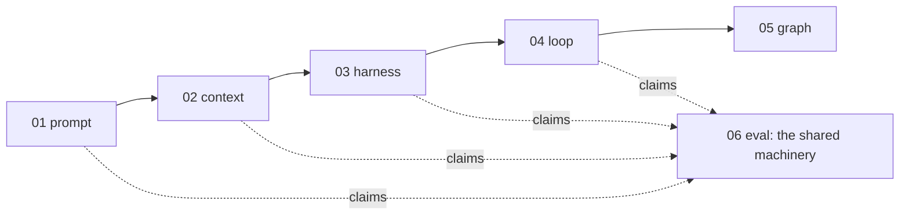
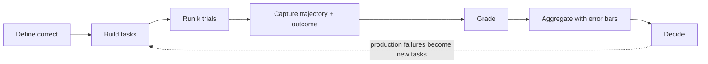

# 1 — What an Eval Is

> An eval is a repeatable experiment that turns "does this work?" into a number you can compare across changes. This chapter sets the vocabulary every later chapter uses.

A prompt change ships because three test questions looked better, and a week later refund answers are wrong for one customer segment and nobody can say when it started. Unit tests can't catch this, because the same input gives a different output on each run and "correct" takes judgment. This chapter defines the repeatable experiment that replaces the three questions, and the words the other twelve chapters use for its parts.

---

## Why evals are their own discipline

**Every other layer makes claims. Evals are how you check them.** A prompt "works better", a context strategy "reduces hallucination", a harness "is more reliable", a loop "converges". Each is a hypothesis about a non-deterministic system, and only a measurement settles it.

Eval engineering means building that measurement. You decide what correct means, collect tasks that represent real use, choose graders you can trust, run them repeatedly, and read the results honestly. Then you wire them into the places where decisions get made: CI, releases and production monitoring. It is an engineering discipline, not a QA afterthought, for three reasons:

1. **The outputs are non-deterministic.** One run proves nothing. You need rates, repeats and error bars ([09](09-reading-results.md)).
2. **"Correct" is often a judgment.** So the graders are themselves models or people, and they need measuring too ([15](15-calibration-against-human-labels.md)).
3. **The eval is software.** It has bugs, it drifts and it gets gamed. Treat a score drop as a claim about the eval before treating it as a claim about the system ([12](12-failure-modes.md)).



Every layer below this one has its own eval chapter. Each says **what** to measure at that layer:

| Layer | Its eval chapter | Measures |
|---|---|---|
| Prompt | [01/08](../../../ai-engineering/01-prompt-engineering/notes/08-evaluating-prompts.md) | Output quality per prompt version |
| Context | [02/12](../../../ai-engineering/02-context-engineering/notes/12-evaluating-context.md) | Whether the right content reached the model and got used |
| Harness | [03/05](../../../ai-engineering/03-harness-engineering/notes/05-verification-loops.md) | Verification inside a run |
| Loop | [04/03](../../../ai-engineering/04-loop-engineering/notes/03-the-scorekeeper.md) | The stop condition a loop optimises against |

This topic owns **how** to measure, for all of them: datasets, graders, judge calibration, traces, statistics, gates and production monitoring. It stands as its own topic because that machinery is the same everywhere, and copies spread across the layers would drift apart.

Without that machinery, every change to a prompt, model, tool or retrieval config is a guess. The GitHub Copilot team built their eval framework before the prompts and before the UI ([01/08](../../../ai-engineering/01-prompt-engineering/notes/08-evaluating-prompts.md#build-the-eval-first)). That order is the lesson.

> **An eval is the definition of "better" for your system, written down so a machine can check it.**

---

## The vocabulary

Anthropic, LangSmith, OpenAI and Inspect use slightly different words for the same six parts:

| Term | What it is | Also called |
|---|---|---|
| **Task** | One test: an input plus success criteria | case, example, sample, row |
| **Trial** | One attempt at a task. Outputs vary, so a task usually gets several trials | run, attempt, epoch |
| **Trajectory** | The full record of a trial: messages, tool calls, intermediate results | trace, transcript |
| **Outcome** | The final state at the end of the trial: the answer, the file system, the database row | final response, end state |
| **Grader** | Code, a model or a person that scores one aspect of a trial | evaluator, scorer, judge, metric |
| **Suite** | A set of tasks run together to give a system-level picture | dataset + evaluators, eval set, benchmark |

Two more terms come from the harness layer:

- **System under test (SUT).** The agent harness being measured: model, prompts, tools, routing, memory, control loop.
- **Eval harness.** The infrastructure that runs the suite: it loads tasks, runs trials (often in parallel), records trajectories, applies graders and aggregates results. It treats the SUT as a black box with an entry point.

Inspect AI uses the cleanest version of this split: a `Task` is a **dataset** + a **solver** (the SUT) + a **scorer** (the grader). Keep those three separable and you can swap any one without touching the others.

Here is that split at its smallest: a dataset, a solver and a scorer, run for five trials each. The solver is a stub so that the example runs with no key. That only shows the shape of the harness, because a real eval calls the real system ([Test vs. eval](#test-vs-eval-the-seam)).

```python
import random

SUITE = [  # each task: an input and what success means
    {"id": "refund-window", "input": "How long do refunds take?", "must_say": "5 business days"},
    {"id": "payout-path", "input": "Where do I change my payout account?", "must_say": "Settings"},
    {"id": "cancel-fee", "input": "Is there a cancellation fee?", "must_say": "no fee"},
]

STUB = {  # stands in for the model: a right answer, a wrong one, and how often it gets it right
    "refund-window": ("Refunds take 5 business days.", "Refunds are quick.", 0.9),
    "payout-path": ("Go to Settings, then Payouts.", "Contact your bank.", 1.0),
    "cancel-fee": ("There is no fee to cancel.", "A small fee may apply.", 0.6),
}

def solver(task, rng):                     # the system under test
    right, wrong, p = STUB[task["id"]]
    return right if rng.random() < p else wrong

def scorer(task, outcome):                 # the grader: code, checking one thing
    return task["must_say"] in outcome

def run_suite(trials, seed):
    rng = random.Random(seed)
    return {t["id"]: [scorer(t, solver(t, rng)) for _ in range(trials)] for t in SUITE}

results = run_suite(trials=5, seed=7)
for task_id, grades in results.items():
    print(f"{task_id:14} {sum(grades)}/{len(grades)} trials passed")
rate = sum(sum(g) / len(g) for g in results.values()) / len(results)
print(f"suite pass rate {rate:.2f}, criterion >= 0.90: {'met' if rate >= 0.90 else 'not met'}")
```

Output:

```text
refund-window  5/5 trials passed
payout-path    5/5 trials passed
cancel-fee     4/5 trials passed
suite pass rate 0.93, criterion >= 0.90: met
```

The stub is right 90%, 100% and 60% of the time, so the true suite rate is 0.83. This run reports 0.93 and says the criterion is met. Three tasks and five trials are not enough to tell those apart, which is why [09](09-reading-results.md) exists.

### The core flow



Each arrow is a chapter:

| Step | Chapter |
|---|---|
| Define correct, error analysis, failure taxonomy | [02](02-defining-correct.md) |
| Build tasks | [03](03-eval-datasets.md) |
| Grade | [04](04-graders.md), [05](05-llm-as-judge.md), [15](15-calibration-against-human-labels.md) |
| Agent trajectories, k trials | [06](06-evaluating-agents.md) |
| RAG and grounding | [07](07-evaluating-rag-and-grounding.md) |
| Capture traces | [08](08-tracing-and-observability.md) |
| Aggregate and decide | [09](09-reading-results.md) |
| Gate in CI | [10](10-evals-in-ci.md) |
| Production and the loop back | [11](11-production-and-the-maturity-ladder.md) |
| When the eval itself is wrong | [12](12-failure-modes.md) |
| All of it, on one real system | [13](13-case-study-support-agent.md) |

---

## Test vs. eval: the seam

Not everything about an LLM system needs an eval. Draw the line by determinism:

| Behavior | Deterministic? | Check with | Example |
|---|---|---|---|
| Prompt rendering, schema validation, retry logic, tool routing tables | Yes | **Unit tests**: assert exact values | "Template inserts the user name", "retry fires 3 times on 429" |
| Tool-call arguments parse, output matches a JSON schema | Yes, given an output | **Deterministic graders** inside an eval | "Response is valid JSON with a `citations` array" |
| Answer quality, grounding, helpfulness, end-to-end task success | No | **Evals**: many tasks, many trials, rates not assertions | "Grounded answer rate ≥ 0.90 on the golden set" |

Rules that follow:

- **Never assert a specific model response string in a unit test.** It will flake, and the fix will be to loosen the test until it checks nothing.
- **Unit tests gate merges; evals measure rates.** A unit test is pass/fail. An eval result is a proportion with an error bar ([09](09-reading-results.md)).
- **Mock the model in unit tests, never in evals.** An eval with a mocked model measures the mock.

---

## Capability vs. regression evals

Two suites answer two different questions, and they need different pass rates:

| | Capability eval | Regression eval |
|---|---|---|
| **Question** | "What can this system do?" | "Does it still do what it used to?" |
| **Expected pass rate** | Low to medium. Room to climb | Near 100% |
| **Tasks come from** | The frontier: hard cases, new use cases | Tasks the system has already mastered, plus every fixed bug |
| **A drop means** | Little on its own. You're measuring a hill | Something broke. Block the release |
| **Runs** | On demand, when exploring | Every change, in CI ([10](10-evals-in-ci.md)) |

Tasks **graduate**: once a capability task passes reliably, move it to the regression suite so it keeps being checked. Keep the frontier moving by adding harder cases as old ones saturate ([12](12-failure-modes.md#saturation)).

---

## Offline vs. online

| | Offline | Online |
|---|---|---|
| **Data** | A fixed dataset you curate | Live production traffic |
| **When** | Before a change ships | After it ships, continuously |
| **Ground truth** | Reference answers, labels | Usually none. Proxy signals, sampled human review, LLM judges |
| **Catches** | Regressions you thought to test for | Drift, new failure types, things nobody thought to test |
| **Chapter** | 02–10 | [11](11-production-and-the-maturity-ladder.md) |

You need both. Offline evals are the lab: cheap, repeatable, comparable. Online evals are the field: the only place you learn what real users actually do. Production failures feed the offline set, which is how the lab stays relevant ([03](03-eval-datasets.md#harvest-from-failures)).

---

## What an eval is not

- **Not a benchmark score.** Public benchmarks (MMLU, SWE-bench, τ-bench) tell you about a model in general. Your eval tells you about *your* system on *your* tasks. A model's leaderboard rank predicts little about your support bot. Most of the research literature is about the first kind. Guo et al.'s survey sorts LLM evaluation into knowledge and capability, alignment, and safety, plus specialized domains and how benchmarks are organized, and has no section on evaluating an application, on regression suites or on error bars ([arXiv:2310.19736](https://arxiv.org/abs/2310.19736) (Guo et al., 2023-10, preprint); a catalogue with no experiments and no stated method for choosing its papers). Chang et al. organise the same literature as what to evaluate, where (datasets and benchmarks) and how (automatic or human, by whether the criterion can be computed), and count 46 popular benchmarks. They warn that static, public benchmarks are likely memorized by LLMs and call for dynamic evaluation, but they assert this and measure no contamination; their human-evaluation advice is a list of factors with no agreement statistics or sample-size rule ([arXiv:2307.03109](https://arxiv.org/abs/2307.03109) (Chang et al., ACM TIST 2024; read as arXiv v9, 2023-12); no experiments of its own, 2023-era models).
- **Not a vibe check.** Reading ten outputs and feeling good is level 0 of the maturity ladder ([11](11-production-and-the-maturity-ladder.md#the-ladder)). It's where everyone starts. It is not where you stay.
- **Not a one-off.** An eval suite is a living artifact. It changes as the product, the users and the failure modes change. Anthropic describes evals as maintained by a team that owns the infrastructure, with domain experts contributing tasks.
- **Not only quality.** Latency, cost and steps-to-completion are eval metrics too. Log them on every trial: they're free to capture and catch regressions that quality scores miss ([06](06b-components-trials-and-cost.md#efficiency-metrics)).

---

## Five ideas that carry the topic

1. **Read before you measure.** Failure modes come from error analysis on real traces, not from a list of generic metrics ([02](02-defining-correct.md#find-failure-modes-by-reading-error-analysis)).
2. **Use the simplest grader you can trust.** Code first. Use a judge only where code can't reach, and only after calibrating it against people ([04](04-graders.md)).
3. **Grade the path and the destination.** For agents, outcome and trajectory fail independently ([06](06-evaluating-agents.md#outcome-and-trajectory)).
4. **A score without an error bar is an anecdote.** Pair, repeat, slice ([09](09-reading-results.md)).
5. **The suite is alive.** Production failures become rows, saturated tasks graduate to regression, and you climb the maturity ladder one rung at a time ([11](11-production-and-the-maturity-ladder.md#the-ladder)).

---

## Where it sits

Eval measures every layer below it and inherits their weaknesses. It also has weaknesses of its own: an eval is only as good as its tasks (coverage), its graders (calibration) and its statistics (sample size). A well-built eval on an unrepresentative dataset gives precise answers to the wrong question. If the harness exposes no trajectory, you can only grade outcomes. If the loop has no stop condition, a trial can't end cleanly. Eval also feeds the top of the loop stack: the hill-climbing loop ([04/08](../../../ai-engineering/04-loop-engineering/notes/08-self-improving-loops.md)) is an optimizer pointed at an eval. A weak eval there produces a system that gets better at the eval and no better at the job ([12](12-failure-modes.md#goodhart-the-eval-becomes-the-target)).

---

## Pitfalls

- **Asserting model text in a unit test.** Symptom: CI goes red on a rephrased but correct answer, and the fix is to loosen the test until it checks nothing. Fix: unit-test the deterministic parts (prompt rendering, retry on 429), and move answer quality to an eval that reports a rate.
- **Mocking the model inside an eval.** Symptom: scores never move, whatever you change in the prompt. An eval with a mocked model measures the mock. Fix: mock in unit tests only, and run evals against the real system under test.
- **One trial per task.** Symptom: the same commit passes and fails on consecutive runs. Fix: run several trials and report rates. The stub above gives 1.0, 0.67, 0.67, 1.0 and 1.0 on five seeds at one trial per task, for one unchanged system.
- **Reading a capability eval like a regression eval.** Symptom: a release gets blocked because a frontier suite fell from 40% to 36%, or nobody reacts when a mastered task starts failing. Fix: keep two suites. A drop on the capability hill means little alone, and a drop on the regression suite blocks the release.
- **Never graduating tasks.** Symptom: the capability suite creeps toward 100% and stops showing progress, while mastered tasks are checked only by accident. Fix: move reliably passing tasks to the regression suite and add harder ones ([12](12-failure-modes.md#saturation)).
- **Treating a public benchmark as your eval.** Symptom: a model with the best leaderboard number does worse on your tickets. Fix: use benchmarks for a shortlist, and decide on tasks drawn from your own users ([03](03-eval-datasets.md)).

## Try it

1. Sort these into unit test, deterministic grader or eval: (a) the template inserts the user's name; (b) the reply is valid JSON with a `citations` array; (c) the grounded answer rate on the golden set is at least 0.90; (d) a retry fires three times on a 429.

   <details><summary>Answer</summary>

   (a) and (d) are unit tests, since they are deterministic and assert exact values. (b) is a deterministic grader inside an eval: the check is exact, but it needs a model output to check. (c) is an eval, because it is a rate over many tasks and trials.

   </details>

2. In the script above, run `run_suite` with `trials` set to 1, 5 and 50, on seeds 0 to 4, and print the suite rate each time. What happens to the spread, and does it reach the true 0.83?

   <details><summary>Answer</summary>

   | Trials | Suite rate on seeds 0 to 4 |
   |---|---|
   | 1 | 1.0, 0.67, 0.67, 1.0, 1.0 |
   | 5 | 0.8, 0.87, 0.8, 0.8, 1.0 |
   | 50 | 0.83, 0.87, 0.83, 0.86, 0.86 |

   The spread narrows from 0.33 to 0.04, around the true rate. More trials reduce sampling noise within these three tasks. They say nothing about whether these three tasks are the right ones.

   </details>

3. A support team has a chat assistant, no evals, and one week. A capability task, "handles a multi-currency refund", passes 19 of 20 trials on each of the last three releases. What should they do with it?

   <details><summary>Answer</summary>

   Graduate it to the regression suite, where it should stay near 100% and block a release if it falls, and add a harder multi-currency case to the capability suite. It has stopped telling them what the system can newly do.

   </details>

## Interview checklist

| Prompt | Answer in one line |
|---|---|
| Why can't unit tests cover an LLM feature? | The same input gives different outputs, and "correct" is often a judgment, so you need many tasks and trials and report a rate with an error bar. Unit tests still cover the deterministic parts, such as prompt rendering and retry logic. |
| Define task, trial, trajectory, outcome, grader and suite. | A task is an input plus success criteria, and a trial is one attempt at it. The trajectory is the record of that attempt, the outcome is its end state, a grader scores one aspect, and a suite is the set of tasks run together. |
| Where do you mock the model? | In unit tests, never in evals, because an eval with a mocked model measures the mock. |
| How do capability and regression evals differ? | A capability eval asks what the system can do and sits at a low to medium pass rate. A regression eval asks whether it still does what it used to, sits near 100% and blocks a release when it drops. |
| Your suite went from 41% to 38% overnight. Block the release? | First ask which suite it is. On a capability suite a 3-point drop means little alone, while on a regression suite a drop that size means something broke. |
| Your PM says the demo looks great, so evals can wait. What do you say? | A demo is a vibe check on a handful of inputs and leaves no number to compare after the next change. Offline evals give that number before shipping, and online evals say whether it holds for real users. |

## Next

[02-defining-correct.md](02-defining-correct.md): before any data or graders, write down what success means.
