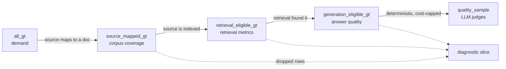

# 3 — Eval Datasets

> The dataset decides what your eval can see. Start small and real, grow it from failures, keep it versioned, and make sure every row is fair for the gate that scores it.

A golden set of 300 questions scores grounding at 0.40, the generation team rewrites the prompt for a month, and the score barely moves, because half the rows could never have been answered from the index. A dataset decides what every later number means. This chapter covers where rows come from, how they stay representative as traffic changes, and which rows are fair for which measurement.

---

## Start small, start real

The first useful dataset is **20–50 tasks taken from real failures**: user complaints, support tickets, bad traces from error analysis ([02](02-defining-correct.md#find-failure-modes-by-reading-error-analysis)). Review each one by hand. A small, clean, realistic set beats a large, noisy benchmark, because every row in it is about *your* system.

| Stage | Size | Purpose |
|---|---|---|
| **Example suite** | 5–20 | Eyeball diffs while iterating on a prompt ([01/09](../../../ai-engineering/01-prompt-engineering/notes/09-evaluating-prompts.md#offline-the-tech-tree)) |
| **First golden set** | 20–50 | Real failures, hand-reviewed. Enough to catch big regressions |
| **Working set** | 100–300 | Enough for ±5–8 point error bars on a pass rate ([09](09-reading-results.md#how-many-tasks)) |
| **LLM-graded sample** | 50–200 | Cost-capped subset for expensive judges |
| **Large harness** | 1,000+ | Detecting small effects. Usually needs synthetic or logged data |

Grow toward the next stage when the current one can't separate two versions you need to tell apart. Statistics tells you when that is ([09](09-reading-results.md)). For scale, Oshin & Campos suggest 10–50 starter examples for a LangChain app (*Learning LangChain*, ch. 10), and Huyen reports that the tasks in EleutherAI's eval harness have a median of 1,000 examples, with an average of 2,159. The Inverse Scaling prize organizers called 300 the absolute minimum and preferred 1,000, especially for synthesized examples (*AI Engineering*, ch. 4).

---

## Where tasks come from

| Source | Strength | Watch out for |
|---|---|---|
| **Production logs / telemetry** | Real distribution, real phrasing | Doesn't exist before launch. Each big app change can make old rows obsolete. Consent and PII. Good *inputs*, weak *labels*: what the user did next was shaped by what your app suggested ([DS 01/14](../../../data-science/01-classical-ml/notes/14-learning-from-corrections.md#a-correction-rate-reads-two-things-at-once) measures this bias) |
| **Real failures** (tickets, 👎, escalations) | The highest-value rows. Directly about your weak spots | Over-represents failure. Balance with normal traffic |
| **Existing records** (pre-AI support logs, docs, forums) | Plentiful, realistic | Shape mismatch. You may need to adapt them into tasks, trading similarity to your problem against scale |
| **Domain experts writing cases** | Hits the edge cases that matter | Slow. Experts write *hard* cases and under-sample common ones |
| **Synthetic (LLM-generated)** | Cheap coverage of combinations | Tropes, unrealistic phrasing, bias toward the generating model |

Telemetry is fine for graders that need no gold answer. Where you need one, Berryman & Ziegler suggest leaving telemetry to online evaluation. For existing records, GitHub Copilot is the standard example: no corpus of "what the user types next" existed, so the team took functions from open-source repos, deleted the bodies, and asked for completions. Function bodies run longer than typical suggestions, and edits that depend on the body (new imports) are already in the file, but the supply is nearly infinite (*Prompt Engineering for LLMs*, ch. 10).

Public query logs give real phrasing but still need labels, and the labelling step shapes the set. WebQuestions crawled Google Suggest breadth-first from "Where was Barack Obama born?" and sent 100K questions to crowdworkers at $0.03 each. Workers could answer only with entities or values from the question entity's Freebase page, or mark the question unanswerable. Two workers gave the same answer on 6,642 of the 100K, and the released set has 5,810 questions. The best parser reached 31.4% against a 26.9% baseline, and the authors call the data "much more challenging and noisy" than hand-built semantic-parsing sets ([doi:10.18653/v1/d13-1160](https://doi.org/10.18653/v1/d13-1160) (Berant et al., EMNLP 2013)). The gold answers are whatever the knowledge base already holds.

Crowd-written text may not be written by the crowd. Veselovsky et al. paid 44 Mechanical Turk workers to summarize medical abstracts in June 2023 and trained a classifier on summaries of the same abstracts written by people in 2019 and by ChatGPT. **It flagged 33% to 46% of the 46 summaries as synthetic** (15 at a strict threshold, 21 at the default), and 41 of the 46 involved pasting ([arXiv:2306.07899](https://arxiv.org/abs/2306.07899) (Veselovsky et al., 2023-06, preprint)). No worker was observed using a model, the counts are not corrected for classifier error, and the one task was picked because models do it well. It covers writing, not labelling. If you buy reference answers, log paste events and compare a sample against model output for the same prompt.

Expert-written tasks can be pooled across a field, and the pooling leaves its own marks. LegalBench ([arXiv:2308.11462](https://arxiv.org/abs/2308.11462) (Guha et al., NeurIPS 2023 Datasets and Benchmarks; read as arXiv v1)) gathered 162 tasks from 36 sources after an open call to legal scholars: reused public datasets, datasets scholars had hand-coded but not released, and tasks written for the benchmark. Tasks are tagged with six kinds of legal reasoning (issue-spotting, rule-recall, rule-application, rule-conclusion, interpretation, rhetorical-understanding), and the rule-application tasks are also scored as rule-conclusion. The mix follows what contributors had, not what lawyers do: 119 tasks are interpretation, out of 162 (the paper's per-type counts sum to more than 162), and all but one of the issue-spotting tasks come from a single source. Tasks hold at least 50 samples and 563 on average, classification is scored by balanced accuracy because labels are imbalanced, and free-text rule application was graded by one law-trained person with no agreement figure. Which few-shot examples were drawn moved one open model by over 20 points of balanced accuracy on one task, overruling (five random 4-shot prompts, eight binary tasks). The paper concedes that some tasks may have leaked into pre-training and does not measure it.

Injecting one known fault into correct text gives labelled rows and a matched negative for free. MEDEC ([arXiv:2412.19260](https://arxiv.org/abs/2412.19260) (Ben Abacha et al., 2024-12, preprint)) holds 3,848 clinical texts that are either correct or contain exactly one medical error. Annotators injected a wrong diagnosis, treatment or similar into MedQA scenarios (3,360 texts), or swapped a concept in real hospital notes (244 of 488 sampled notes altered), where each injected error had to contradict at least two other parts of the note. Three tasks follow from the labels: flag the error, find its sentence, write the correction. The test set (925 texts, 51.3% with errors) separates the tasks: Claude 3.5 Sonnet flagged best of the LLMs (70.16% accuracy) but its corrections scored lowest (aggregate 0.2795), while o1-preview corrected best (0.698); two physicians reached 79.6% and 71.6% flag accuracy on a 569-text subset. Corrections were scored against one reference sentence by ROUGE, BERTScore and BLEURT with no human grading, and the paper's own example shows a correct synonym (X-linked for Bruton agammaglobulinemia) scored low ([04](04-graders.md)). o1-preview dropped from 0.7286 flag accuracy on the public MedQA-based set to 0.5762 on the private hospital notes, which the authors attribute to public text, not tested.

### Synthetic data done right

Don't ask a model for "100 test questions". You'll get 100 variations of the same polite question. Generate along **dimensions** instead:

1. Pick 3–4 dimensions that matter for your product: *persona* (new user, power user, frustrated), *intent* (billing, how-to, bug report), *complexity* (one-step, multi-step, ambiguous), *channel* (chat, email).
2. Generate **tuples** of dimension values first (`frustrated × billing × ambiguous`). Check the tuples cover what you need.
3. Turn each tuple into a natural-language query in a **separate** call.
4. Read a sample. Delete the unrealistic ones.

If you want several queries per tuple, ask for them in one call. Provided the output fits, that gives more variety than repeated calls at temperature > 0. Synthesis is easiest when you can start from the answer and invent the question backward. It is riskiest when the model doesn't know the domain well, because the rows come out as simplistic tropes, popular misconceptions or plain errors (*Prompt Engineering for LLMs*, ch. 10).

Even a one-passage prompt drifts from what people ask. Zhang, Liu et al. ([arXiv:2501.03491](https://arxiv.org/abs/2501.03491) (Zhang et al., 2025-01, preprint)) had four models (GPT-4o, Claude 3.7 Sonnet, Llama 3.3 70B, DeepSeek-V3) each write 1,024 questions about 256 Wikipedia paragraphs at temperature 0, with GPT-4o labelling question types. **27% to 45% of the LLM questions were descriptive or characterizing ("what is the significance of…"), against 3.0% in TriviaQA and 1.5% in HotpotQA**, and their answers ran 24 to 35 words against about 2 words for the human gold answers. The human sets come from different contexts and instructions, GPT-4o is both a generator and the only judge (Pearson 0.76 with people on 300 annotations), and each model ran once per prompt wording (two paraphrased prompts in the appendix give descriptive shares of 24% to 49%), so take the direction rather than the exact shares: check the type mix of a generated set against real queries before you trust it.

Once a working set exists, **mutate it toward the edges** instead of generating from scratch. Albada lists three targeted moves (*Building Applications with AI Agents*, ch. 9):

- **Adversarial:** "Find a user message that causes the agent to contradict itself."
- **Counterfactual:** change one word in a passing case and see whether the agent fails.
- **Interpolation:** blend two intents into one deliberately ambiguous request.

Have a person review each mutated row before it joins the set.

Pushing a generator toward failures costs diversity. Perez et al. had a 280B LM write questions for a 280B chatbot and graded the replies with an offensiveness classifier. Zero-shot generation drew offensive replies on 3.7% of 0.5M questions (18,444 failures). Each step that aimed harder lowered diversity: few-shot prompting on earlier failures reached 7.7%, fine-tuning on them 8.7%, and RL 13.9–42.3%. **At the strongest RL setting 78% of the questions contained the word "invisible"** (self-BLEU 84.4, against 42.3 for zero-shot). Human red-teamers found different failures: 35 of the 100 noun phrases in red-team questions that most often led to offensive replies never appeared in the human-written Bot-Adversarial Dialogue (BAD) dataset. The grader bounds the whole method. The classifier was 84.5% accurate on BAD, detects only the harm it was trained on, and its flags are candidates for "other classifiers or people" to confirm ([doi:10.18653/v1/2022.emnlp-main.225](https://doi.org/10.18653/v1/2022.emnlp-main.225) (Perez et al., EMNLP 2022)). Track a generated set's diversity (unique n-grams, self-BLEU) beside its failure rate, and keep human-written adversarial rows too.

Having the model fill a structure, and code assemble the rows, gives you controls for free. BigToM ([arXiv:2306.15448](https://arxiv.org/abs/2306.15448) (Gandhi et al., NeurIPS 2023 Datasets and Benchmarks)) had GPT-4 fill the variables of a causal template for a false-belief story (context, desire, percept, belief, causal event, action), one sentence each, and composed 25 conditions from each of 200 templates in code: 5,000 items. Because the true-belief and false-belief versions of a story share every other sentence, a false-belief answer counts only when the model also passes the matched true-belief item, "as otherwise a model might succeed on the false belief version for the wrong reasons". Scored that way, zero-shot GPT-4 reached .97 on forward belief (.90 when the story states the initial belief) and .40 on backward belief. 200 crowd raters scored the generated items above crowd-written ones (1.152 higher on a 1–5 scale, 95% CI 1.066 to 1.244) and slightly above expert-written ones (0.263), but they saw only 2 of the 25 conditions. On the worry that the generator has an edge on its own test, the authors had Claude-2 write 750 items: GPT-4 scored 0.858 on those against 0.861 on a matched sample of its own, one alternate generator and 30 templates. About 3% of items carry common-sense errors.

For QA sets grounded in a corpus, the same idea applies to coverage and privacy. Driouich, Cao and Thomas ([arXiv:2508.18929](https://arxiv.org/abs/2508.18929) (Driouich et al., TRUST-AI workshop at ECAI 2025)) cluster the corpus's chunk embeddings with k-means, draw representative chunks from each cluster, pseudonymize personal data in them, and only then generate QA pairs, so topics follow the corpus rather than the generator's habits and personal data stays out of the eval set. The evidence is thin. Diversity was tested on one document (the EU AI Act) and scored by a GPT-4.1 judge on a 1–10 scale (9.0 against 8.1 for a RAGAS-style generator at 100 pairs, one reported value per cell with no variance, GPT-4o generating). The paper's embedding-similarity column is described inconsistently and does not clearly back the claim, and the QA pairs were never checked for correctness. The masking agent's per-label accuracy was mostly 0.75 to 0.90 on synthetic PII text, with the metric undefined and no baseline tool, which still leaves entities unmasked. Take the recipe, not the numbers.

Two traps:

- **Self-preference.** If the model generating the data is also a candidate under test, it'll find its own phrasing easy. If every row was written by model A, a harness that decides between A and B starts A with a head start. Generate with a different model family.
- **Synthetic-only suites.** Use synthetic data to bootstrap and fill coverage gaps, then replace it with real traffic as you get it.

### Harvest from failures

The suite stays relevant by eating its own production failures. Every confirmed failure becomes a row:

```
production failure → triage (real failure, or eval bug?) → label with taxonomy → add to discovery set
                                                                                     ↓ once fixed
                                                                              move to regression set
```

OpenAI recommends keeping two pools: a **regression suite** of known, fixed failures that must keep passing, and a rolling **discovery set** of new production failures that shows where the system currently breaks.

---

## Coverage and balance

Check the dataset against the distribution you care about:

- **Slice by the dimensions** from your failure taxonomy and user mix: intent, language, difficulty, source type, user segment. Record the slice on every row so you can report by slice later. Say what unit the score is averaged over, too. The Stanford Sentiment Treebank gave a 5-class label to each of its 215,154 phrases, and most short phrases are neutral. Its RNTN model scored 80.7% over all phrases but 45.7% on whole sentences. A 21-sentence set built for one construction, negating a positive sentence, separated a bigram Naive Bayes model (19.0% correct reversals) from the RNTN (71.4%) ([doi:10.18653/v1/d13-1170](https://doi.org/10.18653/v1/d13-1170) (Socher et al., EMNLP 2013)). Slicing by answer type does the same for QA. On SQuAD's dev set, the logistic-regression baseline scored 72.1 F1 on dates but 31.2 on verb phrases, while humans stayed between 82.4 and 95.4 on every type ([doi:10.18653/v1/d16-1264](https://doi.org/10.18653/v1/d16-1264) (Rajpurkar et al., EMNLP 2016)). One average hides a model that only handles the easy types.
- **Match production frequencies** for the headline number. Over-sample rare-but-costly cases in *separate* slices, not the headline. [DS 01/11](../../../data-science/01-classical-ml/notes/11-choosing-a-metric.md#sizing-a-benchmark-when-a-class-is-rare) sizes those quotas and shows the reweighting.
- **Balance positive and negative cases** ([02](02-defining-correct.md#positive-and-negative-cases)). Make the negatives plausible. SQuAD 2.0 added 53,775 unanswerable questions that crowdworkers wrote to look answerable, each with a plausible decoy span in the paragraph. The best model fell from 85.8 F1 on SQuAD 1.1 to 66.3 (humans 89.5, always-abstain 48.9). On negatives generated automatically, the best score was 15.4 F1 higher ([arXiv:1806.03822](https://arxiv.org/abs/1806.03822) (Rajpurkar et al., ACL 2018)).
- **Include off-distribution rows**, not only inputs that resemble your few-shot examples or training data. Prompted in-context accuracy fell as test inputs drifted from the exemplars, fastest with CoT (slope −1.4, across 4 LLMs and 9 synthetic tasks) ([arXiv:2509.10414](https://arxiv.org/abs/2509.10414) (de Wynter, 2025-09)). A CoT trained into a small model on a toy task fell to 0% exact match on unseen transformations ([arXiv:2508.01191](https://arxiv.org/abs/2508.01191) (Zhao et al., Findings of ACL 2026)).
- **Cover the dependencies users actually have.** HumanEval's problems touch 4 libraries, MBPP's 8 and APPS's none. ODEX built 945 StackOverflow coding intents over 79 libraries. Every Codex model scored far lower on the library-dependent (open-domain) problems. For code-davinci-002 the open–closed pass@1 gap ran from 4.34 points in Spanish to 38.57 in Japanese, and model upgrades widened it in English and Japanese. CodeGen-6.1B matched the pass@1 of the 175B code-davinci-001 there, even though the two score similarly on HumanEval ([arXiv:2212.10481](https://arxiv.org/abs/2212.10481) (Wang et al., Findings of EMNLP 2023)). A set built from easy-to-test, self-contained inputs can rank models differently from your traffic.
- **Watch the denominator.** "92% pass" means nothing until you say *of what*. Report pass rate per slice, with the slice size.

---

## Row eligibility: is this row fair for this gate?

A row can be a valid task but unfair for a particular measurement. If the expected source isn't in the index, scoring that row on retrieval measures your corpus, not your retriever.

The case study handles this with **named row pools**, each a subset of the one above it ([case study](13-case-study-support-agent.md#row-pools)):

| Pool | Contains | Fair for |
|---|---|---|
| `all_gt` | Every golden row | Demand analysis: what users ask |
| `source_mapped_gt` | Rows whose expected source maps to a known document | Corpus coverage |
| `retrieval_eligible_gt` | Mapped rows whose source is actually indexed | Retrieval metrics |
| `generation_eligible_gt` | Rows where retrieval found the expected source | Answer quality |
| `quality_sample` | Deterministic, cost-capped sample of the above | LLM judges |



The rule: **a downstream gate never silently scores rows an upstream gate marked ineligible.** Ineligible rows appear only as a separate diagnostic slice. Otherwise a retrieval miss shows up as a "bad answer" and you fix the wrong thing.

Here is that rule on a made-up set of 100 rows. The system's generator is the same in both grounding lines, and only the denominator differs:

```python
import hashlib

# Each row carries what the pipeline knows about it, not just its input and reference.
rows = (
    [{"mapped": False, "indexed": False, "retrieved": False, "grounded": False}] * 10   # source unknown
    + [{"mapped": True, "indexed": False, "retrieved": False, "grounded": False}] * 15  # not in the index
    + [{"mapped": True, "indexed": True, "retrieved": False, "grounded": False}] * 25   # ranking missed it
    + [{"mapped": True, "indexed": True, "retrieved": True, "grounded": True}] * 40
    + [{"mapped": True, "indexed": True, "retrieved": True, "grounded": False}] * 10
)

pools = {
    "all_gt": rows,
    "source_mapped_gt": [r for r in rows if r["mapped"]],
    "retrieval_eligible_gt": [r for r in rows if r["indexed"]],
    "generation_eligible_gt": [r for r in rows if r["retrieved"]],
}
for name, pool in pools.items():
    print(f"{name:24} n={len(pool):3}")

def rate(pool, key):
    return sum(r[key] for r in pool) / len(pool)

print(f"grounding over every row:     {rate(rows, 'grounded'):.2f}  <- blames generation for the corpus")
print(f"grounding, generation pool:   {rate(pools['generation_eligible_gt'], 'grounded'):.2f}")
print(f"retrieval, retrieval pool:    {rate(pools['retrieval_eligible_gt'], 'retrieved'):.2f}")

def split(row_id, test_share=0.2):         # a row keeps its split when the dataset grows
    bucket = int(hashlib.sha256(row_id.encode()).hexdigest(), 16) % 100
    return "test" if bucket < test_share * 100 else "dev"

ids = [f"row-{i}" for i in range(1000)]
first = {i: split(i) for i in ids[:500]}
print("rows that changed split after doubling the set:", sum(first[i] != split(i) for i in first))
print("test share:", sum(split(i) == "test" for i in ids) / len(ids))
```

Output:

```text
all_gt                   n=100
source_mapped_gt         n= 90
retrieval_eligible_gt    n= 75
generation_eligible_gt   n= 50
grounding over every row:     0.40  <- blames generation for the corpus
grounding, generation pool:   0.80
retrieval, retrieval pool:    0.67
rows that changed split after doubling the set: 0
test share: 0.192
```

Grounding is 0.80 on rows where the generator had the evidence, and 0.40 over every row. The corpus and retriever account for the other half. The split at the end is also worth copying: hashing the row ID keeps a row in the same split as the dataset grows, so test rows don't drift into dev.

---

## What a row contains

A general shape (adapt the fields to your system):

```json
{
  "id": "billing-refund-014",
  "input": {"messages": [{"role": "user", "content": "I was charged twice for order 8812"}]},
  "reference": {
    "answer": "Apologizes, confirms the duplicate charge, issues a refund for one charge",
    "expected_tool_calls": [{"name": "lookup_order", "args": {"order_id": "8812"}},
                            {"name": "issue_refund", "match": "ANY_ARGS"}],
    "expected_sources": ["help/billing/duplicate-charges"]
  },
  "labels": {"intent": "billing", "difficulty": "easy", "case_type": "positive", "language": "en"},
  "eligibility": {"retrieval": true, "generation": true},
  "provenance": {"source": "ticket", "added": "2026-10-02", "added_by": "ops-review"},
  "graders": ["tool_trajectory", "grounding", "completeness"]
}
```

What matters:

- **A reference, not always an answer.** For open-ended tasks, the reference is a rubric or a list of required points, not a gold string to match.
- **Labels** for slicing, **eligibility** per gate, **provenance** for trust.
- **Graders named per row**, so a row only gets graders that make sense for it.

Pin the row format with a JSON Schema and validate every row on load. A schema checks types, not consistency, so add **cross-field checks** too: every ID in `expected` must appear in the input. Albada's own example row shows why. The input order is `A89268`, the expected refund is `issue_refund(order_id="A12345", amount=19.99)`, and a correct agent would fail that row forever (*Building Applications with AI Agents*, ch. 9). The useful enums:

| Field | Values | Why |
|---|---|---|
| `reference.expected_tool_calls[].match` | `EXACT`, `NORMALIZED`, `ANY_ARGS`, `JUDGE` | How strictly each call's arguments must match |
| `reference.tool_match_mode` | `EXACT`, `IN_ORDER`, `ANY_ORDER`, `SUBSET`, `SUPERSET` | How the whole trajectory is compared ([06](06-evaluating-agents.md)) |
| `reference.forbidden_tools` | tool names | Negative cases: the agent must *not* call these |
| `reference.expected_state` | object | End-state assertions for outcome grading |
| `labels.case_type` | `positive`, `negative`, `boundary`, `out_of_scope`, `adversarial` | Balance and slicing |
| `split` | `dev`, `test`, `regression`, `discovery` | Keeps tuning data out of the reported number |
| `provenance.source` | `production`, `ticket`, `feedback`, `expert`, `synthetic`, `benchmark` | Trust and drift checks |

---

## Checklist

- [ ] First 20–50 rows are real failures, hand-reviewed
- [ ] Synthetic rows generated along dimensions by a different model family, then read
- [ ] Every row has slice labels, eligibility and provenance
- [ ] Positive, negative and boundary cases present
- [ ] A path for production failures to become rows

Splitting, versioning and contamination checks are in [03b](03b-splits-contamination-and-public-benchmarks.md#checklist).

---

## Pitfalls

- **Waiting for a big dataset.** Symptom: no evals for months while someone curates 1,000 rows. Fix: start with 5 to 20 real tasks, then grow by stage: 20 to 50, then 100 to 300, which gives about ±5 to 8 points.
- **Generating synthetic rows freely.** Symptom: every generated question sounds alike, and they all pass. Fix: generate tuples along your dimensions first, write each query in a separate call, and replace synthetic rows with real traffic as you get it.
- **Letting the coverage drift away from production.** Symptom: the suite is green while a new product area fills the support queue. Fix: match production frequencies, slice by the dimensions you care about, and keep harvesting failures into discovery and regression pools.
- **Scoring ineligible rows.** Symptom: grounding looks terrible and prompt work doesn't help, as the script above shows. Fix: named row pools, and ineligible rows reported only as a diagnostic slice.

Pitfalls about held-out splits, mutable references and public benchmark labels are in [03b](03b-splits-contamination-and-public-benchmarks.md#pitfalls).

## Try it

1. Add 20 rows to the pool script that are mapped and indexed but missed by retrieval. Before running, predict which of the three printed rates change.

   <details><summary>Answer</summary>

   The grounding over every row falls from 0.40 to 0.33, and the retrieval rate falls from 0.67 to 0.53. The rate on the generation pool stays 0.80, since those rows never reach it. That is the point of the pools: a retrieval regression moves only the retrieval number.

   </details>

2. You have 200 labelled rows and a pass rate near 80%. What is the 95% margin, and can this set detect a 3-point gain?

   <details><summary>Answer</summary>

   1.96 × √(0.8 × 0.2 / 200) = ±5.5 points, inside this chapter's ±5 to 8 range. It cannot detect 3 points by comparing two independent rates. [09](09-reading-results.md#how-many-tasks) puts a paired 5-point difference at 400 to 800 tasks.

   </details>

3. A help-centre bot has 541 rows with expected URLs. Which pool should each of these use: demand analysis, retrieval MRR, and a costly LLM grounding judge?

   <details><summary>Answer</summary>

   Demand analysis uses `all_gt`, retrieval MRR uses `retrieval_eligible_gt`, and the judge uses `quality_sample`, a deterministic and cost-capped sample that keeps its eligibility labels.

   </details>

## Interview checklist

| Prompt | Answer in one line |
|---|---|
| How big should a first eval set be? | Start at 5 to 20 real tasks, then 20 to 50, and 100 to 300 for about ±5 to 8 points. LLM-graded sets often stop at 50 to 200 because of cost, and 1,000 or more is for fine differences. |
| Where do good rows come from? | Production failures first, then real traffic and expert-written cases, with synthetic rows generated along chosen dimensions to fill gaps. OpenAI's practice keeps a regression pool and a discovery pool of harvested failures. |
| What is row eligibility? | A row can be a valid task yet unfair for one measurement. If the expected source isn't in the index, scoring it on retrieval measures the corpus, so pools narrow the rows from `all_gt` to `generation_eligible_gt`. |
| Your grounding is 0.40 overall. Is the generator bad? | Not necessarily. Score it only on rows where retrieval found the source: in this chapter's example that gives 0.80, so the rest is a corpus and retrieval problem. |
| Why not just use synthetic data? | Synthetic rows carry tropes and unrealistic phrasing, and a generating model finds its own phrasing easy, which gives it a head start if it is also a candidate. Use them to bootstrap and fill gaps, generated by a different model family, then replace them with real traffic. |

## Next

[03b — Splits, contamination and public benchmarks](03b-splits-contamination-and-public-benchmarks.md): keeping the set honest once it exists, and what the public benchmarks learned the hard way.
