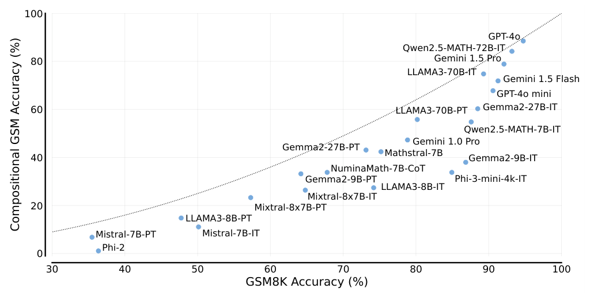
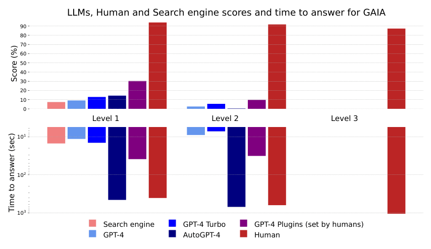
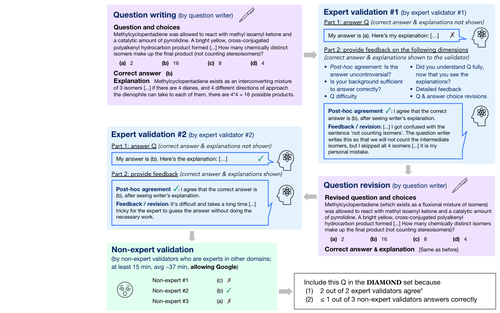
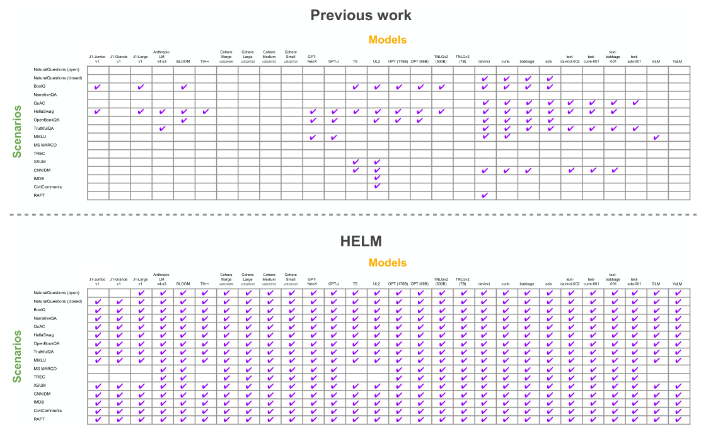

# 3b — Splits, Contamination and Public Benchmarks

> A dataset stays useful only while its rows stay unseen, its references stay fixed and its labels stay right. Split and version it, keep it out of training, and review the rows of any benchmark you adopt.

[03](03-eval-datasets.md) built the rows. This chapter keeps them honest: dev and held-out splits, versions that make two scores comparable, the tactics public benchmarks use against contamination, and what their maintainers learned about label errors, adversarial filtering and shortcuts. Most of the rows in a famous benchmark were thrown out before release:

```text
SWE-bench Verified, review funnel (OpenAI, 93 developers)

  2,294  original tasks
    │
  1,699  reviewed: clear description, complete and stable tests, correct patch, sensible difficulty
    │
    500  survived (29% of those reviewed)
```

---

## Splits, versioning, contamination

- **Split it.** Keep a **dev** set you iterate against and a **held-out test** set you look at rarely. Tuning prompts against the full set overfits to it, exactly as in ML ([train, dev and test sets](../../../data-science/02-deep-learning/notes/03-structuring-ml-projects.md#train-dev-and-test-sets) in data science, [12](12-failure-modes.md#overfitting-the-dev-set)). Keep the failures you read apart from the rows you score too ([eyeball and blackbox sets](../../../data-science/01-classical-ml/notes/12-reading-the-errors.md#learning-from-errors-without-fitting-to-them)). For judge calibration, use train/dev/test splits of the human labels too ([15](15-calibration-against-human-labels.md#calibrate-against-human-labels)).
- **Version it.** Datasets change. Store them in git (or a dataset tool with versions) and record the dataset version in every result. A score from v3 and a score from v4 are not comparable.
- **Freeze the reference with the data.** If labels came from a grader, record the grader version. Change the grader and the labels shift ([case study](13-case-study-support-agent.md#would-different-judges-give-different-golden-traces)).
- **Give time-sensitive rows a review date.** A gold answer about the world goes stale. FreshQA ([arXiv:2310.03214](https://arxiv.org/abs/2310.03214) (Vu et al., Findings of ACL 2024; read as arXiv v2)) sorts its 600 questions into never-, slow- and fast-changing answers plus false-premise questions, drops any question whose answer changes more often than weekly, and stores "the expected next review date for each question"; the maintainers update answers by hand. Grading has two modes: RELAXED credits a correct main answer, and STRICT also requires every other claim in the response to be accurate and current. Without search, in April 2023, GPT-4 scored 46.4% RELAXED and 28.6% STRICT over the 500 test questions, and 12.0% STRICT on the 125 fast-changing ones. Two authors agreed on 99% (RELAXED) and 96% (STRICT) of 100 sampled answers, raw agreement with no chance correction; categories of 125 questions carry no intervals.
- **Keep it out of training and prompts.** Don't paste eval rows into few-shot examples. Don't fine-tune on them. Don't let the agent see them at runtime.
- **Reset state per trial.** If tasks touch a database, sandbox or file system, every trial starts from a clean snapshot. Otherwise one trial's side effects look like the next trial's failure.

### Contamination: how public benchmarks fight it

If eval rows end up in a model's training data, the score measures memory, not ability. The public benchmarks use four tactics, and each works for a private set too:

| Tactic | Benchmark | How |
|---|---|---|
| **Unique answers** | GAIA | Answers need several sources combined, and some come from attachments (PDFs, audio, images) that aren't on the web |
| **Parameterized templates** | AndroidWorld, τ²-bench | The task is a template ("change `[CONTACT_NAME]`'s number to `[NEW_PHONE]`"), filled with fresh values every run. A memorized action sequence won't replay. Fixing some parameters while varying others gives you controlled experiments |
| **Temporal freshness** | SWE-bench-Live | Keep adding tasks created after the model's training cutoff |
| **Canaries** | BIG-bench, Terminal-Bench | Embed a unique GUID in the data. If a model can produce it, the set has leaked. BIG-bench put one GUID in every task file, both so that scrapers can filter the files out and so that a later model can be probed for having trained on them. It asks anyone quoting a task to include the string. It can't catch text the tasks took from the web, which carries no canary ([arXiv:2206.04615](https://arxiv.org/abs/2206.04615) (Srivastava et al., TMLR 2023)). Terminal-Bench's authors call their own canary "largely a symbolic safeguard", because every task is public and there is no private test set ([arXiv:2601.11868](https://arxiv.org/abs/2601.11868) (Merrill et al., ICLR 2026)) |
| **Closed test set** | Enterprise Scenarios Leaderboard | Keep some test sets unpublished "to prevent gaming of the leaderboard" (*LLM Engineer's Handbook*, ch. 7). HLE keeps a private held-out set to detect overfitting. SHADE-Arena published only 5 of its 17 environments, to keep the rest out of training data ([PDF](https://assets.anthropic.com/m/4fb35becb0cd87e1/original/SHADE-Arena-Paper.pdf) (Kutasov et al., 2025-06)) |

The earliest code benchmarks used two simpler tactics. **Write the rows by hand:** HumanEval's 164 problems were written from scratch because GitHub already holds solutions to problems from sources such as Codeforces, which makes up part of APPS ([arXiv:2107.03374](https://arxiv.org/abs/2107.03374) (Chen et al., 2021 ⚑)). **Audit overlap:** MBPP counted pretraining lines that matched its solutions. Only 32 of 974 problems (3.3%) had more than half their lines matched, and 91.5% had at most two matching lines ([arXiv:2108.07732](https://arxiv.org/abs/2108.07732) (Austin et al., 2021 ⚑)).

Rewording published problems is a weaker defence than writing new ones. IMO-Bench ([arXiv:2511.01846](https://arxiv.org/abs/2511.01846) (Luong et al., EMNLP 2025; read as arXiv v1)) altered 400 past Olympiad short-answer problems by paraphrasing, renaming objects, changing numbers and adding distractors, by hand or with a language model. Averaged over 8 samples, each of the five models tested scored only 1.8 to 3.5 points lower on the altered problems than on the originals. On its proof set, graded by human experts, **Grok 4 (heavy) scored 76.2% on 6 unmodified USAMO 2025 problems and 11.1% on 18 problems written for the benchmark** (3 of those 18 scored zero after repeated query failures; o3, with no such failures: 52.4% and 15.1%). The two groups have different authors and no matched difficulty, six problems is a small sample, and the paper gives no intervals and no agreement between graders. The benchmark, its judge model and the top-scoring system all come from Google DeepMind.

For non-English suites, Iusztin & Labonne recommend human-translated versions of general benchmarks over machine-translated ones, plus tasks written in the native language (*LLM Engineer's Handbook*, ch. 7). How to detect contamination after the fact is in [12](12-failure-modes.md#contamination).

---

Two more papers sharpen the rewording test. [arXiv:2410.01748](https://arxiv.org/abs/2410.01748) (Hosseini et al., 2024-10, preprint) chains two GSM8K questions into 1,200 compositional pairs and defines the reasoning gap as the pair score minus the product of the two single scores. At 8-shot, temperature 0, pass@1 (best of with or without a formatting preamble), **the gap is 1.1 points for GPT-4o but 14.2 for GPT-4o mini, and 4.9 for Llama-3-70B-Instruct but 27.5 for the 8B**, so the same GSM8K score hides very different compositional skill. Its leakage check (accuracy on number-modified questions close to the originals) points away from contamination as the main cause. The check is indirect, and the gap assumes the two hops are independent. [arXiv:2312.07910](https://arxiv.org/abs/2312.07910) (Zhu et al., JMLR 2024) is the library that packages this kind of check: standard, dynamic (DyVal, freshly generated samples) and semantic (MSTemp) evaluation protocols over 22 public datasets. Its benchmark results are shown only in figures, so cite it for the tooling, not for a number.


*Image Source: Hosseini et al., [Not All LLM Reasoners Are Created Equal](https://arxiv.org/abs/2410.01748) (2024), Fig. 1*

## Lessons from public benchmarks

Li's survey of GAIA, SWE-bench Verified, τ²-bench, Terminal-Bench, AndroidWorld and OSWorld (*AI Agents in Depth*, ch. 6) carries over to private suites:

- **Budget for rejection.** For SWE-bench Verified, OpenAI had 93 developers review 1,699 of the original 2,294 tasks. They checked that the description was clear, the tests complete and stable, the patch correct, and the difficulty sensible. Only **500 survived (29%)**. A row you didn't review is a row that might be wrong ([12](12-failure-modes.md#eval-bugs-look-like-agent-bugs)). OSWorld-Verified went through the same thing: over 300 issues surfaced in 15 months of use. Rows that no system ever passes are the cheapest place to look. BrowseComp's authors ran Deep Research 64 times per question and reviewed the 118 questions it never solved: 21 of them (18%) had a reference answer that was wrong, ambiguous or in the wrong format, and were removed ([arXiv:2504.12516](https://arxiv.org/abs/2504.12516) (Wei et al., 2025-04)). Unclear rows also cap the score. MBPP's authors hand-edited a subset of its crowd-sourced problems: on 100 problems that appear in both versions, edits touched 56% of the problem texts and 30% of the tests, and few-shot solve rate for the 137B model rose from 63% to 79% ([arXiv:2108.07732](https://arxiv.org/abs/2108.07732) (Austin et al., 2021 ⚑)).
- **Adversarial filtering biases the set against the filter models.** The method is older than frontier models. SWAG was filtered against ELMo-era models (humans 88%, models under 60%), and BERT soon reached over 86%. HellaSwag rebuilt it with BERT-Large itself as the filter. Humans scored 95.6%, and BERT-Large, at 47.3%, was still the best model tested, so filtering against one model made the set hard for all of them. The authors called for benchmarks that "co-evolve with the evolving state-of-the-art in an adversarial way" ([doi:10.18653/v1/p19-1472](https://doi.org/10.18653/v1/p19-1472) (Zellers et al., ACL 2019)). ARC's Challenge set kept the 2,590 science questions that both a retrieval solver and a word co-occurrence solver got wrong, and no baseline did significantly better than random (25%) on it ([arXiv:1803.05457](https://arxiv.org/abs/1803.05457) (Clark et al., 2018 ⚑)). The filter model does not always come out on top. PIQA filtered against BERT-Large with AFLite, and BERT then ranked last of the three models tested: 66.8%, against 69.2% for the smaller GPT and 77.1% for RoBERTa-Large, with humans at 94.9% ([arXiv:1911.11641](https://arxiv.org/abs/1911.11641) (Bisk et al., AAAI 2020)). Humanity's Last Exam kept only the questions that stumped GPT-4o, Gemini 1.5 Pro, Claude 3.5 Sonnet and o1: about 13,000 of 70,000 attempts went on to two rounds of expert review, and 3,000 survived. Those same models then scored 3.3–9.4%, and the authors warn that "small inflections close to zero accuracy are not strongly indicative of progress". Their reviewers were also told it was fine not to check any answer that would take more than 5 minutes to solve, so some wrong labels got through ([arXiv:2501.14249](https://arxiv.org/abs/2501.14249) (Phan et al., 2025-01)). BrowseComp filtered against GPT-4o, o1 and an early Deep Research the same way, and GPT-4o scored 0.6% (Wei et al., above). A set filtered this way can show that a model is still far from the bar. It can't fairly rank the models it was filtered against.
- **With no answer key, a validator screens and people decide.** UQ ([arXiv:2508.17580](https://arxiv.org/abs/2508.17580) (Nie, Liu et al., 2025-08, preprint)) took roughly 3 million unanswered Stack Exchange questions from 80 sites and kept 500: at least two years old, still with no answer, high in votes and views, then filtered by an LLM and reviewed by PhD-level annotators. With no gold, an LLM validator screens each model's answer and experts check the ones that pass. Tested on 500 HLE question-answer pairs with the gold withheld, **the best validator (a two-model, three-iteration unanimous pipeline) reached 40.00% precision at 24.62% recall**, and four of the five answer models each ranked first under at least one of six validators, so the authors conclude a validator alone can't produce a leaderboard. On UQ itself o3-pro passed the validator on 75 of 500 questions; humans checked answers to 91 of the 144 questions any model passed and confirmed 10, though they chose answers that were easier to prove wrong, so that is not a precision estimate, and the validator missed invented references. The set is 78.8% science, its LLM filter used GPT-4o and o4-mini (so the filter-model bias above applies), and a question can be unsolved because nobody tried. The authors propose a new version once 20% is verified solved.
- **Filtering shows up as a drop between the split and its hard twin.** ETHICS (five moral-judgment tasks) released a normal Test set and an adversarially filtered Hard Test set. RoBERTa-large on Commonsense Morality scored **90.4 on Test and 63.4 on Hard Test**, and the best fine-tuned model's five-task average fell from **71.0 to 47.9**, under 50 for every model; few-shot GPT-3 sat at 39.3 and 32.3 ([arXiv:2008.02275](https://arxiv.org/abs/2008.02275) (Hendrycks et al., ICLR 2021)). Hyperparameters were tuned on Test, so the Test numbers are the optimistic ones. Ship the filtered split next to the plain one so the gap is visible.
- **Score the shortcuts before trusting the headline.** Run the model on part of each row, or with easy distractors, and see how much of the score survives. On SWAG, BERT dropped only from 86.7% to 74.8% when it saw the candidate endings without the context, so most of the signal was in the endings (Zellers et al., above). CommonsenseQA's distractors were concepts related to the question, one of them written by a crowdworker. BERT-Large scored 55.9% against 88.9% for humans, and 92.3% when those distractors were swapped for random ones ([doi:10.18653/v1/n19-1421](https://doi.org/10.18653/v1/n19-1421) (Talmor et al., NAACL 2019)). BoolQ ran the check and passed it. On 16k yes/no questions that people had actually typed into Google, BERT scored 64.48% from the question alone and 66.74% from the passage alone, close to the 62.17% majority baseline, while the best model reached 80.43% against 90% for humans. So questions collected from real users were hard without any adversarial filtering ([doi:10.18653/v1/n19-1300](https://doi.org/10.18653/v1/n19-1300) (Clark et al., NAACL 2019)). Shortcuts can also be designed out at build time. CNN/Daily Mail turned news summary bullets into fill-in-the-blank questions, then replaced every entity with a marker (`ent212`) and reshuffled the markers each time a row was loaded, so the answer could come only from the document, not from world knowledge or which entities the paper writes about most. Even so, a baseline that picks the entity nearest the query's words scored 50.9% on CNN and 55.5% on Daily Mail test, against 63.0% and 69.0% for the Attentive Reader, because the bullets often share wording with the article (especially on Daily Mail) ([arXiv:1506.03340](https://arxiv.org/abs/1506.03340) (Hermann et al., NIPS 2015); 2015 LSTM readers, no human ceiling). PersonaChat found the same leak between a persona and the dialogue written from it, and had crowdworkers rewrite every persona with no shared content words. A ranking model trained on the original personas scored 0.473 on next-utterance accuracy (hits@1, 1 correct reply among 20) when tested with original personas, and 0.302 with the rewritten ones, below the 0.318 it got with no persona at all, so its apparent gain from "using the persona" was word matching ([doi:10.18653/v1/p18-1205](https://doi.org/10.18653/v1/p18-1205) (Zhang et al., ACL 2018); Profile Memory network, appendix Table 6 of the arXiv version). Training on the rewritten personas kept part of the gain (0.509 and 0.354).
- **Match difficulty across splits.** On ARC-AGI-1 the public evaluation set was easier than the private one, so public scores didn't predict private ones. ARC-AGI-2 had 407 people attempt the tasks, kept only tasks that at least two of them solved, and assigned tasks to the public, semi-private and private splits so that mean human accuracy differed by no more than 1 percentage point between them ([arXiv:2505.11831](https://arxiv.org/abs/2505.11831) (Chollet et al., 2025-05)). For a private suite, stratify the dev/test split by difficulty or slice, not just at random. Measure difficulty rather than trusting labels. Contributors' ratings on Terminal-Bench correlate only r = 0.436 with empirical difficulty (Terminus 2's mean pass rate across frontier models, hard below 33.3%). 93.3% of human-hard tasks were also empirically hard, but so were 54.5% of human-medium ones (Merrill et al., [above](#contamination-how-public-benchmarks-fight-it)).
- **Read what "human-solvable" means before quoting it.** ARC-AGI-3 replaces puzzles with 135 turn-based games that give no instructions (25 public, 55 semi-private, 55 private) and scores an agent on how few actions it needs next to people: "If the upper-median best human completed a level in only 10 actions, but the AI agent took 100 to complete it, then the AI agent scores (10/100)^2 for that level, which gets reported as 1%." The people were 486 members of the public, tested in person, ten per candidate environment, and an environment was kept if at least two of the ten finished it. So "humans can solve 100% of the environments" means two in ten at the least, and the action baseline can rest on as few as two completers. **With no harness or tools, and an action cap of five times the human baseline, the best of four frontier models scored 0.50% on the semi-private set** ([arXiv:2603.24621](https://arxiv.org/abs/2603.24621) (ARC Prize Foundation, 2026-03, preprint; read as the 2026-04 revision)), with no run count or interval, so the 0.1 to 0.5 spread between models can't be read. A harness tuned on three public games took Opus 4.6 from 0.0% to 97.1% on one game and left it at 0.0% on another.
- **Check "fixed it" and "broke nothing" separately.** SWE-bench grades two test sets. **FAIL_TO_PASS** tests fail before the fix and pass after, which proves the problem is solved. **PASS_TO_PASS** tests pass both before and after, which proves nothing regressed.
- **Use difficulty levels as a diagnostic.** GAIA's Level 1 needs 1–2 tools (humans 93.9%, GPT-4 30.3%), Level 2 needs multi-step reasoning (91.8% vs 9.7%), and Level 3 needs long combinations (87.3% vs 0%). Failing at a given level points to a different fix: L1 to prompts and tool use, L2 to planning, L3 to architecture or post-training. Those GAIA scores are for GPT-4 with plugins that the authors chose by hand for each question; plain GPT-4 through the API scored 9.1%, 2.6% and 0%, and the paper's headline of 15% for the plugin setup is an "oracle" that cannot be reproduced ([arXiv:2311.12983](https://arxiv.org/abs/2311.12983) (Mialon et al., 2023-11, preprint)). The set is 466 questions (146, 245 and 75 by level), each with one short factual answer, and only the final answer is scored. A question cost about two hours of annotator time with two independent validators, and only 68% survived validation as written (75%, 68%, 47% by level). The levels are a proxy from the annotators' step and tool counts, not hard limits.


*Image Source: Mialon et al., [GAIA: A Benchmark for General AI Assistants](https://arxiv.org/abs/2311.12983) (2023), Fig. 4*
- **Pick hard rows by expert disagreement, and expect the filter to flatter the validators.** GPQA ([arXiv:2311.12022](https://arxiv.org/abs/2311.12022) (Rein et al., 2023-11, preprint)) has PhD-level writers produce biology, physics and chemistry multiple-choice questions, then keeps a row only if experts in the field tend to answer it right and non-experts (PhDs from other fields, with web search, about 37 minutes a question) tend to miss it. On the unfiltered 546 questions, experts score 64.8% and non-experts 34.1% (chance 25%); few-shot CoT GPT-4 scores 38.7%, and with search 39.4% only because it falls back to its CoT answer when it abstains (28.2% without the fallback). The 198-question Diamond set shows experts 81.3% against non-experts 22.1%, but the same validators chose those rows, so that gap is partly built in. Quote the unfiltered gap. Rows can also be wrong: when a second expert disagreed with the writer, 46% of the time, after reading the writer's explanation, they said the question was correct, and the authors estimate about 74% of questions are objectively right, which caps what any score can mean.


*Image Source: Rein et al., [GPQA: A Graduate-Level Google-Proof Q&A Benchmark](https://arxiv.org/abs/2311.12022) (2023), Fig. 1*
- **Composing rows can revive a saturated set.** REST ([arXiv:2507.10541](https://arxiv.org/abs/2507.10541) (Pan, Pei et al., 2025-07, preprint)) puts several consecutive questions into one prompt and scores each. On MATH500 with 3, 5, 7 or 9 questions per prompt (32K output tokens, rule-based answer extraction), **DeepSeek-R1-Distill-Qwen-7B and -32B, 1.6 points apart on single questions (93.0 and 94.6), ended up 22.22 points apart (66.75 and 88.97)**, and DeepSeek-R1 fell from 81.66 to 52.49 on AIME24 averaged over 2 to 5 questions per prompt (8 sampling runs). Rankings flipped too: R1-Distill-Qwen-1.5B beat Qwen2.5-Math-1.5B-Instruct on single questions (83.40 against 73.00) and lost under stress (42.47 against 53.94). GSM8K barely moved for the 7B and 32B R1-Distill models (drops of 0.43 and 0.04 points) but fell 14 to 18 points for the 1.5B models. The stress score mixes reasoning with position in the prompt and output length, and the paper does not show that it predicts any real multi-question workload, so report it beside the single-question score, not instead of it.
- **Check that the human baseline sat the same items.** AGIEval ([arXiv:2304.06364](https://arxiv.org/abs/2304.06364) (Zhong et al., Findings of NAACL 2024; read as arXiv v2)) collects 8,062 objective questions from 20 exam tasks (Gaokao, SAT, LSAT, lawyer qualification, civil service and maths competitions) and reports GPT-4 at 58.4% with zero-shot chain-of-thought against a human average of 67 and a top-performer figure of 91. No person answered these questions for the paper. The human figures are taken from the source datasets or "estimated ... by scaling the scores of the average (50%) and top (1%) test takers against the full scores to 100", and one pair (56 and 91) stands in for all three LSAT sections. Its contamination check covers six Gaokao subjects only: on 2022 questions, after GPT-4's September 2021 cutoff, maths QA fell from 47% to 29.8%, on 47 questions with no interval.
- **Expert grading needs an agreement figure, and a mini set is fitted to one model.** GHOSTS ([arXiv:2301.13867](https://arxiv.org/abs/2301.13867) (Frieder et al., NeurIPS 2023 Datasets and Benchmarks; read as arXiv v2)) is 709 graduate-level maths prompts whose answers are mostly proofs, so the authors, from master's to professor level, rated each ChatGPT output from 1 to 5 by hand and attached error codes (wrong computation, missing proof step, circular argument) and warning codes (rambling, hallucinating): 1,636 ratings in all. Agreement was never measured; a second assessor reviewed fewer than 10 samples per dataset. The 170-prompt miniGHOSTS was picked so that each file's mean and standard deviation matched the full set's ratings for the 30 January 2023 ChatGPT, then GPT-4 was rated on the mini set alone (4.15 against 3.29 for ChatGPT on the full set). Nothing shows the subset tracks the full set for a model it was not fitted on. Between the two ChatGPT versions the mean barely moved (3.20 to 3.29), yet "less than half of the prompts" rated 4 were the same ones.
- **Audit reused rows, and say how.** L-Eval ([arXiv:2307.11088](https://arxiv.org/abs/2307.11088) (An et al., ACL 2024; read as the arXiv version)) assembled 20 long-document tasks (508 documents, over 2,000 question–answer pairs, 3k to 200k tokens) and wrote only 4 of them from scratch; 4 were re-annotated and 12 cleaned. The cleaning step had Claude-100k answer each question from the document, and where its answer mismatched the reference or it said the answer could not be deduced, a person re-annotated or removed the row. That found NarrativeQA questions about a character who "does not even appear in the input document". The paper gives no count of rows fixed or removed, an error the model shares with the reference passes unseen, and Claude-100k was then one of the models ranked. On an 85-question subset, telling each model the reference's length raised ROUGE-L's Kendall τ with three annotators' ranking of 7 systems from 0.5 to 0.8, which shows how much of an overlap score is answer length ([04](04-graders.md#reference-based-text-metrics)).
- **Count the empty cells before comparing models.** HELM pooled every prior report it could find for 30 models on its 16 core scenarios and found models had been evaluated on **17.9% of (model, scenario) pairs on average**, under mixed conditions (fine-tuned for some, prompted for others, different shot counts). Rerunning all of them under one 5-shot setup, at most 1,000 instances per scenario and 3 draws of in-context examples, raised coverage to **96.0%** (the rest failed for technical reasons with specific models). The run cost $38,001 in commercial API fees plus about 19,500 GPU hours for the open models. It could only flag contamination from what providers disclosed, such as the Pile for the models trained on it, and says outright that it cannot verify whether a model saw the test data. With 3 draws and 1,000 instances it ran no significance tests on the automatic core-scenario results (the authors warn some claims may be insignificant), so small gaps between models are not settled ([arXiv:2211.09110](https://arxiv.org/abs/2211.09110) (Liang et al., TMLR 2023), §1.1–1.2, §6, §11.2, Fig. 4). Your own comparison table needs the same audit: a model missing from a row, or run under a different prompt, makes the row incomparable.


*Image Source: Liang, Bommasani et al., [Holistic Evaluation of Language Models](https://arxiv.org/abs/2211.09110) (TMLR 2023), Fig. 4: prior work (top), HELM (bottom)*

- **Tighten success conditions until a superficial fix can't pass.** τ²-bench accepts only an "excellent" speed rating, not "good". Loose conditions reward agents that half-solve the task.
- **Start some tasks mid-stream.** OSWorld often begins from a configured intermediate state, not a clean one, and accepts more than one valid end state.
- **Hold out at the level of generality you claim.** If the agent must handle new *kinds* of task, the test set needs task types the dev set never had, not just new instances of the same tasks. Kapoor et al. sorted 17 agent benchmarks this way. Only 1 of 8 domain-general benchmarks held out whole tasks, and 7 of the 17 had no holdout at all. The cost shows on WebArena, where the top agent at the time (STeP, 35.8%) "hardcodes policies to solve the specific tasks included in WebArena", such as building a Reddit profile URL by appending `/user/user_name` ([arXiv:2407.01502](https://arxiv.org/abs/2407.01502) (Kapoor et al., 2024-07)). A private suite tuned on the same tasks it reports on has the same problem ([12](12-failure-modes.md#overfitting-the-dev-set)). ALFWorld shows the split that tests it. Its **seen** set (140 tasks) reuses training rooms with objects moved, and its **unseen** set (134 tasks) uses rooms never seen in training. An agent trained only in the embodied simulator scored 33.6% on seen and 23.1% on unseen, while one trained on the text version scored 27.1% and 34.3%, so the in-distribution split alone would have picked the wrong training regime ([arXiv:2010.03768](https://arxiv.org/abs/2010.03768) (Shridhar et al., ICLR 2021); all tasks, 50K training episodes, oracle perception and teleport navigation, peak score per split, no confidence intervals). Mind2Web's three splits show which step of generality costs the points. Flan-T5XL's per-step success was 52.0% on new tasks from known websites, 38.9% on unseen websites and 39.6% on unseen domains, so reaching a new site cost about 13 points and a new domain cost nothing further. The authors put this down to website design and interaction logic rather than domain ([arXiv:2306.06070](https://arxiv.org/abs/2306.06070) (Deng et al., NeurIPS 2023 Datasets & Benchmarks); test sets of 252, 177 and 912 tasks, offline replay, each step graded with the true history supplied, SD under 1 across 5 option-grouping seeds and no interval for task sampling). Task success, which that per-step score doesn't show, was 5.2%, 5.1% and 2.9%.

---

## Checklist

- [ ] Dev / held-out split. Held-out looked at rarely
- [ ] Dataset versioned; version recorded with every result
- [ ] References frozen, with the grader version that produced them
- [ ] Time-sensitive rows carry a review date
- [ ] Test rows kept out of prompts, fine-tuning and the retrieval index
- [ ] A sample of any adopted benchmark reviewed by hand
- [ ] Shortcut baselines run (partial input, easy distractors) before trusting a headline
- [ ] Dev and test stratified by difficulty or slice

---

## Pitfalls

- **Reusing eval rows elsewhere.** Symptom: a score far above similar unseen tasks. Rows have leaked into few-shot examples or training data. Fix: keep the test split out of prompts, fine-tuning and the retrieval index ([12](12-failure-modes.md#contamination)).
- **Mutable references.** Symptom: scores jump with no code change after someone "tidied" the gold answers. Fix: version the dataset, freeze references, and record the version beside each result.
- **Trusting a public benchmark's labels.** Symptom: a flawed task quietly penalizes or rewards agents. For SWE-bench Verified, OpenAI had 93 developers review 1,699 of the original 2,294 tasks, and only 500 survived. Fix: review a sample of any dataset you adopt, and reset the environment state for every row.
- **Ranking models with a set filtered against them.** Symptom: the filter models sit at the bottom, and the order looks like a finding. HellaSwag's filter model scored 47.3%, and on PIQA BERT-Large, the filter, ranked last of three. Fix: use an adversarially filtered set to show a gap to the bar, not to rank the models it was filtered against.
- **Quoting a headline without a shortcut check.** Symptom: a strong score that the task design gives away. BERT kept 74.8% of SWAG with no context at all, against 86.7% with it. Fix: score partial inputs and easy distractors, and report how much of the score survives.

## Try it

ARC-AGI-3 scores each level as the square of the human-to-agent action ratio. This reproduces the worked example in the text and lets you try others:

```python
def level_score(human_actions: int, agent_actions: int) -> float:
    """ARC-AGI-3's per-level score: (human actions / agent actions) squared."""
    return (human_actions / agent_actions) ** 2

for agent in (10, 20, 50, 100):
    print(f"human 10, agent {agent:>3}: {level_score(10, agent):.0%}")
```

1. Run it. What does an agent that needs twice the human's actions score, and why does the square matter when you compare two agents?
2. BoolQ's BERT scored 64.48% from the question alone and 66.74% from the passage alone, against a 62.17% majority baseline. Did the set pass the shortcut check, and what would a failing result look like?
3. A new private suite has 40 tasks that no model has ever passed. What do you check before reporting a capability gap?

<details><summary>Answers</summary>

1. 25%: (10/20)² = 0.25, and 100 actions gives 1%. The square punishes inefficiency more than linearly, so a 2× gap in actions reads as a 4× gap in score. Compare agents on action counts as well as the headline.
2. Yes. Both partial inputs sit near the majority baseline, while the best model reached 80.43% with both, so the score needs the question and the passage together. A failing result looks like SWAG, where the endings alone kept most of the score.
3. The tasks. On BrowseComp, 21 of the 118 questions Deep Research never solved (18%) had a wrong, ambiguous or badly formatted reference answer. Review the never-passed rows first, and give a capable model the reference to see whether the answer can be found.

</details>

## Interview checklist

| Prompt | Answer in one line |
|---|---|
| How do you stop a public benchmark from being memorized? | Published tactics are unique answers (GAIA), parameterized templates (AndroidWorld, τ²-bench), tasks newer than the training cutoff (SWE-bench-Live), canary GUIDs (Terminal-Bench) and closed test sets. In your own suite, keep test rows out of training data and prompts. |
| Why version a dataset and freeze its references? | A score from v3 and one from v4 are not comparable, and labels made by a grader shift when the grader changes, so record the dataset and grader versions with every result. |
| How much of a public benchmark survives review? | Often little. For SWE-bench Verified, 93 developers reviewed 1,699 tasks and 500 survived, and 18% of the BrowseComp questions Deep Research never solved had a bad reference. |
| What does adversarial filtering do to a benchmark? | It makes the set hard for the filter models, which then can't be ranked fairly on it. Humanity's Last Exam kept questions that stumped four frontier models, which then scored 3.3–9.4%. |
| How do you check a benchmark for shortcuts? | Run the model on part of each row or with easy distractors. CommonsenseQA's BERT-Large went from 55.9% to 92.3% when the related distractors were swapped for random ones. |
| Why stratify dev and test by difficulty? | A random split can leave one side easier, as ARC-AGI-1's public set was. ARC-AGI-2 matched mean human accuracy across splits to within 1 point. |

## Next

[04-graders.md](04-graders.md): how each row gets scored.
