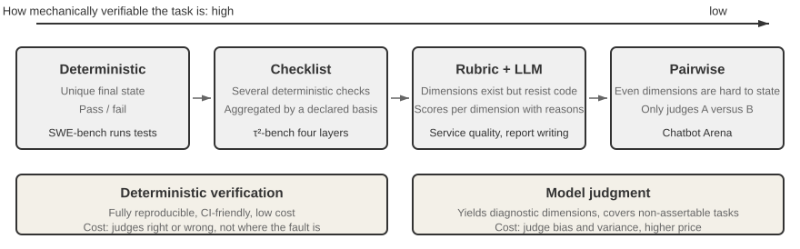
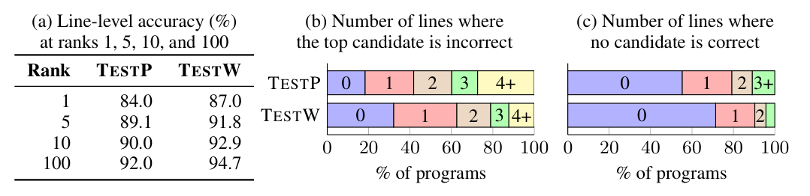
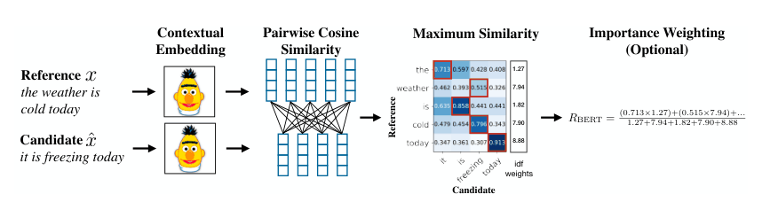
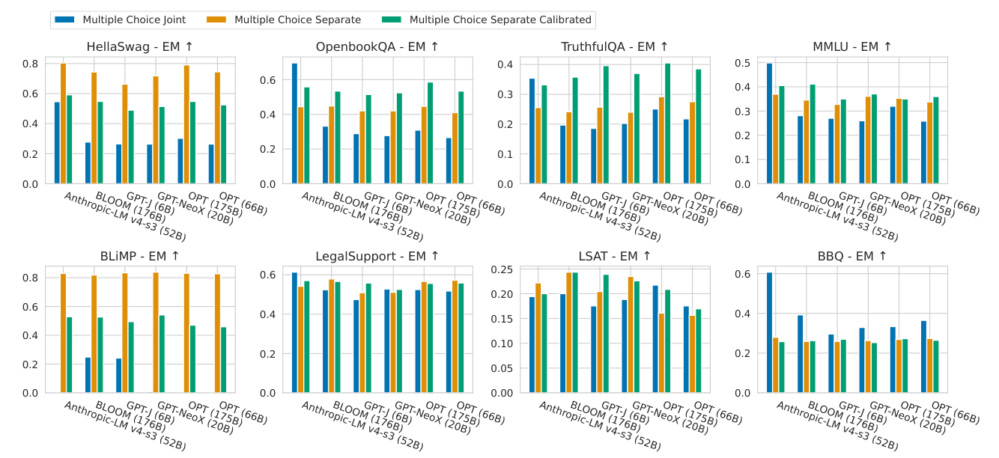
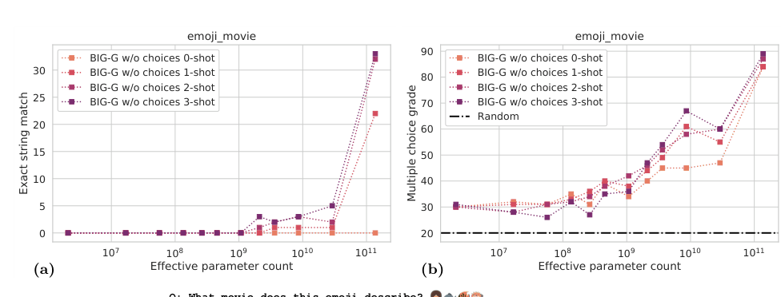

# 4 — Graders

> A grader turns one trial into a score for one dimension. Use the simplest grader that can be trusted: code first, a model above that floor, people to calibrate both.

An LLM judge costing thousands of calls a night reports that an answer "seems well grounded", while a five-line check would have shown that the cited URL was never retrieved. Choosing the wrong kind of grader wastes budget and gives a false reading. This chapter orders the choices: code first, then a model where the quality is semantic, humans to calibrate both, and an explicit rule for combining them.

---

## The three kinds


*Image Source: Li, [AI Agents in Depth](https://github.com/bojieli/ai-agent-book/blob/main/book-en/chapter7.md) (2026), Fig. 7-4 (Apache-2.0)*

| Grader | How it scores | Strength | Weakness | Use when |
|---|---|---|---|---|
| **Code** | String/regex match, schema check, unit tests, state check, numeric tolerance | Deterministic, fast, free, hard to argue with | Only checks what you can express exactly | There's a clear right answer or a checkable property |
| **Model** (LLM-as-judge) | A model scores against a rubric, compares two outputs, or votes | Handles meaning, tone, completeness | Biased, costly, needs calibration ([15](15-calibration-against-human-labels.md)) | The quality is semantic and no code can check it |
| **Human** | Expert review, annotation | The ground truth for subjective quality | Slow, expensive, inconsistent at scale | Building the reference, calibrating judges, ambiguous cases |

A fourth kind sits between code and model: the **separated evaluator agent**, which *operates* the output (runs the app, clicks through it, runs the code) instead of reading it ([03/05](../../../ai-engineering/03-harness-engineering/notes/05-verification-loops.md#separating-generation-from-evaluation)). It's a model, but its verdict rests on observed behavior.

### Layer them, don't choose

The four are layers, not alternatives:

| Layer | Scales | Cost | Role |
|---|---|---|---|
| Code | Fully | ~0 | First line. Catches structural failures cheaply |
| Separated evaluator | Well | Medium | Behavioral verification |
| LLM judge | Fully | Medium | Subjective criteria at volume |
| Human sample | Poorly | High | **Calibrates** the judge. 5–10% of graded rows, not a review queue |

Run code graders first and stop early: an answer that fails the schema doesn't need a judge to tell you it's bad. That saves judge budget for the rows that need judgment. During calibration, do the opposite and run the judge on those rows too, because a row where code and judge disagree shows which of them to fix ([14](14-calibrating-judges-with-checks-and-critiques.md#part-1-run-the-code-checks-against-the-judge)).

The same order works when you build the layers. Oshin & Campos advise starting with heuristic (code) evaluators, then adding human review, and only then an LLM judge that automates the human review you now understand (*Learning LangChain*, ch. 10).

---

## Code graders: more than you think

Teams reach for a judge too early. Most systems have more checkable properties than they use:

| Property | Code check |
|---|---|
| Output format | JSON parses, matches schema, required fields present |
| Tool use | Right tool name, arguments parse, argument values match ([06](06-evaluating-agents.md#scoring-tool-calls)) |
| Citations | Every cited ID is in the retrieved set. Quoted text appears verbatim in the source ([07](07-evaluating-rag-and-grounding.md#citation-checks-in-code)) |
| Final state | Row exists in the DB, file was written, test suite passes |
| Code output | Compiles, runs, passes the repo's tests |
| Language | Response language matches query language (a language-ID library) |
| Boundaries | Didn't call a forbidden tool, didn't exceed N turns, didn't leak a regex-detectable secret |
| Efficiency | Steps, tokens, latency, cost from the trace |
| Exact facts | Number within tolerance, date matches, entity in an allowed set |

"Passes the tests" is only as strict as the tests. MBPP showed this first, with three asserts per problem. On 50 of its 500 test problems the authors hand-wrote adversarial tests, and the 137B model's solve rate fell from 66% to 58%, so about 12% of counted solutions were wrong. One of them was `is_woodall`, where only one assert used a true Woodall number, so the model returned `n == 383` ([arXiv:2108.07732](https://arxiv.org/abs/2108.07732) (Austin et al., 2021 ⚑)). EvalPlus added about 80× more tests to HumanEval (LLM-written seed inputs, then type-aware mutation): **pass@k fell by up to 19.3–28.9% across 26 models** (GPT-4 greedy 88.4% → 76.2%), the ranking of several models flipped, and 11% of HumanEval's own reference solutions were wrong ([arXiv:2305.01210](https://arxiv.org/abs/2305.01210) (Liu et al., NeurIPS 2023)). Before trusting a test-suite grader, measure its false-positive rate by hand on a sample of passing outputs. Code that calls libraries needs tests written differently. ODEX (945 StackOverflow intents, 79 libraries) mocks HTTP calls, makes bounding assertions on random output (every element an integer in [3, 5]) and compares with library equality such as `np.array_equal`, because `a == b` on arrays raises an error. With Codex, one randomly chosen test gave about the same pass@1 as the full suite ([arXiv:2212.10481](https://arxiv.org/abs/2212.10481) (Wang et al., Findings of EMNLP 2023)). Grading speed is harder than grading correctness, because the timer is noisy too. When Shypula et al. timed 500 pairs of *identical* C++ programs on real hardware with hyperfine, the mean "speedup" was 1.12× (sd 0.36) and the top 5% showed 1.91×. They moved all timing into the gem5 simulator (one Skylake configuration, `-O3`), where a deterministic program gives the same time every run, and counted a wrong or slower program as a speedup of 1.0. The tests still leaked: in a hand audit of 120 optimised programs from their best model, 10 got faster by shrinking array sizes that the tests never filled ([arXiv:2302.07867](https://arxiv.org/abs/2302.07867) (Shypula et al., ICLR 2024); about 100 tests per problem, 41 test problems). Benchmark the timer on a no-op change before believing a speedup, and pass performance checks only on top of correctness.

Judge a generated line by what it does, and score the unit the user receives. SPoC translated pseudocode into C++ for Codeforces problems and counted a candidate line correct if swapping it into the gold program still passed the public and hidden tests, so `if (b)` matches `if (b == true)` where exact match and BLEU would not. Under that grader the translation model's top line was right **84.0% of the time on held-out problems (TESTP) and 87.0% on held-out annotators (TESTW)**, yet only 18.2% and 32.0% of programs had every top line right, and the programs assembled from the top lines passed 17.8% and 30.7% of the time, because lines that work alone can clash ([arXiv:1906.04908](https://arxiv.org/abs/1906.04908) (Kulal et al., NeurIPS 2019; read as the arXiv v1 preprint), Fig. 3). An LSTM translator, easy line-aligned programs and one run, with no variance reported, so read the gap as a pattern, not a measured size. A per-part grade that looks strong can sit under a weak end-to-end grade, so report both.


*Image Source: Kulal et al., [SPoC: Search-based Pseudocode to Code](https://arxiv.org/abs/1906.04908) (2019), Fig. 3 (a) line-level accuracy, (b) lines where the top candidate is wrong, (c) lines where no candidate is correct*

For tool calls, check **in order** and stop at the first failure: *called a tool? → right tool? → valid arguments? → right values?* An early failure makes the later checks meaningless. Check values with a tolerance or a range, not equality: a thermostat call at 76°F when the reference says 77°F is probably fine, while no call or the wrong tool is not ([01/09](../../../ai-engineering/01-prompt-engineering/notes/09-evaluating-prompts.md#scoring-outputs)).

### Partial match: grade the aspect that breaks

When exact match on the whole output is too strict, match on one aspect: code after stripping comments and whitespace, the destination country of a travel suggestion, the tool name of an action. Pick an aspect that separates breaking divergence from benign divergence, and that is neither so specific the model rarely hits it nor so general it means nothing. You find it by watching where the current system actually fails, which is circular, but still better than a weak or misleading aspect (*Prompt Engineering for LLMs*, ch. 10).

### Reference-based text metrics

BLEU, ROUGE and embedding similarity compare an output to a reference string. They're cheap and deterministic but correlate poorly with quality for open-ended answers: a correct answer worded differently scores low. A survey's comparison table puts numbers on it: on SummEval summaries, the average Spearman correlation with human ratings was 0.19 for ROUGE-1 and 0.23 for BERTScore, against 0.51 for G-Eval (a GPT-4 judge). The LLM judges were also about 200–400× slower than word-overlap metrics in the authors' timing, and on machine translation their advantage was not significant ([arXiv:2401.07103](https://arxiv.org/abs/2401.07103) (Li et al., 2024-01)). The references themselves are a second problem (*AI Engineering*, ch. 3):

- **They can be wrong.** The WMT 2023 Metrics shared task found many bad reference translations in its own data.
- **A metric inherits the quality of its references.** Zhang et al. had three crowd annotators rate summaries of 100 CNN/DM and 100 XSUM articles. The datasets' own reference summaries were rated faithful 84% of the time on CNN/DM and 37% on XSUM, against 99% and 97% for zero-shot Instruct Davinci. **ROUGE-L's system-level Kendall τ with faithfulness was 0.54 on CNN/DM and −0.27 on XSUM**, and every metric tested (METEOR, BERTScore, BARTScore, BLEURT) was negative on XSUM. Scored against summaries the authors commissioned from freelance writers, the XSUM relationship turned positive, shown as a plot with no coefficient ([arXiv:2301.13848](https://arxiv.org/abs/2301.13848) (Zhang et al., TACL 2024; read as arXiv v1, 2023-01)). News only, system-level only, and no annotator agreement is reported for the ratings.
- **They can be incomplete.** Adept's Fuyu wrote correct image captions that scored low because no reference phrased them that way.
- **Overlap isn't correctness.** On HumanEval, OpenAI found correct and incorrect code solutions got similar BLEU scores. Codex-12B's BLEU distributions for correct and incorrect solutions overlap heavily on 4 random tasks ([arXiv:2107.03374](https://arxiv.org/abs/2107.03374) (Chen et al., 2021 ⚑), Fig. 8). The same holds for MBPP and for ODEX's library code across four languages ([arXiv:2212.10481](https://arxiv.org/abs/2212.10481) (Wang et al., Findings of EMNLP 2023)). It is worst when the output copies most of its input. On Java bug fixing, **BLEU was 90–93 for all three systems while only 3–18% of their fixes matched the reference and programmers rated them 1.4–2.0 out of 5**. CodeBLEU adds syntax-tree and data-flow matching and raised the Pearson correlation with programmer scores on that task from 0.92 to 0.98, but exact match did better still (0.999), each correlation spans only three or four systems, and nothing is executed ([arXiv:2009.10297](https://arxiv.org/abs/2009.10297) (Ren et al., 2020-09, preprint)).
- **Overlap can be gamed.** On Topical-Chat, always replying with the ten most common tokens (". i the , that a to it is of") scored a word-overlap F-1 of 25.6, 3.6 points above the Transformer the dataset's authors reported ([arXiv:2005.00456](https://arxiv.org/abs/2005.00456) (Mehri & Eskenazi, ACL 2020)).
- **Overlap labels mislead whatever is scored against them.** Hallucination-detection papers usually label an answer as hallucinated when its ROUGE-L against the reference falls below 0.3. Janiak et al. relabelled with a GPT-4o-mini judge. On 200 NQ-Open answers from Mistral-7B, sampled where ROUGE and the judge disagreed and labelled by three annotators (κ 0.799), **the judge's precision was 0.736 against 0.401 for ROUGE, at the same 0.957 recall**. Answers over 100 tokens "consistently receive scores below the 0.3 threshold, regardless of factual accuracy". Under the judge's labels, detector AUROCs fell by up to 45.9% ([Perplexity](../../01-llm-fundamentals/notes/06-pretraining-data-and-objectives.md#entropy-cross-entropy-kl-and-perplexity) on NQ-Open, 0.852 to 0.584), and the mean answer length across samples scored an AUROC of 0.71 to 0.72 on both models, matching or beating Eigenscore and LN-Entropy ([arXiv:2508.08285](https://arxiv.org/abs/2508.08285) (Janiak et al., 2025-08, preprint); two 7–8B models, short-answer QA, one judge, one run). The human check covers one model and one dataset, and the judge's own biases go untested.
- **Overlap can rank systems backwards.** Li et al.'s RL chatbot scored lower single-reference BLEU than the model it started from (1.28 against 1.44 on 2,500 pairs), yet human judges preferred its multi-turn conversations 72% of the time ([arXiv:1606.01541](https://arxiv.org/abs/1606.01541) (Li et al., EMNLP 2016)).

The metric itself has settings, and they change the number:

- **BLEU is not one number.** For the same WMT'17 system outputs, switching how the reference is tokenized and cased moved BLEU by up to 1.8 points on one language pair and about 1.0 on average. A second reference raised one English–Finnish score from 22.04 to 25.25. The fix is SacreBLEU: score detokenized output with the metric's own tokenization and report its version string ([arXiv:1804.08771](https://arxiv.org/abs/1804.08771) (Post, WMT 2018)).
- **ROUGE recall rewards length.** Nallapati et al. switched to full-length ROUGE F1 because recall "favors longer summaries". They also noted that their model's summaries were often meaningful and relevant when they differed from the reference, which word-overlap ROUGE does not capture ([arXiv:1602.06023](https://arxiv.org/abs/1602.06023) (Nallapati et al., CoNLL 2016)).
- **BERTScore depends on the model and layer.** Its authors pick one layer per embedding model on held-out WMT16 data (layer 17 of 24 for RoBERTa-large), because agreement with humans drops sharply in the final layers. They also rescale raw scores against random sentence pairs to make them readable, which changes the number but not the ranking ([arXiv:1904.09675](https://arxiv.org/abs/1904.09675) (Zhang et al., ICLR 2020), App. B). Report the model, layer and rescaling with the score.

For short extractive answers, **exact match** and **token F1** are the standard pair, and both come from SQuAD. Each ignores punctuation and articles. EM counts a prediction correct if it equals *any* reference. F1 treats prediction and reference as bags of tokens and takes the best F1 over the references. Every dev and test question got at least 3 references, partly "to make our evaluation more robust". Scoring a second crowdworker's answer against the others gave **humans only 77.0% EM and 86.8% F1** on the test set, and the authors trace most mismatches to non-essential words ("monsoon trough" against "movement of the monsoon trough"), not to real disagreement ([doi:10.18653/v1/d16-1264](https://doi.org/10.18653/v1/d16-1264) (Rajpurkar et al., EMNLP 2016)). So EM marks correct answers wrong over span boundaries, and the human score is a measure of annotator agreement, not a ceiling. Collect several references, report F1 beside EM, and score a second human the same way to see where your metric tops out.

Model-based metrics close part of the gap. **BERTScore** matches each token to its most similar token by contextual embedding, so a paraphrase still scores. On WMT18 segment-level human judgments it beat sentence BLEU on all 14 language directions (Kendall τ 0.550 against 0.415 for German→English). On PAWS, whose non-paraphrases are made by swapping words, its AUC was 0.69 where BLEU's fell to 0.53, near chance. It matches wording, not facts, though: it scored high a translation that said "English" for "German" and another that said "Tuesday" for "Monday" ([arXiv:1904.09675](https://arxiv.org/abs/1904.09675) (Zhang et al., ICLR 2020)). **BLEURT** fine-tunes BERT on a few thousand human ratings, after pre-training on 6.5M synthetic perturbations of Wikipedia sentences, and reached Kendall τ 0.625 on WMT17 to-English against 0.580 for BERTScore and 0.324 for sentence BLEU. A learned metric only knows the ratings it saw. Trained on poorly rated translations and tested on well rated ones, BLEURT without the synthetic pre-training fell below BERTScore at moderate skew and below sentence BLEU at higher skew. Every metric agreed less with humans as the test systems got better, since ranking good systems is harder than separating good from bad ([arXiv:2004.04696](https://arxiv.org/abs/2004.04696) (Sellam et al., ACL 2020)). Both still need a reference, and their evidence is translation, captioning and data-to-text, where the right answers are close to each other.


*Image Source: Zhang et al., [BERTScore: Evaluating Text Generation with BERT](https://arxiv.org/abs/1904.09675) (ICLR 2020), Fig. 1*

Dialog has too many right answers for any reference. USR drops it: RoBERTa models fine-tuned on the dialog corpus score naturalness (masked-LM likelihood of the reply) and fit to the context (a classifier that tells the true reply from a random one), and a regression combines them. On 360 Topical-Chat replies from 60 contexts, its turn-level Spearman with overall-quality ratings was **0.42, against 0.34 for METEOR, 0.32 for BERTScore and 0.22 for BLEU-4**. Its system-level 1.0 rests on only five and four response sources, and the authors say to use it for tuning and model selection alongside human evaluation, not to claim one system beats another ([arXiv:2005.00456](https://arxiv.org/abs/2005.00456) (Mehri & Eskenazi, ACL 2020)).

> **Contradiction.** Albada describes "modern practice" for agents as relying increasingly on embedding distance, BERTScore, BLEU and ROUGE to judge whether outputs meet the intent of a task (*Building Applications with AI Agents*, ch. 9). The correlation numbers above say otherwise for open-ended text: BERTScore at 0.23 against human ratings is a weak gate. The same chapter later warns that optimizing a single score such as BLEU leads to "formulaic or unnatural outputs". Follow the warning, not the recommendation.

The case study ruled out ROUGE-L for conversational answers for this reason ([case study](13-case-study-support-agent.md#why-custom-graders-instead-of-a-frameworks-built-in-eval)). Use them for tightly constrained outputs (translation of fixed strings, extraction) or as a cheap tracking signal, not a gate.

When no reference can stand for the answer, grade the property you want. Fan et al. dropped BLEU and ROUGE for stories written to Reddit WritingPrompts ("we do not aim to generate a specific story") and measured whether a story follows its prompt. The automatic check asked whether the true prompt was the likeliest of 10 to have produced the story. The human check was forced choice: match three shuffled stories to their three prompts (105 stories per model, 15 judges per question), a task with a right answer, unlike a 1–5 rating. A nearest-neighbour baseline that returned a training-set story matched their model on pairing, so they added a copying check: **generated stories shared on average an 8.9-word longest common subsequence with training stories, against all 150 words for the retriever** ([arXiv:1805.04833](https://arxiv.org/abs/1805.04833) (Fan et al., ACL 2018)). A degenerate system can max out a single property metric, so pair each one with a check for its shortcut.

### Multiple-choice: format is part of the score

Most public benchmarks are close-ended. In April 2024, 75% of the tasks in EleutherAI's lm-evaluation-harness were multiple-choice (MMLU, AGIEval, ARC-C) (*AI Engineering*, ch. 4). MCQ scoring looks like the safest code grader there is, but it has two traps:

- **Format sensitivity.** Alzahrani et al. (2024) found that adding an extra space between question and answer, or a phrase like "Choices:", changed models' answers (*AI Engineering*, ch. 4). Freeze the template and report it with the score. The harness's maintainers measured the size of the effect: scoring five open models zero-shot by log-likelihood, they asked the same ARC-Challenge questions with the answer texts as the options (cloze) and with lettered options (MMLU-style). **Mistral-7B rose from 50.1% to 72.4% with letters and Falcon-7B fell from 40.2% to 25.9%**, so the better format depends on the model, and Mistral's lead over Falcon is 10 points in one format and 46 in the other ([arXiv:2405.14782](https://arxiv.org/abs/2405.14782) (Biderman et al., 2024-05, preprint; read as the 2026-05 revision)). The 95% bootstrap intervals are about ±2.5 to ±2.9 points, and the paper states no run count. Of GPT-NeoX-20B, which fell to chance in one format, they say it failed to follow that prompt format though it could score well in the other. Their checklist: share exact prompts and model outputs, disclose how much prompt tuning was done and on which models, and don't copy scores from another implementation. HELM saw the same swing at larger scale. On HellaSwag, OPT (175B) scored **79.1% when each answer was scored in its own 0-shot prompt (separate), 54.8% when separate scores were calibrated, and 30.2%, almost random, when all the choices sat in one 5-shot prompt (joint)**, and for all six models tested the order was separate > calibrated > joint. The best format also depends on the scenario: on OpenBookQA, TruthfulQA and MMLU, five of six models did best calibrated, while Anthropic-LM v4-s3 (52B) did best with joint and worst with separate ([arXiv:2211.09110](https://arxiv.org/abs/2211.09110) (Liang et al., TMLR 2023), §8.2, Fig. 33; six models of 6B to 176B, exact-match accuracy, HELM v0.1.0 prompts).
- **How you read the answer.** The harness can score by log-likelihood (compare the model's probability of each option's full text) or by generation (let the model write a letter, then match it). Iusztin & Labonne recommend generation: it mirrors real use, it's easier to implement, and it discriminates better, because "low-quality models tend to overperform on probability-based evaluations" (*LLM Engineer's Handbook*, ch. 7). The two methods give different numbers for the same model, so don't compare scores across them.


*Image Source: Liang, Bommasani et al., [Holistic Evaluation of Language Models](https://arxiv.org/abs/2211.09110) (TMLR 2023), Fig. 33*

MCQs test whether a model can pick the good answer, not whether it can write one. Use them for knowledge and reasoning checks, not for summarization or other generation tasks.

---

## The grader interface

Make every grader implement one contract. Then graders are swappable, composable and reportable the same way.

**Input** (what any grader may need):

| Field | Contents |
|---|---|
| `task` | The row: input, reference, labels |
| `output` | The final response / outcome |
| `trajectory` | Tool calls, intermediate messages (optional per grader) |
| `retrieved_context` | Passage **text**, not just IDs or URLs |
| `metadata` | Model, prompt version, config, run ID |

**Output:**

| Field | Contents |
|---|---|
| `score` | Number in [0, 1] (or the native scale, documented) |
| `passed` | Boolean against the grader's threshold |
| `reasoning` | Why. For judges, the explanation. For code, the failing check |
| `dimensions` | Sub-scores, if the grader checks several things |
| `labels` | Failure taxonomy labels this trial earned ([02](02-defining-correct.md#the-failure-taxonomy)) |
| `grader_version` | Name + prompt/code version, so scores are traceable |

```python
class Grader(Protocol):
    name: str
    version: str
    requires: set[str]            # e.g. {"retrieved_context"}: skip, don't guess, if missing
    def grade(self, task, output, trajectory=None, context=None) -> GraderResult: ...
```

The `requires` field matters. A grounding grader handed URLs instead of passage text should return "can't grade" (`context_missing`), not a made-up score ([case study](13-case-study-support-agent.md#why-the-grounding-cross-check-showed-low-agreement)).

---

## Grader states: which ones can block a release

Not every grader is trustworthy enough to gate on. Give each one an explicit state:

| State | Meaning | Can gate releases? |
|---|---|---|
| **Heuristic** | Deterministic code check | Yes |
| **Calibrated** | LLM judge with evidence it agrees with humans ([15](15-calibration-against-human-labels.md)) | Yes, at the calibrated threshold |
| **Experimental** | New or uncalibrated judge | **No.** Tracking and investigation only |

A threshold change without fresh calibration evidence moves the grader back to experimental. Release decisions must name which state each cited metric is in.

---

## Combining graders: scoring design

A task often has several graders. Decide up front how they combine:

| Scheme | Rule | Use when |
|---|---|---|
| **Binary (all-pass)** | Task passes only if every grader passes | Any failure is unacceptable (safety, format, policy) |
| **Weighted** | Weighted sum of scores must clear a threshold | Dimensions trade off legitimately |
| **Hybrid** | Must-pass gates + weighted score on the rest | Most production systems |
| **Report separately** | No composite. Show each dimension | Diagnosis. Always do this alongside any composite |

Hybrid example: *schema valid AND no citation hallucination AND (0.5 × grounding + 0.3 × completeness + 0.2 × relevance ≥ 0.75)*.

All-pass rules pile up false alarms, because any one check can fail a good output. In [SPADE](https://arxiv.org/abs/2401.03038) (Shankar et al., 2024), 67 and 32 assertions each met a false-failure limit alone, yet together wrongly failed 88% and 53% of good outputs on two pipelines, so measure the false-failure rate of the whole set.

### Veto items

A must-pass gate on a quality dimension is a **veto item**: if it fires, the total is zero. Hallucination is the classic one. It's orthogonal to quality, since a fluent, detailed, polite answer with a made-up fact does more harm than a terse correct one. A veto also blocks reward hacking by keyword stuffing: you can't pad your way past it.

Li (*AI Agents in Depth*, ch. 6), following Scale AI's *Rubrics as Rewards*, gives four rules for a rubric:

1. **Expert-grounded.** It encodes domain facts and reasoning steps, not surface features like fluency.
2. **Covers pitfalls.** It names the high-risk common errors explicitly, not only what good looks like.
3. **Weighted by importance.** Each item is Essential, Important, Optional or Pitfall, and Pitfall items can veto.
4. **Self-contained.** Each item can be checked without the grader's own expertise. "Cites at least two named sources and says how each supports the conclusion", not "shows deep understanding".

```yaml
- id: hallucination
  criterion: Every fact in the reply appears in a tool output
  weight: veto        # fires → total score is 0
```

HealthBench shows what this looks like at scale: 5,000 health conversations, each with its own physician-written rubric, 48,562 criteria in all. Each criterion is worth −10 to +10 points, and the negative ones are the pitfalls (for example, "recommends a dangerous dose"). A model grader marks each criterion met or not met independently. The example's score is the points earned divided by the maximum possible, which can be negative, and the mean is clipped to [0, 1] ([arXiv:2505.08775](https://arxiv.org/abs/2505.08775) (Arora et al., 2025-05); OpenAI built it and ranks its own models on it). Grading one criterion per call keeps each decision binary and auditable, though it costs one grader call per criterion.

GAMUT ([arXiv:2607.19322](https://arxiv.org/abs/2607.19322) (Chen et al., 2026-08, preprint)) separates writing a rubric from grading with it. Authors write a structured meta-rubric (open sets such as "name at least two of these seven dishes", ordered steps, three importance tiers), and fixed rules compile it into flat binary checks for the judge, each with one of four verdicts: meets, partially meets, missing, contradicts. A contradiction subtracts credit (μ = −2) and also counts in the denominator, so a cautious answer outranks a confidently wrong one. On 1,813 multimodal questions (a mean of 15.2 checks each, Gemini 3.1 Pro as judge, no repeat runs reported), **the best model scored 58.7%, and omission, not error, dominated: 29.2% of its rubric elements were missing against 4.1% contradicted**. A Claude Opus 4.8 judge gave the identical ranking within 1.8 points, and a Qwen3-VL 235B judge was more lenient across the board, by 4 to 11 points (its own model +11), while keeping the broad ordering. The premise that judges grade flat checks more reliably than structured rubrics is not tested against people or a structured-rubric judge, the weights are set by hand, and Gemini 3.1 Pro also drafted the rubrics (annotators then revised them) and ranks first.

A rubric gets better through use. Disagreements between graders turn it, over time, from principles into a casebook of edge cases.

Don't let a composite hide a regression. A model that gains 5 points of relevance while losing 5 points of grounding scores flat on the composite and is worse for users who need correct answers. Always report the dimensions too.

---

## Binary vs. scales

For judges and humans, prefer **binary pass/fail** per dimension over 1–5 scales:

- Graders disagree more on the middle of a scale. "Is this a 3 or a 4?" has no stable answer.
- Pass/fail forces you to define the bar, which is the point of [02](02-defining-correct.md).
- Rates of binary outcomes have simple statistics ([09](09-reading-results.md)).

Use an ordinal scale only when the levels are each *described* (what a 2 looks like vs. a 4), and only when the extra resolution changes a decision. If you have a scale, you can always threshold it into pass/fail later.

FLASK tests the described-scale case. It wrote a 1–5 rubric for each of 12 skills (logical correctness, factuality, conciseness and so on) and had GPT-4 score only the three skills labelled relevant to each instruction. On 200 instances answered by four models, each rated by 3 of 10 labelers, **per-skill scores reached a Spearman of 0.680 with the human scores, against 0.641 for one overall score copied to every skill**. Taking away the reference answer cost far more (0.516) than taking away the rubric (0.646) ([arXiv:2307.10928](https://arxiv.org/abs/2307.10928) (Ye et al., ICLR 2024)). The gain is small and has no interval, and the labelers agreed with each other only moderately (Krippendorff's α 0.488 overall, 0.089 on readability). The paper's per-instance checklists, at most five GPT-4-written sub-questions per item on an 89-item hard subset, were never checked against human ratings.

Not everyone agrees. Berryman & Ziegler argue for judges to drop yes/no in favor of a described 1–5 scale. A bare "is it right?" leaves the bar to the judge, which may then hold ambitious answers to a stricter standard than safe ones, or pass mostly-right answers while failing near-perfect ones (*Prompt Engineering for LLMs*, ch. 10). Both camps blame the same failure, a bar the judge has to guess. Binary with written PASS/FAIL definitions and a scale with each level described both fix it.

Binary has one trap when the task has a right answer and the system is allowed to abstain. If "I don't know" scores the same 0 as a wrong answer, guessing always has the higher expected score. Kalai et al. argue that this grading, used in 9 of the 10 benchmarks they surveyed, is one reason models learn to hallucinate ([arXiv:2509.04664](https://arxiv.org/abs/2509.04664) (Kalai et al., 2025-09); a theory paper with no experiments). OpenEQA does exactly this: when an agent abstains, it substitutes a guess from a text-only LLM, so abstaining never earns credit ([PDF](https://open-eqa.github.io/assets/pdfs/paper.pdf) (Majumdar et al., 2024-06)). Their fix is three outcomes and a confidence target stated in the prompt: "answer only if you are more than *t* confident; a mistake costs *t*/(1−*t*) points, a correct answer earns 1, and IDK earns 0." At *t* = 0.5, 0.75 or 0.9, a mistake costs 1, 3 or 9 points (the paper prints 2 for *t* = 0.75, but the formula gives 3), so a well-calibrated system answers only when it is above the target. Use this whenever "I don't know" is an acceptable reply, and report the abstention rate on its own ([09](09-reading-results.md#pitfalls)). [DS 01/13](../../../data-science/01-classical-ml/notes/13-automate-review-or-reject.md) derives the same target from prices, for a model that can hand a case to a person.

All-or-nothing scoring also changes what progress looks like over model versions. In BIG-bench, about 5% of tasks showed sudden "breakthrough" gains with scale. On `emoji_movie` the same models jumped abruptly under exact string match and rose gradually under multiple-choice grading. The authors' summary: "Different choices in task design can make the same capability appear to stagnate, gradually improve, or suddenly break through." A smooth metric doesn't rule out a real threshold either. One explanation the authors offer: if each of *k* steps improves steadily, success on the whole task rises much later and faster ([arXiv:2206.04615](https://arxiv.org/abs/2206.04615) (Srivastava et al., TMLR 2023); `emoji_movie` on BIG-G models up to 137B, greedy decoding). Gate on pass/fail, but when you track a capability across versions, log a graded signal beside it (partial credit, or the log-probability of the right answer) so that the jump doesn't come as a surprise.


*Image Source: Srivastava et al., [Beyond the Imitation Game](https://arxiv.org/abs/2206.04615) (TMLR 2023), Fig. 9 (a) exact string match, (b) multiple-choice grade*

---

## Checklist

- [ ] Every checkable property has a code grader before any judge is added
- [ ] Code graders run first; failures short-circuit expensive graders
- [ ] All graders implement one interface, with `requires` and `grader_version`
- [ ] Each grader has a state (heuristic / calibrated / experimental)
- [ ] Composite scoring rule written down; dimensions always reported alongside
- [ ] Binary pass/fail by default; scales only with described levels

---

## Working reference

[13 · Case study: harness patterns](13-case-study-support-agent.md#harness-patterns) — four suite types and a tool-trajectory scorer in pytest.

---

## Pitfalls

- **Reaching for a judge first.** Symptom: a large bill for checks a regex or schema could do, plus noise in a metric that could have been exact. Fix: layer the graders, run code first, and stop early so a failed row never reaches a judge.
- **A composite that hides a regression.** Symptom: a flat score on a model that gained 5 points of relevance and lost 5 of grounding. Fix: report each dimension alongside any composite, and put must-pass gates in front of the weighted part.
- **No veto on hallucination.** Symptom: a fluent answer with an invented fact outscores a terse correct one, and keyword stuffing raises the score. Fix: make it a veto item, so the total goes to zero when it fires.
- **Comparing wording with BLEU or ROUGE.** Symptom: a good paraphrase scores low, and a longer answer scores higher, because ROUGE recall favors length. Tokenization alone moved BLEU by up to 1.8 points on one WMT'17 language pair. Fix: keep these for narrow uses, and check facts or tests instead.
- **Abstention scored like a wrong answer.** Symptom: the system guesses more over time, because a guess has the higher expected score. Fix: a three-outcome grader with a stated confidence target, and report the abstention rate on its own.
- **Changing a threshold quietly.** Symptom: a green dashboard after someone lowered a bar, with no evidence behind it. Fix: a threshold change without calibration puts the grader back to experimental, which can't block a release.
- **Rubrics that need the grader's expertise.** Symptom: graders disagree on "shows good reasoning". Fix: make each item self-contained, such as "cites at least two named sources and says how each supports the conclusion".

## Try it

1. A hybrid rule says: schema valid AND no citation hallucination AND (0.5 × grounding + 0.3 × completeness + 0.2 × relevance ≥ 0.75). A reply has a valid schema, no hallucination, and scores 0.9, 0.6 and 0.7. Does it pass? And if a citation was hallucinated?

   <details><summary>Answer</summary>

   0.45 + 0.18 + 0.14 = 0.77, so it passes. With a hallucinated citation it fails, whatever the 0.77 says, because that condition is a must-pass gate rather than part of the weighted sum.

   </details>

2. Using this chapter's confidence target, set *t* = 0.75, so a mistake costs *t*/(1−*t*) = 3 points. A system is 60% sure of one answer and 80% sure of another. Should it answer either?

   <details><summary>Answer</summary>

   Expected score at 60%: 0.6 − 0.4 × 3 = −0.6, worse than the 0 for "I don't know", so it should abstain. At 80%: 0.8 − 0.2 × 3 = +0.2, so it should answer. The break-even is exactly *t*.

   </details>

3. Design the graders for a support agent's refund flow, in order, with cost in mind. The checks: JSON shape, refund row in the database, tone, tool order.

   <details><summary>Answer</summary>

   Run the JSON schema first, then the database state and the tool order, all as code and with failures stopping the row there. Tone comes last, as the only judge. The state check matters most, since only it catches a reply saying "I've issued your refund" when no refund exists ([06](06-evaluating-agents.md#grade-the-outcome-by-state-not-by-words)).

   </details>

## Interview checklist

| Prompt | Answer in one line |
|---|---|
| What are the three kinds of grader, and in which order? | Code, then model, then human. Code is cheap and exact, a model handles semantic qualities, and a human sample of about 5 to 10% calibrates the rest. |
| Why not use BLEU or ROUGE for LLM answers? | They compare surface wording, so valid paraphrases score low, and ROUGE recall favors length. A tokenization choice alone moved BLEU by up to 1.8 points on one WMT'17 language pair. |
| Binary or 1 to 5 scale for a judge? | Binary per dimension by default, because graders disagree most in the middle of a scale and a rate has simple statistics. Berryman & Ziegler prefer a described 1 to 5 scale, and both approaches fix a bar the judge would otherwise guess. |
| What is a veto item? | A must-pass gate on a quality dimension: if it fires the total is zero. Hallucination is the classic one, and HealthBench's negative criteria of up to −10 points work in a similar spirit. |
| How do grader states work? | Heuristic code checks can gate, calibrated judges can gate at their calibrated threshold, and experimental ones are tracked but can't block a release. Changing a threshold without calibration evidence sends a grader back to experimental. |
| A new model has +5 relevance and −5 grounding, and the composite is flat. Ship? | No, not on the composite. Report the dimensions, because this is worse for anyone who needs correct answers. A hybrid rule with a grounding floor would have caught it. |
| Why do grader disagreements improve a rubric? | Each disagreement exposes an edge case the rubric didn't settle. Resolved over time, they turn it from principles into a casebook of edge cases. |

## Next

[05-llm-as-judge.md](05-llm-as-judge.md): making model graders trustworthy.
