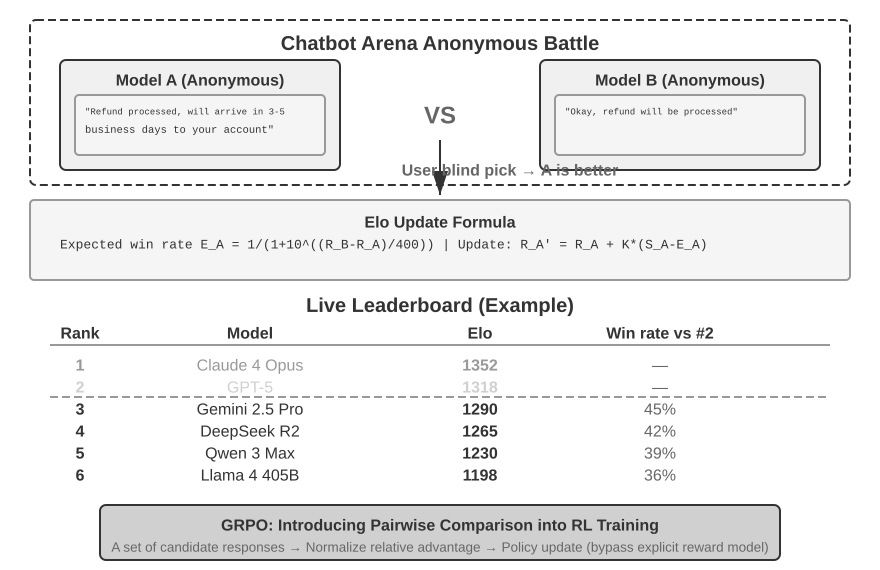

# 5 — LLM as Judge

> A judge is a model making a measurement. Until you've checked it against human labels, you don't know what it measures. Write a narrow rubric, mitigate the known biases, and calibrate before you gate on it.

A judge is the tool for qualities no code check can express, and it is easy to get wrong: one that checks "quality" silently switches criteria from row to row, and every shape of judge carries biases that have been measured. This chapter covers when to use a judge, how to write its prompt, which biases to test for, and how to turn pairwise votes into a ranking. [Note 15](15-calibration-against-human-labels.md) then compares the judge with human labels, which is what gives its number a meaning.

---

## When a judge is the right tool

Use a judge when the quality is semantic (is this complete? is it grounded? is the tone right?) and no code check can express it ([04](04-graders.md#code-graders-more-than-you-think)). Don't use one for things code can check. A judge that decides whether JSON is valid is slower, costlier and less reliable than `json.loads`.

### Three judge shapes

| Shape | Asks | Good for | Watch out for |
|---|---|---|---|
| **Pointwise** (single output + rubric) | "Does this answer meet criterion X?" | Absolute pass/fail gates, monitoring | Drift in what "pass" means over time |
| **Pairwise** (A vs. B) | "Which answer better meets X?" | Comparing two versions, model selection | Position bias. Swap and run both orders |
| **Reference-guided** (output + gold answer) | "Does this answer contain the facts in the reference?" | Factual correctness when you have a reference | The judge may accept paraphrases that are subtly wrong |

The same judge can disagree with itself across shapes. In Shepherd, GPT-4 graded critiques of model answers written by four models, on 352 instances ([arXiv:2308.04592](https://arxiv.org/abs/2308.04592) (Wang et al., 2023-08, preprint)). **Rating each critique alone on a 1–7 scale, GPT-4 gave Alpaca-7B 4.7 where human raters gave 2.91**, and it ranked the four models in a different order from the humans. Comparing two critiques at a time, it picked the same winner as the human win rates against Alpaca and SelFee, though it put Shepherd ahead of ChatGPT (56.0) where the human figure is a tie (49.6). The paper describes no human pairwise task, so those human win rates appear to be derived from the 1–7 ratings. The authors recommend the pairwise shape on that evidence. It is thin: no correlation between GPT-4 and human scores, no rater agreement, no swap of the two orders, and the humans saw the critiques from the different models together while GPT-4 saw one.

Pairwise judging is more reliable than pointwise for "which is better", because relative judgments are easier than absolute ones. But you can't monitor production with it, because there's no second answer to compare against. Most systems use pointwise for gates and pairwise for A/B decisions.

**A judge is model + prompt + sampling settings.** Change any of the three and you have a different judge (*AI Engineering*, ch. 3). Huyen's example: coherence was 90% last month and 92% this month. That means nothing unless the judge was identical both times, and a coworker fixing a typo in the judge prompt counts as a change. The same criterion name doesn't mean the same judge across tools either. MLflow, Ragas and LlamaIndex all ship a "faithfulness" judge, but MLflow scores 1–5, Ragas 0 or 1, and LlamaIndex YES/NO, so one (context, answer) pair can get 3, 1 and NO. Her rule: don't trust a judge whose model and prompt you can't see.

**Off-the-shelf specialized judges** exist if a general model is too costly: reward models such as Google's Cappy (360M parameters, a 0–1 correctness score for a prompt–response pair), reference-based judges such as Prometheus (prompt, response, reference and rubric in, a 1–5 score out, with the reference defined as a 5), and preference models such as PandaLM and JudgeLM (*AI Engineering*, ch. 3). These are 2023 models: [calibrate them](15-calibration-against-human-labels.md#the-procedure) like any other judge. The successor shows why. [arXiv:2405.01535](https://arxiv.org/abs/2405.01535) (Kim et al., EMNLP 2024) reports that **Prometheus 2 closes about half the gap to GPT-4 against human scores, not all of it**: on FLASK (2,000 responses, reference-based 1–5 rubric), its 8x7B model reaches Pearson 0.555 with humans, against 0.449 for Prometheus-13B and 0.679 for GPT-4-1106. Without the reference answer it falls to 0.411. The paper gives no confidence intervals, and of its four main 1–5 scoring benchmarks only FLASK carries human scores; the other three measure agreement with GPT-4 and Claude 3 Opus.

---

## Writing the judge prompt

### One judge, one criterion

A judge that checks "quality" will silently switch between criteria from row to row. Write one judge per dimension ([02](02-defining-correct.md#from-criteria-to-dimensions)), each with a narrow question.

| Bad | Good |
|---|---|
| "Rate this response's quality 1–10" | "Does the answer state a specific menu path that appears in the source document? PASS or FAIL" |
| "Is this helpful?" | "Does the answer address every question the user asked? List each question, then mark each addressed or not" |

Huyen reports the same from practice: judges do better on classification than on numerical scores, discrete scores beat continuous ones, and the wider the discrete range, the worse the judge gets (*AI Engineering*, ch. 3). Oshin & Campos give the matching rule: a judge prompt a person could replicate, and no 0–10 scale with vague distinctions between scores (*Learning LangChain*, ch. 10).

GEMBA complicates that rule. Kocmi & Federmann had GPT-4 score translations 0–100, zero-shot, with a human reference, on WMT22 (3 language pairs, 54 systems, professional MQM labels as gold). **At system level it ranked systems correctly 89.8% of the time, ahead of every other WMT22 metric (COMET-22 83.9%, BLEU 70.8%), but per segment it trailed** (Kendall τ 0.36–0.38 against COMET-22's 0.37–0.43). The scores clumped: 53.3% of these scores, and 60.6% without a reference, were exactly 95, and the authors conjecture that the ties lowered the per-segment τ. Narrower scales did not fix it: five labelled classes scored τ 0.22–0.27 and 1–5 stars 0.33–0.38, though stars beat 0–100 at system level (91.2%) and classes came close (89.1%; 91.2% without a reference). Models below GPT-3.5 gave unusable output ([arXiv:2302.14520](https://arxiv.org/abs/2302.14520) (Kocmi & Federmann, EAMT 2023)). The paper found the least constrained prompt best overall, so it is evidence about levels of aggregation, not against wide scales: a judge that ranks systems well may still be unable to grade items, and a release gate grades items.

If the judge model exposes token probabilities, the clumping has a direct fix: score with the **expected value over the score tokens** instead of the single most likely one, an idea that goes back to G-Eval. [arXiv:2607.05391](https://arxiv.org/abs/2607.05391) (Kwok et al., 2026-07, preprint) asked Gemini 2.5 Flash to tell a passing agent trajectory from a failing one for the same Terminal-Bench 2 task, on a 1–20 scale over 200 sampled trajectories. **The discrete judge tied on 26.7% of comparisons and scored 71.8% with a tie counted as half; the expected score never tied and reached 74.7% in one pass**, which the discrete judge needed 16 passes to match. A tie broken is not always broken the right way: in the paper's one worked pair, the 1–5 judge tied 88 times in 100 and was never wrong, while the expected score was wrong 23 to 31 times. The paper reports no confidence intervals or cost for this comparison, which uses one judge model on one benchmark.

### Structure that works

1. **Role and task.** Frame it as grading a third party's work. Never tell the model it's grading its own output. Berryman & Ziegler report that judges get a bit less accurate when told the work is the user's and much worse when told it is their own, because the model is pulled between conflicting habits: forum-style text that rarely self-criticizes fairly, and RLHF that makes it recant at any hint of doubt (*Prompt Engineering for LLMs*, ch. 10; [01/09](../../../ai-engineering/01-prompt-engineering/notes/09-evaluating-prompts.md#llm-as-judge)). This is about framing, and it is separate from self-preference (below), which applies even when the judge doesn't know whose output it is. Even without that framing, a model has a harder time grading its own samples. Kadavath et al. had Anthropic's pretrained models (up to 52B) give P(True) that their own sampled answer was right. **Zero-shot, P(True) was poorly calibrated, usually close to 50%** ("zero-shot" here still meant a fixed six-example prompt, and on arithmetic almost every sample scored above 0.5). With 20 examples in the prompt (plus five of its own samples) it became well calibrated, and answers rated above 0.5 were right far more often than the base rate. Showing it five of its own samples for comparison also helped, less so on long code and maths answers. The authors suggest two reasons: a model's own samples lie near its decision boundary, and it can't tell tokens it wrote from tokens it was given ([arXiv:2207.05221](https://arxiv.org/abs/2207.05221) (Kadavath et al., 2022, preprint)). They also warn that RLHF-tuned models are less well calibrated than the pretrained ones they measured, though for their 52B RLHF policy a single temperature (T = 2.5) largely fixed it on three tasks.
2. **The criterion**, with a precise definition of PASS and FAIL. State it before the content: the judge reads once, front to back, so it should read the output already knowing what to look for.
3. **Few-shot examples**: 2–4 labeled cases, including a tricky PASS and a tricky FAIL near the boundary. Take them from your human-labeled data, never from the test split.
4. **The inputs**, clearly delimited: question, output, reference or context.
5. **Reason, then verdict.** Ask for a short critique, then a label in a fixed format (`"verdict": "PASS"`). Reasoning first gives you something to read when the judge is wrong; test any accuracy gain.
6. **An escape hatch**: `CANNOT_GRADE` when the inputs are missing or the case is out of scope. Without it the judge guesses.

A reusable single-criterion judge prompt with all six parts:

```text
You are reviewing a response written by a customer-support assistant. Your job is to check
one thing only: <CRITERION, one sentence>.

## Definitions
PASS: <precise condition, e.g. "every specific fact (menu path, number, date, price) in the
response appears in the SOURCES">.
FAIL: <precise condition, e.g. "any specific fact is absent from or contradicts the SOURCES">.
Ignore everything else: length, tone and formatting do not affect this verdict.
CANNOT_GRADE: the SOURCES are empty, or the question is outside <domain>.

## Examples                                   (2–4, from the TRAIN split only)
<example> …a clear PASS…                       <verdict>PASS</verdict> </example>
<example> …tricky FAIL: looks right, one invented detail… <verdict>FAIL</verdict> </example>
<example> …short but correct (guards against verbosity bias)… <verdict>PASS</verdict> </example>

## Task
<question>{{question}}</question>
<sources>{{retrieved_context_text}}</sources>
<response>{{response}}</response>

First write a short critique in <critique> tags: list each relevant claim and whether it
meets the PASS definition. Then give your verdict in <verdict> tags: PASS, FAIL or CANNOT_GRADE.
```

Rules that go with it:

- **Parse `<verdict>` strictly.** Anything else counts as a grader error, not a FAIL.
- **Pin the judge model** to a different family from the system under test, and version the prompt (`grounding-v3`).
- **Give it the reference answer when you have one.** Iusztin & Labonne note that adding a ground-truth answer as context improves the judge's accuracy (*LLM Engineer's Handbook*, ch. 7).
- **Set temperature to 0**, as Huyen advises (*AI Engineering*, ch. 4). The worked example in *LLM Engineer's Handbook* (ch. 7) runs its GPT-4o-mini judge at temperature 0.8, single pass. That **contradicts** this rule: at 0.8 the same answer can get a different score on a rerun, and the chapter reports no repeat runs to show how much. If you must sample (to estimate judge variance, say), run several times and report the spread ([09](09-reading-results.md#repeats-and-clustering)).
- **A prompt change resets the judge to experimental** until it is re-calibrated ([15](15-calibration-against-human-labels.md#keep-it-calibrated)).

A compact version from the DeepLearning.AI course's analysis-clarity judge (Lab 3), with one criterion, delimited data, and the explanation before the label:

```text
You are evaluating whether an answer to a query is clear.
[BEGIN DATA]
Query: {query}
Answer: {response}
[END DATA]
"clear": the answer is easy to follow, well structured, and answers the query.
"unclear": it is confusing, off-topic, or hard to act on.

EXPLANATION: <step-by-step reasoning>
LABEL: "clear" or "unclear"
```

**Parse strictly.** Phoenix's `llm_classify(..., rails=["clear", "unclear"])` snaps the output to one of the rails and records anything else as unparseable. Folding an unparseable verdict into FAIL makes a formatting bug look like an agent regression. The course's Lab 5 adds a second judge on the same answer for entity correctness, the one-judge-per-criterion rule in practice.

### SOMA: a rubric recipe

Berryman & Ziegler's recipe (*Prompt Engineering for LLMs*, ch. 10):

| | Rule | Why |
|---|---|---|
| **S**pecific questions | "Did it pick the heating system?" — not "Is this right?" | A generic question is as hard as the task, and more ambiguous. The exception is a task that is much easier to check than to do (is this poem a limerick?) |
| **O**rdinal scale | 1–5, with each level described | Yes/no leaves the bar to the judge, so it drifts between runs. Five levels is a psychometrics default (they cite Redford, *Machine Psychometrics*) |
| **M**ulti-**A**spect | Score each dimension separately — e.g. **intent** (right plan?) vs. **execution** (carried out correctly?); Copilot used relevance / truth / completeness | One composite score lets the judge silently switch criteria |

Copilot Chat's split was **RTC**: relevance, truth and completeness. Avoid **Goldilocks questions** that fold "enough" and "not too much" into one axis ("Is the length right?"). Split them into "complete?" and "concise?". A bare "is it right?" also invites systematic bias: the judge may hold ambitious answers to a stricter bar than safe ones, or pass mostly-right answers while failing near-perfect ones that aren't completely right.

One aspect of a SOMA judge, condensed from their Example 10-1. The task and scale come before the transcript, every level is described, and the analysis comes before the score. Run one such prompt per aspect:

```text
I need your help evaluating a smart home assistant. Grade each interaction for
effectiveness: whether the assistant's attempted action would remedy the user's problem.
1 = would do nothing to address the problem, or make it worse
2 = might address a small part, leaving the main part unaddressed
3 = good chance of addressing a substantial part
4 = not guaranteed to work completely, but should solve most of it
5 = will definitely solve the problem completely

User: I'm a bit chilly.
Assistant: to=functions.set_room_temp {"temp": 77}

Give a thorough analysis, then end with "Effectiveness: X", where X is 1 to 5.
```

### Decompose hard criteria

For grounding and completeness, a single holistic question ("is this faithful?") is weak. Decompose:

- **Grounding:** extract the answer's claims → check each against the context → score = supported / total ([07](07-evaluating-rag-and-grounding.md#faithfulness-claim-by-claim)).
- **Completeness:** list the sub-questions in the query → check each is answered.

Decomposition gives partial credit, finds *which* claim failed, and is easier for the judge. G-Eval (Liu et al. 2023) formalizes a version of this: the judge writes its own evaluation steps for a criterion, then follows them.

Ask each check on its own, too. Chain-of-Verification is a method for correcting a model's own draft, not a judge, but its ablations are about how to pose a verification question ([arXiv:2309.11495](https://arxiv.org/abs/2309.11495) (Dhuliawala et al., Findings of ACL 2024; numbers from the arXiv version)). With Llama 65B on 56 Wikidata list questions, **about 17% of the entities in a long answer were correct, while about 70% were answered correctly when each was asked about separately**. Answering the checks without the draft in context raised list precision from 0.29 to 0.36, and open questions beat yes/no ones when each check was answered in its own prompt (0.22 against 0.19 on a category-list task); the two tied at 0.15 when the checks were answered together. The authors' explanation, that a model tends to agree with whatever a yes/no question states, rests on examples only. The evidence is one 2023 base model on test sets of 55 to 418 questions with no intervals, and the precision came with fewer correct items kept.

An earlier design skipped the verdict altogether. GPTScore scores a text by the log-probability a model assigns to it, conditioned on an instruction that describes the task and defines the aspect ("Generate a coherent summary for the following text"). It carries BARTScore's generation-probability idea to 19 models from 80M to 175B parameters, across 4 tasks and 22 aspects ([arXiv:2302.04166](https://arxiv.org/abs/2302.04166) (Fu et al., NAACL 2024)). **The instruction helped, but only a little**: averaged over the 19 models, Spearman with humans on SummEval coherence went from 38.0 to 40.2 (×100), and other summary aspects gained about 1–2 points. The RLHF-tuned text-davinci-003 correlated worse than the older davinci-001 in most settings (dialogue-level FED, 13.5 against 54.3), but better on summarisation. Most correlations sat around 0.25–0.47, with outliers both ways (about 0.1–0.16 on MT fluency, 0.6–0.74 on NEWSROOM). The method also needs log-probabilities for a given text, which hosted chat APIs don't generally return, so treat it as background, not a judge to build.

---

## Known biases

Zheng et al. ("Judging LLM-as-a-Judge", MT-Bench, 2023) documented the biases that matter most. Strong judges agreed with human preferences about as often as humans agreed with each other (over 80%) *once these were controlled*. Huyen gives the exact figures: GPT-4 agreed with humans 85% of the time, against 81% between humans. AlpacaEval's judges correlated 0.98 with human rankings (*AI Engineering*, ch. 3). The 2023 bias sizes she cites are a useful baseline for what to test: GPT-4 gave its own answers a 10% higher win rate and Claude-v1 25%. Zheng et al. themselves say their data was too limited to establish self-preference, and GPT-3.5 did not favour itself. Position bias was the solid finding: with two similar answers shown in both orders, GPT-4 gave a consistent verdict only 65% of the time and Claude-v1 23.8%. The 85% agreement also excludes ties. GPT-4 and Claude-1 preferred ~100-word answers with factual errors over ~50-word correct ones (Wu & Aji). On creative tasks, an answer twice as long almost always won (Saito et al.). AI judges favor the *first* answer in a pair, the opposite of the human recency bias.

People aren't a clean baseline either. Iusztin & Labonne note that human raters also favor long, confident answers, especially nicely formatted Markdown (*LLM Engineer's Handbook*, ch. 7). Calibrate against expert labels written to a rubric, not casual preference. A later survey sorts the documented biases into four groups (presentation, social, content, cognitive) and names fifteen. Among them are bandwagon (siding with a stated majority) and distraction, where an irrelevant sentence such as "System Star likes to eat oranges and apples" shifts the verdict ([arXiv:2412.05579](https://arxiv.org/abs/2412.05579) (Li et al., 2024-12)). The table keeps the ones worth testing for on your own data.

| Bias | What happens | Mitigation |
|---|---|---|
| **Position** | Pairwise judges favor the first (or second) answer | Run both orders. Count a win only if it holds in both. Otherwise call it a tie |
| **Verbosity** | Longer answers score higher, even when padded. Much weaker in 2026 judges under a pairwise rubric (below), but not ruled out | Rubric says length is not quality. Include a short correct example scored PASS. Track score vs. length |
| **Self-preference** | A model favors outputs from its own family | Judge with a different model family from the system under test |
| **Leniency** | Judges pass borderline cases | Binary criteria with explicit FAIL conditions. Tricky-FAIL few-shot examples |
| **Format / authority** | Confident tone, markdown, citations look correct | Check citations in code ([07](07-evaluating-rag-and-grounding.md#citation-checks-in-code)). Judge the content, not the style |
| **Limited capability** | The judge can't verify what it can't do (hard math, niche code) | Use a reference answer, or a code check, or a stronger judge |
| **Master keys** | A reference-guided judge passes a non-answer: a lone `:`, a blank space, `Thought process:` | Put empty and opener-only responses in the calibration set as must-FAIL cases. Check the answer is non-empty in code |

**Measure the biases on your judge instead of assuming them.** Norman et al. audited 21 judges from 9 providers on MT-Bench, JudgeBench and RewardBench (about 541k judgments, temperature 0, March–April 2026). **Verbosity bias was below 0.011 for all 21**, measured as the correlation between length difference and verdict under one pairwise rubric. 2023-era studies had put the effect of style and length at 20–40% of variance. The authors warn that this "should not be interpreted as a universal claim that verbosity bias is solved": another rubric or task may bring it back. Position bias had not gone away. It ranged from 0.002 (Gemini 2.5 Pro) to 0.192 (Qwen 3 8B), measured as |P(A wins) − 0.5| over both orders ([arXiv:2606.19544](https://arxiv.org/abs/2606.19544) (Norman et al., 2026-06)). Keep the swap test mandatory, and treat the length check as a cheap confirmation. A useful length check compares win rates only on pairs of similar length. HealthBench found a weak length–score correlation for o3 (Pearson *r* = 0.123). On pairs within 10% of each other's length, o3's win rate over GPT-4.1 fell from 72.9% to 63.7%, and GPT-4.1's win over o1 went the other way, from 61.0% to 65.2% ([arXiv:2505.08775](https://arxiv.org/abs/2505.08775) (Arora et al., 2025-05)). The length-matched number is the one to report.

The limited-capability row has a clean example from chemistry. On 14 tasks, expert chemists rated ChemCrow (GPT-4 with 18 chemistry tools) above tool-less GPT-4, most clearly on novel syntheses. A GPT-4 grader concluded the opposite: it **preferred GPT-4's fluent, complete-looking answers even where they were factually wrong** ([arXiv:2304.05376](https://arxiv.org/abs/2304.05376) (Bran et al., 2023-04)). A judge that cannot check the facts grades the style.

One answer is to give the judge tools, so that it runs the code, queries the system's state or searches before it rules. A survey of these agentic judges ([arXiv:2601.05111](https://arxiv.org/abs/2601.05111) (You et al., 2026-01, preprint)) sorts them into fixed workflows, judges that route on intermediate results, and judges that revise their own rubrics. The idea takes its name from Zhuge et al.'s *Agent-as-a-Judge* (ICML 2025), which graded coding agents with an agent. The survey names the costs (more computation per verdict, more latency, a wider attack surface) and measures none of them. It runs no experiments, so it is a map of designs, not evidence that an agentic judge agrees with people more often than a single call does.

The master-key row comes from Zhao et al., who tested judges that grade reasoning answers against a gold answer (five math and general-reasoning benchmarks, temperature 0). **Content-free responses passed**: "punctuation-only responses (e.g., “:”) can induce errors in GPT-4o with up to 35% FPRs", and `Thought process:` reached 60–90% false positives on LLaMA3-70B-Instruct and Qwen2.5-72B-Instruct. Averaged over all their attack strings, the false-positive rate was 6.0% for o1, 12.4% for Claude 4 Sonnet and 14.6% for GPT-4o. Chain-of-thought with majority voting did not reliably help and sometimes made it worse. Two things did help: removing the question from the judge prompt, and fine-tuning a verifier on truncated "first sentence only" answers labeled wrong ([arXiv:2507.08794](https://arxiv.org/abs/2507.08794) (Zhao et al., 2025-07)). Their setting is RL reward models, where the policy finds such strings by itself. An agent optimized against your judge can do the same ([12](12-failure-modes.md#goodhart-the-eval-becomes-the-target)).


Training a judge does not remove position bias. J1 fine-tuned judges with reinforcement learning on 22K synthetic pairs ([arXiv:2505.10320](https://arxiv.org/abs/2505.10320) (Whitehouse et al., ICLR 2026; numbers from the arXiv version)). On PPE Correctness (12.7K pairs, greedy decoding), **its 70B pairwise judge still flipped its verdict on 21.9% of pairs when the answer order was swapped**: 72.9% accurate in one order, 61.2% when a pair counts only if both orders agree. The untrained Llama-3.1-8B base flipped on 44.1%. Training on both orders left that at 36.8%, and a reward for agreeing across orders cut it to 28.7%. A pointwise judge cannot flip, but the 70B one tied on 13.7% of pairs. The paper measures no other bias and reports no agreement with human raters, so run both orders on a trained judge as you would on a prompted one.

---

## Pairwise ranking: Elo and Bradley–Terry


*Image Source: Li, [AI Agents in Depth](https://github.com/bojieli/ai-agent-book/blob/main/book-en/chapter7.md) (2026), Fig. 7-6 (Apache-2.0)*

When there's no absolute standard, ask "which is better, A or B?" and turn many such votes into a ranking.

- **Bradley–Terry** gives each system a latent strength. P(A beats B) depends only on the difference in strengths.
- **Elo** is the online-update form of that model. Everyone starts at 1000. After each match, the winner gains points in proportion to how surprising the win was. A 1200-rated model is expected to beat a 1000-rated one about 76% of the time, and an upset moves both ratings more.
- **Chatbot Arena** ranks models this way from millions of blind human votes. The catch: the ranking reflects what users happened to ask. A flood of coding questions lifts coding models.

Huyen adds numbers to the Arena caveats (*AI Engineering*, ch. 3, figures from 2023–24):

- **It switched from Elo to Bradley–Terry**, then rescales BT scores to look like Elo. Elo depends on the order of matches, as the worked example below shows.
- **Coverage is thin.** In January 2024, 57 models and 244,000 comparisons averaged only 153 comparisons per model pair (1,596 pairs).
- **The prompts aren't your traffic.** Of 33,000 published prompts, 180 were "hello" or "hi", and one brainteaser was asked 44 times.
- **Preference isn't capability.** "B beats A" fits B good and A bad, both bad, or both good. If A resolves 70% of support tickets, a 51% win rate for B says nothing about how many B would resolve, so you can't weigh it against B costing twice as much.

A later audit adds a selection effect. [arXiv:2504.20879](https://arxiv.org/abs/2504.20879) (Singh et al., NeurIPS 2025 Datasets and Benchmarks; numbers from arXiv v2) argues that **a provider can test many private variants and publish only the best, which lifts the score without lifting quality**. In the authors' scrape of 5,864 battles from January to March 2025, Meta had 27 private variants on the main leaderboard and Google 10. Their own test on the vision leaderboard gave two identical Aya-Vision-8B checkpoints 1052 and 1069, with four models ranked between them, and their simulation puts best-of-20 selection at about +50 points. Read it as a mechanism, not a measured inflation: the real-world evidence is two pairs of the authors' own models with overlapping intervals, no other provider's private scores were observed, and most of the authors work at Cohere, which competes on the Arena.

The update in two lines, with K setting how far one match moves a rating:

```
expected  E_A = 1 / (1 + 10^((R_B − R_A) / 400))     # 1200 vs 1000 → 0.76
update    R_A ← R_A + K · (S_A − E_A)                # S_A = 1 win, ½ tie, 0 loss
```

With an LLM judge doing the voting, **swap the order** on every pair and count a win only if it holds both ways, as in the position-bias row above. Bradley–Terry also assumes preferences are transitive (A > B > C ⇒ A > C). Judges and humans often violate that, so check for cycles before trusting a ranking.

The same "compare candidates to each other" idea drives GRPO in post-training ([gen-AI 05-RL](../../05-RL/README.md)).

The swap check, condensed from the lab's judge. `ask` is your model client: it sends one prompt and returns the text.

```python
def judge_once(ask, question, first, second) -> str:
    verdict = ask(f"Question:\n{question}\n\nAnswer A:\n{first}\n\nAnswer B:\n{second}\n\n"
                  "Which answer is better? Output only A, B or tie.").strip().lower()
    if verdict not in ("a", "b", "tie"):
        raise ValueError(f"unparseable verdict: {verdict!r}")   # a grader error, not a result
    return {"a": "A", "b": "B", "tie": "tie"}[verdict]

def judge_pair(ask, question, a, b) -> str:
    first = judge_once(ask, question, a, b)         # "A" | "B" | "tie"
    second = judge_once(ask, question, b, a)        # same pair, order swapped
    second = {"A": "B", "B": "A"}.get(second, second)   # map back to the real answers
    return first if first == second else "tie"      # a win must survive the swap
```

### Worked example: online Elo vs. a Bradley–Terry fit

These snippets are trimmed from Li's Elo leaderboard lab (link below). Both methods read the same battle table: one row per vote, with `model_a`, `model_b` and `winner` ∈ {`model_a`, `model_b`, `tie`}.

**Elo** walks the votes in order and nudges two ratings per vote:

```python
def expected(r_a, r_b):                       # P(A beats B) from the rating gap
    return 1 / (1 + 10 ** ((r_b - r_a) / 400))

def update(ratings, a, b, winner, k=4, init=1000):
    r_a, r_b = ratings.get(a, init), ratings.get(b, init)
    e_a = expected(r_a, r_b)
    s_a = {"model_a": 1.0, "model_b": 0.0}.get(winner, 0.5)   # a tie is half a win
    ratings[a] = r_a + k * (s_a - e_a)        # surprise × K
    ratings[b] = r_b + k * ((1 - s_a) - (1 - e_a))
```

**Bradley–Terry** ignores order. It counts wins per pair, then fits every strength at once with a logistic regression, which is how Chatbot Arena computes its leaderboard:

```python
import numpy as np
import pandas as pd
from sklearn.linear_model import LogisticRegression

models = sorted(set(df.model_a) | set(df.model_b))
def pivot(rows):                              # counts per (a, b), on the full square
    return (pd.pivot_table(rows, index="model_a", columns="model_b",
                           aggfunc="size", fill_value=0)
              .reindex(index=models, columns=models, fill_value=0))

a_win = pivot(df[df.winner == "model_a"])
b_win = pivot(df[df.winner == "model_b"])
tie   = pivot(df[df.winner.str.startswith("tie")])
tie   = tie + tie.T                           # a tie counts for both directions
wins  = 2 * a_win + 2 * b_win.T + tie         # wins weigh 2, a tie 1 each way

X, y, w = [], [], []
for i, m_a in enumerate(models):
    for j, m_b in enumerate(models):
        if i == j: continue
        x = np.zeros(len(models)); x[i], x[j] = np.log(10), -np.log(10)
        X += [x, x]; y += [1, 0]              # the same pair, once as a win, once as a loss
        w += [wins.loc[m_a, m_b], wins.loc[m_b, m_a]]

lr = LogisticRegression(fit_intercept=False, penalty=None).fit(X, y, sample_weight=w)
ratings = pd.Series(400 * lr.coef_[0] + 1000, index=models)
```

Two details are easy to get wrong:

- **Ties.** Count a tie as half a win for each side, in both methods. Drop ties and two models that keep drawing drift apart on noise.
- **The pivot.** Reindex every pivot to the full model × model square *before* you add the transpose. Small samples give pivots with different rows and columns, and pandas aligns on labels, so `tie + tie.T` on a ragged pivot fills cells with NaN or zeroes them. The ties then vanish from the fit without an error.

Why run both? **Elo depends on the order of the votes. Bradley–Terry is a global fit, so it doesn't.** Here is the lab's offline simulator: 3,000 battles between eight models with known skills, 10% ties. Elo (K = 4) was run on five shuffles of the same battles:

```text
                true     BT   Elo min  Elo max
gpt-4           1250   1116     1114     1133
claude-3-opus   1225   1114     1100     1110
gemini-1.5-pro  1180   1058     1051     1068
mixtral-8x7b    1075    974      955      988
vicuna-13b       935    876      862      887
```

Both recover the true order, and the gaps between models match. The absolute level differs because each method anchors its own mean. Elo moved up to 34 points depending only on the order of the votes. At K = 32 the spread reached 148 points, enough to swap the top two. Use Elo for a live, streaming leaderboard. Use Bradley–Terry, with bootstrap confidence intervals, for any ranking you publish or gate on.

**Run the full lab:** [ai-agent-book/chapter7/elo-leaderboard](https://github.com/bojieli/ai-agent-book/tree/main/chapter7/elo-leaderboard) (Li, ch. 7 Elo leaderboard lab, formerly 6-6; Apache-2.0). Inside it, run `pip install -r requirements.txt && python quickstart.py` for an offline demo. `python cli.py --help` lists the simulate → Elo → leaderboard pipeline.

---

## Cost

Judges multiply cost: every trial × every judge × every repeat. Ways to control it:

- Code graders first; skip the judge when code already failed the row.
- A cost-capped, deterministic **quality sample** for judges, not every row ([03](03-eval-datasets.md#row-eligibility-is-this-row-fair-for-this-gate)).
- A smaller judge model once it's calibrated as well as the large one on your test split.
- Cache judge results keyed by (output hash, judge version).
- A **cascade**: a cheap judge decides when it is confident and passes the rest to the strong one.

Know the multiplier. Using GPT-4 to generate and to judge one criterion doubles the calls. Judging three criteria (quality, factual consistency, toxicity) quadruples them (*AI Engineering*, ch. 3). The usual answer is **spot-checking**: a cheap model generates and a strong judge scores 1% of responses, which buys cost at the price of missed failures. Choose the sample rate against the error bar you need ([09](09-reading-results.md#how-many-tasks)).

The cascade is the reject option from classification (Chow, 1970, whom the authors cite for cost-based thresholds), applied to judges. [arXiv:2609.26550](https://arxiv.org/abs/2609.26550) (Li et al., 2026-09, preprint) froze one before testing it: a cheap decision-only judge (JEV) answers, and GPT-6 takes every pair where JEV's confidence is under 0.9, a threshold chosen on 96 pilot pairs. On 1,610 held-out preference pairs **the cascade scored 93.4% against 92.5% for GPT-6 alone, at 41.4% of the fee**. The saving depends on how good the cheap judge already is: 26.7% of the fee on RewardBench, 66.8% on JudgeBench, and 75.5% on two new workloads, where thresholds re-chosen per workload by the lower-bound rule (0.95 and 0.99) escalated 74.2% of pairs. The frozen 0.9 would have cost 61.9% there and lost 0.5 points. Two rules come with it. Set the threshold on the lower confidence bound of the accuracy loss, not the point estimate, which cut the risk of losing more than 2 points from 40–50% to about 5% with 96 labels. And check that confidence finds the errors on your data: on reference-free prose its AUROC was 0.498, so no threshold helped. Fees outside the live run are simulated, the cheap judge is one proprietary model, and only pairwise preference was tested, not rubric scores.

---

## Checklist

- [ ] One judge per criterion, binary verdict, reasoning before verdict, `CANNOT_GRADE` escape
- [ ] Judge is a different model family from the system under test
- [ ] Pairwise judges run in both orders
- [ ] Judge model + prompt version pinned and recorded

## Pitfalls

- **One judge for "quality".** Symptom: verdicts switch criteria from row to row, and disagreements can't be diagnosed. Fix: one judge per criterion, with written PASS and FAIL definitions, and decomposition for grounding and completeness.
- **Counting a parse failure as FAIL.** Symptom: pass rates drop after a model update because the output format changed. Fix: parse the verdict strictly, and count anything else as a grader error. Give the judge a `CANNOT_GRADE` escape as well, or it will guess.
- **Trusting a pairwise verdict from one order.** Symptom: the first-shown answer keeps winning. Fix: run both orders and count a win only if it holds both ways, as `judge_pair` does.
- **Publishing an Elo ranking.** Symptom: the same votes in a different order give a different rating, by up to 148 points at K = 32 in the worked example. Fix: use Elo for a live leaderboard, and Bradley–Terry with bootstrap confidence intervals for any ranking you publish or gate on.

## Try it

1. Two systems start at 1000 and 1200, with K = 32, and the weaker one wins. By how much do the ratings move?

   <details><summary>Answer</summary>

   The weaker side's expected score is 1 / (1 + 10^(200/400)) = 0.24, so it gains 32 × (1 − 0.24) = **24.3** points and the stronger side loses the same. A win by the favourite (E = 0.76) moves only 7.7 points.

   </details>

2. Write a position-bias check for a pairwise judge, then decide what to do with these three pairs. Pair 1: A wins in both orders. Pair 2: the first-shown answer wins both times. Pair 3: the judge says tie, then A.

   <details><summary>Answer</summary>

   Run each pair in both orders and count a win only if it holds both ways, as `judge_pair` above does. Pair 1 is a win for A. Pair 2 is a tie, and it's the bias itself. Pair 3 is a tie too, because the win did not hold in both orders. To measure the bias over a set, compute |P(A wins) − 0.5| over both orders, the measure Norman et al. report (0.002 to 0.192 across 21 judges).

   </details>

## Interview checklist

| Prompt | Answer in one line |
|---|---|
| Name the biases you'd test for, and the fix for each. | Position: run both orders. Self-preference: use a different family. Leniency: binary criteria with tricky-FAIL examples. Master keys: put empty and opener-only answers in the calibration set. Verbosity was below 0.011 for all 21 judges under one 2026 rubric, so test it instead of assuming it. |
| How do you judge at low cost? | Run code first and skip the judge on failed rows, use a cost-capped deterministic sample, swap in a smaller model once it calibrates as well on test, and cache by output hash and judge version. Remember that one generate plus three judges quadruples the calls. |
| Why did Chatbot Arena move from Elo to Bradley–Terry? | Elo depends on the order of the matches, and Bradley–Terry is a global fit that doesn't. Its coverage is still thin: 153 comparisons per pair in January 2024. |
| What can break a Bradley–Terry ranking from an LLM judge? | Position bias and cycles. Swap the order on every pair and count a win only if it holds both ways. The model also assumes preferences are transitive, which judges and humans often violate, so check for cycles before trusting the ranking. |

## Next

[15-calibration-against-human-labels.md](15-calibration-against-human-labels.md): check the judge against human labels before it gates anything.
