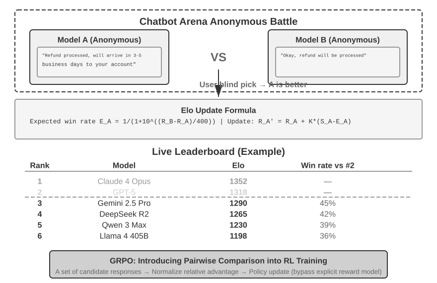

# 5b — Pairwise ranking: Elo and Bradley–Terry

> Pairwise votes become a ranking only if each vote survives an order swap, and a ranking you publish should come from a Bradley–Terry fit with intervals, not from an online Elo.

This note continues [05](05-llm-as-judge.md): once you have a pairwise judge (or human voters), how to turn many "A or B" verdicts into a ranking, and which caveats the public arenas carry. [Note 15](15-calibration-against-human-labels.md) then checks the judge against human labels.

---

## Pairwise ranking: Elo and Bradley–Terry


*Image Source: Li, [AI Agents in Depth](https://github.com/bojieli/ai-agent-book/blob/main/book-en/chapter7.md) (2026), Fig. 7-6 (Apache-2.0)*

When there's no absolute standard, ask "which is better, A or B?" and turn many such votes into a ranking.

- **Bradley–Terry** gives each system a latent strength. P(A beats B) depends only on the difference in strengths.
- **Elo** is the online-update form of that model. Everyone starts at 1000. After each match, the winner gains points in proportion to how surprising the win was. A 1200-rated model is expected to beat a 1000-rated one about 76% of the time, and an upset moves both ratings more.
- **Chatbot Arena** ranks models this way from millions of blind human votes. The catch: the ranking reflects what users happened to ask. A flood of coding questions lifts coding models.

Huyen adds numbers to the Arena caveats (*AI Engineering*, ch. 3, figures from 2023–24):

- **It switched from Elo to Bradley–Terry**, then rescales BT scores to look like Elo. Elo depends on the order of matches, as the worked example below shows.
- **Coverage is thin.** In January 2024, 57 models and 244,000 comparisons averaged only 153 comparisons per model pair (1,596 pairs).
- **The prompts aren't your traffic.** Of 33,000 published prompts, 180 were "hello" or "hi", and one brainteaser was asked 44 times.
- **Preference isn't capability.** "B beats A" fits B good and A bad, both bad, or both good. If A resolves 70% of support tickets, a 51% win rate for B says nothing about how many B would resolve, so you can't weigh it against B costing twice as much.

A later audit adds a selection effect. [arXiv:2504.20879](https://arxiv.org/abs/2504.20879) (Singh et al., NeurIPS 2025 Datasets and Benchmarks; numbers from arXiv v2) argues that **a provider can test many private variants and publish only the best, which lifts the score without lifting quality**. In the authors' scrape of 5,864 battles from January to March 2025, Meta had 27 private variants on the main leaderboard and Google 10. Their own test on the vision leaderboard gave two identical Aya-Vision-8B checkpoints 1052 and 1069, with four models ranked between them, and their simulation puts best-of-20 selection at about +50 points. Read it as a mechanism, not a measured inflation: the real-world evidence is two pairs of the authors' own models with overlapping intervals, no other provider's private scores were observed, and most of the authors work at Cohere, which competes on the Arena.

The update in two lines, with K setting how far one match moves a rating:

```
expected  E_A = 1 / (1 + 10^((R_B − R_A) / 400))     # 1200 vs 1000 → 0.76
update    R_A ← R_A + K · (S_A − E_A)                # S_A = 1 win, ½ tie, 0 loss
```

With an LLM judge doing the voting, **swap the order** on every pair and count a win only if it holds both ways, as in the position-bias row of [05](05-llm-as-judge.md#known-biases). Bradley–Terry also assumes preferences are transitive (A > B > C ⇒ A > C). Judges and humans often violate that, so check for cycles before trusting a ranking.

The same "compare candidates to each other" idea drives GRPO in post-training ([gen-AI 05-RL](../../05-RL/README.md)).

The swap check, condensed from the lab's judge. `ask` is your model client: it sends one prompt and returns the text.

```python
def judge_once(ask, question, first, second) -> str:
    verdict = ask(f"Question:\n{question}\n\nAnswer A:\n{first}\n\nAnswer B:\n{second}\n\n"
                  "Which answer is better? Output only A, B or tie.").strip().lower()
    if verdict not in ("a", "b", "tie"):
        raise ValueError(f"unparseable verdict: {verdict!r}")   # a grader error, not a result
    return {"a": "A", "b": "B", "tie": "tie"}[verdict]

def judge_pair(ask, question, a, b) -> str:
    first = judge_once(ask, question, a, b)         # "A" | "B" | "tie"
    second = judge_once(ask, question, b, a)        # same pair, order swapped
    second = {"A": "B", "B": "A"}.get(second, second)   # map back to the real answers
    return first if first == second else "tie"      # a win must survive the swap
```

### Worked example: online Elo vs. a Bradley–Terry fit

These snippets are trimmed from Li's Elo leaderboard lab (link below). Both methods read the same battle table: one row per vote, with `model_a`, `model_b` and `winner` ∈ {`model_a`, `model_b`, `tie`}.

**Elo** walks the votes in order and nudges two ratings per vote:

```python
def expected(r_a, r_b):                       # P(A beats B) from the rating gap
    return 1 / (1 + 10 ** ((r_b - r_a) / 400))

def update(ratings, a, b, winner, k=4, init=1000):
    r_a, r_b = ratings.get(a, init), ratings.get(b, init)
    e_a = expected(r_a, r_b)
    s_a = {"model_a": 1.0, "model_b": 0.0}.get(winner, 0.5)   # a tie is half a win
    ratings[a] = r_a + k * (s_a - e_a)        # surprise × K
    ratings[b] = r_b + k * ((1 - s_a) - (1 - e_a))
```

**Bradley–Terry** ignores order. It counts wins per pair, then fits every strength at once with a logistic regression, which is how Chatbot Arena computes its leaderboard:

```python
import numpy as np
import pandas as pd
from sklearn.linear_model import LogisticRegression

models = sorted(set(df.model_a) | set(df.model_b))
def pivot(rows):                              # counts per (a, b), on the full square
    return (pd.pivot_table(rows, index="model_a", columns="model_b",
                           aggfunc="size", fill_value=0)
              .reindex(index=models, columns=models, fill_value=0))

a_win = pivot(df[df.winner == "model_a"])
b_win = pivot(df[df.winner == "model_b"])
tie   = pivot(df[df.winner.str.startswith("tie")])
tie   = tie + tie.T                           # a tie counts for both directions
wins  = 2 * a_win + 2 * b_win.T + tie         # wins weigh 2, a tie 1 each way

X, y, w = [], [], []
for i, m_a in enumerate(models):
    for j, m_b in enumerate(models):
        if i == j: continue
        x = np.zeros(len(models)); x[i], x[j] = np.log(10), -np.log(10)
        X += [x, x]; y += [1, 0]              # the same pair, once as a win, once as a loss
        w += [wins.loc[m_a, m_b], wins.loc[m_b, m_a]]

lr = LogisticRegression(fit_intercept=False, penalty=None).fit(X, y, sample_weight=w)
ratings = pd.Series(400 * lr.coef_[0] + 1000, index=models)
```

Two details are easy to get wrong:

- **Ties.** Count a tie as half a win for each side, in both methods. Drop ties and two models that keep drawing drift apart on noise.
- **The pivot.** Reindex every pivot to the full model × model square *before* you add the transpose. Small samples give pivots with different rows and columns, and pandas aligns on labels, so `tie + tie.T` on a ragged pivot fills cells with NaN or zeroes them. The ties then vanish from the fit without an error.

Why run both? **Elo depends on the order of the votes. Bradley–Terry is a global fit, so it doesn't.** Here is the lab's offline simulator: 3,000 battles between eight models with known skills, 10% ties. Elo (K = 4) was run on five shuffles of the same battles:

```text
                true     BT   Elo min  Elo max
gpt-4           1250   1116     1114     1133
claude-3-opus   1225   1114     1100     1110
gemini-1.5-pro  1180   1058     1051     1068
mixtral-8x7b    1075    974      955      988
vicuna-13b       935    876      862      887
```

Both recover the true order, and the gaps between models match. The absolute level differs because each method anchors its own mean. Elo moved up to 34 points depending only on the order of the votes. At K = 32 the spread reached 148 points, enough to swap the top two. Use Elo for a live, streaming leaderboard. Use Bradley–Terry, with bootstrap confidence intervals, for any ranking you publish or gate on.

**Run the full lab:** [ai-agent-book/chapter7/elo-leaderboard](https://github.com/bojieli/ai-agent-book/tree/main/chapter7/elo-leaderboard) (Li, ch. 7 Elo leaderboard lab, formerly 6-6; Apache-2.0). Inside it, run `pip install -r requirements.txt && python quickstart.py` for an offline demo. `python cli.py --help` lists the simulate → Elo → leaderboard pipeline.

---

## Pitfalls

- **Publishing an Elo ranking.** Symptom: the same votes in a different order give a different rating, by up to 148 points at K = 32 in the worked example. Fix: use Elo for a live leaderboard, and Bradley–Terry with bootstrap confidence intervals for any ranking you publish or gate on.

## Try it

1. Two systems start at 1000 and 1200, with K = 32, and the weaker one wins. By how much do the ratings move?

   <details><summary>Answer</summary>

   The weaker side's expected score is 1 / (1 + 10^(200/400)) = 0.24, so it gains 32 × (1 − 0.24) = **24.3** points and the stronger side loses the same. A win by the favourite (E = 0.76) moves only 7.7 points.

   </details>

## Interview checklist

| Prompt | Answer in one line |
|---|---|
| Why did Chatbot Arena move from Elo to Bradley–Terry? | Elo depends on the order of the matches, and Bradley–Terry is a global fit that doesn't. Its coverage is still thin: 153 comparisons per pair in January 2024. |
| What can break a Bradley–Terry ranking from an LLM judge? | Position bias and cycles. Swap the order on every pair and count a win only if it holds both ways. The model also assumes preferences are transitive, which judges and humans often violate, so check for cycles before trusting the ranking. |

## Next

[15-calibration-against-human-labels.md](15-calibration-against-human-labels.md): check the judge against human labels before it gates anything.
