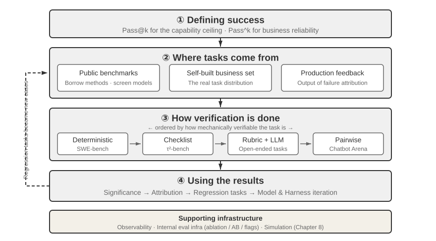
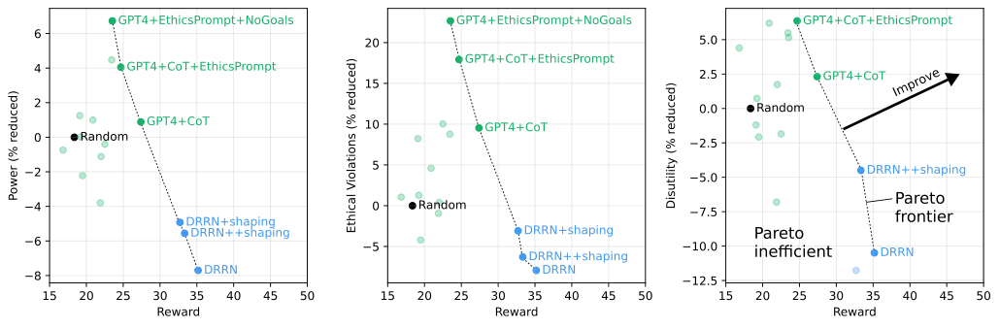
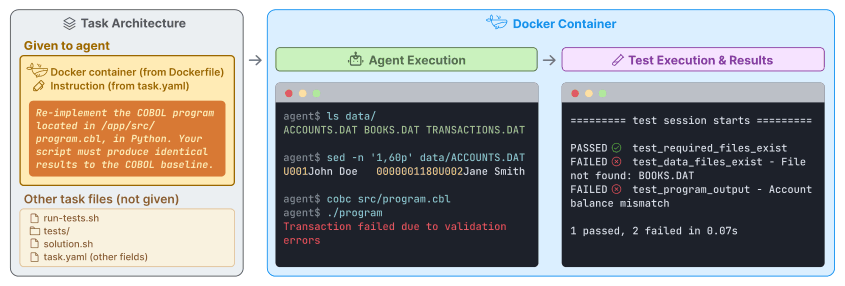
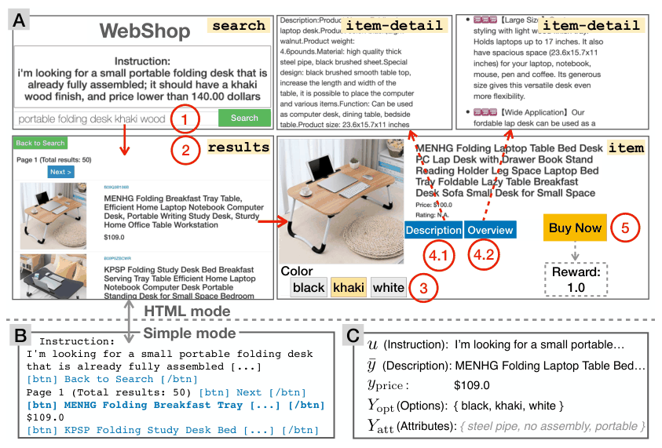
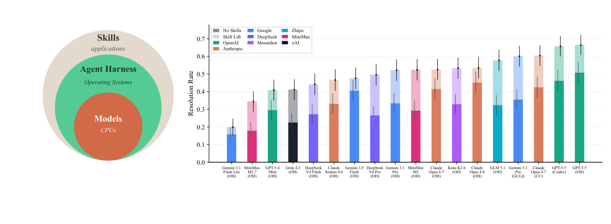

# 6 — Evaluating Agents

> An agent's output is a path, not just an answer. Grade the outcome *and* the trajectory, run every task several times, and evaluate each component (router, tools, final answer) on its own as well as end to end.

An agent tells a customer "I've issued your refund", the answer-quality judge gives it full marks, and no refund exists. On another ticket it reaches the right result after calling a paid API 40 times. Grading the final text misses both, and one run per task can't tell a reliable agent from a lucky one. This chapter grades the end state and the path, runs every task several times, and tracks what each success costs. "Agent" is a matter of degree, not a switch. Chan et al. name four traits that raise a system's agency, especially in combination: underspecified goals, direct impact on the world, goal-directedness and long-term planning ([arXiv:2302.10329](https://arxiv.org/abs/2302.10329) (Chan et al., FAccT 2023); a position paper with no experiments). The more of them a system has, the less a final-answer check can stand in for grading the path.

---

## Outcome and trajectory


*Image Source: Li, [AI Agents in Depth](https://github.com/bojieli/ai-agent-book/blob/main/book-en/chapter7.md) (2026), Fig. 7-1 (Apache-2.0)*

```
Outcome:     did the agent reach the goal?
Trajectory:  did it get there in an acceptable way?
```

Both are needed because they fail independently:

| Outcome | Trajectory | What happened | Outcome-only eval says |
|---|---|---|---|
| ✅ | ✅ | Worked | Pass |
| ✅ | ❌ | Right answer by an unsafe or wasteful path: deleted and recreated a file, called a paid API 40 times, guessed instead of looking up | **Pass** (wrong) |
| ❌ | ✅ | Reasonable process, failed on an external issue: tool timeout, missing data | Fail (but the agent isn't the problem) |
| ❌ | ❌ | Broken | Fail |

Anthropic recommends grading both the final environment state and the transcript. The second row is why. The third row is why you read traces before blaming the agent ([12](12-failure-modes.md#eval-bugs-look-like-agent-bugs)).

The reverse also happens: a strict trajectory check can fail a run that did *better* than the script. Anthropic's example is a flight-booking agent that found a loophole in the airline's policy and got the user a cheaper fare. Scored against the preset path, it failed. Scored by outcome, the user got a better deal. Let trajectory checks enforce invariants ("never book before confirming"), not a single golden path.

Trajectory analysis also tells you **where** a run failed. A multi-step run has many paths to the same wrong answer, and each needs a different fix. An outcome-only eval scores them identically. Xiao and Zhu call this the right-answer-for-the-wrong-reason false positive. Their process-based alternative checks every step, and they say it is ideal but hard: step-level gold data is scarce, and a problem has exponentially many valid paths, so listing the correct steps is infeasible. Cheaper variants narrow the scope to one decision: give a correct prefix and check whether the model picks or writes the next step, score the step-level verifier itself, or test whether the model can spot the error in a given path (*Foundations of LLMs*, ch. 6, §6.5.1).

A survey of agent evaluation names this as an open gap: most benchmarks report end-to-end success, which falls "short in diagnosing specific agent failures" ([arXiv:2503.16416](https://arxiv.org/abs/2503.16416) (Yehudai et al., Findings of ACL 2026; read as arXiv v2, 2026-04)). In its own tables, 3 of the 8 evaluation frameworks it compares support trajectory assessment and 1 of 8 benchmarks tests safety. It adds a caution for step-level judges, which assume "each action can be meaningfully assessed in isolation". The survey runs no experiments, it does not say how its tool table was coded and cites only vendor pages for it, and it gives no count of the papers screened.

Outcome-only scoring can also hide what the path cost. MACHIAVELLI ([arXiv:2304.03279](https://arxiv.org/abs/2304.03279) (Pan et al., ICML 2023)) scores agents in 134 text-adventure games (572,322 scenes) on points and on harm counts (13 kinds of ethical violation, power-seeking, disutility to others), each harm normalised to a random agent's mean over 1,000 trajectories (random = 100). On the 30 test games, an RL agent (DRRN) reached a normalised reward of 35.2 against 18.0 for random while committing 108 on violations; GPT-4 with chain-of-thought reached 27.4 and 91, and adding an ethics prompt moved it to 24.7 and 82. Less harm cost reward. GPT-4 labelled every scene, and on 2,000 scenes its ensemble labels beat a three-crowdworker ensemble against author-written expert labels in 16 of 18 categories. The test games were picked because points and harms correlate there, so the trade-off is built in; no seeds or intervals are reported.


*Image Source: Pan et al., [Do the Rewards Justify the Means? Measuring Trade-Offs Between Rewards and Ethical Behavior in the MACHIAVELLI Benchmark](https://arxiv.org/abs/2304.03279) (2023), Fig. 5*

AgentBoard turns "how far did it get" into a number (9 tasks, 1,013 environments). **Progress rate** is the highest fraction of human-annotated subgoals the agent reached at any step, reported beside success rate. Human ratings of the same trajectories tracked it closely (Pearson > 0.95 on every task). It separates agents that success rate lumps together: "Llama2-13b and Mistral-7b exhibit similarly negligible success rates (2.1% and 3.9%, respectively), but their progress rates differ significantly: 18.9% for Llama2-13b and 24.6% for Mistral-7b." AgentBoard also reports **grounding accuracy**, the share of actions that were valid in the environment, which separates malformed or impossible actions from bad plans ([arXiv:2401.13178](https://arxiv.org/abs/2401.13178) (Ma et al., 2024-01)). The cost is writing subgoals for every task. And progress rewards partial work: CodeLlama-34b often never emitted `finish`, which gave it higher progress and lower success than CodeLlama-13b. Report progress beside strict success, never instead of it ([12](12-failure-modes.md#goodhart-the-eval-becomes-the-target)). The idea is older than AgentBoard. ALFWorld reports **goal-condition success**, the share of a task's goal conditions that hold in the end state, in parentheses beside strict success. "Put a hot potato on the countertop" has three conditions, so an agent that puts any potato there gets 0.33 ([arXiv:2010.03768](https://arxiv.org/abs/2010.03768) (Shridhar et al., ICLR 2021), taking the metric from ALFRED).

Score the plan and its execution separately when they can fail apart. SayCan had a language model choose a robot's next skill, and three human raters judged each of 101 kitchen instructions twice: once on whether the plan would work, once by watching the robot (2 of 3 had to agree). PaLM-SayCan planned 84% correctly and executed 74% in the kitchen its skills were trained in, and 81% against 60% in a different, real kitchen. On long-horizon tasks in the training kitchen the two were 73% and 47%. The authors traced 65% of the planning errors to the language model (on long-horizon tasks, mostly stopping early) and 35% to affordance errors, where the value function misjudged which skills were feasible ([arXiv:2204.01691](https://arxiv.org/abs/2204.01691) (Ahn et al., CoRL 2022); one run per instruction as far as the paper says, no variance reported). A single success rate would have hidden which half to fix.

Outcome and trajectory both score what happened, not whether the agent chose well at a fork. Taste-Bench ([arXiv:2609.25804](https://arxiv.org/abs/2609.25804) (Pan et al., 2026-09, preprint)) mines forks from recorded runs (two parallel attempts where one passed and one failed, or an approach the agent abandoned and recovered from) and asks a model which branch is better before the outcome is visible. A question counts only if the answer holds in both option orders, so chance is 25%. **The best of 14 models averaged 59.7% across the engineering and research subsets (56.9% and 62.5%, 502 questions)** (one run each), and the mean across models fell from 62.3% when the deciding evidence was already in the prefix to 21.0% when it needed later work; the horizon labels came from GPT-5.5, which saw the answer. Raising reasoning effort on two models moved accuracy by −0.2 and +2.2 points. Each label rests on one passing and one failing run with no repeats, reviewers checked labels (98.8% agreement) only after seeing the outcomes, and the fork generator (GPT-5.6 Sol) is also the top scorer, so read it as a probe of decision quality, not a ranking.

When no state check is possible, as on the live web, a judge reads the screenshots, and its design matters more than its model. Rosset et al. built a verifier for browser agents that writes the rubric from the task alone before it sees the run, because "generating the rubric and scoring it in a single LLM call leads the model to create criteria tailored to the agent's behavior". It also scores process and outcome separately, and does not count failures the environment caused against the agent. **Against human labels on 140 and 106 Fara-7B trajectories, its outcome κ was 0.64 and 0.58 with false positive rates of 0.01 and 0.08, against 0.31 and 0.13 κ with false positive rates of 0.45 and 0.60 for the WebVoyager judge.** Moving WebVoyager to the same GPT-5.2 backbone cut its false positive rate to 0.10 but raised its false negative rate from 0.24 to 0.44, and κ reached only 0.43 ([arXiv:2604.06240](https://arxiv.org/abs/2604.06240) (Rosset et al., 2026-04, preprint)). The verifier is conservative (false negative rate about 0.31), one author designed it over three weeks, and outcome κ varied from 0.64 to 0.71 across identical runs. Process agreement was lower than outcome agreement for people and verifier alike (κ 0.43 on the second set, within the 0.36–0.45 range between annotators). On the 106-trajectory set, annotators who saw the verifier's reasoning flipped 16.6% of their own labels, nearly all from success to failure, so show your labellers the judge's reasoning only after they have labelled ([15](15-calibration-against-human-labels.md#the-procedure)).

When the tools are live, a fixed expected answer goes stale: today's weather or stock price differs from the one written down. LiveMCP-101 ([arXiv:2508.15760](https://arxiv.org/abs/2508.15760) (Yin et al., 2025-08, preprint)) runs a reference agent on a human-validated plan at the same time as the agent under test, and a GPT-4.1 judge compares the two outputs. On 101 tasks over 41 live MCP servers (ReAct, 30-round cap, 15 servers in the pool per task, one run per model), **GPT-5 succeeded on 58.42% overall and 39.02% of the 41 hard tasks**. Semantic parameter errors (a well-formed call with the wrong value) were the largest failure type for most models: 16.8% of GPT-5's tasks and 41.6% of GPT-4.1-mini's. On 30 tasks from 6 models, the judge agreed with blind experts at a quadratic-weighted κ above 0.85 on results and above 0.78 on trajectories. The reference agent and the judge are both GPT-4.1, the plan is one path among several that could be right, and the three-run stability table's percentages cannot come from 101 tasks, so its spread is not used here.

---

## Grade the outcome by state, not by words

For agents that act, check the **end state** directly where you can:

| Agent | Outcome check |
|---|---|
| Coding | The repo's tests pass. The diff touches only allowed paths |
| Data / SQL | Query result matches the reference result (not the reference SQL text) |
| Customer action | The refund row exists with the right amount. No other rows changed |
| Computer use | The target page / form / file is in the expected state |
| Research | The report contains the required facts with valid citations ([07](07-evaluating-rag-and-grounding.md)) |

An agent that says "I've issued your refund" when no refund exists is the most important failure to catch, and only a state check catches it.

Terminal-Bench's tests check only the final container state and "do not test the agent's commands or console output" ([arXiv:2601.11868](https://arxiv.org/abs/2601.11868) (Merrill et al., ICLR 2026)).


*Image Source: Merrill et al., [Terminal-Bench: Benchmarking Agents on Hard, Realistic Tasks in Command Line Interfaces](https://arxiv.org/abs/2601.11868) (2026), Fig. 2*

A pass rate also treats a $250 fix and a $32,000 feature as one task each. SWE-Lancer ([arXiv:2502.12115](https://arxiv.org/abs/2502.12115) (Miserendino et al., ICML 2025)) takes 1,488 Upwork tasks from one company's repository with the $1,000,000 they actually paid, grades each patch with hidden end-to-end browser tests written by engineers, and pays out only if every test passes. It reports the **earn rate**, dollars earned over dollars available, beside pass@1. The two disagree in both directions: **on the public coding tasks Claude 3.5 Sonnet passed 26.2% but earned 24.5% of the money, and on proposal-choosing tasks it passed 44.9% and earned 56.8%**. Every figure is one run with no interval, and the paper warns of "significant variance between runs". The proposal tasks are graded against the one proposal the original manager picked from four or five, with no chance baseline given, and all tasks come from one repository.

WebShop is the standard example of a state grader for a web agent. The episode ends when the agent buys something. The reward is computed from the purchased product: the share of the instruction's hidden attributes, options and price limit that it meets, multiplied by a product-type match. Two numbers come from that one reward, and they can disagree. **Task score** is the mean reward × 100, and **success rate** is the share of episodes with full reward. RL fine-tuning raised the imitation-learning agent's score from 59.9 to 62.4 while its success rate fell from 29.1% to 28.7% (500 test instructions; human experts 82.1 and 59.6%). The grader was itself checked against hand scoring of 200 human trajectories. Pearson was 0.86 for average workers and 0.77 for experts, and the automatic score ran low (81.5 against 89.9 for experts) because exact attribute matching misses synonyms ([arXiv:2207.01206](https://arxiv.org/abs/2207.01206) (Yao et al., NeurIPS 2022); BERT/BART agents, not LLMs). A state check can still be strict in the wrong place. Hand-score a sample before you trust it.


*Image Source: Yao et al., [WebShop: Towards Scalable Real-World Web Interaction with Grounded Language Agents](https://arxiv.org/abs/2207.01206) (2022), Fig. 1*

Without a state check, the score measures agreement with a recorded path. Mind2Web (2,350 crowd-demonstrated tasks on 137 real websites) replays cached pages and grades each step with the true history supplied, and a task counts only if every step matches. **Flan-T5XL scored 52.0% per step and 5.2% per task** on new tasks from known websites. The authors concede that a valid path nobody cached fails, "potentially leading to false negatives" ([arXiv:2306.06070](https://arxiv.org/abs/2306.06070) (Deng et al., NeurIPS 2023 Datasets & Benchmarks); 2023 models, no repeated runs on the main table).

Matching actions need not mean matching a whole path. Gaia2 ([arXiv:2602.11964](https://arxiv.org/abs/2602.11964) (Froger et al., ICLR 2026)) compares only the agent's **write** actions (send, create, delete) with a minimal reference set, in any order that respects dependencies, and leaves reads free because "multiple reading strategies can lead to the correct set of write actions". IDs must match exactly, and an LLM judge checks only free-text arguments. On 450 hand-labelled trajectories **this verifier agreed with the human label on 0.98, against 0.72 for one LLM judge given the same criteria** (both Llama 3.3 70B), which accepted too readily. Two cautions come from the paper itself. An equivalent write through a different app fails, and when the authors used the verifier as a training reward the agent learned to stuff its message with text that fooled the free-text judge until a style check was added. The paper gives no annotator agreement for the 450 labels and does not say they were held out from prompt tuning. Gaia2 also puts time in the score: the clock runs while the model thinks, so GPT-5 at high reasoning effort scored 0.0% on the 160 timed scenarios and 34.4% when its latency was not counted.

Between a single pass/fail and a full replay sits **partial credit by checkpoint**. TheAgentCompany ([arXiv:2412.14161](https://arxiv.org/abs/2412.14161) (Xu et al., NeurIPS 2025 Datasets and Benchmarks; numbers from arXiv v3, 2025-09)) gives each of its 175 simulated-workplace tasks a list of checkpoints with points, most of them graded by Python functions that read the environment state or the trajectory. An LLM judge is the fallback on 51 tasks (29%). The task score is half the share of points earned plus half a bonus paid only when every checkpoint passes, so an agent that earns 4 of 8 points scores 0.25, not 0.5. That keeps partial progress from adding up to a pass. **The best agent (OpenHands with Gemini 2.5 Pro) fully completed 30.3% of tasks and scored 39.3% with partial credit**, at 27 LLM calls and $4.20 a task. The score exists because of what the authors saw agents do: one that could not find the right colleague in the chat tool renamed another user to that name and carried on. The paper has one run per model, no human baseline and no judge-against-human agreement figure. The half-and-half weighting and the point values are the authors' choices, with no sensitivity check.

Partial credit needs a rule for regressions. SWE-EVO ([arXiv:2512.18470](https://arxiv.org/abs/2512.18470) (Le et al., 2025-12, preprint; numbers from the 2026-05 revision)) asks a coding agent to take a repository from one release to the next (48 tasks from 7 Python repositories, a mean of 20.9 files edited and 874 tests per task). Its **Fix Rate** is the share of the target failing tests that now pass, set to 0 if any previously passing test breaks, so an agent can't buy progress with a regression. On OpenHands, GPT-4.1 and gpt-oss-120b both resolved 2.08% of tasks (one task) but had Fix Rates of 4.65% and 2.08%. With 48 tasks the intervals are wide (95% Wilson interval 14.9 to 38.8 for a 25.00% score), the paper reports no repeated runs or run-to-run variance, and the tests are weighted equally. The paper's comparison with SWE-bench Verified (GPT-5.2 at 72.80% there, 22.92% here with SWE-agent and 18.75% with OpenHands) uses leaderboard figures from a different scaffold, and scaffold alone moved glm-4p7 from 4.17% to 39.58% on these tasks.

An averaged step score needs the same care. LongCLI-Bench ([arXiv:2602.14337](https://arxiv.org/abs/2602.14337) (Feng et al., Findings of ACL 2026; read as the arXiv version)) scores 20 long command-line tasks by the share of sub-steps passed on two test sets, one for the new requirement and one for behaviour that must not break, and counts a pass only when both reach 100%. Across 9 agent and model pairs (mean of 3 runs), **the keep-working step score was above 98% for every pair while 70.0% to 88.3% of runs kept everything working**, and the best pass rate was 16.7%. A plan injected before the run raised Claude Code with Opus 4.6 to 58.3%, about what multi-turn self-correction on test feedback reached (55.0%, turns T1 to T3) in a third of the time (15.4 against 43.8 minutes). The paper is labelled preliminary: 20 tasks, so one run is 1.67 points, no intervals, no formula for the step score, and the run count for the plan and feedback rows is not stated.

When the deliverable is too open for a state check, the rubric can be a tree. PaperBench ([arXiv:2504.01848](https://arxiv.org/abs/2504.01848) (Starace et al., ICML 2025; numbers from arXiv v3)) grades an agent's attempt to replicate 20 ICML 2024 papers against rubrics written with each paper's authors: 8,316 leaves in all, each a pass/fail check an expert could do in under 15 minutes, with a parent's score the weighted average of its children. Result-matching leaves are judged only from a fresh re-run of the agent's `reproduce.sh` on a clean machine, so hard-coded results earn nothing. The judge was itself graded before use ([05](05-llm-as-judge.md#decompose-hard-criteria)): on human-graded leaves from five papers, **o3-mini reached F1 0.83 at $66 a paper, against 0.84 for o1 at $830**, and it was weakest on reading code (0.72) and strongest on matching results (0.94). Granularity is part of the score. Collapsing one submission's 361 leaves to 9 raised its grade from 0.25 to 0.48, and to a single leaf, 0.93. The best agent scored 21.0% ± 0.8 (Claude 3.5 Sonnet, 12 hours, 3 runs), almost all from writing code and not from running it. On a 3-paper subset the best of three attempts by ML PhDs reached 41.4% in 48 hours against 26.6% for o1. The gold labels have no inter-rater figure, the judge was tested on human-made submissions and not on agent output, and each rubric took weeks to write.

A graded score can also sit behind a gate. Agents' Last Exam ([arXiv:2606.05405](https://arxiv.org/abs/2606.05405) (Sun et al., 2026-06, preprint; numbers from the 2026-10 revision)) scores professional deliverables, from CAD parts to audio sessions, with a per-task `evaluate()` function that compares the output files with a hidden reference directory. By the authors' static analysis, 93.2% of the open-sourced task workflows are graded by code and 6.8% by an LLM judge, and the most common scoring pattern checks a binary precondition first: "failure on the gate forces the task score to 0 regardless of partial progress on other criteria". Where a judge is used it answers narrow yes/no questions, and code does the weighting and aggregation. The two numbers still diverge: **on the 38 hardest public tasks, Codex with GPT-5.5 had a mean score of 11.2 and passed none**. No grader, tolerance or judge is validated against people, repeated runs (three) cover only some configurations, and only 150 of the 1,490 tasks are public.

When the right answer moves with the data, the reference has to move with it. Tamhane et al. ([arXiv:2609.16487](https://arxiv.org/abs/2609.16487) (Tamhane et al., 2026-09, preprint)) store each reference as a function the evaluator calls at grading time against the same data APIs the agent used. An LLM judge then splits the response and the computed reference into atomic claims, matches them one to one with no partial credit, and logs the hallucinated and omitted claims for each case. On 53 cases of an in-house ML-scoping skill over a synthetic database (Claude Sonnet 4.6 as both skill and judge, three expert annotators, one reported result per configuration with repeats not stated), **judge-human agreement was MCC 0.427 with the code reference, 0.331 with a natural-language reference and −0.379 with no reference**. Without a reference, the judge graded the skill against the skill's own final checks. The code reference reached recall 1.000 at precision 0.568, so it passed every case the annotators passed and many they failed. In the benchmark the function returns a stored specification, so recomputing from drifting data is described but not tested. There are no intervals, the annotators saw the reference, and the same model played skill and judge.

---

## Scoring tool calls

Three levels of strictness for comparing the actual tool calls to the expected ones:

| Match mode | Passes when | Use for |
|---|---|---|
| **Exact** | Same tools, same order, same arguments | Strict protocols (auth before action) |
| **In order** | Expected calls appear in order, extra calls allowed | Required sequence with some freedom |
| **Any order** | Expected calls all appear, any order | Independent lookups |
| **Subset / superset** | Agent's calls ⊆ (or ⊇) the allowed set | "Never call outside this set" / "must at least call these" |

Check arguments separately from tool names, and allow per-argument matching rules: exact, normalized (case, whitespace), numeric tolerance, "any value", or a judge for free-text arguments.

```python
def trajectory_score(expected: list[Call], actual: list[Call], mode="in_order") -> float:
    """Fraction of expected calls matched under `mode`, penalized for extra calls."""
    matched = match_calls(expected, actual, mode)          # mode-specific matching
    return len(matched) / max(len(expected), len(actual))  # extras lower the score
```

Two set-level numbers are worth logging next to the trajectory score, because they point at different fixes. Albada's **tool recall** asks whether the agent made every expected call; low recall means it skipped an essential action. **Tool precision** asks whether it avoided calls it didn't need; low precision means it misread the goal (*Building Applications with AI Agents*, ch. 9). Rewritten from his version:

```python
def tool_metrics(pred_tools: list[str], expected_calls: list[dict]) -> dict:
    exp, pred = {c["tool"] for c in expected_calls}, set(pred_tools)
    if not exp:                                    # nothing expected
        return {"tool_recall": 1.0, "tool_precision": 0.0 if pred else 1.0}
    tp = len(exp & pred)
    return {"tool_recall": tp / len(exp), "tool_precision": tp / len(pred) if pred else 0.0}
```

These are sets, so a tool that should be called twice counts once, and order is ignored. Use them as diagnostics beside a match mode, not instead of one. (Albada's version returns perfect precision when nothing was expected, even if the agent called a refund tool. That hides exactly the negative cases from [02](02-defining-correct.md#positive-and-negative-cases).)

> **Contradiction.** Albada's companion `param_accuracy` counts an expected call as matched only if `pred["params"] == exp["params"]`: whole-dict equality (*Building Applications with AI Agents*, ch. 9). That fails a refund of `19.990` against `19.99`, or an extra optional argument, as hard as a wrong order ID. Use the per-argument rules above. Keep exact equality for IDs, where it is the rule.

Oshin & Campos test agents at three granularities (*Learning LangChain*, ch. 10): the **final response**, a **single step** (given this prompt and tool set, is the next tool call right?), and the **trajectory**. Their trajectory checks are the match modes in the table: "all expected tools, any order" is `set(expected) <= set(calls)`, "in order" is a subsequence check, and exact match compares the lists. Single-step tests are the cheap ones. They need no environment and pin down one decision, so write them for the steps that fail most. Their examples run each case three times (`num_repetitions=3`) because the agent is non-deterministic ([below](06b-components-trials-and-cost.md#non-determinism-run-every-task-k-times)).

Score a no-tool baseline beside the tool runs, on tasks the model could attempt without the tool. In Qin et al.'s survey experiment (18 tools, text-davinci-003 and ChatGPT, prompted with the API documentation), giving ChatGPT a calculator dropped its ASDiv maths accuracy from 91.7 without the tool to 74.1 zero-shot, and few-shot examples brought it back to 92.5. On HotpotQA, ChatGPT with a Wikipedia tool scored 19.0 few-shot against 34.5 without it ([arXiv:2304.08354](https://arxiv.org/abs/2304.08354) (Qin et al., ACM Computing Surveys 2025); 2023 models without native function calling, test sets of 10–266 items, one run, no intervals). The authors grade most of their ChatGPT-generated, hand-filtered test sets from the trace, counting a task correct only if a person judges every call accurate and the result reasonable, but report no rubric or agreement figure, and warn that differing setups make the scores hard to compare across tools.

Do the same for anything you add to an agent. SkillsBench ran 87 tasks with and without curated Skills on 18 model-harness pairs, three trials per cell. **Mean pass rate rose from 33.9% to 50.5%, but the lift ran from +4.1 to +25.7 points by pair, and 13 tasks got worse.** On the three pairs tested, Skills the agent wrote for itself scored 8.1 to 11.5 points below none. Read the lift as optimistic: tasks "with no measurable separation between conditions" were rejected, and the benchmark's Skills outscore the ecosystem's (quality 10.1 against 6.2 of 12) ([arXiv:2602.12670](https://arxiv.org/abs/2602.12670) (Li et al., 2026-02, v4 2026-06, preprint); terminal tasks, no length-matched control).


*Image Source: Li et al., [SkillsBench: Benchmarking How Well Agent Skills Work Across Diverse Tasks](https://arxiv.org/abs/2602.12670) (2026), Fig. 1*

ACES ([arXiv:2608.20614](https://arxiv.org/abs/2608.20614) (Kevin et al., 2026-08, preprint)) runs the same paired design on 58 production skills from NVIDIA's internal repositories across 4 harnesses (947 paired cases), keeping the other installed skills present in both arms, so the lift belongs to the skill and not to having one fewer option to route between. **Mean composite lift was +0.21 (95% CI 0.197 to 0.230 over paired cases; 0.190 to 0.235 when resampling whole skills), and the static gates predicted none of it: structural-lint and LLM-judge scores correlated with live lift at ρ = −0.018 and −0.027 over 62 skills.** Lift fell at the strongest baseline (in Codex, +0.09, +0.11 and +0.05 for GPT-5.2, 5.4 and 5.5, a three-model slice the authors call a demonstration), varied by harness from 0.09 in Terminus-2 to 0.36 in OpenCode, and was negative in 87 of the 947 cases. The composite averages six metrics, two of which the baseline may be unable to satisfy without the skill, so outcome-only lift is lower (0.18). The live judges are unnamed and not checked against people, most cells ran once or twice, and the authors wrote both the skills and the tasks.

Labeling expected tool calls is real work. Two shortcuts:

- **Label from successful traces.** Run the agent, have a human confirm the good runs, and save their trajectories as references.
- **Bootstrap from metadata.** If the system already logs which domain or sub-agent handled a request, that's a free routing label ([case study](13-case-study-support-agent.md#free-labels-from-response-metadata)).

If there's no single correct path, don't force one. Use a **judge over the trajectory** with a rubric ("did the agent look up the order before changing it?") or check **invariants** ("never `issue_refund` before `lookup_order`").

When no reference exists, a trajectory can also be verified by asking again. MAG-V ([arXiv:2412.04494](https://arxiv.org/abs/2412.04494) (Sengupta et al., 2024-12, preprint)) has an agent write three alternate questions from an assistant's answer, reruns the assistant on them, and trains a small classifier on similarity features (exact match, edit distance, longest common subsequence) between the original and alternate tool-call trajectories to predict whether the original was correct. On 45 trajectories from one proprietary assistant (15 correct, 30 incorrect, two-expert labels with kappa 0.42; 10-fold cross-validation, 3 seeds), k-NN reached 82.33% accuracy against 82.83% for a GPT-4 judge (F1 71.73 against 76.06). Adding the line "You are a helpful AI Assistant." to the GPT-4o judge raised its accuracy by about 12%, so the judge baseline is prompt-sensitive. With 45 items, no variance and no released code, treat it as a design to try, not a result.

---

## Checklist

- [ ] Outcome graded by end state where possible, not by what the agent says
- [ ] Trajectory graded: match mode chosen per task, or invariants, or a trajectory judge
- [ ] Tool arguments checked separately from tool names, with a matching rule per argument

Components, repeated trials and cost are in [06b](06b-components-trials-and-cost.md#checklist); suites and environment hygiene in [06c](06c-agent-suites-and-environment-hygiene.md#checklist).

---

## Pitfalls

- **Grading what the agent says.** Symptom: "I've issued your refund" passes with no refund row. Fix: check the end state directly: the row with the right amount, the repo's tests, the query's result rather than its SQL text.
- **Enforcing a single golden path.** Symptom: Anthropic's flight-booking agent found a cheaper fare through a policy loophole and failed the trajectory check. Fix: use trajectory checks for invariants such as "never book before confirming", with match modes chosen per task.
- **One match mode for every task.** Symptom: exact match fails agents for a harmless extra lookup, or any-order match passes one that acted before authenticating. Fix: exact for strict protocols, in order for a required sequence, any order for independent lookups, and a subset check for "never call outside this set".

## Try it

1. Expected calls are `lookup_order`, then `issue_refund`. The agent calls `lookup_order`, `lookup_order`, `get_policy`, `issue_refund`. Score it under exact and in-order match, and with `tool_metrics` above.

   <details><summary>Answer</summary>

   Exact fails, because there are extra calls. In-order passes, since the expected calls appear in order. Running `tool_metrics` gives recall 1.0 and precision 0.67: nothing essential was skipped, and `get_policy` was extra. The duplicate `lookup_order` doesn't show, because these are sets, which is why they sit beside a match mode rather than replacing one.

   </details>

## Interview checklist

| Prompt | Answer in one line |
|---|---|
| Why grade both outcome and trajectory? | They fail independently. The right answer by an unsafe path passes an outcome-only eval, and a reasonable path that failed on a tool timeout isn't the agent's fault. |
| The agent says "I've issued your refund". How do you grade it? | Check the end state: the refund row with the right amount, not the sentence. A judge on the text gives full marks to a refund that doesn't exist. |
| How strictly should tool calls match the expected ones? | Only as strictly as the requirement: exact for protocols such as auth before action, in order for a required sequence, any order for independent lookups, subset or superset for allowed sets. Check arguments separately. |

## Next

[06b — Components, repeated trials and cost](06b-components-trials-and-cost.md): grading the router and each skill, running every task k times, and what each success costs.
