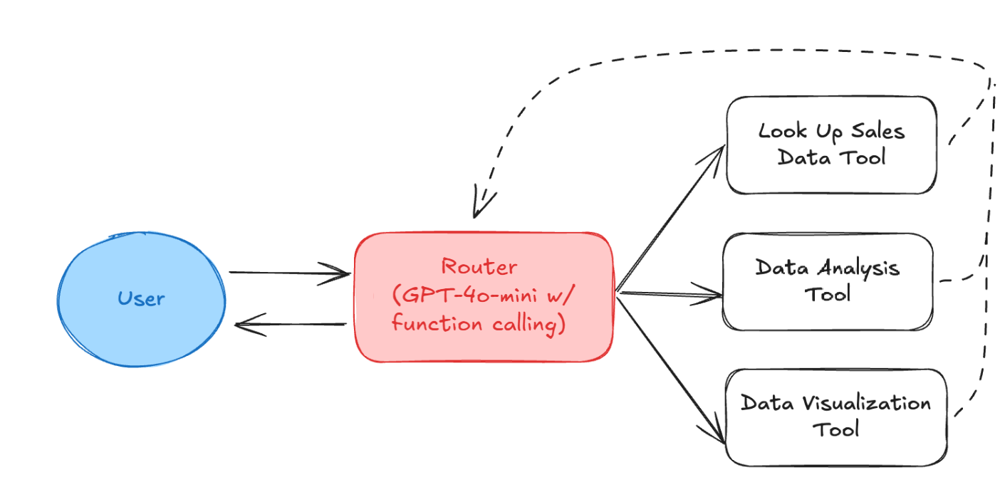
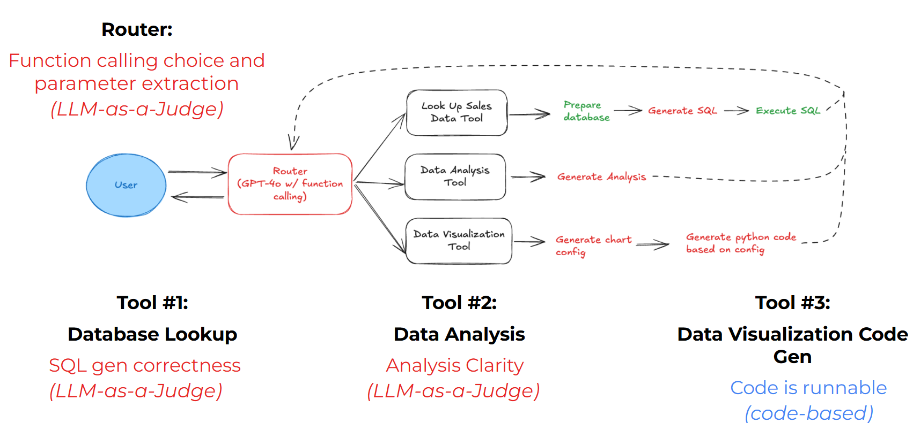
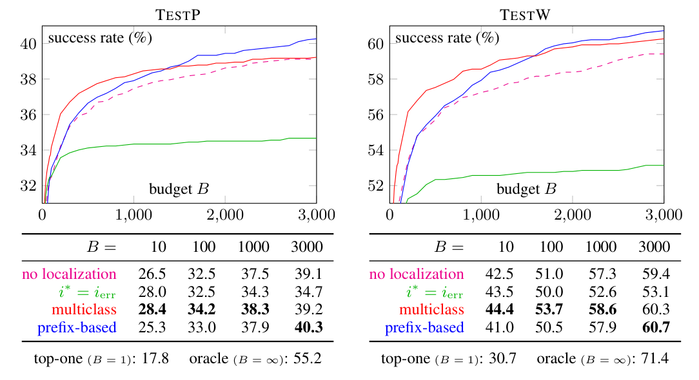
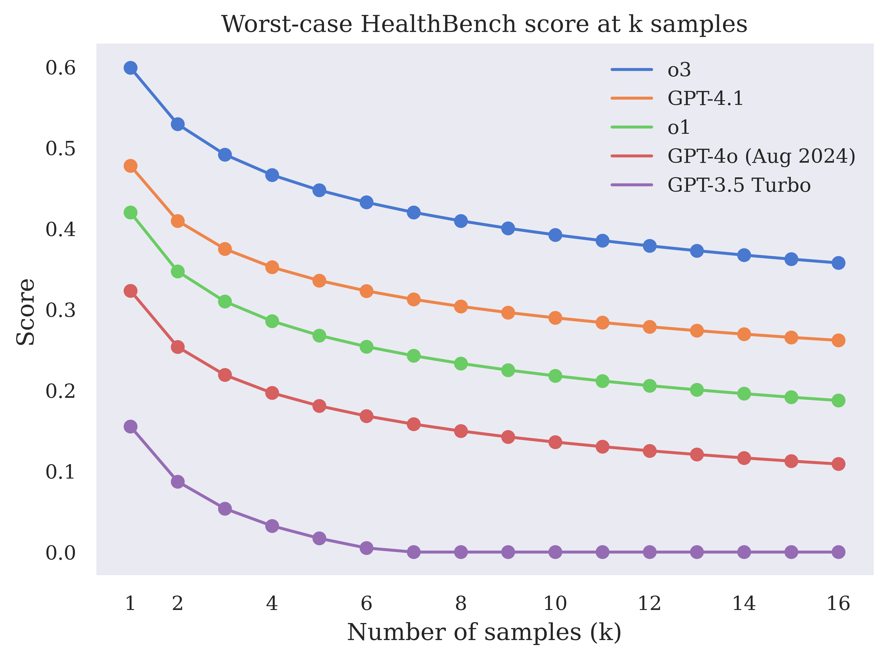
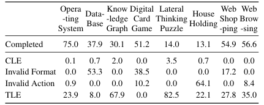
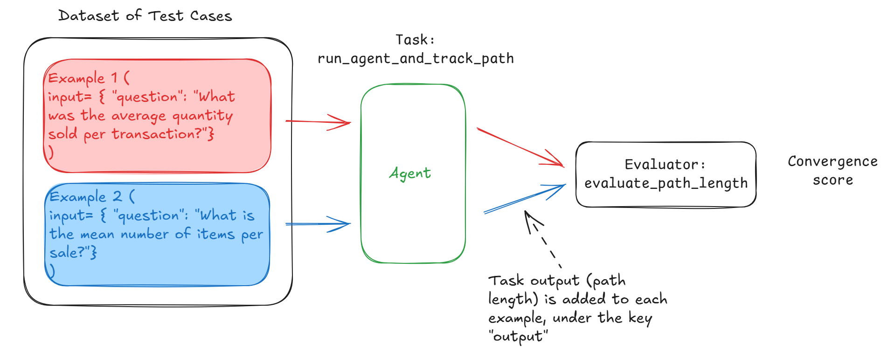
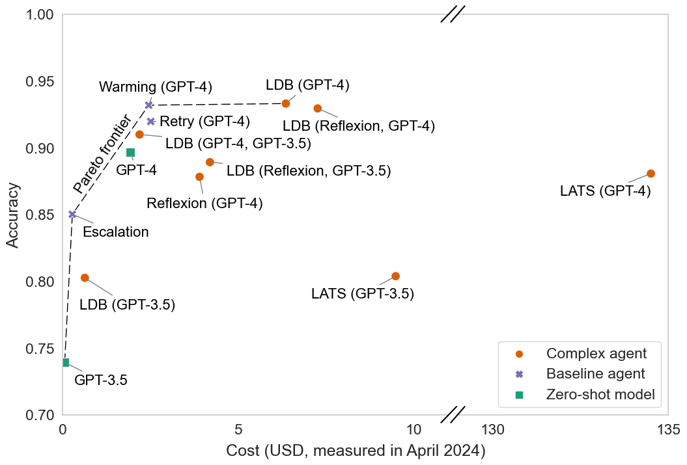

# 6b — Evaluating Agents: Components, Repeated Trials and Cost

> An end-to-end failure doesn't say which part broke, one run doesn't say whether the agent is reliable, and a pass rate doesn't say what the passes cost. Score each component, run every task k times, and log cost per success.

[06](06-evaluating-agents.md) graded one run of an agent by its end state and its path. This chapter widens the view three ways: an evaluator for each component (router, skills, path), several trials per task with pass@k and pass^k, and the steps, tokens, latency and human time behind each success.

---

## Evaluate the components, then the whole

An agent is a router plus skills plus a final answer. Evaluate each, because an end-to-end failure doesn't say which one broke. The DeepLearning.AI [*Evaluating AI Agents*](https://www.deeplearning.ai/short-courses/evaluating-ai-agents/) course (code: [upstream repo](https://github.com/ginny100/DeepLearning.AI-Evaluating-AI-Agents)) builds exactly this on a sales-data agent: a function-calling router that picks between three tools and loops until it can answer.


*Image Source: DeepLearning.AI & Arize, Evaluating AI Agents (2025), Lab 1*

Each box gets its own grader. Three are LLM judges and one is plain code:


*Image Source: DeepLearning.AI & Arize, Evaluating AI Agents (2025), Lab 3*

| Component | Question | Grader in the course |
|---|---|---|
| **Router** | Did it pick the right tool with the right parameters? | LLM judge over the tool-call span (Phoenix `TOOL_CALLING_PROMPT_TEMPLATE`) |
| **Skill: SQL lookup** | Does the SQL answer the question? | LLM judge with the instruction and query |
| **Skill: analysis** | Is the analysis clear? Are entities correct? | Two LLM judges, one per criterion |
| **Skill: visualization** | Does the generated code run? | Code: `exec()` it |
| **Path** | Did it converge in a reasonable number of steps? | Code: optimal steps ÷ actual steps |

The router judge, in the course's code. It pulls every LLM span from the traces, judges each tool choice against the tool definitions, and writes the label back onto the span:

```python
# Pull LLM spans that made a tool call (Lab 3)
query = SpanQuery().where("span_kind == 'LLM'").select(
    question="input.value", tool_call="llm.tools")
df = px.Client().query_spans(query, project_name=PROJECT).dropna(subset=["tool_call"])

with suppress_tracing():                     # don't trace the judge itself
    evals = llm_classify(
        dataframe=df,
        template=TOOL_CALLING_PROMPT_TEMPLATE,   # course pastes tool JSON into it
        rails=["correct", "incorrect"],          # output is snapped to these labels
        model=OpenAIModel(model="gpt-4o"),
        provide_explanation=True)                # reasoning stored next to the label
evals["score"] = (evals["label"] == "correct").astype(int)
px.Client().log_evaluations(SpanEvaluations(eval_name="Tool Calling Eval", dataframe=evals))
```

The visualization check needs no judge:

````python
def code_is_runnable(output: str) -> bool:
    code = output.strip().replace("```python", "").replace("```", "")
    try:
        exec(code)        # course shortcut: run untrusted code only in a sandbox
        return True
    except Exception:
        return False
````

These APIs have moved since the course was recorded. `px.Client()` and `SpanEvaluations`/`log_evaluations` are legacy: current Phoenix uses `phoenix.client.Client` and logs span annotations. phoenix.evals 2.x replaces `llm_classify(dataframe=…)` and `OpenAIModel` with `create_classifier` and `LLM(provider="openai", model=…)`. The course also fills the template's `{tool_definitions}` slot with string `.replace()` calls that turn the JSON braces into quotes. Pass the definitions in as a template variable instead. "Runs without raising" is also a weak check: code that draws an empty chart passes it.

The harness is a component too, so report model and harness together. On Terminal-Bench (89 tasks, at least 5 runs per pair, about ±3 points), GPT-5 resolved 49.6% in Codex CLI and 35.2% in Terminus 2, though the authors conclude that "model selection is usually more important than agent scaffold" (Merrill et al., [above](06-evaluating-agents.md#grade-the-outcome-by-state-not-by-words)).

Inside a harness, an instruction-following score also counts rules the agent would have kept anyway. Harness-IF ([arXiv:2608.11727](https://arxiv.org/abs/2608.11727) (Huang et al., 2026-08, preprint)) labels each rule by what agents do with no instruction at all, and scores the rules that go against that default separately. Over 12 models on 60 multi-turn coding items in 3 rounds (2,160 runs, one harness setup), **every model scored lower on against-default rules, by 3.6 to 7.4 points (mean 5.81)**: Claude Opus 4.7 went from 85.9% to 78.6%. Where a rule lives matters too. In a small synthetic pilot (9 older model builds, 916 runs, deterministic scoring), rules placed in tool or skill descriptions lost conflicts more often than rules in the system prompt, a project file or the user turn, though only 6 of the 9 builds reproduced that ordering. Read the levels with care: 86.8% of the verdicts involve a GPT-5.2 judge, swapping the judge gave 62.1% agreement (κ 0.163 on 116 paired verdicts), and the 60 items were picked from 80 for difficulty.

The same holds for whole agent products on production work. AlphaEval ([arXiv:2604.12162](https://arxiv.org/abs/2604.12162) (Lu, Xu, Zhang, Hua et al., 2026-04, preprint)) built 94 tasks with 7 companies that deploy agents, scored each with at least two kinds of grader weighted by the company's experts, and ran 14 model-and-product pairs. **The same Claude Opus 4.6 scored 64.41 in Claude Code, 61.85 in Cursor, 61.31 in GitHub Copilot and 53.45 in Codex**, and 64.41 was the best score of any pair. Only that top pair ran three times (64.41, 95% CI ±1.83), so the 0.5-to-3-point gaps among the first three products are within run-to-run noise; the Codex gap is not, though each product ran its own pinned CLI version and every other pair ran once. On 20 tasks, the Opus 4.6 judge agreed with each of two experts (κ 0.697 and 0.780 over 1,000 rubric-point judgments) about as well as the experts agreed with each other (κ 0.691), but the judge is also the top-scoring model and no judge swap was run.

For a coding agent, the component before the patch is **localization**: did it edit the right place? SWE-PolyBench ([arXiv:2504.08703](https://arxiv.org/abs/2504.08703) (Rashid et al., 2025-04, preprint)) scores it as set precision and recall of the files the agent changed against the files in the reference patch, and again at the level of the deepest class or function node each change touches. On its 2,110 tasks in four languages, with Claude 3.5 Sonnet under three adapted agents, **the agent with the best Python file retrieval (recall 60.9, precision 77.6) passed 20.1% of Python tasks, and the other two passed 24.1%, one of them at precision 44.2**. The authors call good retrieval "(most of the time) a necessary but not sufficient condition", but they compute no correlation, and the metric is scored against one reference patch, so a valid fix made elsewhere would score low. The pass rate also fell with the number of files to change (Aider: 17.7% for one file, 7.9% for five or more). The run count is not stated; the ± values are bootstrap standard errors, which match what resampling tasks from one run would give.

A human baseline does not remove the harness from the comparison. In a penetration test of a live university network of about 8,000 hosts ([arXiv:2512.09882](https://arxiv.org/abs/2512.09882) (Lin et al., ICLR 2026; read as the 2026-03 arXiv revision)), ten professionals and several agents were scored on the sum of a complexity score and a severity weight for each valid finding. GPT-5 outscored 5 of the 10 humans inside the authors' ARTEMIS scaffold, 2 inside Codex and none inside CyAgent. ARTEMIS was scored on the first 10 hours of a 16-hour run, while Codex and CyAgent stopped within 20 minutes and 2 hours, and the hourly costs are averages over the 16 hours. The ARTEMIS configuration that outscored 9 of the 10 (95.2 against 111.4 for the best human, 82% of submissions valid) cost $59 an hour; the $18.21-an-hour configuration is the one that beat 5, with 55% of its submissions valid. Each agent ran once, there are no intervals, and the authors scored their own agent without reporting agreement between raters.

Component scores also give you a ceiling for the whole. Everitt, Garbacea et al. ([arXiv:2504.11844](https://arxiv.org/abs/2504.11844) (Everitt et al., 2025-04, preprint)) measure each subtask alone, then compare the composite task against what full use of those capabilities would earn, scaled so a random policy scores 0 and full use scores 1. In Blocksworld (8 models queried in March and April 2025, several of them older builds, 3 to 5 blocks, 30 seeds each), **every model took fewer height measurements when the measuring was one step of a larger task than when it was the whole task**, and GPT-4 Turbo and GPT-4o, near-perfect at executing plans alone, did no better than the rest on the Plan and Execute composite. Most models fell short of full use; Claude 3.7 Sonnet and Gemini 2.0 Flash came closest. A low composite score can therefore mean an agent that has the skill and doesn't use it, not one that lacks it. It is one synthetic environment, the capability estimates assume the subtasks compose, thinking models were excluded, and the effect of a motivating prompt was tested on one model and one task. A narrative synthesis of 27 benchmark, taxonomy and audit papers from 2023 to 2026 ([arXiv:2607.05775](https://arxiv.org/abs/2607.05775) (Albayaydh, Zhao and Flechais, 2026-07, preprint)) reaches the same conclusion across the field: sub-skill competence does not reliably compose into end-to-end success, and failure compounds non-linearly with task length, which the authors offer as candidate patterns rather than established laws. It groups failures into six clusters (tool invocation, planning and constraints, long-horizon degradation, multi-agent coordination, safety, and measurement validity), the last of which says that part of the leaderboard progress is corrected measurement error. It reruns nothing and rarely gives the setup behind the figures it quotes, so use it as a map to the primary studies, not as a source for their numbers.

### Routing vs. domain evals in multi-agent systems

With a supervisor and sub-agents, split the suites ([case study](13-case-study-support-agent.md#architecture-routing-vs-domain-evals)):

- **Routing eval**: does the supervisor pick the right sub-agent? Seed with queries on the boundaries between domains.
- **Domain eval**: given correct routing, does each sub-agent call the right tools and produce the right output?

Neither replaces the other. A retrieval-quality eval and an answer-quality eval together still miss "right answer, wrong sub-agent" and "right sub-agent, wrong tool path".

---

## Non-determinism: run every task k times

The same task can pass on one trial and fail on the next. A single run per task tells you about luck. Run each task **k** times (3–10 is typical) and report rates.

Two metrics answer different questions:

| Metric | Definition | Question | Rises or falls with k |
|---|---|---|---|
| **pass@k** | P(at least one of k trials succeeds) | "Can it do this at all, given retries?" | Rises |
| **pass^k** | P(all k trials succeed) | "Does it do this *every* time?" | Falls |
| **Best@k** | Score of the best of k trials | "What's the quality ceiling?" (continuous scores, open-ended tasks) | Rises |
| **Worst@k** | Score of the worst of k trials | "How bad is the bad day?" (the continuous-score version of pass^k) | Falls |

If per-trial success is *p* and trials are independent: pass@k = 1 − (1 − p)^k, and pass^k = p^k. At p = 0.75 and k = 3: pass@3 = 0.98, pass^3 = **0.42**.

- **pass@k** fits tools where a user or system can retry and pick a good result: code generation with tests, candidate generation. From *n* samples with *c* correct, the unbiased estimator is pass@k = 1 − C(n−c, k) / C(n, k) (Chen et al. 2021, the Codex paper). Codex drew n = 200 samples per HumanEval problem to report k ≤ 100. Plugging the observed pass rate into 1 − (1 − p̂)^k underestimates pass@k by a wide margin, and the gap doesn't fully close even at n > 5k. The best sampling temperature also rises with k: 0.2 for pass@1 and 0.8 for pass@100 on a 679M model. Codex-12B scores 28.8% pass@1 and 72.3% pass@100 ([arXiv:2107.03374](https://arxiv.org/abs/2107.03374) (Chen et al., 2021 ⚑), Appendix A). Choosing a candidate needs a grader: from 100 Codex-S samples, taking the one with the highest mean log-probability solves 44.5% of problems, while an oracle that picks a sample passing the tests solves 77.5%. MBPP's 137B model shows the same temperature pattern (low temperature is best with one try, higher wins within 10 samples), and beam search did worst of all because it looped ([arXiv:2108.07732](https://arxiv.org/abs/2108.07732) (Austin et al., 2021 ⚑)).
Xiao and Zhu give the same estimator over a dataset, averaged across problems: Pass@k = (1/N) Σᵢ [1 − C(Nₛ − Cᵢ, k) / C(Nₛ, k)], with Nₛ ≥ k samples per problem and Cᵢ of them correct (*Foundations of LLMs*, ch. 6, Eq. 6.31, citing Chen et al.).
- **Cons@k** (consensus@k) needs no oracle at scoring time. Draw k reasoning paths, extract each final answer, take the most frequent, and score only that majority answer against the reference: Cons@k = (1/N) Σᵢ 1[majority answerᵢ = correct answerᵢ]. Pass@k asks whether any of k samples is right, so it is generous. Cons@k asks whether the system as deployed, voting over k paths, is right (self-consistency scored as a metric; Wang et al.), so it is the stricter, more deployment-shaped number whenever the product returns one answer (*Foundations of LLMs*, ch. 6, Eq. 6.33). It applies only where answers can be extracted and compared, and it is still not pass^k: a stable wrong answer scores 0 every time.
- **pass^k** fits customer-facing agents, where every user gets one try. τ-bench (Yao et al. 2024) introduced it and showed agents that look fine on pass@1 falling sharply at pass^8.

The two can rank models in opposite orders. On math benchmarks, RLVR-trained models beat their base models at k=1 but lose at large k: base Qwen2.5-32B solves about 9% more Minerva problems than its RL-trained version at k=128 ([arXiv:2504.13837](https://arxiv.org/abs/2504.13837) (Yue et al., 2025-04)). Pick the k that matches how the system is used before comparing.

The attempt budget can move the score as much as the model does. MLE-bench ([arXiv:2410.07095](https://arxiv.org/abs/2410.07095) (Chan et al., ICLR 2025)) scores an agent on 75 Kaggle competitions by the share of attempts that would have earned a medal on the competition's private leaderboard. With the AIDE scaffold, 24 hours and one GPU per competition, **o1-preview medalled on 16.9% ± 1.1 of attempts at pass@1 and 34.1% at pass@8, and GPT-4o at pass@6 (17.0%) matched o1-preview at pass@1** (16 and 36 seeds, mean ± standard error). The scaffold moved it as far: GPT-4o scored 8.7% under AIDE, 4.4% under OpenHands and 0.8% under MLAB. Giving GPT-4o 100 hours instead of 24, and ten times the search nodes, raised it only to 11.8%. So a leaderboard row needs its k, scaffold and time limit beside the model name. The pass@k here counts a medal on any of k attempts as graded on the hidden test set, and the agent has no way to make that pick itself. The medal bar is approximate too, since the authors rebuilt each train/test split and grader, and the agents had 24 hours and newer tools where the human competitors had weeks.

A budget can also be counted in compiler calls. SPoC's success rate at *B* is the share of problems with an accepted program within *B* compile-and-run trials. Search sees only public tests and the accepted program is then judged on hidden tests. With 100 candidates per pseudocode line, on held-out problems (TESTP) the multiclass error localizer scored 28.4% at B = 10 and 38.3% at B = 1,000, against 26.5% and 37.5% with no localization. Which method won flipped with *B*: prefix-based pruning lost at B = 10 (25.3%) because its extra compiles were charged to the budget, and won at B = 3,000 (40.3% against 39.1%), while naive localization on the compiler's reported line was worse than none at large budgets (34.7%) because that line is wrong 21.7% of the time. The most any search could reach with those candidate lists was 55.2% ([arXiv:1906.04908](https://arxiv.org/abs/1906.04908) (Kulal et al., NeurIPS 2019; read as the arXiv v1 preprint), Fig. 4; one run per cell, no variance reported). So a success-at-*B* number means little without *B* and what a trial costs.


*Image Source: Kulal et al., [SPoC: Search-based Pseudocode to Code](https://arxiv.org/abs/1906.04908) (2019), Fig. 4*

Check which of the k runs a headline reports. ScienceAgentBench ([arXiv:2410.05080](https://arxiv.org/abs/2410.05080) (Chen et al., ICLR 2025)) runs each of its 102 data-science tasks, drawn from 44 publications, three times and reports the best run, chosen by success first and cost last. **Claude 3.5 Sonnet with self-debug solved 32.4% of tasks as best of three and 22.9% (standard deviation 2.0) as the mean of the three runs**; o1-preview went from 42.2% to 27.1%. The reported cost is that of the selected run, not of all three. The same table has a scaffold result: for Claude 3.5 Sonnet without expert-provided knowledge, best of three, the simple self-debug loop beat OpenHands CodeAct by 10.8 points (32.4% against 21.6%) at $0.057 a task against $0.958. Tasks are graded by executing the program against a per-task criterion, and figures by a GPT-4o judge averaged over three samples, whose agreement with people the paper does not measure. To stop an agent reading test labels instead of training a model, the authors replaced the labels with dummy values, but they show one case of this catching a shortcut, not a count.

The aggregate over tasks needs the same care as the aggregate over runs. ALE-Bench ([arXiv:2506.09050](https://arxiv.org/abs/2506.09050) (Imajuku et al., NeurIPS 2025 Datasets and Benchmarks)) places an agent's score on the original human leaderboard of 40 AtCoder heuristic contests and converts the rank to a per-problem performance figure. AtCoder's rating, in the authors' words, "is designed to reward high scores without penalizing low ones". With four hours of iterative refinement per problem, o4-mini-high sat in **the top 11.8% of humans by rating (2104) but the top 22.3% by average performance (1520)**, and it reached a performance of 1600 on 32.5% of problems against 56.2% for humans in its rating band. The authors recommend the average. These are single runs; only the one-shot setting has a five-run check.

Worst@k does for rubric scores what pass^k does for pass/fail. HealthBench samples *N* responses per conversation, takes the minimum score over every subset of size *k*, and averages those minima. That gives an unbiased estimate, the same idea as Chen et al.'s pass@k estimator. o3 scores 0.60 on average, but its worst-of-16 is about a third lower, and GPT-3.5 Turbo's worst-case score reaches 0 by k = 7 ([arXiv:2505.08775](https://arxiv.org/abs/2505.08775) (Arora et al., 2025-05); OpenAI benchmarking OpenAI models on its own rubrics). In a domain where one bad answer does harm, the bottom of the curve is the number to gate on.


*Image Source: Arora et al., [HealthBench](https://arxiv.org/abs/2505.08775) (2025), Fig. 7*

State which one you report. Yang et al. (2026) give both for a common set of *n* tasks and *R* repeats: **Mean@R** = average over all n·R binary attempts (the expected one-shot success rate), and **pass@R** = fraction of tasks solved in *at least one* repeat. Neither can be reconstructed from the other once aggregated, so log per-attempt results, not just the summary.

Also report the **per-task pass rate distribution**. A suite at 70% could be "every task passes 70% of the time" (flaky) or "70% of tasks always pass, 30% never do" (capability gaps). They need different fixes. Real suites are usually a mix. Over 64 trials per question on BrowseComp, Deep Research solved 16% of the questions every time, failed 14% every time, and landed somewhere in between on the rest ([arXiv:2504.12516](https://arxiv.org/abs/2504.12516) (Wei et al., 2025-04)).

Report the spread per task, and say which score you took from each run. CALM ran five seeds per Jericho text game. On `library` the mean was 9.02 with a standard deviation of 5.07, against 30.39 ± 3.01 on `zork1`, and most of its ablations ran once each. Each run's score was the mean of its last 100 training episodes: 9.4% of the maximum averaged over 28 games. The best trajectories the same agents had found during exploration averaged 14.7%, higher than any model in the paper ([arXiv:2010.02903](https://arxiv.org/abs/2010.02903) (Yao et al., EMNLP 2020); GPT-2 action generator with an RL agent, 2020 baselines). The final policy and the best run seen are Mean@R and Best@k by other names, and they can differ by half again.

With 8 runs per agent, a gap that looks large can still fail a significance test. Sherwood, Aybar and Kaplan ([arXiv:2604.25067](https://arxiv.org/abs/2604.25067) (Sherwood et al., 2026-04, preprint)) gave four coding agents 3 hours on one consumer GPU to build an AlphaZero-style Connect Four player, then rated every trial in a round-robin tournament that includes a perfect solver, fixed at a Bradley-Terry rating of 2000. **Claude Opus 4.7 beat the solver moving first in 7 of 8 trials, against 2 of 8 for Opus 4.6 and 0 of 8 for GPT-5.4 and Gemini 3.1 Pro**, yet the Opus 4.7 vs 4.6 rating gap was not significant after Holm correction (p = 0.062); the abstract's "significantly better" holds only for the first-mover wins against the other agents. Log time used as well as the score: GPT-5.4 stopped after a mean 0.92 of its 3 hours. With a shorter, casual prompt it used 1.89 to 2.73 hours, but its rating did not change significantly, so the authors' sandbagging probe (4 trials per cell) stays inconclusive. The task prompt was mostly written with Claude, and the Gemini CLI configuration changed before trial 5 and again before the last three of its 8 trials.

---

## Efficiency metrics

Log these on every trial. They catch regressions that pass rates miss. Pricing a turn, rolling it up and the percentile dashboards are in [GA 06 note 6](../../06-observability/notes/06-cost-and-latency-dashboards.md); this section covers cost per success as an eval metric:

| Metric | Why |
|---|---|
| **Steps / turns to completion** | Rising steps at a flat pass rate means the agent is thrashing toward the right answer |
| **Tool calls** (total, per tool, failed) | Retry storms, wrong-tool loops |
| **Tokens** (input / output / cached) | Cost driver. Context bloat shows here first |
| **Latency** (p50 / p95, time to first token) | User experience |
| **Cost per success** | The sustainability metric. Failed runs are pure cost, so at 50% success the real cost is 2× the per-run cost |
| **Convergence** | Optimal steps ÷ actual steps (the course's Lab 4 metric, [below](#convergence-in-practice)) |

**Log why each failed run ended, not only that it failed.** AgentBench (29 LLMs, 8 environments from an OS shell to ALFWorld and WebShop, temperature 0) sorts every run into completed, context limit exceeded, invalid format, invalid action, or task limit exceeded (out of turns, or stopped for repeating itself). The mix depends on the environment. Averaged over all models, task limit exceeded was 82.5% of outcomes on lateral-thinking puzzles and 67.9% on knowledge-graph tasks, invalid format was 53.3% on database tasks, and invalid action was 64.1% in ALFWorld. **Over 90% of the runs that hit the task limit had two responses with ROUGE-L ≥ 0.8 in their last 10 rounds**: the agent was looping, not making slow progress (partly by construction, since the ALFWorld harness ends a run that repeats itself three times). Open models of 70B or less produced invalid actions about three times as often as API models (13.6% against 4.6%) ([arXiv:2308.03688](https://arxiv.org/abs/2308.03688) (Liu et al., ICLR 2024)). Each reason has a different fix: a format failure points at the prompt or the parser, and a loop at a repetition check in the harness. AgentBench itself ran each model once, greedily, so its per-model scores carry no variance estimate ([below](#non-determinism-run-every-task-k-times)).


*Image Source: Liu et al., [AgentBench: Evaluating LLMs as Agents](https://arxiv.org/abs/2308.03688) (2023), Table 4*

On long tasks, how a run ends also tells you whether the agent kept working. AutoLab ([arXiv:2606.05080](https://arxiv.org/abs/2606.05080) (Xu et al., 2026-06, preprint)) gives agents 36 optimisation tasks (faster kernels, better training runs) with budgets of 2 to 12 hours and scores the improvement each one reaches. With 11 models in one harness, 3 rollouts each, **Claude Opus 4.6 averaged 0.68 over its rollouts, with a median of 57 steps, against 0.50 for Gemini 3.1 Pro, with 12**. Hand-reading 302 zero-score rollouts found two opposite failures: some models submitted after a first pass, and others ran out the clock without submitting. Score rose with steps and runtime, but the paper gives the correlation as plots across models, with no coefficient and no controlled test. The harness moved scores as far as the model did. Moving Kimi K2.6 from the pi-mono harness to the authors' modified mini-swe-agent, prompted not to submit on the first pass, raised it from 0.21 to 0.64 on 25 CPU tasks, at $2.05 a trial against $0.40. Three rollouts leave a wide spread (the gap between best-of-3 and mean grows with per-task standard deviation, r = 0.84 across the 11 models), and the appendix gives Opus's averages as 0.77 and 0.85 against 0.68 and 0.76 in the main table, unexplained. Log the submit step and the budget used beside the score, so "quit early" and "never finished" don't both read as a zero.

The step where a run ends is a poor guide to where it went wrong. A study of 1,184 failed Terminal-Bench trajectories ([arXiv:2607.09510](https://arxiv.org/abs/2607.09510) (Zhao et al., 2026-07, preprint)), covering 89 tasks and 21 systems (3 scaffolds by 7 models), labelled the decisive error in each run, with Claude Opus 4.6 drafting the labels and two of four human annotators finalising each run (Cohen's κ 0.83 for root causes). **The decisive error came at a median step 7 of a median 27, and the first visible sign of it at a median step 16**, in the 72% of runs that showed one; the other 28% never surfaced a sign. In 26% of failed runs the agent claimed success with fabricated evidence. Each figure is a point estimate with no interval, timeouts were excluded, the decisive error is labelled in hindsight, and both annotators started from the same model draft.

Finding that step need not take a judge. OAT ([arXiv:2607.12747](https://arxiv.org/abs/2607.12747) (Yeh et al., NeurIPS 2026)) learns from successful runs only. It reads each step's hidden states from Qwen3.5-27B, models how they usually evolve, and scores each step of a failed run by how far it strays. Trained on 103 successful MCP-Atlas trajectories and tested on 88 failed ones the authors annotated (5 seeds), **its change-point variant reached step-level F1 0.435 against 0.181 for a prompted GPT-5 judge and 0.255 for picking steps at random, at 7 ms against about 40 s a trajectory**. A plain Isolation Forest on the same features reached 0.411, so most of the gain comes from using success as the reference, not from the sequence model. On 184 Who&When failures from other agents its top-k variant reached F1 0.225 (the change-point one 0.211) against 0.152 for GPT-5, after aligning its features to the unlabelled test set. The authors call it anomaly detection, "not equivalent to causal attribution": it often flags a later symptom and misses the root cause, it needs hidden-state access, and the labels carry no agreement figure. Read its flags as where to start reading a trace ([08](08-tracing-and-observability.md#traces--evals--datasets)), not as the cause.

A task with a known optimum lets you split a failure into "didn't gather the evidence" and "gathered it but didn't use it". Menaged et al. ([arXiv:2606.16576](https://arxiv.org/abs/2606.16576) (Menaged et al., 2026-06, preprint, read as v2 2026-09, under review)) hide a randomly sampled finite automaton behind two tools (is this string accepted? is this my automaton?) and give the agent twice the queries that the classic learning algorithms L* and TTT need, so every instance is solvable within budget and size sets the difficulty. **At 8 to 9 states the best of 3 models solved 30.0% of instances, or 57.5% with a scaffold that carries working memory between turns** (40 instances per size bucket, one run each), and among successful runs at that size the best pair still used about 23.5% more queries than TTT. To classify a failure, the authors hand the agent's collected answers to classic passive learners: if none of them can recover the automaton, the agent planned its queries badly; if one can, the agent had the evidence and reasoned badly. Only DeepSeek and Gemini models ran, and the stateful prompt also lets the model write its reasoning, which the stateless one forbids, so the scaffold gain mixes the two.

### Convergence in practice

The course's Lab 4 asks the same question 17 ways ("average quantity per transaction", paraphrased), runs the agent on each, and scores how close each run came to the shortest path:


*Image Source: DeepLearning.AI & Arize, Evaluating AI Agents (2025), Lab 4*

```python
def run_and_track(example):                      # the experiment's task
    msgs = run_agent([{"role": "user", "content": example.input["question"]}])
    return {"path_length": len(msgs)}            # counts messages, not tool calls

experiment = run_experiment(dataset, run_and_track, experiment_name="Convergence Eval")
optimal = min(o["path_length"] for o in outputs if o)   # shortest run observed

@create_evaluator(name="Convergence Eval", kind="CODE")
def convergence(output) -> float:
    return optimal / output["path_length"] if output else 0.0   # 1.0 = shortest

experiment = evaluate_experiment(experiment, evaluators=[convergence])
```

Read the score for what it is. "Optimal" means the shortest run *observed*, not the shortest possible, so a suite where every run thrashes can still score near 1.0. The score is also relative to this batch, so it doesn't compare across agent versions unless you fix the reference length. Set the optimum by hand (or from a confirmed good trace) before using it as a regression gate.

### Why agent cost grows faster than the step count

Every turn re-sends the whole context. Li's worked example (*AI Agents in Depth*, Table 6-4) is a three-turn refund agent: 9,500 input tokens, 470 output, **$0.022** in total. Prefix caching saves nearly half the input cost. The amplifiers are what break the budget:

- **Thinking tokens.** 500–2,000 extra per turn can multiply cost 3–5×. At 50 tokens/s, 2,000 thinking tokens is 40 s of latency.
- **Big tool outputs.** A 5,000-token web page returned on turn 2 is billed again on every later turn.
- **Detours.** Ten turns instead of three, and the context passes 20,000 tokens.

So the levers are turn count and context growth, not just a cheaper model ([02-context/03](../../../ai-engineering/02-context-engineering/notes/03-budgeting-the-window.md)). Set a **per-task cost cap** in the harness, and log thinking tokens separately.

**Latency has two stages.** Prefill reads the context and sets **time to first token** (queueing + prefill; grows with context). Decode sets tokens/s. Report **p95**, not the mean: the mean hides the slow minority.

**Report a budget–capability curve, not one point.** RE-Bench (Wijk et al. 2025): at a 2-hour budget the best agent scored about 4× human experts. At 8 hours humans narrowly passed it, and with 32 hours total across attempts they scored about 2× the agent. Leading at a short budget doesn't predict long-horizon ability. Compare at budgets close to the real workload.

**Count the human review time in any speedup claim.** GPT-5 finished GDPval's expert tasks 90× faster than the experts, but someone has to check the output. Once the authors added an expert's 109-minute average review and the expert redoing the work whenever the model lost (61% of the time), the speedup fell to 1.12× for "try the model once, then fix it yourself" and 1.39× for "retry until it's good enough". The cost advantage fell from 474× to 1.18–1.63×. For GPT-4o, which won 12.5% of comparisons, the retry strategy ended up *slower* than the expert alone, at 0.46× ([arXiv:2510.04374](https://arxiv.org/abs/2510.04374) (Patwardhan et al., 2025-10); OpenAI-run, self-reported human times, 220 tasks).

**Plot accuracy against cost, and include simple baselines.** Kapoor et al. reran the HumanEval agents from the leaderboard (164 problems, five runs each, April 2024 prices). A warming baseline (retry GPT-4 when the example tests fail, raising temperature from 0 to 0.5 across retries) reached 93.2% for $2.45. LDB with GPT-4 reached 93.3% for $6.36, and LATS with GPT-4 reached 88.0% for $134.50. "For substantially similar accuracy, the cost can differ by almost two orders of magnitude." None of the original papers reported cost as a headline metric, and the authors found none that compared against such baselines. Log **input and output token counts, not just dollars**, so the comparison can be re-priced when rates change ([arXiv:2407.01502](https://arxiv.org/abs/2407.01502) (Kapoor et al., 2024-07)).


*Image Source: Kapoor et al., [AI Agents That Matter](https://arxiv.org/abs/2407.01502) (2024), Fig. 1*

The same group repeated the exercise at scale. The Holistic Agent Leaderboard ([arXiv:2510.11977](https://arxiv.org/abs/2510.11977) (Kapoor et al., ICLR 2026; read as arXiv v1, 2025-10)) ran 21,730 rollouts of 9 models on 9 benchmarks for about $40,000 at September 2025 prices. **The most expensive model sat on the cost-accuracy frontier for 1 of 9 benchmarks, and in 21 of 36 same-scaffold comparisons a higher reasoning setting gave equal or lower accuracy.** On Online Mind2Web (300 tasks), SeeAct with GPT-5 cost $171 and Browser-Use with Claude Sonnet 4 cost $1,577 for 42.3% against 40.0%. Most of these are single runs, which the authors say they "were forced to rely on", so the 21 of 36 has no noise estimate and several benchmarks are subsets of 33 to 50 tasks. They also had a GPT-5 judge read 2,184 transcripts against six rubrics (1,634 once TAU-bench is set aside for the failure-rate tables) and found what a pass rate hides: a scaffold in a benchmark's official repository carried benchmark examples in its few-shot prompt, agents located gold answers on HuggingFace or arXiv, and a customer-service agent charged the wrong card. The judge's flags were checked against people for precision only (0.87 to 1.00 on 31 to 49 samples, one rubric per benchmark), so the paper can show that these things happen, not how often.

The listed price does not rank cost either. Chen et al. ([arXiv:2603.23971](https://arxiv.org/abs/2603.23971) (Chen et al., 2026-03, preprint; read as v2, 2026-05)) ran 8 models on 12 tasks (9 single-turn, 3 agentic) at 2026-05-01 prices: **in 106 of 336 model-pair-by-task comparisons (31.5%), the model with the lower listed price cost more in total**. Gemini 3 Flash lists at $3.50 per million input plus output tokens against $17.50 for GPT-5.4, yet cost $705 against $509 over all 12 tasks. On the reversed single-turn pairs, thinking tokens explained over 95% of the gap; on agentic tasks, turns and cached input tokens did (turns alone drove over 80% of Kimi K2.6's gap to GPT-5.4 on Cybench). The same query on the same model varied in cost by up to 9.7× across runs, which suggests a verdict from one run can flip. Each model ran at one reasoning setting, and the paper scores cost alone, not cost per success, so measure cost per success on your own tasks, over repeats.

---

## Checklist

- [ ] Router, each skill, and end-to-end evaluated separately
- [ ] Each task run k times; pass^k reported for user-facing agents
- [ ] Per-task pass rates plotted, not only the suite average
- [ ] Steps, tokens, latency and cost per success logged per trial
- [ ] Speed claims count human review time; accuracy plotted against cost with simple baselines

---

## Pitfalls

- **Reporting pass@k for a customer-facing agent.** Symptom: a high headline with users hitting failures. At p = 0.75 and k = 3, pass@3 is 0.98 and pass^3 is 0.42. Fix: report pass^k or Worst@k where each user gets one try, and say which metric you report.
- **Treating a suite average as one thing.** Symptom: 70% hides either flakiness or a capability gap. Fix: plot the per-task pass rate. On BrowseComp, Deep Research solved 16% of questions in all 64 trials and failed 14% in all 64.
- **Speed and cost claims without review or baselines.** Symptom: GPT-5's 90× speedup on GDPval falls to 1.12× to 1.39× once review and redo time are counted. Fix: count human time, plot accuracy against cost, and include simple baselines.

## Try it

1. An agent's per-trial success is 0.95 and trials are independent. What is pass^8? And what is the real cost per success of Li's $0.022 refund run at 50% success?

   <details><summary>Answer</summary>

   0.95⁸ = **0.66**, so an agent that looks fine trial by trial gets through all eight only two-thirds of the time. Cost per success is $0.022 / 0.5 = **$0.044**, since failed runs are paid for too.

   </details>

2. Your support agent sits at 70%. The first run shows half the tasks pass 5 of 5 and half pass 2 of 5. What do you do differently than if 70% of tasks always passed and 30% never did?

   <details><summary>Answer</summary>

   Here half the suite is flaky, which points at non-determinism: ambiguous instructions, unstable tools or shared state, so read the failing trials against the passing ones. With the 70/30 split the agent has a capability gap on a set of tasks, so check those tasks for faults, then add tools or instructions for them.

   </details>

## Interview checklist

| Prompt | Answer in one line |
|---|---|
| Compare pass@k and pass^k, with numbers. | pass@k is the chance that at least one of k trials succeeds, and pass^k that all do. At p = 0.75 and k = 3 they are 0.98 and 0.42, so use pass^k for customer-facing agents where each user gets one try. |
| How would you evaluate a router-plus-skills agent? | Give each part a grader: a judge over the tool-call span for the router, per-skill checks (code execution for the visualization skill), and optimal ÷ actual steps for the path, then an end-to-end score. An end-to-end failure alone doesn't say which part broke. |
| What is convergence, and what's the catch? | Optimal steps ÷ actual steps over paraphrases of a question. "Optimal" is the shortest run observed, so a suite where every run thrashes can still score near 1.0. |
| Why does agent cost grow faster than step count? | Every turn re-sends the whole context, so a 5,000-token tool output is billed again each later turn. Thinking tokens and detours add to it, which makes turn count and context growth the levers, not only a cheaper model. |
| A simple baseline nearly matches your agent framework on accuracy. How do you decide? | Plot accuracy against cost with simple baselines. Kapoor et al. found a warming baseline at 93.2% for $2.45 against LDB at 93.3% for $6.36, so check the gap against the error bar and log tokens so that you can re-price later. |
| Why record how each failed agent run ended? | The mix of endings varies by environment, so one failure rate hides it. AgentBench sorts runs into completed, context limit exceeded, invalid format, invalid action or task limit exceeded, which covers running out of turns or repeating itself. |

## Next

[06c — Agent suites and environment hygiene](06c-agent-suites-and-environment-hygiene.md): which suites each kind of agent needs, how to test multi-turn and multi-session work, and how to keep the environment from failing the agent.
