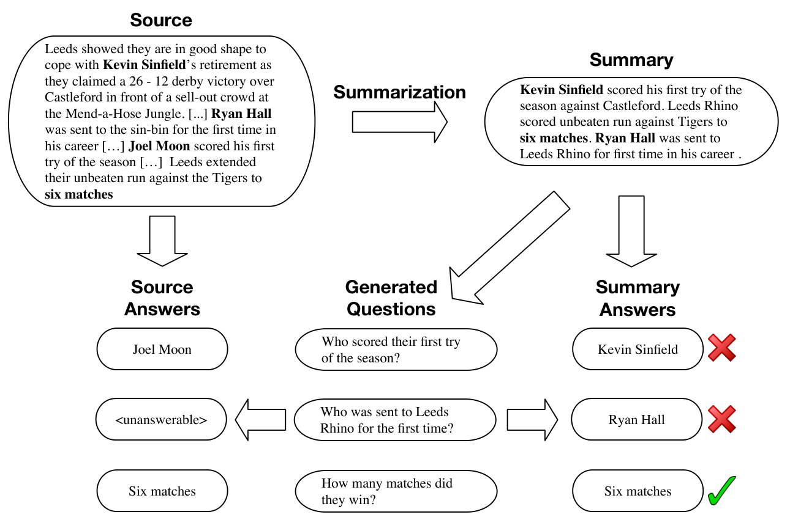
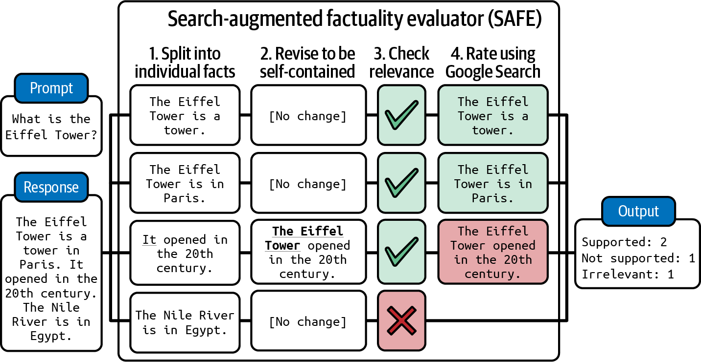

# 7 — Evaluating RAG and Grounding

> A RAG answer can fail in retrieval, in generation, or in the gap between them. Score each stage separately, score only the rows each stage could have got right, and check grounding claim by claim instead of asking a judge for a vibe.

A RAG assistant gets a bad score, the team rewrites the prompt for a week, and the real cause is that retrieval never found the right article. One score across the pipeline can't say which stage failed, and a grader handed URLs in place of passage text produces confident noise. This chapter scores retrieval, ranking, generation and citations separately, on rows each stage could have got right.

*Context-side view (what to put in the window and how to measure that) is in [02/12](../../../ai-engineering/02-context-engineering/notes/12-evaluating-context.md). This chapter is the measurement machinery.*

---

## Split the pipeline

```mermaid
flowchart LR
  Q[query] --> W[rewrite<br/><i>rewrite hit</i>]
  W --> R[retrieve<br/><i>recall@k, hit rate</i>]
  R --> K[rerank<br/><i>MRR, nDCG@k</i>]
  K --> C[context<br/><i>context precision</i>]
  C --> G[generate<br/><i>faithful, complete</i>]
  G --> A[answer + citations<br/><i>citations valid</i>]
```

| Stage | Question | Metric | Needs |
|---|---|---|---|
| **Retrieval** | Did the right documents come back? | Recall@k, hit rate | Expected source IDs per row |
| **Ranking** | Were they near the top? | MRR, nDCG@k | Expected sources (graded relevance for nDCG) |
| **Context** | How much of the window is relevant? | Context precision | Relevance judgment per chunk |
| **Generation: faithfulness** | Is every claim supported by the context? | Supported claims / total claims | Context **text** |
| **Generation: completeness** | Did it answer every part? | Answered sub-questions / total | Decomposed question or reference |
| **Generation: relevance** | Does it address the question asked? | Judge | Query |
| **Citations** | Do citations point at sources that support the claim? | Citation precision / recall | Citation → passage mapping |

**Score generation only on rows where retrieval succeeded** (the `generation_eligible` pool, [03](03-eval-datasets.md#row-eligibility-is-this-row-fair-for-this-gate)). If the source wasn't retrieved, a bad answer is a retrieval failure. Counting it against generation sends you to fix the prompt when the index is the problem.

**Run a no-context baseline.** Ask the same questions with nothing retrieved. The gap between that score and the full system is what retrieval is really adding, and questions the model answers correctly without context aren't testing retrieval. OpenEQA, an embodied question-answering benchmark, found a "blind" GPT-4 that saw only the question scored 33.5, against 55.3 for GPT-4V given the video frames and 86.8 for humans. A third of the score came from priors about what's usually in a house, not from looking ([PDF](https://open-eqa.github.io/assets/pdfs/paper.pdf) (Majumdar et al., 2024-06); scored by a GPT-4 judge validated against human raters, [15](15-calibration-against-human-labels.md#what-to-measure)).

---

## Retrieval metrics

| Metric | Definition | Use when |
|---|---|---|
| **Hit rate@k** | Fraction of queries with ≥ 1 relevant doc in top k | One good source is enough |
| **Recall@k** | Relevant docs in top k ÷ all relevant docs | The answer needs several sources |
| **Precision@k** | Relevant docs in top k ÷ k | Context window is tight; noise hurts |
| **MRR** | Mean of 1 / rank of first relevant doc | Users (or the model) read top-down |
| **nDCG@k** | Rank-discounted gain, normalized to the ideal ranking | Graded relevance (highly / partly / not) |

Pick *k* to match what actually goes into the prompt. Recall@50 is irrelevant if only the top 5 are passed to the model.

These are the [confusion matrix](../../../data-science/01-classical-ml/notes/04-model-evaluation.md#confusion-matrix-precision-recall-f1) again. A relevant chunk in the top k is a true positive, an irrelevant one a false positive, a relevant chunk left out a false negative, and k is the threshold. Hit rate, recall and precision read one matrix at one k. MRR and nDCG weight positions, so no single matrix gives them. [Collaborative filtering](../../../data-science/05-time-series-and-recommenders/notes/02-collaborative-filtering-and-matrix-factorisation.md#the-metric-that-matters-top-n-ranking) in data science computes recall and NDCG on recommenders, and [two-tower and evaluation](../../../data-science/05-time-series-and-recommenders/notes/03-two-tower-and-evaluation.md#offline-evaluation-sampled-metrics) shows that scoring against a sample of negatives gives a different metric. [Choosing a metric](../../../data-science/01-classical-ml/notes/11-choosing-a-metric.md#one-table-four-jobs) sets this beside judges and guardrails, and [Reading the errors](../../../data-science/01-classical-ml/notes/12-reading-the-errors.md#the-same-habit-in-retrieval-judges-and-traces) reads the missed chunks and the distractors.

These metrics fit in a few lines. In the three rows below, the first finds its source at rank 1, the second finds one of two sources at rank 3, and the third misses:

```python
def retrieval(rows, k):                    # rows: (ranked ids, relevant ids)
    hit = recall = rr = 0
    for ranked, relevant in rows:
        top = ranked[:k]
        hit += any(d in relevant for d in top)
        recall += len(set(top) & set(relevant)) / len(relevant)
        rr += next((1 / (i + 1) for i, d in enumerate(top) if d in relevant), 0)
    n = len(rows)
    return {"hit": round(hit / n, 2), "recall": round(recall / n, 2), "mrr": round(rr / n, 2)}

rows = [(["d1", "d7", "d3"], {"d1"}),            # first place
        (["d4", "d9", "d2"], {"d2", "d8"}),      # one of two sources, third place
        (["d5", "d6", "d0"], {"d7"})]            # never retrieved
print("k=3", retrieval(rows, 3))
print("k=1", retrieval(rows, 1))
```

Output:

```text
k=3 {'hit': 0.67, 'recall': 0.5, 'mrr': 0.44}
k=1 {'hit': 0.33, 'recall': 0.33, 'mrr': 0.33}
```

Cutting to k = 1 halves the hit rate. If only the top chunk reaches the prompt, the first line is measuring something the model never sees.

RAGAS's two retrieval metrics are not plain recall and precision (*LLM Engineer's Handbook*, ch. 7). **Context precision** is rank-aware: it rewards putting the relevant passages at the top, closer to nDCG than to precision@k. **Context recall** splits the *reference answer* into claims and checks how many can be attributed to the retrieved context, so it needs a ground-truth answer, not labeled sources. **Answer relevancy** is indirect too: an LLM writes several questions that the answer would fit, and the score is their mean cosine similarity to the real question. It catches off-topic or partial answers, and it inherits the embedding model's notion of similarity.

Getting **expected sources** is the expensive part. Options, cheapest first: the doc a support agent linked in the original ticket; the source a human-approved answer cited; an LLM judge labeling relevance of retrieved chunks (calibrate it, [15](15-calibration-against-human-labels.md)); expert labeling.

---

## Faithfulness: claim by claim

"Is this answer faithful?" as one judge question is weak and lenient. Decompose:

1. **Extract claims.** A model splits the answer into atomic factual statements. "Go to Settings → Payouts and click Edit. Changes take 2 business days." → three claims.
2. **Verify each claim** against the retrieved passages: *supported*, *contradicted*, or *not found*.
3. **Score** = supported ÷ total. Report contradicted separately: a contradiction is worse than an omission.

This is the core of RAGAS faithfulness (Es et al. 2023) and of the case study's grounding grader ([case study](13-case-study-support-agent.md#grounding-claims-before-the-answer)). Benefits: partial credit, a pointer to the exact bad claim, and easier work for the judge than a holistic verdict.

RAGAS's own validation is thinner than its adoption suggests. On WikiEval (50 Wikipedia pages on post-2022 events, ChatGPT-written questions), its scores agreed with human preference **0.95 on faithfulness, 0.78 on answer relevance and 0.70 on context relevance** ([arXiv:2309.15217](https://arxiv.org/abs/2309.15217), Es et al., 2023-09). The task was pairwise: pick the better of two answers, where the worse one had been deliberately degraded (answered without context, left incomplete, or padded with off-topic sentences). That is easier than scoring a real answer on an absolute scale. Context relevance was weakest because the judge struggled to pick the key sentences out of long contexts. Treat the defaults as a starting point and calibrate them on your own labelled set before gating on them.

Claims can also carry the retrieval/generation split when you hold a reference answer. RAGChecker ([arXiv:2408.08067](https://arxiv.org/abs/2408.08067) (Ru et al., NeurIPS 2024 Datasets and Benchmarks; numbers from arXiv v2)) extracts claims from both the response and the reference, then checks each against the other and against the retrieved chunks. That gives the retriever a claim recall (the share of reference claims found in the chunks) and gives the generator **noise sensitivity**: the share of its response claims that are wrong yet supported by a retrieved chunk. Across 8 systems on 4,162 queries in 10 domains (top-20 chunks of 300 tokens), **wrong claims copied from chunks that also held a correct claim ran at 26–37% of response claims, against 4–6% from fully irrelevant chunks**. Swapping BM25 for E5-Mistral under GPT-4 raised claim recall from 74.0 to 83.5 and that noise from 26.2 to 28.9. A better retriever also feeds the generator more plausible errors. Only the overall precision, recall and F1 were checked against people (Pearson 0.62 with human preference on 280 response pairs, where two annotators reached 0.70 with each other). The diagnostic metrics have no human validation, the annotators saw GPT-4 critiques, and every metric needs a long-form reference answer, many of them written by GPT-4.

### Grounding tiers

Not every claim needs the same evidence. The case study grades on tiers:

| Tier | Claim type | Must be supported by |
|---|---|---|
| **Strict** | Specific facts: menu paths, numbers, prices, dates, policy | Verbatim or near-verbatim in a passage |
| **Paraphrase** | Explanations, procedures in other words | Semantically entailed by a passage |
| **General** | Greetings, hedges, common knowledge, "let me know if…" | Exempt |

Without tiers, a judge either fails harmless filler or waves through invented specifics.

The word "faithfulness" doesn't mean one thing across tools. MLflow, Ragas and LlamaIndex all ship a faithfulness judge, with different prompts and scales: 1–5, 0/1 and YES/NO (*AI Engineering*, ch. 3). A faithfulness number is only comparable to another from the same judge version ([05](05-llm-as-judge.md#three-judge-shapes)).

**A cheaper verifier for step 2.** Claim verification is textual entailment (NLI): given a premise (the passage) and a hypothesis (the claim), predict entailment, contradiction or neutral. A small trained classifier can do it instead of a general judge. Huyen's example is DeBERTa-v3-base-mnli-fever-anli, 184M parameters, trained on 764,000 annotated pairs (*AI Engineering*, ch. 4). It's cheap enough to run on every claim in production. Calibrate it like a judge: NLI models trained on general text can miss domain paraphrase. Falke et al. (ACL 2019) first found that off-the-shelf NLI transfers poorly to summary checking. FactCC ([arXiv:1910.12840](https://arxiv.org/abs/1910.12840) (Kryściński et al., EMNLP 2020)) fine-tuned BERT-base on about 1M synthetic claims. It took sentences from CNN/DailyMail articles and corrupted them by swapping entities, numbers or pronouns, or by negating them. It checks each summary sentence against the whole document, not sentence by sentence. On 503 hand-labelled CNN/DM summary sentences, **in-domain weak labels beat strong labels from a neighbouring task: 72.7% class-balanced accuracy against 51–52% for BERT trained on MNLI or FEVER**. On the more abstractive XSum the result reversed, with MNLI at 59.9% and FactCC at 54.1%, because the corruptions don't cover multi-sentence paraphrase. The authors also say it misses commonsense, temporal and coreference errors. So train the verifier on corruptions shaped like your system's real errors, and re-check it when your outputs get more abstractive.

**A detector that reads attention.** When you host the model, its attention weights are a third signal. Lookback Lens ([arXiv:2407.07071](https://arxiv.org/abs/2407.07071) (Chuang et al., EMNLP 2024)) computes, for each of the 1,024 attention heads in LLaMA-2-7B-Chat, the share of attention that lands on the context instead of on the model's own output, and fits a logistic regression on those ratios. Trained on 2,655 question-answering examples and tested on summaries, it reached **AUROC 85.3 when the span to judge was given, against 76.6 for an NLI model trained on about 731k summarization examples**. A probe on hidden states scored 100.0 on its training set and 81.3 on that transfer; it matched the lens only in the other direction, from summaries to question answering. Without given spans, scoring 8-token windows, every detector was weak: 66 for the lens, 57–62 for the NLI model. It needs every attention map during generation, so it can't score an API model or another model's text. Labels came from GPT-4o (spot-checked on 120 examples), all scores are from one run, and both models were LLaMA-2.

**Or ask questions instead of checking entailment.** QAGS ([arXiv:2004.04228](https://arxiv.org/abs/2004.04228) (Wang, Cho & Lewis, ACL 2020)) generates questions from the *answer*, answers each one from the source and from the answer, and scores how well the two answers match (token F1). A hallucinated fact turns into a question the source can't answer. Against human factual-consistency labels it reached **Pearson 54.5 on CNN/DM, against 17.7 for ROUGE-2** and 27.6 for BERTScore. On abstractive XSum it reached 17.5, where every metric was weak. It also beat FactCC on Falke's sentence-ranking task (72.1% against 70.0%). It stayed ahead of the n-gram metrics with a weaker QA or question-generation model and with as few as 5 questions. Its blind spots come from how it is built. Answer candidates are named entities and noun phrases, so it is strongest on entity errors. On XSum the QA model answered wrongly from the article on 32.5% of questions. Correct answers worded differently score as mismatches (8% of cases). Text copied from the source scores near-perfect by construction. Asking questions to evaluate a summary goes back to Mani et al. (1999). FEQA (Durmus et al., ACL 2020) is a concurrent version of the same idea.


*Image Source: Wang, Cho & Lewis, [Asking and Answering Questions to Evaluate the Factual Consistency of Summaries](https://arxiv.org/abs/2004.04228) (2020), Fig. 1*

**Check what the context added.** Iusztin & Labonne suggest comparing the answer with and without the retrieved context to measure integration (*LLM Engineer's Handbook*, ch. 7). If the two are the same, the generator ignored retrieval, and faithfulness can look fine because the model's prior happened to agree with the passage. Krishna et al. ran the stronger control, **swapping in random Wikipedia paragraphs at inference**. Their system was top of the KILT leaderboard for long-form QA on ELI5 at the time. With random paragraphs its ROUGE-L moved from 24.42 to 24.20. In blind A/B tests people preferred neither version by more than 7 points, and at p = 0.9 they slightly preferred the random-context answers. How much an answer overlapped the retrieved text had almost no correlation with its quality (Spearman ρ = 0.09). This still held on the roughly 23% of questions where retrieval found the gold page. On the same leaderboard RAG and BART + DPR scored *below* BART with no retrieval ([arXiv:2103.06332](https://arxiv.org/abs/2103.06332) (Krishna, Roy & Iyyer, NAACL 2021)). KILT's combined score counts ROUGE-L only when the top-1 retrieval is the gold page, and nothing in it checks that the answer used what was retrieved. Report the random-context control beside retrieval and generation scores. Its other findings, train/validation overlap and an uninformative ROUGE-L, are in [12](12-failure-modes.md#contamination).

### Faithful is not correct

An answer can be perfectly faithful to a stale or wrong document. Faithfulness measures the generator. **Correctness** against a reference measures the system. Track both: faithful-but-wrong points at the corpus. A survey of the factuality literature draws the same line as a 2×2 ([arXiv:2310.07521](https://arxiv.org/abs/2310.07521) (Wang et al., ACM Computing Surveys 2025; read as arXiv v3, 2023-12)): hallucination is departure from the source or prompt, factuality is agreement with facts that a reliable source can ground, and all four cells occur. An accurate answer that ignores the prompt is hallucinated but factual, and "I don't know" is neither hallucinated nor factual. The survey runs no experiments of its own, and it chooses not to focus on summarization faithfulness: the NLI and question-answering checkers above do not appear in it.

### Grounding without retrieval

For answers with no retrieved context (closed-book, or checking a model's own knowledge):

- **Self-consistency.** Sample several answers. Claims that vary between samples are likely hallucinated. SelfCheckGPT ([arXiv:2303.08896](https://arxiv.org/abs/2303.08896), Manakul et al., 2023-03) drew 20 samples per passage on 238 GPT-3 biographies from WikiBio. Asking an LLM whether each sentence is supported by each sample reached **AUC-PR 93.4 for flagging non-factual sentences** (random 73.0) and 0.78 Spearman with human passage rankings. That beat GPT-3's own token probabilities (87.5 at best). The cost is N extra generations plus one check per sentence per sample, and the test set was biographies only.
- **Search-backed checking.** SAFE ([arXiv:2403.18802](https://arxiv.org/abs/2403.18802) (Wei et al., NeurIPS 2024)) runs the claim-by-claim recipe against the web: split the response into facts, rewrite each to stand alone ("It opened in the 20th century" → name the subject), send fact-checking queries to Google Search, and have a model judge each fact against the results (*AI Engineering*, ch. 4). It's the same decomposition as RAGAS faithfulness, with search results as the context. It inherits search's blind spots, and it can't verify private facts. On 16,011 human-labelled facts from FActScore biographies (496 responses, GPT-3.5-Turbo as the judge), **SAFE agreed with crowd annotators on 72.0% of facts, and in 100 sampled disagreements the authors ruled for SAFE in 76 and the annotators in 19**, at $0.19 per response against $4 for the human labels. Read the 76 with care: the authors adjudicated their own system, and they and SAFE had the open web while the annotators had one Wikipedia page. The test also skipped SAFE's splitting step by using human-split facts, and splitting, together with rewriting facts to stand alone, is where it went wrong on legal questions (79.7% agreement on 133 facts, against 94.9% on 137 medical ones). "Supported" means supported by search results, not true.


*Image Source: Huyen, *AI Engineering* (O'Reilly, 2025), Fig. 4-1*

- **Tool-backed checking.** Search is one tool among several. FacTool ([arXiv:2307.13528](https://arxiv.org/abs/2307.13528) (Chern et al., 2023-07, preprint)) ran the same extract, query, verify loop eight months before SAFE, with the tool chosen by claim type: Google Search for knowledge claims, a Python interpreter for code and arithmetic, Google Scholar for citations. Against GPT-4 checking the same ChatGPT responses from memory with three-shot chain-of-thought, it won most where a lookup replaces recall: **on 100 literature reviews, response-level F1 94.74 against 21.54**, because the title and year of each cited paper are string-matched to a Scholar hit. On 50 knowledge-QA responses the gap was 71.79 against 57.14 (65.67 for the zero-shot memory check). Two limits show in its own tables. With ChatGPT as the verifier on knowledge QA, tools did not help (claim-level F1 81.25 against 84.88 for zero-shot self-check), so the verifier must be able to reason over the evidence. On GSM-Hard, claim-level F1 was 98.97 and response-level 80.36: each calculation checks out while the reasoning that chose it is never tested. The authors labelled the claims themselves, with no agreement figure; code and math responses were scored against tests and target values.

- **Adversarial factuality sets.** TruthfulQA ([arXiv:2109.07958](https://arxiv.org/abs/2109.07958), Lin et al., 2021-09) has 817 questions in 38 categories where the popular answer is false. At release, the best model (GPT-3-175B with a "helpful" prompt) was truthful on **58% against 94% for humans**. Within each model family the largest models were usually *least* truthful. The authors attribute this to larger models imitating human misconceptions more faithfully, and back it with control experiments. A GPT-3 judge fine-tuned on human labels predicted truthfulness with 90–96% accuracy on held-out models. That is an early case of a judge calibrated against humans ([15](15-calibration-against-human-labels.md)). Good for measuring a model's tendency to repeat misconceptions. Its questions have been public since 2021, so check for contamination before trusting a high score.

**Point the closed-book suite at where hallucination concentrates.** Huyen found her model hallucinated most on two kinds of query: niche knowledge (the Vietnamese Mathematical Olympiad rather than the IMO) and questions about things that don't exist ("What did X say about Y?" when X never did) (*AI Engineering*, ch. 4). Read outputs to find your own two kinds, then weight the suite toward them ([02](02-defining-correct.md#find-failure-modes-by-reading-error-analysis)).

---

## Citation checks in code

Citations are one of the few places in RAG where code can grade semantics cheaply:

| Check | Code |
|---|---|
| **Citation exists** | Every cited ID / URL is in the retrieved set. Anything else is a `citation_hallucination` |
| **Quote is real** | Quoted text appears (fuzzy-matched) in the cited passage |
| **Coverage** | Every strict-tier claim has a citation |
| **Format** | Citation markers parse |

Then, with a judge: **citation recall** (does the sentence have at least one citation, and do its cited passages together entail it?) and **citation precision** (is each citation needed: a citation counts against precision when it can't support the sentence alone and the others support it without it). ALCE defines both with an NLI model (TRUE, T5-11B) as the judge, and found about half of ChatGPT's and GPT-4's ELI5 answers not fully supported by their citations. On 100 sampled ASQA and ELI5 questions, with three systems' outputs labelled by human raters, the scores agreed at kappa 0.698 for recall and 0.525 for precision. The NLI model misses partial support, so automatic precision runs low ([arXiv:2305.14627](https://arxiv.org/abs/2305.14627), Gao et al., EMNLP 2023).

The code half of that table on a sample answer. The fifth claim is a greeting in the general tier, and the last call passes a URL where passage text belongs:

```python
from difflib import SequenceMatcher

PASSAGES = {"p1": "To change your payout account go to Settings > Payouts and click Edit.",
            "p2": "Changes to payout details take 2 business days to apply."}

def check_citations(claims, retrieved):
    if not retrieved or any(text.startswith("http") for text in retrieved.values()):
        return {"label": "context_missing"}         # a grader fault, not a system failure
    labels = []
    for claim in claims:
        cited = claim.get("cite")
        if cited is None:
            labels.append("missing_citation" if claim["tier"] == "strict" else "exempt")
        elif cited not in retrieved:
            labels.append("citation_hallucination")
        else:
            quote, passage = claim["quote"].lower(), retrieved[cited].lower()
            m = SequenceMatcher(None, quote, passage).find_longest_match()
            labels.append("ok" if m.size / len(quote) >= 0.9 else "quote_not_found")
    return {"label": "graded", "claims": labels}

claims = [
    {"tier": "strict", "cite": "p1", "quote": "go to Settings > Payouts and click Edit"},
    {"tier": "strict", "cite": "p2", "quote": "take 5 business days to apply"},
    {"tier": "strict", "cite": "p9", "quote": "free of charge"},
    {"tier": "strict", "cite": None},
    {"tier": "general", "cite": None},
]
print(check_citations(claims, PASSAGES))
print(check_citations(claims, {"p1": "https://help.example.com/payouts"}))
```

Output:

```text
{'label': 'graded', 'claims': ['ok', 'quote_not_found', 'citation_hallucination', 'missing_citation', 'exempt']}
{'label': 'context_missing'}
```

Each label names a different fix. The second claim has a real citation whose quote says 5 days where the passage says 2, and the third cites a passage that was never retrieved. The last line is the guard from [Pass the text, not the pointer](#pass-the-text-not-the-pointer): it reports a fault in the eval, not a failure of the system.

---

## Pass the text, not the pointer

The most common grounding eval bug: the grader receives passage IDs or URLs instead of passage text, can't verify anything, and scores near zero, or worse, scores from its own knowledge. The case study's cross-check against DeepEval faithfulness and G-Eval accuracy showed low agreement for exactly this reason ([case study](13-case-study-support-agent.md#why-the-grounding-cross-check-showed-low-agreement)).

Guard against it in the grader interface (`requires = {"retrieved_context"}`, [04](04-graders.md#the-grader-interface)) and label it `context_missing` in the taxonomy. Assert in CI that grounding graders received non-empty text.

---

## Frameworks

| Framework | Gives you | Watch out for |
|---|---|---|
| **RAGAS** | Faithfulness, answer relevance, context precision / recall, reference-free | Generic definitions. Uncalibrated for your domain ([15](15-calibration-against-human-labels.md#cross-checking-with-other-judges)) |
| **ARES** (Saad-Falcon et al. 2023) | Fine-tuned small judges + a small human set (~150 labels) with prediction-powered inference for confidence intervals. Beat RAGAS by 59 points on context-relevance and 14 on answer-relevance accuracy across KILT and SuperGLUE ([arXiv:2311.09476](https://arxiv.org/abs/2311.09476)) | Setup cost: synthetic training data plus judge fine-tuning per domain. Defaults: synthetic queries from google/flan-t5-xxl, classifier judges on microsoft/deberta-v3-large (*LLM Engineer's Handbook*, ch. 7). Worth it at volume |
| **RAGChecker** (Ru et al. 2024) | Claim-level precision / recall plus retriever and generator diagnostics such as noise sensitivity ([above](#faithfulness-claim-by-claim)) | Needs a long-form reference answer per query. Only the overall scores were validated against people |
| **DeepEval, TruLens, Phoenix evals** | Ready-made RAG judges, tracing integration | Same as RAGAS: calibrate before gating |

Iusztin & Labonne pair the two: RAGAS for quick iteration, ARES once trained for consistent and potentially faster evaluation at key stages (*LLM Engineer's Handbook*, ch. 7). Use frameworks to get started and for cross-checks. Gate on graders you've calibrated against your own labels.

---

## Checklist

- [ ] Retrieval, ranking, generation and citations scored separately
- [ ] Generation scored only on generation-eligible rows; ineligible rows reported as their own slice
- [ ] *k* matches what reaches the prompt
- [ ] Faithfulness by claim extraction + per-claim verification, with grounding tiers
- [ ] Citation existence and quotes checked in code
- [ ] Graders receive passage text; `context_missing` asserted in CI
- [ ] Correctness tracked alongside faithfulness

---

## Pitfalls

- **Blaming generation for retrieval misses.** Symptom: prompt work doesn't move the answer score. Fix: score generation only on `generation_eligible` rows and report the rest as their own slice.
- **Choosing k for a flattering number.** Symptom: excellent Recall@50 when only the top 5 reach the prompt. Fix: set k to what goes into the model.
- **Passing pointers to the grader.** Symptom: grounding near zero, or scores that come from the judge's own knowledge, and a low cross-check with other judges. Fix: `requires = {"retrieved_context"}` in the grader interface, `context_missing` as a label, and a CI assertion that the text was non-empty.
- **One holistic faithfulness question.** Symptom: lenient scores that don't say which claim failed. Fix: extract claims, verify each as supported, contradicted or not found, and report contradicted separately.
- **Grounding with no tiers.** Symptom: "let me know if…" fails while an invented menu path slips through. Fix: strict, paraphrase and general tiers, each with its own evidence rule.
- **Equating faithful with correct.** Symptom: a high faithfulness score on an answer drawn from a stale document. Fix: track correctness against a reference beside it, since faithfulness measures the generator and correctness measures the system.
- **Skipping the no-context baseline.** Symptom: credit to retrieval that the model's priors earned. OpenEQA's blind GPT-4 scored 33.5 against 55.3 for GPT-4V with frames. Fix: run the same questions with nothing retrieved, and with random passages. Krishna et al.'s ELI5 system lost only 0.2 ROUGE-L on random passages.
- **Trusting RAGAS defaults because they are popular.** Symptom: an uncalibrated score gating releases. Its 0.95, 0.78 and 0.70 agreement came from a pairwise task against deliberately degraded answers on 50 pages. Fix: calibrate on your labelled set first.

## Try it

1. Change the third row in the retrieval script so that `d7` appears at rank 3. Which of the k = 3 metrics changes, and which of the k = 1 metrics?

   <details><summary>Answer</summary>

   At k = 3, hit goes from 0.67 to 1.0, recall from 0.5 to 0.83 and MRR from 0.44 to 0.56. The k = 1 line is unchanged at 0.33 across the board. If only the top chunk reaches the prompt, this retrieval "improvement" changes nothing for the model.

   </details>

2. Split this answer into claims and assign tiers: "Hi! Go to Settings → Payouts and click Edit. Changes take 2 business days. Let me know if that helps."

   <details><summary>Answer</summary>

   Strict: the menu path, the "click Edit" step and the 2 business days, as in this chapter's three-claim example. Each needs near-verbatim support. General and exempt: the greeting and "let me know if that helps". A faithfulness score of 2 of 3 here means one specific claim failed, which you can check.

   </details>

3. Your faithfulness is 0.95 and users still report wrong answers about a pricing change. What's the likely cause, and what would show it?

   <details><summary>Answer</summary>

   An answer can be faithful to a stale document, so suspect corpus staleness. Correctness against an up-to-date reference would show the gap, and checking the retrieved passage's date on the failing rows would confirm it.

   </details>

## Interview checklist

| Prompt | Answer in one line |
|---|---|
| How do you split a RAG eval? | Retrieval (Recall@k, hit rate), ranking (MRR, nDCG), context precision, generation (faithfulness, completeness, relevance) and citations, each with its own required inputs. |
| Recall@k or hit rate? | Hit rate when one good source is enough, recall when the answer needs several. Set k to what reaches the prompt in either case. |
| How does claim-based faithfulness work? | Extract atomic claims, verify each against the passages as supported, contradicted or not found, and score supported ÷ total. Report contradicted separately, because it is worse than an omission. |
| Which citation checks need no LLM? | Cited ID in the retrieved set, quote found (fuzzy) in the cited passage, every strict-tier claim cited, and markers that parse. Only citation precision and recall need a judge. |
| Grounding dropped to 0.5 across every row overnight. First suspicion? | The grader's inputs, not the model. The case study's custom grader returned a flat 0.5 and `context_missing` when given URLs in place of text. |
| Why isn't high faithfulness enough? | It measures the generator against whatever was retrieved, so a stale document gives a faithful wrong answer. Correctness against a reference measures the system. |
| RAGAS or ARES? | RAGAS for quick iteration, reference-free, after calibrating. ARES needs setup per domain and about 150 labels, and in its paper it beat RAGAS by 59 points on context relevance, so it pays off at volume. |

## Next

[08-tracing-and-observability.md](08-tracing-and-observability.md): the data every grader reads from.
