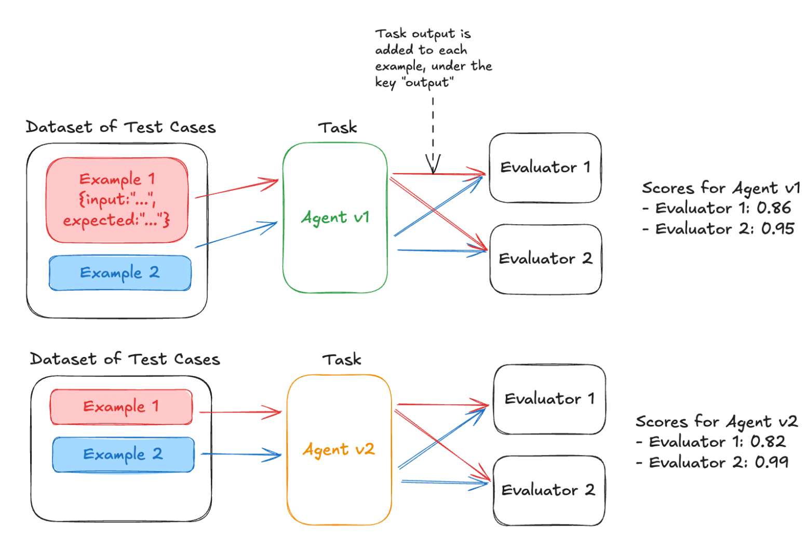
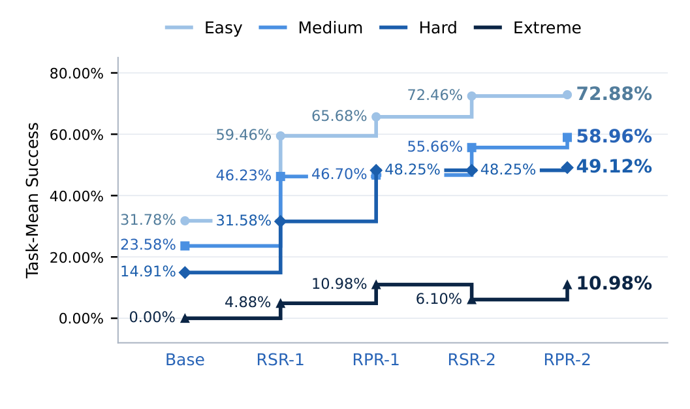

# 9 — Reading Results

> An eval score is an estimate from a sample, not a fact. Put an error bar on it, compare versions on the same tasks, and break it down by slice before deciding anything. Most "improvements" on small suites are noise.

Version B scores 80% on 50 tasks, Version A scored 72%, and the team ships B. At that size the two are not distinguishable, and a two-point dip on the same set can get days of explanation when it was one flipped task. This chapter is how to tell a change from noise: error bars, paired comparisons, slices, and reading the transcripts behind the number.

---

## The error bar on a pass rate

A pass rate *p* measured on *n* independent tasks has a standard error of:

```
SE = √( p(1 − p) / n )          95% CI ≈ p ± 1.96 · SE
```

| n | p = 0.80 | 95% CI |
|---|---|---|
| 20 | SE 0.089 | 62% – 98% |
| 50 | SE 0.057 | 69% – 91% |
| 100 | SE 0.040 | 72% – 88% |
| 300 | SE 0.023 | 75% – 85% |
| 1,000 | SE 0.013 | 77% – 83% |

On 50 tasks, 80% and 72% are not distinguishable. That's the most important table in this chapter. Report the interval with every headline number.

For small *n* or *p* near 0 or 1, use the **Wilson interval** instead of the normal approximation. It doesn't produce bounds outside [0, 1].

See [Estimation](../../../data-analytics/02-probability-and-statistics/notes/04-estimation.md#standard-errors-and-confidence-intervals) in data analytics for the derivation of the standard error, the [Wilson interval](../../../data-analytics/02-probability-and-statistics/notes/04-estimation.md#when-wald-fails-wilson) and [the bootstrap](../../../data-analytics/02-probability-and-statistics/notes/04-estimation.md#the-bootstrap). These bars cover sampling error only. They say nothing about how the tasks got into the suite, which is the [data generating process](../../../data-analytics/02-probability-and-statistics/notes/07-data-generating-process.md#big-is-not-the-same-as-representative) question.

Nor does a zero tell you about deployment scale. A behaviour that never shows on 1,000 test queries can still show at 100,000. Jones et al. ([arXiv:2502.16797](https://arxiv.org/abs/2502.16797) (Jones, Tong et al., 2025-02, preprint)) give each query a continuous elicitation probability, sampled repeatedly, and fit a power law to the top ten of them to extrapolate the worst query at larger *n*. Forecasting from 100–1,000 queries to 10,000–90,000 on Claude models, **the fit's mean error on misuse risk was 1.7 orders of magnitude (base-10 log), against 2.4 for a log-normal fit, and it landed within one order of magnitude 72% of the time**. It underestimated 34% of the time against 72% for the log-normal fit, where an unbiased method would sit at 50%. "Deployment" was simulated by splitting one generated query pool into non-overlapping evaluation and deployment sets, so the forecast covers more queries, not different ones: "We do not study distribution shifts between evaluation and deployment queries". It gives no intervals on its forecasts.

---

## How many tasks

The question isn't "how big should the suite be?" It's "**what's the smallest change I need to detect?**" [A/B testing](../../../data-analytics/03-experimentation-and-causality/notes/01-ab-testing.md#how-many-users) in data analytics works through the same sample-size question for two independent groups.

Rough sizes for detecting a difference between two versions run on the *same* tasks (paired, 80% power, α = 0.05, pass rates around 70–85%):

| Smallest difference that matters | Tasks needed (roughly) |
|---|---|
| 15 points | 50–100 |
| 10 points | 100–200 |
| 5 points | 400–800 |
| 2 points | 2,500+ |

The paired range depends on how often the two versions disagree on the same task: fewer disagreements, fewer tasks needed. Unpaired comparisons need noticeably more.

OpenAI's rougher rule of thumb, as Huyen quotes it, assumes nothing about pairing: to be 95% confident that one system is better, a 30-point difference needs ~10 samples, 10 points ~100, 3 points ~1,000 and 1 point ~10,000. **Each 3× smaller difference needs 10× more samples** (*AI Engineering*, ch. 4). That matches the table above to within a factor of two at 10 points. Use whichever you have, and stop pretending a 2-point gap on 100 rows means something.

**A cheap stability check for the suite you already have:** bootstrap it. Draw 100 rows with replacement from your 100, score them, and repeat many times. If one resample gives 90% and another 70%, the suite is too small for the decisions you're making with it (*AI Engineering*, ch. 4).

Practical consequence: a 50-task golden set is a **smoke detector** for big regressions. It cannot tell you that a prompt tweak gained 3 points. Either grow the suite, or stop making decisions on 3-point differences.

---

## Compare on the same tasks: paired differences

When comparing version A and B, run both on the same tasks and analyze **per-task differences**, not two independent pass rates. [Hypothesis testing](../../../data-analytics/02-probability-and-statistics/notes/05-hypothesis-testing.md#the-parametric-tests-in-code) in data analytics teaches the paired test.

```
task   A    B    B − A
t1     1    1     0
t2     0    1    +1
t3     1    0    −1
t4     1    1     0
…
mean difference = Δ;  SE(Δ) = sd(differences) / √n
```

Most tasks pass or fail on both versions, so the differences are mostly zero, and the SE of the difference is much smaller than the SE of either rate. Miller (Anthropic, "Adding Error Bars to Evals", 2024) shows pairing can cut the variance of a comparison substantially for free. The paired variance is the unpaired one minus twice the covariance, so the saving grows with how often the two versions agree on a question. Two versions of the same agent usually agree on most questions, which is the best case ([arXiv:2411.00640](https://arxiv.org/abs/2411.00640)).

For binary outcomes, the same idea is **McNemar's test**: only the tasks where A and B disagree carry information. If B wins 14 and loses 6 of the 20 discordant tasks, that's suggestive and not settled: the exact two-sided p is 0.115. At 15–5, p is 0.041. At 11–9, p is 0.824, which is nothing.

All of this fits in the standard library. The counts below are invented, and the last three lines use a 200-task run where A passes 150 and B passes 158:

```python
from math import comb, sqrt

def wilson(passed, n, z=1.96):
    p = passed / n
    centre = (p + z * z / (2 * n)) / (1 + z * z / n)
    half = z * sqrt(p * (1 - p) / n + z * z / (4 * n * n)) / (1 + z * z / n)
    return round(centre - half, 3), round(centre + half, 3)

def normal(passed, n, z=1.96):
    p = passed / n
    half = z * sqrt(p * (1 - p) / n)
    return round(p - half, 3), round(p + half, 3)

def mcnemar_exact(b_wins, a_wins):           # two-sided sign test on the discordant tasks
    n = b_wins + a_wins
    tail = sum(comb(n, i) for i in range(max(b_wins, a_wins), n + 1)) / 2 ** n
    return round(min(1.0, 2 * tail), 3)

def paired_se(both, a_only, b_only, neither):
    n = both + a_only + b_only + neither
    d = [0] * (both + neither) + [-1] * a_only + [1] * b_only
    mean = sum(d) / n
    return mean, sqrt(sum((x - mean) ** 2 for x in d) / (n - 1) / n)

print("n=20, 19 pass  normal", normal(19, 20), " wilson", wilson(19, 20))
for wins in [(14, 6), (15, 5), (11, 9)]:
    print("B wins, A wins", wins, " p =", mcnemar_exact(*wins))

# 200 tasks. A passes 150, B passes 158. Only the 20 discordant tasks move the difference.
delta, se = paired_se(both=144, a_only=6, b_only=14, neither=36)
unpaired = sqrt(0.75 * 0.25 / 200 + 0.79 * 0.21 / 200)
print(f"delta {delta:+.3f}, paired SE {se:.3f}, unpaired SE {unpaired:.3f}")
print(f"paired 95% CI [{delta - 1.96 * se:+.3f}, {delta + 1.96 * se:+.3f}]")
print(f"unpaired 95% CI [{delta - 1.96 * unpaired:+.3f}, {delta + 1.96 * unpaired:+.3f}]")
```

Output:

```text
n=20, 19 pass  normal (0.854, 1.046)  wilson (0.764, 0.991)
B wins, A wins (14, 6)  p = 0.115
B wins, A wins (15, 5)  p = 0.041
B wins, A wins (11, 9)  p = 0.824
delta +0.040, paired SE 0.022, unpaired SE 0.042
paired 95% CI [-0.004, +0.084]
unpaired 95% CI [-0.042, +0.122]
```

Two things to read here. The normal interval on 19 of 20 runs past 1.0, which is why small samples get Wilson. And pairing halves the standard error on the same data, but with 14 wins and 6 losses the paired interval still touches zero, which matches the McNemar result: promising, not settled.

### A worked example that needs this

The DeepLearning.AI course's final lab runs exactly this setup. It uses one dataset and two agent versions, where v2 adds "Think before you respond." to the SQL-generation prompt. The same evaluators score both:


*Image Source: DeepLearning.AI & Arize, Evaluating AI Agents (2025), Lab 5*

```python
# Each evaluator sees the dataset row (input, expected) and the task output
def evaluate_sql_result(output, expected) -> bool:
    digits = lambda s: "".join(filter(str.isdigit, s))
    sql = next((r for r in output.get("tool_responses") or []
                if r["tool_name"] == "lookup_sales_data"), None)
    if sql is None:
        return True                     # course code: no SQL ran counts as a PASS
    return digits(sql["tool_response"]) == digits(expected["sql_result"])

for name in ("v1", "v2"):               # v2 = SQL prompt + "Think before you respond."
    run_experiment(dataset, run_agent_task, experiment_name=f"Overall {name}",
                   evaluators=[function_calling_eval, evaluate_sql_result,
                               evaluate_clarity, evaluate_entity_correctness,
                               code_is_runnable])
```

The lab ends with v1 and v2 side by side in the Phoenix UI. Read it with this note. The dataset is about **7 questions**, run once each. At n = 7 a single flipped task moves a rate by 14 points, so 0.82 vs 0.86 is noise. Pair by question, count the discordant tasks, and repeat each one k times before you conclude anything ([06](06-evaluating-agents.md#non-determinism-run-every-task-k-times)). Also check the graders before the agents. `evaluate_sql_result` passes silently when no SQL ran, and it compares only the digits in the result, so `1,200` and `12.00` match. A version that skips the SQL tool gets a perfect SQL score.

---

## Repeats and clustering

### Repeated trials

With *k* trials per task ([06](06-evaluating-agents.md#non-determinism-run-every-task-k-times)), first average the trials **within** each task, then compute the SE across tasks. Treating 100 tasks × 5 trials as 500 independent samples understates the error bar, because trials of the same task are correlated.

Repeats reduce the noise from sampling randomness within each task. They don't reduce noise from *which tasks you picked*. For that you need more tasks. Beyond a few repeats, more tasks beat more repeats.

The wording of a task is a draw too. GSM-Symbolic turned 100 GSM8K questions into templates and drew 50 sets of 100 with new names and numbers (25 models, 8-shot chain of thought, greedy decoding). **The same model's accuracy moved by more than 12 points between its best and worst set** for Gemma2-9B, whose mean was 79.1 with a spread of 3.0, and by about 15 for Phi-3.5-mini ([arXiv:2410.05229](https://arxiv.org/abs/2410.05229) (Mirzadeh et al., ICLR 2025)). Hold that against the error bar before reading it as fragility: by the formula above, a 100-question set at 79% carries a standard error of about 4 points, so this spread is what sets of that size give. The paper's appendix concedes that whether its drop from the original questions is significant depends on the test chosen (p = 0.6 for GPT-4o under theirs). The finding that survives is larger: one irrelevant clause added to each question cost o1-preview 17.5 points and Phi-3-mini 65.7.

### Clustered tasks

If tasks come in groups (10 questions about the same document, 5 turns of one conversation), they're not independent either. Use **clustered standard errors** (cluster by document or conversation). Miller reports clustered SEs over 3× larger than naive ones on DROP (1.34 vs. 0.44), about 1.9× on MGSM and barely different on RACE-H. How much clustering matters depends on how strongly questions within a cluster move together. Ignoring clustering makes results look more certain than they are.

---

## Slice before you conclude

A flat headline can hide a win and a loss that cancel out:

| Slice | n | A | B | Δ |
|---|---|---|---|---|
| Billing | 120 | 82% | 90% | +8 |
| How-to | 150 | 88% | 89% | +1 |
| Non-English | 40 | 75% | 58% | **−17** |
| **Overall** | 310 | 84% | 85% | +1 |

"+1 overall" would ship a change that breaks non-English users. Always break results down by the slices you labeled ([03](03-eval-datasets.md#coverage-and-balance)), and show *n* per slice so nobody over-reads a 12-task slice. [Reading the errors](../../../data-science/01-classical-ml/notes/12-reading-the-errors.md#step-4-slice-and-count) runs the same step on a classifier, with the same warning about scanning many slices.

Model cards made this the reporting standard for released models. Mitchell et al. ask for results broken down by each relevant factor (groups of people, capture instruments, environments) and by their intersections, with confidence intervals. The card also states intended and out-of-scope uses and the decision threshold the numbers assume. Their toxicity example put two versions of the same Perspective API classifier side by side on synthetic identity-term templates. Version 1 scored poorly on sentences containing "lesbian", "gay" and "homosexual". Version 5, retrained with bias mitigations, scored more evenly across the terms. A single headline score would have shown neither problem nor fix ([arXiv:1810.03993](https://arxiv.org/abs/1810.03993) (Mitchell et al., FAT* 2019)). The paper proposes a format and shows two examples. The authors say themselves that a card is only as honest as the people who write it.

Bias slices are usually built as minimal pairs: the same input with only the group term changed. Winogender wrote 720 coreference sentences (60 occupations, with male, female and neutral pronouns) where the right answer does not depend on the pronoun's gender, which crowdworkers checked. Even so, three coreference systems resolved the male and female versions differently on 68% (rule-based), 28% (statistical) and 13% (neural) of the pairs. The bias compounds through the pipeline. "Manager" is 38.5% female in US labour statistics and 5.18% female in a text corpus, and none of the three systems predicted a female manager. The authors give the test "high positive predictive value and low negative predictive value": it can show bias but cannot prove it is absent ([arXiv:1804.09301](https://arxiv.org/abs/1804.09301) (Rudinger et al., NAACL 2018)). Open-ended generation needs a classifier to score each slice, and that classifier has error bars of its own. BOLD prompted GPT-2, BERT and CTRL with 23,679 Wikipedia sentence openings across 43 groups in 5 domains, and most models produced more biased text than the Wikipedia originals. Checked against human labels, its toxicity classifier caught only 67.24% of the toxic texts and reached a Spearman correlation of 0.58 ([arXiv:2101.11718](https://arxiv.org/abs/2101.11718) (Dhamala et al., FAccT 2021)). A per-group gap smaller than the classifier's own error is not evidence of anything.

Slicing by difficulty does the same job for capability claims. Yang et al. (2026) fixed four difficulty strata over 322 terminal-agent tasks, then tracked each stratum across training stages. The headline mean rose steadily. The strata did not: Easy climbed from 32% to 73%, while Extreme went 0 → 4.9 → 11.0 → **6.1** → 11.0%. That dip at the fourth stage is invisible in the aggregate.


*Image Source: Yang et al. (2026), Figure 10*

Watch for **Simpson's paradox**: B can beat A in every slice and lose overall (or the reverse) if the slice mix differs between runs. Huyen's example, using numbers from a 1986 kidney-stone study (*AI Engineering*, ch. 4):

| | Group 1 | Group 2 | Overall |
|---|---|---|---|
| Model A | **93%** (81/87) | **73%** (192/263) | 78% (273/350) |
| Model B | 87% (234/270) | 69% (55/80) | **83%** (289/350) |

A wins both groups and loses overall, because most of A's rows are in the harder group. Compare on identical task sets.

### Too many slices

Slice 20 ways and one will show a "significant" change by chance at α = 0.05. Treat surprising slice results as hypotheses to confirm on fresh data, not conclusions. Pre-register the slices that gate releases. [Hypothesis testing](../../../data-analytics/02-probability-and-statistics/notes/05-hypothesis-testing.md#multiple-comparisons) in data analytics has the corrections (Bonferroni, Holm, Benjamini-Hochberg).

The same arithmetic applies to testing several fixes at once. At 95% confidence each, the chance that at least one of 6 parallel hypotheses is a false positive is 1 − 0.95⁶ ≈ **26%**. Either tighten the per-test threshold (Bonferroni: α / number of tests) or re-run every positive result as an independent confirmation and believe it only if it replicates.

**When the difference is smaller than the noise, don't switch.** 100 tasks at 70% gives a standard error of about 4.6 points, so the 95% interval is ±9. "73% vs 70%" is inside the noise. Run the paired test first ([above](#compare-on-the-same-tasks-paired-differences)). Grow the sample only if that's still inconclusive.

---

## Read the transcripts

Numbers say how much. Transcripts say why. Before accepting any change in a score:

1. Pull 10–20 tasks that **flipped** (pass → fail and fail → pass).
2. Read them. Is the flip real, or a grader quirk, an infra error, a flaky task?
3. If fails are mostly one failure label, that's your story. If they're scattered, it may be noise.

Anthropic's guidance puts it plainly: you won't know whether your graders work unless you read transcripts and grades together.

A right final answer can sit on wrong steps. Wu et al. ([arXiv:2506.02126](https://arxiv.org/abs/2506.02126) (Wu et al., 2025-06, preprint)) split a reasoning trace into steps and score each one twice: whether its facts match a reference (a GPT-4o check) and whether it lowers the perplexity of the gold answer. On five medical benchmarks with Qwen2.5-7B models, **the base model fine-tuned with SFT and RL averaged 60.02% accuracy and a knowledge score of 64.23, against 31.48% and 54.29 for the R1-distilled model given the same training, while their information-gain scores were nearly equal (2.348 and 2.309)**. The older ROSCOE step metrics hardly moved: faithfulness-step was 0.781 for the untrained, SFT and SFT+RL base checkpoints alike (four of the benchmarks). Read it as a reason to check facts in the transcript, not as a validated metric: GPT-4o makes every knowledge call with no human check, only Qwen 7B models were tested, nothing was run twice, and the paper's text disagrees with its own Table 1 in several places.

---

## From a benchmark report to hypotheses

A report's value is the hypotheses it suggests, not the headline number. Li's AndroidWorld walkthrough (*AI Agents in Depth*, ch. 6; the data is illustrative) shows the method:

1. **Check the eval first.** Before blaming the agent on a 0% cluster, confirm the tasks, environment and grader work ([12](12-failure-modes.md#eval-bugs-look-like-agent-bugs)).
2. **Cross per-task results with capability tags** (settings navigation, transcription, complex UI, …). Failures concentrated in one tag point to one cause.
3. **Tier the hypotheses by cost:**

| Tier | Example | Run when |
|---|---|---|
| **Surface** (prompt hints, tool descriptions) | "Add a hint for finding Wi-Fi settings" | First. They're cheap and independent, so test them in parallel (and correct for multiple comparisons, above) |
| **Mid** (new tools, workflow changes) | "Add a transcription tool" | Surface fixes leave the tag below target |
| **Deep** (swap model, add UI-tree input, post-train) | "Use a stronger vision model" | Only if the tag is still below, say, 40% after the cheaper tiers |

4. **Weigh each fix's gain against its cost.** "+75 points on settings tasks for +8% input tokens" is a different decision from a gain at 3× cost. Don't deploy a fix whose gain is inside the noise.
5. **Re-run the full benchmark.** Fixing one cluster reveals the next failure pattern, so the loop starts again.

A **model swap** is one deep hypothesis among others. Run it the same way, on your own eval set, with paired comparison, and compare on success, tool-call accuracy, latency and cost. It is not a shortcut.

Lab: AndroidWorld report → improvement ([upstream `chapter7/android-world`](https://github.com/bojieli/ai-agent-book/tree/main/chapter7/android-world)).

---

## Report template

```
Suite: support-golden v4 (n=310, 3 trials/task)     Judge: grounding-v2 (calibrated, TNR 0.88)
                    A (prod)        B (candidate)   Δ (paired)
Pass rate           84.2% ±3.9      85.1% ±3.8      +0.9  [−1.6, +3.4]
  Non-English (40)  75.0% ±13       57.5% ±15       −17.5 [−29, −6]    ⚠
Errors / refusals   1.3%            4.2%                                ⚠
Steps (median)      4               4
Cost per success    $0.014          $0.016          +14%
Flipped tasks read: 18 / 18 — 9 of 11 regressions are `refusal` on non-English
Decision: do not ship. Investigate refusal behavior for non-English.
```

---

## Checklist

- [ ] Every headline number has a 95% CI
- [ ] Suite size chosen from the smallest difference that matters
- [ ] Comparisons paired on identical tasks; SE of the difference reported
- [ ] Trials averaged within task; clustered SEs where tasks group
- [ ] Results broken down by labeled slices with n
- [ ] Errors and refusals counted, not dropped
- [ ] Flipped transcripts read before any decision

---

## Pitfalls

From the KDD 2017 "Dirty Dozen" paper on online experiments, the ones that bite LLM evals most:

| Pitfall | In LLM evals (symptom) | Fix |
|---|---|---|
| **Metric sample ratio mismatch** | Version B errored on 8% of tasks, which were dropped. B's pass rate is over its easier 92% | Count the errored tasks for both arms, and report the count |
| **Ratio metrics with changing denominators** | "Grounding rate" rose because B answers fewer questions (refuses more) | Report answer rate beside grounding, over the same rows |
| **Novelty effects** | Online, users engage more with any change for the first week | Run past the first week before reading the result |
| **Overall vs. segment confusion** | The slicing problem above | Labelled slices, each with its n |
| **Ignoring the error bar** | Shipping on +2 points over 50 tasks | A paired CI on the difference |

Two more from this chapter, outside that paper:

- **Treating repeats as new tasks.** Symptom: 100 tasks run five times are reported as n = 500, and the interval looks far too tight. Fix: average within a task, or cluster by it.
- **Picking a winner among many slices.** Symptom: one slice of 20 is "significant". Fix: declare hypotheses up front, correct for the number of tests, or re-run the positive result as an independent confirmation.

Rule: **never let errors or refusals silently leave the denominator.** Count errors as failures. For refusals, it depends on whether declining was a legitimate answer. Where the system should have answered, a refusal is a failure. Where "I don't know" is acceptable, counting it as a failure scores a confident wrong answer the same as an honest abstention, which pushes the system toward guessing ([arXiv:2509.04664](https://arxiv.org/abs/2509.04664) (Kalai et al., 2025-09)). In that case report three rates: correct, wrong and abstained. Or use a grader that penalizes wrong answers more than abstentions ([04](04-graders.md#binary-vs-scales)).

Unscoreable outputs and unequal samples are the same fault in a model comparison. A capability study of six GPT-3 and GPT-3.5 models on 21 language-understanding datasets ([arXiv:2303.10420](https://arxiv.org/abs/2303.10420) (Ye et al., 2023-03, preprint)) scored davinci and code-davinci-002 on 100 samples, text-davinci-001 and text-davinci-002 on 1,000, and the two newest models on the whole set (datasets under 1,000 records were used in full), then set the scores side by side. **Rows were left blank where too many outputs could not be parsed, at a threshold the paper never gives**, and davinci's parseable rate on MRPC went from 0 to 100% (100 items, zero-shot) when the prompt ended with the word "Answer". In the per-dataset tables every score carries a ± that is never defined, and one reads 26.00 ± 45.03. The paper states no run count, sampling method or decoding settings, so its rankings can't be checked, and all six models are retired.

### A cautionary write-up

The fine-tuning evaluation in *LLM Engineer's Handbook* (ch. 7) shows how many of these pitfalls fit in one table. Two fine-tuned 8B models and Llama-3.1-8B-Instruct answered 334 test prompts. A GPT-4o-mini judge scored each answer once, at temperature 0.8, on 1–3 scales for accuracy and style:

| Model | Accuracy | Style |
|---|---|---|
| TwinLlama-3.1-8B (SFT) | 2.45 | 2.04 |
| TwinLlama-3.1-8B-DPO | 2.46 | 2.12 |
| Llama-3.1-8B-Instruct | 2.62 | 1.86 |

The text reads the 0.08 style gap between DPO and SFT as DPO "leading" and the 0.16 accuracy gap as Instruct having "a slight edge". There's no error bar, no repeat run of a sampled judge, no paired comparison and no human check of the style judge. Any of those gaps may be noise. The chapter's best advice is the qualitative step: read the answers, because reading catches mistakes like a wrong chat template or the wrong model being loaded, which no score will flag.

## Try it

1. You look at 20 slices at α = 0.05 and nothing really changed. What's the chance that at least one looks significant? And with 6 pre-declared hypotheses, what Bonferroni threshold keeps the family at 0.05?

   <details><summary>Answer</summary>

   1 − 0.95²⁰ = **0.64**, so a "significant" slice among 20 is more likely than not. For 6 hypotheses, 0.05 / 6 = **0.0083** per test. Without the correction the chance of a false positive across 6 is 1 − 0.95⁶ = 26%.

   </details>

2. Work out the 95% margin (1.96 · SE) in points for n = 50 at p = 0.80, n = 100 at p = 0.70 and n = 200 at p = 0.80.

   <details><summary>Answer</summary>

   **±11.1**, **±9.0** and **±5.5**. The middle one is the "100 at 70%" case: 70% ± 9 points. Each row shows why the "How many tasks" guide asks for 400 to 800 tasks to see a 5-point change.

   </details>

3. Change the discordant counts in the script's last run to `a_only=5, b_only=15`, keeping the total at 200 (`both=144, neither=36`). Does the 95% paired interval now clear zero?

   <details><summary>Answer</summary>

   Yes. The delta is +0.050 with paired SE 0.022, so the interval is about [+0.007, +0.093], in line with McNemar's p = 0.041 for 15–5. One flipped task moved the verdict, so report the interval and don't treat 0.05 as a cliff.

   </details>

## Interview checklist

| Prompt | Answer in one line |
|---|---|
| Version B got 80% and A got 72% on 50 tasks. Ship? | Not on that. At n = 50 and p = 0.80 the 95% interval is 69% to 91%, so the two are not distinguishable. Compare them paired and collect more tasks. |
| How many tasks to detect a 5-point change? | About 400 to 800, against 50 to 100 for 15 points and 2,500 or more for 2. Each 3× smaller difference needs about 10× the samples, by OpenAI's rule of thumb as Huyen quotes it. |
| Why compare on the same tasks? | Most tasks pass or fail on both versions, so the differences are mostly zero and their SE is much smaller than either rate's. In this chapter's made-up 200-task example the SE falls from 0.042 unpaired to 0.022 paired. |
| What is McNemar's test telling you? | Only discordant tasks carry information. At 14 wins and 6 losses the exact p is 0.115, suggestive at best, at 15–5 it's 0.041, and at 11–9 it's 0.824. |
| You ran 100 tasks five times. What's your n? | 100, not 500, because repeats of a task are correlated. Average within a task or cluster by it. Miller reports a clustered SE of 1.34 against a naive 0.44 on DROP, over 3× larger, for the same reason: rows that share a document aren't independent. |
| Overall score rose 1 point, and non-English fell 17. What do you do? | Hold the release and read those transcripts. An average can rise while a slice collapses, and with enough mix change it can even reverse (Simpson's paradox). Check the slice's n too. |
| Version B's pass rate rose, but it errored on 8% of tasks. What's the first check? | The denominator. If those tasks were dropped, B is being scored on an easier 92%. Put them back in the reported rate, and list them. |

## Next

[10-evals-in-ci.md](10-evals-in-ci.md): turning a result into a gate.
