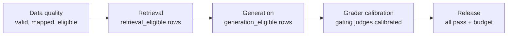

# 10 — Evals in CI

> An eval nobody runs protects nothing. Put the cheap suites on every change and the expensive ones on a schedule, separate *running* from *asserting*, and make each gate say what failed and what to do next.

An eval that someone has to remember to run stops being run, and one that fails the build on every wobble gets muted. A prompt change then ships on "the number looks about the same", and the regression shows up in production. This chapter turns a result into an automatic gate: what runs when, how to block on evidence and not on noise, and who owns the suite.

---

## What runs when

Not every eval belongs on every commit. Tier by cost and speed:

| Trigger | Suite | Graders | Budget | Blocks? |
|---|---|---|---|---|
| **Every commit / PR** | Unit tests + smoke eval (10–30 tasks) | Code only | Seconds–minutes, ~$0 | Yes |
| **PR touching prompts, tools, retrieval** | Regression suite | Code + calibrated judges on a sample | Minutes, a few $ | Yes |
| **Nightly** | Full suite, k trials | All, including experimental (tracked) | Hours | Alerts, not blocks |
| **Pre-release** | Full suite + held-out test + adversarial | All calibrated | As needed | Yes: release gate |
| **Model / provider change** | Everything, paired against current prod ([09](09-reading-results.md#compare-on-the-same-tasks-paired-differences)) | All | As needed | Yes |

Use path filters so a README change doesn't trigger a $40 judge run.

---

## Two phases: run, then assert

Split the eval job into two steps with an artifact between them:

```
Phase 1: RUN                              Phase 2: ASSERT
  for each task × trial:                    load results.jsonl
    run SUT, capture trace                  compute metrics + CIs per slice
    run graders                             compare to baseline / thresholds
    write row → results.jsonl               emit pass/fail per gate + report
  (slow, costly, non-deterministic)         (fast, free, deterministic)
```

Why:

- **Re-assert without re-running.** Change a threshold or add a slice and recompute in seconds.
- **Debug the gate separately from the system.** If the assert step crashes, you haven't lost a $30 run.
- **Results are an artifact.** Upload them, diff them against the last run, attach them to the PR.
- **Flakiness is visible.** Retries and infra errors are recorded in phase 1, not swallowed.

The case study's harness splits each suite this way: an execution step writes rows, and pytest assertions read them ([case study](13-case-study-support-agent.md#harness-patterns)).

---

## The regression gate

A regression gate compares a candidate against a **baseline**, not just a fixed threshold:

| Rule type | Example | Catches |
|---|---|---|
| **Absolute floor** | Schema validity ≥ 99%. Citation hallucination = 0 | Never-events |
| **Relative to baseline** | Grounding not more than 3 points below prod (paired, CI excludes −3) | Regressions |
| **Per-slice floor** | No labeled slice drops > 10 points | Hidden slice regressions ([09](09-reading-results.md#slice-before-you-conclude)) |
| **Efficiency budget** | Cost per success ≤ 1.2 × baseline. p95 latency ≤ 8 s | Silent cost blow-ups |
| **Regression set** | Previously fixed failures: ≥ 95% pass | Re-breaking old bugs |

Gate on the **confidence interval**, not the point estimate. "Block if the upper bound of Δ is below −3" won't block on noise. "Block if Δ < 0" blocks on noise half the time.

A useful gate has more than two answers. This one is a paired comparison on simulated tasks, with the −3 point floor from the table, and it refuses to judge a run where too many tasks errored:

```python
import random
from math import sqrt

def gate(rows, floor=-0.03, max_error_rate=0.02):
    """rows hold baseline and candidate results (1 or 0) for the same tasks, or error=True."""
    scored = [r for r in rows if not r.get("error")]
    errors = len(rows) - len(scored)
    if errors / len(rows) > max_error_rate:         # the run itself failed: no verdict on the agent
        return {"verdict": "rerun", "errors": errors, "n": len(rows)}
    d = [r["candidate"] - r["baseline"] for r in scored]
    n = len(d)
    mean = sum(d) / n
    se = sqrt(sum((x - mean) ** 2 for x in d) / (n - 1) / n)
    low, high = mean - 1.96 * se, mean + 1.96 * se
    verdict = "block" if high < floor else "pass" if low >= floor else "inconclusive"
    return {"verdict": verdict, "delta": round(mean, 3), "ci": [round(low, 3), round(high, 3)],
            "errors": errors, "n": n}

def simulate(n, p_cand, p_base=0.85, keep=0.85, error_rate=0.0, seed=1):
    rng = random.Random(seed)
    rows = []
    for _ in range(n):
        base = int(rng.random() < p_base)
        # most tasks keep their baseline result; the rest get a fresh draw at the candidate's rate
        cand = base if rng.random() < keep else int(rng.random() < p_cand)
        rows.append({"baseline": base, "candidate": cand, "error": rng.random() < error_rate})
    return rows

print("no real change, n=300  ", gate(simulate(300, 0.85)))
print("real drop, n=300       ", gate(simulate(300, 0.30)))
print("same drop, n=40        ", gate(simulate(40, 0.30)))
print("8% infra errors, n=300 ", gate(simulate(300, 0.85, error_rate=0.08)))
```

Output:

```text
no real change, n=300   {'verdict': 'pass', 'delta': -0.007, 'ci': [-0.029, 0.016], 'errors': 0, 'n': 300}
real drop, n=300        {'verdict': 'block', 'delta': -0.123, 'ci': [-0.163, -0.084], 'errors': 0, 'n': 300}
same drop, n=40         {'verdict': 'inconclusive', 'delta': -0.05, 'ci': [-0.148, 0.048], 'errors': 0, 'n': 40}
8% infra errors, n=300  {'verdict': 'rerun', 'errors': 16, 'n': 300}
```

The second and third lines simulate the same change, and only the 300-task run has the evidence to block it. Treating the third line as a pass is how a thin suite lets regressions through. The last line is a verdict on the run, not on the agent.

Update the baseline deliberately: after a release, store its results as the new baseline with the dataset and grader versions. A grader fitted to past outputs needs the same care. BLEURT, a metric fine-tuned on human ratings, lost agreement with humans when trained on poorly rated translations and tested on well rated ones, and every metric tested agreed less as the systems improved ([arXiv:2004.04696](https://arxiv.org/abs/2004.04696) (Sellam et al., ACL 2020); [04](04-graders.md#reference-based-text-metrics)). Re-check a learned grader or judge against fresh human labels when the system has moved a lot, not only when the grader changes.

---

## The gate ladder

Inside a mature suite, gates are **ordered by pipeline stage**. A later gate only runs on the rows an earlier one says are fair ([03](03-eval-datasets.md#row-eligibility-is-this-row-fair-for-this-gate)):



| Gate | Checks | Fails when |
|---|---|---|
| **Data quality** | Rows valid, mapped, deduplicated, eligibility labeled | Schema errors, unmapped sources above threshold |
| **Retrieval** | Recall / MRR on `retrieval_eligible` rows | Below floor or regressed |
| **Generation** | Grounding, completeness on `generation_eligible` rows | Below floor or regressed |
| **Grader calibration** | Gating judges are `calibrated`, calibration not stale | A gating judge is experimental or out of date |
| **Release** | All above pass. Efficiency within budget | Any upstream failure |

This is distinct from the **maturity ladder** ([11](11-production-and-the-maturity-ladder.md#the-ladder)), which orders the stages of *building* an eval practice. The gate ladder orders checks *within* one run.

### What a gate emits

Every gate produces the same shape, so failures are actionable:

```json
{
  "gate": "generation",
  "passed": false,
  "metrics": {"grounding": {"value": 0.81, "ci": [0.77, 0.85], "baseline": 0.86}},
  "rows_scored": 212, "rows_ineligible": 38,
  "top_failure_labels": {"unsupported_claim": 19, "incomplete_answer": 7},
  "worst_slices": [{"slice": "lang=de", "n": 31, "value": 0.64}],
  "next_action": "Inspect unsupported_claim rows in lang=de; likely prompt change in #412"
}
```

A gate that only says `FAILED` sends someone on a half-day hunt.

Write the gates down as a **contract**: a small config file (e.g. `evals/gates.yaml`) that the assert step reads, so thresholds change by reviewed diff and not by someone editing a script. Per gate it records:

| Field | Example |
|---|---|
| Runs on pool | `generation_eligible` |
| Graders (name · version · state) | `grounding · v3 · calibrated` |
| Fails when (absolute) | `schema_valid < 0.99` |
| Fails when (vs. baseline) | upper bound of paired Δ grounding < −0.03 |
| Fails when (per slice) | any slice with n ≥ 20 drops > 10 points |
| Efficiency budget | cost per success ≤ 1.2 × baseline; p95 latency ≤ budget |
| Blocks | merge / release / nothing (alert only) |

Changing a threshold is a reviewed change with a reason, like changing a test. A full eight-gate contract for a RAG system is worked through in [13](13-case-study-support-agent.md#the-gate-ladder).

---

## A CI workflow

Two jobs: a cheap **smoke** job (code graders only, one trial) on every relevant PR, and a **regression** job that runs only if smoke passes. A nightly cron runs the full suite and alerts instead of blocking. The core of the regression job:

```yaml
on:
  pull_request:
    paths: ["prompts/**", "src/agent/**", "src/retrieval/**", "evals/**"]
  schedule:
    - cron: "0 3 * * *"                    # nightly full suite
jobs:
  regression:
    needs: smoke                           # smoke = code graders only, --trials 1
    steps:
      # Phase 1: run. Costly, non-deterministic; records infra errors, never drops rows
      - run: python -m evals.run --suite regression --trials 3 --concurrency 8 --cache .eval-cache --out results.jsonl
        env: {ANTHROPIC_API_KEY: "${{ secrets.EVAL_API_KEY }}"}   # separate, spend-capped key
      - uses: actions/upload-artifact@v4
        if: always()
        with: {name: eval-results, path: results.jsonl}
      # Phase 2: assert. Free, deterministic; paired comparison against the stored baseline
      - run: python -m evals.assert results.jsonl --baseline baselines/prod.jsonl --contract evals/gates.yaml --report report.md
        continue-on-error: ${{ github.event_name == 'schedule' }}  # nightly alerts, doesn't block
      - if: always()
        run: cat report.md >> "$GITHUB_STEP_SUMMARY"            # PR summary
```

Practical details:

- **Secrets and cost caps.** Give the eval job its own API key with a spend limit.
- **Concurrency.** Run tasks in parallel with a rate limiter; respect provider limits or you'll grade 429s.
- **Infra failures ≠ eval failures.** Retry transient errors, then report them as their own count. Never as a task fail, never silently dropped ([09](09-reading-results.md#pitfalls)).
- **Caching.** Cache SUT outputs by (input, config hash) and judge outputs by (output hash, judge version) for re-runs.
- **Pin everything.** Model IDs, judge versions, dataset version. Record them in `results.jsonl`.

---

## Ownership

Anthropic describes eval suites as living artifacts: a team owns the infrastructure, while domain experts contribute tasks and read results. Make that explicit:

- **Infra owner**: runner, CI, dashboards, cost.
- **Criteria owner** ([02](02-defining-correct.md#one-person-decides)): pass/fail definitions, the taxonomy, calibration sign-off.
- **Every engineer**: adds a row when they fix a bug.

Production metrics need owners too, and they cut across teams. Albada's point: a five-second planning delay is usually a prompt or workflow decision, not an infrastructure limit, so no single team can own latency. His template assigns each metric with a RACI chart: **R**esponsible does the work, **A**ccountable owns the outcome, **C**onsulted gives input, **I**nformed is kept updated (*Building Applications with AI Agents*, ch. 10). Condensed:

| Metric | Product | ML engineers | Infra / SRE |
|---|---|---|---|
| Latency (planning, tool calls) | A, C | R, I | R, C |
| Hallucination rate | C, I | **A**, R | I |
| Task success rate | **A**, R (defines success) | C | I |
| Token usage / cost | C | R, I | **A**, R |
| Input drift | I | **A**, R | C |
| Fallback / retry frequency | C | R | **A**, I |
| User feedback | **A**, R | C | I |
| Dashboards and triage rituals | C | C | **A**, R |

Exactly one A per row. Adapt the columns to your org. The point is that no metric is left without an A.

The release gate itself can be stated the same way. Albada's example combines a threshold and a no-regression rule: at least 95% tool recall on refund and cancellation scenarios, and promotion blocked by any regression in multi-turn tests (*Building Applications with AI Agents*, ch. 9). That's the absolute-floor and regression-set rows of [the gate table](#the-regression-gate).

---

## Checklist

- [ ] Smoke suite (code graders) on every PR; regression suite on relevant paths
- [ ] Run and assert are separate steps with `results.jsonl` between them
- [ ] Gates compare to a stored baseline using CIs, not point estimates
- [ ] Per-slice floors and efficiency budgets, not just the headline
- [ ] Gates run in pipeline order and respect eligibility
- [ ] Each gate emits metrics, failure labels, worst slices and a next action
- [ ] Infra errors counted separately; eval job has its own capped key
- [ ] Owners named for infra and criteria

---

## Pitfalls

- **Gating on the point estimate.** Symptom: "Block if Δ < 0" fails about half of all no-op PRs, and people learn to re-run until it's green. Fix: block when the CI's upper bound is below the floor, as in the script.
- **Treating inconclusive as a pass.** Symptom: a real drop merges because a 40-task suite couldn't see it. Fix: three answers, not two, with inconclusive sent to a bigger run or a person.
- **Losing infra errors.** Symptom: a provider outage shows up as an agent regression, or errored tasks vanish and the rate rises. [09](09-reading-results.md#pitfalls) says to count errors as failures in a *reported rate* so they can't leave the denominator. This chapter says they aren't *task* failures for a *gate*. Both keep them in view. Fix: retry transient errors, report the count on its own line, and have the gate return "rerun" above a set limit.
- **Running everything on every push.** Symptom: a $40 judge run on a README change. Fix: path filters, tiers by trigger, and code graders before paid judges.
- **Asserting inside the run.** Symptom: a crash or a threshold change throws away an expensive run. Fix: two phases, with rows written to `results.jsonl` and a free assert step over them.
- **Sharing the production API key.** Symptom: an eval loop eats the budget or gets rate limited with live traffic, and you end up grading 429s. Fix: a separate key with a spend limit, and a rate limiter.
- **A blended score, or a gate no one owns.** Symptom: a per-slice drop passes because the average is fine, or thresholds set once never change. Fix: named gates in a contract file (`evals/gates.yaml`), per-slice floors with a minimum n, and an explicit owner for infrastructure and for criteria.

## Try it

1. In the script, raise the n on the "same drop" line. Where does it change from inconclusive to block?

   <details><summary>Answer</summary>

   At n = 80 it's still inconclusive, with a CI of [−0.159, −0.016], and at n = 120 it blocks at [−0.163, −0.037]. The upper bound has to fall below −0.03, so the gate's power depends on suite size. These results come from this seed and simulated data.

   </details>

2. Change the floor to −0.01 and re-run "no real change, n=300". What does the gate say, and what would it take to get a pass?

   <details><summary>Answer</summary>

   Inconclusive: the CI of [−0.029, +0.016] isn't entirely above −0.01. A tighter floor needs a narrower CI, which means more tasks, so choose the floor knowing what your suite can resolve.

   </details>

3. Lab: in [eval-suite-ci](../practice/eval-suite-ci/README.md#things-to-try), mark `export-data` critical and see `v2-concise` go from PASS to FAIL, then set a tokens budget of 1.2 × baseline. Which gate type does each of these match in this chapter's table?

   <details><summary>Answer</summary>

   Marking a task critical makes it behave like the **regression set**, a floor on specific tasks that must not re-break. The tokens budget is an **efficiency budget**. The lab's list gives the answer for the first.

   </details>

## Interview checklist

| Prompt | Answer in one line |
|---|---|
| Absolute floor or regression gate? | Both, for different failures. A floor catches never-events such as schema validity under 99% or any citation hallucination. A paired baseline comparison catches drift that stays above any floor. |
| Why not block if the candidate's score is lower? | Because Δ < 0 blocks on noise half the time. Gate on the CI instead, as in "block if the upper bound of Δ is below −3". |
| Why split into run and assert phases? | The run is slow, costly and non-deterministic, while asserting is free and deterministic. You can change a threshold or add a slice without re-running, and a crash in assert doesn't lose a $30 run. |
| 8% of tasks hit rate limits during a run. Block the PR? | No verdict either way. Retry, report the errors as their own count, and rerun, since the score can't be read while the failures are about the provider. Don't count them as task failures or drop them. |
| What runs on a PR, and what nightly? | Fast code graders and regression sets on PRs that touch relevant paths, and larger suites with judges nightly, which alert without blocking. The gate ladder then limits later gates to rows that earlier gates found fair. |
| When is the baseline updated? | Deliberately, after a release, storing results with dataset and grader versions. A baseline that moves on its own hides slow decline. |
| Who owns what? | An infra owner runs the runner, CI and cost, a criteria owner signs off pass/fail definitions and calibration, and every engineer adds a row when fixing a bug. Production metrics cross teams, so give each a RACI row. |

## Next

[11-production-and-the-maturity-ladder.md](11-production-and-the-maturity-ladder.md): evals after launch.
