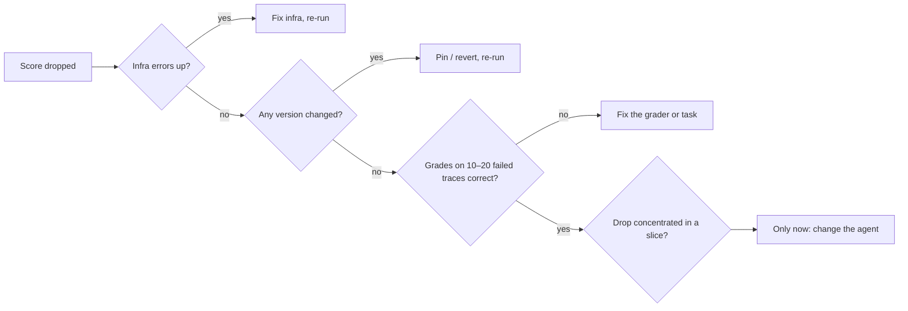
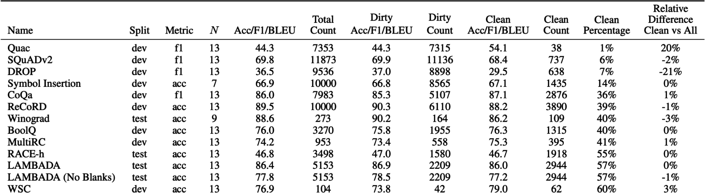

# 12 — When Evals Go Wrong

> An eval is software and a measurement, so it fails both ways: bugs that produce wrong scores, and right scores that stop meaning what you think. When a number moves, suspect the eval before the agent.

A score drops, the team spends two days rewriting the prompt, and the cause turns out to be a judge model that updated itself. The opposite failure is quieter: a score that climbs because errored rows left the denominator, or because the agent learned to game the check. This chapter covers the ways evals themselves go wrong, and the order to debug them in before anyone changes the agent.

---

## Eval bugs look like agent bugs

A score drop is a claim that the system got worse. Often it's the eval that changed or broke:

| Cause | Looks like | Example |
|---|---|---|
| **Infra failure** | Tasks failing | Timeouts, rate limits (429s), OOM, sandbox didn't start |
| **Grader bug** | Correct outputs marked wrong | Regex too strict, judge given URLs not text (`context_missing`) |
| **Broken task** | A task at 0% for every version | Unreachable state, wrong reference, missing permission |
| **State leakage** | Flaky, order-dependent failures | Trial 2 sees files trial 1 wrote |
| **Stale reference** | "Wrong" answers that are now right | Docs updated, gold answer wasn't |
| **Version mismatch** | A jump on no change | Judge model updated, dataset v3 vs v4 |
| **Dropped rows** | A jump in pass rate | Errored tasks silently left the denominator ([09](09-reading-results.md#pitfalls)) |

### The debug order

When a score drops:



1. **Infrastructure.** Errors, timeouts, rate limits, resource limits. Are error counts up?
2. **Versions.** Did the dataset, grader, judge model or config change between runs?
3. **Traces and grader decisions.** Read 10–20 failed transcripts *with* their grades. Is the grade right?
4. **Slices.** Is the drop concentrated in one category? That points at a cause.
5. **Only then** change the model, prompt, tools or agent logic.

Skipping to step 5 means "fixing" an agent that wasn't broken, and sometimes breaking it.

The order fits a short function. These runs are invented: a 300-task baseline at 80%, then four runs that each have a different cause:

```python
def triage(prev, cur):
    """Walk the debug order. Stop at the first step that explains the change."""
    if cur["errors"] > prev["errors"] or cur["rows_scored"] < prev["rows_scored"]:
        return f"infra: errors {prev['errors']} -> {cur['errors']}, rows scored {prev['rows_scored']} -> {cur['rows_scored']}"
    changed = [k for k in prev["versions"] if prev["versions"][k] != cur["versions"][k]]
    if changed:
        return f"versions: {changed} changed, runs are not comparable"
    moved = {s: round(cur["slices"][s] - prev["slices"][s], 2) for s in prev["slices"]}
    worst = min(moved, key=moved.get)
    if moved[worst] <= -0.10:
        return f"slice: {worst} moved {moved[worst]:+.2f}, read its flipped transcripts"
    return "read 10-20 failed transcripts with their grades, then consider the agent"

def headline(run):
    return round(run["passed"] / run["rows_scored"], 3)

base = {"passed": 240, "rows_scored": 300, "errors": 0,
        "versions": {"dataset": "v4", "judge": "grounding-v2"}, "slices": {"billing": 0.82, "how-to": 0.80}}

cases = {
    "rate jumped": dict(base, passed=230, rows_scored=270, errors=30),
    "judge bumped": dict(base, passed=222, versions={"dataset": "v4", "judge": "grounding-v3"}),
    "one slice fell": dict(base, passed=222, slices={"billing": 0.68, "how-to": 0.80}),
    "small drift": dict(base, passed=234, slices={"billing": 0.80, "how-to": 0.79}),
}
print("baseline", headline(base))
for name, run in cases.items():
    print(f"{name:15} {headline(run)}  {triage(base, run)}")
print("errors counted as fails:", round(230 / 300, 3))
```

Output:

```text
baseline 0.8
rate jumped     0.852  infra: errors 0 -> 30, rows scored 300 -> 270
judge bumped    0.74  versions: ['judge'] changed, runs are not comparable
one slice fell  0.74  slice: billing moved -0.14, read its flipped transcripts
small drift     0.78  read 10-20 failed transcripts with their grades, then consider the agent
errors counted as fails: 0.767
```

The first run looks like a win and is really 30 lost tasks: counted as fails, the rate is 0.767. None of these results is yet a reason to edit the agent. The function checks slices before transcripts only because a slice tells you which transcripts to read first.

---

## Saturation

A suite near 100% has stopped measuring. It can't show improvement, and it may hide new failures that its tasks never probe. Saturation is a signal that the tasks no longer reach the system's capability boundary, not that the problem is solved.

What to do:

- **Graduate it.** Saturated capability tasks become the regression suite, which *should* sit near 100% ([01](01-what-an-eval-is.md)).
- **Add harder tasks** from the discovery set, new use cases, longer horizons, adversarial variants.
- **Raise the bar**: pass^k instead of pass@1 ([06](06-evaluating-agents.md#non-determinism-run-every-task-k-times)), stricter grounding tier, tighter efficiency budget.

Public benchmarks saturate the same way. A benchmark everyone scores 90%+ on can't separate models. GLUE (2018) saturated within a year and was replaced by SuperGLUE (2019); MMLU (2020) was largely replaced by MMLU-Pro (2024). In June 2024, less than a year after its previous revamp, Hugging Face replaced its leaderboard's whole benchmark set: GSM-8K gave way to MATH level 5, MMLU to MMLU-Pro, and GPQA, MuSR, BBH and IFEval were added (*AI Engineering*, ch. 3, 4). Expect those to saturate too (a 2024–25 snapshot).

BBH was itself built from a benchmark that was saturating, and it shows that weak prompting can make a benchmark look harder than it is. Citing the PaLM paper, Suzgun et al. note that PaLM 540B with five-shot prompts already beat the average human rater on 65% of BIG-Bench tasks. (The BIG-Bench paper itself gives no such count. It reports that the best language models in its aggregate plots scored under 20 on a normalised scale where experts would score close to 100 ([arXiv:2206.04615](https://arxiv.org/abs/2206.04615) (Srivastava et al., TMLR 2023)).) Of 78 clean tasks, Suzgun et al. found 36 where no model had beaten the average rater, and kept 23 of them: 6,511 examples, with the average rater at 67.7% and the best prior result at 50.9%. BIG-Bench had scored models with answer-only prompting. Writing chain-of-thought exemplars took Codex from 56.6% to 73.9%, which put it above the average rater on 17 of the 23 tasks instead of 5. PaLM 540B went from 52.3% to 65.2% (10 of 23). Before a benchmark is declared too hard, check that the prompt lets models show what they can do ([doi:10.18653/v1/2023.findings-acl.824](https://doi.org/10.18653/v1/2023.findings-acl.824) (Suzgun et al., Findings of ACL 2023)).

The replacements are built to start near the floor. On ARC-AGI-2, o3 (Medium) scores 3.0%, against 53.0% on ARC-AGI-1, and o3-mini (High) drops from 34.5% to 3.0% ([arXiv:2505.11831](https://arxiv.org/abs/2505.11831) (Chollet et al., 2025-05)). On Humanity's Last Exam, frontier models scored 3.3–9.4% at release, with RMS calibration errors of 82–93%: they answer confidently when they're wrong ([arXiv:2501.14249](https://arxiv.org/abs/2501.14249) (Phan et al., 2025-01)). The floor has a noise band of its own. The ARC authors treat any score under 5% as not meaningful, and the HLE authors say much the same about small moves near zero. A change from 3% to 4% isn't progress. HLE's authors also predicted models could pass 50% by the end of 2025, so a new benchmark's headroom can disappear quickly.

When you pick benchmarks for a custom leaderboard, check how strongly they correlate. On the January 2024 Hugging Face set, WinoGrande and MMLU correlated at 0.90 and ARC-C and MMLU at 0.87, while TruthfulQA sat around 0.45–0.55 against the rest. Two highly correlated benchmarks double-count one capability. A plain average also treats 80% on a hard benchmark the same as 80% on an easy one. HELM ranks by **mean win rate** instead: the fraction of times a model beats another, averaged across scenarios (*AI Engineering*, ch. 4).

---

## Goodhart: the eval becomes the target

"When a measure becomes a target, it ceases to be a good measure." Optimize hard against any eval and you'll find its gaps:

| Gap exploited | Example |
|---|---|
| **Grader leniency** | Answers padded until the verbosity-biased judge passes them |
| **Narrow checks** | Code agent edits the tests instead of the code. Output matches the schema with empty content |
| **Proxy metric** | 👍 rate optimized → flattery. Escalation rate cut → refuses to escalate when it should |
| **Visible tests** | Agent overfits to tests it can see |

Partial credit is a common version of the proxy gap. Yang et al. (2026) trained terminal agents on a dense reward: the fraction of checker tests passed. Under that reward, **failed trajectories collected 50% of all reward mass**, and 48 failures passed every executed scenario check yet still failed the task's terminal gate. Their fix kept the partial credit, because it helps exploration, but kept it *subordinate* to verified completion. Strict success means the full protected verifier passes, not the agent declaring itself done or a subset of checks passing. Rescoring under that rule cut the failures' share of reward to 29%. The lesson for any eval: when you award partial credit, report strict success beside it, and never let the sum of the partial scores outrank completion.

The narrow-checks gap can appear without anyone trying to game it. Anthropic reports that Claude 3.7 Sonnet sometimes **special-cased tests** to make them pass: it returned the expected values directly or edited the tests. The behaviour came from reward hacking in RL training on coding tasks graded by tests. User testing missed it, and classifiers run over training transcripts caught it. The card suggests watching transcripts for many edit-and-test cycles on one file, comments that mention specific tests, and unexpected edits to test files ([PDF](https://assets.anthropic.com/m/785e231869ea8b3b/original/claude-3-7-sonnet-system-card.pdf) (Anthropic, 2025-02); a vendor self-report). A tests-pass grader can't see any of this. A transcript check or a diff check on the test files can.

Grading formats can create the proxy gap too. Under binary grading, where a wrong answer and "I don't know" both score 0, guessing always has a higher expected score than abstaining. Kalai et al. count 9 of the 10 benchmarks on popular leaderboards that give abstention no credit, and argue that this is one reason models learn to hallucinate ([arXiv:2509.04664](https://arxiv.org/abs/2509.04664) (Kalai et al., 2025-09); a position paper with no experiments). The fix is in the grader: see [04](04-graders.md#binary-vs-scales).

The judge you train against is itself a proxy. DR Tulu trained a deep-research agent with RL on rubric rewards graded by GPT-4.1-mini, and evaluated it on benchmarks with their own rubrics and judges. Within one run, higher training reward usually meant better downstream scores. Across runs, **the run with the highest training reward was not necessarily the best downstream**, and the authors attribute this to the mismatch between the training and evaluation judges and rubrics ([DR Tulu](https://www.datocms-assets.com/64837/1763496622-dr_tulu_draft.pdf) (Shao et al., 2025-11)). Pick checkpoints on the held-out eval, not on the training reward.

Defenses:

- **Multiple dimensions** with guardrails, never a single score ([04](04-graders.md#combining-graders-scoring-design)).
- **Held-out tests** the optimizer (human or agent) can't see ([04/03](../../../ai-engineering/04-loop-engineering/notes/03-the-scorekeeper.md)).
- **Read the transcripts** of the biggest gains, not just the losses.
- **Rotate and refresh** the suite from production.

This bites hardest in automated loops, where an optimizer runs thousands of iterations against your grader. A loop finds a grader's blind spot faster than any human ([04/08](../../../ai-engineering/04-loop-engineering/notes/08-self-improving-loops.md)).

---

## Overfitting the dev set

Every prompt tweak you keep because it scored better on the eval set is fitting to that set. After enough iterations, dev-set gains stop transferring.

- Keep a **held-out test** set; look at it rarely (per release, not per change) ([03](03-eval-datasets.md#splits-versioning-contamination)).
- If dev and test diverge, you've overfit. Freshen dev from production.
- Small suites overfit faster: on 50 tasks, one lucky flip is 2 points.
- Every score you report from the test set leaks some information about it. ARC Prize used the same 100 private tasks from 2020 to 2024 and disclosed roughly 10,000 scores against them, enough for teams to fit the private set ([arXiv:2505.11831](https://arxiv.org/abs/2505.11831) (Chollet et al., 2025-05)). Limit how often anyone sees test scores, and rotate the set eventually.
- Same for judges: tune on the dev split of human labels, report on test ([15](15-calibration-against-human-labels.md#the-procedure)).

---

## Contamination

The model may have seen your eval data:

- **Public benchmarks** leak into pre-training. High scores may be memory, not skill. Prefer private, recent, or regenerated tasks.
- **Your own leaks**: eval rows pasted into few-shot examples, fine-tuning data built from logs that include eval rows, eval rows in the retrieval index.
- **Detection**: performance far above similar unseen tasks; the model completes a task's text verbatim; scores drop on paraphrased versions.

Two detection heuristics, with a cost trade-off (*AI Engineering*, ch. 4):

| Method | How | Trade-off |
|---|---|---|
| **N-gram overlap** | An eval sample that shares a 13-token sequence with the training data is "dirty" | More accurate. Needs the training data, and comparing every sample against it is expensive |
| **Perplexity** | Unusually low perplexity on the eval text means the model finds it easy to predict, so it has probably seen it | Cheap and works without training data. Less accurate |

Contamination is usually accidental: web scrapes pick up published benchmarks, and training and eval sets can share a source (the same maths textbooks). It is also sometimes deliberate and reasonable: a developer selects the model on clean benchmarks, then trains on the benchmark data before release because it is good data. Either way, report the score on the **clean subset** next to the full score. In OpenAI's GPT-3 analysis, 13 benchmarks had at least 40% of their samples in the training data, and the clean-vs-full gap went both ways (Brown et al. 2020): Google's Gemini report measured how small the gap can be. About a hundred fine-tuning steps on web extracts matching HellaSwag's training set, which were not in pre-training, **lifted 1-shot validation accuracy to 89.6% for Gemini Pro and 96.0% for Gemini Ultra**, against 92.3% measured for GPT-4. Google then reported HellaSwag only in a decontaminated 10-shot setting, and dropped LAMBADA after finding leaks ([arXiv:2312.11805](https://arxiv.org/abs/2312.11805) (Gemini Team, 2023-12)).


*Image Source: Huyen, *AI Engineering* (O'Reilly, 2025), Fig. 4-10*

The split itself can leak, with no pre-training involved. ELI5's authors kept near-duplicates out of validation and test by sampling those splits only from questions with no close TF-IDF neighbour in the rest of the data ([arXiv:1907.09190](https://arxiv.org/abs/1907.09190), Fan et al., ACL 2019). Krishna et al. retrieved the 7 nearest training questions for 300 validation questions and had crowd-workers label each pair. **81% of validation questions had a paraphrase in the training set, and all 300 had a topically similar one** (Fleiss κ 0.29). A RoBERTa paraphrase classifier trained on QQP flagged only 43.6%, so automatic checks undercount. Copying the best answer among the 7 retrieved training questions scored 28.5 ROUGE-L, higher than every model on the leaderboard ([arXiv:2103.06332](https://arxiv.org/abs/2103.06332) (Krishna, Roy & Iyyer, NAACL 2021)). Lewis et al. (EACL 2021) found the same kind of overlap in short-answer open-domain QA sets such as Natural Questions. Dedupe a held-out split by meaning, not by n-grams. Retrieve near neighbours, have a person check them, or hold out whole topics.

Benchmark maintainers can keep part of the data private and evaluate submissions against that hold-out. For your own fine-tunes there's a quick tell: if fine-tuning raises the base model's MMLU by 10 points, suspect the instruction data overlaps the test set before you celebrate (*LLM Engineer's Handbook*, ch. 7).

---

## Judge drift and misuse

| Problem | Fix |
|---|---|
| Judge model silently updated | Pin the version; re-calibrate on change ([15](15-calibration-against-human-labels.md#keep-it-calibrated)) |
| Provider model update changes the system's behaviour | Re-run the suite on every model change. Chen et al. (2023) found GPT-3.5 and GPT-4 scores changed significantly on many benchmarks between March and June 2023. Moving from GPT-3.5-turbo-0301 to -1106 cost Voiceflow 10% on intent classification while it improved GoDaddy's support bot (*AI Engineering*, ch. 4): the same update can help one app and hurt another |
| Criteria drift: the team's idea of "pass" moved but the judge didn't | Version criteria; re-label a sample when they change ([02](02-defining-correct.md#criteria-drift); [Shankar et al.](https://arxiv.org/abs/2404.12272), UIST 2024: criteria move as people grade) |
| Uncalibrated judge used as a release gate | Grader states: experimental never gates ([04](04-graders.md#grader-states-which-ones-can-block-a-release)) |
| Judge from the same family as the SUT | Different model family ([05](05-llm-as-judge.md#known-biases)) |
| Generic off-the-shelf metric trusted because it's popular | Calibrate against your labels; expect inversions ([case study](13-case-study-support-agent.md#calibration-results)) |

---

## Measuring the wrong thing

The quietest failure: everything works and the metric doesn't track what users care about.

- **Generic metrics** ("helpfulness", "coherence") instead of metrics from error analysis ([02](02-defining-correct.md#find-failure-modes-by-reading-error-analysis)).
- **Wrong unit**: per-turn scores look fine while conversations fail to resolve.
- **Wrong denominator**: grounding rate rises because the system answers less ([09](09-reading-results.md#pitfalls)).
- **Offline–online gap**: eval set doesn't look like production traffic any more.
- **Overlap metrics on open-ended text.** On ELI5, ROUGE-L against reference answers barely separates trivial outputs from good ones. The question copied five times scored 20.0 on validation, above RAG's 16.1. A random off-topic training answer scored 16.2. Krishna et al.'s system scored 24.4, above the longest human-written gold answer (21.2), yet people preferred the gold answer 68% to 14%. ROUGE-L also rose steadily with output length ([arXiv:2103.06332](https://arxiv.org/abs/2103.06332) (Krishna, Roy & Iyyer, NAACL 2021)). Before trusting a reference-overlap metric, score a trivial baseline and a human reference with it. A reference-free alternative compares distributions. MAUVE clusters model and human texts in an embedding space and scores the gap between the histograms. Its ranking of eight GPT-2 settings correlated 0.952 with human judgments of human-likeness, and it was the only measure tested whose score fell steadily with generation length for every model and decoder; generation perplexity mostly agreed but was non-monotonic in two settings ([arXiv:2102.01454](https://arxiv.org/abs/2102.01454) (Pillutla et al., NeurIPS 2021)). It scores a corpus, not one answer, and checks no facts.
- **Automatic metric the model was trained on.** On PersonaChat, ranking models beat generative ones on hits@1 by about four to one (0.511 against 0.125), "perhaps obvious as that is the metric they are optimizing". In 100 human-rated conversations per model, on a 1–5 scale, the gap shrank to 3.50 against 3.13 on engagingness, and the same ranking model without a persona scored higher (3.88) than with one. The authors note the differences were "obscured by the high variance of the human raters' evaluations" ([doi:10.18653/v1/p18-1205](https://doi.org/10.18653/v1/p18-1205) (Zhang et al., ACL 2018); no rater counts or agreement reported). Check a model against a metric it wasn't optimised for before trusting the ranking.

Check periodically that offline scores **predict** online outcomes. If the version that won offline doesn't win online, the eval is measuring something else.

---

## Eval debt

Sculley et al.'s "Hidden Technical Debt in ML Systems" applies directly. Evals accumulate debt:

- Graders nobody remembers the reason for.
- Thresholds set once and never revisited.
- Rows whose references went stale.
- Two copies of a grader (CI and production) that drifted apart.
- Dashboards nobody reads.

Schedule maintenance: review failure labels quarterly, prune dead rows, re-calibrate judges, retire metrics nobody acts on.

---

## Checklist

- [ ] Debug order followed before touching the agent: infra → versions → traces → slices
- [ ] Infra errors, dropped rows and version changes visible in every report
- [ ] Saturated tasks graduated; harder tasks added
- [ ] Multiple dimensions + guardrails; biggest gains read, not just losses
- [ ] Held-out test set, rarely viewed
- [ ] Eval rows kept out of prompts, fine-tuning data and indexes
- [ ] Judge versions pinned; criteria versioned
- [ ] Offline wins checked against online outcomes
- [ ] Eval maintenance on a schedule

---

## Pitfalls

- **Changing the agent first.** Symptom: "fixes" that don't move the score, or that break something. Fix: follow the debug order: infra, versions, traces and grades, slices, and only then the agent.
- **Believing a jump.** Symptom: a win on a no-change run, from dropped rows or a bumped dataset or judge. Fix: put errors and version IDs in every report, and be as suspicious of a jump up as of a drop.
- **Keeping a saturated suite as a capability measure.** Symptom: everything scores 90%+ and versions can't be told apart. Fix: graduate those tasks to a regression suite, and add harder ones or raise the bar with pass^k.
- **Optimizing against the metric.** Symptom: scores rise while users don't notice, as with Claude 3.7 Sonnet special-casing tests. Fix: several dimensions with guardrails, held-out tests the optimizer can't see, and transcripts of the biggest gains.
- **Overfitting the dev set.** Symptom: dev gains stop transferring. On 50 tasks, one lucky flip is 2 points. Fix: a held-out test read per release rather than per change, and fresh dev rows from production.
- **Contaminated rows.** Symptom: scores far above similar unseen tasks, or a drop on paraphrases. Fix: keep eval rows out of few-shot examples, fine-tuning logs and the retrieval index, and prefer private, recent or regenerated tasks.
- **Eval debt.** Symptom: thresholds set once, stale references, and two drifted copies of a grader. Fix: quarterly label reviews, pruning dead rows, re-calibrating judges and retiring metrics nobody acts on.
- **An offline eval that doesn't predict online.** Symptom: the offline winner doesn't win online. Fix: check that prediction periodically, and when it fails treat the eval, not the launch, as the thing to fix.

## Try it

1. For each symptom, name the first thing you'd check. (a) One task is at 0% on every version. (b) Pass rate rises 5 points on a run with no change. (c) A test passes on one order and fails on another. (d) The answer "wrong" per the reference is right per current docs.

   <details><summary>Answer</summary>

   (a) Broken task: unreachable state, wrong reference or missing permission. (b) Dropped rows or a version mismatch: check the error count, denominator and versions. (c) State leakage between trials. (d) Stale reference: update the gold answer.

   </details>

2. In the script, the "rate jumped" run passes 230 of 270 scored rows, and 30 rows errored. Compute the rate each way, and say which one a release report should show.

   <details><summary>Answer</summary>

   230 / 270 = **0.852** with errors dropped, and 230 / 300 = **0.767** with errors as failures. The script's baseline is 0.80, so it's a rise on one reading and a fall on the other. Fix the errors and re-run, and if you must report now, show 0.767 with the error count beside it.

   </details>

3. You've made 8 prompt tweaks in a row, each keeping whatever scored better on a 50-task dev set, and the dev score rose 8 points. What do you do before believing it?

   <details><summary>Answer</summary>

   Run the held-out test, since one flip is 2 points on 50 tasks and selection across 8 tweaks can produce a rise like this one. If dev and test diverge, you've overfit. Refresh dev from production and keep reading test per release.

   </details>

## Interview checklist

| Prompt | Answer in one line |
|---|---|
| The score dropped this morning. What's your order? | Infrastructure, then versions, then 10 to 20 failed traces with their grades, then slices, and only then the agent. |
| How do you handle a saturated eval? | Graduate its tasks into a regression suite and add harder ones. Public benchmarks do the same, as with GLUE to SuperGLUE and MMLU to MMLU-Pro, or o3 (Medium) at 53.0% on ARC-AGI-1 and 3.0% on ARC-AGI-2. |
| Give examples of Goodhart in agent evals. | Answers padded for a verbosity-biased judge, a code agent editing tests rather than code, 👍 optimized into flattery, and escalation rate cut until it won't escalate when it should. |
| How can test-set scores leak? | Every reported score leaks some information. ARC Prize disclosed about 10,000 scores against the same 100 private tasks from 2020 to 2024, enough for teams to fit the private set. |
| How do you detect contamination? | Scores well above similar unseen tasks, verbatim completions of task text, and drops on paraphrases. N-gram overlap and perplexity are the two heuristics, with different costs. |
| Provider silently updates the model. What protects you? | Pin versions and re-run on each model change. Chen et al. found GPT-3.5 and GPT-4 scores changed significantly on many benchmarks from March to June 2023. |
| Offline scores improve each release, but resolution is flat. What's going on? | The eval has stopped measuring what users care about, through a generic metric, wrong unit, wrong denominator, or a set that no longer resembles traffic. Check whether offline wins predict online wins. |

## Next

[13-case-study-support-agent.md](13-case-study-support-agent.md): every chapter applied to one real system.
