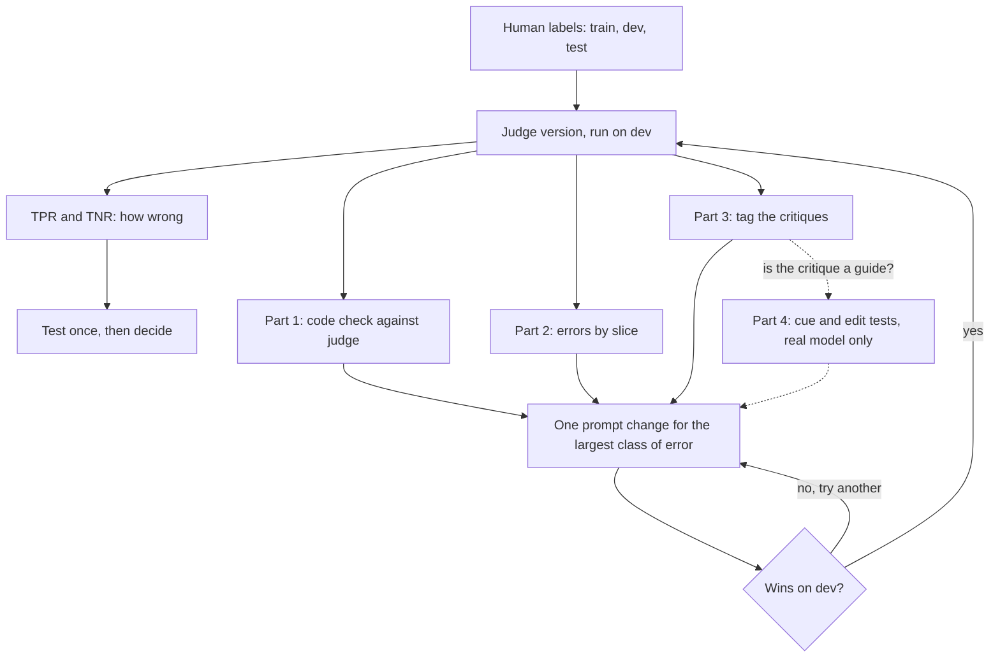

# 14 — Calibrating Judges with Checks and Critiques

> [Note 05](05-llm-as-judge.md#the-procedure) gives the calibration procedure: label, split, iterate on dev, score test once. This note assumes it and doesn't repeat it. It adds three sources of evidence to the step where you read disagreements, and a test of how far to trust one of them.

Note 05's calibration tells you how often a judge is wrong. It says little about why, or what to change. Three things you already have can help: the code checks that ran on the same rows, the judge's errors split by flags in the data, and the critique the judge wrote (its short written reason for the verdict). Each is useful and each can mislead. A code check can only test what code can see. A slice can be a coincidence or another slice in disguise. A critique can be an account written after the fact, one that leaves out what actually moved the verdict. So this note treats all three as evidence for finding what to fix, and human labels stay the only thing that settles which judge is right.

Throughout, PASS is the positive class, as in note 05. TPR is the share of outputs people passed that the judge also passed. TNR is the share of outputs people failed that the judge also failed.



## What the exercise can and cannot show

The script is [`practice/judge_checks_and_critiques.py`](../practice/judge_checks_and_critiques.py). It runs parts 1 to 3 offline with the planted failures and rule judges of [GA 06's support agent](../../06-observability/notes/03-judge-pipelines-over-trace-exports.md). It doesn't modify that package.

**This tests the procedure and measures no real model.** The judges are deterministic rules that behave the way a model plausibly might. The "human" labels are the planted failures: a row is FAIL if the generator planted a hallucinated citation or a distorted claim. Every rate below describes those rules on that data, and nothing here says how well any real model judges. A rule judge's evidence list is faithful by construction, because the verdict is literally `bool(evidence)`, so the offline run says nothing about faithfulness either. Part 4 needs a real model and is written as an online exercise with no results.

```bash
cd generative-ai/08-eval/practice && uv run judge_checks_and_critiques.py
```

```text
train  280 rows  human PASS  268  FAIL 12
dev    560 rows  human PASS  539  FAIL 21
test   560 rows  human PASS  551  FAIL  9
```

Only 42 of 1,400 rows are labelled FAIL, and the split left 9 of them in test, so every TNR below has a wide interval.

## Part 1: run the code checks against the judge

Run the code checks and the judge on every row, then cross them. This is cheaper than labelling and answers a narrower question: where do a deterministic check and the judge part ways, and which of them is wrong there?

| | Judge passes | Judge fails |
|---|---|---|
| **Code passes** | Normal. The random human sample covers these rows. | Either the judge caught something the check can't see, or it failed a good output. A person decides, and the answer shows which side to fix. |
| **Code fails** | A false pass on a provable fault. Read these first. | Agreement. This gives the judge's catch rate on provable faults, which are probably the easiest cases, so don't assume the rate holds for subjective criteria. |

For example, a citation missing from the retrieved set should fail a grounding judge. If it doesn't, you've found a judge problem without labelling anything.

The exercise has two code checks. Check A requires every cited URL to have been retrieved. Check B requires every number in the answer to appear in a document the answer cites.

```python
def check_citation(conv):
    retrieved = {d["url"] for d in conv.documents}
    return all(url in retrieved for url in conv.sources)

def check_numbers(conv):
    cited = [d for d in conv.documents if d["url"] in conv.sources]
    if not cited:
        return True  # nothing to compare against: check A reports this row
    return not _numbers(conv.answer) - set().union(*(_numbers(d["text"]) for d in cited))
```

```text
both checks, lenient judge
  code pass, judge pass  377
  code pass, judge FAIL  161
  code FAIL, judge pass    3
  code FAIL, judge FAIL   19

both checks, strict judge
  code pass, judge pass  538
  code pass, judge FAIL    0
  code FAIL, judge pass    3
  code FAIL, judge FAIL   19
```

Now read the rows, starting with code fails and judge passes.

```text
read first: code FAIL, judge pass (strict judge)
  t01096 planted=distorted_claim: The default payment term is 30 days. Change it under Invoice settings.
    cited ['payment-terms'], retrieved ['payment-terms', 'credit-notes']
  t00974 planted=distorted_claim: The default payment term is 30 days. Change it under Invoice settings.
    cited ['payment-terms'], retrieved ['payment-terms', 'credit-notes']
  t00672 planted=distorted_claim: The default payment term is 30 days. Change it under Invoice settings.
    cited ['payment-terms'], retrieved ['payment-terms', 'credit-notes']

both FAIL, but the label says PASS (strict judge)
  t00689 planted=wrong_route: This refund is above what I can approve, so I have passed it to a colleague.
    cited ['policy'], retrieved ['api-limits', 'add-user']

code pass, lenient judge FAIL, by language: {'da': 151, 'en': 10}
  label PASS on 161 of 161
  English rows: {'This refund is above what I can approve, so I have passed it to a colleague.': 10}
```

The three false passes say 30 days where the cited document says 14. The strict judge compares numbers against every retrieved document, and 30 appears in the credit-notes document that was retrieved but not cited. So the fix belongs on the judge's side: compare against the cited source.

Row `t00689` is different. Check and judge both fail it, while the label says PASS. It's an answer citing a policy page that was never retrieved, on a trace whose planted fault was wrong routing, so the generator didn't count it as a grounding failure. A human reviewer might well side with the judge, as [GA 06/03](../../06-observability/notes/03-judge-pipelines-over-trace-exports.md) says of the same answer. Agreement between check and judge doesn't settle that. A person does, and the answer may change the label instead of the judge.

The lenient judge's 161 disagreements with code are all labelled PASS, and 151 of them are Danish. Part 2 comes back to that.

### Four limits on this cross

**(a) Human labels stay the calibration.** Agreement with code tests only what code can check. It doesn't move a grader out of `experimental` ([04](04-graders.md#grader-states-which-ones-can-block-a-release)), and note 05's rule stands: only human labels settle which judge is right.

**(b) Calibration runs the judge on rows code already failed.** Stopping early is right in production ([04](04-graders.md#layer-them-dont-choose)) because it saves money. In calibration it empties the bottom row of the table above. The two modes differ:

```text
Limit (b): stopping early changes what you can measure (strict judge)
  every row                 n=560  human FAIL rows=21  TNR=18/21
  rows passing check A      n=552  human FAIL rows=14  TNR=11/14
  rows passing both checks  n=538  human FAIL rows= 0  TNR=0/0
```

Behind both checks, the judge sees no labelled failures at all, so its TNR can't be computed. A real system won't be this extreme, because these planted failures were built to be provable. The direction holds: rows the judge never sees are missing from what you can measure.

**(c) The disagreement queue is not the human sample.** Note 04 says the 5 to 10% human sample is not a review queue. Keep two samples. The random sample gives TPR, TNR and the corrected pass rate. The targeted queue finds what to fix, and its rates are biased because you picked its rows for disagreeing. Social scientists will recognise selection on the outcome.

```text
Limit (c): random sample against disagreement queue (lenient judge, all 1,400 rows)
  all rows       n=1400 FAIL=42   TPR 0.694  TNR 0.929  true pass rate 0.970
  the lenient judge passes 0.676 of all rows; the correction below starts from that
  queue          n=415 FAIL=3  TPR 0.000  TNR 0.000  corrected pass rate: not valid, TPR + TNR is below 1
  over 2,000 draws, 2.5th to 97.5th percentile:
    random, 105 rows       TPR 0.60-0.78  TNR 0.50-1.00  corrected pass rate 0.808-1.145  draws with no FAIL row: 72
    stratified, 150 rows   TPR 0.61-0.78  TNR 0.93-0.93  corrected pass rate 0.854-1.126  draws with no FAIL row: 0
```

The queue shows TPR 0 and TNR 0 for a judge whose real values are 0.694 and 0.929, because where the code is right, as here, every queued row is a judge error. It's still the best place to find the fix.

The random sample is honest but imprecise. In 72 of 2,000 draws of 105 rows, there's no failed row at all. The corrected pass rate ([05](05-llm-as-judge.md#correcting-the-pass-rate)) ranges from 0.81 to 1.15 around a true 0.970, and the correction has no ceiling, so report it with an interval.

There is one proper middle course. Label every row code failed plus a random sample of the rest, and weight by the known odds of selection. That's still a probability sample, so it can give rates. The stratified line does this. Its TNR is exactly 0.93 in every draw, only because code catches every planted failure here, and it helps less with the corrected rate, where TPR is the noisy term. Weighting needs each row's chance of inclusion, so it can't rescue a queue assembled by hand. [EvalGen's appendix](../sources/shankar-2024-who-validates-the-validators.pdf) got higher alignment from non-random than from random sampling of grades when *choosing* assertions. That's a different job from estimating a rate: targeted rows for choosing, probability samples for measuring.

**(d) Agreement needs independence.** A check and a judge reacting to the same surface signal, such as word overlap, can agree and both be wrong. Social scientists know this as shared method variance: two instruments can correlate because they share a method, without either being valid.

```text
Limit (d): does agreement with code say anything if they share a signal?
  strict judge fails 8 of 8 rows that check A fails: its rule contains check A
  strict judge TNR against the labels: 18/21 = 0.857
```

The strict judge agrees with check A on every row check A fails, because the rule is inside the judge. That 100% says nothing about its TNR of 0.857. [Snorkel](../sources/ratner-2017-snorkel.pdf) shows it formally for labelling functions, which are noisy voters for training data. In its Example 3.1, five perfectly correlated functions with 50% accuracy, alongside five independent ones at 99%, lead a model that assumes independence to estimate the correlated functions at 100% and the good ones at 50%. It's about training data, not judges, so take the idea and no numbers from it. [SPADE](../sources/shankar-2024-spade.pdf) generates candidate assertions from prompt changes, and some of those candidates call an LLM themselves through a binary question. An assertion like that isn't independent of an LLM judge, so check what a generated "code check" does before treating it as a second opinion. SPADE also reports that checks with acceptable false failure rates one at a time can reach a set false failure rate of 88% and 53% on two pipelines, so measure a set of checks as a set.

## Part 2: slice the judge's errors by flag

Compute TPR and TNR per slice on dev, using flags you already have: language, route, answer length, whether a citation is present, and the code check result. This is the same move as reading a model's errors in DS 01/12, *Reading the errors*, and note 09's warning applies: [slice enough ways and something will look significant by chance](09-reading-results.md#too-many-slices).

So say how many tests you ran and correct for them. The script runs a Fisher exact test of each slice against the rest, then applies Holm's correction across the family.

```text
=== Part 2: lenient judge by slice, on dev ===
19 slice-against-rest tests; p is Holm-adjusted across all of them
flag             level              TPR     95% CI       p    TNR     95% CI       p
language         da              10/161  0.03-0.11   <.001    6/6  0.61-1.00   1.000
language         en             367/378  0.95-0.98   <.001  12/15  0.55-0.93   1.000
route            account        104/150  0.62-0.76   1.000    0/0          -       -
route            billing        130/174  0.68-0.81   1.000  10/13  0.50-0.92   1.000
route            refund           39/78  0.39-0.61   0.001    4/4  0.51-1.00   1.000
route            technical      104/137  0.68-0.82   1.000    4/4  0.51-1.00   1.000
length           12-13 words    260/309  0.80-0.88   <.001    6/9  0.35-0.88   0.884
length           <=11 words      55/144  0.31-0.46   <.001    6/6  0.61-1.00   1.000
length           >=14 words       62/86  0.62-0.80   1.000    6/6  0.61-1.00   1.000
citation present yes            377/539  0.66-0.74       -  18/21  0.65-0.95       -
code check       fails              0/1  0.00-0.79   1.000  18/21  0.65-0.95       -
code check       passes         377/538  0.66-0.74   1.000    0/0          -       -

are the length and route slices the language slice again? TPR, English rows only:
  length 12-13 words  252/252
  length <=11 words   55/55
  length >=14 words   60/71
  route  account      101/101
  route  billing      126/126
  route  refund       38/48
  route  technical    102/103
```

Four things to read here.

- **The language slice is real for these rules.** TPR is 10/161 on Danish against 367/378 on English. This is GA 06/03's finding again: 389 of the lenient judge's 415 false alarms overall are Danish, because the overlap rule compares Danish answers with documents in another language.
- **Two other slices are partly language in disguise.** Short answers and the 12 to 13 word bucket look significant, but among English rows the two buckets are 55/55 and 252/252. What's left in English is the 14-plus word bucket (60/71) and the refund route (38/48), and those are the refund escalation line. You find this by cutting one flag within another, as with confounding in any observational table.
- **TNR gets no verdict.** No TNR slice is significant, and the intervals are too wide to show otherwise: 12/15 and 6/6 can't be told apart. "No significant difference" here means the sample can't say. The account route has no labelled failures on dev, so its TNR doesn't exist.
- **One flag does nothing.** Every answer in this data has a citation, so that slice has one level and no test. On real data, keep the flag and report that it's empty.

## Part 3: code the critiques

This extends [step 4 of note 05's procedure](05-llm-as-judge.md#the-procedure). Read critiques on every disagreement, and on a sample of agreements too, because a right verdict can rest on a wrong reason. Code them the way [note 02 codes outputs](02-defining-correct.md#find-failure-modes-by-reading-error-analysis): open coding first, then group the tags into categories. People's standards shift as they read, as [EvalGen's study of criteria drift](../sources/shankar-2024-who-validates-the-validators.pdf) found, so expect the tags to move.

The table is a starting set of tags and proposed fixes. **The fixes are hypotheses to test, not findings.** The last column gives what the sources read for this note support, and it's thin. Change one thing, then see whether it wins on dev.

| What the critique shows | Prompt change to try | Evidence |
|---|---|---|
| Missed evidence in the input | Ask for claims or evidence listed before the judgement | Mixed. In [Tapwal et al.](../sources/tapwal-2026-faithful-or-fabricated.pdf), reasoning before the verdict without locking it was *more* open to a planted label than the baseline on same-model pairs (up to 0.714, baseline 0.29 to 0.51). Pairwise summaries, small open-weight models, preprint |
| Cited evidence not in the input | Require a quote per piece of evidence, and check the quotes in code | Partial. Locking quoted spans before the verdict cut revisions after a reveal in Tapwal et al. (5 to 22%, baseline 76 to 85%). Checking quotes in code is this note's addition, untested there |
| Judged a different criterion | Tighten the definitions or split the judge | None on the fix. Criteria drift (Shankar et al.) suggests re-reading your own labels too |
| Reasoning supports one verdict, the label says the other | Compute the verdict from the listed evidence in code | None on real models. GA 06/03's consistency override shows the mechanism on rule judges |
| Right verdict, wrong reason | Add a few-shot example from train showing the right reason | None found |
| Mentions something that shouldn't count (source, length, style) | Name it as out of scope, then rerun the cue test | Weak. [Turpin et al.](../../../ai-engineering/01-prompt-engineering/sources/turpin-2023-language-models-don-t-always.pdf) found that warning about a named bias helped, but may not generalise to biases you didn't name. Answering models, not judges |

Then count the tags, fix the largest class, and log the tag counts next to TPR and TNR in the [calibration record](05-llm-as-judge.md#the-procedure). The rule from DS 01/12 applies: fix a class of error and never the rows you read, keep test untouched, and each change must win on dev.

In the script a rule assigns the tags, where a person would read, and the evidence list plays the part of the critique.

```text
=== Part 3: calibration record, on dev ===
v0 lenient: TPR 0.699  TNR 0.857  kappa 0.120  (read 213 rows)
     161  should not count
      42  agreement, no flaw
       6  right verdict, padded reason
       3  missed evidence
       1  different criterion
v1 no overlap rule: TPR 0.998  TNR 0.857  kappa 0.896  (read 52 rows)
      48  agreement, no flaw
       3  missed evidence
       1  different criterion
v2 numbers vs cited docs: TPR 0.998  TNR 1.000  kappa 0.976  (read 52 rows)
      51  agreement, no flaw
       1  different criterion

cannot occur with these judges, whatever the data: 'cited evidence not in input' and
'reasoning supports one verdict, label says the other', because the verdict is bool(evidence).

v2 against the code checks, on dev
  code pass, judge pass  538
  code pass, judge FAIL    0
  code FAIL, judge pass    0
  code FAIL, judge FAIL   22

=== Test, once, for the version the dev record chose ===
v2: TPR 550/551 = 0.998  TNR 9/9 = 1.000  kappa 0.946
    TNR 95% Wilson interval 0.70 to 1.00
```

What the record shows:

1. **v0 to v1.** The largest class is "should not count": low word overlap, which is no evidence of a made-up claim, on 161 rows. Removing it lifts TPR from 0.699 to 0.998 and costs no TNR.
2. **v1 to v2.** The next class is the 3 missed distortions from part 1. Comparing numbers against cited documents only lifts TNR from 0.857 to 1.000.
3. **Test, once.** 9/9 with an interval of 0.70 to 1.00. Nine failed rows can't support a stronger claim, however clean the point estimate looks.

That clean story needs three corrections.

- **v2 is the code check.** Its table against the checks has empty off-diagonals, because we rewrote the judge into the same rule. That breaks limit (d): nothing now cross-checks anything, and if code can do this, you don't need a judge for it. With a real model you'd change the prompt, and the judge would stay a separate instrument.
- **The perfect test score is a property of the setup.** The planted failures were built to be provable by exactly this rule. No conclusion about judges follows.
- **Some tags can't appear.** "Cited evidence not in input" and "reasoning supports one verdict, label says the other" are impossible here, because the verdict is `bool(evidence)` and the evidence is drawn from the input. "Right verdict, wrong reason" never appears in pure form either: no labelled failure is flagged by low overlap alone. What does appear is a padded reason, 6 rows on dev where low overlap sits beside real evidence. The mix above tells you nothing about what a real model's critiques will show.

## Part 4: test whether a critique reports what drove the verdict

Parts 1 to 3 treat the critique as a clue. This part asks when to believe it. A critique is *faithful* if it reports what actually moved the verdict, which is a separate question from whether it reads well or reaches the right verdict.

The research on this is sobering, though almost none of it tests a judge on a fixed rubric.

- [Turpin et al.](../../../ai-engineering/01-prompt-engineering/sources/turpin-2023-language-models-don-t-always.pdf) added biasing features to multiple-choice prompts for GPT-3.5 and Claude 1.0. Accuracy fell by up to 36.3%, and of 426 explanations supporting a biased prediction, 1 mentioned the bias. They also give the logic used below: predictions should ignore features not referenced, and respond to features relied on. They call this "a necessary but not sufficient test for faithfulness".
- [Chen et al.](../sources/chen-2025-reasoning-models-dont-always-say.pdf) gave reasoning models hints. Claude 3.7 Sonnet and DeepSeek R1 revealed using the hint 25% and 39% of the time overall, often under 20% in a given setting. These aren't judges either.
- [Marioriyad et al.](../sources/marioriyad-2026-judge-who-never-admits.pdf) do test judges, with six models choosing between two responses after metadata cues were added. Verdicts often shift without the cue being mentioned: GPT-4o on ELI5 with a recency cue shifted 30 points with 0% acknowledgement. The title's "never admits" doesn't hold in every cell, though. Gemma and Qwen acknowledged an education cue on 58% and 76% of ELI5 rationales while still shifting, and gender cues barely moved anyone. The judges had no rubric, gave the verdict before the reason, and each condition used 100 pairs. It's a preprint that describes its shift measure in two ways, so read the sizes as rough, and test your own judge.
- [Lanham et al.](../sources/lanham-2023-measuring-faithfulness-cot.pdf) edit the model's generated reasoning, for example by adding a mistake, and see if the answer changes. The answer's dependence varied widely by task. [Bentham et al.](../sources/bentham-2024-cot-unfaithfulness-disguised-accuracy.pdf) contest Lanham's simpler with-and-without-reasoning metric: after normalising for answer-order sensitivity, it tracks accuracy closely (R² = 0.74 across their models). So a low score may partly mean a less accurate model. Compare judges of similar accuracy before you read much into a difference.
- [Tapwal et al.](../sources/tapwal-2026-faithful-or-fabricated.pdf) offer the mitigation to try, *Proof-Before-Preference*. The judge first writes notes with quoted spans, those notes are locked, and it scores and ranks from them. Revisions after a label reveal fell to 5 to 22%, from 76 to 85% in the baseline. But it tied on 82 to 94% of mostly near-equivalent pairs, and a release gate can't simply copy a judge that often declines to rule. The authors call cue invariance necessary but not sufficient for reliable explanations. Five small models, pairwise task, no confidence intervals, preprint.
- [Mittal and Arike](../sources/mittal-2026-c2-faith.pdf) warn against relying on a judge alone to grade reasoning. On maths chains, three judges detected an error exists 88 to 94% of the time but located it 56 to 68% of the time, and they also flagged 40 to 55% of perfect chains. With 70% of the middle steps deleted, they still rated completeness at about 3.0 out of 4 against a reference of 2.17, and that reference was itself written by GPT-4.1. This grades reasoning chains, not a judge's own critiques, so treat it as a warning about the skill and not a measure of your judge.

### Online exercise: cue and edit tests

> **ONLINE: needs a real model.** Nothing here has been run, and this note reports no results. The offline script can't do this, because rule judges have no hidden influences to reveal. Write `call_judge` in the script for your provider, then run with `--online`. Cost is about three judge calls per row for the cue test, and three for the edit test.

**Cue test.** Add something that shouldn't matter, such as "A senior support agent wrote this answer." Record how often the verdict moves and how often the critique mentions the cue. Run the judge twice without the cue as well, because a sampled model can flip on its own and that noise rate is the baseline.

**Edit test.** Remove the evidence the critique says it relied on, and see if the verdict changes. If it doesn't, that critique is no guide to what to fix. This exact form is this course's adaptation, not a published test validated for judges. It adapts Turpin's input-side counterfactuals and Lanham's interventions, which edit the reasoning and not the input. A verdict that does change shows the judge is sensitive to that input, and it doesn't prove the critique is faithful. The harness covers PASS verdicts with quotes, and removes one unquoted sentence as a control.

| Record for each judge version | Your value |
|---|---|
| Rows tested | |
| Verdict flip rate, no cue (noise), with Wilson interval | |
| Verdict flip rate, cue, with Wilson interval | |
| Of flipped rows, share whose critique mentions the cue | |
| Edit test: flips after removing relied-on evidence | |
| Edit test control: flips after removing an unquoted sentence | |

How to read it. A cue rate clearly above noise means the judge is sensitive to the cue, so rerun after naming it out of scope. If flips rarely mention the cue, stop reading critiques as causes on that criterion. Sample size matters: 100 rows at a 10% flip rate gives a Wilson interval of roughly 6% to 17%. Then try locked quotes as a dev experiment, and check how often the judge now returns `CANNOT_GRADE`.

## Rules of thumb

- When a code check and the judge disagree, read that row first. It shows which of them to fix.
- Run the judge on rows code already failed during calibration, and stop early only in production.
- Keep the random human sample and the disagreement queue apart. Only the random sample gives you rates.
- Read critiques on agreements as well as disagreements. A right verdict can rest on a wrong reason.
- A critique is a hypothesis about the verdict. Change the input and see whether the verdict follows.

And the limits on those rules:

- Agreement with code never replaces human labels, and it doesn't take a grader out of `experimental`.
- A code check that shares a signal with the judge adds no second opinion.
- "Only the random sample" means a probability sample. Stratifying with known odds of selection still counts, while a queue chosen by hand doesn't.
- The cue and edit tests are necessary and not sufficient. Passing them doesn't prove a critique is faithful, and failing an edit test says this critique is a poor guide, not that the verdict is wrong.
- The prompt changes in part 3 are hypotheses. They earn their place by winning on dev.

## Pitfalls

- **Treating agreement with code as calibration.** Symptom: "the judge agrees with our checks 97% of the time" appears in a decision to gate. Fix: report TPR and TNR against human labels, and keep the grader `experimental` until you have them.
- **Stopping early during calibration.** Symptom: the judge has never been seen failing a provable fault, and code-failed rows are missing from the record. Fix: use a calibration mode that runs everything, and keep stop-early for production.
- **Reporting rates from the queue.** Symptom: a judge looks terrible, or a TNR is computed from rows chosen for disagreeing. Fix: rates only from a probability sample, and the queue only for finding fixes.
- **Reading only disagreements.** Symptom: critiques on correct verdicts never get tagged, so a fragile reason stays hidden until the data shifts. Fix: add a sample of agreements to the reading list, and log what you read.
- **A slice with no correction or no denominator.** Symptom: one striking slice out of many, or a claim that TNR is equal when the slice has six failed rows. Fix: state the number of tests, correct for it, show intervals and cut the slice within its neighbours.
- **Rewriting the judge into the check.** Symptom: check and judge agree perfectly after a fix. Fix: if code can decide it, move it to code and retire that part of the judge. Then calibrate the judge on what's left.
- **Believing a critique because it reads well.** Symptom: a prompt change based on what the critique says, with no change in dev rates. Fix: run the cue or edit test, and judge the change only on dev.

## Try it

1. Read this row. Code check says fail, judge says pass, and the human label says PASS. Name the three things that could be wrong, and how you'd decide.

   <details><summary>Answer</summary>

   The check, the judge or the label. Have someone read the row against the criterion, ideally without seeing either verdict. Row `t00689` in this note shows the reverse pattern, where check and judge agree against the label and the label may be the part to change.

   </details>

2. Run the script, then change `SEED` and rerun. Which results move, and which stay? What does that say about the test score of 9/9?

   <details><summary>Answer</summary>

   The split changes, so per-split counts, tag counts and intervals move. The all-row figures, such as TPR 0.694 and TNR 0.929 for the lenient judge, stay, because they don't depend on the split. How many failed rows land in test varies with the seed, which is why a single perfect score on so few failures shouldn't carry a decision.

   </details>

3. **Online, needs a real model.** Run the cue test with a cue of your choice on 100 dev rows, with a noise run. Fill in the record table above.

   <details><summary>Answer</summary>

   No answer is given, because the result is about your judge. Compare the cue flip rate with the noise rate, not with zero, and compare intervals. Then read the flipped rows' critiques. Tag those that don't mention the cue, and treat that criterion's critiques as weak evidence.

   </details>

## Interview checklist

| Prompt | Answer in one line |
|---|---|
| Your judge passes a row your code check failed. What does that tell you? | Possibly a false pass on a provable fault, so read it first, and a person decides which of them to fix. |
| Why not stop early during calibration? | It removes the rows that test whether the judge catches provable faults, so stop early only in production. |
| Can you estimate TPR and TNR from the disagreement queue? | No, its rows were selected on disagreeing. Use a random sample, or a stratified one with known odds of selection. |
| Check and judge agree on every failure. Is that good news? | Only if they're independent. If they share a signal, it shows they share a signal. |
| How do you use a judge's critiques? | Tag them on disagreements and a sample of agreements, fix the largest class of error, and keep a change only if it wins on dev. |
| Does a plausible critique tell you why the judge decided? | Not on its own. In Turpin et al. and much of Marioriyad et al., outputs shifted with cues the explanations didn't mention, so run cue and edit tests. |
| What does passing a cue test prove? | Little by itself. It's necessary and not sufficient for faithfulness, and it covers only the cues you tried. |
| A paper's mitigation made judges cue-invariant. Ship it? | Check what it costs first: Tapwal et al.'s locked notes tied on 82 to 94% of near-equivalent pairs, which a release gate can't copy as it stands. |

## Next

[../README.md](../README.md): back to the pillar's chapter map. For the procedure this note builds on, see [05](05-llm-as-judge.md#calibrate-against-human-labels).
