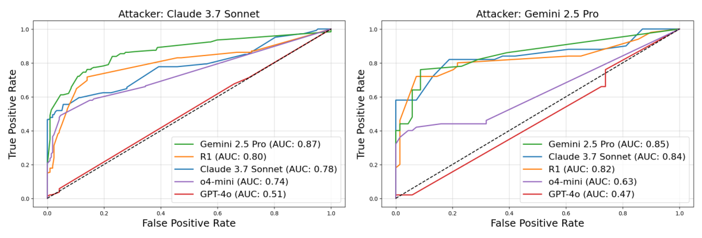

# 15 — Calibrating a Judge Against Human Labels

> A judge is a model making a measurement. Until you've checked it against human labels, you don't know what it measures. Report its two error rates separately, read κ before raw agreement, and re-calibrate when anything changes.

In this course's case study, an off-the-shelf judge scored the answers users disliked higher on completeness than the ones they liked, and nothing in its output showed that. Asking a model to grade feels like measuring, but until a judge is compared with human labels nobody knows what its number means, and any change to its model, prompt or sampling makes it a new instrument. [Note 05](05-llm-as-judge.md) covers how to write a judge and which biases to test for. This chapter covers how to calibrate it on your own data, what to measure, how to correct a pass rate, and how to keep the judge calibrated.

---

## Calibrate against human labels

**A judge is calibrated when you've measured how often it agrees with humans on your data.** Until then it's experimental and can't gate releases ([04](04-graders.md#grader-states-which-ones-can-block-a-release)).

### The procedure

1. **Get human labels.** 100–200 outputs labeled PASS/FAIL on the judge's criterion, by your domain expert ([02](02-defining-correct.md#one-person-decides)). Include both classes in reasonable numbers. Husain's guide asks for "about 100 examples per failure mode, with enough Pass and Fail examples to measure both classes", and warns that below 60 "the confidence intervals are often too wide to support a useful conclusion" ([Using LLM-as-a-Judge](https://hamel.dev/blog/posts/llm-judge/), 2024, revised 2026). Labelling can move the criterion itself ([criteria drift](02-defining-correct.md#criteria-drift); [Shankar et al.](https://arxiv.org/abs/2404.12272), 2024, nine practitioners). Real user signal (👍/👎, escalation, resolution) can be the label, as in the case study, but only for a criterion it measures. **Satisfaction is not task success.** In GAUGE (25 agents on τ²-bench and SimulatorArena), "57.5% of conversations our blind human panel rated satisfied (≥5/7) had failed the customer’s task". That matches the 57.3% base failure rate, so the rating said nothing about success (AUC 0.44). A policy-aware judge reading the tool calls did (AUC 0.73) ([arXiv:2609.12191](https://arxiv.org/abs/2609.12191) (Bodhwani et al., 2026-09)). A 👍 can label a tone or experience judge; a resolution judge needs outcome labels.
2. **Split** the labels: **train** (pick few-shot examples from here), **dev** (iterate on the prompt here), **test** (measure once at the end).
3. **Run the judge** on dev. Build the confusion matrix against the human labels.
4. **Read the disagreements.** Each is a judge prompt problem (fix the prompt), a criteria problem (fix the criteria, re-label), or a hard case (add to few-shot).
5. **Iterate** on dev until the numbers are good enough for the job.
6. **Measure on test once.** That's the number you report. If you tune against test, it's a dev set.
7. **Record** the judge model, prompt version and test metrics. Re-run when any of them changes.

Keep one calibration record per version: PASS/FAIL label counts per split; human–human agreement on a double-labelled subset (the ceiling); one line per dev iteration (prompt change → TPR/TNR); test confusion matrix with TPR, TNR, precision, κ, separation and `CANNOT_GRADE` rate; bias checks (position swap, length, self-preference); a decision (calibrated for gating, tracking only, or rework). [Note 14](14-calibrating-judges-with-checks-and-critiques.md) adds code checks, slices and critiques to step 4.

**Few-shot examples help consistency, not necessarily accuracy.** Zheng et al. raised GPT-4's consistency from 65% to 77.5% by putting evaluation examples in the prompt, but the longer prompt quadrupled their judge cost, and "high consistency may not imply high accuracy": the judge can make the same mistake every time (*AI Engineering*, ch. 3). LangSmith turns calibration into a loop: when a person corrects a judge verdict, the correction, with an optional explanation, is stored and fed back as a few-shot example on later runs (*Learning LangChain*, ch. 10). Draw those examples from the train split only, or the test agreement you report is inflated.

**Evaluate the evaluator with seeded cases.** Phoenix & Taylor write test cases that are known to contain an issue and cases known not to, then count false positives (the judge invents an issue) and false negatives (it misses one) (*Prompt Engineering for Generative AI*, ch. 3). Their own demo claims "near 100% accuracy" for a GPT-4 conciseness judge on 10 responses they generated to be concise or verbose. That's a sanity check, not a calibration: 10 rows give a confidence interval tens of points wide ([09](09-reading-results.md#how-many-tasks)), and synthetic extremes are easier than real borderline cases.

### What to measure

This is the [confusion matrix](../../../data-science/01-classical-ml/notes/04-model-evaluation.md#confusion-matrix-precision-recall-f1) with PASS as positive, and [reading the errors](../../../data-science/01-classical-ml/notes/12-reading-the-errors.md#step-3-read-rows) reads each cell. Accuracy alone hides the failure you care about. Report the two error rates separately:

| Metric | Meaning | Matters for |
|---|---|---|
| **TPR** (recall on PASS) | Of outputs humans passed, how many the judge passed | Not blocking good releases |
| **TNR** (recall on FAIL) | Of outputs humans failed, how many the judge failed | **Catching bad outputs.** Usually the one that matters |
| **Precision on PASS** | Of outputs the judge passed, how many humans passed | Using judge-passed outputs as golden labels |
| **Cohen's κ** | Agreement corrected for chance | Comparing against human–human agreement |
| **Score separation** | Mean score on human-PASS minus mean on human-FAIL (and Cohen's *d*) | Whether a continuous judge discriminates at all |


*Image Source: Norman et al., [Reliability without Validity](https://arxiv.org/abs/2606.19544) (2026), Fig. 1*

Rules of thumb:

- **Different jobs, different metric.** A release gate needs high TNR (catch bad outputs). A golden-label builder needs high precision on PASS (clean labels). If one judge can't do both, use two ([case study](13-case-study-support-agent.md#decision-framework)).
- **Lead with κ, not raw agreement.** Across 21 judges on MT-Bench, exact-match agreement exceeded Cohen's κ by 33.8–41.3 points: "a judge reporting “85% agreement” on MT-Bench has κ≈0.48" ([arXiv:2606.19544](https://arxiv.org/abs/2606.19544) (Norman et al., 2026-06)). Ties and an unbalanced base rate inflate raw agreement.
- **Repeatable is not valid.** Qwen 3 8B gave the same verdict across reruns almost every time (test–retest α 0.992) and had the cohort's strongest position bias (0.192). A deterministic judge reproduces its bias exactly. Run the swap check even on a judge that never changes its mind. Gilardi et al. found the same gap in annotation. ChatGPT (gpt-3.5-turbo, zero-shot, 6,183 tweets and news articles) agreed with its own reruns 97% of the time at temperature 0.2 and 91% at temperature 1, against 79% between trained annotators. **But its accuracy against those annotators was 59–83% on the binary relevance tasks**, and its self-agreement correlated only weakly with accuracy (Pearson *r* = 0.36). The headline, about 25 points more accurate than MTurk workers at about a thirtieth of the cost, compares it with crowd workers, not experts, and was scored only on items two trained annotators agreed on ([arXiv:2303.15056](https://arxiv.org/abs/2303.15056) (Gilardi et al., PNAS 2023)).
- **Benchmark against human–human agreement**, on the same statistic. If two experts agree 85% of the time, a judge at 83% is about as good as a second expert. Expecting 99% is expecting better than humans. Berryman & Ziegler's version of the test: have several people rate the same items, then add the judge (one query per item, temperature 0) to the pool and check that the pool's disagreement, measured with something like Kendall's τ, doesn't rise (*Prompt Engineering for LLMs*, ch. 10). Three recent benchmarks report their judge this way. OpenEQA's GPT-4 answer-matcher correlated with blind human raters at Spearman ρ 0.909 (95% CI 0.883–0.928, 300 responses), inside the 0.91–0.93 range between human raters. Swapping in GPT-3.5 or LLaMA-2 as the judge dropped ρ below 0.7 ([PDF](https://open-eqa.github.io/assets/pdfs/paper.pdf) (Majumdar et al., 2024-06)). HealthBench's GPT-4.1 grader reached macro-F1 0.709 against physicians, where individual physicians scored 0.569–0.730, and it beat the average physician in 5 of 7 themes. Note that the grader prompt was developed with GPT-4.1, which may be part of why it came out the best grader ([arXiv:2505.08775](https://arxiv.org/abs/2505.08775) (Arora et al., 2025-05)). GDPval's experimental autograder agreed with expert graders 65.7% of the time, against 70.8% between experts, over three grading sweeps. The authors released it but "do not consider it a full substitute for industry expert graders" ([arXiv:2510.04374](https://arxiv.org/abs/2510.04374) (Patwardhan et al., 2025-10)). All three are vendor- or lab-run on their own benchmarks, and a weaker judge model can lose most of the agreement.
- **Small separation means the threshold is doing the work.** If PASS and FAIL means differ by < 0.05, the judge isn't discriminating. Fix the prompt.
- **For a monitor, set the threshold from a false-positive budget.** A judge that flags rare bad behaviour in agent transcripts (sabotage, policy breaches) runs mostly on benign traffic, so its false positives decide what it costs. SHADE-Arena set the suspicion threshold at the 99th percentile of scores on benign transcripts, which is about 1% FPR. The best monitor, Gemini 2.5 Pro, reached AUC 0.87, but even it would need an FPR above 20% to catch 80% of attacks. Human reviewers did worse, at AUC 0.65 after an average of 103 minutes per transcript (on a small subset that isn't directly comparable). Monitoring after every turn helped a little but flagged many more benign transcripts. Extra budget did more good spent on re-querying the monitor at the end and averaging the scores. A better system prompt helped more than turn-by-turn monitoring, even when it said nothing qualitatively new ([PDF](https://assets.anthropic.com/m/4fb35becb0cd87e1/original/SHADE-Arena-Paper.pdf) (Kutasov et al., 2025-06); 17 environments, with Anthropic models among those tested). Report the ROC curve or TPR at your FPR budget, not just AUC.


*Image Source: Kutasov et al., [SHADE-Arena](https://assets.anthropic.com/m/4fb35becb0cd87e1/original/SHADE-Arena-Paper.pdf) (2025), Fig. 8*

- **Inverted separation means it measures something else.** The case study found off-the-shelf judges scoring *disliked* answers higher on completeness and escalation ([case study](13-case-study-support-agent.md#calibration-results)). Generic metrics aren't tuned to your users.

### Correcting the pass rate

An uncalibrated judge's pass rate is only a relative measure. "The judge passes 81% of answers" means little alone, while "version B passes more often than version A" is a usable claim (*Prompt Engineering for LLMs*, ch. 10). Calibration is what turns it into an estimate. A judge with known error rates gives a biased estimate of the true pass rate (see [base rates](../../../data-analytics/02-probability-and-statistics/notes/02-probability-foundations.md#bayes-rule-inverts-the-conditional)). If the judge's observed pass rate is *p̂*, and you measured TPR and TNR on the test split, the corrected estimate is:

```
true pass rate ≈ (p̂ + TNR − 1) / (TPR + TNR − 1)
```

Example: judge passes 80% of production outputs, TPR 0.95, TNR 0.80 → (0.80 + 0.80 − 1) / (0.95 + 0.80 − 1) = 0.60 / 0.75 = **0.80**. With TNR 0.70 instead → 0.50 / 0.65 = **0.77**. The correction is small when the judge is good and large when it's lenient. Only valid when TPR + TNR is well above 1.

The metrics and this correction are a few lines of code. Both confusion matrices below are invented, and both show 78% raw agreement:

```python
def calibration(tp, fn, fp, tn):
    """Judge against human labels on the test split. Positive means PASS."""
    n = tp + fn + fp + tn
    agree = (tp + tn) / n
    judge_pass, human_pass = (tp + fp) / n, (tp + fn) / n
    chance = judge_pass * human_pass + (1 - judge_pass) * (1 - human_pass)
    return {"TPR": round(tp / (tp + fn), 2), "TNR": round(tn / (tn + fp), 2),
            "precision_pass": round(tp / (tp + fp), 2), "agreement": round(agree, 2),
            "kappa": round((agree - chance) / (1 - chance), 2)}

def corrected(p_hat, tpr, tnr):
    return round((p_hat + tnr - 1) / (tpr + tnr - 1), 2)

# 100 human labels, 60 PASS and 40 FAIL. The judge passes most of what it sees.
stats = calibration(tp=54, fn=6, fp=16, tn=24)
print(stats)
print("judge passes 70% in production; corrected:", corrected(0.70, stats["TPR"], stats["TNR"]))

# Same 78% agreement on a skewed set: 90 PASS and 10 FAIL.
print(calibration(tp=75, fn=15, fp=7, tn=3))
```

Output:

```text
{'TPR': 0.9, 'TNR': 0.6, 'precision_pass': 0.77, 'agreement': 0.78, 'kappa': 0.52}
judge passes 70% in production; corrected: 0.6
{'TPR': 0.83, 'TNR': 0.3, 'precision_pass': 0.91, 'agreement': 0.78, 'kappa': 0.1}
```

The second judge agrees just as often and finds 3 of the 10 bad outputs, which is why κ falls to 0.10 and why TNR, not agreement, is the number to read for a release gate.

---

## Keep it calibrated

- **Re-calibrate when anything changes**: judge model, judge prompt, the system under test (new failure types appear), or the user population.
- **Watch for domain shift.** The case study's judges separated well on one product's traffic and near-zero on another, because users there disliked answers for different reasons (tone, escalation, multi-turn context) ([case study](13-case-study-support-agent.md#domain-shift)). Calibration is per domain. Public benchmarks show the same: in Norman et al.'s study 11 of 21 judges moved four or more places between benchmarks, and Llama 3.3 70B went from 5th on MT-Bench to 20th on JudgeBench, so a judge's leaderboard rank says little about how it does on your data.
- **Keep a human sample flowing.** A 5–10% human-reviewed sample in production is what tells you the judge is drifting ([11](11-production-and-the-maturity-ladder.md#two-layer-online-review)).
- **Pin the judge model version.** A provider updating the judge silently changes all your scores.
- **Don't mix judges** across runs you intend to compare.

### Cross-checking with other judges

Comparing your judge to an off-the-shelf one (RAGAS, DeepEval, G-Eval) tells you whether they measure the same thing (correlation), not which is right. Only agreement with *human labels* settles that. Low correlation is a reason to investigate both against the labels, not to switch.

### Multi-family judging

Self-preference ([05](05-llm-as-judge.md#known-biases)) gets worse when the agent is *optimized* against the judge: it learns that judge's blind spots. The mitigation is several independent judges from **different model families** on the same rubric. If the agent runs on Claude, judge with GPT and Gemini. Their biases tend to be orthogonal, so the agent rarely fools all of them at once. Aggregate by weighted average or require agreement. To keep cost down, run one judge on every case and the full panel as a periodic audit (*AI Agents in Depth*, ch. 6). GAUGE measured the self-preference this guards against: an Opus-4.8 judge rated Claude agents 0.75 points (on a 7-point scale) higher, relative to a GPT-5.5 judge, than it rated non-Claude agents (Bodhwani et al., [above](#the-procedure)). GDPval saw the same thing with a GPT-5 autograder: it agreed with experts less often on outputs from the more capable OpenAI models. Blinding by itself doesn't hide which family wrote an output, either. GDPval's authors scrubbed model names from filenames but note that outputs "may still have been identifiable" by style: OpenAI outputs used em dashes, Claude's often used the first person, and Grok sometimes called itself Grok (Patwardhan et al., [above](#what-to-measure)).

**A panel doesn't fix a shared resolution limit.** In the same study, four judges from two providers ranked τ²-bench agents. They recovered the full 25-agent ladder (ρ 0.84–0.94) but not the near-equal strong agents. On pairs whose verifiable rewards differed by less than 0.1, the best single judge picked the wrong winner 31% of the time, against under 1% on wide pairs. The four-judge average gave exactly 31% too, because the judges correlated at ρ 0.67–0.98 and flipped the same close pairs. The one thing that helped was **calibrated abstention**: refuse to rank a pair whose score gap falls inside its bootstrap noise. That halved the error to 14.8% on the pairs it ranked, but it ranked only 31–49% of them. When two candidates are close, report "no detectable difference" ([09](09-reading-results.md#compare-on-the-same-tasks-paired-differences)) rather than adding judges.

### Beyond text

The same pattern extends to other modalities. Score TTS output with an audio model (or ASR, then a text judge), UI agents from screenshots, and video from sampled frames. Each modality needs its own calibration set.

---

## Checklist

- [ ] 100–200 human labels, split train/dev/test
- [ ] TPR, TNR and κ reported on test, compared with human–human agreement
- [ ] Judge model + prompt version pinned and recorded
- [ ] Re-calibration triggered by any change to judge, SUT or domain

---

## Pitfalls

- **Gating on an uncalibrated judge.** Symptom: a good number with no human labels behind it, sometimes pointing the wrong way, like the off-the-shelf completeness judge that scored disliked answers higher ([case study](13-case-study-support-agent.md#calibration-results)). Fix: 100 to 200 human labels, split train, dev and test, and measure once on test.
- **Reporting raw agreement.** Symptom: "85% agreement" on a skewed set. Fix: lead with κ and report TPR and TNR separately, as the script above shows.
- **Trusting a consistent judge.** Symptom: reruns match, so nobody checks further. Fix: run the swap check ([05](05-llm-as-judge.md#known-biases)) even on a judge that never changes its mind.
- **Tuning on the test split.** Symptom: a calibration number that doesn't hold in production. Fix: draw few-shot examples from train, iterate on dev, and read test once.
- **Judging with the same family as the system.** Symptom: scores favor your own model, as GAUGE measured ([above](#multi-family-judging)). Fix: use a different family, and don't expect a panel to fix close calls, because correlated judges flip the same pairs.

## Try it

1. Your judge has TPR 0.90 and TNR 0.60 on test, and it passes 70% of production outputs. Estimate the true pass rate, and say whether this judge should gate releases.

   <details><summary>Answer</summary>

   (0.70 + 0.60 − 1) / (0.90 + 0.60 − 1) = 0.30 / 0.50 = **0.60**, which is what the script prints. As a gate it is weak, since it lets through 40% of the outputs humans fail, so work on TNR with tricky-FAIL few-shot examples before it gates anything.

   </details>

2. A judge on 100 human labels gives `calibration(tp=70, fn=10, fp=12, tn=8)`. Agreement is 78%, the same as both judges in the script. Read the output: should it gate releases?

   <details><summary>Answer</summary>

   The script prints TPR 0.88, TNR 0.4, precision on PASS 0.85, agreement 0.78 and κ 0.29. It catches 8 of the 20 bad outputs, so it should not gate. The 78% comes mostly from the 80 outputs humans passed.

   </details>

3. A weak judge has TPR 0.55 and TNR 0.50, and passes 60% of production outputs. Run `corrected(0.60, 0.55, 0.50)`. What does the result tell you?

   <details><summary>Answer</summary>

   It returns 2.0, a pass rate of 200%, which is impossible. TPR + TNR is only 1.05, so the denominator is near zero and the correction is not valid. The formula needs TPR + TNR well above 1, and this judge should be fixed, not corrected.

   </details>

## Interview checklist

| Prompt | Answer in one line |
|---|---|
| What makes an LLM judge calibrated? | You have measured how often it agrees with humans on your data: 100 to 200 labels split into train, dev and test, with TPR, TNR and κ reported once on test and compared with human–human agreement. |
| TPR or TNR for a release gate? | TNR, because it measures how many bad outputs get caught. A golden-label builder wants high precision on PASS instead, and if one judge doesn't win both, use two. |
| Why lead with κ over raw agreement? | Ties and base rates inflate agreement. Norman et al. note that "85% agreement" on MT-Bench corresponds to κ of about 0.48. |
| Two judges from different vendors disagree on a candidate. Add a third? | Not to settle close pairs. In GAUGE's τ²-bench test the four-judge average picked the wrong winner 31% of the time on close pairs, the same as the best single judge, because the judges were correlated. Report "no detectable difference", or abstain when the gap is inside the noise. |

## Next

[06-evaluating-agents.md](06-evaluating-agents.md): when the output is a trajectory, not an answer.
