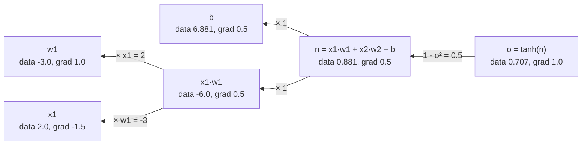

# micrograd: backpropagation from scratch

Every network you have trained so far ended with `loss.backward()`, and something filled in millions of gradients. By the end of this chapter you will have written that something, in about 100 lines of plain Python, and it will agree with PyTorch to every printed digit.

This is the first of three chapters on Karpathy's *Neural Networks: Zero to Hero*, and they tell one story: build the whole stack by hand so that nothing underneath a language model stays magic. This one builds the engine for gradients. [makemore](02-makemore.md) uses it to build character-level language models and shows how to keep deep ones trainable. [nanoGPT](03-nanogpt.md) ends at a working GPT. Watch the lectures and code along in the notebooks; these chapters are what to come back to.

The whole idea is one picture. A computation is a graph, each node knows only its own derivative, and gradients flow backward from the output, multiplied along the way.



## Derivatives, numerically

The derivative of `f` at `x` is how much `f` changes per unit nudge of `x`.

```python
def f(x): return 3*x**2 - 4*x + 5
h = 1e-6
print((f(3.0 + h) - f(3.0)) / h, " analytically 6x - 4 =", 6*3.0 - 4)
```

```text
14.000003002223593  analytically 6x - 4 = 14.0
```

With several inputs, nudge one at a time to get the partial derivative with respect to each. For `d = a*b + c` at `a=2, b=-3, c=10`, the partials are ∂d/∂a = b = -3, ∂d/∂b = a = 2 and ∂d/∂c = 1.

```python
a, b, c = 2.0, -3.0, 10.0
d = lambda a, b, c: a*b + c
print("dd/da", round((d(a + h, b, c) - d(a, b, c)) / h, 4),
      " dd/db", round((d(a, b + h, c) - d(a, b, c)) / h, 4),
      " dd/dc", round((d(a, b, c + h) - d(a, b, c)) / h, 4))
```

```text
dd/da -3.0  dd/db 2.0  dd/dc 1.0
```

Numerical gradients are how you *check* an implementation ([gradient checking](../../../data-science/02-deep-learning/notes/01-neural-networks-fundamentals.md) in the Ng course is the same idea). They are far too slow to train with, since they need one extra forward pass per parameter, and a language model has millions of parameters. What we want is every partial derivative for about the cost of one more pass. That is what reverse-mode differentiation gives, a result old enough to have been rediscovered several times. Rumelhart, Hinton and Williams ([*Nature* 1986](https://doi.org/10.1038/323533a0)) made it the standard way to train networks, and Baydin et al. ([arXiv:1502.05767](https://arxiv.org/abs/1502.05767), *JMLR* 2018) survey the general technique.

## The `Value` object

Wrap each scalar so that every arithmetic operation records its inputs and knows how to pass gradient back to them.

```python
import math

class Value:
    def __init__(self, data, _children=(), _op="", label=""):
        self.data = data
        self.grad = 0.0                   # d(output)/d(self), filled in by backward()
        self._backward = lambda: None     # how to push out.grad into the children
        self._prev = set(_children)
        self._op, self.label = _op, label

    def __add__(self, other):
        other = other if isinstance(other, Value) else Value(other)
        out = Value(self.data + other.data, (self, other), "+")
        def _backward():
            self.grad += 1.0 * out.grad       # addition routes the gradient unchanged to both inputs
            other.grad += 1.0 * out.grad
        out._backward = _backward
        return out

    def __mul__(self, other):
        other = other if isinstance(other, Value) else Value(other)
        out = Value(self.data * other.data, (self, other), "*")
        def _backward():
            self.grad += other.data * out.grad   # multiplication swaps: d(ab)/da = b
            other.grad += self.data * out.grad
        out._backward = _backward
        return out

    def __pow__(self, k):                        # k is a plain int/float
        out = Value(self.data ** k, (self,), f"**{k}")
        def _backward():
            self.grad += k * self.data ** (k - 1) * out.grad
        out._backward = _backward
        return out

    def tanh(self):
        t = math.tanh(self.data)
        out = Value(t, (self,), "tanh")
        def _backward():
            self.grad += (1 - t**2) * out.grad
        out._backward = _backward
        return out

    def exp(self):
        out = Value(math.exp(self.data), (self,), "exp")
        def _backward():
            self.grad += out.data * out.grad     # the lecture used = here; the notebook fixes it to +=
        out._backward = _backward
        return out

    # everything else is built from the above
    def __neg__(self): return self * -1
    def __sub__(self, other): return self + (-other)
    def __truediv__(self, other): return self * other**-1
    def __radd__(self, other): return self + other
    def __rmul__(self, other): return self * other      # so 2 * Value(3) works

    def backward(self):
        topo, visited = [], set()
        def build(v):
            if v not in visited:
                visited.add(v)
                for child in v._prev:
                    build(child)
                topo.append(v)                 # a node is appended only after all its inputs
        build(self)
        self.grad = 1.0                        # d(self)/d(self)
        for node in reversed(topo):            # output first, leaves last
            node._backward()
```

### The three ideas in that code

| Idea | Where | Why it matters |
|---|---|---|
| **Local derivatives** | Each `_backward` knows only its own op's derivative | Adding a new op means writing one small closure |
| **Chain rule** | `self.grad += local * out.grad` | Gradient at a node = (gradient arriving from above) × (local derivative) |
| **Topological order** | `backward()` | A node's `_backward` runs only after every node that uses it has finished contributing |

**Why `+=` and not `=`.** If a value is used twice (`b = a + a`, or a weight shared across examples), gradient arrives along every path and must be summed. Using `=` silently keeps only the last path. The lecture hits exactly this bug, and it is worth seeing fail.

```python
def buggy_add(x, y):
    out = Value(x.data + y.data, (x, y), "+")
    def _backward():
        x.grad = out.grad          # the bug: the second path overwrites the first
        y.grad = out.grad
    out._backward = _backward
    return out

a = Value(3.0); buggy_add(a, a).backward(); print("b = a + a with '=': a.grad =", a.grad, "(wrong)")
a = Value(3.0); (a + a).backward();          print("b = a + a with '+=': a.grad =", a.grad)
```

```text
b = a + a with '=': a.grad = 1.0 (wrong)
b = a + a with '+=': a.grad = 2.0
```

The same `+=` is why gradients must be zeroed before each backward pass, because it accumulates across calls as well as across paths.

**Granularity is a choice.** `tanh` can be a single op with derivative `1 − t²`, or built as `(e − 1)/(e + 1)` with `e = (2n).exp()`. Both give the same gradients, and the check below shows it. Frameworks pick fused ops for speed and numerical stability.

## One neuron, checked against PyTorch

We start with one neuron with two inputs, whose bias was chosen to make the output a round number. The picture at the top of this chapter is this computation.

```python
x1, x2 = Value(2.0, label="x1"), Value(0.0, label="x2")
w1, w2 = Value(-3.0, label="w1"), Value(1.0, label="w2")
bias = Value(6.8813735870195432, label="b")
n = x1*w1 + x2*w2 + bias
o = n.tanh()
o.backward()
print(f"n {n.data:.4f}  o {o.data:.4f}")
print(f"micrograd  x1 {x1.grad:.4f}  w1 {w1.grad:.4f}  x2 {x2.grad:.4f}  w2 {w2.grad:.4f}")

n2 = Value(n.data); e = (2*n2).exp(); o2 = (e - 1) / (e + 1); o2.backward()
print(f"tanh built from exp: do/dn = {n2.grad:.4f}  (fused op: {1 - o.data**2:.4f})")
```

```text
n 0.8814  o 0.7071
micrograd  x1 -1.5000  w1 1.0000  x2 0.5000  w2 0.0000
tanh built from exp: do/dn = 0.5000  (fused op: 0.5000)
```

Work it by hand once. do/dn = 1 − o² = 0.5. `n` adds its terms, so each term receives 0.5. Then `x1*w1` swaps: `w1` gets `x1 * 0.5 = 1.0` and `x1` gets `w1 * 0.5 = -1.5`. And `w2.grad` is 0 because `x2 = 0`, since a weight on a zero input cannot affect the output.

Now the same in PyTorch, where the tensors are the `Value`s and autograd is the `backward()`.

```python
import torch
tx1 = torch.tensor([2.0], dtype=torch.double, requires_grad=True)
tx2 = torch.tensor([0.0], dtype=torch.double, requires_grad=True)
tw1 = torch.tensor([-3.0], dtype=torch.double, requires_grad=True)
tw2 = torch.tensor([1.0], dtype=torch.double, requires_grad=True)
tb = torch.tensor([6.8813735870195432], dtype=torch.double, requires_grad=True)
to = torch.tanh(tx1*tw1 + tx2*tw2 + tb)
to.backward()
print(f"pytorch    x1 {tx1.grad.item():.4f}  w1 {tw1.grad.item():.4f}  x2 {tx2.grad.item():.4f}  w2 {tw2.grad.item():.4f}")
```

```text
pytorch    x1 -1.5000  w1 1.0000  x2 0.5000  w2 0.0000
```

The notebooks draw each expression as a graph with `graphviz` (`draw_dot(o)`), showing `data` and `grad` at every node. Drawing it once by hand is the fastest way to internalise backprop.

## A neural-network library on top

Nothing about a network needs new machinery. A neuron is a weighted sum through `tanh`, a layer is a list of neurons, and an MLP is a list of layers.

```python
import random
random.seed(0)

class Neuron:
    def __init__(self, nin):
        self.w = [Value(random.uniform(-1, 1)) for _ in range(nin)]
        self.b = Value(random.uniform(-1, 1))
    def __call__(self, x):
        return sum((wi*xi for wi, xi in zip(self.w, x)), self.b).tanh()
    def parameters(self):
        return self.w + [self.b]

class Layer:
    def __init__(self, nin, nout):
        self.neurons = [Neuron(nin) for _ in range(nout)]
    def __call__(self, x):
        outs = [n(x) for n in self.neurons]
        return outs[0] if len(outs) == 1 else outs
    def parameters(self):
        return [p for n in self.neurons for p in n.parameters()]

class MLP:
    def __init__(self, nin, nouts):
        sz = [nin] + nouts
        self.layers = [Layer(sz[i], sz[i+1]) for i in range(len(nouts))]
    def __call__(self, x):
        for layer in self.layers:
            x = layer(x)
        return x
    def parameters(self):
        return [p for layer in self.layers for p in layer.parameters()]

model = MLP(3, [4, 4, 1])         # 3 inputs, two hidden layers of 4, one output
print("parameters:", len(model.parameters()), " (3+1)*4 + (4+1)*4 + (4+1)*1")
```

```text
parameters: 41  (3+1)*4 + (4+1)*4 + (4+1)*1
```

This mirrors `torch.nn`: modules hold parameters, are callable and expose `parameters()`. Every framework's loop has the same five steps, so here they are on four examples.

### The training loop

```python
xs = [[2.0, 3.0, -1.0], [3.0, -1.0, 0.5], [0.5, 1.0, 1.0], [1.0, 1.0, -1.0]]
ys = [1.0, -1.0, -1.0, 1.0]

for k in range(20):
    ypred = [model(x) for x in xs]                                   # 1. forward
    loss = sum((yp - yt)**2 for yt, yp in zip(ys, ypred))            # 2. loss (sum of squared errors)
    for p in model.parameters():                                     # 3. zero grads
        p.grad = 0.0
    loss.backward()                                                  # 4. backward
    for p in model.parameters():                                     # 5. step: move against the gradient
        p.data += -0.05 * p.grad
    if k % 4 == 0 or k == 19:
        print(k, round(loss.data, 4))
print("targets    ", ys)
print("predictions", [round(model(x).data, 3) for x in xs])
```

```text
0 7.7298
4 1.4949
8 0.3334
12 0.133
16 0.0755
19 0.0555
targets     [1.0, -1.0, -1.0, 1.0]
predictions [0.921, -0.944, -0.864, 0.848]
```

The loss falls from 7.7 to 0.06 in 20 steps, and the predictions are close to the targets. Four examples and 41 parameters are not a test of generalisation. They prove that every piece is wired correctly, which is the first thing to prove about any new training loop.

| Step | PyTorch equivalent |
|---|---|
| forward | `ypred = model(X)` |
| loss | `loss = F.mse_loss(ypred, y)` |
| zero grads | `optimizer.zero_grad()` (or `p.grad = None`) |
| backward | `loss.backward()` |
| step | `optimizer.step()` |

### Why backward beats nudging

We claimed one backward pass does the work of a nudge per parameter. We can measure that on this tiny model, and check the gradients against finite differences while we are at it.

```python
import time

def total_loss():
    return sum((model(x) - yt)**2 for x, yt in zip(xs, ys))

for p in model.parameters(): p.grad = 0.0
start = time.perf_counter(); l = total_loss(); forward = time.perf_counter() - start
start = time.perf_counter(); l.backward(); backward = time.perf_counter() - start
exact = [p.grad for p in model.parameters()]

start = time.perf_counter()
numeric = []
eps = 1e-6
for p in model.parameters():
    base = total_loss().data
    p.data += eps
    numeric.append((total_loss().data - base) / eps)
    p.data -= eps
nudge = time.perf_counter() - start
worst = max(abs(e - n) for e, n in zip(exact, numeric))
print(f"forward {forward*1e3:.2f} ms, backward {backward*1e3:.2f} ms, nudging every parameter {nudge*1e3:.1f} ms")
print(f"largest gradient disagreement over {len(exact)} parameters: {worst:.2e}")
```

```text
forward 0.18 ms, backward 0.08 ms, nudging every parameter 29.2 ms
largest gradient disagreement over 41 parameters: 3.43e-07
```

The backward pass took about as long as the forward pass, or less, while nudging every parameter took over a hundred times as long, and it grows with the parameter count. The two sets of gradients agree to within 1e-6, the size of the nudge itself. Scale that ratio up to a model with millions of parameters and you see why reverse mode made neural network training possible.

### Forgetting to zero

Forgetting step 3 is the most common bug in hand-written loops. Gradients from earlier iterations pile up, and each step follows a sum of stale directions.

```python
def train(zero, seed, lr, steps=200):
    random.seed(seed)
    m = MLP(3, [4, 4, 1])
    for k in range(steps):
        loss = sum((m(x) - yt)**2 for x, yt in zip(xs, ys))
        if zero:
            for p in m.parameters(): p.grad = 0.0
        loss.backward()
        for p in m.parameters():
            p.data -= lr * p.grad
    return round(loss.data, 3)

for lr in [0.02, 0.1, 0.2, 0.5]:
    print(f"lr {lr:4}  zeroed {[train(True, s, lr) for s in (1, 2, 3)]}   not zeroed {[train(False, s, lr) for s in (1, 2, 3)]}")
```

```text
lr 0.02  zeroed [0.01, 0.009, 0.007]   not zeroed [0.0, 8.0, 0.0]
lr  0.1  zeroed [0.001, 0.002, 0.001]   not zeroed [0.0, 0.0, 8.0]
lr  0.2  zeroed [0.0, 0.0, 0.001]   not zeroed [0.0, 8.0, 0.0]
lr  0.5  zeroed [0.0, 8.0, 0.0]   not zeroed [8.0, 8.0, 8.0]
```

Each row runs three seeds for 200 steps. The maximum possible loss here is 8, every output saturated at the wrong sign. With gradients zeroed, eleven of the twelve runs converge. Without zeroing, the failure is worse than a noisy curve, because it is intermittent. Each step now moves by the sum of all past gradients, which works like momentum with no decay, so on this tiny problem some seeds reach a lower loss than the correct code, and others overshoot, saturate every `tanh` and stick at 8 with no gradient left. A bug that sometimes looks like a speed-up is the hard kind to catch, so do not rely on the loss curve to reveal it. The check that does is a code review of the loop.

## From scalars to tensors

micrograd builds one graph node per scalar multiply. That is fine for 41 parameters and hopeless for millions. Real frameworks make each node a tensor op ([`matmul`](../../01-llm-fundamentals/notes/02-attention-and-the-transformer-block.md#matrix-products-transpose-and-rank), `softmax`, `layernorm`) whose backward is a few matrix expressions, run on a GPU. The concepts carry over exactly.

| micrograd | PyTorch |
|---|---|
| `Value` | `torch.Tensor` with `requires_grad=True` |
| `_prev`, `_op` | `tensor.grad_fn` and its `next_functions` |
| `_backward` closure | `torch.autograd.Function.backward` |
| `backward()` topo sort | the autograd engine |
| `p.data += -lr * p.grad` | `torch.optim.SGD` (Adam keeps running averages of grad and grad²) |

You can look at PyTorch's graph directly, and see that it is what we built.

```python
print("to.grad_fn:", type(to.grad_fn).__name__, "->", [type(f[0]).__name__ for f in to.grad_fn.next_functions if f[0]])
```

```text
to.grad_fn: TanhBackward0 -> ['AddBackward0']
```

[makemore part 4](02-makemore.md#part-4-becoming-a-backprop-ninja) does the tensor version by hand: deriving the backward pass for [cross-entropy](../../01-llm-fundamentals/notes/06-pretraining-data-and-objectives.md#entropy-cross-entropy-kl-and-perplexity), batch norm and a linear layer, and checking each against autograd.

## Practice

| Notebook | Covers | Runs |
|---|---|---|
| [`micrograd_lecture_first_half_roughly`](../practice/nn-zero-to-hero/micrograd/micrograd_lecture_first_half_roughly.ipynb) | Numerical derivatives, `Value`, manual backprop through a graph, graphviz drawing | Runs offline; `graphviz` (Python package and system binary) for the diagrams |
| [`micrograd_lecture_second_half_roughly`](../practice/nn-zero-to-hero/micrograd/micrograd_lecture_second_half_roughly.ipynb) | Full `Value` with `backward()`, PyTorch comparison, Neuron/Layer/MLP, training loop | Runs offline; `torch` for the comparison cell |

Lecture: [The spelled-out intro to neural networks and backpropagation](https://www.youtube.com/watch?v=VMj-3S1tku0) (2.5 h). The [micrograd repository](https://github.com/karpathy/micrograd) holds the finished engine and a demo on two moons.

## Pitfalls

| Rule | Why |
|---|---|
| Sum gradients with `+=` in every `_backward` | A value used twice must collect gradient from every path |
| Zero gradients once per step, before `backward()` | `+=` also accumulates across calls |
| Visit nodes in reverse topological order | A node must hear from all its users before it passes gradient on |
| Check a new op against finite differences | A wrong local derivative trains badly and does not crash |
| Keep `data` updates out of the graph | Parameter steps are not part of the computation being differentiated |

- **Updating with `+=` in the wrong direction.** The step is `p.data += -lr * p.grad`. Dropping the minus climbs the loss, and it looks like a learning-rate problem.
- **A learning rate that fits one model.** The 0.05 here is for this model and this sum-of-squares loss. Change the loss to a mean and you have changed the effective rate.
- **Trusting a loss curve to catch loop bugs.** As the zeroing experiment shows, a broken loop can produce a beautiful curve on some seeds.
- **Reading a small training loss as success.** Four examples and 41 parameters can always be memorised. This loop proves the mechanics, and it does not show generalisation.
- **Assuming a gradient of zero means no effect in general.** `w2.grad` is 0 because `x2` happens to be 0 here. On the next example it will not be.

## Try it

1. **Add operations.** Add `relu` and `log` to `Value`, and check both against PyTorch at the same input.

<details><summary>Answer</summary>

```python
def relu(self):
    out = Value(max(0.0, self.data), (self,), "relu")
    def _backward():
        self.grad += (self.data > 0) * out.grad
    out._backward = _backward
    return out

def log(self):
    out = Value(math.log(self.data), (self,), "log")
    def _backward():
        self.grad += (1 / self.data) * out.grad
    out._backward = _backward
    return out

Value.relu, Value.log = relu, log
a = Value(2.5); f1 = (a*a).log() + (a - 1).relu(); f1.backward()
ta = torch.tensor(2.5, dtype=torch.double, requires_grad=True); f2 = torch.log(ta*ta) + torch.relu(ta - 1); f2.backward()
print("micrograd", round(f1.data, 6), round(a.grad, 6), " pytorch", round(f2.item(), 6), round(ta.grad.item(), 6))
```

```text
micrograd 3.332581 1.8  pytorch 3.332581 1.8
```

Each new op takes one local derivative and nothing else changes, and that is the design's whole payoff. By hand, d/da of `log(a²) + (a − 1)` is `2/a + 1 = 1.8`, which both engines agree on.

</details>

2. **Cross-entropy by hand.** Build softmax cross-entropy on three classes from `exp`, division and `log`, and confirm that the gradient with respect to the logits is `p − y`.

<details><summary>Answer</summary>

```python
logits = [Value(1.0), Value(-0.5), Value(0.3)]
target = 2
exps = [l.exp() for l in logits]
total = sum(exps, Value(0.0))
probs = [e / total for e in exps]
nll = -probs[target].log()
nll.backward()
print("grad   ", [round(l.grad, 4) for l in logits])
print("p - y  ", [round(p.data - (i == target), 4) for i, p in enumerate(probs)])
```

```text
grad    [0.5815, 0.1297, -0.7112]
p - y   [0.5815, 0.1297, -0.7112]
```

The two lines match. This is why cross-entropy trains well: the gradient on a logit is simply how far its probability is from the target, with no extra factor that vanishes when the model is confidently wrong. Compare that with squared error through `tanh`, whose gradient carries a `1 − t²` that goes to zero there.

</details>

3. **Two moons with micrograd.** Train an MLP on `make_moons` with hinge loss and an L2 penalty, which is the micrograd repo's demo, and report accuracy. Why is it slow?

<details><summary>Answer</summary>

```python
from sklearn.datasets import make_moons

X, y = make_moons(n_samples=60, noise=0.1, random_state=0)
y = y * 2 - 1
random.seed(1)
net = MLP(2, [16, 16, 1])
start = time.time()
for k in range(100):
    scores = [net([Value(a), Value(b)]) for a, b in X.tolist()]
    margins = [(1 + -float(yi) * s).relu() for yi, s in zip(y, scores)]     # hinge loss, with relu from exercise 1
    data_loss = sum(margins) * (1.0 / len(X))
    reg = 1e-4 * sum(p*p for p in net.parameters())
    total = data_loss + reg
    for p in net.parameters(): p.grad = 0.0
    total.backward()
    lr = 1.0 - 0.9 * k / 100
    for p in net.parameters(): p.data -= lr * p.grad
    if k % 33 == 0 or k == 99:
        acc = sum((s.data > 0) == (yi > 0) for yi, s in zip(y, scores)) / len(X)
        print(k, "loss", round(total.data, 3), "accuracy", round(acc, 3))
print(len(net.parameters()), "parameters,", round(time.time() - start, 1), "seconds")
```

```text
0 loss 0.689 accuracy 0.683
33 loss 0.111 accuracy 0.967
66 loss 0.031 accuracy 1.0
99 loss 0.027 accuracy 1.0
337 parameters, 28.1 seconds
```

It reaches 100% on 60 points. Thirty seconds for 337 parameters and 100 steps is the cost of a Python object per multiplication, each one a graph node, which is why real frameworks make whole tensor operations the nodes. The hinge loss here passes through a `tanh` output, so its margin of 1 can only be approached, and that is why the loss never reaches 0. The micrograd repo's demo uses ReLU layers and a linear output instead.

</details>

## Interview checklist

| Question | Short answer |
|---|---|
| What does `backward()` do? | Topologically sorts the graph, then applies each node's local derivative from the output back, multiplying by the chain rule. |
| Why reverse mode for neural networks? | One scalar loss and many parameters: one backward pass gives all the partials, at a cost comparable to a forward pass. |
| Why must gradients accumulate with `+=`? | A value used on several paths needs the sum, by the multivariate chain rule. |
| Why zero gradients? | `+=` also accumulates across calls, so old steps would leak into the new one. |
| What is the derivative of `tanh`? | `1 − tanh²`, which goes to 0 at saturation, the seed of the vanishing gradient problem. |
| What is a gradient check? | Compare backprop with `(f(x+h) − f(x)) / h` per parameter. Too slow to train with, good for testing a new op. |
| What is the gradient of cross-entropy with respect to logits? | `p − y`. |
| How does PyTorch differ from micrograd? | Tensor ops as nodes, not scalars, plus fused ops, GPUs and optimizers. The algorithm is the same. |

## Next

[makemore](02-makemore.md) puts this engine to work on tensors, building character-level language models from bigram counts to a WaveNet-style CNN, and shows what it takes to keep deep networks trainable.
