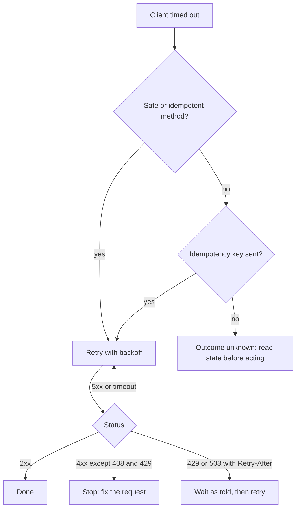

# 1 — API design

> A client that times out does not know whether its request worked, and most of what makes an API good follows from that one fact. This chapter builds the parts that answer it (idempotent writes, conditional updates, stable pagination, deadlines) in REST, GraphQL and gRPC, and runs each against a real local server.

---

## What each method promises

An API is a contract between programs that fail independently. A mobile app sends `POST /payments`, the connection dies, and the app has to decide whether to send it again. The answer has to be in the contract, because nothing else can tell the client what happened.

HTTP states the contract in its method semantics. [RFC 9110 §9.2.1](https://www.rfc-editor.org/rfc/rfc9110#section-9.2.1) calls GET, HEAD, OPTIONS and TRACE *safe*: the client asks for no change to server state. [§9.2.2](https://www.rfc-editor.org/rfc/rfc9110#section-9.2.2) adds PUT and DELETE to the *idempotent* methods: sending the request many times has the same intended effect as sending it once. POST is neither, and the same section says a client should not automatically retry a non-idempotent request without knowing it is safe to, and a proxy must not.

That gives you a design rule for resources. If a write can be named by the client, make it a PUT to that name, and retries become harmless. Reach for POST when the server picks the name, then add your own retry protection, because HTTP gives you none.

| Method | Safe | Idempotent | Use it for | Retry after a timeout |
|---|---|---|---|---|
| GET | yes | yes | Read a representation | Freely |
| PUT | no | yes | Replace the resource at a name the client knows | Yes |
| DELETE | no | yes | Remove it (a second delete can return 404, the state is the same) | Yes |
| POST | no | no | Create where the server picks the id, or start an action | Only with an idempotency key |
| PATCH | no | no | Partial change | Only if your patch format makes it safe |

Idempotent describes the effect on the server, and the responses can differ. A second DELETE may well answer 404 while leaving the same state behind.

The status code tells the client which branch to take, so keep the classes clean: most 4xx mean do not send this again unchanged (408 and 429 are the exceptions), and 5xx or a timeout means the outcome is unknown or transient. [RFC 6585 §4](https://www.rfc-editor.org/rfc/rfc6585#section-4) defines 429 Too Many Requests, which may carry the `Retry-After` header defined in [RFC 9110 §10.2.3](https://www.rfc-editor.org/rfc/rfc9110#section-10.2.3). For error bodies, [RFC 9457](https://www.rfc-editor.org/rfc/rfc9457) defines `application/problem+json` with the members `type`, `title`, `status`, `detail` and `instance`, so clients don't parse a different shape from every service.

The transport underneath is covered elsewhere: [HTTP/1.1 on TCP](../../computer-science/notes/06-networks.md#http11-on-top-of-tcp), [HTTP/2 and HTTP/3](../../computer-science/notes/06-networks.md#http2-and-http3), and [what a cold request costs](../../computer-science/notes/06-networks.md#a-budget-for-a-cold-request). This chapter stays above that line.

## Two writes that survive a retry

Two failures come up constantly, and the same small server shows both.

The first is the *lost update*. Alice and Bob both read an invoice, both change it, and the second write silently erases the first. [RFC 9110 §8.8.3](https://www.rfc-editor.org/rfc/rfc9110#section-8.8.3) lets a server give a representation a validator called an entity tag, and [§13.1.1](https://www.rfc-editor.org/rfc/rfc9110#section-13.1.1) lets a client say "apply this only if the tag still matches" with `If-Match`. On a mismatch the method isn't applied, and the usual answer is [412 Precondition Failed](https://www.rfc-editor.org/rfc/rfc9110#section-15.5.13). [RFC 6585 §3](https://www.rfc-editor.org/rfc/rfc6585#section-3) adds 428 Precondition Required for servers that insist on the header, and names this exact problem as its purpose. The same tag makes reads cheap: `If-None-Match` gets a 304 with no body when nothing changed.

The second is the *double charge*. HTTP has no idempotent way to say "create a payment", so the client generates a unique key and sends it with the request. Stripe's API is the best-known public description of this: [its docs](https://docs.stripe.com/api/idempotent_requests) suggest a V4 UUID, up to 255 characters, and parameters that differ from the original are an error. In its API v1, the server saves the status and body of the first request once execution has begun, including 500s, a repeat gets the saved result, and keys can be pruned after at least 24 hours. Its API v2 instead retries failed work to completion where it can. `Idempotency-Key` is not part of RFC 9110. It is a convention, so document yours.

```python
import hashlib, http.client, json, threading
from http.server import BaseHTTPRequestHandler, ThreadingHTTPServer

invoices = {"7": {"amount": 100, "status": "draft"}}
payments, keys = [], {}
lock = threading.Lock()


def etag(obj):
    body = json.dumps(obj, sort_keys=True).encode()
    return '"' + hashlib.sha256(body).hexdigest()[:12] + '"'


class Api(BaseHTTPRequestHandler):
    def log_message(self, *args):
        pass

    def reply(self, status, obj=None, headers=None, kind="application/json"):
        body = json.dumps(obj).encode() if obj is not None else b""
        self.send_response(status)
        for name, value in (headers or {}).items():
            self.send_header(name, value)
        if body:
            self.send_header("Content-Type", kind)
        self.send_header("Content-Length", str(len(body)))
        self.end_headers()
        self.wfile.write(body)

    def problem(self, status, title, detail):
        doc = {"type": "about:blank", "title": title, "status": status, "detail": detail}
        self.reply(status, doc, kind="application/problem+json")

    def read_json(self):
        return json.loads(self.rfile.read(int(self.headers["Content-Length"])))

    def do_GET(self):
        invoice = invoices[self.path.rsplit("/", 1)[1]]
        tag = etag(invoice)
        if self.headers.get("If-None-Match") == tag:
            return self.reply(304, headers={"ETag": tag})
        self.reply(200, invoice, {"ETag": tag})

    def do_PUT(self):
        key = self.path.rsplit("/", 1)[1]
        new = self.read_json()
        match = self.headers.get("If-Match")
        if match is None:
            return self.problem(428, "Precondition Required", "send If-Match with the ETag you read")
        with lock:
            if match != etag(invoices[key]):
                return self.problem(412, "Precondition Failed", "the invoice changed since you read it")
            invoices[key] = new
            self.reply(200, new, {"ETag": etag(new)})

    def do_POST(self):
        key = self.headers.get("Idempotency-Key")
        raw = self.rfile.read(int(self.headers["Content-Length"]))
        if key is None:
            return self.problem(400, "Bad Request", "send an Idempotency-Key")
        fingerprint = hashlib.sha256(raw).hexdigest()
        with lock:
            if key in keys:
                saved_print, saved_status, saved_body = keys[key]
                if saved_print != fingerprint:
                    return self.problem(422, "Unprocessable Content", "key reused with a different body")
                return self.reply(saved_status, saved_body, {"Idempotent-Replayed": "true"})
            payment = {"id": f"pay_{len(payments) + 1}", **json.loads(raw)}
            payments.append(payment)
            keys[key] = (fingerprint, 201, payment)
        self.reply(201, payment)


server = ThreadingHTTPServer(("127.0.0.1", 0), Api)
threading.Thread(target=server.serve_forever, daemon=True).start()


def call(method, path, body=None, **headers):
    conn = http.client.HTTPConnection("127.0.0.1", server.server_port)
    raw = json.dumps(body) if body is not None else None
    conn.request(method, path, raw, {k.replace("_", "-"): v for k, v in headers.items()})
    response = conn.getresponse()
    data = response.read()
    conn.close()
    return response.status, response.getheader("ETag"), json.loads(data) if data else None


status, tag_a, _ = call("GET", "/invoices/7")
print("alice reads     ", status, tag_a)
print("cache revalidate", call("GET", "/invoices/7", If_None_Match=tag_a)[0])
_, tag_b, _ = call("GET", "/invoices/7")
print("no precondition ", call("PUT", "/invoices/7", {"amount": 1}, )[0])
status, tag_new, _ = call("PUT", "/invoices/7", {"amount": 120, "status": "draft"}, If_Match=tag_a)
print("alice writes    ", status, tag_new)
status, _, problem = call("PUT", "/invoices/7", {"amount": 90, "status": "draft"}, If_Match=tag_b)
print("bob writes stale", status, problem["detail"])

order = {"invoice": "7", "amount": 120}
print("pay             ", call("POST", "/payments", order, Idempotency_Key="k-1")[2])
print("pay, retried    ", call("POST", "/payments", order, Idempotency_Key="k-1")[2])
print("same key, new   ", call("POST", "/payments", {"invoice": "7", "amount": 5}, Idempotency_Key="k-1")[0])
print("rows charged    ", len(payments))
server.shutdown()
```

```text
alice reads      200 "d97cd66ddd02"
cache revalidate 304
no precondition  428
alice writes     200 "b8eaf60696f8"
bob writes stale 412 the invoice changed since you read it
pay              {'id': 'pay_1', 'invoice': '7', 'amount': 120}
pay, retried     {'id': 'pay_1', 'invoice': '7', 'amount': 120}
same key, new    422
rows charged     1
```

The output reads as a story. Alice's read returns a tag, and revalidating with it costs a body-less 304. A write with no precondition is refused with 428. Alice's conditional write succeeds and changes the tag, so Bob's write, based on what he read before that, gets 412 and must re-read. The payment retried with the same key returns the same `pay_1` and charges one row, while the same key with a different body is rejected rather than guessed at.

The lock around "check the key, do the work, save the result" is doing real work here. In a real service that atomic step is a unique constraint in the same database transaction as the business write, so that two concurrent retries can't both pass the check. [Chapter 3](03-caching-and-queues.md#the-outbox-a-write-and-a-message-together) builds that shape with SQLite.

## Pagination that holds still

A list endpoint has to return pieces, and the obvious way, `LIMIT 20 OFFSET 4000`, has two problems. The [GraphQL pagination guide](https://graphql.org/learn/pagination/) flags the same kinds for its own offset form: performance, and ambiguity when records are added. A row inserted between requests shifts everything along, so a client sees an item twice. And the database must walk past every skipped row.

*Keyset pagination* fixes both: the client passes the sort key of the last row it saw, and the query asks for rows after that key. The key has to be unique, so a timestamp is paired with the primary key as a tie-breaker. Wrapping it in an opaque string, the *cursor*, keeps clients from building it themselves and leaves you free to change it. The GraphQL guide recommends the same opacity.

```python
import base64, json, sqlite3

db = sqlite3.connect(":memory:")
db.execute("create table post(id integer primary key, created integer)")
db.executemany("insert into post values (?, ?)", [(i, 1000 + i) for i in range(1, 11)])


def offset_page(offset, size=4):
    rows = db.execute(
        "select id from post order by created desc, id desc limit ? offset ?", (size, offset)
    )
    return [r[0] for r in rows]


def encode(created, row_id):
    raw = json.dumps([created, row_id]).encode()
    return base64.urlsafe_b64encode(raw).decode().rstrip("=")


def decode(cursor):
    return json.loads(base64.urlsafe_b64decode(cursor + "=" * (-len(cursor) % 4)))


def keyset_page(cursor=None, size=4):
    if cursor is None:
        sql, args = "select created, id from post order by created desc, id desc limit ?", (size + 1,)
    else:
        sql = """select created, id from post where (created, id) < (?, ?)
                 order by created desc, id desc limit ?"""
        args = (*decode(cursor), size + 1)
    rows = db.execute(sql, args).fetchall()
    more = len(rows) > size
    rows = rows[:size]
    return [r[1] for r in rows], (encode(*rows[-1]) if more else None)


first = offset_page(0)
db.execute("insert into post values (11, 2000)")          # a new post arrives between requests
print("offset page 1", first)
print("offset page 2", offset_page(4), "<- 7 again")

db.execute("delete from post where id = 11")
first, cursor = keyset_page()
db.execute("insert into post values (11, 2000)")
print("keyset page 1", first)
second, cursor = keyset_page(cursor)
print("keyset page 2", second)
print("cursor       ", cursor, "=", decode(cursor))
```

```text
offset page 1 [10, 9, 8, 7]
offset page 2 [7, 6, 5, 4] <- 7 again
keyset page 1 [10, 9, 8, 7]
keyset page 2 [6, 5, 4, 3]
cursor        WzEwMDMsIDNd = [1003, 3]
```

Offset paging showed post 7 on both pages because a new post arrived between the calls. Keyset paging, given the same arrival, moved on to 6. The cursor is base64 of JSON, which is encoding and not secrecy, so anyone can read it and forge one. If it carries anything sensitive, sign it, and always run the object-level check from [chapter 2](02-auth-sessions-jwt-oauth.md#authorisation-is-a-separate-check) on what comes back.

Now the cost. A million rows with a covering index for the sort, on an Apple M4 Pro with CPython 3.14.7, taking the best of 20 runs:

```python
import sqlite3, time

db = sqlite3.connect(":memory:")
db.execute("create table post(id integer primary key, created integer, body text)")
db.executemany(
    "insert into post values (?, ?, ?)", ((i, i, "x" * 200) for i in range(1, 1_000_001))
)
db.execute("create index post_created on post(created, id)")


def timed(sql, args):
    best = float("inf")
    for _ in range(20):
        start = time.perf_counter()
        rows = db.execute(sql, args).fetchall()
        best = min(best, time.perf_counter() - start)
    assert len(rows) == 20
    return best * 1000


offset = "select id, body from post order by created desc, id desc limit 20 offset ?"
keyset = """select id, body from post where (created, id) < (?, ?)
            order by created desc, id desc limit 20"""
print(f"{'depth':>9}  {'offset ms':>10}  {'keyset ms':>10}")
for depth in (0, 10_000, 100_000, 900_000):
    top = 1_000_000 - depth + 1
    print(f"{depth:>9,}  {timed(offset, (depth,)):>10.3f}  {timed(keyset, (top, top)):>10.3f}")
print(db.execute("explain query plan " + keyset, (5, 5)).fetchall()[0][3])
```

<!-- measured -->

```text
    depth   offset ms   keyset ms
        0       0.007       0.006
   10,000       0.100       0.008
  100,000       0.989       0.007
  900,000       8.332       0.007
SEARCH post USING INDEX post_created (created<?)
```

Offset cost grows linearly with depth, reaching about 8 ms at 900,000 rows, a roughly thousandfold difference from keyset's steady 7 µs. Even this is the flattering case, since the database is in memory and idle. The plan line shows why keyset stays flat: it seeks into the index on `(created, id)` and reads 20 entries.

Keyset has costs too. You can't jump to page 50, a total count is a separate and possibly expensive query, and every sort order the API offers needs its own index. Most feeds and exports can live with that, and an admin table with numbered pages over a few thousand rows can keep its offset.

How the next-page pointer reaches the client is a smaller choice. Put the cursor in the JSON body, or use a `Link` header ([RFC 8288](https://www.rfc-editor.org/rfc/rfc8288)) with `rel="next"`. Always cap the page size on the server: [unrestricted resource consumption](https://owasp.org/API-Security/editions/2023/en/0xa4-unrestricted-resource-consumption/) is on the [OWASP API Top 10](https://owasp.org/API-Security/editions/2023/en/0x11-t10/) for this reason.

## GraphQL: the client picks the shape

REST gives each resource a fixed shape, so a screen that needs an author's name and three book titles either over-fetches or makes several calls. GraphQL lets the client describe the shape it wants in one request, against a typed schema. The server walks that request field by field, calling a resolver for each.

The walk is where the trouble starts. The [GraphQL performance guide](https://graphql.org/learn/performance/) names the classic failure the N+1 problem: one query fetches the list, then one query per item fetches a nested field. The standard fix is batching, with a helper such as DataLoader collecting the keys requested in a short window and asking the database for them together. Here is a small loader against a real schema, using `graphql-core` and counting the SQL.

<!-- requires: graphql -->
```python
import asyncio, sqlite3
from graphql import (GraphQLArgument, GraphQLField, GraphQLInt, GraphQLList, GraphQLNonNull,
                     GraphQLObjectType, GraphQLSchema, GraphQLString, graphql, parse)
from graphql.language import FieldNode

db = sqlite3.connect(":memory:")
db.executescript("""
create table author(id integer primary key, name text);
create table book(id integer primary key, author_id integer, title text);
""")
db.executemany("insert into author values (?, ?)", [(i, f"author{i}") for i in range(1, 26)])
db.executemany("insert into book values (?, ?, ?)", [(i, i % 25 + 1, f"t{i}") for i in range(1, 101)])
statements = []
db.set_trace_callback(statements.append)


class Loader:
    """Collect every key asked for in one tick of the event loop, then fetch them together."""

    def __init__(self):
        self.pending = {}

    def load(self, key):
        loop = asyncio.get_running_loop()
        if not self.pending:
            loop.call_soon(self.flush)
        return self.pending.setdefault(key, loop.create_future())

    def flush(self):
        batch, self.pending = self.pending, {}
        marks = ",".join("?" * len(batch))
        rows = db.execute(f"select author_id, title from book where author_id in ({marks})", list(batch))
        found = {key: [] for key in batch}
        for author_id, title in rows:
            found[author_id].append({"title": title})
        for key, future in batch.items():
            future.set_result(found[key])


def naive_books(author, info):
    rows = db.execute("select title from book where author_id = ?", (author["id"],))
    return [{"title": t} for (t,) in rows]


def batched_books(author, info):
    return info.context.load(author["id"])


def schema(resolve_books):
    book = GraphQLObjectType("Book", {"title": GraphQLField(GraphQLString)})
    author = GraphQLObjectType("Author", {
        "id": GraphQLField(GraphQLInt),
        "name": GraphQLField(GraphQLString),
        "books": GraphQLField(GraphQLList(book), resolve=resolve_books),
    })

    def authors(_, info, first):
        rows = db.execute("select id, name from author order by id limit ?", (first,))
        return [{"id": i, "name": n} for i, n in rows]

    query = GraphQLObjectType("Query", {"authors": GraphQLField(
        GraphQLList(author), args={"first": GraphQLArgument(GraphQLNonNull(GraphQLInt))}, resolve=authors)})
    return GraphQLSchema(query)


def depth(node, level=0):
    children = [s for s in (node.selection_set.selections if node.selection_set else [])
                if isinstance(s, FieldNode)]
    return max((depth(c, level + 1) for c in children), default=level)


QUERY = "{ authors(first: 25) { name books { title } } }"


async def main():
    for name, resolver, context in (("naive", naive_books, None), ("batched", batched_books, Loader())):
        statements.clear()
        result = await graphql(schema(resolver), QUERY, context_value=context)
        assert not result.errors
        books = sum(len(a["books"]) for a in result.data["authors"])
        print(f"{name:8} {len(result.data['authors'])} authors, {books} books, {len(statements)} SQL statements")
    operation = parse(QUERY).definitions[0]
    print("query depth", depth(operation))


asyncio.run(main())
```

```text
naive    25 authors, 100 books, 26 SQL statements
batched  25 authors, 100 books, 2 SQL statements
query depth 3
```

Same result, 26 statements against 2. The loader works because resolvers for sibling objects all run before the event loop's next tick, so `flush` sees all 25 keys at once.

The bigger design consequence is that clients now write your query plan. A client can ask for books of authors of books of authors, and a nested list multiplies. The [GraphQL security guide](https://graphql.org/learn/security/) lists the defences: trusted documents (only allow queries you registered ahead of time, which suits first-party clients), pagination on list fields, depth limits, breadth and alias limits, and rate limiting by computed query cost and not by request count. `depth` above is the simplest of these, a check on the parsed query before any resolver runs.

On change, the [schema design guide](https://graphql.org/learn/schema-design/#versioning) says GraphQL takes "a strong opinion on avoiding versioning": add new types and fields, and avoid breaking changes. That works because clients only receive what they asked for, so a new field never disturbs them.

Pay for GraphQL when many clients need different shapes of the same graph. For a single client, or for a service-to-service call, the extra resolver machinery buys you little.

## gRPC: a typed contract between services

gRPC is built for calls between services you control. You define messages and methods in a `.proto` file, generate client and server code, and call remote methods as if they were local functions. The [core concepts page](https://grpc.io/docs/what-is-grpc/core-concepts/) lists four method kinds: unary, server streaming, client streaming and bidirectional.

Two things repay attention. The first is the wire format. [Protocol Buffers encoding](https://protobuf.dev/programming-guides/encoding/) drops field names in favour of numbers and stores most integer types as varints: 1 to 10 bytes, 7 payload bits each, with the high bit meaning "more follows". Its worked example says `a = 150` in field 1 encodes as `08 96 01`, and the run below confirms it.

The second is deadlines. The [deadlines guide](https://grpc.io/docs/guides/deadlines/) has a warning you should remember: by default gRPC does not set one, so a call can wait forever. A client sets a deadline, and a server that calls another service should pass on what remains. gRPC converts the deadline to a timeout with the elapsed time deducted, automatically in some languages such as Java and Go, and explicitly in C++. The server also has to stop working by itself, since expiry cancels the call and not your Python function. The [SRE book's section on deadline propagation](https://sre.google/sre-book/addressing-cascading-failures/) makes the same point with arithmetic: a backend handed a stale, hardcoded deadline does work whose result nobody is waiting for.

This one script compiles a `.proto` at runtime, starts a frontend and a backend on localhost, and passes a deadline through both.

<!-- requires: grpc -->
```python
import json, pathlib, sys, time
from concurrent import futures
import grpc
from grpc_tools import protoc

pathlib.Path("rate.proto").write_text("""
syntax = "proto3";
package demo;
message Test1 { int32 a = 1; }
message Quote { string symbol = 1; int64 price_micros = 2; int32 volume = 3; }
message QuoteRequest { string symbol = 1; int32 work_ms = 2; }
service Quotes {
  rpc Get (QuoteRequest) returns (Quote);          // unary
  rpc Watch (QuoteRequest) returns (stream Quote); // server streaming
}
""")
assert protoc.main(["protoc", "-I.", "--python_out=.", "--grpc_python_out=.", "rate.proto"]) == 0
sys.path.insert(0, ".")
import rate_pb2 as pb, rate_pb2_grpc as rpc

print("Test1(a=150) on the wire:", pb.Test1(a=150).SerializeToString().hex(" "))

quote = pb.Quote(symbol="ABCD", price_micros=172_250_000, volume=1500)
as_json = json.dumps({"symbol": "ABCD", "price_micros": 172_250_000, "volume": 1500}).encode()
print(f"protobuf {len(quote.SerializeToString())} bytes, JSON {len(as_json)} bytes")


class Quotes(rpc.QuotesServicer):
    backend = None
    calls_seen = 0

    def Get(self, request, context):
        Quotes.calls_seen += 1
        if request.work_ms > 0:
            if context.time_remaining() * 1000 < request.work_ms:
                context.abort(grpc.StatusCode.DEADLINE_EXCEEDED, "not enough budget left, not starting")
            time.sleep(request.work_ms / 1000)
        return quote

    def Watch(self, request, context):
        for volume in range(3):
            yield pb.Quote(symbol=request.symbol, volume=volume)


class Frontend(rpc.QuotesServicer):
    def __init__(self, stub):
        self.stub = stub

    def Get(self, request, context):
        time.sleep(0.2)   # work the frontend does before it calls the backend
        try:
            return self.stub.Get(request, timeout=context.time_remaining())
        except grpc.RpcError as err:
            context.abort(err.code(), f"backend: {err.details()}")


def serve(servicer):
    server = grpc.server(futures.ThreadPoolExecutor(max_workers=4))
    rpc.add_QuotesServicer_to_server(servicer, server)
    port = server.add_insecure_port("127.0.0.1:0")
    server.start()
    return server, port


backend, backend_port = serve(Quotes())
backend_channel = grpc.insecure_channel(f"127.0.0.1:{backend_port}")
frontend, frontend_port = serve(Frontend(rpc.QuotesStub(backend_channel)))
channel = grpc.insecure_channel(f"127.0.0.1:{frontend_port}")
direct, front = rpc.QuotesStub(backend_channel), rpc.QuotesStub(channel)

print("unary      ", direct.Get(pb.QuoteRequest(symbol="ABCD"), timeout=1).volume)
print("streaming  ", [q.volume for q in direct.Watch(pb.QuoteRequest(symbol="ABCD"), timeout=1)])

for label, budget, work in (("enough time", 1.0, 100), ("too little ", 0.4, 300)):
    Quotes.calls_seen = 0
    try:
        front.Get(pb.QuoteRequest(symbol="ABCD", work_ms=work), timeout=budget)
        print(f"{label}  OK")
    except grpc.RpcError as err:
        print(f"{label}  {err.code().name}: {err.details()}")
try:
    direct.Get(pb.QuoteRequest(symbol="ABCD", work_ms=1), timeout=0.0001)
except grpc.RpcError as err:
    print("expired    ", err.code().name)
backend.stop(0); frontend.stop(0)
```

```text
Test1(a=150) on the wire: 08 96 01
protobuf 14 bytes, JSON 61 bytes
unary       1500
streaming   [0, 1, 2]
enough time  OK
too little   DEADLINE_EXCEEDED: backend: not enough budget left, not starting
expired     DEADLINE_EXCEEDED
```

The size comparison is for one small message, 14 bytes against 61, and the gap depends on your data: long strings compress hardly at all, because both formats carry them verbatim. In the deadline case, the frontend spends 200 ms of a 400 ms budget and hands on what remains. The backend sees about 200 ms left for 300 ms of work and declines to start. That saves the work, and the client gets a clear `DEADLINE_EXCEEDED` instead of a slow failure.

Retries need the same care as HTTP. The [status codes page](https://grpc.io/docs/guides/status-codes/) warns that `DEADLINE_EXCEEDED` may be returned even when the operation completed on the server, which is the POST problem again. The [retry guide](https://grpc.io/docs/guides/retry/) offers configured backoff, attempt limits and throttling, and notes that once response headers have arrived the call is committed and won't be retried. [Chapter 7](07-reliability-under-load.md#retries-can-keep-a-system-down) shows what retries do under overload.

## Choosing between them

These are judgement calls, and teams reasonably differ. This is the default I would start from.

| Situation | Start with | Because |
|---|---|---|
| Public API, unknown clients | REST with JSON | Works with curl, browsers and every language; HTTP caches and tooling help |
| First-party apps with many screens over one graph | GraphQL | Clients fetch the shape they need; use trusted documents to bound the cost |
| Calls between your own services | gRPC | Typed contract, generated clients, deadlines and streaming built in |
| Browser to a service | REST or GraphQL | Browsers are first-class HTTP and JSON clients, and their caches understand it |
| An LLM reply arriving token by token | Streaming HTTP or gRPC streaming | Covered in [chapter 10](10-ai-system-reference-architecture.md#the-gateway-budget-fallback-and-streaming) |

Whichever you pick, the rules for change are the same. Adding an optional field is safe, removing or renaming one isn't, and changing what a field means is the worst of all because nothing fails loudly. Version only when you must break something, keep the old version running until its traffic has gone, and measure that traffic before you remove it.



## Pitfalls

- **Treating a timeout as a failure.** It means unknown. A client that treats it as failure and creates a fresh request is how duplicates happen.
- **Storing the idempotency key after the work.** A crash between the two loses the record and the retry charges twice. Commit them together.
- **Reading a key with `GET` and writing it later.** Two concurrent retries both find nothing. Use a unique constraint.
- **Using timestamps alone as a keyset cursor.** Two rows share a timestamp, one falls between pages and vanishes. Add the primary key.
- **Offering a sort you have no index for.** Keyset without the index is a scan with extra steps.
- **Counting GraphQL requests for rate limits.** One request can cost a million row reads. Limit by computed cost.
- **Leaving out gRPC deadlines.** The default is no deadline, so a stuck dependency holds your threads until it recovers or you run out.
- **Returning 200 with an error in the body.** Caches, retries, dashboards and load balancers all read the status code.

## Try it

**1. Build a cursor.** Do `cursor.py` in the [lab](../practice/README.md): encode, decode and paginate with a tie-breaker, and reject a tampered cursor. Run `cd practice/exercises/backend_lab && uv run pytest test_cursor.py`.

<details>
<summary>Answer</summary>

Worked code is in [`solutions/backend_lab/cursor.py`](../practice/solutions/backend_lab/cursor.py). It signs the payload with HMAC so a forged cursor fails, compares with `hmac.compare_digest`, and fetches `size + 1` rows so it can tell whether another page exists without running a count.

</details>

**2. Why does a duplicate retried payment return the original 201 and not a 409?** Think about what the client needs to do next.

<details>
<summary>Answer</summary>

The client is retrying because it never saw the first response. It needs the payment id, so the server replays the original result. A 409 would say that something conflicts while leaving it with no way to find out what it bought. A conflict does fit a repeat that arrives while the first request is still running, and [Stripe's docs](https://docs.stripe.com/api/idempotent_requests) treat that case separately: in API v1, conflicting concurrent requests aren't saved as results.

</details>

**3. Compute it.** A list has 10 million rows. A client exports all of it at 100 rows per page. Roughly how many rows does the database step over in total with `OFFSET`, and with keyset?

<details>
<summary>Answer</summary>

There are 100,000 pages. With offset, page *k* skips 100·(k − 1) rows, so the total is 100 · (0 + 1 + … + 99,999) = 100 · 99,999 · 100,000 / 2, about 5 × 10¹¹ rows skipped. Keyset skips none: it reads 10 million rows once. At the roughly 110 million skipped rows per second implied by the table above (900,000 rows in about 8 ms), the offset export spends over an hour just skipping, in the best case of an in-memory database.

</details>

## Interview checklist

| Question | Answer |
|---|---|
| Which HTTP methods are idempotent? | The safe ones (GET, HEAD, OPTIONS, TRACE), plus PUT and DELETE. POST and PATCH are not by default. |
| How do you make POST safe to retry? | Client-generated idempotency key, stored with the saved response in the same transaction as the work; a repeat replays it, and a different body with the same key is an error. |
| What stops lost updates over HTTP? | ETag on read, `If-Match` on write, 412 when it no longer matches. |
| Offset or keyset? | Keyset for deep or changing lists: constant cost and no duplicates. Offset for small, stable lists that need numbered pages. |
| What is the N+1 problem, and the fix? | One query for a list plus one per item. Batch the per-item keys in one query, for example with a DataLoader. |
| How do you stop an expensive GraphQL query? | Trusted documents for first-party clients; otherwise depth, breadth and cost limits, plus pagination on every list. |
| REST or gRPC between services? | gRPC if you own both ends and want typed contracts, deadlines and streaming; REST when clients are many or unknown. |
| What is deadline propagation? | One absolute deadline for the whole call tree; each hop passes on what remains so nobody works for a caller that has gone. |
| 401 or 403? | 401 means not authenticated; 403 means authenticated and refused. See [chapter 2](02-auth-sessions-jwt-oauth.md). |

## Next

An API now has safe writes and stable reads. [Chapter 2 — Auth](02-auth-sessions-jwt-oauth.md) decides who may call it.
