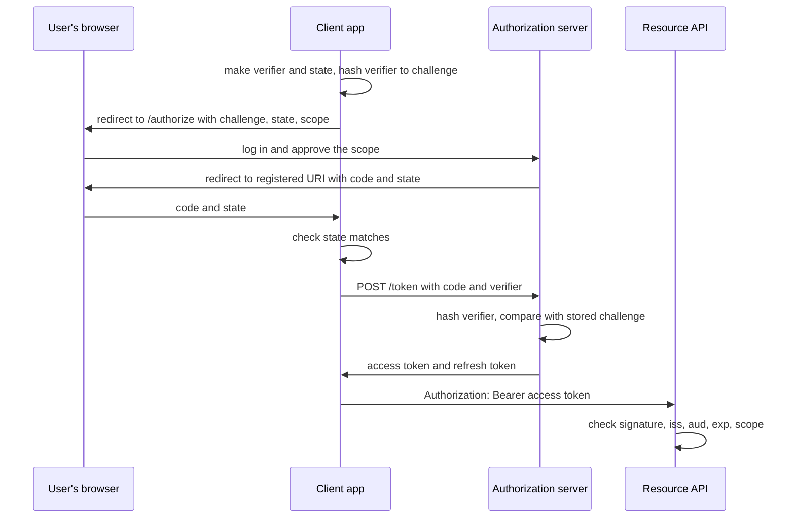

# 2 — Auth: sessions, JWT and OAuth

> A signed token can be perfectly valid and still belong in nobody's hands, which is why "we use JWT" answers almost nothing about whether an API is secure. This chapter builds sessions, token verification, the OAuth code flow and object-level checks, then attacks each one to watch which check stops it.

---

## Three questions that get blurred

"Auth" covers three separate questions, and most bugs come from answering one and assuming the others.

| Question | Name | Failure looks like | HTTP answer |
|---|---|---|---|
| Who is this? | Authentication | Someone logs in as Alice | [401](https://www.rfc-editor.org/rfc/rfc9110#section-15.5.2), valid credentials are missing |
| What may they do here? | Authorisation | Alice reads Bob's invoice | [403](https://www.rfc-editor.org/rfc/rfc9110#section-15.5.4), understood and refused |
| What did they let this app do? | Delegation | A photo printer can read your email | OAuth scope check |

Sessions and JWTs are two ways to carry the answer to the first question from one request to the next. OAuth addresses the third. Neither of them answers the second, and that one is yours to write on every endpoint.

## Sessions: the server remembers

HTTP keeps no state between requests, so after login the server hands the browser a value to send back. In a *session* design, that value is a random id with no meaning. Everything about the user stays on the server, in a table that can be read or deleted at any time.

The rules come from the [OWASP Session Management Cheat Sheet](https://cheatsheetseries.owasp.org/cheatsheets/Session_Management_Cheat_Sheet.html). The id needs at least 64 bits of entropy from a cryptographically secure generator. It must be regenerated when privileges change, so that an id an attacker planted before login dies at login, which is the *session fixation* attack. It needs an idle timeout and an absolute one, and logout must kill it on the server.

```python
import secrets


class SessionStore:
    """Server-side sessions. The cookie holds a random id and nothing else."""

    def __init__(self, idle=1800, absolute=8 * 3600):
        self.rows, self.idle, self.absolute = {}, idle, absolute

    def create(self, user, now, anonymous_id=None):
        self.rows.pop(anonymous_id, None)       # rotate: an id set before login dies at login
        sid = secrets.token_urlsafe(32)         # 256 bits from the OS random source
        self.rows[sid] = {"user": user, "created": now, "seen": now}
        return sid

    def get(self, sid, now):
        row = self.rows.get(sid)
        if row is None:
            return None
        if now - row["seen"] > self.idle or now - row["created"] > self.absolute:
            del self.rows[sid]
            return None
        row["seen"] = now
        return row["user"]

    def logout(self, sid):
        self.rows.pop(sid, None)


store = SessionStore()
fixed = "id-the-attacker-planted"
store.rows[fixed] = {"user": None, "created": 0, "seen": 0}
sid = store.create("alice", now=0, anonymous_id=fixed)
print("attacker's id after login     :", store.get(fixed, 1))
print("real session                  :", store.get(sid, 1))
print("after 29 minutes idle         :", store.get(sid, 1 + 29 * 60))
print("after 31 more minutes idle    :", store.get(sid, 1 + 60 * 60))

sid = store.create("alice", now=0)
for t in range(0, 8 * 3600, 25 * 60):                # active every 25 minutes, all day
    store.get(sid, t)
print("still active, but 8 h 1 min old:", store.get(sid, 8 * 3600 + 60))
sid = store.create("alice", now=0)
store.logout(sid)
print("after logout                  :", store.get(sid, 1))
print("Set-Cookie: __Host-SessionID=<id>; Secure; HttpOnly; SameSite=Strict; Path=/")

for bits in (64, 128):
    years = 2**bits / (10_000 * 100_000) / (365.25 * 86_400)
    print(f"{bits} bits, 10,000 guesses/s, 100,000 live sessions: {years:.3g} years")
```

```text
attacker's id after login     : None
real session                  : alice
after 29 minutes idle         : alice
after 31 more minutes idle    : None
still active, but 8 h 1 min old: None
after logout                  : None
Set-Cookie: __Host-SessionID=<id>; Secure; HttpOnly; SameSite=Strict; Path=/
64 bits, 10,000 guesses/s, 100,000 live sessions: 585 years
128 bits, 10,000 guesses/s, 100,000 live sessions: 1.08e+22 years
```

Every line is one rule firing. Alice stays logged in while she keeps using the site, and even so the absolute timeout ends the session at eight hours, which limits how long a stolen id is useful. The 585 years is OWASP's own figure reproduced: an attacker making 10,000 guesses a second against 100,000 live sessions. The eight-hour and thirty-minute values here are choices for this example. OWASP suggests idle timeouts of 2–5 minutes for high-value applications and 15–30 for low-risk ones, and [NIST SP 800-63B](https://pages.nist.gov/800-63-4/sp800-63b.html) says the overall reauthentication timeout should be no more than 30 days at AAL1 and 24 hours at AAL2, with an inactivity timeout of no more than 1 hour at AAL2.

The cookie attributes each block one thing, and [RFC 6265 §4.1.2.5–6](https://www.rfc-editor.org/rfc/rfc6265#section-4.1.2.5) defines the first two:

- `Secure`: sent over HTTPS only, so it can't be read off the network.
- `HttpOnly`: invisible to JavaScript, so a script injected into the page can't read and send it away. This is why OWASP warns against keeping tokens in `localStorage`, which any script on the page can read.
- `SameSite=Strict`: not sent on requests that start from other sites.
- The `__Host-` name prefix: browsers only accept the cookie if it has `Secure`, `Path=/` and no `Domain`, so a sibling subdomain can't set it.

A cookie is attached automatically, and that causes the classic web bug. A page on `evil.example` submits a form to your API and the browser adds Alice's cookie. This is *cross-site request forgery*. The [OWASP CSRF cheat sheet](https://cheatsheetseries.owasp.org/cheatsheets/Cross-Site_Request_Forgery_Prevention_Cheat_Sheet.html) recommends a synchronizer token for stateful apps and a signed double-submit cookie for stateless ones, allows Fetch Metadata headers with an origin fallback for apps that target only modern browsers, and treats `SameSite` as defence in depth. A bearer token in an `Authorization` header isn't sent automatically, so this attack doesn't apply, which is one of the real differences between the designs.

## Passwords: make guessing expensive

A session starts with a login, so the stored password has to survive the database being stolen. A fast hash fails at that, because an attacker with the table can try guesses as fast as their hardware allows. A password hash is slow on purpose and, in the better designs, needs a lot of memory too, which makes the attacker's graphics cards less useful.

```python
import hashlib, hmac, secrets, time

N, R, P = 2**17, 8, 1


def hash_password(password, salt=None):
    salt = salt or secrets.token_bytes(16)
    digest = hashlib.scrypt(password.encode(), salt=salt, n=N, r=R, p=P, maxmem=256 * 1024 * 1024)
    return salt, digest


def verify(password, salt, digest):
    return hmac.compare_digest(hash_password(password, salt)[1], digest)


start = time.perf_counter()
salt, digest = hash_password("correct horse")
scrypt_ms = (time.perf_counter() - start) * 1000
start = time.perf_counter()
for _ in range(100_000):
    hashlib.sha256(b"correct horse").digest()
sha_ms = (time.perf_counter() - start) * 1000 / 100_000

print(f"scrypt N=2^17 r=8 p=1  {scrypt_ms:9.1f} ms per guess, {128 * N * R / 2**20:.0f} MiB of memory")
print(f"sha-256                {sha_ms:9.4f} ms per guess")
print(f"ratio                  {scrypt_ms / sha_ms:9,.0f}x")
print("right password:", verify("correct horse", salt, digest), " wrong:", verify("hunter2", salt, digest))
print(f"logins/s one core can verify: {1000 / scrypt_ms:.0f}")
```

<!-- measured -->

```text
scrypt N=2^17 r=8 p=1      213.9 ms per guess, 128 MiB of memory
sha-256                   0.0003 ms per guess
ratio                    797,898x
right password: True  wrong: False
logins/s one core can verify: 5
```

These were measured on an Apple M4 Pro with CPython 3.14, one thread, with a fresh random salt. Each scrypt guess costs the attacker the time and memory shown, where a SHA-256 guess costs a fraction of a microsecond. The last line is the trade-off: at about 5 logins a second per core, the login endpoint is itself a way to exhaust your CPUs, so it needs [a rate limit](04-load-balancing-and-rate-limiting.md). The [OWASP Password Storage Cheat Sheet](https://cheatsheetseries.owasp.org/cheatsheets/Password_Storage_Cheat_Sheet.html) warns about exactly this: too high a work factor invites denial of service, and a hash should take less than a second to compute.

OWASP's order of preference, with minimum settings:

| Algorithm | Minimum settings | Note |
|---|---|---|
| Argon2id | 19 MiB, 2 iterations, parallelism 1 | First choice |
| scrypt | N=2¹⁷, r=8, p=1 | Used above; in the Python standard library |
| bcrypt | Work factor 10 or more | Legacy systems; input limited to 72 bytes |
| PBKDF2 | 600,000 iterations with HMAC-SHA-256 | Where FIPS compliance is required |

You can raise the settings later without a reset: on the next successful login, when you hold the plain password for a moment, rehash it with the new parameters.

## JWT: the token remembers

A *JSON Web Token* moves the state to the client. The token carries the claims and a signature over them, so any service holding the key can check it with no database call. [RFC 7519](https://www.rfc-editor.org/rfc/rfc7519) defines the claims and [RFC 7515](https://www.rfc-editor.org/rfc/rfc7515) the signing. A JWT can also be encrypted, but the common form is signed: three base64url parts joined by dots, for header, payload and signature. That form is *signed, not encrypted*: anyone holding it can read the payload, so it should never carry anything secret.

A worked example first, because RFC 7515's Appendix A.1 gives one with an exact answer you can check your code against, and then the part that matters: everything the token could lie about has to be checked against what this service expects, not against what the token says.

```python
import base64, hashlib, hmac, json, time


def b64(raw):
    return base64.urlsafe_b64encode(raw).rstrip(b"=").decode()


def unb64(text):
    return base64.urlsafe_b64decode(text + "=" * (-len(text) % 4))


def sign_hs256(key, signing_input):
    return b64(hmac.new(key, signing_input.encode(), hashlib.sha256).digest())


# RFC 7515 Appendix A.1, including the CRLFs in the header and payload.
header = b'{"typ":"JWT",\r\n "alg":"HS256"}'
payload = b'{"iss":"joe",\r\n "exp":1300819380,\r\n "http://example.com/is_root":true}'
key = unb64("AyM1SysPpbyDfgZld3umj1qzKObwVMkoqQ-EstJQLr_T-1qS0gZH75aKtMN3Yj0iPS4hcgUuTwjAzZr1Z9CAow")
signing_input = b64(header) + "." + b64(payload)
print("RFC 7515 A.1 signature:", sign_hs256(key, signing_input))
assert sign_hs256(key, signing_input) == "dBjftJeZ4CVP-mB92K27uhbUJU1p1r_wW1gFWFOEjXk"


class Rejected(Exception):
    pass


def verify(token, key, *, iss, aud, typ="at+jwt", now=None):
    """Everything the token could lie about is checked against what this service expects."""
    try:
        head_b64, body_b64, signature = token.split(".")
        head = json.loads(unb64(head_b64))
    except ValueError as err:
        raise Rejected("malformed") from err
    if head.get("alg") != "HS256":                     # the caller's choice, not the token's
        raise Rejected(f"algorithm {head.get('alg')!r} not allowed")
    expected = sign_hs256(key, f"{head_b64}.{body_b64}")
    if not hmac.compare_digest(expected, signature):
        raise Rejected("bad signature")
    claims = json.loads(unb64(body_b64))
    if head.get("typ") != typ:
        raise Rejected(f"wrong type {head.get('typ')!r}")
    if claims.get("iss") != iss:
        raise Rejected(f"wrong issuer {claims.get('iss')!r}")
    if claims.get("aud") != aud:
        raise Rejected(f"wrong audience {claims.get('aud')!r}")
    if (now or time.time()) >= claims["exp"]:
        raise Rejected("expired")
    return claims


def naive_verify(token, key):
    """The bug: the token chooses how it is checked."""
    head_b64, body_b64, signature = token.split(".")
    head = json.loads(unb64(head_b64))
    if head["alg"] == "none":
        return json.loads(unb64(body_b64))
    if head["alg"] == "HS256":
        if hmac.compare_digest(sign_hs256(key, f"{head_b64}.{body_b64}"), signature):
            return json.loads(unb64(body_b64))
    raise Rejected("bad signature")


def mint(key, *, alg="HS256", typ="at+jwt", **claims):
    head = b64(json.dumps({"alg": alg, "typ": typ}).encode())
    body = b64(json.dumps(claims).encode())
    return f"{head}.{body}.{sign_hs256(key, f'{head}.{body}') if alg != 'none' else ''}"


SECRET = b"k" * 32
GOOD = dict(iss="https://id.example", aud="billing", sub="alice", exp=2_000)
EXPECT = dict(iss="https://id.example", aud="billing", now=1_000)

print("good token       :", verify(mint(SECRET, **GOOD), SECRET, **EXPECT)["sub"])
cases = {
    "alg none": mint(b"", alg="none", **GOOD),
    "wrong key": mint(b"x" * 32, **GOOD),
    "wrong audience": mint(SECRET, **{**GOOD, "aud": "reports"}),
    "expired": mint(SECRET, **{**GOOD, "exp": 999}),
    "id token as access": mint(SECRET, typ="JWT", **GOOD),
}
for label, token in cases.items():
    try:
        verify(token, SECRET, **EXPECT)
        print(f"{label:17}: ACCEPTED")
    except Rejected as why:
        print(f"{label:17}: rejected, {why}")

print("naive, alg none  :", naive_verify(mint(b"", alg="none", sub="admin", exp=9), SECRET))

# A verifier configured for RS256 holds a public key, which is not a secret. If it also accepts
# HS256 and the token picks the algorithm, the attacker signs with the public key as an HMAC secret.
PUBLIC_KEY_PEM = b"-----BEGIN PUBLIC KEY-----\nMFkw...published-on-the-jwks-endpoint...\n"
forged = mint(PUBLIC_KEY_PEM, sub="admin", exp=9)
print("naive, confusion :", naive_verify(forged, PUBLIC_KEY_PEM))
head = json.loads(unb64(forged.split(".")[0]))
print("strict RS256-only:", "rejected" if head["alg"] != "RS256" else "accepted", "before any key is touched")
```

```text
RFC 7515 A.1 signature: dBjftJeZ4CVP-mB92K27uhbUJU1p1r_wW1gFWFOEjXk
good token       : alice
alg none         : rejected, algorithm 'none' not allowed
wrong key        : rejected, bad signature
wrong audience   : rejected, wrong audience 'reports'
expired          : rejected, expired
id token as access: rejected, wrong type 'JWT'
naive, alg none  : {'sub': 'admin', 'exp': 9}
naive, confusion : {'sub': 'admin', 'exp': 9}
strict RS256-only: rejected before any key is touched
```

The first line reproduces the RFC's signature byte for byte. Then come the checks. Most come from [RFC 8725](https://www.rfc-editor.org/rfc/rfc8725), the best-practice update written because of under-specified mechanisms and implementation mistakes:

- **Algorithm ([§3.1](https://www.rfc-editor.org/rfc/rfc8725#section-3.1)).** The caller states the allowed algorithms and each key is used with one. The header's `alg` is attacker-controlled input. [§2.1](https://www.rfc-editor.org/rfc/rfc8725#section-2.1) describes changing it to `none`, which is the first naive result above.
- **Key confusion.** In the second naive result, a service expecting RS256 holds a *public* key, which is no secret. If the verifier lets the token pick HS256 and passes that same key to HMAC, an attacker signs with the public key as if it were a shared secret ([§2.1](https://www.rfc-editor.org/rfc/rfc8725#section-2.1)). The naive verifier here shows the mechanism, using a stand-in string for the key.
- **Issuer and audience ([§3.8](https://www.rfc-editor.org/rfc/rfc8725#section-3.8), [§3.9](https://www.rfc-editor.org/rfc/rfc8725#section-3.9)).** The keys must belong to the issuer, and when one issuer serves several applications, a valid token for the `reports` service must not work at `billing`. [RFC 7519 §4.1.3](https://www.rfc-editor.org/rfc/rfc7519#section-4.1.3) says that when `aud` is present, a principal that doesn't find itself in it must reject the token.
- **Type ([§3.11](https://www.rfc-editor.org/rfc/rfc8725#section-3.11)).** Explicit typing can stop one kind of token being replayed as another, for new kinds of JWT, though it may not separate existing kinds. [RFC 9068 §4](https://www.rfc-editor.org/rfc/rfc9068#section-4) requires resource servers to reject JWT access tokens whose `typ` isn't `at+jwt` or `application/at+jwt`. This verifier takes one exact value, so a real one has to accept both.
- **Expiry.** [RFC 7519 §4.1.4](https://www.rfc-editor.org/rfc/rfc7519#section-4.1.4): the token must not be accepted on or after `exp`.
- **Key strength ([§3.5](https://www.rfc-editor.org/rfc/rfc8725#section-3.5)).** Human-memorable passwords must not be used directly as HS256 keys.
- **Key lookups ([§3.10](https://www.rfc-editor.org/rfc/rfc8725#section-3.10)).** `kid` is attacker input and can be an injection, and `jku` or `x5u` can make your service fetch an attacker's URL unless you protect against it, for example with an allow-list.

Don't ship your own verifier. The hand-written one exists so you can see the checks. In production use a maintained library and pass it the same expectations:

<!-- requires: pyjwt -->
```python
import base64, json
import jwt

SECRET = "k" * 32
OPTIONS = dict(algorithms=["HS256"], issuer="https://id.example", audience="billing",
               options={"require": ["exp", "iss", "aud"]})
good = {"iss": "https://id.example", "aud": "billing", "sub": "alice", "exp": 4_000_000_000}
print("library accepts  :", jwt.decode(jwt.encode(good, SECRET, algorithm="HS256"), SECRET, **OPTIONS)["sub"])


def unsigned(claims):
    encode = lambda o: base64.urlsafe_b64encode(json.dumps(o).encode()).rstrip(b"=").decode()
    return f"{encode({'alg': 'none'})}.{encode(claims)}."


cases = {
    "alg none": unsigned(good),
    "wrong audience": jwt.encode({**good, "aud": "reports"}, SECRET, algorithm="HS256"),
    "expired": jwt.encode({**good, "exp": 1_000}, SECRET, algorithm="HS256"),
    "no exp": jwt.encode({k: v for k, v in good.items() if k != "exp"}, SECRET, algorithm="HS256"),
}
for label, token in cases.items():
    try:
        jwt.decode(token, SECRET, **OPTIONS)
        print(f"{label:17}: ACCEPTED")
    except jwt.InvalidTokenError as why:
        print(f"{label:17}: {type(why).__name__}")
```

```text
library accepts  : alice
alg none         : InvalidAlgorithmError
wrong audience   : InvalidAudienceError
expired          : ExpiredSignatureError
no exp           : MissingRequiredClaimError
```

PyJWT rejects all four, but the `algorithms`, `issuer`, `audience` and `require` arguments are what make it strict. They are your responsibility, and leaving them out is the common mistake.

## Session or token

The trade-off is revocation against lookups, and it is less one-sided than people suggest.

| | Server-side session | Signed token (JWT) |
|---|---|---|
| Check on each request | A store lookup | Signature, with no network call |
| Revoke one user now | Delete the row | Not possible until `exp`, unless you add a denylist |
| Size per request | About 40 bytes | Hundreds of bytes, growing with claims |
| Data freshness | Always current | Whatever was true at issue |
| Crossing many services | Every service needs the store | Any service with the public key can verify |
| Browser storage | `HttpOnly` cookie | Same cookie is safest; `localStorage` is readable by scripts |

The [OWASP REST cheat sheet](https://cheatsheetseries.owasp.org/cheatsheets/REST_Security_Cheat_Sheet.html) notes the revocation gap directly and suggests a denylist of `jti` values kept until each token's expiry. Take that seriously: a denylist is a store lookup per request, which gives up the advantage that motivated the token. So the usual pattern is short-lived access tokens, minutes rather than days, plus a refresh token held by a server that can refuse it.

For a single web app talking to its own backend, a session cookie is simpler and revokes immediately. Tokens earn their keep when many services have to verify identity without calling home, or when another party issues them. That second case is OAuth.

## OAuth: delegation without sharing the password

A hypothetical invoicing app wants to read your calendar. It should not get your password, which would let it do anything forever. [OAuth 2.0](https://www.rfc-editor.org/rfc/rfc6749) has you authenticate at the calendar's own authorization server, and the app receives a token limited in scope and time. The authorization code flow ([RFC 6749 §4.1](https://www.rfc-editor.org/rfc/rfc6749#section-4.1)), with PKCE from [RFC 7636](https://www.rfc-editor.org/rfc/rfc7636), looks like this:



The code passes through the browser, where it can leak in logs, history and malicious apps. PKCE deals with that: the client commits to a secret by sending its hash up front and reveals the secret only on the direct back-channel call, so a stolen code alone is useless. The code below runs a one-process authorization server, not a product, with each attack from [RFC 9700](https://www.rfc-editor.org/rfc/rfc9700), the current OAuth security best practice:

```python
import base64, hashlib, secrets


def s256(verifier):
    digest = hashlib.sha256(verifier.encode()).digest()
    return base64.urlsafe_b64encode(digest).rstrip(b"=").decode()


# RFC 7636 Appendix B test vector.
print("S256:", s256("dBjftJeZ4CVP-mB92K27uhbUJU1p1r_wW1gFWFOEjXk"))
assert s256("dBjftJeZ4CVP-mB92K27uhbUJU1p1r_wW1gFWFOEjXk") == "E9Melhoa2OwvFrEMTJguCHaoeK1t8URWbuGJSstw-cM"


class OAuthError(Exception):
    pass


class AuthServer:
    """Just enough authorization server to see each check fire. Runs in one process, not a product."""

    def __init__(self):
        self.clients = {"app": ["https://app.example/callback"]}
        self.codes, self.refresh = {}, {}

    def authorize(self, client_id, redirect_uri, state, challenge, user, scope):
        if redirect_uri not in self.clients[client_id]:       # exact string match, RFC 9700 §2.1
            raise OAuthError("redirect_uri not registered")
        code = secrets.token_urlsafe(16)
        self.codes[code] = dict(client=client_id, uri=redirect_uri, challenge=challenge, user=user, scope=scope)
        return f"{redirect_uri}?code={code}&state={state}", code

    def token(self, client_id, redirect_uri, code, verifier):
        grant = self.codes.pop(code, None)                    # gone after one attempt: single use
        if grant is None:
            raise OAuthError("code unknown or already used")
        if grant["client"] != client_id or grant["uri"] != redirect_uri:
            raise OAuthError("code issued to another client")
        if s256(verifier) != grant["challenge"]:
            raise OAuthError("PKCE verifier does not match")
        return self.issue(grant["user"], grant["scope"], family=secrets.token_hex(4))

    def issue(self, user, scope, family):
        token = secrets.token_urlsafe(16)
        self.refresh[token] = dict(user=user, scope=scope, family=family, used=False)
        return {"access_token": f"at-for-{user}", "scope": scope, "refresh_token": token}

    def rotate(self, token):
        row = self.refresh[token]
        if row["used"]:                                       # replay: revoke the whole family
            for other in self.refresh.values():
                if other["family"] == row["family"]:
                    other["used"] = True
            raise OAuthError("refresh token replayed, family revoked")
        row["used"] = True
        return self.issue(row["user"], row["scope"], row["family"])


server = AuthServer()
URI = "https://app.example/callback"

# Client side: a fresh verifier and state for this one login.
verifier, state = secrets.token_urlsafe(32), secrets.token_urlsafe(16)
redirect, code = server.authorize("app", URI, state, s256(verifier), "alice", "invoices:read")
assert f"state={state}" in redirect                            # the client checks this on return


def attempt(label, call):
    try:
        print(f"{label:30}", sorted(call()))
    except OAuthError as err:
        print(f"{label:30} refused: {err}")


attempt("attacker's redirect_uri", lambda: server.authorize("app", "https://evil.example/cb", "x", "c", "alice", "r"))
attempt("stolen code, no verifier", lambda: server.token("app", URI, code, "guessed"))
redirect, code = server.authorize("app", URI, state, s256(verifier), "alice", "invoices:read")
tokens = None


def exchange():
    global tokens
    tokens = server.token("app", URI, code, verifier)
    return tokens


attempt("legitimate exchange", exchange)
attempt("same code again", lambda: server.token("app", URI, code, verifier))

first_refresh = tokens["refresh_token"]
second = server.rotate(first_refresh)
print(f"{'rotation':30} new refresh token issued: {second['refresh_token'] != first_refresh}")
attempt("old refresh token replayed", lambda: server.rotate(first_refresh))
attempt("newest token after the replay", lambda: server.rotate(second["refresh_token"]))
```

```text
S256: E9Melhoa2OwvFrEMTJguCHaoeK1t8URWbuGJSstw-cM
attacker's redirect_uri        refused: redirect_uri not registered
stolen code, no verifier       refused: PKCE verifier does not match
legitimate exchange            ['access_token', 'refresh_token', 'scope']
same code again                refused: code unknown or already used
rotation                       new refresh token issued: True
old refresh token replayed     refused: refresh token replayed, family revoked
newest token after the replay  refused: refresh token replayed, family revoked
```

The checks above map to specific requirements:

| Check | Requirement | Blocks |
|---|---|---|
| Exact `redirect_uri` match (localhost ports for native apps aside) | [RFC 9700 §2.1](https://www.rfc-editor.org/rfc/rfc9700#section-2.1) | Sending the code to an attacker's site |
| PKCE S256 | [§2.1.1](https://www.rfc-editor.org/rfc/rfc9700#section-2.1.1): public clients must, confidential clients recommended | Using a stolen code |
| Single-use code | [RFC 6749 §4.1.2](https://www.rfc-editor.org/rfc/rfc6749#section-4.1.2) | Replaying a code |
| PKCE if the server's support is confirmed, otherwise one-time `state` | [RFC 9700 §2.1](https://www.rfc-editor.org/rfc/rfc9700#section-2.1): clients must prevent CSRF | Attaching the attacker's account to the victim's session |
| Refresh rotation | [§4.14.2](https://www.rfc-editor.org/rfc/rfc9700#section-4.14.2): for public clients, rotate or sender-constrain | A stolen long-lived token |
| Avoid implicit (SHOULD NOT), no password grant (MUST NOT) | [§2.1.2](https://www.rfc-editor.org/rfc/rfc9700#section-2.1.2), [§2.4](https://www.rfc-editor.org/rfc/rfc9700#section-2.4) | Tokens in URLs; apps handling passwords |

Rotation deserves a second look at the last two lines of output. When a refresh token is used, the server issues a new one and invalidates the old but remembers that they are related. If the old one shows up again, either the attacker or the legitimate client has a copy of a token that was already spent, and the server can't tell which. So it revokes the whole family and makes the user log in again. That is why even the newest token fails after the replay.

OAuth grants access; on its own it says nothing about who logged in. [OpenID Connect](https://openid.net/specs/openid-connect-core-1_0.html) adds that on top, with an *ID token* whose claims include `iss`, `sub`, `aud`, `exp` and `iat`, and a `nonce` that ties it to this login. They go to different places:

| | ID token | Access token |
|---|---|---|
| Audience | The client app | The resource API |
| Purpose | Tell the client who logged in | Authorise calls to the API |
| Send it to the API? | No | Yes |

Using one in place of the other is what the `typ` and `aud` checks are there to catch.

## Authorisation is a separate check

A fully verified token says who is calling. It doesn't say whether this caller may read invoice 2. [OWASP's API Security Top 10](https://owasp.org/API-Security/editions/2023/en/0xa1-broken-object-level-authorization/) ranks *broken object level authorization* first, and asks for an object-level check on every endpoint that receives an id. It is an easy bug to write, since the code works in every normal test.

```python
import sqlite3

db = sqlite3.connect(":memory:")
db.executescript("""
create table invoice(id integer primary key, tenant text, amount int);
insert into invoice values (1, 'acme', 100), (2, 'globex', 900);
""")
ROLES = {"viewer": {"invoice:read"}, "admin": {"invoice:read", "invoice:delete"}}


def allowed(principal, action):
    return action in ROLES.get(principal["role"], set())          # anything unlisted is denied


def broken_get(principal, invoice_id):
    return db.execute("select * from invoice where id = ?", (invoice_id,)).fetchone()


def get_invoice(principal, invoice_id):
    if not allowed(principal, "invoice:read"):
        return 403, None
    row = db.execute("select * from invoice where id = ? and tenant = ?",
                     (invoice_id, principal["tenant"])).fetchone()
    return (200, row) if row else (404, None)                      # never says the row exists


alice = {"sub": "alice", "tenant": "acme", "role": "viewer"}
print("broken: alice reads globex's invoice:", broken_get(alice, 2))
print("fixed : alice reads her own         :", get_invoice(alice, 1))
print("fixed : alice reads globex's        :", get_invoice(alice, 2))
print("fixed : unknown role                :", get_invoice({**alice, "role": "intern"}, 1))
print("viewer may delete                   :", allowed(alice, "invoice:delete"))
```

```text
broken: alice reads globex's invoice: (2, 'globex', 900)
fixed : alice reads her own         : (200, (1, 'acme', 100))
fixed : alice reads globex's        : (404, None)
fixed : unknown role                : (403, None)
viewer may delete                   : False
```

`broken_get` is correctly authenticated and leaks the other tenant's data. Three habits in the fixed version do the work, and the [OWASP Authorization Cheat Sheet](https://cheatsheetseries.owasp.org/cheatsheets/Authorization_Cheat_Sheet.html) asks for each of them: check on every request, deny by default (the unknown role gets 403 because nothing granted it), and give least privilege (a viewer can't delete).

The tenant filter sits inside the query, so forgetting it means writing a different query, and it answers 404 for another tenant's row so that an attacker can't probe for ids. Unguessable ids (UUIDs) help a little but do not replace the check, because ids leak through URLs, logs and shared links.

Roles fit most systems. When a decision depends on a relationship, such as "editors of this document", the same shape holds with a richer function behind `allowed`. Keep it one function, so the policy is in one place and can be tested as a table.

## Pitfalls

- **Trusting `alg` from the token.** Pass an allow-list to the verifier, always.
- **Verifying the signature and stopping there.** Without `aud` and `iss` checks, a token for any service works on yours.
- **Treating base64 as secrecy.** Signed JWT payloads are readable by anyone who holds the token.
- **Long-lived JWTs with no revocation plan.** A leaked token works until `exp`. Keep it short and refresh, or accept a denylist.
- **Tokens in `localStorage`.** One cross-site scripting bug hands them over. Prefer an `HttpOnly` cookie for browsers, and add CSRF protection when you do.
- **Same session id before and after login.** That is session fixation. Rotate at login and at any privilege change.
- **Authenticating and forgetting to authorise.** Check the object on every endpoint that takes an id.
- **Fast hashes for passwords.** SHA-256 with a salt is still fast. Use Argon2id or scrypt.
- **No rate limit on login.** Slow hashing makes login an easy way to burn CPU.
- **Loose `redirect_uri` matching.** Prefix or wildcard matching has to be replaced with exact string comparison.
- **Sending an ID token to an API.** ID tokens are for the client; APIs take access tokens.

## Try it

**1. Build a strict verifier.** Do `jwt_verify.py` in the [lab](../practice/README.md). The tests include the RFC 7515 vector, `alg: none`, a wrong audience, expiry at the exact second and a wrong type. Run `cd practice/exercises/backend_lab && uv run pytest test_jwt_verify.py`.

<details>
<summary>Answer</summary>

Worked code is in [`solutions/backend_lab/jwt_verify.py`](../practice/solutions/backend_lab/jwt_verify.py). The order matters: check the algorithm against your allow-list before computing anything with the key, and use `hmac.compare_digest` for the signature. Expiry uses `now >= exp`, since RFC 7519 forbids acceptance *on or after* the time.

</details>

**2. A team stores a JWT in a cookie with `HttpOnly` and `SameSite=Lax`, and says they no longer need CSRF protection because they use tokens. Are they right?**

<details>
<summary>Answer</summary>

No. What protects against CSRF is that a header token is not attached automatically. A cookie is attached automatically whatever it contains. `SameSite=Lax` narrows the attack but still allows top-level GET navigations, and OWASP treats `SameSite` as defence in depth rather than a replacement. They should add a CSRF token or Fetch Metadata checks, and make sure no GET changes state.

</details>

**3. Compute it.** A hypothetical service does 10,000 requests per second with sessions in a store that handles one lookup in 1 ms. It moves to 15-minute JWTs plus a `jti` denylist in the same store, for a security review. How many lookups per second remain, and what did the change gain?

<details>
<summary>Answer</summary>

Still 10,000 lookups per second if every request checks the denylist, so nothing was saved on the request path. The denylist can stay small, since an entry only lives until the token's expiry, and it is usually nearly empty, so you could keep it in memory on each host and push updates. That turns a synchronous lookup into a propagation delay, a staleness window in which a revoked token still works. That window is the actual price, and it should be a stated decision.

</details>

## Interview checklist

| Question | Answer |
|---|---|
| Authentication or authorisation? | Who you are, against what you may do. Different code, different failures, 401 against 403. |
| Session or JWT? | Session when revocation and simplicity matter and one backend owns the store. JWT when many services verify without calling home; keep it short-lived. |
| How do you revoke a JWT? | You can't directly. Short expiry plus refresh, or a `jti` denylist until expiry, which brings back a lookup. |
| What is the `alg: none` attack? | The token declares itself unsigned and a naive verifier agrees. Verifiers must fix allowed algorithms themselves. |
| What is key confusion? | An RS256 public key gets used as an HS256 secret because the token chose the algorithm. Tie each key to one algorithm. |
| What must a resource server check on a JWT? | Signature, algorithm, `iss`, `aud`, `exp`, `typ`, then scope and object-level access. |
| What does PKCE protect? | A stolen authorization code: redeeming it needs a verifier that was never sent through the browser. |
| Why rotate refresh tokens? | A replayed old token reveals theft, so the server revokes the family. |
| ID token or access token? | ID token tells the client who logged in; access token authorises API calls. |
| How do you store passwords? | Argon2id or scrypt with a unique salt, at settings under a second per hash, and upgrade on next login. |
| What is BOLA? | Authenticated users reach objects they don't own because the endpoint trusts the id. Scope queries to the principal. |
| What stops CSRF? | A synchronizer token or Fetch Metadata, with `SameSite` as extra depth. It doesn't apply to tokens sent in headers. |

## Next

Callers are now identified and scoped. [Chapter 3 — Caching and queues](03-caching-and-queues.md) takes up keeping the system fast and writes durable once they get through.
