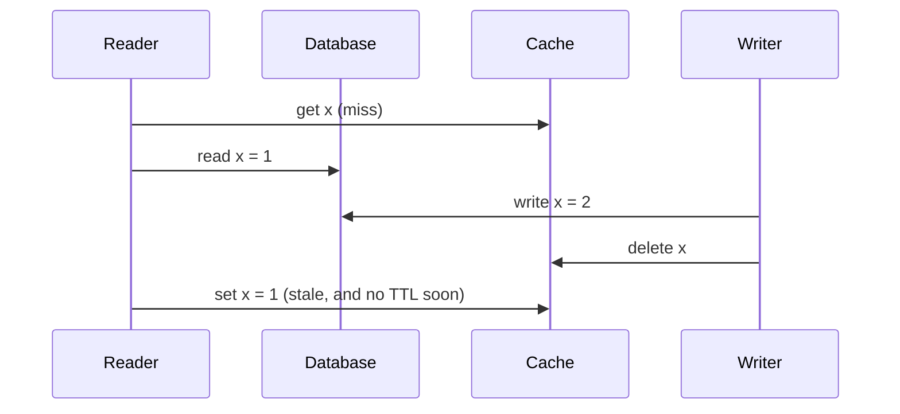
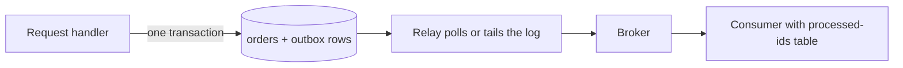

# 3 — Caching and queues

> A cache makes the system depend on a machine it was supposed to be able to lose, and a queue delivers the same message twice on an ordinary day. Both are worth having once you design for that, so this chapter runs the stampedes, stale fills, duplicate deliveries and lost messages, then fixes each.

---

## What a cache buys, measured

Put a small fast store in front of a large slow one, and you win to the extent that requests repeat. The popular shape is *look-aside* (also called cache-aside): the application reads the cache, on a miss reads the database, then fills the cache. The [Memcache at Facebook paper](https://www.usenix.org/system/files/conference/nsdi13/nsdi13-final170_update.pdf) calls this a demand-filled look-aside cache. Writes go to the database and delete the cached entry.

How much it helps depends on how skewed the traffic is. The simulation below compares an LRU cache under two invented workloads with a million keys: one uniform, and one Zipf-distributed, where the key at rank *r* is requested in proportion to 1/*r*.

```python
import itertools, random
from collections import OrderedDict


def zipf_sampler(n, s, rng):
    weights = [1 / rank**s for rank in range(1, n + 1)]
    cumulative = list(itertools.accumulate(weights))
    return lambda k: rng.choices(range(n), cum_weights=cumulative, k=k)


class LRU:
    def __init__(self, size):
        self.size, self.items = size, OrderedDict()

    def access(self, key):
        hit = key in self.items
        if hit:
            self.items.move_to_end(key)
        else:
            self.items[key] = True
            if len(self.items) > self.size:
                self.items.popitem(last=False)
        return hit


rng = random.Random(7)
requests = zipf_sampler(1_000_000, 1.0, rng)(1_000_000)
uniform = [rng.randrange(1_000_000) for _ in range(1_000_000)]
print("cache as % of keys   zipf(s=1)   uniform   db reads per 1,000 requests (zipf)")
for pct in (0.1, 1, 5, 10, 25):
    size = int(1_000_000 * pct / 100)
    z, u = LRU(size), LRU(size)
    zipf_hits = sum(z.access(k) for k in requests)
    uniform_hits = sum(u.access(k) for k in uniform)
    print(f"{pct:17}%   {zipf_hits / 1e4:7.1f}%   {uniform_hits / 1e4:6.1f}%   {1000 - zipf_hits / 1e3:8.0f}")
```

```text
cache as % of keys   zipf(s=1)   uniform   db reads per 1,000 requests (zipf)
              0.1%      40.3%      0.1%        597
                1%      58.4%      1.0%        416
                5%      70.9%      4.9%        291
               10%      75.6%      9.4%        244
               25%      78.3%     21.6%        217
```

The skewed workload gets 58% hits from a cache holding 1% of the keys, while the uniform one gets 1%. Past a point, more memory buys little: going from 10% to 25% of keys gains 3 points, because the trace is finite and first-time reads of rare keys always miss. Don't assume these numbers for your service. Measure your own key distribution, by replaying a sample of real requests against simulated cache sizes.

The rightmost column matters most. The database doesn't see the hit ratio; it sees the misses. Going from 90% to 95% looks minor, and it halves the database's load. It also tells you what happens when the cache disappears.

```text
  100 requests        hit 90%            database sees 10
  100 requests        cache gone         database sees 100   (10x)
```

The [metastable failures paper](https://sigops.org/s/conferences/hotos/2021/papers/hotos21-s11-bronson.pdf) works through this in its §2.2 with a 90% hit rate on a database that manages 300 QPS. The system handles 3,000 QPS happily, but it is *vulnerable* above 300 QPS, since losing the cache multiplies database load by ten and it may never refill. [Chapter 7](07-reliability-under-load.md#retries-can-keep-a-system-down) returns to this. Size the database for what you would do when the cache is cold, or decide what you shed. [Persistence](../../../data-engineering/01-storage-and-compute-foundations/notes/09-persistence.md#cache-versus-source-of-truth) covers the related question of whether a store is a cache or a source of truth.

## Which write strategy

| Strategy | Write goes to | Read after write | Risk |
|---|---|---|---|
| Look-aside, delete on write | Database, then delete the key | Miss, then refill | The stale-fill race below; a cold start |
| Write-through | Cache and database together | Hit | Every write is slower; rarely read data fills the cache |
| Write-back | Cache, database later | Hit | Acknowledged writes die with the cache node |
| TTL only | Database | Stale until expiry | Bounded staleness that you must accept in the product |

Delete rather than update on a write. The Memcache paper's stated reason is that deletes are idempotent, so a repeated one does no harm. There's a second reason: two concurrent updates can land in the cache in the wrong order and leave the older value behind, and a delete can't do that.

When memory runs out, something has to go. [Redis's eviction docs](https://redis.io/docs/latest/develop/reference/eviction/) list the policies you pick from: `noeviction` rejects new writes, `allkeys-lru` and `allkeys-lfu` evict across all keys, `volatile-lru` and `volatile-ttl` evict only among keys with a TTL. Use `allkeys-*` when the instance is purely a cache, and never `noeviction` for one. If an instance holds data you can't regenerate, it isn't a cache, and the [Redis persistence docs](https://redis.io/docs/latest/operate/oss_and_stack/management/persistence/) describe what you would then have to accept: RDB snapshots, usually taken every five minutes or more, can lose everything since the last one, and AOF with the default `fsync` every second can lose about one second of writes.

HTTP has its own cache in browsers and CDNs, usable with no code at all. [RFC 9111](https://www.rfc-editor.org/rfc/rfc9111) defines the directives you will actually set: `max-age` ([§5.2.2.1](https://www.rfc-editor.org/rfc/rfc9111#section-5.2.2.1)) is how long a response stays fresh, `s-maxage` ([§5.2.2.10](https://www.rfc-editor.org/rfc/rfc9111#section-5.2.2.10)) overrides that for shared caches, `no-cache` ([§5.2.2.4](https://www.rfc-editor.org/rfc/rfc9111#section-5.2.2.4)) allows storing but requires revalidation, and `no-store` ([§5.2.2.5](https://www.rfc-editor.org/rfc/rfc9111#section-5.2.2.5)) forbids storing. Personalised responses need `private` or `no-store`, or a CDN can serve Alice's invoice to Bob. Revalidation is the ETag flow from [chapter 1](01-api-design.md#two-writes-that-survive-a-retry).

## The stampede

When a hot key expires, every request in flight misses at the same moment, and each goes to the database for the same value. This is a *cache stampede*, or a thundering herd. The cure is to let exactly one caller do the load. This is usually called *single flight*, and the idea fits in a small class:

```python
import threading, time


class Db:
    def __init__(self, delay=0.25):
        self.delay, self.calls, self.lock = delay, 0, threading.Lock()

    def load(self, key):
        with self.lock:
            self.calls += 1
        time.sleep(self.delay)
        return f"value-of-{key}"


def plain_get(cache, db, key):
    if key in cache:
        return cache[key]
    value = db.load(key)
    cache[key] = value
    return value


class SingleFlight:
    """One caller per key runs the work. The others wait for it to finish."""

    def __init__(self):
        self.lock, self.pending = threading.Lock(), {}

    def do(self, key, work):
        with self.lock:
            event = self.pending.get(key)
            leader = event is None
            if leader:
                event = self.pending[key] = threading.Event()
        if not leader:
            event.wait()
            return
        try:
            work()
        finally:
            with self.lock:
                del self.pending[key]
            event.set()


def single_flight_get(cache, db, key, flight):
    if key not in cache:
        flight.do(key, lambda: cache.__setitem__(key, db.load(key)))   # fill before waking anyone
    return cache[key]


def expire_under_load(getter, n=100):
    cache, db = {}, Db()                  # the hot key has just expired
    barrier = threading.Barrier(n)

    def client():
        barrier.wait()
        assert getter(cache, db, "hot") == "value-of-hot"

    threads = [threading.Thread(target=client) for _ in range(n)]
    [t.start() for t in threads]
    [t.join() for t in threads]
    return db.calls


print("100 clients miss the same key at once")
print("  plain look-aside :", expire_under_load(plain_get), "database calls")
flight = SingleFlight()
print("  single flight    :", expire_under_load(lambda c, d, k: single_flight_get(c, d, k, flight)), "database call")
```

```text
100 clients miss the same key at once
  plain look-aside : 100 database calls
  single flight    : 1 database call
```

One database call instead of a hundred. This version only coalesces within one process: with 50 app servers, up to 50 calls still reach the database, which is usually acceptable. Across a fleet, the coalescing has to live in the cache tier, which is what leases do in the next section. The second cause of stampedes comes from warming a cache in one batch, because then everything expires together. Adding random jitter to each TTL spreads the reload:

```python
import random
from collections import Counter

rng = random.Random(1)
KEYS, TTL = 100_000, 3600
for label, jitter in (("no jitter", 0.0), ("10% jitter", 0.10)):
    # A cache warmed in one 60-second batch. Each key expires one TTL later, plus jitter.
    expiries = [rng.uniform(0, 60) + TTL * (1 + rng.uniform(0, jitter)) for _ in range(KEYS)]
    per_second = Counter(int(t) for t in expiries)
    span = max(per_second) - min(per_second)
    print(f"{label:11} reloads spread over {span:4} s, worst second {max(per_second.values()):5} reloads")
```

```text
no jitter   reloads spread over   59 s, worst second  1802 reloads
10% jitter  reloads spread over  419 s, worst second   324 reloads
```

The same 100,000 reloads, with a worst second less than a fifth as bad. The cost is that some keys live 10% longer.

## Stale fills, and leases

Deleting on write has a subtle race, because the fill and the delete can arrive in the wrong order.



[Memcache at Facebook §3.2.1](https://www.usenix.org/system/files/conference/nsdi13/nsdi13-final170_update.pdf) solves this with *leases*. On a miss, the cache gives the client a 64-bit token bound to that key. A delete invalidates outstanding tokens, and a fill with a dead token is refused.

```python
class Store:
    def __init__(self):
        self.db, self.cache, self.tokens, self.seq = {"x": 1}, {}, {}, 0

    # --- a demand-filled cache with the race ---
    def read_miss(self, key):
        return self.db[key]

    def fill(self, key, value):
        self.cache[key] = value

    def write(self, key, value):
        self.db[key] = value
        self.cache.pop(key, None)
        self.tokens.pop(key, None)         # a delete cancels any outstanding lease

    # --- the same fill guarded by a lease ---
    def lease(self, key):
        self.seq += 1
        self.tokens[key] = self.seq
        return self.seq

    def fill_with_lease(self, key, value, token):
        if self.tokens.get(key) != token:
            return False
        self.cache[key] = value
        return True


s = Store()
old = s.read_miss("x")                     # reader misses, reads 1, then stalls
s.write("x", 2)                            # writer updates the database, deletes the cache entry
s.fill("x", old)                           # reader wakes up and fills
print("no lease  : db =", s.db["x"], "cache =", s.cache["x"], " <- stale until the TTL ends")

s = Store()
token = s.lease("x")
old = s.read_miss("x")
s.write("x", 2)
accepted = s.fill_with_lease("x", old, token)
print("with lease: db =", s.db["x"], "cache =", s.cache.get("x"), " fill accepted:", accepted)
```

```text
no lease  : db = 2 cache = 1  <- stale until the TTL ends
with lease: db = 2 cache = None  fill accepted: False
```

The same token handles stampedes across a fleet. By default the cache hands out one token per key every 10 seconds, and other clients are told to wait briefly, by which time the value is usually there. The paper measured a week of misses for keys especially prone to herds, and the peak database query rate fell from 17K/s without leases to 1.3K/s with them. In the paper the herds come from writes repeatedly invalidating a hot key, not from expiry, but the token limits misses either way. Leases are that system's design, not a feature you get by default from a cache server, so check what your client does before you rely on it.

## Queues give you at-least-once

A queue decouples the producer from the consumer's speed and availability. A web request can enqueue the email and return, and a [bounded queue with backpressure](../../computer-science/notes/05-processes-threads-and-io.md#backpressure-bounding-whats-in-flight) absorbs spikes. [Little's law](../../computer-science/notes/05-processes-threads-and-io.md#queues-littles-law) tells you how deep it will get.

Delivery has an inescapable gap. A consumer does the work and then acknowledges, and it can die between the two. Whatever order you pick, one failure is possible, and the [Kafka design docs](https://kafka.apache.org/42/design/design/) state it clearly in terms of the consumer's saved position:

| Order | If the consumer dies in between | Guarantee |
|---|---|---|
| Save position, then process | The message is never processed | At most once |
| Process, then save position | The message is processed again | At least once |

Nearly all systems choose the second, because losing data silently is worse than a retry you can code for. [SQS standard queues](https://docs.aws.amazon.com/AWSSimpleQueueService/latest/SQSDeveloperGuide/standard-queues-at-least-once-delivery.html) say a message may be delivered more than once and that applications should be designed to be idempotent, and RabbitMQ's [acknowledgements and confirms](https://www.rabbitmq.com/docs/confirms) give the same [at-least-once guarantee](https://www.rabbitmq.com/docs/reliability).

SQS implements this with a [visibility timeout](https://docs.aws.amazon.com/AWSSimpleQueueService/latest/SQSDeveloperGuide/sqs-visibility-timeout.html). Receiving a message hides it (for 30 seconds by default) rather than removing it. The hiding is best effort, so a standard queue can still deliver a copy within the window. If nobody deletes it in time, it reappears. A consumer that needs longer has to extend the timeout, or a healthy but slow worker gets its job duplicated. Here's the same mechanism with a counter for a clock, and a consumer that dies 5% of the time after doing the work:

```python
import random


class Queue:
    """A queue with a visibility timeout, like SQS. Time is a counter so runs are repeatable."""

    def __init__(self, visibility=30, max_receives=3):
        self.messages, self.dead = {}, []
        self.visibility, self.max_receives = visibility, max_receives

    def send(self, mid, body):
        self.messages[mid] = dict(body=body, visible_at=0, receives=0)

    def receive(self, now):
        for mid, m in list(self.messages.items()):
            if m["visible_at"] <= now:
                if m["receives"] >= self.max_receives:
                    self.dead.append(mid)
                    del self.messages[mid]
                    continue
                m["receives"] += 1
                m["visible_at"] = now + self.visibility
                return mid, m["body"]
        return None

    def delete(self, mid):
        self.messages.pop(mid, None)


def run(consumer, crash_rate, seed=3, n=1000):
    rng, q = random.Random(seed), Queue()
    for i in range(n):
        q.send(f"m{i}", 10)
    now = 0
    while q.messages:
        got = q.receive(now)
        if got is None:
            now += 1
            continue
        mid, amount = got
        crash_before_ack = rng.random() < crash_rate
        consumer(mid, amount)
        if not crash_before_ack:           # the work happened but the ack may be lost
            q.delete(mid)
    return q


balance = {"plain": 0, "dedup": 0}
seen = set()


def plain(mid, amount):
    balance["plain"] += amount


def idempotent(mid, amount):
    if mid in seen:                        # in real code: a unique row in the same transaction
        return
    seen.add(mid)
    balance["dedup"] += amount


run(plain, crash_rate=0.05)
run(idempotent, crash_rate=0.05)
print("1000 messages worth 10 each, 5% of consumers die between the work and the ack")
print(f"expected {1000 * 10}, plain consumer {balance['plain']}, idempotent consumer {balance['dedup']}")

# A poison message always crashes its consumer before the ack.
q, now, handled = Queue(max_receives=3), 0, 0
q.send("poison", 0)
q.send("ok", 1)
while q.messages:
    got = q.receive(now)
    if got is None:
        now += 1
        continue
    mid, _ = got
    if mid == "poison":
        handled += 1
        continue                           # crash
    q.delete(mid)
print(f"poison message attempts: {handled}, then dead-letter queue = {q.dead}")
```

```text
1000 messages worth 10 each, 5% of consumers die between the work and the ack
expected 10000, plain consumer 10510, idempotent consumer 10000
poison message attempts: 3, then dead-letter queue = ['poison']
```

The plain consumer overcharged by 5%. The idempotent one is right despite the same duplicates. Exactly-once *effect* comes from at-least-once delivery plus an idempotent consumer, and the dedupe record has to commit together with the work, or the same gap opens up inside the consumer.

The last line of output is the other necessary piece. A message that always crashes its consumer would otherwise retry forever and hold up the work behind it. After a fixed number of attempts it goes to a *dead-letter queue*, where a person can look at it. Alert on that queue's depth, because a growing one means data is sitting unprocessed.

## A queue or a log

These two tools behave quite differently.

| | Work queue (SQS, RabbitMQ classic use) | Partitioned log (Kafka) |
|---|---|---|
| After consumption | Message is deleted | Message stays until retention expires |
| Scale consumers | Competing consumers pick any message | One consumer per partition in a group |
| Order | [Best effort on SQS standard](https://docs.aws.amazon.com/AWSSimpleQueueService/latest/SQSDeveloperGuide/standard-queues.html) | [Total order within a partition](https://kafka.apache.org/42/design/design/) |
| Replay | No | Yes, rewind the position |
| Several independent readers | Needs fan-out | Natural, each group keeps its own position |
| Best for | Jobs: send this email | Events: this happened, tell whoever cares |

Kafka's per-partition order gives you a useful property and a design constraint. Put all of one order's events under the order's key and they stay in sequence; but a single slow key holds up its whole partition, and the same [hot-key problem](../../../data-engineering/01-storage-and-compute-foundations/notes/05-partitioning-and-replication.md#hot-keys) as any hash partitioning applies.

The design docs also warn you to read claims of "exactly once" closely. Kafka's idempotent producer and transactions give exactly-once between Kafka topics, provided consumers read at `read_committed`, which isn't the default. Once the consumer writes to an outside system, that system's write has to join in somehow: store the offset atomically with the output, or make the write idempotent.

## The outbox: a write and a message together

A service saves an order and publishes "order created". Those are two systems with no shared commit, so a crash between them leaves an order nobody hears about, or an announcement of an order that doesn't exist. This is the *dual-write problem*, and it appears whenever a database write and a message must go together.

The [transactional outbox pattern](https://microservices.io/patterns/data/transactional-outbox.html) removes the second write. The message becomes a row, in the same database, committed in the same transaction as the business data. A separate relay reads unsent rows and publishes them.



```python
import json, sqlite3


def connect():
    db = sqlite3.connect(":memory:", isolation_level=None)
    db.executescript("""
    create table orders(id integer primary key, item text);
    create table outbox(id integer primary key autoincrement, topic text, body text, sent int default 0);
    create table processed(message_id integer primary key);
    create table shipments(order_id integer);
    """)
    return db


class BrokerDown(Exception):
    pass


def dual_write(db, item, publish):
    """The bug: the database and the broker are two separate commits."""
    db.execute("insert into orders(item) values (?)", (item,))
    publish({"item": item})                # if this raises, the order exists and nobody hears


def outbox_write(db, item):
    db.execute("begin")
    cursor = db.execute("insert into orders(item) values (?)", (item,))
    db.execute("insert into outbox(topic, body) values ('orders', ?)",
               (json.dumps({"order_id": cursor.lastrowid}),))
    db.execute("commit")                   # both or neither


def relay(db, publish, crash_before_marking=False):
    for mid, body in db.execute("select id, body from outbox where sent = 0 order by id").fetchall():
        publish(mid, json.loads(body))
        if crash_before_marking:
            return                         # published, but will be published again
        db.execute("update outbox set sent = 1 where id = ?", (mid,))


def consumer(db, mid, body):
    db.execute("begin")
    try:
        db.execute("insert into processed values (?)", (mid,))
    except sqlite3.IntegrityError:
        db.execute("rollback")
        return "duplicate ignored"
    db.execute("insert into shipments values (?)", (body["order_id"],))
    db.execute("commit")
    return "processed"


db = connect()


def down(_):
    raise BrokerDown


try:
    dual_write(db, "book", down)
except BrokerDown:
    print("dual write, broker down: orders =", db.execute("select count(*) from orders").fetchone()[0],
          "and no message exists")

db = connect()
outbox_write(db, "book")
print("outbox: order and message rows =", db.execute("select count(*) from orders").fetchone()[0],
      db.execute("select count(*) from outbox").fetchone()[0])

log = []
deliver = lambda mid, body: log.append(consumer(db, mid, body))
relay(db, deliver, crash_before_marking=True)    # relay dies after publishing
relay(db, deliver)                               # the restarted relay publishes it again
print("deliveries:", log)
print("shipments :", db.execute("select count(*) from shipments").fetchone()[0])
```

```text
dual write, broker down: orders = 1 and no message exists
outbox: order and message rows = 1 1
deliveries: ['processed', 'duplicate ignored']
shipments : 1
```

The relay is at-least-once in turn: it can crash after publishing and before marking the row sent, so the same message goes out twice, as the pattern's description warns. The consumer's `processed` table has a primary key on the message id, inserted in the same transaction as the shipment, so the second delivery changes nothing. This is the same trick as the idempotency key in [chapter 1](01-api-design.md#two-writes-that-survive-a-retry): a unique constraint inside the transaction does the deciding.

Outbox rows need cleaning up, and the relay's polling adds a little latency. Tailing the database's write-ahead log avoids the polling at the cost of more moving parts. The same page names that alternative the transaction log tailing pattern. SQLite stands in here so the code runs anywhere; the shape is the same on Postgres.

## Pitfalls

- **Treating the cache as if it can never go away.** If a cold cache takes the database down, the cache is a hard dependency. Test it.
- **Same TTL on a batch of keys.** They'll all expire together. Add jitter.
- **Updating the cache on write.** Concurrent writers can leave the older value last. Delete it.
- **Caching personalised responses publicly.** Mark them `private` or `no-store`, and check the CDN's cache key.
- **Caching errors or empty results without a thought.** A short TTL on "not found" protects the database; a long one hides new data.
- **Assuming exactly-once delivery.** Design for duplicates. Read the fine print on any product that claims otherwise.
- **Ack before the work finishes.** That silently turns at-least-once into at-most-once.
- **Visibility timeout shorter than the job.** Healthy workers will then process the same job in parallel. Extend it while working.
- **No dead-letter queue.** One bad message retries forever and blocks everything behind it.
- **Publishing inside the database transaction.** A rollback can't take back a published message. Use an outbox.
- **Unbounded queues.** They hide overload until the latency is minutes. See [backpressure](../../computer-science/notes/05-processes-threads-and-io.md#backpressure-bounding-whats-in-flight).

## Try it

**1. Build single flight properly.** Do `single_flight.py` in the [lab](../practice/README.md). The version above leaves waiters with a `KeyError` if the leader fails; your version must pass the leader's exception to every waiter. Then do `outbox.py`. Run `cd practice/exercises/backend_lab && uv run pytest test_single_flight.py test_outbox.py`.

<details>
<summary>Answer</summary>

Worked code is in [`solutions/backend_lab/single_flight.py`](../practice/solutions/backend_lab/single_flight.py) and [`outbox.py`](../practice/solutions/backend_lab/outbox.py). The flight keeps a small record with an event, a value and an exception. The leader fills it in `finally` and sets the event. Waiters read the record, not the cache, and re-raise if needed.

</details>

**2. Compute it.** A database handles 2,000 reads per second at its limit. Traffic is 15,000 reads per second at a 95% hit ratio. What is the database's load, how far can the hit ratio fall before it saturates, and what load does it see just after a cache restart?

<details>
<summary>Answer</summary>

Load is 15,000 × 0.05 = 750 reads per second. It saturates when misses reach 2,000, so at a hit ratio of 1 − 2,000/15,000, about 86.7%. Right after a restart the ratio is near zero and all 15,000 go to the database, 7.5 times its limit. So a restart needs a plan: warm the cache before taking traffic, restart one node at a time, or shed load.

</details>

**3. A consumer writes to a third-party email API that has no idempotency support. Can you get exactly-once emails?**

<details>
<summary>Answer</summary>

No. You can write "about to send" and "sent" rows around the call, but a crash after the API call and before the second row leaves you unable to tell whether it went out. You have to choose: retry and maybe send twice, or don't retry and maybe send none. For most email the duplicate is the better failure; for a payment it is not, which is why payment APIs offer idempotency keys.

</details>

## Interview checklist

| Question | Answer |
|---|---|
| Describe look-aside caching. | Read cache; on a miss read the database and fill; on a write update the database and delete the key. |
| Why delete and not update on write? | Deletes are idempotent and can't leave an older value after a newer one. |
| What is a cache stampede and the fix? | Many misses for one hot key at once. Single flight within a process, leases across a fleet, jitter on TTLs. |
| How can a stale value get in after a delete? | A reader's fill arrives after a writer's delete. Leases reject the late fill. |
| What's the danger in a 90% hit ratio? | The database sees a tenth of the load, so losing the cache means 10x. |
| At-least-once or exactly-once? | Delivery is at-least-once. Exactly-once effect comes from an idempotent consumer. |
| What is a visibility timeout? | A received message is hidden, and reappears unless deleted within the window. |
| When use a dead-letter queue? | After a fixed number of failed receives, so a poison message stops blocking and someone is alerted. |
| Kafka or a work queue? | Log for events with replay and many readers; queue for jobs with competing workers. |
| How do you keep order in Kafka? | Key by entity so that entity's events share a partition. |
| What is the dual-write problem? | Database and broker can't commit together. Use an outbox with an idempotent consumer. |

## Next

The back end is durable and can absorb bursts. [Chapter 4 — Load balancing and rate limiting](04-load-balancing-and-rate-limiting.md) spreads the traffic across machines and decides who gets turned away.
