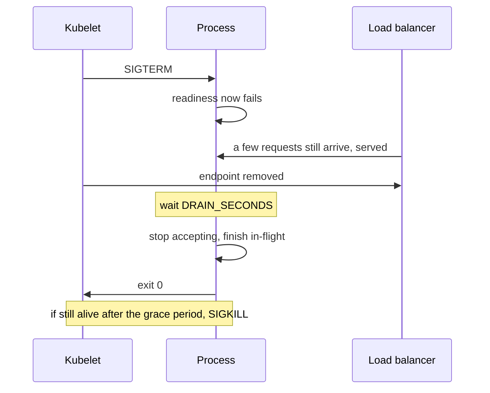
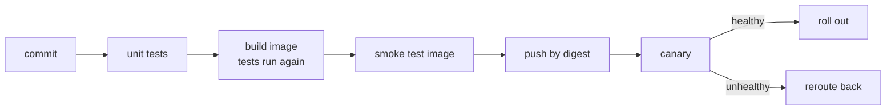

# 6 — Containers, CI/CD and deployment

> By default, a Python server killed mid-request drops that request on the floor, and a rolling deploy does that to every replica in turn. This chapter builds a small image for real, stops it with a request running, and then works out what a safe rollout, a canary and an autoscaler each do, with the same few lines of arithmetic the tools use.

---

## What a container is, and what the image holds

A container is an ordinary process with a restricted view of the machine. Docker uses [namespaces](https://docs.docker.com/get-started/docker-overview/) to give it an isolated workspace: its own process IDs, network, mounts. Cgroups limit what it can consume. There's no second kernel, which is why a container starts as fast as the process inside it, and why it's weaker isolation than a virtual machine.

An image is the read-only recipe: each Dockerfile instruction creates a layer, and a rebuild [redoes only the layers that changed](https://docs.docker.com/get-started/docker-overview/). So instruction order is a performance decision: put what changes rarely (the base, the dependencies) before what changes often (your code).

Here is the Dockerfile from [`practice/deploy/`](../practice/deploy/). Four decisions in it matter.

```dockerfile
# Pinned by digest, because tags can move. Take a new digest on purpose, to update.
FROM python:3.14-slim@sha256:930e1abba7c4e8f96ed93e8012c35d174d7732752731bbd5e8e757d7ec6f3966 AS test
WORKDIR /src
COPY app/ .
# The build fails here if the tests fail, so a bad commit never becomes an image.
RUN python -m unittest -q test_server

FROM python:3.14-slim@sha256:930e1abba7c4e8f96ed93e8012c35d174d7732752731bbd5e8e757d7ec6f3966 AS runtime
WORKDIR /srv
# Copied from the test stage: an image cannot exist unless those tests passed.
COPY --from=test /src/server.py .
ENV PYTHONUNBUFFERED=1 PYTHONDONTWRITEBYTECODE=1
USER 65534:65534
EXPOSE 8080
HEALTHCHECK --interval=5s --timeout=2s --start-period=2s --retries=3 \
    CMD ["python", "-c", "import urllib.request as u; u.urlopen('http://127.0.0.1:8080/healthz', timeout=1)"]
# Exec form: python is PID 1 and gets SIGTERM directly. A shell as PID 1 may not pass it on.
CMD ["python", "server.py"]
```

- **Pin by digest.** A tag like `3.14-slim` is mutable: the [same name can point at a different image tomorrow](https://docs.docker.com/build/building/best-practices/). A digest names the exact bytes, so builds are repeatable until you choose to update, and you give up automatic security fixes, so update on a schedule. This is the small version of what Google's release engineering calls [hermetic builds](https://sre.google/sre-book/release-engineering/): the same revision should give the same result on any machine, insensitive to what's installed there.
- **Multi-stage.** [By default the last stage is the image](https://docs.docker.com/build/building/multi-stage/), unless you pass `--target`, and anything left behind stays out. Here the first stage exists to run tests, so test code and its tools never reach production.
- **Not root.** [Setting a user](https://cheatsheetseries.owasp.org/cheatsheets/Docker_Security_Cheat_Sheet.html) is OWASP's standard advice against privilege escalation. The same sheet warns against ever mounting `/var/run/docker.sock` into a container, since control of that socket amounts to root on the host.
- **`.dockerignore`.** [It keeps files out of the build context](https://docs.docker.com/build/building/best-practices/), which means both a smaller upload and no accidental `.env` in a layer. A secret copied into a layer stays in the image even when a later layer deletes it.

`practice/deploy/verify.sh` builds this on the local Docker daemon and checks those claims rather than trusting them:

```text
== build (the test stage must pass for the image to exist)
  built; size 44 MB
  user: 65534:65534
  tests are not in the final image
```

## Config comes from the environment

One image should run in every environment, so that what you tested is what you ship. The twelve-factor rule follows: [strict separation of config from code](https://12factor.net/config), where config is what varies between deploys, such as credentials and hostnames. Its test is a good one to remember: could you open-source the code right now without leaking a credential? `DRAIN_SECONDS` in the lab's server comes from the environment for this reason.

Environment variables have a limit worth stating: child processes inherit them, anything allowed to inspect the process can read them, and they tend to end up in crash reports. Real secrets usually arrive through a secrets manager or a mounted file, with the same separation.

## Shutting down without dropping requests

Every deploy, scale-down and node drain ends with the same event: your process receives SIGTERM. Kubernetes then gives it [a grace period, 30 seconds by default](https://kubernetes.io/docs/concepts/workloads/pods/pod-lifecycle/), before SIGKILL. Python's default for SIGTERM is to die on the spot.

The code below starts a real child server twice, sends a 0.6-second request, and signals the process while that request runs.

```python
import signal, subprocess, sys, tempfile, threading, time, urllib.request
from pathlib import Path

SERVER = """
import signal, sys, threading, time
from http.server import BaseHTTPRequestHandler, ThreadingHTTPServer

class Handler(BaseHTTPRequestHandler):
    def do_GET(self):
        time.sleep(0.6)                      # a request that takes a while
        self.send_response(200)
        self.send_header("Content-Length", "2")
        self.end_headers()
        self.wfile.write(b"ok")
    def log_message(self, *_): pass

class Server(ThreadingHTTPServer):
    daemon_threads = False                   # server_close() waits for running handlers

server = Server(("127.0.0.1", 0), Handler)
print(server.server_address[1], flush=True)
if sys.argv[1] == "graceful":
    signal.signal(signal.SIGTERM, lambda *_: threading.Thread(target=server.shutdown).start())
server.serve_forever()
server.server_close()
"""


def trial(mode, path):
    proc = subprocess.Popen([sys.executable, path, mode], stdout=subprocess.PIPE, text=True)
    port = proc.stdout.readline().strip()
    result = {}

    def client():
        try:
            with urllib.request.urlopen(f"http://127.0.0.1:{port}/", timeout=5) as reply:
                result["client"] = f"HTTP {reply.status}"
        except Exception as err:
            result["client"] = f"failed ({type(err).__name__})"

    thread = threading.Thread(target=client)
    thread.start()
    time.sleep(0.2)                          # the request is now running
    proc.send_signal(signal.SIGTERM)
    thread.join()
    code = proc.wait(timeout=5)
    proc.stdout.close()
    print(f"{mode:9} exit code {code:4}, client saw {result['client']}")


with tempfile.TemporaryDirectory() as tmp:
    path = Path(tmp) / "server.py"
    path.write_text(SERVER)
    trial("default", str(path))
    trial("graceful", str(path))
```

```text
default   exit code  -15, client saw failed (RemoteDisconnected)
graceful  exit code    0, client saw HTTP 200
```

The fix is what [twelve-factor describes](https://12factor.net/disposability): on SIGTERM stop taking new work, finish what's running, then exit. In a cluster there is one more step, because stopping the listener at once is too early. [The Pod being marked terminating in the Service's endpoints and the signal happen at about the same time](https://kubernetes.io/docs/concepts/workloads/pods/pod-lifecycle/), and load balancers learn of it a little later. Requests keep arriving for a moment after SIGTERM. So the order is:



Google's [Borg paper](https://static.googleusercontent.com/media/research.google.com/en//pubs/archive/43438.pdf) describes the same contract at scale: tasks can ask for a SIGTERM before a preempting SIGKILL, so that they can save state, finish requests and decline new ones, and that notice was delivered about 80% of the time. The figure is the part to design around: the notice sometimes doesn't arrive, so a crash has to be safe anyway.

There's a trap in the Dockerfile. `CMD python server.py` (shell form) makes a shell PID 1, and the shell may not forward the signal. Here is the real comparison, run by `verify.sh` with a 2 second request running and a 4 second stop grace. The stop times move by about a second between runs:

```text
== SIGTERM during a 2 s request, exec form (python is PID 1)
  stop took 1s, exit code 0, running request got HTTP 200
== the same, with a shell as PID 1 (grace period 4 s)
  stop took 4s, exit code 137, running request got HTTP 200
```

The exec form exits as soon as its work is done. The shell form never hears the signal and gets killed at the deadline: code 137 is 128 + 9, SIGKILL. The running request succeeded only because it fit inside the grace period; anything longer would have died with the container. Every deploy would also take the whole grace period, for every replica.

Graceful shutdown doesn't remove the need for clients to retry. It can't help when a machine dies, which Kubernetes calls an [involuntary disruption](https://kubernetes.io/docs/concepts/workloads/pods/disruptions/).

## Three probes that mean three different things

Kubernetes [offers three probes](https://kubernetes.io/docs/concepts/configuration/liveness-readiness-startup-probes/), and each failure does something different.

| Probe | Question | On failure | Lab endpoint |
|---|---|---|---|
| Startup | Has it finished starting? | Keeps waiting, then restarts it. Other probes wait for this one | `/healthz` |
| Liveness | Is it unrecoverably stuck? | **Restarts the container** | `/healthz` |
| Readiness | Should it get traffic now? | Removes it from load balancing, no restart | `/readyz` |

The classic mistake is a liveness probe that checks a dependency. The database slows down; every pod fails liveness; Kubernetes restarts all of them; now the pods must reconnect and warm their caches on top of a slow database. The Kubernetes docs warn about this directly: an incorrect liveness probe means [restarts under high load and more work for the pods that remain](https://kubernetes.io/docs/concepts/configuration/liveness-readiness-startup-probes/), and a probe should indicate unrecoverable failure such as a deadlock. Liveness should therefore answer "is this process able to run at all" and depend on nothing external.

Readiness is the probe that's allowed to reflect temporary state: warming up, draining, overloaded. And failing it during shutdown is how the previous section tells the load balancer to go away.

## Rolling updates and how much room they need

A rolling update replaces pods a few at a time. Two settings control the pace, and [their rounding is asymmetric](https://kubernetes.io/docs/concepts/workloads/controllers/deployment/): `maxSurge` rounds up, `maxUnavailable` rounds down. Both default to 25%.

```python
import math


def bounds(replicas, surge=25, unavailable=25):
    """Deployment percentages become pods: surge rounds up, unavailable rounds down."""
    return math.ceil(replicas * surge / 100), math.floor(replicas * unavailable / 100)


for n in (1, 3, 4, 10, 40):
    s, u = bounds(n)
    print(f"{n:3} replicas: maxSurge {s:2}, maxUnavailable {u:2} -> {n - u:2} to {n + s:2} pods during a rollout")
```

```text
  1 replicas: maxSurge  1, maxUnavailable  0 ->  1 to  2 pods during a rollout
  3 replicas: maxSurge  1, maxUnavailable  0 ->  3 to  4 pods during a rollout
  4 replicas: maxSurge  1, maxUnavailable  1 ->  3 to  5 pods during a rollout
 10 replicas: maxSurge  3, maxUnavailable  2 ->  8 to 13 pods during a rollout
 40 replicas: maxSurge 10, maxUnavailable 10 -> 30 to 50 pods during a rollout
```

Two things follow. Below four replicas the defaults never drop under the replica count, and they take one extra pod's room, so that room must exist. And at 40 replicas the rollout may run with only 30 available, so 25% of your capacity can be missing while new code starts up. If you sized your service to run at 80% of capacity, that rollout overloads it. Set `maxUnavailable` from your [headroom calculation](05-estimation-and-scaling.md), rather than leaving the default.

The rest of the manifest (shortened here; the full file is [`practice/deploy/k8s/deployment.yaml`](../practice/deploy/k8s/deployment.yaml)) pairs those settings with resources and security:

```yaml
strategy:
  type: RollingUpdate
  rollingUpdate: {maxSurge: 25%, maxUnavailable: 25%}
minReadySeconds: 10
template:
  spec:
    terminationGracePeriodSeconds: 30
    containers:
      - name: api
        env:
          - {name: DRAIN_SECONDS, value: "5"}
        resources:
          requests: {cpu: 250m, memory: 128Mi}
          limits: {memory: 256Mi}
        securityContext:
          allowPrivilegeEscalation: false
          readOnlyRootFilesystem: true
          capabilities: {drop: [ALL]}
```

Limits behave differently per resource: [CPU limits throttle, memory limits can kill](https://kubernetes.io/docs/concepts/configuration/manage-resources-containers/). A container over its CPU limit slows down, and that shows up as latency with no error; a container over its memory limit may be OOM-killed, once the kernel detects memory pressure. That is why this manifest sets a memory limit and only a CPU request, a common choice that accepts noisy neighbours in exchange for no throttling on an idle node.

A [PodDisruptionBudget](https://kubernetes.io/docs/concepts/workloads/pods/disruptions/) (in the same file) protects you from *voluntary* disruptions, such as a node drain, by limiting how many pods can go at once. It doesn't limit direct deletes or a Deployment's own rolling update. It does nothing about a machine failing, which Kubernetes calls an involuntary disruption.

The Deployment controller [stops a bad rollout](https://kubernetes.io/docs/concepts/workloads/controllers/deployment/): if new pods never become ready, it stops scaling them up and old pods keep serving, within the limit `maxUnavailable` sets. That only catches failures readiness can see. `kubectl rollout undo` goes back a revision, which is the command you want to have practised. A version that starts cleanly and then returns wrong answers will pass all of this, and catching it is the job of a canary.

## Canary: how much traffic, for how long

[A canary](https://sre.google/workbook/canarying-releases/) is, in the SRE Workbook's definition, a partial and time-limited deployment of a change and its evaluation, where the part that didn't change is the control. [Rollback is rerouting users to the old version](https://martinfowler.com/bliki/CanaryRelease.html). The question is what percentage to pick.

Take a hypothetical service: 1,000 requests per second, a normal error rate of 0.1%, and a bad release at 2%. The check runs once a minute and fires when the error count would be very unlikely under the normal rate (Poisson tail under one in a million).

```python
import random

# Hypothetical: 1,000 requests a second. A release raises errors from 0.1% to 2%.
RATE, BASE, BAD = 1000, 0.001, 0.02
CHECK_EVERY = 60                           # the analysis looks once a minute


def tail(k, lam):
    """P(X >= k) for X ~ Poisson(lam): how surprising are k errors if nothing is wrong?"""
    term, total = 2.718281828459045 ** -lam, 0.0
    for i in range(k):
        total += term
        term *= lam / (i + 1)
    return max(1.0 - total, 0.0)


def detect(share, seed, limit=7200):
    rng = random.Random(seed)
    errors, requests = 0, 0
    for t in range(CHECK_EVERY, limit + 1, CHECK_EVERY):
        n = int(RATE * share * CHECK_EVERY)
        errors += rng.binomialvariate(n, BAD)
        requests += n
        if tail(errors, requests * BASE) < 1e-6:
            return t, errors
    return limit, errors


print(f"{'canary':>7}{'requests/s':>12}{'detected after':>16}{'errors by then':>16}{'% of users exposed':>20}")
for share in (0.001, 0.01, 0.05, 0.25, 1.0):
    runs = sorted(detect(share, seed) for seed in range(25))
    t, errors = runs[len(runs) // 2]
    print(f"{share:7.1%}{RATE * share:12.0f}{t:14} s{errors:16,}{share:20.1%}")
```

```text
 canary  requests/s  detected after  errors by then  % of users exposed
   0.1%           1           300 s               8                0.1%
   1.0%          10            60 s              12                1.0%
   5.0%          50            60 s              59                5.0%
  25.0%         250            60 s             298               25.0%
 100.0%        1000            60 s           1,196              100.0%
```

Read the last two columns together. At 1% the bad release is spotted within the first check, at a cost of 12 errors. Going below 1% buys little: at 0.1% the check needs five minutes to gather evidence, and the absolute errors barely change. Going above 5% wastes the protection, because each check is a minute long however much traffic flows.

So the size of a canary is mostly set by how long you're willing to wait, and by how small a regression you need to see. A bad release at 2% is a blatant one; a 0.2% error rate would need far more traffic or far more time. Real rollouts also watch latency and saturation, compare with a control group rather than a fixed rate, and must consider that a bad release can harm in ways no error counter shows.

## Blue-green, and when the database is the problem

[Blue-green](https://martinfowler.com/bliki/BlueGreenDeployment.html) keeps two complete environments. You deploy to the idle one, test it, then switch the router; rollback is switching back. It's simple and rapid, though writes made on green during that time still need handling, and it costs you a second environment. The switch moves all traffic at once, so you get none of a canary's gradual evidence.

Each of these strategies has old and new code running against the same database, at the same time (rolling and canary) or within rollback distance (blue-green). Fowler names the trick: [separate schema changes from application upgrades](https://martinfowler.com/bliki/BlueGreenDeployment.html). A rename can't be done in one step while both versions run.

```python
import sqlite3

db = sqlite3.connect(":memory:")
db.execute("create table users(id integer primary key, name text)")
db.execute("insert into users(name) values ('Ada Lovelace')")


def v1_write(name):
    db.execute("insert into users(name) values (?)", (name,))


def v1_read(uid):
    return db.execute("select name from users where id = ?", (uid,)).fetchone()[0]


def v2_write(first, last):                     # during the rollout, v2 writes both shapes
    db.execute("insert into users(name, first_name, last_name) values (?, ?, ?)",
               (f"{first} {last}", first, last))


def v2_read(uid):                              # and falls back to the old column
    first, last, name = db.execute(
        "select first_name, last_name, name from users where id = ?", (uid,)).fetchone()
    return f"{first} {last}" if first else name


print("-- the wrong way: rename in one step, while v1 pods still run")
broken = sqlite3.connect(":memory:")
broken.execute("create table users(id integer primary key, name text)")
broken.execute("alter table users rename column name to full_name")
try:
    broken.execute("select name from users")
except sqlite3.OperationalError as err:
    print("v1 pod:", err)

print("-- expand: add columns, both versions keep working")
db.execute("alter table users add column first_name text")
db.execute("alter table users add column last_name text")
v1_write("Grace Hopper")
v2_write("Edsger", "Dijkstra")
print("v1 reads the v2 row:", v1_read(3))
print("v2 reads the v1 row:", v2_read(2))

print("-- migrate: backfill old rows in batches, once v1 is gone")
for uid, name in db.execute("select id, name from users where first_name is null").fetchall():
    first, _, last = name.partition(" ")
    db.execute("update users set first_name = ?, last_name = ? where id = ?", (first, last, uid))
print("rows left to backfill:", db.execute("select count(*) from users where first_name is null").fetchone()[0])

print("-- contract: remove the old column in a later release")
db.execute("alter table users drop column name")
print([c[1] for c in db.execute("pragma table_info(users)")])
```

```text
-- the wrong way: rename in one step, while v1 pods still run
v1 pod: no such column: name
-- expand: add columns, both versions keep working
v1 reads the v2 row: Edsger Dijkstra
v2 reads the v1 row: Grace Hopper
-- migrate: backfill old rows in batches, once v1 is gone
rows left to backfill: 0
-- contract: remove the old column in a later release
['id', 'first_name', 'last_name']
```

Expand, migrate, contract. Each of the steps is safe to stop at, and each one leaves a version you can roll back to. A real migration of a large table does the backfill in small batches, because one big update locks rows and generates [replication lag](../../../data-engineering/05-quality-and-observability/notes/05-operating-data-stores.md#replica-lag) on every replica.

## The pipeline

[Continuous delivery](https://martinfowler.com/bliki/ContinuousDelivery.html) means software is deployable throughout its lifecycle, and you can deploy any version on demand; you may or may not deploy every commit. DORA reports that it [improves delivery performance](https://dora.dev/capabilities/continuous-delivery/) as measured by its four key metrics. A pipeline is just this as code:



The lab has the first half as a [GitHub Actions](https://docs.github.com/en/actions/get-started/understand-github-actions) workflow, kept outside `.github/` so it can't trigger anything:

```yaml
jobs:
  test:
    runs-on: ubuntu-latest
    steps:
      - uses: actions/checkout@v4
      - name: Unit tests
        run: python -m unittest -q test_server
        working-directory: deploy/app
  image:
    needs: test
    runs-on: ubuntu-latest
    steps:
      - uses: actions/checkout@v4
      - name: Build (runs the tests again in the test stage)
        run: docker build -t api:${{ github.sha }} deploy
```

What was and wasn't run here, since "the pipeline works" is easily overclaimed. The workflow file was parsed and structurally checked, but never ran on GitHub. The Docker build and the stop test ran for real on a local daemon. The Kubernetes manifests were parsed and checked for the fields above by `check_manifests.py`, and never applied to a cluster: `kubectl apply --dry-run=client` needs an API server even in dry-run mode, and failed offline here with "connection refused". All the probe, rollout and autoscaler behaviour in this chapter comes from the Kubernetes docs and from the models here, not from watching a cluster. Testing in CI itself belongs to [the testing strategy chapter](../../software-design/notes/05-testing-strategy.md).

## What an autoscaler does in a spike

The Horizontal Pod Autoscaler's core is [one line](https://kubernetes.io/docs/concepts/workloads/autoscaling/horizontal-pod-autoscale/): `desiredReplicas = ceil(currentReplicas × currentMetric / desiredMetric)`, ignored when within a 10% tolerance. Around it are two details that decide spike behaviour: pods that aren't ready yet count as 0% on a scale-up, and by default it can add at most 100% or 4 pods, whichever is greater, per 15 seconds.

Here's a hypothetical service using those rules. A pod serves 100 req/s at full CPU, the target is 60%, and pods take 60 seconds to become ready. Traffic jumps from 300 to 1,500 req/s at t = 60 s.

```python
import math

# A hypothetical service: one pod serves 100 req/s at 100% CPU. Target 60% CPU. Pods take 60 s to be ready.
CAPACITY, TARGET, START_DELAY, PERIOD = 100, 0.60, 60, 15


def desired(current, metric, target):
    """The HPA formula, with its default 10% tolerance."""
    ratio = metric / target
    return current if abs(ratio - 1) <= 0.10 else math.ceil(current * ratio)


def traffic(t):
    return 300 if t < 60 else 1500         # a five-fold spike at t = 60 s


ready, pending = 5, []                     # pending: list of (ready_at, count)
print("   t  traffic  ready  starting  cpu  served")
lost = 0
for t in range(0, 361, PERIOD):
    ready += sum(c for at, c in pending if at <= t)
    pending = [(at, c) for at, c in pending if at > t]
    starting = sum(c for _, c in pending)
    load = traffic(t)
    cpu = min(1.0, load / (ready * CAPACITY))        # saturates at 100%, hiding the true demand
    # On scale-up, pods that aren't ready yet count as 0% CPU.
    average = cpu * ready / (ready + starting)
    total = ready + starting
    want = desired(total, average, TARGET)
    want = min(want, max(total * 2, total + 4))       # default limit: +100% or +4 pods per 15 s
    if want > total:
        pending.append((t + START_DELAY, want - total))
    served = min(load, ready * CAPACITY)
    lost += (load - served) * PERIOD
    if t % 30 == 0:
        print(f"{t:4}{load:9}{ready:7}{starting:10}{cpu:5.0%}{served / load:8.0%}")
print(f"requests not served at capacity during the climb: {lost:,}")
```

```text
   t  traffic  ready  starting  cpu  served
   0      300      5         0  60%    100%
  30      300      5         0  60%    100%
  60     1500      5         0 100%     33%
  90     1500      5         4 100%     33%
 120     1500      9         0 100%     60%
 150     1500      9         6 100%     60%
 180     1500     15         0 100%    100%
 210     1500     15        10 100%    100%
 240     1500     25         0  60%    100%
 270     1500     25         0  60%    100%
 300     1500     25         0  60%    100%
 330     1500     25         0  60%    100%
 360     1500     25         0  60%    100%
requests not served at capacity during the climb: 96,000
```

The model teaches three things.

- **CPU saturates, and hides demand.** At 100% the metric can't say that demand is five times capacity, so the autoscaler only sees 100/60 and goes up in steps.
- **Startup time is the outage.** Two minutes passed before the service could carry the load, because each step waits for pods to start. Shrinking the 60 seconds helps more than any autoscaler setting.
- **It finished right.** 25 pods at 60% is exactly the target, and a [slower scale-down](https://kubernetes.io/docs/concepts/workloads/autoscaling/horizontal-pod-autoscale/) (5 minutes of stabilisation by default) stops it shrinking immediately after.

In that climb 96,000 requests couldn't be served. An autoscaler handles growth over minutes, and spare capacity plus [load shedding](07-reliability-under-load.md#shed-load-to-protect-goodput) handles seconds. CPU is also a poor signal for some services: [LLM serving](../../../ai-engineering/07-inference-engineering/notes/06-serving-at-scale.md#autoscaling) has its own autoscaling problems, because requests differ in cost by orders of magnitude.

## Pitfalls

- **Liveness checks a dependency.** A slow database then restarts your whole fleet, when restarting could never have fixed it.
- **`CMD python app.py`.** Shell as PID 1, no SIGTERM, every deploy takes the full grace period and ends in SIGKILL.
- **Stopping the listener the moment SIGTERM arrives.** Requests still in flight from load balancers get connection errors. Fail readiness and wait first.
- **A grace period shorter than your slowest request.** A 60 second request and a 30 second default grace can't both be honoured.
- **`latest` as a base tag.** Two builds of one commit can then differ, and a rollback may not reproduce what ran.
- **Secrets in a layer.** Deleting them in a later layer leaves them readable in the earlier one.
- **Rename in one migration.** While old and new code overlap, one of them breaks. Expand, migrate, contract.
- **Trusting default `maxUnavailable` at high utilisation.** 25% unavailable is 25% of your capacity gone during every deploy.
- **Assuming the autoscaler handles spikes.** It reacts in minutes. Check your own startup time before you rely on it.

## Try it

**1. With `maxSurge: 10%`, `maxUnavailable: 10%` and 25 replicas, what range of pod counts can you see during a rollout?**

<details>
<summary>Answer</summary>

Surge rounds up: ceil(2.5) = 3. Unavailable rounds down: floor(2.5) = 2. So from 23 available to 28 total.

</details>

**2. In the autoscaler model, what's the first target after the spike if pods take 60 seconds to start, and why isn't it 25 at once?**

<details>
<summary>Answer</summary>

At 5 pods CPU reads 100%, so the formula gives ceil(5 × 100/60) = 9. It can't jump to 25 because the metric caps at 100%: the autoscaler can't observe that demand is 300% of what 5 pods can do. Then the 9 pods are saturated in turn, giving 15, and then 25.

</details>

**3. Run `practice/deploy/verify.sh`, then change the lab's `CMD` to shell form and rebuild by hand. What exit code does `docker stop` produce, and how long does it take?**

<details>
<summary>Answer</summary>

Exit code 137, after the whole stop timeout, which `docker stop -t` sets. `verify.sh` runs the same comparison with a 4 second timeout. If you can't run Docker, the output is quoted above.

</details>

## Interview checklist

| Question | Answer |
|---|---|
| Container versus VM? | A container is an isolated process sharing the host kernel, using namespaces and cgroups. A VM has its own kernel. |
| How do you keep images small and safe? | Multi-stage builds, slim base pinned by digest, non-root user, `.dockerignore`, no secrets in layers. |
| What does shell-form `CMD` break? | The shell is PID 1 and may not forward SIGTERM, so the process gets SIGKILL at the deadline. |
| Graceful shutdown sequence? | On SIGTERM, fail readiness, wait for load balancers to notice, stop accepting, finish in-flight work, exit before the grace period ends. |
| Liveness versus readiness? | Liveness failure restarts, and is for unrecoverable states. Readiness failure removes from traffic, and is for temporary ones. Don't put dependencies in liveness. |
| `maxSurge` versus `maxUnavailable`? | Extra pods allowed, rounded up; missing pods allowed, rounded down. Both default to 25%. |
| Canary versus blue-green? | Canary sends a small share to the new version and evaluates it. Blue-green swaps all traffic between two full environments, with instant rollback. |
| How big a canary? | Big enough to get evidence in the time you'll wait. A model shows that errors at detection are nearly constant below 1%, then grow with share. |
| How do you rename a column with no downtime? | Expand (add new, write both), migrate (backfill, read new), contract (drop old). Each step is a separate deploy. |
| What does a CPU limit do versus a memory limit? | CPU limit throttles, showing as latency. Memory limit kills. |
| HPA formula? | `ceil(current × metric / target)`, with a 10% tolerance and rate limits on scale-up. |
| Why does autoscaling miss spikes? | Saturated CPU hides true demand, and each step must wait for pods to start. |

## Next

The deploy is safe. Next, [Chapter 7 — Reliability under load](07-reliability-under-load.md): what happens when the traffic, or the dependencies, turn on you.
