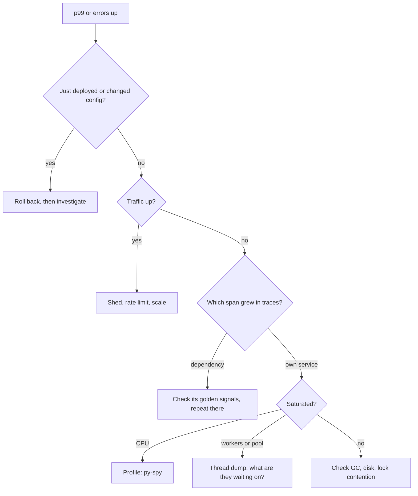

# 7 — Reliability under load

> A 10 second blip can take a healthy service down for good: 280 requests per second, one retry each, and the database never recovers after the blip ends. This chapter reproduces that failure from a published model and works out which fixes end it. It also covers why p99 is what users feel, how to find where a slow request went, and what a lost region costs.

---

## The tail is what users get

An average tells you what a server does. A user's page often waits for many servers, and takes as long as the slowest. Dean and Barroso's [The Tail at Scale](https://www.barroso.org/publications/TheTailAtScale.pdf) does the arithmetic: with a 10 ms typical response and 1% of requests taking a second, a request that fans out to 100 servers waits a second 63% of the time.

Here are their numbers recomputed, then a simulation of the same setup.

```python
import random, statistics

# The Tail at Scale's arithmetic: 1% of a server's requests take a second.
for n in (1, 10, 100, 1000):
    print(f"fan-out {n:5}: {1 - 0.99**n:6.1%} of requests wait for a slow server")
print(f"1 in 10,000 slow, 2,000 servers: {1 - (1 - 1 / 10_000) ** 2000:.1%}")


def latency(rng):
    """10 ms typically, and 1% of the time a hiccup of a second."""
    return 1000.0 if rng.random() < 0.01 else rng.uniform(8, 12)


def quantile(xs, q):
    return sorted(xs)[int(q * len(xs))]


rng = random.Random(1)
N = 100_000
for fanout in (1, 10, 100):
    whole = [max(latency(rng) for _ in range(fanout)) for _ in range(N // fanout * 2 if fanout > 10 else N)]
    print(f"fan-out {fanout:3}: median {quantile(whole, .5):7.1f} ms   p99 {quantile(whole, .99):7.1f} ms")
```

```text
fan-out     1:   1.0% of requests wait for a slow server
fan-out    10:   9.6% of requests wait for a slow server
fan-out   100:  63.4% of requests wait for a slow server
fan-out  1000: 100.0% of requests wait for a slow server
1 in 10,000 slow, 2,000 servers: 18.1%
fan-out   1: median    10.0 ms   p99    12.0 ms
fan-out  10: median    11.8 ms   p99  1000.0 ms
fan-out 100: median  1000.0 ms   p99  1000.0 ms
```

At fan-out 100 the median whole request takes a full second. Not the tail: the median. A once-in-a-hundred event on one server is the normal case for the whole request. The second figure, 18.1%, is the paper's "almost one in five" for a one-in-ten-thousand event across 2,000 servers.

The paper's causes of variability are all mundane: shared resources, daemons, maintenance work, queueing, garbage collection. You can't remove them all, so it proposes to [build "a predictably responsive whole out of less-predictable parts"](https://www.barroso.org/publications/TheTailAtScale.pdf). It gives real numbers from a Google service: one leaf server's p99 was 10 ms, the p99 of waiting for all of them was 140 ms, and of waiting for 95% was 70 ms. So half of that tail came from the last 5% of leaves. For systems that tolerate imprecise results, it also suggests occasionally returning a good-enough answer instead of waiting for stragglers.

## Hedging: asking twice, a little later

A hedged request sends a second copy to another replica, if the first hasn't replied after some delay, and takes whichever answers first. The trick is the delay: too early and you double your load, too late and you've gained nothing. One approach the paper gives is to wait for the 95th percentile, which limits the benefit to a small fraction of requests. Here's a model with a 2% slow mode, assuming replica latencies are independent and hedges don't slow anything down.

```python
import random


def latency(rng):
    return rng.lognormvariate(2.3, 0.4) + (rng.expovariate(1 / 200) if rng.random() < 0.02 else 0)


def quantile(xs, q):
    return sorted(xs)[int(q * len(xs))]


rng = random.Random(4)
N = 200_000
single = [latency(rng) for _ in range(N)]
p50, p95, p99, p999 = (quantile(single, q) for q in (.5, .95, .99, .999))
print(f"one request   p50 {p50:6.1f}  p95 {p95:6.1f}  p99 {p99:6.1f}  p99.9 {p999:6.1f} ms, load 100%")

for label, delay in (("hedge at p50", p50), ("hedge at p95", p95), ("hedge at p99", p99)):
    results, extra = [], 0
    for _ in range(N):
        first = latency(rng)
        if first <= delay:
            results.append(first)
        else:
            extra += 1
            results.append(min(first, delay + latency(rng)))
    print(f"{label}  p50 {quantile(results, .5):6.1f}  p95 {quantile(results, .95):6.1f}"
          f"  p99 {quantile(results, .99):6.1f}  p99.9 {quantile(results, .999):6.1f} ms, load {100 + extra / N * 100:.1f}%")
```

```text
one request   p50   10.1  p95   21.0  p99  144.2  p99.9  597.1 ms, load 100%
hedge at p50  p50   10.1  p95   18.7  p99   23.1  p99.9   31.3 ms, load 149.6%
hedge at p95  p50   10.1  p95   20.9  p99   31.1  p99.9   40.8 ms, load 104.9%
hedge at p99  p50   10.1  p95   20.9  p99  148.3  p99.9  161.2 ms, load 101.0%
```

Hedging at p95 cuts p99 from 144 ms to 31 ms for 4.9% more requests. Hedging earlier costs 50% more load for a modest further gain, and hedging at p99 helps only the very end. The paper reports the same shape on a real system: in a BigTable read benchmark of 1,000 keys spread over 100 servers, hedging after 10 ms took p99.9 from 1,800 ms to 74 ms with 2% more requests.

Two conditions apply. Hedge only **idempotent** operations, for the [reasons in chapter 1](01-api-design.md#what-each-method-promises). And the extra copies must not become a retry storm: the paper suggests sending them at lower priority, and a budget would cap them when everything is slow. Its model of independence is also the weak part of this one: when the cause is shared, like a slow database behind both replicas, a hedge adds load and doesn't help.

## Retries can keep a system down

The hook comes from [Bronson et al.](https://sigops.org/s/conferences/hotos/2021/papers/hotos21-s11-bronson.pdf), who name this a *metastable failure*. A system moves from stable to vulnerable as load grows, with nothing visibly wrong. Then a *trigger* pushes it over, and a *sustaining effect* keeps it there after the trigger has gone. They stress that the sustaining effect is the thing to fix, more than whatever started it, since triggers are many and ordinary.

Their example: a database answering in under 100 ms up to 300 QPS and an order of magnitude slower above that, clients with a timeout and one retry. Here it is as a model, with the same numbers.

```python
# The retry example from Bronson et al., HotOS 2021, as a one-second-step model.
# Below 300 QPS the database answers in time; above that nearly everything times out.
CAPACITY = 300


def goodput(offered):
    return offered if offered <= CAPACITY else 0            # past the limit, replies come too late


def run(base, *, outage=(100, 110), seconds=200, retries=1, budget=None):
    timeline, retrying = [], 0.0
    for t in range(seconds):
        rate = base + retrying
        ok = 0 if outage[0] <= t < outage[1] else goodput(rate)
        failed = rate - ok
        new_failures = min(failed, base)                    # first attempts that failed
        wanted = new_failures * (1 if retries else 0)       # one retry each, a second later
        retrying = wanted if budget is None else min(wanted, budget * base)
        timeline.append((rate, ok))
    return timeline


def report(label, timeline):
    before = timeline[99][1]
    after = timeline[180][1]
    print(f"{label:44} before {before:4.0f}/s   long after the outage {after:4.0f}/s")


report("280 QPS, one retry, 10 s outage", run(280))
report("140 QPS, one retry, 10 s outage", run(140))
report("280 QPS, no retries, 10 s outage", run(280, retries=0))
report("280 QPS, retry budget of 10% of traffic", run(280, budget=0.10))
report("280 QPS, retry budget of 5% of traffic", run(280, budget=0.05))
report("150 QPS, one retry, 10 s outage", run(150))
report("151 QPS, one retry, 10 s outage", run(151))

timeline = run(280)
print("\n  t  offered  goodput   (280 QPS, one retry)")
for t in (95, 100, 105, 110, 111, 150):
    print(f"{t:3}{timeline[t][0]:9.0f}{timeline[t][1]:9.0f}")
```

```text
280 QPS, one retry, 10 s outage              before  280/s   long after the outage    0/s
140 QPS, one retry, 10 s outage              before  140/s   long after the outage  140/s
280 QPS, no retries, 10 s outage             before  280/s   long after the outage  280/s
280 QPS, retry budget of 10% of traffic      before  280/s   long after the outage    0/s
280 QPS, retry budget of 5% of traffic       before  280/s   long after the outage  280/s
150 QPS, one retry, 10 s outage              before  150/s   long after the outage  150/s
151 QPS, one retry, 10 s outage              before  151/s   long after the outage    0/s

  t  offered  goodput   (280 QPS, one retry)
 95      280      280
100      280        0
105      560        0
110      560        0
111      560        0
150      560        0
```

The last table is the whole story. Before the outage: 280 QPS, all successful. During the 10 second outage, every request fails and retries, doubling offered load to 560. When the database returns, it receives 560 QPS, above its limit, so everything times out, and those timeouts cause the next second's retries. The database is perfectly healthy, and goodput is zero, indefinitely. The model reproduces the paper's stated limits: at or below 150 QPS it recovers by itself, and 280 QPS recovers only if retries stay below 20 QPS (a 5% budget gives 14 and recovers; 10% gives 28 and doesn't). The model leaves out the paper's surge of retransmitted packets after its network outage.

Notice what the operators would see, which makes this dangerous: "the trigger" is over, and nothing is broken. In this retry example, restarting the database doesn't help. Scaling up may be impossible. The recovery that works is to cut the load: disable retries or shed traffic, then bring it back slowly. Another of the paper's examples has the same shape: a look-aside cache at a 90% hit rate lets a database that handles 300 QPS serve 3,000, and [a cold cache](03-caching-and-queues.md#the-stampede) then puts all 3,000 on it.

## Retrying responsibly

So retries need to be designed like a load source. Five rules, each with its evidence.

```python
import random

# Worst-case amplification when each layer retries on its own.
print("attempts at the database if every layer retries 3 times:", 4**3)


class Budget:
    """Allow retries for only a fraction of recent requests, like a token bucket for retries."""

    def __init__(self, ratio=0.1, floor=10):
        self.ratio, self.tokens = ratio, float(floor)

    def request(self):
        self.tokens = min(self.tokens + self.ratio, 100)

    def allow_retry(self):
        if self.tokens >= 1:
            self.tokens -= 1
            return True
        return False


class Breaker:
    """Open after too many failures in a row, then let a trial through after a cool-down."""

    def __init__(self, threshold=5, cool_down=30.0):
        self.threshold, self.cool_down = threshold, cool_down
        self.failures, self.opened_at = 0, None

    def allow(self, now):
        return self.opened_at is None or now - self.opened_at >= self.cool_down

    def record(self, ok, now):
        if ok:
            self.failures, self.opened_at = 0, None
        else:
            self.failures += 1
            if self.failures >= self.threshold or self.opened_at is not None:
                self.opened_at = now


def backoff(attempt, rng, base=0.1, cap=10.0):
    """Full jitter: anywhere from zero up to the exponential ceiling."""
    return rng.uniform(0, min(cap, base * 2**attempt))


rng = random.Random(1)
print("full-jitter delays, attempts 0-5:", [round(backoff(a, rng), 2) for a in range(6)])

# 100 clients all fail at t = 0. When does each retry land, in 100 ms buckets?
for label, delay in (("fixed 1 s", lambda: 1.0), ("full jitter up to 1 s", lambda: rng.uniform(0, 1))):
    buckets = [0] * 11
    for _ in range(100):
        buckets[min(int(delay() * 10), 10)] += 1
    print(f"  {label:22} peak of {max(buckets)} retries in one 100 ms slot")

for attempts_label, fail_rate in (("1% failures", 0.01), ("100% failures (outage)", 1.0)):
    budget, sent = Budget(), 0
    for _ in range(10_000):
        budget.request()
        sent += 1
        if rng.random() < fail_rate and budget.allow_retry():
            sent += 1
    print(f"  retry budget at {attempts_label:24}: load {sent / 10_000:.2f}x")

breaker, now, calls = Breaker(), 0.0, 0
for second in range(60):
    now = float(second)
    if breaker.allow(now):
        calls += 1
        breaker.record(False, now)         # the dependency is down
print(f"  breaker: {calls} of 60 calls reached a dead dependency")
```

```text
attempts at the database if every layer retries 3 times: 64
full-jitter delays, attempts 0-5: [0.01, 0.17, 0.31, 0.2, 0.79, 1.44]
  fixed 1 s              peak of 100 retries in one 100 ms slot
  full jitter up to 1 s  peak of 18 retries in one 100 ms slot
  retry budget at 1% failures             : load 1.01x
  retry budget at 100% failures (outage)  : load 1.10x
  breaker: 6 of 60 calls reached a dead dependency
```

**Add jitter.** After a shared failure, [clients retry together](https://aws.amazon.com/builders-library/timeouts-retries-and-backoff-with-jitter/). The output above shows all 100 in one slot with a fixed delay, and at most 18 with jitter. AWS's advice applies more widely than retries: it considers adding jitter to all timers and periodic jobs, using a fixed per-host value for scheduled work. Exponential backoff alone delays a stampede rather than dispersing it. [The networking chapter](../../computer-science/notes/06-networks.md#how-long-to-wait-before-resending) shows the same idea in TCP.

**Cap retries with a budget.** The important output: at 1% failures the budget has no noticeable effect, and during a total outage load rises only 1.10x, and without one it's 2x or more. The [SRE book's version](https://sre.google/sre-book/addressing-cascading-failures/) is a server-wide budget such as 60 retries per minute, past which you just fail the request.

**Retry at one layer.** If backend, frontend and JavaScript each try 3 extra times, one user click can become [4 × 4 × 4 = 64 attempts](https://sre.google/sre-book/addressing-cascading-failures/), which is the multiplication in the first line of the output. Pick one layer, usually the one nearest the failure that can decide; the others pass the error on.

**Retry only what's retryable.** Validation errors won't improve with time. This is why clear status codes matter, in [HTTP](01-api-design.md) and [gRPC](https://grpc.io/docs/guides/status-codes/). Non-idempotent operations need an idempotency key first.

**Breakers: use with care.** A circuit breaker stops calling a dependency once errors pass a threshold, then tries again after a cool-down. Above it let 6 of 60 calls through to a dead service. It's widely recommended, and AWS has [a serious objection](https://aws.amazon.com/builders-library/timeouts-retries-and-backoff-with-jitter/): breakers add modal behaviour that is hard to test and can add time to recovery. Their alternative is a local token bucket for retries, which is what `Budget` is. Use a breaker where a dead dependency has a fallback, and test its open state deliberately.

## Deadlines must travel

A timeout set independently at each hop doesn't protect anything. The first hop may have given up, and the rest still do the work. The SRE book's phrase is that [you don't get credit for late assignments](https://sre.google/sre-book/addressing-cascading-failures/) with RPCs. The fix is to pass the remaining time along. A 30 second deadline with 7 seconds spent gives the next call 23 seconds, minus a few hundred milliseconds for network and post-processing. [Some gRPC implementations do this](https://grpc.io/docs/guides/deadlines/), on by default in Java and Go and opt-in in C++ ([chapter 1](01-api-design.md#grpc-a-typed-contract-between-services) ran the idea, with a server that refuses a call it can't finish), and in HTTP you need to carry it in a header of your own.

```python
# A request with a 1,000 ms budget crosses four services, each spending 400 ms.
SPEND = {"frontend": 400, "orders": 400, "pricing": 400, "database": 400}


def fixed_timeouts(timeout=1000):
    """Every hop starts its own 1,000 ms clock. Nobody knows the caller has left."""
    elapsed = sum(SPEND.values())
    return elapsed, max(0, elapsed - timeout), elapsed <= timeout


def propagated(budget=1000):
    """Each hop passes on what's left, and refuses work it can't finish."""
    remaining, spent = budget, []
    for name, spend in SPEND.items():
        if remaining < spend:
            return budget - remaining, spent, f"{name} returned DEADLINE_EXCEEDED with {remaining} ms left"
        remaining -= spend
        spent.append(name)
    return budget - remaining, spent, "ok"


elapsed, wasted, ok = fixed_timeouts()
print(f"fixed timeouts: chain ran {elapsed} ms, client gave up at 1000, {wasted} ms of work after that, client ok: {ok}")
elapsed, spent, outcome = propagated()
print(f"propagated:     stopped at {elapsed} ms after {spent}: {outcome}")
```

```text
fixed timeouts: chain ran 1600 ms, client gave up at 1000, 600 ms of work after that, client ok: False
propagated:     stopped at 800 ms after ['frontend', 'orders']: pricing returned DEADLINE_EXCEEDED with 200 ms left
```

The second version does the part that matters most in overload: it refuses work it can't finish, freeing the capacity for requests that still have a chance. Also propagate cancellation, for the same reason.

## Shed load to protect goodput

Two rates that overload separates: **throughput** is what the server produces, and **goodput** is what clients receive in time to use. [AWS's load shedding article](https://aws.amazon.com/builders-library/using-load-shedding-to-avoid-overload/) builds on this, though it uses throughput for what's sent to the server, which this chapter calls offered load, and points out how bad the failure looks if you're measuring the wrong one. Here's a server with capacity 1,000 per second and clients who wait one second, under two minutes of load.

```python
import collections, random


def run(capacity_per_s, arrivals_per_s, deadline, queue_limit=None, lifo=False, seconds=120, seed=9):
    """One worker pool. A reply counts as good only if it arrives within the client's deadline."""
    rng = random.Random(seed)
    queue, good, served, shed = collections.deque(), 0, 0, 0
    tick = 0.01
    credit, arrivals_due = 0.0, 0.0
    for step in range(int(seconds / tick)):
        now = step * tick
        arrivals_due += arrivals_per_s * tick
        while arrivals_due >= 1:
            arrivals_due -= 1
            if queue_limit is not None and len(queue) >= queue_limit:
                shed += 1
            else:
                queue.append(now)
        credit += capacity_per_s * tick
        while credit >= 1 and queue:
            credit -= 1
            arrived = queue.pop() if lifo else queue.popleft()
            served += 1
            good += now - arrived <= deadline
        credit = min(credit, 1.0)
    return good / seconds, served / seconds, shed / seconds, len(queue)


CAP, DEADLINE = 1000, 1.0
print(f"capacity {CAP}/s, client deadline {DEADLINE:.0f} s, two minutes of steady offered load")
print(f"{'offered':>8}{'policy':>26}{'goodput':>9}{'throughput':>12}{'shed':>7}{'queue at end':>14}")
for offered in (800, 1500):
    for label, kw in (("unbounded FIFO", {}), ("FIFO, 500 queue limit", {"queue_limit": 500}),
                      ("FIFO, 5,000 queue limit", {"queue_limit": 5000}),
                      ("LIFO, 5,000 queue limit", {"queue_limit": 5000, "lifo": True})):
        g, t, s, q = run(CAP, offered, DEADLINE, **kw)
        print(f"{offered:8}{label:>26}{g:9.0f}{t:12.0f}{s:7.0f}{q:14,}")
```

```text
capacity 1000/s, client deadline 1 s, two minutes of steady offered load
 offered                    policy  goodput  throughput   shed  queue at end
     800            unbounded FIFO      800         800      0             0
     800     FIFO, 500 queue limit      800         800      0             0
     800   FIFO, 5,000 queue limit      800         800      0             0
     800   LIFO, 5,000 queue limit      800         800      0             0
    1500            unbounded FIFO       25        1000      0        60,000
    1500     FIFO, 500 queue limit     1000        1000    496           490
    1500   FIFO, 5,000 queue limit       25        1000    458         4,990
    1500   LIFO, 5,000 queue limit     1000        1000    458         4,990
```

Look at 1,500 offered. The unbounded queue's throughput is a perfect 1,000 per second, and goodput is 25. The server serves requests that nobody is waiting for: the queue reached 60,000, a minute's wait. Only the first three seconds' requests made it. A dashboard of server throughput and server errors looks fine, while clients see a total outage. That's why [AWS measures client-perceived availability](https://aws.amazon.com/builders-library/using-load-shedding-to-avoid-overload/).

Three lessons from the table.

- **A limit on the queue is what protects goodput.** The 500-item queue yields full goodput, shedding the excess 500 per second. Rejecting fast is the kind thing to do.
- **The size of the limit matters.** The 5,000 queue means a five second wait, longer than any client's patience, and goodput falls back to 25. The rule: queue limit < capacity × deadline. [The SRE book](https://sre.google/sre-book/addressing-cascading-failures/) gives a worked case, with a queue of 10× threads turning 100 ms into 1.1 s, and it recommends small queues of 50% of the thread count or less for steady traffic.
- **LIFO rescues a bad queue.** Same 5,000 queue, last in first out, and goodput is back to 1,000: recent requests still have time, while the old ones are given up on anyway. This is unfair to the requests at the bottom, and that's accepted in an overload. Bronson et al. also list it among policy changes for overload.

Rejecting isn't free, though: it takes CPU. [Google's client-side adaptive throttling](https://sre.google/sre-book/handling-overload/) moves the decision to clients. Each tracks requests and accepts over two minutes, and starts rejecting locally when requests exceed K × accepts, with K = 2 as the preferred setting and 1.1 as an aggressive one. The same chapter uses four criticality levels, propagated through the call, so that batch work is dropped before user-facing work.

[Little's law and bounded queues](../../computer-science/notes/05-processes-threads-and-io.md#backpressure-bounding-whats-in-flight) are the same idea one level down, and the [connection pool](../../../data-engineering/05-quality-and-observability/notes/05-operating-data-stores.md#connections-why-you-pool) is a queue that needs the same limit.

**Test until failure.** The SRE chapter's practical advice, and [AWS's](https://aws.amazon.com/builders-library/using-load-shedding-to-avoid-overload/): load test far past the break point, in a test environment and, the SRE chapter adds, a small slice of production once protections are in place, to learn whether goodput levels off or collapses. You want the former, and only a test shows which you have. For the [closed-loop trap](05-estimation-and-scaling.md) in such a test, see chapter 5.

## A traffic spike, in order

Everything so far, as the sequence you'd follow in an actual spike. The [SRE book's immediate steps](https://sre.google/sre-book/addressing-cascading-failures/) for cascading failure are the backbone of this.

| Time | Tool | Purpose | Limit |
|---|---|---|---|
| First seconds | Spare capacity | Absorb a burst | You paid for it in advance |
| First seconds | Bounded queues, shedding | Protect goodput and answer fast | Some requests rejected |
| First seconds | [Rate limits](04-load-balancing-and-rate-limiting.md) per client | Keep one client from taking all | Doesn't help with broad demand |
| Seconds to a minute | Degraded modes: cached or partial answers | Cheaper work per request | Must be exercised, or it won't work when needed |
| Seconds to a minute | Drop batch and low-criticality traffic | Free up capacity | Backlog later |
| Minutes | [Autoscaling](06-containers-cicd-and-deployment.md#what-an-autoscaler-does-in-a-spike) | Add capacity | Startup time; dependencies don't scale |
| Afterwards | Slow restart | Avoid thundering herd and [cold caches](https://sre.google/sre-book/addressing-cascading-failures/) | Takes patience |

The SRE warning on degraded modes matters: a rarely used path is often broken, so exercise it regularly on a small subset of servers.

## Measuring: percentiles and histograms

[Averages hide what matters](https://sre.google/sre-book/service-level-objectives/), and the SRE book's advice is to use percentiles, where the high ones show the plausible worst case. The [bimodal latency section](https://sre.google/sre-book/addressing-cascading-failures/) is its example of a problem a mean won't show. Metrics systems can't store every sample, so they keep histograms. The classic kind is counts in fixed buckets, and Prometheus now prefers native histograms, which choose their own.

```python
import bisect, random

rng = random.Random(3)
samples = [rng.lognormvariate(3.5, 0.5) for _ in range(98_500)] + [rng.uniform(1000, 3000) for _ in range(1_500)]
samples.sort()
print(f"mean {sum(samples) / len(samples):7.1f}  p50 {samples[50_000]:7.1f}  p99 {samples[99_000]:7.1f}  p99.9 {samples[99_900]:7.1f}  ms")

# Fixed-bucket histogram, the way Prometheus estimates a quantile.
for label, bounds in (("coarse", [50, 100, 250, 500, 1000, 2500, 5000]),
                      ("fine", [25, 50, 75, 100, 150, 200, 300, 500, 750, 1000, 1500, 2000, 2500, 3000, 5000])):
    counts = [0] * len(bounds)
    for s in samples:
        counts[bisect.bisect_left(bounds, s)] += 1

    def estimate(q):
        target, seen = q * len(samples), 0
        for i, c in enumerate(counts):
            if seen + c >= target:
                low = bounds[i - 1] if i else 0
                return low + (bounds[i] - low) * (target - seen) / c
            seen += c

    print(f"{label:7} histogram: p50 {estimate(.5):7.1f}  p99 {estimate(.99):7.1f}  p99.9 {estimate(.999):7.1f}")

# Averaging per-host p99s is not the fleet's p99.
hosts = [[rng.lognormvariate(3.5, 0.5) for _ in range(9_000)] + [rng.uniform(1000, 3000) for _ in range(1_000 if h == 0 else 0)] for h in range(10)]
per_host = [sorted(h)[int(len(h) * .99)] for h in hosts]
merged = sorted(x for h in hosts for x in h)
print(f"one sick host of ten: mean of host p99s {sum(per_host) / 10:.0f} ms, true fleet p99 {merged[int(len(merged) * .99)]:.0f} ms")
print(f"host p99s: {[round(p) for p in per_host]}")
```

```text
mean    67.3  p50    33.3  p99  1685.7  p99.9  2889.6  ms
coarse  histogram: p50    31.9  p99  1686.2  p99.9  4385.7
fine    histogram: p50    35.8  p99  1687.7  p99.9  2877.1
one sick host of ten: mean of host p99s 373 ms, true fleet p99 1189 ms
host p99s: [2786, 107, 107, 103, 101, 105, 104, 104, 109, 107]
```

The first line is why you can't use the mean: 67 ms describes nobody here, since half see 33 ms and the worst 1.5% see more than a second. The next two lines show [Prometheus's trade-off](https://prometheus.io/docs/practices/histograms/). A classic histogram can only locate a quantile within a bucket, by interpolation, so the error depends on the bucket width: the coarse version says p99.9 is 4,386 ms when the true value is 2,890 ms. Put bucket boundaries around your SLO threshold, where you need the accuracy.

The last two lines show the second trap. One sick host out of ten gives a mean of host p99s of 373 ms; the true fleet p99 is 1,189 ms. A quantile can't be averaged. Histograms can be aggregated by summing bucket counts across hosts, and [pre-computed summary quantiles can't](https://prometheus.io/docs/practices/histograms/).

Which signals? The SRE book's [four golden signals](https://sre.google/sre-book/monitoring-distributed-systems/) are latency, traffic, errors and saturation. Give failed requests their own latency, since fast errors make averages look good. OpenTelemetry defines [`http.server.request.duration`](https://opentelemetry.io/docs/specs/semconv/http/http-metrics/) with a low-cardinality `http.route` attribute: `/invoices/{id}`, not `/invoices/8123`, because each distinct value costs a whole time series.

## Tracing one request

A metric says the p99 is high. A trace says where one slow request spent its time. It's a tree of [spans](https://opentelemetry.io/docs/concepts/signals/traces/), each with a name, a parent and start and end times, and it crosses services because the caller sends an ID in a [`traceparent` header](https://www.w3.org/TR/trace-context/), of the form `00-<trace id>-<parent span id>-<flags>`. This uses the real OpenTelemetry SDK, with the exporter writing to memory rather than to a collector:

<!-- requires: otel -->
```python
import io, json, time
from opentelemetry import trace
from opentelemetry.sdk.trace import TracerProvider
from opentelemetry.sdk.trace.export import ConsoleSpanExporter, SimpleSpanProcessor
from opentelemetry.trace.propagation.tracecontext import TraceContextTextMapPropagator

out = io.StringIO()
provider = TracerProvider()
provider.add_span_processor(SimpleSpanProcessor(ConsoleSpanExporter(out=out, formatter=lambda s: s.to_json(indent=None) + "\n")))
tracer = provider.get_tracer("demo")
propagator = TraceContextTextMapPropagator()


def downstream(headers):
    """A second service: it reads the caller's trace id from the header."""
    context = propagator.extract(headers)
    with tracer.start_as_current_span("db.query", context=context) as span:
        span.set_attribute("db.system.name", "sqlite")
        time.sleep(0.03)


with tracer.start_as_current_span("GET /invoices/{id}") as root:
    root.set_attribute("http.route", "/invoices/{id}")
    with tracer.start_as_current_span("auth.check"):
        time.sleep(0.005)
    headers = {}
    propagator.inject(headers)
    print("traceparent format ok:", headers["traceparent"].count("-") == 3, " version", headers["traceparent"][:2])
    downstream(headers)

spans = [json.loads(line) for line in out.getvalue().splitlines()]
trace_ids = {s["context"]["trace_id"] for s in spans}
print("spans:", len(spans), " distinct trace ids:", len(trace_ids))
start = min(s["start_time"] for s in spans)
for s in sorted(spans, key=lambda s: s["start_time"]):
    parent = "root" if s["parent_id"] is None else "child"
    print(f"  {s['name']:22} {parent}")
```

```text
traceparent format ok: True  version 00
spans: 3  distinct trace ids: 1
  GET /invoices/{id}     root
  auth.check             child
  db.query               child
```

Keeping every trace costs too much, so systems [sample](https://opentelemetry.io/docs/concepts/sampling/). Head sampling decides at the start, cheaply, and tail sampling decides after the trace completes, so it can keep the slow and failed ones, which are the ones you need, at the cost of buffering. A low head-sample rate will miss exactly the rare slow requests you're chasing.

## Debugging under load

The method is hypothesis testing: [triage, examine, diagnose, test, cure](https://sre.google/sre-book/effective-troubleshooting/). Under load the first step has a special feature: in an incident, the first priority is to [stop the bleeding and restore service](https://sre.google/sre-book/managing-incidents/), while keeping evidence for later. A rollback that works before you understand why is a good outcome.



The tools live elsewhere, so here's where to go:

- [The troubleshooting loop](../../software-design/notes/06-debugging-and-profiling.md#the-troubleshooting-loop), and [what to do when a process is stuck in production](../../software-design/notes/06-debugging-and-profiling.md#when-the-process-is-stuck-in-production), including `py-spy dump`.
- [What a lock costs](../../computer-science/notes/05-processes-threads-and-io.md#what-a-lock-costs), when the threads are all waiting.
- [Connection pools](../../../data-engineering/05-quality-and-observability/notes/05-operating-data-stores.md#connections-why-you-pool) and [replica lag](../../../data-engineering/05-quality-and-observability/notes/05-operating-data-stores.md#replica-lag) on the database side.
- [The timeout trade-off](../../../data-engineering/01-storage-and-compute-foundations/notes/06-when-distributed-systems-fail.md#detecting-faults-the-timeout-trade-off), which explains why a slow node and a dead node look the same.

The most common picture under load is a **saturated pool**: workers all waiting on a slow dependency, the queue growing, and CPU low. Low CPU with high latency points to waiting, and that's what a [thread dump](../../software-design/notes/06-debugging-and-profiling.md#when-the-process-is-stuck-in-production) shows directly.

## SLOs and error budgets

A service level objective is the target you commit to, such as ["99.9% of Get RPC calls will complete in less than 100 ms"](https://sre.google/sre-book/service-level-objectives/). The [error budget](https://sre.google/sre-book/embracing-risk/) is one minus that: at 99.99%, 52.56 minutes a year, and 250 failures out of 2.5 million requests a day ([chapter 5](05-estimation-and-scaling.md) has the arithmetic). Its value is that it turns a recurring argument into a number. While budget remains, you can release; when it's spent, you stop and work on stability. It also means that 100% is the wrong target: users can't tell the difference past a point, and each nine costs more than the last.

## Losing a region

A region's loss is a capacity problem and a data problem. Capacity first, from a hypothetical 30,000 req/s peak and 300 req/s per server.

```python
import math

# Hypothetical: 30,000 req/s at peak, 300 req/s per server at a 60% utilisation target.
PEAK, PER_SERVER = 30_000, 300


def fleet(regions, spare_regions_lost=1):
    survivors = regions - spare_regions_lost
    per_region = math.ceil(PEAK / survivors / PER_SERVER)
    total = per_region * regions
    bare = math.ceil(PEAK / PER_SERVER)
    return per_region, total, total / bare - 1


print("active in every region, must survive the loss of one region at peak")
print(f"{'regions':>8}{'servers each':>14}{'total':>8}{'overhead':>10}{'normal load each':>18}")
for r in (2, 3, 4, 6):
    each, total, overhead = fleet(r)
    print(f"{r:8}{each:14}{total:8}{overhead:10.0%}{PEAK / total / PER_SERVER:18.0%}")

print("\nasynchronous replication: what a region loss costs")
for writes, lag in ((100, 0.5), (1000, 0.5), (1000, 5), (1000, 60)):
    print(f"  {writes:5} writes/s with {lag:4} s of lag -> {writes * lag:7,.0f} acknowledged writes at risk")
```

```text
active in every region, must survive the loss of one region at peak
 regions  servers each   total  overhead  normal load each
       2           100     200      100%               50%
       3            50     150       50%               67%
       4            34     136       36%               74%
       6            20     120       20%               83%

asynchronous replication: what a region loss costs
    100 writes/s with  0.5 s of lag ->      50 acknowledged writes at risk
   1000 writes/s with  0.5 s of lag ->     500 acknowledged writes at risk
   1000 writes/s with    5 s of lag ->   5,000 acknowledged writes at risk
   1000 writes/s with   60 s of lag ->  60,000 acknowledged writes at risk
```

The first table is the cost of surviving a region loss. Two regions need 100% overhead and run at 50% of capacity in normal times; six need only 20%. More regions cost less capacity per region, and give you more of everything else to manage. That's also capacity you're carrying and can't use, and it's only there if you test that it works: the [surviving regions must absorb traffic](05-estimation-and-scaling.md) at peak, with their caches suddenly facing other regions' keys.

The second table is the data. Asynchronous replication means that writes acknowledged but not yet copied [vanish with the region](../../../data-engineering/01-storage-and-compute-foundations/notes/05-partitioning-and-replication.md#what-lag-looks-like): writes per second × lag. This is your **RPO**, the [maximum acceptable time since the last recovery point](https://docs.aws.amazon.com/whitepapers/latest/disaster-recovery-workloads-on-aws/business-continuity-plan-bcp.html). **RTO** is the maximum acceptable delay until service returns. Synchronous replication across regions removes the loss, and adds at least one inter-region round trip to every write, so you pay in latency. That's [the real cost in CAP](../../../data-engineering/01-storage-and-compute-foundations/notes/07-consistency-and-consensus.md#cap-and-the-real-cost).

AWS's whitepaper describes [four strategies](https://docs.aws.amazon.com/whitepapers/latest/disaster-recovery-workloads-on-aws/disaster-recovery-options-in-the-cloud.html), in order of rising cost and falling recovery time.

| Strategy | What runs in the other region | Recovery |
|---|---|---|
| Backup and restore | Only copies of the data | Restore and deploy, the slowest |
| Pilot light | Data replicated, core infrastructure on, application servers switched off | Turn on and scale up |
| Warm standby | A small working copy | Scale up |
| Multi-site active/active | Full service, serving traffic | Route around it |

The choice depends on the RTO and RPO a business has decided on, and these should be numbers. Failover involves three further things easy to skip. Someone or something must decide that a region has failed, and [a timeout can't tell slow from dead](../../../data-engineering/01-storage-and-compute-foundations/notes/06-when-distributed-systems-fail.md#detecting-faults-the-timeout-trade-off), so two regions may both think they're leader unless [fencing](../../../data-engineering/01-storage-and-compute-foundations/notes/06-when-distributed-systems-fail.md#knowledge-truth-and-fencing) stops it. [DNS answers and clients](../../computer-science/notes/06-networks.md#dns-a-small-protocol-worth-reading-once) cache their answers, so traffic moves slowly. And [only a restore proves a backup](../../../data-engineering/05-quality-and-observability/notes/05-operating-data-stores.md#backups-only-a-restore-proves-one), just as only a failover drill proves failover.

## Pitfalls

- **Retrying at every layer.** Attempts multiply: 4 × 4 × 4 is 64. Pick one.
- **Restarting during a retry-driven metastable failure.** The load keeps it down. Cut the load first.
- **Throughput dashboards.** The server can do its full 1,000 per second with zero satisfied clients. Measure from the client.
- **An unbounded queue.** It turns overload into a long outage of stale work. Queue limit < capacity × deadline.
- **Averaging p99s.** One sick host hides. Sum histogram buckets, then compute.
- **`user_id` in a metric label.** A time series per user. Keep labels low-cardinality and use traces for specifics.
- **A hedge without a budget.** Your tail fix adds to the overload when everything is slow.
- **Degraded mode never exercised.** It will fail when you need it.
- **Head sampling at 1% to debug the tail.** You drop nearly all of the slow traces you're after.
- **Keeping capacity to survive a region and never testing it.** Run the drill.

## Try it

**1. With 1% of calls slow, what fan-out makes a slow call more likely than not?**

<details>
<summary>Answer</summary>

Need 1 − 0.99ⁿ > 0.5, so n > ln(0.5) / ln(0.99), which is 68.97. A fan-out of 69.

```python
import math
print(math.ceil(math.log(0.5) / math.log(0.99)))
```

```text
69
```

</details>

**2. A database handles 300 QPS. Clients send 200 QPS with one retry each. Does a 10 second outage cause a metastable failure in the model above? What's the largest retry budget, as a share of traffic, that recovers?**

<details>
<summary>Answer</summary>

Yes: 200 + 200 = 400 > 300, so it stays down. Retries must stay at or under 100 QPS, so a budget up to 50% of traffic recovers: 200 × 1.5 = 300 is at the limit. Note how much room lower utilisation buys: at 280 QPS the budget had to be under about 7%.

</details>

**3. A service does 1,000 requests per second with a 250 ms deadline. What queue limit keeps queued requests from always being too late?**

<details>
<summary>Answer</summary>

Capacity × deadline = 250 at the very most, and in practice less, since processing takes time as well. Half of that, about 125, leaves room. The lab's `retry_budget.py` is the related exercise on the client side.

</details>

**4. Implement `RetryBudget` and `Breaker` in [`practice/exercises/backend_lab/retry_budget.py`](../practice/exercises/backend_lab/retry_budget.py).** The tests in `test_retry_budget.py` include a 10% ratio under total failure, a clock you control, and a half-open trial that closes the breaker on success. A worked version is in [`solutions/`](../practice/solutions/backend_lab/retry_budget.py).

## Interview checklist

| Question | Answer |
|---|---|
| Why focus on p99? | Fan-out multiplies tail events: with 1% slow and 100 calls, 63% of requests wait for a slow one. |
| What's a hedged request? | A second copy sent after a delay, near p95, taking the first answer. Idempotent operations only. About 5% extra load. |
| What's a metastable failure? | A trigger pushes the system into a bad state, and a sustaining effect such as retries keeps it there after the trigger has gone. |
| How do you recover from a retry storm? | Cut the load below the recovery point, disable or budget retries, then ramp up. |
| How should retries work? | One layer, exponential backoff with jitter, a budget, only retryable errors, idempotency keys. |
| Circuit breaker downside? | Modal behaviour that's hard to test, and it can add to recovery time. A local retry token bucket is a common alternative. |
| How do deadlines work across services? | Pass the remaining time on, subtract a margin, refuse work you can't finish, and propagate cancellation. |
| Throughput versus goodput? | Work done versus useful work received in time. Under overload the two can differ by almost everything. |
| FIFO or LIFO under overload? | Bounded FIFO if the queue is short; LIFO when it's long, because the newest requests are the ones that can still succeed. |
| How do you compute a fleet p99? | Sum histogram buckets across hosts, then estimate. Never average per-host quantiles. |
| Head or tail sampling? | Head is cheap, but it's decided in advance. Tail keeps slow and failed traces, but it costs buffering. |
| Four golden signals? | Latency, traffic, errors, saturation. |
| What's an error budget? | 1 − SLO. It's a shared number for deciding whether to release or to stabilise. |
| RPO versus RTO? | RPO is how much data you can lose, measured in time. RTO is how long you can be down. |
| What does losing a region require? | Capacity of 1/(N−1) extra, replication with known lag, a decision mechanism with fencing, and drills. |

## Next

You have all the parts. [Chapter 8 — Design walkthroughs: rate limiter, notifications, job scheduler](08-design-walkthroughs-rate-limiter-notifications-scheduler.md) puts them together.
