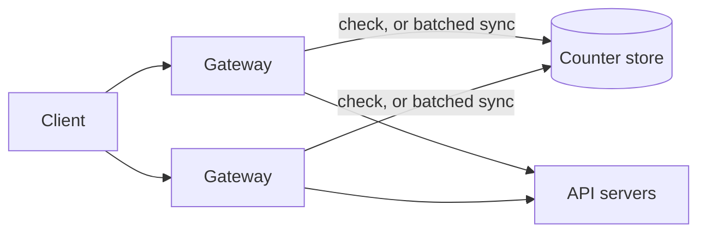
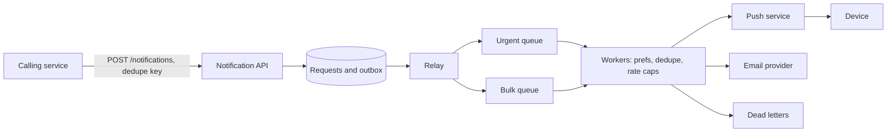
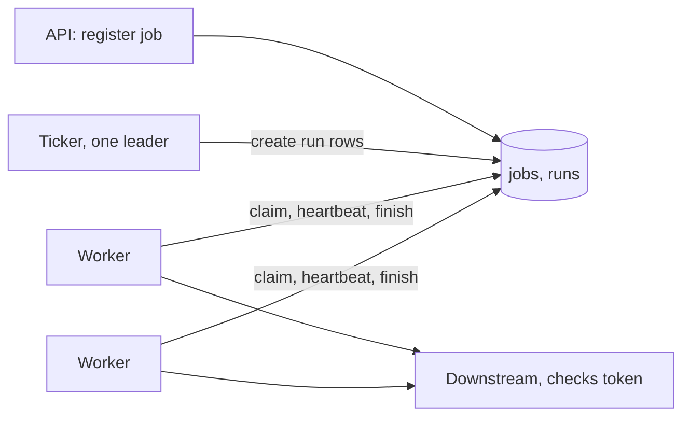

# 8 — Design walkthroughs: rate limiter, notifications, job scheduler

> Two gateways reading a counter, then both writing it, admitted 10 requests against a limit of 5, on every run. Each design here turns on a small fact like that. The chapter works through three systems with a repeatable method: every requirement is a stated assumption, every number comes from running code, and each design's core is small enough to run and break on a laptop.

---

## A method to repeat

Every requirement and scale figure in these walkthroughs is hypothetical, invented so that the arithmetic has something to work on. None describes a real company. In a real design, or an interview, the same order works:

1. **Requirements.** Who calls it, and what must it do? What's explicitly out of scope?
2. **Estimate.** [A short program](05-estimation-and-scaling.md#an-estimate-is-a-program). What does the arithmetic rule out?
3. **API and data model.** The contract, and what must be stored.
4. **Sketch.** The boxes, and how one request goes through them.
5. **The hard part.** Usually one issue dominates. Spend your time there.
6. **Failure.** Take each component away, and say what users see.

The interviewing track has its own six-step version, built for narrating a design out loud in 45 to 55 minutes: [the system design study guide](../../../practice/interviewing/rounds/system-design-round/study-guide.md#1-the-six-step-process-45-55-min). Use this method to find the design and that one to present it.

Step 5 is where designs differ. For the rate limiter it's the race; for notifications it's fairness between kinds of traffic; for the scheduler it's two workers believing they own one job.

## Rate limiter: requirements and estimate

**Hypothetical requirements.** A gateway fleet in front of a public API. Limit each API key to a configured rate, here 600 requests per minute. Must add under 1 ms. Over-limit requests get [HTTP 429](https://www.rfc-editor.org/rfc/rfc6585), with [`Retry-After`](https://www.rfc-editor.org/rfc/rfc9110#section-10.2.3) so that clients know when to return. A small overshoot is acceptable; a large one is not. Billing-grade accuracy is out of scope.

```python
# Hypothetical API gateway. Every input here is an assumption.
peak_rps = 50_000
active_keys = 2_000_000
limit_per_minute = 600
gateways = 20

state_bytes = 8 + 8 + 8 + 24              # key hash, two window counts, window start, plus store overhead
memory_gb = active_keys * state_bytes / 1e9
print(f"state: {memory_gb:.1f} GB for {active_keys:,} keys ({state_bytes} bytes each)")
print(f"store operations: {peak_rps:,}/s, one per request, if every check goes to the store")

budget_ms = 1.0
print(f"a remote check inside a {budget_ms:.0f} ms budget means the store is near: same zone, one round trip")

# Local counting with periodic sync, to reduce store traffic.
for sync_s in (0.1, 1, 5):
    ops = gateways / sync_s * 1000                     # assume each sync pushes 1,000 active keys
    over = limit_per_minute / 60 * sync_s * (gateways - 1)
    print(f"sync every {sync_s:>3} s: about {ops:9,.0f} key updates/s, and a key could overshoot by up to {over:6,.0f} requests")
```

```text
state: 0.1 GB for 2,000,000 keys (48 bytes each)
store operations: 50,000/s, one per request, if every check goes to the store
a remote check inside a 1 ms budget means the store is near: same zone, one round trip
sync every 0.1 s: about   200,000 key updates/s, and a key could overshoot by up to     19 requests
sync every   1 s: about    20,000 key updates/s, and a key could overshoot by up to    190 requests
sync every   5 s: about     4,000 key updates/s, and a key could overshoot by up to    950 requests
```

The memory is trivial: 0.1 GB. So the storage isn't the problem, the traffic to it is: 50,000 operations a second is one busy store, or a few shards. The second result is the real trade-off: syncing less often reduces store traffic, while a key can overshoot further.



**Algorithm.** [Chapter 4](04-load-balancing-and-rate-limiting.md) compared them with measurements. A token bucket suits burst tolerance, and a sliding-window counter gives low memory with good accuracy; [Cloudflare's published design](https://blog.cloudflare.com/counting-things-a-lot-of-different-things/) uses the sliding-window approximation.

**API.** Internally one call: `check(key, cost, now) -> (allowed, retry_after)`. Limits live in config that the gateways cache.

## Rate limiter: the race

The hard part. [Chapter 4](04-load-balancing-and-rate-limiting.md#sharing-the-count) ran this race with eight threads; here the bad order is forced. A check is a read followed by a write. This code forces the bad interleaving so that it shows up on every run, and uses SQLite for the "one transaction" case because it runs here with no server.

```python
import sqlite3, tempfile, os


def open_db(path):
    db = sqlite3.connect(path, isolation_level=None, timeout=5)
    db.execute("CREATE TABLE IF NOT EXISTS bucket (key TEXT PRIMARY KEY, tokens REAL, updated REAL)")
    return db


def naive_read(db, key, capacity):
    row = db.execute("SELECT tokens FROM bucket WHERE key = ?", (key,)).fetchone()
    return capacity if row is None else row[0]


def naive_write(db, key, tokens):
    db.execute("INSERT OR REPLACE INTO bucket VALUES (?, ?, 0)", (key, tokens))


def allow(db, key, now, capacity=5.0, rate=1.0):
    """Token bucket as one transaction. Two gateways can't both spend the last token."""
    db.execute("BEGIN IMMEDIATE")
    try:
        row = db.execute("SELECT tokens, updated FROM bucket WHERE key = ?", (key,)).fetchone()
        tokens, updated = (capacity, now) if row is None else row
        tokens = min(capacity, tokens + (now - updated) * rate)
        ok = tokens >= 1
        db.execute("INSERT OR REPLACE INTO bucket VALUES (?, ?, ?)", (key, tokens - ok, now))
        db.execute("COMMIT")
        return ok
    except BaseException:
        db.execute("ROLLBACK")
        raise


with tempfile.TemporaryDirectory() as tmp:
    path = os.path.join(tmp, "limits.db")
    a, b = open_db(path), open_db(path)      # two gateways

    # The race: both read, then both write. Forced order, so this happens on every run.
    allowed = 0
    for _ in range(5):
        seen_a, seen_b = naive_read(a, "k", 5), naive_read(b, "k", 5)
        allowed += (seen_a >= 1) + (seen_b >= 1)
        naive_write(a, "k", seen_a - 1)
        naive_write(b, "k", seen_b - 1)
    print(f"read then write, 2 gateways: {allowed} allowed of a limit of 5")

    a.execute("DELETE FROM bucket")
    results = [allow(a if i % 2 else b, "k", now=100.0) for i in range(8)]
    print(f"one transaction:             {sum(results)} allowed of a limit of 5, {results}")
    print("two seconds later:", allow(a, "k", now=102.0), allow(b, "k", now=102.0), allow(a, "k", now=102.0))
```

```text
read then write, 2 gateways: 10 allowed of a limit of 5
one transaction:             5 allowed of a limit of 5, [True, True, True, True, True, False, False, False]
two seconds later: True True False
```

The naive path admits double. In production the same race appears only under concurrency, which means that it passes tests and fails in a burst, for the client most worth limiting. The fix is to make check-and-spend one atomic operation at the store. With Redis that's what a [server-side `INCR` or a script](https://redis.io/docs/latest/commands/incr/) achieves (read for this track, and not run: there's no Redis server on this machine). SQLite's `BEGIN IMMEDIATE` plays the same role here.

**Failure: the store is down.** Should the gateway allow or reject? Here's the arithmetic under one set of assumptions, with a backend capacity of 45,000 req/s.

```python
# Hypothetical: the limiter's store is down for 60 s. Of 50,000 req/s, 10,000 are one abusive client.
RPS, ABUSE, SECONDS, BACKEND_CAPACITY = 50_000, 10_000, 60, 45_000

print(f"{'policy':34}{'legit served':>14}{'abuse let in':>14}{'backend load':>14}")
legit = RPS - ABUSE
for name, served, abuse in (
    ("fail closed (reject everything)", 0, 0),
    ("fail open (allow everything)", legit, ABUSE),
    ("local limit per gateway", legit, min(ABUSE, 1000)),
):
    load = served + abuse
    state = "ok" if load <= BACKEND_CAPACITY else "OVER"
    print(f"{name:34}{served * SECONDS:14,}{abuse * SECONDS:14,}{load:9,}/s {state}")
```

```text
policy                              legit served  abuse let in  backend load
fail closed (reject everything)                0             0        0/s ok
fail open (allow everything)           2,400,000       600,000   50,000/s OVER
local limit per gateway                2,400,000        60,000   41,000/s ok
```

Failing closed turns a limiter outage into a full outage for everyone. Failing open passes all 2.4 million legitimate requests but overloads the backend in this example, because the abusive client gets in too. A local per-gateway limit, coarser and imprecise, is the usual answer: it preserves service, and caps the damage. For a limit that protects paid quotas, you might choose otherwise, so ask what the limit is for.

**Failure: multiple regions.** A global limit needs a shared counter, and an inter-region round trip inside a 1 ms budget is impossible. So split: give each region a share, and rebalance slowly from observed traffic. [DE's consistency chapter](../../../data-engineering/01-storage-and-compute-foundations/notes/07-consistency-and-consensus.md#cap-and-the-real-cost) has the theory.

The lab's [`limiters.py`](../practice/exercises/backend_lab/limiters.py) has the algorithms with an injected clock.

## Notifications: requirements and estimate

**Hypothetical requirements.** A service that other teams call to notify users by push, with email or SMS as other channels. Must not lose a login code, shouldn't send a duplicate, and must respect a user's preferences. Delivery to the device is best effort, since the device may be off.

```python
# Hypothetical notification service. Every input here is an assumption.
users = 20_000_000
per_user_day = 3
devices = 1.3
transactional_share = 0.2                 # the rest is bulk or marketing
provider_rate = 20_000                    # sends per second we're allowed, or can reach
payload = 1_000

per_day = users * per_user_day
average = per_day / 86_400
print(f"{per_day:,} notifications/day, mean {average:,.0f}/s, {average * devices:,.0f} sends/s to devices")
print(f"log retained 30 days: {per_day * payload * 30 / 1e12:.1f} TB")

campaign = users                          # one message to everyone
minutes = campaign * devices / provider_rate / 60
print(f"one campaign to all users: {campaign * devices:,.0f} sends, {minutes:.0f} minutes at {provider_rate:,}/s")
print(f"transactional in that time: {per_day * transactional_share / 86_400 * minutes * 60:,.0f} messages would queue behind it on a shared FIFO")
```

```text
60,000,000 notifications/day, mean 694/s, 903 sends/s to devices
log retained 30 days: 1.8 TB
one campaign to all users: 26,000,000 sends, 22 minutes at 20,000/s
transactional in that time: 180,556 messages would queue behind it on a shared FIFO
```

Mean traffic of 903 sends per second is modest. One campaign is what shapes the design: 26 million sends take 22 minutes at the provider's rate, and on a shared FIFO, the 180,556 transactional messages that arrive during that time wait behind it. A login code that's 20 minutes late has failed. So the design's first conclusion comes from arithmetic: separate queues per priority.



**API.**

```text
POST /v1/notifications
{"user_id": "u3", "template": "login_code", "params": {...},
 "priority": "urgent", "ttl_seconds": 60, "dedupe_key": "login-991"}
202 Accepted  {"id": "..."}
```

202, because delivery happens later. `dedupe_key` is an [idempotency key](01-api-design.md#two-writes-that-survive-a-retry), and it's the caller's way of saying "these two calls are the same event".

**Data.** A requests table with a unique dedupe key; device tokens per user; preferences per user and category; an append-only delivery log. Write the request and its outbox row in one transaction, for [the reason in chapter 3](03-caching-and-queues.md#the-outbox-a-write-and-a-message-together): a [relay may publish a message more than once](https://microservices.io/patterns/data/transactional-outbox.html), so consumers must deduplicate.

## Notifications: priority, deduplication, expiry

This code runs the core with a fake provider that fails 20% of sends and has a two-per-tick rate limit. A 30-user campaign arrives first, then a login code, its duplicate, a short-lived message and a dead token.

```python
import heapq, random, sqlite3

URGENT, BULK = 0, 1


class Provider:
    """A stand-in for a push service: flaky, has a rate limit, and rejects dead tokens."""

    def __init__(self, seed=1):
        self.rng, self.delivered = random.Random(seed), []

    def send(self, token, message, now):
        if token.startswith("dead"):
            return "invalid_token"
        if self.rng.random() < 0.2:
            return "unavailable"
        self.delivered.append((round(now, 1), token, message))
        return "ok"


class Dispatcher:
    def __init__(self, provider, rate=2, max_attempts=5):
        self.db = sqlite3.connect(":memory:")
        self.db.executescript("""
            CREATE TABLE sent (dedupe_key TEXT PRIMARY KEY);
            CREATE TABLE tokens (user TEXT, token TEXT);
        """)
        self.provider, self.rate, self.max_attempts = provider, rate, max_attempts
        self.heap, self.seq, self.rng = [], 0, random.Random(7)
        self.stats = dict(duplicate=0, expired=0, dead_token=0, dead_letter=0)
        self.dead_letters = []

    def add_token(self, user, token):
        self.db.execute("INSERT INTO tokens VALUES (?, ?)", (user, token))

    def enqueue(self, user, message, dedupe_key, priority, now, ttl=3600):
        # The same event may arrive twice, since the outbox relay is at-least-once.
        cur = self.db.execute("INSERT OR IGNORE INTO sent VALUES (?)", (dedupe_key,))
        if cur.rowcount == 0:
            self.stats["duplicate"] += 1
            return
        for (token,) in self.db.execute("SELECT token FROM tokens WHERE user = ?", (user,)).fetchall():
            self._push(now, priority, dict(user=user, token=token, message=message, expires=now + ttl, attempt=0))

    def _push(self, not_before, priority, job):
        self.seq += 1
        heapq.heappush(self.heap, (priority, not_before, self.seq, job))

    def run(self, until, tick=1.0):
        now = 0.0
        while now < until and self.heap:
            sent, later = 0, []
            while self.heap and sent < self.rate:
                priority, not_before, seq, job = heapq.heappop(self.heap)
                if not_before > now:
                    later.append((priority, not_before, seq, job))
                    continue
                if now >= job["expires"]:
                    self.stats["expired"] += 1
                    continue
                sent += 1
                self._attempt(job, priority, now)
            for item in later:
                heapq.heappush(self.heap, item)
            now += tick
        return now

    def _attempt(self, job, priority, now):
        result = self.provider.send(job["token"], job["message"], now)
        if result == "invalid_token":
            self.db.execute("DELETE FROM tokens WHERE token = ?", (job["token"],))
            self.stats["dead_token"] += 1
        elif result == "unavailable":
            job["attempt"] += 1
            if job["attempt"] >= self.max_attempts:
                self.stats["dead_letter"] += 1
                self.dead_letters.append(job)
            else:
                ceiling = min(60, 2 ** job["attempt"])
                self._push(now + self.rng.uniform(0, ceiling), priority, job)


provider = Provider()
d = Dispatcher(provider)
for u in range(30):
    d.add_token(f"u{u}", f"tok{u}")
d.add_token("u0", "dead-old-phone")

for u in range(30):                                                 # a campaign arrives first
    d.enqueue(f"u{u}", "sale", f"campaign-7:u{u}", BULK, now=0)
d.enqueue("u3", "your code is 1234", "login-991:u3", URGENT, now=0, ttl=60)
d.enqueue("u3", "your code is 1234", "login-991:u3", URGENT, now=0, ttl=60)   # the relay's duplicate
d.enqueue("u5", "expiring", "sale-ends:u5", BULK, now=0, ttl=4)     # a message that's useless after 4 s

d.run(until=300)
first = next(t for t, token, m in provider.delivered if m.startswith("your code"))
last = max(t for t, _, m in provider.delivered if m == "sale")
print(f"login code delivered at t={first}, last campaign message at t={last}")
print("login code copies delivered:", sum(1 for _, _, m in provider.delivered if m.startswith("your code")))
print("campaign delivered:", sum(1 for _, _, m in provider.delivered if m == "sale"), "of 30")
print("tokens left for u0:", d.db.execute("SELECT token FROM tokens WHERE user='u0'").fetchall())
print(d.stats)
```

```text
login code delivered at t=1.0, last campaign message at t=21.0
login code copies delivered: 1
campaign delivered: 30 of 30
tokens left for u0: [('tok0',)]
{'duplicate': 1, 'expired': 1, 'dead_token': 1, 'dead_letter': 0}
```

Each line of output is a design decision working.

- **Priority:** the login code went out at t = 1, although it arrived behind the campaign. A 20% failure hit its first try or a later one, and it still beat the campaign's last message at t = 21.
- **Deduplication:** one copy delivered, of two requests. The dedupe table is checked at enqueue here; in a real system the check and the queue write must commit together, or a crash between them loses a message.
- **Retries:** all 30 campaign messages arrived despite the flaky provider, with exponential backoff and [jitter](07-reliability-under-load.md#retrying-responsibly). Those that reach the attempt limit go to a dead-letter list, which someone has to watch.
- **Expiry:** the 4 second message was dropped rather than sent late. RFC 8030 makes this part of the protocol: [a push request must carry a TTL](https://www.rfc-editor.org/rfc/rfc8030#section-5.2), and can add [urgency](https://www.rfc-editor.org/rfc/rfc8030#section-5.3) and a [topic that replaces an earlier undelivered message](https://www.rfc-editor.org/rfc/rfc8030#section-5.4). FCM has the [matching features](https://firebase.google.com/docs/cloud-messaging/customize-messages/setting-message-lifespan): a lifespan of up to four weeks on Android and Web, and collapse keys, plus [normal and high priority](https://firebase.google.com/docs/cloud-messaging/customize-messages/setting-message-priority).
- **Dead tokens:** the provider's rejection deleted the old phone's token. Skip this and the list of doomed sends grows forever.

**What "delivered" means.** The provider accepted it. Exactly-once delivery to a device isn't possible through a best-effort provider, and a crash between sending and recording means a possible duplicate. Say so to whoever calls the API, and let the client app deduplicate by message ID if it matters.

**Failure.** A provider outage: the urgent queue backs up, so fall back to another channel for urgent messages (a login code can go by SMS) and let bulk wait. A user with no device: record it. A campaign bug that would send everyone the wrong message: this argues for sending campaigns gradually, in the manner of [a canary](06-containers-cicd-and-deployment.md#canary-how-much-traffic-for-how-long), and for a kill switch. Per-user frequency caps belong in the workers too, since duplicates aren't the only way to annoy someone.

## Scheduler: requirements and estimate

**Hypothetical requirements.** Other teams register recurring jobs by cron expression; a fleet of workers runs them. A million daily jobs. A job should run once per schedule; a worker can die at any time.

```python
import hashlib

# Hypothetical: 1,000,000 daily jobs on a scheduler that can launch 500 per second.
JOBS, RATE = 1_000_000, 500

print(f"mean launch rate if spread over the day: {JOBS / 86_400:.1f}/s")
print(f"all at midnight: {JOBS / RATE / 60:.0f} minutes for the last job to launch")


def spread_minute(job_id, window=24 * 60):
    return int(hashlib.sha256(job_id.encode()).hexdigest(), 16) % window


slots = {}
for i in range(JOBS):
    m = spread_minute(f"job-{i}")
    slots[m] = slots.get(m, 0) + 1
print(f"hashed into minutes of the day: busiest minute {max(slots.values())} jobs, {max(slots.values()) / 60:.1f}/s")
print(f"stable: job-42 runs at minute {spread_minute('job-42')} every day")
```

```text
mean launch rate if spread over the day: 11.6/s
all at midnight: 33 minutes for the last job to launch
hashed into minutes of the day: busiest minute 773 jobs, 12.9/s
stable: job-42 runs at minute 575 every day
```

The mean is 11.6 launches per second, which is nothing. The trouble is that people write `0 0 * * *`. The [SRE cron chapter](https://sre.google/sre-book/distributed-periodic-scheduling/) calls this a thundering herd and points to Google's extension, where `?` lets the system pick the time. Hashing the job ID into its window, as above, gives a time that's spread out and stable between runs: 13 per second at the busiest minute, instead of 33 minutes of backlog. Offer this as the default.



**Data.** `jobs` holds the schedule, and `runs (job, due, state, owner, lease_until, token, attempts)` holds each planned execution, with `(job, due)` as the primary key. That key is the first defence against double launches: however many times a schedule fires, there's one row.

## Scheduler: leases and fencing

The hard part. Worker A claims a job, then pauses: a GC pause, a network partition. It looks dead, so B takes over. Then A wakes up, unaware. The answer is a lease with a [fencing token](../../../data-engineering/01-storage-and-compute-foundations/notes/06-when-distributed-systems-fail.md#knowledge-truth-and-fencing). A claim has an expiry that heartbeats extend, and each new claim gets a larger token. Whoever accepts the result refuses tokens older than the current one.

```python
import sqlite3


class Scheduler:
    def __init__(self):
        self.db = sqlite3.connect(":memory:", isolation_level=None)
        self.db.executescript("""
            CREATE TABLE runs (
                job TEXT, due REAL, state TEXT DEFAULT 'pending', owner TEXT, lease_until REAL,
                token INTEGER DEFAULT 0, attempts INTEGER DEFAULT 0, PRIMARY KEY (job, due));
            CREATE TABLE effects (job TEXT, due REAL, token INTEGER, what TEXT);
        """)

    def add(self, job, due):
        # PRIMARY KEY (job, due): firing the same schedule twice can't make two runs.
        self.db.execute("INSERT OR IGNORE INTO runs (job, due) VALUES (?, ?)", (job, due))

    def claim(self, worker, now, lease=30.0, max_attempts=3):
        self.db.execute("BEGIN IMMEDIATE")
        self.db.execute("""UPDATE runs SET state='failed'           -- out of attempts: hand it to a human
                            WHERE state='running' AND lease_until <= ? AND attempts >= ?""", (now, max_attempts))
        row = self.db.execute("""
            SELECT job, due, token FROM runs
             WHERE due <= ? AND attempts < ?
               AND (state = 'pending' OR (state = 'running' AND lease_until <= ?))
             ORDER BY due LIMIT 1""", (now, max_attempts, now)).fetchone()
        if row is None:
            self.db.execute("COMMIT")
            return None
        job, due, token = row
        self.db.execute("""UPDATE runs SET state='running', owner=?, lease_until=?, token=?, attempts=attempts+1
                            WHERE job=? AND due=?""", (worker, now + lease, token + 1, job, due))
        self.db.execute("COMMIT")
        return job, due, token + 1

    def heartbeat(self, job, due, token, now, lease=30.0):
        cur = self.db.execute("UPDATE runs SET lease_until=? WHERE job=? AND due=? AND token=? AND state='running'",
                              (now + lease, job, due, token))
        return cur.rowcount == 1

    def finish(self, job, due, token, what):
        """Only the current token may record a result. A stale worker's write is refused."""
        self.db.execute("BEGIN IMMEDIATE")
        cur = self.db.execute("UPDATE runs SET state='done' WHERE job=? AND due=? AND token=? AND state='running'",
                              (job, due, token))
        accepted = cur.rowcount == 1
        if accepted:
            self.db.execute("INSERT INTO effects VALUES (?, ?, ?, ?)", (job, due, token, what))
        self.db.execute("COMMIT")
        return accepted


s = Scheduler()
s.add("nightly-report", due=100.0)
s.add("nightly-report", due=100.0)       # two scheduler replicas fired the same schedule
print("runs:", s.db.execute("SELECT COUNT(*) FROM runs").fetchone()[0])

first = s.claim("worker-a", now=100.0)
print("A claims:", first)
print("B claims at once:", s.claim("worker-b", now=101.0))
print("A heartbeats at 120:", s.heartbeat(*first[:3], now=120.0))

# A pauses (a long GC, a dead network) and misses its heartbeats. Its lease ends at 150.
second = s.claim("worker-b", now=151.0)
print("B claims after expiry:", second)
print("A wakes and finishes:", s.finish(*first, "report from A"))
print("B finishes:", s.finish(*second, "report from B"))
print("A heartbeats too late:", s.heartbeat(*first[:3], now=160.0))
print("effects:", s.db.execute("SELECT job, token, what FROM effects").fetchall())

# A job that always crashes its worker stops after max_attempts.
s.add("poison", due=200.0)
now, tries = 200.0, 0
while (c := s.claim("worker-c", now=now)) is not None:
    tries += 1
    now += 31
print("poison job attempts:", tries, " state:", s.db.execute("SELECT state FROM runs WHERE job='poison'").fetchone()[0])
```

```text
runs: 1
A claims: ('nightly-report', 100.0, 1)
B claims at once: None
A heartbeats at 120: True
B claims after expiry: ('nightly-report', 100.0, 2)
A wakes and finishes: False
B finishes: True
A heartbeats too late: False
effects: [('nightly-report', 2, 'report from B')]
poison job attempts: 3  state: failed
```

Read the sequence. B can't claim while A's lease is live, and can after it expires. When A wakes and tries to finish, its token 1 is refused, so there's one effect, B's. And a job that crashes its worker every time stops after three attempts and goes to `failed`, rather than crash-looping through the fleet forever. That last one is a poison job, and every queue system needs an answer to it.

Note where the check has to live. The token here is checked in the same database that holds the result. If the job's effect is an email to a provider that doesn't check tokens, fencing can't help, since A will still have sent the email. So in that case, the job must be idempotent as well, or you accept the risk.

**At-least-once or at-most-once?** There's no single answer. The SRE chapter separates [idempotent jobs like garbage collection](https://sre.google/sre-book/distributed-periodic-scheduling/), which are safe to run twice, from a newsletter, which isn't, and it notes that a skip may be fine for a job on a five minute cycle and not for a payroll run. Its default is to prefer skipping a launch to risking a double one, to "fail closed", because a double send may be impossible to undo. So let the job owner choose: [Kubernetes CronJob](https://kubernetes.io/docs/concepts/workloads/controllers/cron-jobs/) offers `concurrencyPolicy` (`Allow` by default, `Forbid`, `Replace`) and `startingDeadlineSeconds`, and it warns that jobs should be idempotent.

**Failure.**

- **The ticker dies.** Run at least three replicas with a [leader elected through consensus](../../../data-engineering/01-storage-and-compute-foundations/notes/07-consistency-and-consensus.md#where-consensus-lives-in-your-stack). The SRE design runs three with Paxos, and writes the launch to shared state both before and after, so that a new leader knows what might have happened. The `(job, due)` key means that two leaders firing still make one row.
- **The clock lies.** Leases compare times, and [clocks can't be trusted](../../../data-engineering/01-storage-and-compute-foundations/notes/06-when-distributed-systems-fail.md#you-cannot-trust-the-clock). Use the database's clock for leases, in one place, and let fencing cover the rest.
- **The whole system was down for an hour.** Which missed runs do you run? `startingDeadlineSeconds` is exactly this choice: run what's still useful, skip the rest, and don't launch an hour's backlog at once.
- **Workers are preempted.** [Borg's tasks](https://static.googleusercontent.com/media/research.google.com/en//pubs/archive/43438.pdf) can ask for a SIGTERM before SIGKILL, and it arrives only about 80% of the time, so a job should checkpoint and resume rather than count on a warning. It's the same as [draining a server](06-containers-cicd-and-deployment.md#shutting-down-without-dropping-requests): on SIGTERM a worker hands the job back. The AI equivalent of this idea, [durable execution with checkpoints](../../../ai-engineering/05-graph-engineering/notes/04-durable-execution-and-interrupts.md), comes up in chapter 10.

The database used here is a design choice as well. A relational table handles the 11.6 launches per second easily, and has [the transactions](../../../data-engineering/01-storage-and-compute-foundations/notes/10-choosing-a-store.md#when-postgres-is-enough) that this relies on.

## Pitfalls

- **Read, then write, on a counter.** It passes tests, and admits double in a burst. Make it atomic at the store.
- **A limiter that fails closed by default.** The limiter's outage becomes your outage. Decide per limit.
- **One queue for all notifications.** A campaign delays login codes by the length of the campaign.
- **Retrying forever.** A notification with no TTL may arrive after it has stopped being true.
- **Marking a message "delivered" when the provider accepted it, and stopping there.** Say what you know, and keep the difference visible.
- **Lease with no fencing.** A paused worker wakes up and overwrites its successor's result.
- **Fencing that nobody checks.** The token protects only the systems that compare it.
- **Everything at midnight.** Spread by hashing, and make that the default.
- **No attempt limit.** A poison job takes down workers one by one, forever.

## Try it

**1. A limit of 3,000 per minute, with 10 gateways syncing every 2 seconds. What's the worst-case overshoot in the formula above?**

<details>
<summary>Answer</summary>

The rate is 50 per second. Overshoot is at most rate × sync × (gateways − 1) = 50 × 2 × 9 = 900 requests, which is 30% of a minute's limit. If that's too much, sync faster or give each gateway a fixed share of the limit.

</details>

**2. In `lease_scheduler.py`, what would have happened if `finish` did not check the token?**

<details>
<summary>Answer</summary>

Both A and B would have written results. The `effects` table would have two rows, and a job promising one run would have done two. Delete `AND token=?` from the `UPDATE` in `finish` and run it to see.

</details>

**3. A provider allows 5,000 sends per second and you have a 2 million user campaign. Transactional traffic is 300 per second. If they share the limit, with priority, how long does the campaign take?**

<details>
<summary>Answer</summary>

```python
print(round(2_000_000 / (5_000 - 300) / 60, 1))
```

```text
7.1
```

About 7.1 minutes, against 6.7 if it had the provider to itself. Priority costs the campaign very little, and it costs a login code nothing.

</details>

**4. Implement `LeaseScheduler` in [`practice/exercises/backend_lab/lease_scheduler.py`](../practice/exercises/backend_lab/lease_scheduler.py).** Tests in `test_lease_scheduler.py` cover the double fire, the stale finish, heartbeat renewal and the poison job. A worked version is in [`solutions/`](../practice/solutions/backend_lab/lease_scheduler.py).

## Interview checklist

| Question | Answer |
|---|---|
| Where does the rate limiter sit? | At the gateway, with counters in a nearby store, or local counters synced periodically. |
| How do you make it correct under concurrency? | Check-and-spend as one atomic operation at the store. |
| Limiter store down? | Usually a coarse local limit. Fail open or closed depends on what the limit protects. |
| What status code? | 429, with `Retry-After`. |
| Rate limiting across regions? | Give each region a share of the limit. A global synchronous counter costs too much latency. |
| Why separate notification queues? | A campaign would delay urgent messages by its whole length. |
| How do you avoid duplicate notifications? | A dedupe key with a unique constraint, committed with the queue write, plus an outbox with idempotent consumers. |
| What's a TTL for here? | A message that's late can be worse than none. RFC 8030 requires one on every push. |
| What happens with dead device tokens? | Remove them when the provider rejects them. |
| Exactly-once delivery? | Not achievable through a best-effort provider. At-least-once, with deduplication where you control the code. |
| What stops two schedulers firing a job twice? | A leader, plus a unique `(job, due)` key. |
| Lease versus fencing token? | A lease lets someone else take over. A token stops the old owner's late write. |
| Skip or double-run? | It depends on the job. Default to skip, since a double launch may not be reversible. |
| What's the midnight problem? | Humans pick round times. Hash jobs into a window instead. |
| What's a poison job? | One that crashes its worker each time. Limit attempts, and move it to a failed state. |

## Next

[Chapter 9 — Design walkthroughs: KV store and feed](09-design-walkthroughs-kv-store-and-feed.md) has two designs where the data structure decides everything.
