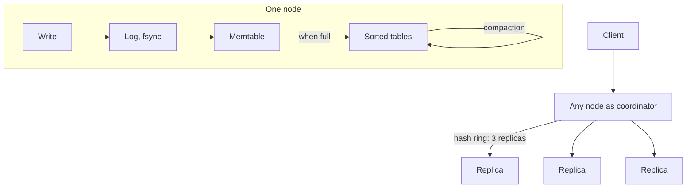
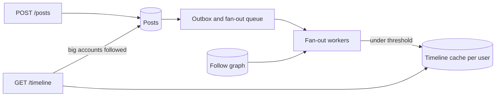

# 9 — Design walkthroughs: KV store and feed

> A key-value store needs about 22 nodes for its traffic and only 6 for its disk, and a feed with one 500,000-follower account can spend 50 seconds delivering one post. In both designs the numbers point at the hard part. This chapter builds a working log-structured store with crash recovery, simulates quorums, and costs out three feed designs, with every scale figure stated as an assumption.

---

## KV store: requirements and estimate

The [method from chapter 8](08-design-walkthroughs-rate-limiter-notifications-scheduler.md#a-method-to-repeat) applies, and every figure here is again hypothetical. A store with `get(key)`, `put(key, value)` and `delete(key)`: values around 1 KB, heavy writes, must keep working when a node dies. Range scans and multi-key transactions are out of scope; if you need them, [the access pattern](../../../data-engineering/01-storage-and-compute-foundations/notes/10-choosing-a-store.md#start-with-the-access-pattern) points to another kind of store, and [plain Postgres](../../../data-engineering/01-storage-and-compute-foundations/notes/10-choosing-a-store.md#when-postgres-is-enough) may be enough at smaller scale. Check that first.

```python
# Hypothetical KV store. Every input here is an assumption.
keys = 10_000_000_000
value_bytes = 1_000
key_bytes = 30
replicas = 3
reads, writes = 400_000, 100_000
node_disk_tb = 8
node_ops = 50_000

raw_tb = keys * (key_bytes + value_bytes) / 1e12
copies_tb = raw_tb * replicas
by_disk = copies_tb / (node_disk_tb * 0.7)         # keep 30% free for compaction
by_ops = (reads * 2 + writes * replicas) / node_ops  # a read from a quorum of 2, a write to all 3
print(f"data {raw_tb:.1f} TB, with {replicas} copies {copies_tb:.1f} TB")
print(f"nodes needed by disk: {by_disk:.0f}, by operations: {by_ops:.0f}")
print(f"index in memory for every key at 40 bytes: {keys * 40 * replicas / 1e12:.1f} TB, which is why an LSM keeps a sparse one")
print(f"sparse index, one entry per 64 KiB block: {copies_tb * 1e12 / 65_536 * 40 / 1e9:.1f} GB")
```

```text
data 10.3 TB, with 3 copies 30.9 TB
nodes needed by disk: 6, by operations: 22
index in memory for every key at 40 bytes: 1.2 TB, which is why an LSM keeps a sparse one
sparse index, one entry per 64 KiB block: 18.9 GB
```

Three conclusions. Operations need more machines than disk does (22 against 6), so this is a traffic problem. It's too big for one machine, so keys must be [partitioned](../../../data-engineering/01-storage-and-compute-foundations/notes/05-partitioning-and-replication.md#range-and-hash-partitioning) and [replicated](../../../data-engineering/01-storage-and-compute-foundations/notes/05-partitioning-and-replication.md#leaderless-and-quorums). And a full in-memory index would cost 1.2 TB against 19 GB for a sparse one, which points to sorted files.



Two layers solve different problems: one node's storage engine, and the distribution across nodes.

## One node: a log-structured store

A B-tree updates pages in place, and random writes are expensive. The [LSM-tree paper](https://www.cs.umb.edu/~poneil/lsmtree.pdf) takes the other route: defer and batch index changes in memory, then merge them to disk in bulk. [Bigtable's tablet design](https://static.googleusercontent.com/media/research.google.com/en//archive/bigtable-osdi06.pdf) is the classic shape, and this code follows its parts. Updates go to a commit log first, recent ones stay in a sorted in-memory *memtable*, older ones sit in immutable sorted *SSTables*, and a read looks at a merged view of the memtable and the tables. [DE 01's row and column stores](../../../data-engineering/01-storage-and-compute-foundations/notes/03-row-and-column-stores.md) measures an LSM's write amplification; this chapter builds one that survives a crash.

```python
import bisect, hashlib, json, os, tempfile

TOMBSTONE = None


class Bloom:
    def __init__(self, keys, bits_per_key=10, hashes=7):
        self.m = max(8, len(keys) * bits_per_key)
        self.k = hashes
        self.bits = bytearray(self.m // 8 + 1)
        for key in keys:
            for p in self._positions(key):
                self.bits[p // 8] |= 1 << (p % 8)

    def _positions(self, key):
        digest = hashlib.sha256(key.encode()).digest()
        a, b = int.from_bytes(digest[:8], "big"), int.from_bytes(digest[8:16], "big")
        return [(a + i * b) % self.m for i in range(self.k)]

    def might_contain(self, key):
        return all(self.bits[p // 8] & (1 << (p % 8)) for p in self._positions(key))


class Table:
    """An immutable sorted file. Sorted keys and one bloom filter, loaded in memory for brevity."""

    def __init__(self, path, items):
        self.path = path
        self.keys = [k for k, _ in items]
        self.values = [v for _, v in items]
        self.bloom = Bloom(self.keys)
        with open(path, "w") as f:
            json.dump(items, f)

    def get(self, key):
        i = bisect.bisect_left(self.keys, key)
        return (True, self.values[i]) if i < len(self.keys) and self.keys[i] == key else (False, None)


class LSM:
    def __init__(self, folder, memtable_limit=4):
        self.folder, self.limit = folder, memtable_limit
        self.wal_path = os.path.join(folder, "wal.log")
        self.memtable, self.tables, self.seq = {}, [], 0
        self.stats = dict(table_reads=0, bloom_skips=0)
        self._replay()
        self.wal = open(self.wal_path, "a")

    def _replay(self):
        if os.path.exists(self.wal_path):
            with open(self.wal_path) as f:
                for line in f:
                    try:
                        key, value = json.loads(line)
                    except json.JSONDecodeError:
                        break                 # a torn last line from a crash: stop there
                    self.memtable[key] = value

    def _log(self, key, value):
        self.wal.write(json.dumps([key, value]) + "\n")
        self.wal.flush()
        os.fsync(self.wal.fileno())           # acknowledged means durable
        self.memtable[key] = value
        if len(self.memtable) >= self.limit:
            self._flush()

    def put(self, key, value):
        self._log(key, value)

    def delete(self, key):
        self._log(key, TOMBSTONE)             # older tables may still hold it

    def get(self, key):
        if key in self.memtable:
            return self.memtable[key]
        for table in reversed(self.tables):   # newest first
            if not table.bloom.might_contain(key):
                self.stats["bloom_skips"] += 1
                continue
            self.stats["table_reads"] += 1
            found, value = table.get(key)
            if found:
                return value
        return None

    def _flush(self):
        self.seq += 1
        path = os.path.join(self.folder, f"table-{self.seq}.json")
        self.tables.append(Table(path, sorted(self.memtable.items())))
        self.memtable = {}
        self.wal.close()
        self.wal = open(self.wal_path, "w")   # flushed data no longer needs the log

    def compact(self):
        merged = {}
        for table in self.tables:             # oldest first, newer values win
            merged.update(zip(table.keys, table.values))
        live = sorted((k, v) for k, v in merged.items() if v is not TOMBSTONE)
        self.seq += 1
        self.tables = [Table(os.path.join(self.folder, f"table-{self.seq}.json"), live)]


with tempfile.TemporaryDirectory() as folder:
    db = LSM(folder)
    for i in range(10):
        db.put(f"k{i}", i)
    db.put("k1", "new")
    db.delete("k2")
    db.put("k10", 10)
    print("tables:", len(db.tables), " in memtable:", sorted(db.memtable))
    print("k1 =", db.get("k1"), " k2 =", db.get("k2"), " k9 =", db.get("k9"), " k10 =", db.get("k10"))

    # Crash: the memtable is gone, and the last log write was torn halfway.
    db.wal.close()
    with open(db.wal_path, "a") as f:
        f.write('["k11", ')
    tables = db.tables
    db2 = LSM(folder)
    db2.tables, db2.seq = tables, db.seq
    print("after a crash and log replay: k10 =", db2.get("k10"), " k11 =", db2.get("k11"), " k8 =", db2.get("k8"))

    db2.stats.update(table_reads=0, bloom_skips=0)
    for i in range(1000):
        db2.get(f"absent{i}")
    print(f"1,000 lookups of absent keys over {len(db2.tables)} tables: "
          f"{db2.stats['table_reads']} table reads, {db2.stats['bloom_skips']} skipped by bloom filters")

    before = sum(len(t.keys) for t in db2.tables)
    db2.compact()
    print(f"compact: {before} entries in {len(tables)} tables -> {len(db2.tables[0].keys)} entries in 1; k2 deleted for good:",
          "k2" not in db2.tables[0].keys, "; k1 =", db2.get("k1"))
```

```text
tables: 3  in memtable: ['k10']
k1 = new  k2 = None  k9 = 9  k10 = 10
after a crash and log replay: k10 = 10  k11 = None  k8 = 8
1,000 lookups of absent keys over 3 tables: 155 table reads, 2845 skipped by bloom filters
compact: 12 entries in 3 tables -> 9 entries in 1; k2 deleted for good: True ; k1 = new
```

Here's each part, and what it's for.

- **The log makes a crash boring.** `k10` existed only in memory and in the log, and it survived. The torn last line, `k11`, was never acknowledged, so losing it is correct. [The persistence chapter](../../../data-engineering/01-storage-and-compute-foundations/notes/09-persistence.md#the-write-ahead-log-making-a-crash-boring) explains the idea, and [what fsync costs](../../../data-engineering/01-storage-and-compute-foundations/notes/09-persistence.md#fsync-what-a-power-cut-takes-and-what-it-costs). Bigtable also uses group commit to batch small log writes, and chapter 5's measured numbers show why.
- **A flush bounds memory and recovery.** Bigtable calls this a *minor compaction*, and gives both reasons: it shrinks memory use and reduces how much log must be replayed after a crash.
- **Reads get slower as tables accumulate**, since each lookup may visit every one. This is the price of fast writes, and [the LSM paper says so](https://www.cs.umb.edu/~poneil/lsmtree.pdf): finds that need an immediate response remain relatively costly.
- **Bloom filters cut most of that cost.** A filter says "definitely not here" or "maybe". Of 3,000 table visits for absent keys, 2,845 were skipped, and [Bigtable lets clients turn them on](https://static.googleusercontent.com/media/research.google.com/en//archive/bigtable-osdi06.pdf) for the same purpose. With these tiny tables 5% got through. The false-positive rate falls as bits per key rise.
- **A delete is a write.** You can't remove a key from an immutable file, so you write a *tombstone* that hides the older value. Only a major compaction, which rewrites everything into one table, can remove the tombstone as well as the data. Bigtable says the same, and regularly compacts so that deleted data really does disappear.
- **Compaction costs write amplification.** The same bytes get rewritten, using disk and CPU, while requests continue. The 30% free disk in the estimate is there for this reason.

The toy keeps every key in memory for brevity, and a real table has a sparse index over blocks. It's a teaching store, not a durable design: for instance, `compact` doesn't fsync the new file before dropping the old ones.

## Many nodes: quorums

[Dynamo](https://www.allthingsdistributed.com/files/amazon-dynamo-sosp2007.pdf) is the classic design here. Its starting point is availability: writes should succeed through failures, and conflicts get resolved later. Keys sit on a [consistent hash ring](04-load-balancing-and-rate-limiting.md#hashing-keys-to-nodes) with virtual nodes; each key has a *preference list* of distinct nodes, longer than N, and the first N healthy ones hold it. Clients read from R nodes and write to W nodes. When R + W > N, the sets overlap, so a read should see the latest acknowledged write. [DE's notes on quorums](../../../data-engineering/01-storage-and-compute-foundations/notes/05-partitioning-and-replication.md#leaderless-and-quorums) cover the theory; here's the cost, in a simulation with background replication deliberately stalled and 1% of nodes down.

```python
import random


def simulate(n, r, w, trials=20_000, down=0.0, lag=0.0, seed=2):
    """Write to w replicas; each other one has it by read time with probability 1 - lag. Then read r."""
    rng = random.Random(seed)
    stale = unavailable = 0
    for _ in range(trials):
        alive = [i for i in range(n) if rng.random() >= down]
        if len(alive) < max(r, w):
            unavailable += 1
            continue
        written = set(rng.sample(alive, w))
        written |= {i for i in alive if rng.random() >= lag}
        if not set(rng.sample(alive, r)) & written:
            stale += 1
    done = trials - unavailable
    return stale / done if done else 0.0, unavailable / trials


print("n=3, background replication not finished by the time of the read (lag=1), 1% of nodes down")
print(f"{'r':>3}{'w':>3}{'r+w>n':>7}{'stale reads':>13}{'unavailable':>13}")
for r, w in ((1, 1), (1, 2), (2, 1), (2, 2), (1, 3), (3, 1)):
    stale, unavailable = simulate(3, r, w, down=0.01, lag=1.0)
    print(f"{r:3}{w:3}{str(r + w > 3):>7}{stale:13.2%}{unavailable:13.3%}")

# Latency: a quorum waits for the slowest member it needs.
rng = random.Random(5)
def lat():
    return rng.lognormvariate(1.0, 0.5) + (rng.expovariate(1 / 50) if rng.random() < 0.05 else 0)

def quantile(xs, q):
    return sorted(xs)[int(len(xs) * q)]

print("\nwaiting for k of 3 replicas (ms)")
for k in (1, 2, 3):
    xs = [sorted(lat() for _ in range(3))[k - 1] for _ in range(100_000)]
    print(f"  k={k}: p50 {quantile(xs, .5):6.1f}   p99 {quantile(xs, .99):6.1f}")
```

```text
n=3, background replication not finished by the time of the read (lag=1), 1% of nodes down
  r  w  r+w>n  stale reads  unavailable
  1  1  False       66.40%       0.000%
  1  2  False       32.58%       0.010%
  2  1  False       32.61%       0.055%
  2  2   True        0.00%       0.010%
  1  3   True        0.00%       2.830%
  3  1   True        0.00%       2.910%

waiting for k of 3 replicas (ms)
  k=1: p50    1.8   p99    4.3
  k=2: p50    2.8   p99    8.1
  k=3: p50    4.4   p99  139.3
```

Reading the rows:

- **R = W = 1** is fast and returns stale data two-thirds of the time, in this worst case of no background replication.
- **R = W = 2** gets the overlap, and tolerates one node being down for both reads and writes. [Dynamo](https://www.allthingsdistributed.com/files/amazon-dynamo-sosp2007.pdf) reports (3,2,2) as its common configuration, chosen to meet performance, durability, consistency and availability targets.
- **R = 1, W = 3** also overlaps, but any single node down stops writes (2.8% unavailable, against 0.01%).

The second table prices it. Dynamo observes that [latency is dictated by the slowest of the R or W replicas](https://www.allthingsdistributed.com/files/amazon-dynamo-sosp2007.pdf), and that's the fan-out math from [chapter 7](07-reliability-under-load.md#the-tail-is-what-users-get) again. Waiting for 2 of 3 gives a p99 of 8 ms, and waiting for all 3 gives 139 ms in this model, because a quorum can leave out the slowest replica. That's a second argument against W = 3.

An overlap isn't full consistency. Sloppy quorums, concurrent writes and failed partial writes can all still break it, which is why [the "real cost" of CAP](../../../data-engineering/01-storage-and-compute-foundations/notes/07-consistency-and-consensus.md#cap-and-the-real-cost) needs its own chapter.

**Node failure.** Dynamo keeps the write available with a *sloppy quorum*: if a preference-list node is down, write to the next healthy one, with a *hint* naming the intended owner, and hand it back when that owner returns. That raises availability, and it also means R + W > N stops guaranteeing an overlap. Permanent divergence gets repaired in the background by *anti-entropy*, comparing replicas using Merkle trees so that only the differing ranges move.

**Adding a node.** [Consistent hashing](https://www.cs.princeton.edu/courses/archive/fall09/cos518/papers/chash.pdf) moves only a small share of keys. [Chapter 4](04-load-balancing-and-rate-limiting.md#hashing-keys-to-nodes) measured that, and [DE's section on rebalancing](../../../data-engineering/01-storage-and-compute-foundations/notes/05-partitioning-and-replication.md#rebalancing) covers the rest.

## Concurrent writes: keep both, or lose one

Quorums tell you that you'll see the writes. They don't say what to do with two writes that didn't know about each other. Dynamo uses vector clocks, a counter per node attached to each version.

```python
def descends(a, b):
    """True if clock a has seen everything in clock b."""
    return all(a.get(node, 0) >= count for node, count in b.items())


def compare(a, b):
    if a == b:
        return "same"
    if descends(a, b):
        return "first is newer"
    if descends(b, a):
        return "second is newer"
    return "CONCURRENT: keep both, let the application merge"


v1 = {"A": 1}                            # written through node A
v2 = {"A": 2}                            # updated through A: replaces v1
v3 = {"A": 2, "B": 1}                    # one client updates through B
v4 = {"A": 2, "C": 1}                    # another updates through C, in a partition
print("v2 vs v1:", compare(v2, v1))
print("v3 vs v2:", compare(v3, v2))
print("v3 vs v4:", compare(v3, v4))

# What last-write-wins does instead: picks by wall clock, and one write vanishes silently.
writes = [("cart=[book]", 1000.002), ("cart=[pen]", 1000.001)]
print("last write wins keeps:", max(writes, key=lambda w: w[1])[0], " and silently drops:", min(writes, key=lambda w: w[1])[0])
```

```text
v2 vs v1: first is newer
v3 vs v2: first is newer
v3 vs v4: CONCURRENT: keep both, let the application merge
last write wins keeps: cart=[book]  and silently drops: cart=[pen]
```

If one clock has seen everything in the other, the older is safely discarded. If neither has, the writes are concurrent, and in its business-logic mode Dynamo returns both to the application to merge, as in its shopping cart example, where deleted items can resurface. Dynamo also offers last write wins, which is simpler and common, but as the last line shows, it decides by a wall clock that [you can't trust](../../../data-engineering/01-storage-and-compute-foundations/notes/06-when-distributed-systems-fail.md#you-cannot-trust-the-clock), and one customer's write disappears silently. [DE covers these options](../../../data-engineering/01-storage-and-compute-foundations/notes/05-partitioning-and-replication.md#concurrent-writes).

The choice is a product decision: for a session cache, losing one write is fine; for a shopping cart, a merge is worth the complexity. Say this out loud in a design discussion.

## Feed: requirements and estimate

**Hypothetical requirements.** A social feed: users post short text, follow others, and read a reverse-chronological timeline of who they follow. Reads must be fast, and a post may take seconds to show up. Ranking is out of scope, though it would sit on top of this. Media goes to [an object store and a CDN](05-estimation-and-scaling.md#an-estimate-is-a-program).

**API.**

```text
POST /v1/posts                       {"text": "..."}
GET  /v1/timeline?limit=20&after=...  200 {"posts": [...], "next": "<opaque cursor>"}
POST /v1/users/{id}/follow
```

The timeline has to use [keyset pagination](01-api-design.md#pagination-that-holds-still), since a feed gains new items between page fetches, and offsets would show duplicates.

**The hard part** is choosing when to do the work of assembling a timeline. Fan-out on write copies each new post into every follower's timeline, so reads are one lookup. Fan-out on read leaves posts where they are, and each read merges from everyone followed. Here is a model. The follower distribution is invented, with a heavy skew, and everybody posts at the same rate.

```python
import random


# Hypothetical. One million users with skewed follower counts: rank r has about 500,000 / r^0.8 followers.
USERS = 1_000_000
followers = [max(1, int(500_000 / rank**0.8)) for rank in range(1, USERS + 1)]
posts_per_user_day, reads_per_user_day = 0.5, 20
total_edges = sum(followers)

posts = USERS * posts_per_user_day
reads = USERS * reads_per_user_day

# Fan-out on write: each post costs one write per follower, if everyone posts at the same rate. A read is one lookup.
write_cost = posts_per_user_day * sum(followers)
# Fan-out on read: a read merges everyone followed. A post costs one write.
mean_following = total_edges / USERS
read_cost = reads * mean_following


def hybrid(threshold):
    celebs = [f for f in followers if f > threshold]
    normal = [f for f in followers if f <= threshold]
    writes = posts_per_user_day * sum(normal)
    # A read merges the celebrities a user follows. Assume follows are proportional to follower count.
    celeb_follows = sum(celebs) / USERS
    return writes, reads * (1 + celeb_follows), len(celebs)


print(f"{USERS:,} users, {total_edges:,} follow edges, mean {mean_following:,.0f} followed per user")
print(f"biggest account {max(followers):,} followers, median {sorted(followers)[USERS // 2]:,}")
print(f"\n{'strategy':30}{'timeline writes/day':>22}{'lookups on read/day':>22}")
print(f"{'fan-out on write':30}{write_cost:22,.0f}{reads:22,.0f}")
print(f"{'fan-out on read':30}{posts:22,.0f}{read_cost:22,.0f}")
for threshold in (100_000, 10_000, 1_000, 100):
    w, r, n = hybrid(threshold)
    print(f"{'hybrid, push under ' + format(threshold, ','):30}{w:22,.0f}{r:22,.0f}   {n} accounts pulled")

print(f"\none post by the top account, pushed: {followers[0]:,} writes, {followers[0] / 10_000:.0f} s at 10,000 writes/s")
```

```text
1,000,000 users, 36,910,936 follow edges, mean 37 followed per user
biggest account 500,000 followers, median 13

strategy                         timeline writes/day   lookups on read/day
fan-out on write                          18,455,468            20,000,000
fan-out on read                              500,000           738,218,720
hybrid, push under 100,000                17,694,286            50,447,280   7 accounts pulled
hybrid, push under 10,000                 16,243,241           108,489,080   132 accounts pulled
hybrid, push under 1,000                  13,655,996           211,978,860   2361 accounts pulled
hybrid, push under 100                     9,090,114           394,614,140   41525 accounts pulled

one post by the top account, pushed: 500,000 writes, 50 s at 10,000 writes/s
```

The arithmetic separates the options.

- **Pure write** costs 18 million timeline writes a day, for 20 million one-lookup reads. Read volume is easy; writes are large, and they're uneven: one post from the top account is 500,000 writes, 50 seconds at this write rate.
- **Pure read** costs 738 million lookups a day. Every read is a large fan-out, and [the tail math](07-reliability-under-load.md#the-tail-is-what-users-get) says a read that merges from 37 sources often waits for a slow one.
- **Hybrid** treats the two groups differently. In the table, pulling only the 7 biggest accounts removes the 500,000-write bursts at a cost of 2.5× more lookups (50 million against 20 million), while total writes fall only 4%. Its main gain is that it **removes the worst case**, and that matters more than the average.

That's the general lesson of the table: moving the threshold down keeps trading writes for reads at a poor rate. So choose it to bound burst size, and not to minimise a total.

## Feed: the read path and the data

The hybrid read path merges a precomputed timeline with the big accounts' own recent posts. Since each input is already sorted, the merge can be lazy and stop as soon as it has a page.

```python
import heapq, itertools

# Read path of a hybrid feed. Timelines hold (timestamp, post_id), newest first.
precomputed = [(100, "a1"), (97, "b4"), (90, "c2"), (85, "a0")]
celebrity_posts = {"star1": [(99, "s1-9"), (92, "s1-8")], "star2": [(98, "s2-7"), (60, "s2-6")]}
following = ["star1", "star2"]


def timeline(user_cursor=None, limit=4):
    """A lazy merge of sorted lists. Stops as soon as it has enough; older posts aren't read."""
    sources = [precomputed] + [celebrity_posts[c] for c in following]
    merged = heapq.merge(*sources, key=lambda post: -post[0])
    if user_cursor is not None:
        merged = (p for p in merged if p[0] < user_cursor)
    return list(itertools.islice(merged, limit))


page1 = timeline()
print("page 1:", page1)
print("page 2:", timeline(user_cursor=page1[-1][0]))
```

```text
page 1: [(100, 'a1'), (99, 's1-9'), (98, 's2-7'), (97, 'b4')]
page 2: [(92, 's1-8'), (90, 'c2'), (85, 'a0'), (60, 's2-6')]
```



**Data.**

- `posts (id, author, created_at, text)`: the source of truth. IDs that sort by time let you merge and page by ID alone.
- `follows (follower, followee)`, indexed both ways.
- Timeline cache: per user, the newest N post IDs, in memory. **IDs only**, so that an edit or delete doesn't have to touch every copy. Render by fetching posts through [a cache](03-caching-and-queues.md#what-a-cache-buys-measured), and Zipf-shaped reads make it effective.

A timeline is a cache that can be rebuilt from `posts` and `follows`, and treating it as one [saves you from protecting it like a source of truth](../../../data-engineering/01-storage-and-compute-foundations/notes/09-persistence.md#cache-versus-source-of-truth).

**Failure, and other cases.**

- **Fan-out falls behind.** Queues give you time, and a post just appears late. Posts should be written through [an outbox](03-caching-and-queues.md#the-outbox-a-write-and-a-message-together) so that the event can't be lost, and fan-out writes must be idempotent, keyed by `(user, post_id)`, because delivery is at-least-once. Let the author see their own post at once, by merging their own recent posts at read time.
- **Timeline cache lost.** Rebuild on demand, and [guard the rebuild against a stampede](03-caching-and-queues.md#the-stampede). A cold fleet means [the metastable look-aside case](07-reliability-under-load.md#retries-can-keep-a-system-down), so warm it gradually.
- **Inactive users.** Don't spend fan-out writes on someone who hasn't opened the app in months. Skip them, and rebuild if they return. On an assumed 30% inactive share, that's 30% of the write bill.
- **Unfollow or delete.** IDs in caches go stale, so filter at render. A delete must be checked at read time, since it can't reach all caches at once.
- **A new follow.** Backfill a few recent posts in the background, or merge them at read time.

## Pitfalls

- **Quorums with R + W ≤ N, and expecting read-your-writes.** The simulation shows stale reads in a third or more of cases when replication lags.
- **W = N.** One node down stops all writes, and the slowest replica sets your p99.
- **Deleting without a tombstone.** An older table brings the value back.
- **Last write wins on data people care about.** A clock skew silently drops a write.
- **No log, or a log that isn't fsynced.** Acknowledged writes vanish at power loss.
- **Forgetting write amplification.** Compaction needs disk headroom and competes for I/O. Disks full at 90% leave it no room to work.
- **Pure fan-out on write.** One big account makes a queue spike for everyone.
- **Copying post bodies into timelines.** An edit or a delete then has to reach every copy.
- **Offset pagination on a timeline.** New posts shift the offsets, and items repeat.
- **Sizing for the average.** The largest account's post and the campaign's first minute are the design inputs.

## Try it

**1. With N = 5, what's the smallest R and W that overlap and also tolerate two nodes being down for both reads and writes?**

<details>
<summary>Answer</summary>

R = W = 3. Together they make 6 > 5, so they overlap. With two nodes down, three remain, which is just enough for each.

</details>

**2. `compact` in `mini_kv.py` merges every table, then drops tombstones. Why couldn't a compaction of only the two newest tables drop them too?**

<details>
<summary>Answer</summary>

An older table outside the compaction may still hold the key. Without the tombstone to hide it, the deleted value would come back. That's why only a major compaction, covering all tables, can drop tombstones. Bigtable says this directly: other compactions can keep deletion entries, and a major one produces a table with none.

</details>

**3. In the feed model, fan-out on write makes 18.5 million timeline writes a day, and workers manage 10,000 writes per second. Is capacity the problem? What is?**

<details>
<summary>Answer</summary>

Mean write load is 18.5 million a day, or 214 per second, far under 10,000. So capacity isn't short on average; the concern is bursts. A single 500,000 write post would occupy all workers for 50 seconds without a per-author limit. Give big fan-outs their own low-priority queue, or the threshold, so that small accounts' posts don't wait behind them.

```python
print(round(18_455_468 / 86_400), 500_000 / 10_000)
```

```text
214 50.0
```

</details>

**4. Implement `MiniKV` in [`practice/exercises/backend_lab/mini_kv.py`](../practice/exercises/backend_lab/mini_kv.py).** The tests in `test_mini_kv.py` include crash recovery with a torn log line, tombstones that survive a flush, newest-table-wins and compaction. A worked version is in [`solutions/`](../practice/solutions/backend_lab/mini_kv.py).

## Interview checklist

| Question | Answer |
|---|---|
| Parts of an LSM store? | Write-ahead log, memtable, immutable sorted tables, compaction, usually bloom filters. |
| LSM versus B-tree? | LSM has cheap writes, and reads pay for it, as does compaction. A B-tree updates in place, and reads are steadier. |
| How does a crash recover? | Replay the log since the last flush into a new memtable. A torn last record was never acknowledged. |
| How does a delete work? | With a tombstone, removed at a major compaction. |
| What does R + W > N give you? | Overlapping reads and writes, without the failure cases covered. |
| R and W for N = 3? | Commonly 2 and 2. They overlap and each tolerates one down node. |
| Why does a quorum help latency? | It waits for the fastest k, so it avoids the slowest replica. |
| Sloppy quorum and hinted handoff? | Write to a stand-in when an owner is down, and pass it back later. Availability up, overlap guarantee gone. |
| Vector clock versus last write wins? | Vector clocks detect concurrent writes so that they can be merged. Last write wins picks one by clock, losing the other. |
| Fan-out on write or read? | Write for fast reads, except for very large accounts. Read to avoid write bursts, at a read cost. Hybrid does each where it's cheap. |
| What goes in a timeline cache? | IDs, not bodies. It can be rebuilt. |
| How do you page a feed? | A keyset cursor, not an offset. |
| Why the threshold in the hybrid? | To bound the worst burst, not to minimise the total. |

## Next

Last, [Chapter 10 — An AI system reference architecture](10-ai-system-reference-architecture.md) applies all of this to a service whose backend is a model.
