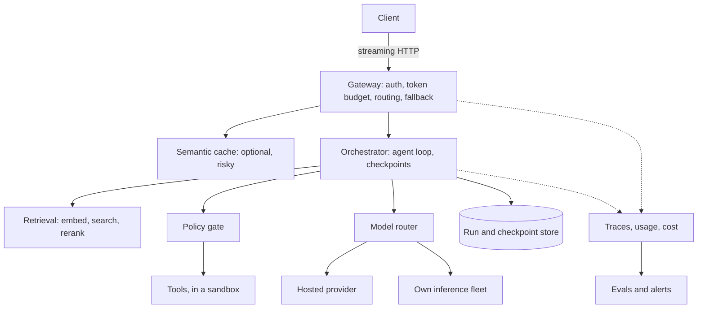

# 10 — An AI system reference architecture

> In a hypothetical mix, the costliest request costs 67 times the median, and a 100-step agent run with a 2% failure per step needs 325 model calls if each failure restarts it, or 102 with checkpoints. The backend ideas from this track still apply, but the unit of work has changed from a request to a token. This chapter draws the whole system, builds its gateway, and points to the notes that cover each part in depth.

---

## The whole system

This chapter is a map. Inference, retrieval, harnesses and observability each have their own notes in this course, and they go much deeper than a backend chapter should. The map below shows how the parts sit together, what each borrows from the earlier chapters, and where to read next.



Figure: a reference architecture, not a required one. A single-call product needs the top line and the model. An agent needs the rest.

| Part | Backend idea it reuses | Read in depth |
|---|---|---|
| Calling a model | [Timeouts and retry classes](07-reliability-under-load.md#retrying-responsibly), [streaming](#streaming-to-the-client) | [Production habits](../../../generative-ai/01-llm-fundamentals/notes/13-calling-models-from-code.md#production-habits) |
| Inference fleet | [Balancing](04-load-balancing-and-rate-limiting.md#picking-a-server), [autoscaling](06-containers-cicd-and-deployment.md#what-an-autoscaler-does-in-a-spike) | [Serving at scale](../../../ai-engineering/07-inference-engineering/notes/06-serving-at-scale.md) |
| Hosted or self-run | [Estimation](05-estimation-and-scaling.md#an-estimate-is-a-program) | [When local beats the API](../../../generative-ai/01-llm-fundamentals/notes/14-open-weight-models-and-local-inference.md#when-does-local-beat-the-api) |
| Retrieval | [Caching](03-caching-and-queues.md), and the choice of [store](../../../data-engineering/01-storage-and-compute-foundations/notes/10-choosing-a-store.md) | [RAG pipeline](../../../generative-ai/02-rag-retrieval/notes/01-rag-pipeline.md), [RAG in production](../../../generative-ai/02-rag-retrieval/notes/07-rag-in-production.md), [retrieval as context](../../../ai-engineering/02-context-engineering/notes/04-retrieval.md) |
| Semantic cache | [Stale fills](03-caching-and-queues.md#stale-fills-and-leases) | [Semantic cache](../../../generative-ai/02-rag-retrieval/notes/10-semantic-cache.md) |
| Agent loop | [Leases and fencing](08-design-walkthroughs-rate-limiter-notifications-scheduler.md#scheduler-leases-and-fencing), [the outbox](03-caching-and-queues.md#the-outbox-a-write-and-a-message-together) | [Harness anatomy](../../../ai-engineering/03-harness-engineering/notes/02-harness-anatomy.md), [durable execution](../../../ai-engineering/05-graph-engineering/notes/04-durable-execution-and-interrupts.md) |
| Tools | [Authorization](02-auth-sessions-jwt-oauth.md), [idempotent writes](01-api-design.md#two-writes-that-survive-a-retry) | [Execution boundaries](../../../ai-engineering/03-harness-engineering/notes/04-execution-boundaries.md), [tool sandboxing](../../../ai-engineering/09-safety-and-security/notes/04-tool-and-execution-sandboxing.md) |
| Observability | [Tracing and percentiles](07-reliability-under-load.md#tracing-one-request) | [Tracing](../../../generative-ai/06-observability/notes/01-tracing-with-langfuse.md), [cost and latency dashboards](../../../generative-ai/06-observability/notes/06-cost-and-latency-dashboards.md) |
| Shipping changes | [Canary](06-containers-cicd-and-deployment.md#canary-how-much-traffic-for-how-long) | [Evals in CI](../../../generative-ai/08-eval/notes/10-evals-in-ci.md), [production evals](../../../generative-ai/08-eval/notes/11-production-and-the-maturity-ladder.md) |

The rest of this chapter covers what changes when these ideas meet a model, and leaves the content of those notes to them.

## What changes when the backend is a model

Three things differ from the services in earlier chapters.

**Requests vary enormously in size.** An API that reads a row has a fairly narrow range of costs. A model request's cost depends on the prompt and on an output length that isn't known when it starts. Here is a hypothetical traffic mix with a hypothetical price of $3 per million input tokens and $15 per million output tokens:

```python
"""How unequal are LLM requests? A hypothetical traffic mix, sampled."""
import random
import statistics

rng = random.Random(10)
PRICE_IN, PRICE_OUT = 3 / 1e6, 15 / 1e6  # hypothetical dollars per token


def request():
    # Hypothetical: most prompts are short, a few carry whole documents.
    prompt = int(rng.lognormvariate(7.0, 1.2))  # median about 1,100 tokens
    output = int(rng.lognormvariate(5.3, 1.0))  # median about 200 tokens
    return prompt, output


reqs = [request() for _ in range(100_000)]
costs = sorted(p * PRICE_IN + o * PRICE_OUT for p, o in reqs)
work = sorted(p + 4 * o for p, o in reqs)  # an output token costs more to make


def q(xs, f):
    return xs[int(f * (len(xs) - 1))]


print(f"cost per request   p50 ${q(costs, .5):.4f}   p99 ${q(costs, .99):.4f}"
      f"   max ${costs[-1]:.2f}")
print(f"p99/p50 cost ratio {q(costs, .99) / q(costs, .5):.0f}x"
      f"   max/p50 {costs[-1] / q(costs, .5):.0f}x")
top = sum(costs[-1000:]) / sum(costs)
print(f"the costliest 1% of requests are {top:.0%} of the bill")
print(f"mean ${statistics.mean(costs):.4f} vs median ${q(costs, .5):.4f}")
```

```text
cost per request   p50 $0.0079   p99 $0.0656   max $0.53
p99/p50 cost ratio 8x   max/p50 67x
the costliest 1% of requests are 9% of the bill
mean $0.0117 vs median $0.0079
```

The mix is invented, and a different one gives different ratios. Two consequences don't depend on the details: counting requests tells you little about work, and a limit expressed in requests per minute doesn't limit spend. That's why [a rate limiter from chapter 4](04-load-balancing-and-rate-limiting.md#five-ways-to-count-requests) counts tokens here.

**The server is a scarce, expensive thing with long-held connections.** A response can take many seconds, so the gateway holds a connection for each one. A slow start also has a name of its own. The two latency figures that matter are time to first token and time per output token, and OpenTelemetry's [generative AI conventions](https://raw.githubusercontent.com/open-telemetry/semantic-conventions/v1.38.0/docs/gen-ai/gen-ai-metrics.md) define server metrics for each one, along with client metrics for token usage and operation duration. Those conventions are marked as in development, so expect names to change.

**Failures are billed.** A retried database read costs very little. A retried model call may cost cents, and a request that fails partway may already have produced output you pay for. That changes the sums on the [retry budget](07-reliability-under-load.md#retrying-responsibly).

## Sizing it

The method is the one from [chapter 5](05-estimation-and-scaling.md#an-estimate-is-a-program): write it as a program, so that an assumption can change. Every input below is hypothetical, including the prices and the replica's throughput.

```python
"""Sizing a hypothetical product. Every input here is an assumption."""
import math

requests_per_day = 500_000
peak_factor = 4
prompt_tokens = 3_000
cached_share = 0.6  # share of prompt tokens that hit a provider's prompt cache
output_tokens = 300
stream_seconds = 12  # time an average response holds a connection
price_in, price_cached, price_out = 3e-6, 0.3e-6, 15e-6  # hypothetical $/token
replica_tokens_per_s = 2_500  # hypothetical output tokens/s for one replica

mean_rps = requests_per_day / 86_400
peak_rps = mean_rps * peak_factor
print(f"requests/s   mean {mean_rps:.1f}   peak {peak_rps:.1f}")

# Little's law: things in flight = arrival rate x time in the system.
open_streams = peak_rps * stream_seconds
print(f"open streams at peak: {open_streams:.0f}")

peak_out = peak_rps * output_tokens
print(f"output tokens/s at peak: {peak_out:,.0f}"
      f"   replicas at 70% target: {math.ceil(peak_out / (replica_tokens_per_s * .7))}")

full = prompt_tokens * price_in + output_tokens * price_out
cached = (prompt_tokens * (1 - cached_share) * price_in
          + prompt_tokens * cached_share * price_cached
          + output_tokens * price_out)
print(f"cost per request   no prompt cache ${full:.4f}   with ${cached:.4f}")
print(f"cost per day       no prompt cache ${full * requests_per_day:,.0f}"
      f"   with ${cached * requests_per_day:,.0f}")

# A retried request is billed again. So is a whole retry storm.
retry_rate = 0.03
print(f"3% of requests retried once adds ${cached * requests_per_day * retry_rate:,.0f}/day")
```

```text
requests/s   mean 5.8   peak 23.1
open streams at peak: 278
output tokens/s at peak: 6,944   replicas at 70% target: 4
cost per request   no prompt cache $0.0135   with $0.0086
cost per day       no prompt cache $6,750   with $4,320
3% of requests retried once adds $130/day
```

The 278 open streams come from [Little's law](../../computer-science/notes/05-processes-threads-and-io.md#queues-littles-law). They are the reason a gateway is usually written around an [event loop](../../computer-science/notes/05-processes-threads-and-io.md#the-event-loop-many-waits-one-thread) and not a thread per request. The 4 replicas are a starting point only, since a real replica's throughput depends on batching and on its model, and the place to measure it is [the serving notes](../../../ai-engineering/07-inference-engineering/notes/06-serving-at-scale.md#batching).

The cost lines show where the money is. Prompt tokens outnumber output tokens ten to one here, so a cheap read of a stable prefix takes 36% off the bill. For the real price structure, and a worked bill with real list prices, read [caching and the real bill](../../../generative-ai/07-agentic-applications/notes/07-scoping-an-ai-product.md#caching-and-the-real-bill).

## Routing: count work, not connections

[Chapter 4](04-load-balancing-and-rate-limiting.md#picking-a-server) showed that a balancer does better with live load than with a fixed turn order. Requests of unequal size make the gap wider. This model has four replicas that each run one request at a time, with the hypothetical workload from above:

```python
"""Three routing policies, on requests of very unequal size.

A model of four replicas that each process 2,000 work units a second, one
request at a time. Hypothetical workload; the comparison is the point.
"""
import random


def workload(n, rate, seed=4):
    rng = random.Random(seed)
    now = 0.0
    out = []
    for _ in range(n):
        now += rng.expovariate(rate)
        size = rng.lognormvariate(7.0, 1.2) + 4 * rng.lognormvariate(5.3, 1.0)
        out.append((now, size))
    return out


def simulate(reqs, policy, replicas=4, speed=2000.0):
    free_at = [0.0] * replicas
    finishes = [[] for _ in range(replicas)]
    waits = []
    for i, (t, size) in enumerate(reqs):
        for f in finishes:
            while f and f[0] <= t:
                f.pop(0)
        if policy == "round robin":
            r = i % replicas
        elif policy == "fewest in flight":  # counts requests, knows no sizes
            r = min(range(replicas), key=lambda k: len(finishes[k]))
        else:  # "least work": knows every size, which a real router doesn't
            r = min(range(replicas), key=lambda k: max(free_at[k], t))
        start = max(free_at[r], t)
        free_at[r] = start + size / speed
        finishes[r].append(free_at[r])
        waits.append(start - t)
    return sorted(waits)


mean_work = sum(s for _, s in workload(50_000, 1)) / 50_000
for util in (0.5, 0.7):
    rate = util * 4 * 2000 / mean_work
    reqs = workload(50_000, rate)
    print(f"utilisation {util:.0%}, {rate:.1f} requests/s")
    for policy in ("round robin", "fewest in flight", "least work"):
        w = simulate(reqs, policy)
        print(f"  {policy:17} queue wait p50 {w[len(w) // 2]:6.2f} s"
              f"   p99 {w[int(.99 * len(w))]:6.2f} s")
```

```text
utilisation 50%, 1.1 requests/s
  round robin       queue wait p50   0.00 s   p99  21.43 s
  fewest in flight  queue wait p50   0.00 s   p99   6.56 s
  least work        queue wait p50   0.00 s   p99   3.14 s
utilisation 70%, 1.6 requests/s
  round robin       queue wait p50   0.28 s   p99  42.01 s
  fewest in flight  queue wait p50   0.00 s   p99  12.90 s
  least work        queue wait p50   0.00 s   p99   8.33 s
```

At 50% utilisation, round robin's p99 wait is more than three times the wait of a policy that only counts requests in flight. "Least work" is a bound, since it knows every request's real size in advance, and a real router can't. It can use the prompt's length and `max_tokens`, but it's guessing at the output.

The model is simple on purpose. A real engine batches requests, so a replica runs many at once and doesn't queue them strictly. The serving notes say why [round robin is a poor default for LLMs](../../../ai-engineering/07-inference-engineering/notes/06-serving-at-scale.md#routing), and add one thing this model leaves out: replicas hold different prompts in cache, so sending a request to a replica that has its prefix saves work. The same note explains why [GPU utilisation is a poor autoscaling signal](../../../ai-engineering/07-inference-engineering/notes/06-serving-at-scale.md#autoscaling) and why a cold start takes minutes. So [the autoscaler reasoning from chapter 6](06-containers-cicd-and-deployment.md#what-an-autoscaler-does-in-a-spike) applies with a longer delay: you need warm headroom to cover a spike, because new replicas will arrive after it.

## The gateway: budget, fallback and streaming

A gateway is one service that every model call goes through. It gives you a single place to authenticate, count, limit, choose a provider and log. This one has stub providers, so no model is called. A provider here is an async generator of text chunks, and the budget counts each chunk as one token.

```python
"""A gateway in front of stub providers: budget, fallback, streaming.

No model is called. A provider here is an async generator of text chunks.
"""
import asyncio
from dataclasses import dataclass, field


class ProviderDown(Exception):
    pass


class OverBudget(Exception):
    pass


@dataclass
class Provider:
    name: str
    fail_after: int | None = None  # chunks before it fails; 0 = fails at once
    sent: int = 0

    async def stream(self, prompt):
        for i, word in enumerate(f"answer from {self.name} to {prompt}".split()):
            if self.fail_after == i:
                raise ProviderDown(self.name)
            await asyncio.sleep(0)
            self.sent += 1
            yield word


@dataclass
class Budget:
    limit: int
    used: int = 0
    held: int = 0

    def reserve(self, tokens):
        if self.used + self.held + tokens > self.limit:
            raise OverBudget(f"{self.used}+{self.held}+{tokens} > {self.limit}")
        self.held += tokens

    def settle(self, reserved, actual):
        self.held -= reserved
        self.used += actual


@dataclass
class Gateway:
    providers: list
    budgets: dict
    log: list = field(default_factory=list)

    async def stream(self, tenant, prompt, max_tokens):
        budget = self.budgets[tenant]
        prompt_tokens = len(prompt.split())
        reserved = prompt_tokens + max_tokens
        budget.reserve(reserved)  # refuse before spending anything
        delivered = 0
        try:
            for provider in self.providers:
                try:
                    async for chunk in provider.stream(prompt):
                        delivered += 1
                        yield chunk
                    self.log.append(f"{provider.name} finished")
                    return
                except ProviderDown:
                    if delivered:  # the client has text: can't start over silently
                        self.log.append(f"{provider.name} died mid-stream")
                        yield "[stream interrupted]"
                        return
                    self.log.append(f"{provider.name} down, trying next")
            raise ProviderDown("all providers")
        finally:
            # Runs on success, failure and client disconnect alike.
            budget.settle(reserved, prompt_tokens + delivered if delivered else 0)


async def collect(gw, tenant, prompt, max_tokens=20, stop_after=None):
    out = []
    stream = gw.stream(tenant, prompt, max_tokens)
    try:
        async for chunk in stream:
            out.append(chunk)
            if stop_after and len(out) == stop_after:
                break  # the client went away
    finally:
        await stream.aclose()  # closes the provider's stream too
    return " ".join(out)


async def main():
    a, b = Provider("A", fail_after=0), Provider("B")
    gw = Gateway([a, b], {"acme": Budget(limit=40)})
    print("1. primary down before any text")
    print("  ", await collect(gw, "acme", "hello"))
    print("  ", gw.log, gw.budgets["acme"])

    a, b = Provider("A", fail_after=2), Provider("B")
    gw = Gateway([a, b], {"acme": Budget(limit=40)})
    print("2. primary dies after two chunks")
    print("  ", await collect(gw, "acme", "hello"))
    print("  ", gw.log, gw.budgets["acme"])

    a = Provider("A")
    gw = Gateway([a], {"acme": Budget(limit=40)})
    print("3. client disconnects after one chunk")
    print("  ", await collect(gw, "acme", "hello", stop_after=1))
    print("   chunks produced:", a.sent, gw.budgets["acme"])

    gw = Gateway([Provider("A")], {"acme": Budget(limit=40)})
    gw.budgets["acme"].used = 30
    print("4. tenant near its limit asks for 20 more")
    try:
        await collect(gw, "acme", "hello")
    except OverBudget as e:
        print("   refused:", e)
    print("  ", gw.budgets["acme"])


asyncio.run(main())
```

```text
1. primary down before any text
   answer from B to hello
   ['A down, trying next', 'B finished'] Budget(limit=40, used=6, held=0)
2. primary dies after two chunks
   answer from [stream interrupted]
   ['A died mid-stream'] Budget(limit=40, used=3, held=0)
3. client disconnects after one chunk
   answer
   chunks produced: 1 Budget(limit=40, used=2, held=0)
4. tenant near its limit asks for 20 more
   refused: 30+0+21 > 40
   Budget(limit=40, used=30, held=0)
```

Each of the four cases shows one rule.

**Case 1: fall back only before the first token.** Nothing has reached the client, so moving to provider B is invisible, apart from the extra wait. Check the [retry classes](07-reliability-under-load.md#retrying-responsibly) first: an overloaded or failed upstream is worth moving away from, and a request the model rejected as malformed will fail on every provider.

**Case 2: after the first token, you can't start again silently.** The client has already shown "answer from". A second provider would write a different answer, starting from nothing, and the user would see the two run together. So the gateway ends the stream with an explicit error, and the client decides what to do. Pretending otherwise is the failure this rule prevents.

**Case 3: a disconnect has to reach the provider.** `aclose()` propagates into the generator, so the provider produced one chunk and stopped. Without it, an abandoned request keeps generating tokens that nobody will read and somebody will pay for. A provider that hangs never reaches that point, so the whole stream needs a deadline as well. See [deadlines must travel](07-reliability-under-load.md#deadlines-must-travel).

**Case 4: refuse early, with a reason.** The request needs 21 tokens of room, so it's refused before anything is spent. The response should be a [429 Too Many Requests](https://www.rfc-editor.org/rfc/rfc6585), which can carry `Retry-After` to say when to come back. The [SRE book's advice on overload](https://sre.google/sre-book/handling-overload/) applies as is: per-customer limits keep one customer from using up everyone's capacity.

### Why reserve first

Cost isn't known until a response finishes, so a gateway that only counts afterwards can admit many requests that each look fine. The model below has a tenant sending one request per time step, each taking 30 steps. All numbers are hypothetical.

```python
"""Why reserve before calling? Concurrent requests against a shared budget."""
import random


def run(reserve, seed=1):
    rng = random.Random(seed)
    limit, used, held = 100_000, 0, 0
    in_flight = []  # (finish time, reserved, actual)
    admitted = refused = 0
    for t in range(2000):
        for item in [x for x in in_flight if x[0] <= t]:
            in_flight.remove(item)
            used += item[2]
            held -= item[1]
        max_tokens, actual = 1000, rng.randint(100, 1000)
        check = used + (held + max_tokens if reserve else 0)
        if (check > limit) if reserve else (used >= limit):
            refused += 1
            continue
        admitted += 1
        if reserve:
            held += max_tokens
        in_flight.append((t + 30, max_tokens if reserve else 0, actual))
    used += sum(x[2] for x in in_flight)
    return used, limit, admitted, refused


for name, flag in (("count after the response", False), ("reserve before the call", True)):
    used, limit, admitted, refused = run(flag)
    print(f"{name:26} spent {used:7,} of {limit:,}"
          f"   ({used - limit:+,})   admitted {admitted}, refused {refused}")
```

```text
count after the response   spent 116,961 of 100,000   (+16,961)   admitted 201, refused 1799
reserve before the call    spent  99,188 of 100,000   (-812)   admitted 172, refused 1828
```

Counting afterwards overspends by 17%, and the overspend grows with concurrency and with `max_tokens`. Reserving the worst case holds the line, and `settle` returns what wasn't used. The price is that near the limit it refuses requests that would have fitted, because it assumes every request will use its full `max_tokens`. That is also a reason to set `max_tokens` sensibly and not to its highest value. The [lab](../practice/solutions/backend_lab/token_budget.py) implements this with a window and a clock you control.

A shared budget across gateway instances has [the race from chapter 8](08-design-walkthroughs-rate-limiter-notifications-scheduler.md#rate-limiter-the-race), and the same answer: make the check and the reservation one atomic step in the store. An agent's whole run needs its own ceiling too, which the harness notes call a [cost envelope](../../../ai-engineering/03-harness-engineering/notes/04-execution-boundaries.md#cost-envelope).

### Streaming to the client

Streaming is why [chapter 1](01-api-design.md#choosing-between-them) left this case for here. [Server-sent events](https://html.spec.whatwg.org/multipage/server-sent-events.html) are the simplest option: an ordinary HTTP response of type `text/event-stream`, where each event is some text lines followed by a blank line. The format has resumption built in, because a client that reconnects sends the last `id` it saw in a `Last-Event-ID` header.

```python
"""Server-sent event framing, and resuming from Last-Event-ID."""


def frame(event_id, text):
    # One event: an id field, a data field, then a blank line to dispatch it.
    lines = "".join(f"data: {line}\n" for line in text.split("\n"))
    return f"id: {event_id}\n{lines}\n"


def parse(stream):
    """The event parts a client needs: (last id, data) per event."""
    events = []
    for block in stream.split("\n\n")[:-1]:  # an unfinished last block is dropped
        eid, data = None, []
        for line in block.split("\n"):
            if line.startswith(":"):  # a comment: keeps the connection alive
                continue
            field, _, value = line.partition(":")
            value = value.removeprefix(" ")
            if field == "id":
                eid = value
            elif field == "data":
                data.append(value)
        if data:
            events.append((eid, "\n".join(data)))
    return events


class StreamBuffer:
    """What the gateway keeps per stream so that a reconnect can resume."""

    def __init__(self):
        self.chunks = []

    def add(self, text):
        self.chunks.append(text)
        return frame(len(self.chunks), text)

    def replay(self, last_event_id):
        start = int(last_event_id or 0)
        return "".join(frame(i + 1, c) for i, c in enumerate(self.chunks) if i >= start)


buf = StreamBuffer()
wire = "".join(buf.add(w) for w in ["The", " cache", " missed"])
print(repr(wire[:32]))
print("parsed:", parse(": keep-alive\n\n" + wire))

# The connection drops after event 1. The client reconnects with
# Last-Event-ID: 1, and is sent only what it hasn't seen.
print("replay:", parse(buf.replay("1")))
# A cut in the middle of an event isn't delivered, so it is sent again.
print("cut:   ", parse(wire[:30]))
```

```text
'id: 1\ndata: The\n\nid: 2\ndata:  ca'
parsed: [('1', 'The'), ('2', ' cache'), ('3', ' missed')]
replay: [('2', ' cache'), ('3', ' missed')]
cut:    [('1', 'The')]
```

The last line shows a detail of the format: a block without its blank line is discarded, so a cut can't deliver half an event.

Three practical points follow. A browser's `EventSource` takes a URL and a credentials flag, with no way to send a body, so a long prompt in a POST body has to be read some other way, such as `fetch`, and resuming becomes your own code. A proxy may drop a quiet connection, and the spec suggests a comment line about every 15 seconds to protect against that, which matters during a long wait for the first token. And resuming needs the buffer above to live somewhere other than the instance that died, so decide whether you want it: replaying from a shared store costs a write per chunk, and many products just show an error and a retry button.

For the client side of this, see [the streaming pattern](../../../generative-ai/01-llm-fundamentals/notes/13-calling-models-from-code.md#pattern-2-streaming-same-file).

## A latency budget for the first token

A request that retrieves before generating is a [chain of stages](07-reliability-under-load.md#the-tail-is-what-users-get), and the medians of a chain don't tell you its tail. These stage timings are hypothetical:

```python
"""A first-token budget for a hypothetical RAG request. Medians are not enough."""
import math
import random

rng = random.Random(7)
# (median ms, lognormal sigma), hypothetical stage timings
stages = {
    "auth + policy":   (5, 0.3),
    "embed the query": (30, 0.4),
    "vector search":   (40, 0.6),
    "rerank":          (120, 0.5),
    "queue + first token": (600, 0.7),
}
target = 1500
samples = [[rng.lognormvariate(math.log(m), s)
            for m, s in stages.values()] for _ in range(50_000)]
totals = sorted(sum(x) for x in samples)
print(f"sum of the medians            {sum(m for m, _ in stages.values()):5} ms")
print(f"median of the whole request   {totals[len(totals) // 2]:5.0f} ms")
print(f"p99 of the whole request      {totals[int(.99 * len(totals))]:5.0f} ms")
print(f"share over {target} ms             {sum(t > target for t in totals) / len(totals):6.1%}")
```

```text
sum of the medians              795 ms
median of the whole request     827 ms
p99 of the whole request       3279 ms
share over 1500 ms              14.2%
```

The medians add up to a comfortable 795 ms against a 1,500 ms target, yet about one request in seven misses it. So budget against the tail of the whole request, measured from a trace, and not against the sum of each team's typical figure. [The Tail at Scale](https://www.barroso.org/publications/TheTailAtScale.pdf) makes the related point for parallel fan-out, that component variability is magnified at the service level, and [RAG in production](../../../generative-ai/02-rag-retrieval/notes/07-rag-in-production.md#latency) lists the levers, such as skipping retrieval for prompts that don't need it. The stage to look at first here is the largest one with the widest spread, which is the queue and first token.

## Agents: long runs need durable state

An agent is a loop of model calls and tool calls, and a long run meets failures that a single request rarely does. Here's what a 2% failure per step does to a run:

```python
"""An agent run of N steps. Each step fails with probability p.

Without checkpoints a failure restarts the run; with them it repeats one step.
"""
import random


def restart(n, p, rng):
    calls = done = 0
    while done < n:
        calls += 1
        done = 0 if rng.random() < p else done + 1
    return calls


def checkpoint(n, p, rng):
    calls = done = 0
    while done < n:
        calls += 1
        done += 0 if rng.random() < p else 1
    return calls


p = 0.02
print(f"step failure rate {p:.0%}. Model calls needed, mean of 20,000 runs")
print("steps   P(no failure)   restart   checkpoint   formula(restart)")
for n in (5, 20, 50, 100):
    rng = random.Random(n)
    a = sum(restart(n, p, rng) for _ in range(20_000)) / 20_000
    b = sum(checkpoint(n, p, rng) for _ in range(20_000)) / 20_000
    formula = ((1 - p) ** -n - 1) / p
    print(f"{n:5}   {(1 - p) ** n:13.0%}   {a:7.1f}   {b:10.1f}   {formula:16.1f}")
```

```text
step failure rate 2%. Model calls needed, mean of 20,000 runs
steps   P(no failure)   restart   checkpoint   formula(restart)
    5             90%       5.3          5.1                5.3
   20             67%      24.9         20.4               24.9
   50             36%      87.5         51.0               87.3
  100             13%     324.7        102.0              327.0
```

The restart column grows exponentially with the number of steps, which is why checkpoints stop being optional somewhere past a few dozen steps. Saving state after each step makes the cost close to linear. The [durable execution note](../../../ai-engineering/05-graph-engineering/notes/04-durable-execution-and-interrupts.md#checkpointers) shows how, and [long-horizon execution](../../../ai-engineering/03-harness-engineering/notes/06-long-horizon-execution.md) covers what else breaks over a long run.

Three things carry over directly from the backend chapters:

- **A worker can die holding a run.** Hand out runs with a lease and a fencing token, as in [the scheduler](08-design-walkthroughs-rate-limiter-notifications-scheduler.md#scheduler-leases-and-fencing).
- **A resumed step may run twice.** Any tool that writes needs an [idempotency key](01-api-design.md#two-writes-that-survive-a-retry). A checkpoint saved after a tool ran but lost before it committed will re-send the email otherwise.
- **State and side effect must change together.** That's [the outbox](03-caching-and-queues.md#the-outbox-a-write-and-a-message-together): record the intention in the same transaction as the checkpoint.

## Where a backend engineer must not reuse the old habit

**A cache hit can be wrong in a new way.** A key-value cache returns exactly what was stored for that key. A semantic cache returns what was stored for a *similar* question, and similar isn't the same as equal. [The semantic cache note](../../../generative-ai/02-rag-retrieval/notes/10-semantic-cache.md#the-threshold-has-no-clean-setting) measures how badly a similarity threshold separates paraphrases from near misses, then adds [a guard on identifiers](../../../generative-ai/02-rag-retrieval/notes/10-semantic-cache.md#guarding-the-hit) and [invalidation by source document](../../../generative-ai/02-rag-retrieval/notes/10-semantic-cache.md#staleness-and-scope). In a multi-tenant system the key must also include the tenant and its permissions, because a cross-tenant hit is a [data leak](../../../generative-ai/02-rag-retrieval/notes/07-rag-in-production.md#security), not just a wrong answer.

**The model isn't an authorised caller.** [Authorization](02-auth-sessions-jwt-oauth.md) in chapter 2 asks whether this user may touch this object. An agent acts for a user, but its choices can be steered by the text it reads. So put a deterministic [policy function](../../../ai-engineering/09-safety-and-security/notes/04-tool-and-execution-sandboxing.md#a-policy-engine-for-tool-calls) between what the model proposes and what runs, and pass the user's identity to the tool and not the model's say-so. Check the design against [the lethal trifecta](../../../ai-engineering/09-safety-and-security/notes/01-threat-model.md#the-lethal-trifecta): private data, untrusted content, and a way to send data out. [Limit egress](../../../ai-engineering/09-safety-and-security/notes/04-tool-and-execution-sandboxing.md#egress-the-third-leg-of-the-trifecta), and [enforce sandboxes in the runtime](../../../ai-engineering/03-harness-engineering/notes/04-execution-boundaries.md#sandboxes), not in anything the agent can edit.

**Green status codes don't mean it worked.** A 200 can carry a wrong answer, a refusal or a truncated one. So [check the stop reason](../../../generative-ai/01-llm-fundamentals/notes/13-calling-models-from-code.md#production-habits), [trace each run](../../../generative-ai/06-observability/notes/01-tracing-with-langfuse.md#the-data-model) with [sensitive data masked before export](../../../generative-ai/06-observability/notes/01-tracing-with-langfuse.md#keeping-traces-safe-and-affordable), [sample live traffic into evals](../../../generative-ai/08-eval/notes/11-production-and-the-maturity-ladder.md), and treat a model or prompt change like a deploy. It gets a [regression gate against a baseline](../../../generative-ai/08-eval/notes/10-evals-in-ci.md#the-regression-gate) in CI and then a [canary](06-containers-cicd-and-deployment.md#canary-how-much-traffic-for-how-long). [Pin the model version](../../../generative-ai/01-llm-fundamentals/notes/13-calling-models-from-code.md#production-habits) for the same reason you pin an image.

**A cost alert is an availability alert.** A runaway loop can use up a budget, and when the budget hits zero the service stops for that tenant. Put [budgets and alerts](../../../generative-ai/06-observability/notes/06-cost-and-latency-dashboards.md#budgets-and-alerts) next to your [SLOs](07-reliability-under-load.md#slos-and-error-budgets), and decide in advance what happens at the limit.

## Pitfalls

**Limiting requests instead of tokens.** One tenant's document-sized prompts can use the capacity of hundreds of short ones while staying under a request limit.

**Silent fallback in mid-stream.** It produces a stitched answer from two models, and the logs show success.

**A fallback provider with no capacity for your traffic.** If the primary fails, all of its traffic arrives at the fallback. Test the failover at load, or it's only a hope. [Losing a region](07-reliability-under-load.md#losing-a-region) has the same sum.

**Fallback that changes behaviour unnoticed.** Another model is another system with its own quality. Run it through the same evals, and record which model answered on each trace.

**Client retries around a slow stream.** A client timeout set for ordinary APIs abandons a slow response and sends it again. You pay twice, and the load goes up when the system is already slow. Make the timeouts match, and [budget the retries](07-reliability-under-load.md#retrying-responsibly).

**Forgetting disconnects.** If closing the client connection doesn't cancel upstream, an impatient user who keeps refreshing multiplies your bill.

**A shared cache across tenants.** See above. It's a security bug that presents itself as a performance win.

**A budget without a behaviour at the limit.** Decide whether the agent stops with a partial result, drops to a cheaper model, or asks someone, as [the cost envelope section](../../../ai-engineering/03-harness-engineering/notes/04-execution-boundaries.md#cost-envelope) describes. An agent that simply crashes at the limit loses its work.

**Trusting a benchmark's throughput for sizing.** Measure with your own prompt lengths. The replica figure in this chapter's estimate is an assumption for that reason.

## Try it

**1. In the sizing program, the prompt doubles to 6,000 tokens, with the same cache share. What does a request cost per day, and what does that mean for prompt growth?**

<details>
<summary>Answer</summary>

Per request: 2,400 uncached × $3/M, plus 3,600 cached × $0.30/M, plus 300 output × $15/M, or $0.0072 + $0.00108 + $0.0045 = $0.01278. Per day at 500,000 requests: $6,390, up from $4,320. Twice the prompt adds 48%, because output doesn't grow. Every example or document someone adds to a prompt template goes on this bill, and that's why [token arithmetic](../../../generative-ai/07-agentic-applications/notes/07-scoping-an-ai-product.md#token-arithmetic-for-one-ticket) belongs in a design review.

</details>

**2. In case 4 of the gateway, the request would really have used 6 tokens, which would have fitted. Was refusing it a bug?**

<details>
<summary>Answer</summary>

No, it's the trade reservation makes. The gateway can't know the output length in advance, so it holds room for `max_tokens`, here 20 plus one prompt token. With `max_tokens=9` the request would have fitted. Lowering `max_tokens` is a real fix, because a caller that asks only for what it needs is admitted more often near the limit.

</details>

**3. With a 5% failure per step, how many calls does a 50-step run need, with and without checkpoints?**

<details>
<summary>Answer</summary>

Without: ((0.95)^-50 − 1) / 0.05 ≈ 240 calls. With: 50 / 0.95 ≈ 53 calls. Only 7.7% of runs would finish without a failure, so the first number is mostly repeated work.

</details>

**4. Build the token budget in the lab.** Implement [`backend_lab/token_budget.py`](../practice/exercises/backend_lab/token_budget.py) so that `test_token_budget.py` passes: reservations, settling with actual usage, releasing a failed call, and a window that resets on a clock you control. A [worked version](../practice/solutions/backend_lab/token_budget.py) is there.

## Interview checklist

| Question | Answer |
|---|---|
| What's different about LLM requests? | Cost varies by orders of magnitude and isn't known up front, responses take seconds and hold a connection, and failed work may still be billed. |
| Why not rate-limit requests only? | Requests don't measure work or spend. Limit tokens too, per tenant. |
| How do you enforce a token budget when cost is unknown? | Reserve prompt tokens plus `max_tokens` before the call, and settle to actual usage after it. |
| What does a reservation cost you? | Near the limit, it refuses some requests that would have fitted. |
| When is provider fallback safe? | Before the first token reaches the client. After that, end with an explicit error. |
| What happens when a client disconnects? | Cancel upstream, settle for what was produced, and stop paying. |
| Why is round robin weak here? | Requests differ greatly in size, and replicas differ in which prefixes they have cached. Route by load and cache affinity. |
| What should an LLM fleet autoscale on? | Queue depth and first-token latency against the SLO, not GPU utilisation. Keep warm headroom, since a cold start takes minutes. |
| SSE or WebSocket for tokens? | SSE is plain HTTP, one way, with resumption built in, and it's enough for a reply. WebSocket fits when the client also sends during the stream. |
| What's the risk of a semantic cache? | A similar question isn't the same question, so a hit can be confidently wrong, and across tenants it's a leak. |
| Why checkpoint an agent? | Restart cost grows exponentially with steps. Per-step checkpoints keep it near linear. |
| Then what's needed on a resumed tool call? | An idempotency key, since the step may run twice. |
| How do you stop a prompt injection reaching a tool? | A deterministic policy between proposal and execution, the user's own identity on the call, and an allow-listed exit. |
| How do you ship a new model version? | A regression gate against a baseline, a canary, and the model id recorded on every trace. |

## Next

That ends the track. To go deeper into the AI side, start with [inference engineering](../../../ai-engineering/07-inference-engineering/README.md) or the [harness notes](../../../ai-engineering/03-harness-engineering/README.md). For the storage underneath all of this, go to [storage and compute foundations](../../../data-engineering/01-storage-and-compute-foundations/README.md). Then return to the [track README](../README.md) and pick a [walkthrough](08-design-walkthroughs-rate-limiter-notifications-scheduler.md) to do from a blank page.
