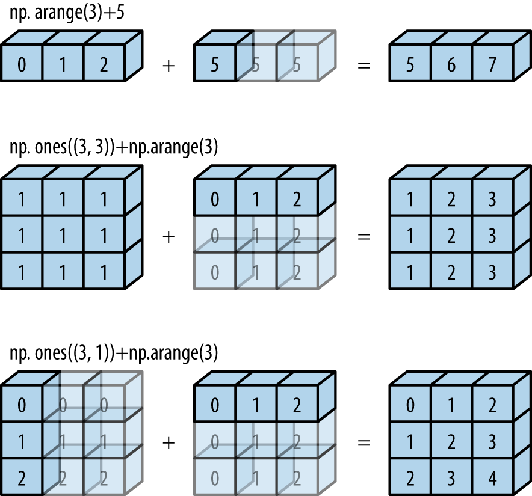

# 4 — Numbers and memory

> Python hides two things that the machine doesn't. Its numbers look like the ones in a maths book, and its memory looks flat and uniform. Neither is true. A float is 53 bits of binary, so `0.1` isn't 0.1 and `sum` can come out wrong. Memory is a staircase of caches, and the same loop runs four times slower when the objects are visited out of order. This chapter measures both, because in each case the useful skill is knowing when it matters. Accumulated rounding on a million costs comes to less than a billionth of a dollar, and you can ignore it. But cosine distance between nearly identical vectors can round to exactly zero, and a list of floats takes four times the memory of the same numbers in an array. Measurements are from an Apple M4 Pro with CPython 3.14.7.

---

## Integers that don't overflow

A Python `int` is a sign and a variable-length array of digits, each holding 30 bits ([`longintrepr.h`](https://github.com/python/cpython/blob/v3.14.7/Include/cpython/longintrepr.h)). So it can't overflow, and it isn't a machine word:

```python
import sys
import time

print(sys.int_info)
for bits in (0, 1, 29, 30, 60, 61, 90, 1_000):
    print(f"{bits:>5} bits: {sys.getsizeof(1 << bits):>4} bytes")

print(2**64 + 1, (2**64 + 1) % 2**64)
print("limit on int<->str:", sys.get_int_max_str_digits())
try:
    str(10**5000)
except ValueError as e:
    print("ValueError:", str(e)[:48])


def mul_seconds(digits, repeat=20):
    x = (1 << (digits * 30)) - 1
    best = 1e9
    for _ in range(repeat):
        start = time.perf_counter()
        x * x
        best = min(best, time.perf_counter() - start)
    return best


from math import log2

last = None
for d in (1_000, 2_000, 4_000, 8_000, 16_000):
    t = mul_seconds(d)
    print(f"{d:>6} digits: {t * 1e6:9.1f} us  slope {log2(t / last) if last else float('nan'):5.2f}")
    last = t
```

<!-- measured -->

```text
sys.int_info(bits_per_digit=30, sizeof_digit=4, default_max_str_digits=4300, str_digits_check_threshold=640)
    0 bits:   28 bytes
    1 bits:   28 bytes
   29 bits:   28 bytes
   30 bits:   32 bytes
   60 bits:   36 bytes
   61 bits:   36 bytes
   90 bits:   40 bytes
 1000 bits:  160 bytes
18446744073709551617 1
limit on int<->str: 4300
ValueError: Exceeds the limit (4300 digits) for integer stri
  1000 digits:     148.1 us  slope   nan
  2000 digits:     477.1 us  slope  1.69
  4000 digits:    1373.9 us  slope  1.53
  8000 digits:    4325.6 us  slope  1.65
 16000 digits:   13285.0 us  slope  1.62
```

The sizes show the 30-bit digits: 28 bytes up to 29 bits, then 4 more bytes for each further 30 bits. A plain small int costs 28 bytes plus the 8-byte pointer to it, against 8 bytes in an array, which matters [below](#the-layout-decides-the-constant).

The `4300` limit is a defence. Converting between decimal text and a huge int is quadratic, so a request body with a million-digit number could burn a lot of CPU. The [docs](https://docs.python.org/3.14/library/stdtypes.html#int-max-str-digits) describe the limit and how to change it.

Multiplication shows the [recursion tree from chapter 1](01-cost-models-and-big-o.md#recurrences-and-recursion-trees) at work. Schoolbook multiplication is `n²`, a slope of 2. The measured slope is around 1.6, close to `log2 3 ≈ 1.585`, because [`longobject.c`](https://github.com/python/cpython/blob/v3.14.7/Objects/longobject.c) switches to Karatsuba's algorithm above 70 digits: three half-size multiplications replace four, so three branches on half the problem. You can see the theory of chapter 1 show up in a timing here.

## What a float really is

A `float` is an IEEE 754 double: 1 sign bit, 11 exponent bits and 52 stored fraction bits, with an implied leading 1, making 53 significant bits. [Goldberg's paper](https://docs.oracle.com/cd/E19957-01/806-3568/ncg_goldberg.html) is the standard reference, and the [Python tutorial's appendix](https://docs.python.org/3.14/tutorial/floatingpoint.html) gives the short version. Only numbers of the form `m × 2^e` can be stored, and 1/10 isn't one of them, for the same reason that 1/3 has no finite decimal.

```python
import math
import struct

print(f"{0.1:.20f}")
print((0.1).as_integer_ratio(), (0.1).hex())
print("3602879701896397 / 2**55 == 0.1:", 3602879701896397 / 2**55 == 0.1)
total = 0.0
for _ in range(10):
    total += 0.1
print("0.1 added ten times:", total, " == 1.0:", total == 1.0)
print("builtin sum of the same:", sum([0.1] * 10))

bits = struct.unpack(">Q", struct.pack(">d", 0.1))[0]
print(f"sign {bits >> 63}, exponent {(bits >> 52) & 0x7ff} - 1023, fraction {bits & (2**52 - 1):013x} (hex)")

for x in (1.0, 1_000.0, 1e6, 2.0**53, 1e16, 1e300):
    print(f"ulp({x:>9.3g}) = {math.ulp(x):.3e}")
print(2.0**53 + 1 == 2.0**53)
print(1e16 + 1 == 1e16, 1e16 + 2 == 1e16)

as_single = lambda v: struct.unpack("f", struct.pack("f", v))[0]
print(as_single(16_777_217.0), as_single(0.1))
```

```text
0.10000000000000000555
(3602879701896397, 36028797018963968) 0x1.999999999999ap-4
3602879701896397 / 2**55 == 0.1: True
0.1 added ten times: 0.9999999999999999  == 1.0: False
builtin sum of the same: 1.0
sign 0, exponent 1019 - 1023, fraction 999999999999a (hex)
ulp(        1) = 2.220e-16
ulp(    1e+03) = 1.137e-13
ulp(    1e+06) = 1.164e-10
ulp( 9.01e+15) = 2.000e+00
ulp(    1e+16) = 2.000e+00
ulp(   1e+300) = 1.487e+284
True
True False
16777216.0 0.10000000149011612
```

Spacing is the key idea. The gap between adjacent floats is the *ulp* (unit in the last place), and it scales with the number. Near 1 it's about 2e-16, so relative precision stays near 16 digits everywhere. Near 1e16 the gap is 2, so `1e16 + 1 == 1e16` is true. That's the reason a running float counter stops increasing, and you can see the same effect in `float32` at 16,777,216: the next odd number just isn't there.

So the first lesson is that you should never compare floats with `==` after arithmetic, and it's also why `0.1` added ten times isn't `1.0`. Note the next line, though: builtin `sum` gets it right, since [3.12 made it use compensated summation](https://docs.python.org/3.14/library/functions.html#sum) for floats. The loop and `sum` no longer agree, and that surprises people.

## Subtraction is where precision goes

Each operation on floats rounds to within half an ulp of the true result. Rounding error is small and well behaved, so a single operation is fine. The real damage comes from subtracting nearly equal numbers: the leading digits cancel, and what's left is mostly earlier rounding error. Goldberg calls this cancellation:

```python
import math

x = 1e-12
print(f"(1 + x) - 1 = {(1 + x) - 1:.15e}   true value {x:.15e}")
print(f"relative error {abs(((1 + x) - 1) - x) / x:.2e}")

p = 1e-10
print(f"\nlog(1 + p)  = {math.log(1 + p):.15e}")
print(f"log1p(p)    = {math.log1p(p):.15e}")

# Cosine distance of two nearly identical unit vectors at angle theta.
print(f"\n{'theta':>8} {'1 - cos':>14} {'2 sin^2(t/2)':>15} {'rel. error':>11}")
for theta in (1e-2, 1e-5, 1e-7, 1e-8, 1e-9):
    naive = 1 - math.cos(theta)
    exact = 2 * math.sin(theta / 2) ** 2
    print(f"{theta:>8.0e} {naive:>14.6e} {exact:>15.6e} {abs(naive - exact) / exact:>11.1e}")
```

<!-- measured -->

```text
(1 + x) - 1 = 1.000088900582341e-12   true value 1.000000000000000e-12
relative error 8.89e-05

log(1 + p)  = 1.000000082690371e-10
log1p(p)    = 9.999999999500001e-11

   theta        1 - cos    2 sin^2(t/2)  rel. error
   1e-02   4.999958e-05    4.999958e-05     2.9e-13
   1e-05   5.000000e-11    5.000000e-11     8.3e-08
   1e-07   4.996004e-15    5.000000e-15     8.0e-04
   1e-08   0.000000e+00    5.000000e-17     1.0e+00
   1e-09   0.000000e+00    5.000000e-19     1.0e+00
```

`(1 + x) - 1` should give back `x`, and instead gets a relative error of 9e-5, which is 11 digits lost in one line. `math.log1p` exists for this case, and it's correct where `log(1 + p)` isn't. The pattern to watch for is a formula that evaluates near where it's zero.

The table is the one that matters for retrieval. For unit vectors at a small angle, `1 - cos θ` falls to 0 at about `1e-8`, so two different near-duplicate embeddings can come out with distance exactly zero. `2 sin²(θ/2)` is the same quantity rearranged with no subtraction, and it stays accurate. For unit vectors, half the squared Euclidean distance is the same quantity, and it subtracts the coordinates first, while they're still small relative to each other. I checked that: at `θ = 1e-8`, `1 - a @ b` gives `0.0` while `0.5 * (a - b) @ (a - b)` gives `5.0e-17`. So if you threshold near-duplicates at very small distances, compute the Euclidean form. For normal retrieval scores this doesn't matter at all.

## Summing many numbers

Rounding error adds up with the number of additions. Sum a million per-request costs and see what it amounts to:

```python
import math
import random
import time
from fractions import Fraction


def kahan(values):
    total = carry = 0.0
    for x in values:
        y = x - carry
        t = total + y
        carry = (t - total) - y  # what the addition just lost
        total = t
    return total


rng = random.Random(1)
costs = [rng.randrange(1, 4_000) * 3e-6 for _ in range(1_000_000)]  # dollars per request
exact = sum(map(Fraction, costs))
for name, f in [("sum loop", lambda v: _loop(v)), ("builtin sum", sum), ("kahan", kahan), ("math.fsum", math.fsum)]:
    def _loop(v):
        t = 0.0
        for x in v:
            t += x
        return t
    start = time.perf_counter()
    got = f(costs)
    ms = (time.perf_counter() - start) * 1e3
    print(f"{name:<12} {got:.10f}  error {float(abs(Fraction(got) - exact)):.2e}  {ms:7.1f} ms")

print()
hard = [1e16, 1.0, -1e16, 1.0] * 1000
print("hard case, true answer 2000:", "loop", _loop(hard), "| sum", sum(hard), "| kahan", kahan(hard), "| fsum", math.fsum(hard))
```

<!-- measured -->

```text
sum loop     5998.8641399994  error 6.42e-10      7.9 ms
builtin sum  5998.8641400000  error 4.37e-13      1.9 ms
kahan        5998.8641400000  error 4.37e-13     25.6 ms
math.fsum    5998.8641400000  error 4.37e-13     13.7 ms

hard case, true answer 2000: loop 1.0 | sum 2000.0 | kahan 1.0 | fsum 2000.0
```

The plain loop is off by 6.4e-10 on a total of $5,998.86, which is six ten-billionths of a dollar. Worrying about that would be misplaced effort, and you should note that it's the case for almost every sum of similar positive numbers. `sum` is also fastest here, as it runs in C.

The hard case is different. When big terms cancel, a loop's answer can be entirely wrong: it gives 1 and the truth is 2,000. Goldberg's Theorem 8 analyses Kahan's method, which keeps a running correction for what each addition lost. Kahan's version fails here too, as its correction assumes that the running total is larger than each new item. Neumaier's variant checks which is larger, and that's what you'll write in the [lab](../practice/README.md); `test_compensated_sum_handles_an_addend_bigger_than_the_total` covers exactly this. `math.fsum` is [documented](https://docs.python.org/3.14/library/math.html#math.fsum) to track several intermediate partial sums, and it costs about seven times `sum`.

So: use `sum` by default, use `math.fsum` when values span many orders of magnitude and cancel, and don't hand-write Kahan in a Python loop, which here is slower than either and wrong on the hard case.

## When to avoid floats

Money, billing and anything audited should be exact. There are three ways to do it:

```python
import math
import time
from decimal import Decimal
from fractions import Fraction

print(Decimal("0.1") + Decimal("0.2"), Decimal(0.1))
print(Fraction(1, 10) + Fraction(2, 10), Fraction(0.1))
micro = 100_000 + 200_000
print(f"micro-dollars: {micro}  = ${micro / 1e6:.2f}")


def timed(values, start):
    t = time.perf_counter()
    total = start
    for v in values:
        total += v
    return (time.perf_counter() - t) / len(values) * 1e9


n = 200_000
print(f"\nns per addition over {n:,} additions")
print(f"int     {timed([3] * n, 0):8.1f}")
print(f"float   {timed([3e-6] * n, 0.0):8.1f}")
print(f"Decimal {timed([Decimal('0.000003')] * n, Decimal(0)):8.1f}")
print(f"Fraction {timed([Fraction(3, 1_000_000)] * n, Fraction(0)):7.1f}")

print()
nan = float("nan")
print(nan == nan, math.isnan(nan), float("inf") > 1e308, 1e308 * 10)
print(sorted([3.0, nan, 1.0, 2.0]))
print(math.isclose(0.1 + 0.2, 0.3), math.isclose(1e-12, 0.0), math.isclose(1e-12, 0.0, abs_tol=1e-9))
```

<!-- measured -->

```text
0.3 0.1000000000000000055511151231257827021181583404541015625
3/10 3602879701896397/36028797018963968
micro-dollars: 300000  = $0.30

ns per addition over 200,000 additions
int          7.6
float        8.2
Decimal     34.9
Fraction   338.6

False True True inf
[3.0, nan, 1.0, 2.0]
True False True
```

Integers in the smallest unit, say micro-dollars, are as fast as floats, here 7.6 ns per addition. [`Decimal`](https://docs.python.org/3.14/library/decimal.html) is about four times slower and decimal-rounding aware, which matters if a contract specifies a rounding rule. [`Fraction`](https://docs.python.org/3.14/library/fractions.html) is exact but about 40 times slower than a float here, since it keeps reducing, and its denominators can grow. Note also that `Decimal(0.1)` shows the binary error faithfully: construct from strings, not floats.

The last lines are traps. `nan != nan`, so `sorted` on a list containing a NaN doesn't raise an error, it returns a list that isn't sorted, since every ordering comparison with NaN (`<`, `>`, `<=`, `>=`) is false. In an eval pipeline that yields wrong percentiles with no warning. Check `math.isnan` on the way in. And `math.isclose` defaults to a relative tolerance, so comparing anything to `0.0` is always false unless you pass `abs_tol`.

## Bits you'll actually use

Machine integers use two's complement: negative `x` is `2^n - x`, so `-1` is all ones. Byte order is a separate question, and network protocols are big-endian, as you'll see in [chapter 6](06-networks.md#tcp-is-a-stream-not-messages):

```python
print((-1).to_bytes(4, "little", signed=True).hex(), (1).to_bytes(4, "big").hex(), (1).to_bytes(4, "little").hex())
print(f"{-5 & 0xff:08b}  {5:08b}")
x = 0b1011000
print("low bit:", x & -x, " clear low bit:", bin(x & (x - 1)), " power of 2:", x & (x - 1) == 0, " popcount:", x.bit_count())
print("h & (size-1) == h % size:", all((h & 255) == h % 256 for h in range(10_000)))
```

```text
ffffffff 00000001 01000000
11111011  00000101
low bit: 8  clear low bit: 0b1010000  power of 2: False  popcount: 3
h & (size-1) == h % size: True
```

The last line is the reason [dict tables have power-of-two sizes](02-data-structures.md#how-probing-avoids-clusters): `h & (size - 1)` is `h % size`, at the cost of a single AND. `x & (x - 1)` clears the lowest set bit and `x & -x` isolates it, and they're the two identities worth memorising. Python's unbounded ints give `-5 & 0xff` a two's complement meaning without any fixed width.

Python hides overflow, and NumPy doesn't. A `numpy` array holds machine values, so it behaves like C:

<!-- requires: numpy -->
```python
import numpy as np

a = np.array([2**31 - 1], dtype=np.int32)
print(a + 1, a.dtype)
tokens = np.array([50_000, 60_000], dtype=np.int32)
print(tokens * tokens)
print(np.float32(0.1) == 0.1, float(np.float32(0.1)))
v = np.full(1_000_000, 1e-3, dtype=np.float32)
print("float32 running sum:", np.cumsum(v, dtype=np.float32)[-1], " float64:", np.cumsum(v, dtype=np.float64)[-1])
print("numpy sum (pairwise):", v.sum())

for theta in (1e-2, 1e-3, 1e-4):
    print(f"theta {theta:.0e}: float32 1-cos = {1 - np.cos(np.float32(theta))}, float64 = {1 - np.cos(theta):.4e}")
```

<!-- measured -->

```text
[-2147483648] int32
[-1794967296  -694967296]
True 0.10000000149011612
float32 running sum: 991.14154  float64: 1000.0000474974513
numpy sum (pairwise): 1000.0
theta 1e-02: float32 1-cos = 5.0008296966552734e-05, float64 = 5.0000e-05
theta 1e-03: float32 1-cos = 4.76837158203125e-07, float64 = 5.0000e-07
theta 1e-04: float32 1-cos = 0.0, float64 = 5.0000e-09
```

`50,000 × 50,000` as `int32` comes out negative with no warning at all. Check dtypes when counting tokens over a dataset, and prefer `int64`. Accumulating in `float32` loses nearly 1% over a million items, 991 and not 1,000. `v.sum()` gets 1000.0 from the same array since [NumPy uses partial pairwise summation](https://numpy.org/doc/stable/reference/generated/numpy.sum.html) when it can. And `float32` has only 24 bits, so the cosine trap above arrives much sooner, at `θ` of around `1e-4`. If your vector store uses `float32`, distances between near-duplicates are coarser than you'd think.

## Smaller floats

Neural-network weights and activations are stored in formats narrower than `float64`, because half the bits means half the bytes to store and to move. They fail in two ways the code below shows: a value overflows to `inf` or underflows to `0`, and a long sum stops growing. All of them split the bits the same way as the double above: a sign, some exponent bits that set the range, and some mantissa bits that set the precision.

| format | sign | exponent | mantissa | max | smallest normal | eps (2^-mantissa) |
|---|---|---|---|---|---|---|
| fp32 | 1 | 8 | 23 | 3.403e+38 | 1.175e-38 | 1.192e-07 |
| fp16 | 1 | 5 | 10 | 6.55e+04 | 6.104e-05 | 0.0009766 |
| bf16 | 1 | 8 | 7 | 3.39e+38 | 1.175e-38 | 0.007812 |
| fp8 E4M3 | 1 | 4 | 3 | 448 | 0.01562 | 0.125 |
| fp8 E5M2 | 1 | 5 | 2 | 5.734e+04 | 6.104e-05 | 0.25 |

The rule is that exponent bits buy range and mantissa bits buy precision. bf16 keeps fp32's 8 exponent bits and gives up 16 mantissa bits, so its range almost matches fp32's (max 3.39e+38 against 3.40e+38), but its eps is 2^-7 ≈ 0.0078, about 2 decimal digits. fp16 has 5 exponent bits and 10 mantissa bits: finer steps, but a ceiling of 65,504. The two fp8 formats trade the same way. E4M3 (the OCP "FN" variant) uses its top exponent for ordinary numbers and has no infinity, which is how it reaches 448. E5M2 follows the fp16 pattern.

NumPy has `float32` and `float16` but no bf16 or fp8, and neither `ml_dtypes` nor `torch` is installed for this chapter's checks. So the code computes the table from the bit layout, and checks that the formula reproduces `np.finfo` for fp16 and fp32. The bf16 and fp8 rows are therefore derived from the layout and not measured on a library type:

<!-- requires: numpy -->
```python
import numpy as np

def limits(e, m, fn=False):
    """Max, smallest normal and eps from the layout. fn: the top exponent holds numbers (E4M3)."""
    bias = 2 ** (e - 1) - 1
    if fn:
        biggest = (2 - 2 * 2.0 ** -m) * 2.0 ** (2 ** e - 1 - bias)
    else:
        biggest = (2 - 2.0 ** -m) * 2.0 ** (2 ** e - 2 - bias)
    return biggest, 2.0 ** (1 - bias), 2.0 ** -m

for name, e, m, fn in [("fp32", 8, 23, 0), ("fp16", 5, 10, 0), ("bf16", 8, 7, 0), ("fp8 E4M3", 4, 3, 1), ("fp8 E5M2", 5, 2, 0)]:
    big, tiny, eps = limits(e, m, fn)
    print(f"{name:9}{big:>12.4g}{tiny:>12.4g}{eps:>11.4g}")

for dt in (np.float32, np.float16):
    f = np.finfo(dt)
    print(dt.__name__, "max", f.max, "eps", f.eps, "smallest normal", f.smallest_normal)
print("layout formula matches finfo, fp16:", limits(5, 10) == (float(np.finfo(np.float16).max), float(np.finfo(np.float16).smallest_normal), float(np.finfo(np.float16).eps)))
with np.errstate(over="ignore"):
    print("fp16 65504 + 16 =", np.float16(65504) + np.float16(16), " 70000 ->", np.float16(70000))
print("1e-8 as fp16:", np.float16(1e-8), " 1e-5 as fp16:", np.float16(1e-5))
print("fp16 step at 1e-5:", np.spacing(np.float16(1e-5)), " step at 1.0:", np.spacing(np.float16(1.0)))
v = np.full(10_000, 1e-3, dtype=np.float16)
print("fp16 running sum:", np.cumsum(v, dtype=np.float16)[-1], " fp32 accumulator:", np.cumsum(v, dtype=np.float32)[-1])
```

<!-- measured -->

```text
fp32         3.403e+38   1.175e-38  1.192e-07
fp16         6.55e+04   6.104e-05  0.0009766
bf16         3.39e+38   1.175e-38   0.007812
fp8 E4M3          448     0.01562      0.125
fp8 E5M2    5.734e+04   6.104e-05       0.25
float32 max 3.4028235e+38 eps 1.1920929e-07 smallest normal 1.1754944e-38
float16 max 6.55e+04 eps 0.000977 smallest normal 6.104e-05
layout formula matches finfo, fp16: True
fp16 65504 + 16 = inf  70000 -> inf
1e-8 as fp16: 0.0  1e-5 as fp16: 1e-05
fp16 step at 1e-5: 6e-08  step at 1.0: 0.000977
fp16 running sum: 4.0  fp32 accumulator: 10.004044
```

Past 65,504 an fp16 value becomes `inf`, and anything below about 6e-8 becomes `0.0` (underflow). Values between 6e-8 and the smallest normal, 6.1e-5, survive as **subnormals**: the exponent is pinned at its minimum, so the step between neighbours stays fixed at 6e-8 however small the value gets. `1e-5` prints correctly, but its step is 0.6% of the value, against 0.1% at 1.0. A large activation or a loss of 70,000 therefore breaks fp16 training, while bf16 does not overflow there. That is why bf16 is the usual training format, and why fp16 training adds **loss scaling**: multiply the loss by a large constant before computing gradients, so small gradients land above the underflow line, then divide them back out before the weights are updated.

The last line is the same trap as the `float32` running sum earlier in this chapter, one format down. Adding ten thousand copies of `0.001` in fp16 stalls at 4.0, where the true total is 10: at 4 the step between neighbouring fp16 values is about 0.004, so adding 0.001 rounds back to the same number. The fp32 accumulator gets 10.004, a little off only because `0.001` itself isn't exact in fp16. This is the reason mixed-precision training multiplies in 16 bits (or 8) but keeps three things in fp32: the running sum inside each [matrix product](../../../generative-ai/01-llm-fundamentals/notes/02-attention-and-the-transformer-block.md#matrix-products-transpose-and-rank), the per-weight running averages the optimiser keeps, and a master copy of the weights that each update is applied to. A sum of many small terms is where narrow floats fail first.

## Log-sum-exp

`exp` grows faster than any format's range. `exp(1000)` is far past the float64 maximum of about 1.8e308, so it comes back as `inf`, and `inf / inf` is `nan`. Softmax turns a list of scores into positive weights that sum to 1: exponentiate each score `z_i` and divide by the total, `exp(z_i) / Σ exp(z_j)` ([more on softmax](../../../generative-ai/01-llm-fundamentals/notes/04-decoding-and-inference-behaviour.md#decoding)). A naive version breaks on scores that a model produces every day.

The fix is a shift. Softmax is unchanged when you subtract the same number from every score, because the factor `e^(-m)` cancels between numerator and denominator. Choose `m = max(z)`, so the largest exponent is `exp(0) = 1` and nothing can overflow. Terms far below the maximum may underflow to zero, which is harmless since they were negligible.

The same shift gives the log-sum-exp, which turns up wherever probabilities are kept as logs:

```text
log Σ eʸ = m + log Σ e^(y - m)
```

`np.logaddexp` does this for two terms and `np.logaddexp.reduce` for many. Log-probabilities such as `-1000` are ordinary numbers, but `exp(-1000)` underflows to exactly `0.0`, and `log(0)` is `-inf`. Multiplying 500 probabilities of 0.01 gives 1e-1000, which is `0.0` in float64, while adding their logs gives -2302.6 with no trouble (last line of the output). Keeping probabilities as logs is how [Bayesian computations](../../../data-analytics/04-bayesian-analysis/notes/06-bayesian-machine-learning.md) avoid that.

<!-- requires: numpy -->
```python
import numpy as np

z = np.array([1000.0, 999.0, 990.0])
with np.errstate(over="ignore", invalid="ignore"):
    print("exp(1000):", np.exp(1000.0), " naive softmax:", np.exp(z) / np.exp(z).sum())
m = z.max()
p = np.exp(z - m) / np.exp(z - m).sum()
print("stable softmax:", p, " sums to", p.sum())
print("log-sum-exp:", m + np.log(np.exp(z - m).sum()), " np.logaddexp.reduce:", np.logaddexp.reduce(z))

lp = np.array([-1000.0, -1001.0])
with np.errstate(divide="ignore"):
    print("naive log(sum(exp)):", np.log(np.exp(lp).sum()), " stable:", np.logaddexp(lp[0], lp[1]))
print("0.01**500:", np.prod(np.full(500, 0.01)), " sum of logs:", np.log(np.full(500, 0.01)).sum())
```

<!-- measured -->

```text
exp(1000): inf  naive softmax: [nan nan nan]
stable softmax: [7.31034316e-01 2.68932495e-01 3.31889066e-05]  sums to 1.0
log-sum-exp: 1000.3132948769755  np.logaddexp.reduce: 1000.3132948769755
naive log(sum(exp)): -inf  stable: -999.6867383124818
0.01**500: 0.0  sum of logs: -2302.585092994045
```

The naive softmax returns `nan` for all three scores, the stable one returns probabilities that sum to 1, and the stable log-sum-exp of two log-probabilities at `-1000` is `-999.69` where the naive one gives `-inf`. Deep-learning libraries do this inside their softmax and cross-entropy functions, which is why you should pass them raw scores (**logits**, the numbers before softmax) and not take `log(softmax(x))` yourself. [Cross-entropy](../../../generative-ai/01-llm-fundamentals/notes/06-pretraining-data-and-objectives.md#entropy-cross-entropy-kl-and-perplexity), the loss `-log` of the probability given to the right answer, is then computed with this shift inside.

## Memory isn't flat

The machine's picture of memory is very different from a list of addresses. Drepper's [What Every Programmer Should Know About Memory](https://www.akkadia.org/drepper/cpumemory.pdf) lays out why: DRAM is far slower than the CPU, so small, fast caches sit between them and hold recently used data. Data moves in whole cache lines, so a read pulls in its neighbours. This is on my machine:

```text
Apple M4 Pro, performance core (from sysctl; latency measured below)

  registers      a few dozen values
  L1 data        128 KiB per core
  L2             16 MiB shared by the performance cluster
  DRAM           24 GB
  ----------------------------------------------------------
  page size      16 KiB      cache line 128 bytes
  first touch of a page: 674 ns, then the page is mapped
```

Caches pay off because programs tend to reuse what they just touched (temporal locality) and touch what's next to it (spatial locality). Code that follows those habits gets the fast end of the staircase. Code that jumps around pays for DRAM on every access.

## Locality, even from Python

Do these effects survive the layers of the interpreter? Here's the same sum of the same float objects, with only the visit order changed:

```python
import random
import time

n = 2_000_000
# Same float objects, same work: only the visit order differs.
objects = [float(i) for i in range(n)]
shuffled = random.Random(1).sample(objects, n)


def total(items):
    start = time.perf_counter()
    s = 0.0
    for x in items:
        s += x
    return (time.perf_counter() - start) / n * 1e9


for _ in range(2):
    print(f"allocation order {total(objects):5.1f} ns/item   shuffled {total(shuffled):5.1f} ns/item")
```

<!-- measured -->

```text
allocation order   7.8 ns/item   shuffled  33.2 ns/item
allocation order   8.1 ns/item   shuffled  33.1 ns/item
```

It's four times slower, without any change in operations or in big-O. Floats allocated in a loop sit next to each other, so visiting them in order walks memory, while visiting them shuffled jumps. That's the linked-list caveat from [chapter 2](02-data-structures.md#linked-lists-honestly), and it also means that a `random.shuffle` of a list makes everything after it slower. Sorting records by key can speed up a later pass for the same reason.

## The staircase

Now remove Python from the path. NumPy's fancy indexing runs the loop in C, so here's the cost per element of reading a growing working set, in order and in random order. Drepper asks the same question in his Section 3 by walking linked lists, and this is a simpler version:

<!-- requires: numpy -->
```python
import numpy as np
import time


def ns_per_access(kib, order):
    n = kib * 1024 // 8
    data = np.arange(n, dtype=np.int64)
    idx = np.arange(n) if order == "seq" else np.random.default_rng(1).permutation(n)
    reps = max(1, 40_000_000 // n)
    best = np.inf
    for _ in range(3):
        start = time.perf_counter()
        for _ in range(reps):
            data[idx].sum()
        best = min(best, (time.perf_counter() - start) / (reps * n))
    return best * 1e9


print(f"{'working set':>12} {'sequential':>11} {'random':>8} {'random/seq':>11}")
for kib in (32, 128, 512, 2_048, 8_192, 32_768, 131_072, 524_288):
    s, r = ns_per_access(kib, "seq"), ns_per_access(kib, "rand")
    print(f"{kib:>9,} KiB {s:>9.2f}ns {r:>6.2f}ns {r / s:>11.1f}")
```

<!-- measured -->

```text
 working set  sequential   random  random/seq
       32 KiB      0.58ns   0.61ns         1.1
      128 KiB      0.51ns   0.62ns         1.2
      512 KiB      0.49ns   0.72ns         1.5
    2,048 KiB      0.49ns   0.75ns         1.5
    8,192 KiB      0.49ns   0.81ns         1.6
   32,768 KiB      0.50ns   3.22ns         6.4
  131,072 KiB      0.50ns   4.08ns         8.1
  524,288 KiB      0.52ns   4.40ns         8.5
```

Sequential access stays flat at 0.5 ns, whatever the size, because the prefetcher sees the pattern and fetches ahead. Random access has the steps. Up to 8 MiB it's under 1 ns, and between 8 and 32 MiB it jumps to 3 ns, consistent with leaving the 16 MiB L2 cache. At 512 MiB it reaches 4.4 ns, 8.5 times the sequential cost.

Some caveats on reading this. The L1 boundary at 128 KiB is barely visible: 0.61 to 0.62, then 0.72. The reason is probably that this measures throughput and not single-access latency, since an out-of-order core has many misses in flight at once, so those numbers are far lower than the latency of a lone DRAM read. A pointer chase would show a steeper staircase. This mix also includes TLB misses at large sizes, and I didn't try to separate those out. I'm also reporting one machine, and other machines' steps will be at different sizes.

## Virtual memory, and what a first touch costs

Addresses that your program sees aren't physical. Each process has its own address space, split into pages, and the hardware translates through page tables. Because a translation is expensive, a small cache called a TLB holds recent ones, and [OSTEP's chapter on TLBs](https://pages.cs.wisc.edu/~remzi/OSTEP/vm-tlbs.pdf) explains why they work: locality again. When a page isn't mapped, the CPU raises a [page fault](https://pages.cs.wisc.edu/~remzi/OSTEP/vm-beyondphys.pdf) and the kernel handles it.

Allocation is lazy, so a large `mmap` costs almost nothing until you touch it:

```python
import mmap
import resource
import time

size = 512 * 1024 * 1024
page = mmap.PAGESIZE
m = mmap.mmap(-1, size)
print("page size:", page)


def touch():
    faults = resource.getrusage(resource.RUSAGE_SELF).ru_minflt
    start = time.perf_counter()
    for offset in range(0, size, page):
        m[offset] = 1
    elapsed = time.perf_counter() - start
    return elapsed / (size // page) * 1e9, resource.getrusage(resource.RUSAGE_SELF).ru_minflt - faults


first, faults1 = touch()
second, faults2 = touch()
print(f"pages: {size // page:,}")
print(f"first touch:  {first:8.0f} ns per page, {faults1:,} minor faults")
print(f"second touch: {second:8.0f} ns per page, {faults2:,} minor faults")
m.close()
```

<!-- measured -->

```text
page size: 16384
pages: 32,768
first touch:       674 ns per page, 32,768 minor faults
second touch:      156 ns per page, 0 minor faults
```

The first pass takes one fault for each of the 32,768 pages at 674 ns per page, and the second takes none. The 156 ns second pass is probably mostly the Python loop itself. So if you allocate 512 MiB and touch it once, you've spent about 22 ms just faulting pages in. That's a small part of many workloads, but it's why a fast allocation can be followed by a slow first loop. Mapping a big file with [`mmap`](https://docs.python.org/3.14/library/mmap.html) works on the same principle, since nothing is read until you touch it.

The file-backed version of this, the page cache and what `fsync` really promises, is covered in [persistence](../../../data-engineering/01-storage-and-compute-foundations/notes/09-persistence.md). I won't repeat it here.

## The layout decides the constant

Put those together. A list of floats is an array of pointers to separately allocated objects. An `array.array` or a NumPy array holds the raw 8 bytes in a row.

```text
list of floats              array('d') or numpy
[ptr][ptr][ptr][ptr]        [1.5][2.5][0.1][9.0]   8 bytes each, adjacent
  |    |    |    |
  v    v    v    v
 1.5  2.5  0.1  9.0         24 bytes each, plus the 8-byte pointer
```

The difference is memory, and whether the loop has to box each value:

<!-- requires: numpy -->
```python
import array
import random
import time
import tracemalloc

import numpy as np

n = 2_000_000
rng = random.Random(2)
raw = [rng.random() for _ in range(n)]


def footprint(build):
    tracemalloc.start()
    keep = build()
    size = tracemalloc.get_traced_memory()[0]
    tracemalloc.stop()
    return keep, size


as_list, b_list = footprint(lambda: [float(x) + 0.0 for x in raw])
as_array, b_array = footprint(lambda: array.array("d", raw))
as_numpy, b_numpy = footprint(lambda: np.array(raw))


def timed(f):
    best = 1e9
    for _ in range(3):
        start = time.perf_counter()
        f()
        best = min(best, time.perf_counter() - start)
    return best / n * 1e9


def loop(xs):
    s = 0.0
    for x in xs:
        s += x
    return s


print(f"{'layout':<16} {'bytes/item':>10} {'loop ns':>8} {'sum() ns':>9}")
print(f"{'list of floats':<16} {b_list / n:>10.1f} {timed(lambda: loop(as_list)):>8.1f} {timed(lambda: sum(as_list)):>9.1f}")
print(f"{'array(d)':<16} {b_array / n:>10.1f} {timed(lambda: loop(as_array)):>8.1f} {timed(lambda: sum(as_array)):>9.1f}")
print(f"{'numpy':<16} {b_numpy / n:>10.1f} {timed(lambda: loop(as_numpy)):>8.1f} {timed(lambda: as_numpy.sum()):>9.1f}")
```

<!-- measured -->

```text
layout           bytes/item  loop ns  sum() ns
list of floats         32.6      8.1       1.9
array(d)                8.0     11.7       7.1
numpy                   8.0     33.4       0.1
```

Read this table by column, and you'll find three results.

Memory is four times better for either array, at 8 bytes per item and not 32. That's often the first reason to switch.

The loop column is the surprise: **NumPy is the slowest way to loop**, at 33 ns against 8 for a list. Iterating builds a fresh Python object for each element, so you pay to box every value each time. A list already has its objects, so `array` and NumPy pay for storage they aren't using. Converting data to a NumPy array and then looping over it in Python is the worst of both.

The `sum` column is the win: 0.1 ns per item for `numpy.sum`, because it doesn't box anything and runs along adjacent memory. That's 19 times faster than the C-level builtin `sum` over the list, and 80 times faster than a Python loop. This is the [cost-model lesson from chapter 1](01-cost-models-and-big-o.md#how-to-optimise-the-order-that-works): big-O is equal in all of these, and the ratio between the best and worst is more than 300.

So the rule of thumb is that speed comes from getting the whole operation out of the Python loop, and memory comes from getting rid of the objects. Vectorising is really about layout. The same reasoning explains [why column stores are fast](../../../data-engineering/01-storage-and-compute-foundations/notes/03-row-and-column-stores.md) and much of [what GPUs want](../../../ai-engineering/07-inference-engineering/notes/02-the-hardware.md).

### Broadcasting: stretching without copying

Broadcasting is how a vectorised operation lines up arrays of different shapes. VanderPlas gives three rules (*Python Data Science Handbook*, ch. 2): pad the shorter shape with 1s on the left, stretch any dimension of size 1 to match the other array, and raise an error if two sizes still disagree and neither is 1. A `(3, 2)` array plus a `(3,)` array fails the third rule (`operands could not be broadcast together with shapes (3,2) (3,)`); add `[:, np.newaxis]` to the vector and it works.



*Image Source: VanderPlas, *Python Data Science Handbook* (O'Reilly, 2016), Fig. 2-4*

The stretched operand is not copied; NumPy reuses the same memory with a stride of 0. The result is a real array, and an intermediate can be far larger than the inputs. His all-pairs distance, `np.sum((X[:, None, :] - X[None, :, :]) ** 2, axis=-1)`, builds an `(N, N, d)` array of differences. I measured it with NumPy 2.5.4 on one laptop, N = 2,000 points and d = 64: the input is 1,000 KiB and the intermediate is 1,953 MiB. At N = 10,000 it would be 47.7 GiB, against 0.75 GiB for the `(N, N)` answer. The expansion `|a|^2 + |b|^2 - 2 a.b` computed the same distances in 3.7 ms against 191 ms (largest difference 4e-14), but it subtracts nearly equal numbers, so [cancellation](#subtraction-is-where-precision-goes) can bite on close points. For the K nearest, `np.argpartition(dist_sq, K + 1, axis=1)` finds them without a full sort (26 ms against 134 ms for `argsort` here, with the same neighbour sets) but returns them unordered. Each point is its own nearest neighbour, which is why the book asks for K + 1. A Python double loop over 300 points took 247 ms against 4.9 ms for broadcasting plus `argpartition`. These are single-machine timings, not benchmarks.

## Pitfalls

- **`==` on computed floats.** Symptom: a test passes on one machine or for one value and fails for another. Use `math.isclose`, with `abs_tol` near zero.
- **`isclose(x, 0.0)` without `abs_tol`.** Symptom: it's always false, for all `x` except 0.
- **NaN in data you sort or take the max of.** Symptom: plausible, wrong percentiles. Filter or assert first.
- **`Decimal(0.1)` where you meant `Decimal("0.1")`.** Symptom: a long binary tail in your exact arithmetic.
- **`int32` token counters in NumPy.** Symptom: negative totals, or small wrapped ones, with no warning.
- **`float32` totals.** Symptom: a sum that stops growing, or is 1% off. Sum in `float64`.
- **`1 - cosine` for near-duplicates.** Symptom: distinct documents at a distance of exactly 0.
- **Looping in Python over a NumPy array.** Symptom: slower than the list you replaced. Vectorise, or stay with a list.
- **Naive softmax on large scores.** Symptom: every probability is `nan`. Subtract the max first, or use the library's softmax.
- **Timing the first pass only.** Symptom: an allocation-heavy benchmark looks slow because of page faults, and the second run looks mysteriously fast.

## Try it

1. Use `sorted(xs, key=...)` to sort floats so that NaNs come last and everything else is in order.
2. Implement `neumaier_sum` in the [lab](../practice/README.md), and find which test a plain Kahan version fails.
3. Over how many tokens does a `float32` running count stop rising when you add 1? Predict it from the number of bits and check.
4. Write a function that computes cosine distance on unit vectors accurately at very small angles, and check it at `θ = 1e-9`.
5. Write a stable softmax and check it on `[1000, 999, 990]`.

<details>
<summary>Answers</summary>

1. `sorted(xs, key=lambda x: (math.isnan(x), x))`. The first element of the tuple puts NaNs at the end. `[3.0, nan, 1.0, 2.0]` becomes `[1.0, 2.0, 3.0, nan]`.
2. `test_compensated_sum_handles_an_addend_bigger_than_the_total`. Kahan returns the wrong answer because its correction assumes the total outweighs the item.
3. At 2^24 = 16,777,216. `float32` has 24 significant bits, so beyond that, adjacent values are 2 apart, and adding 1 rounds back. The float bits block shows `16777217.0` becoming `16777216.0`.
4. `0.5 * (a - b) @ (a - b)` for unit vectors. At `θ = 1e-9` I got `5e-19`, which is right, and `1 - a @ b` gives `0.0`.
5. `e = np.exp(z - z.max()); e / e.sum()` gives `[0.731, 0.269, 3.3e-05]`, as in the log-sum-exp block. Without the shift, every entry is `nan`.

</details>

## Interview checklist

| Question | Answer |
|---|---|
| Why doesn't Python int overflow? | It's a variable-length array of 30-bit digits. It costs memory and speed, and multiplication uses Karatsuba above 70 digits. |
| Why is `0.1 + 0.2 != 0.3`? | Doubles are `m × 2^e` with 53 bits, and none of those decimals is representable, so each is rounded. |
| What's an ulp? | The gap between adjacent floats. It scales with the magnitude, so precision is relative. |
| What's catastrophic cancellation? | Subtracting nearly equal numbers cancels the good leading digits and leaves rounding error. Rearrange the formula. |
| How do you sum many floats accurately? | `sum` is compensated since 3.12, `math.fsum` handles hard cases, and NumPy uses partial pairwise summation. |
| How should you store money? | As integers in the smallest unit, or `Decimal` constructed from strings. |
| Why is NaN dangerous in sorting? | Its ordering comparisons are all false, and only `!=` is true, so sort silently gives an unsorted result. |
| Why do sequential and random access differ? | Caches work on lines and prefetchers predict patterns. Random access defeats both. |
| Why is a list of floats so much bigger than an array? | Pointers plus boxed objects: 32 bytes per value against 8. |
| Why can a NumPy loop be slower than a list loop? | Each element is boxed into a new Python object as you iterate. |
| What's a page fault? | The first touch of an unmapped page traps to the kernel, which maps it. That's why allocation looks free until you use it. |
| What does the TLB do? | It caches address translations, and works because of locality. |

## See also

- [Python 03 · 09 Memory and the runtime](../../python/03-language-for-engineers/notes/09-memory-and-the-runtime.md): refcounting, the GC and `tracemalloc` on the same objects.

## Next

[5 — Processes, threads and I/O](05-processes-threads-and-io.md): who runs this code, what stops it, and what waits.
