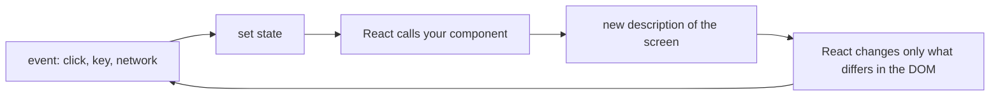

# 2 — React and state

> React's one idea is that the screen is a function of state: you stop telling the browser what to change and start describing what should be there. That turns most interface bugs into data-modelling bugs, and backend engineers already know how to model data. The rest of this chapter is what to store, when a render really happens, and the one escape hatch, Effects, that causes most of the trouble.

---

## The screen as a function of state

In the [previous chapter](01-html-css-and-the-dom.md) you changed the DOM by hand. A hand-written interface with six states needs every transition to fix up the page correctly, and the number of transitions grows much faster than the number of states. React removes that. You write a function from state to elements, and React works out which DOM changes get the screen to match.



A component is a function that returns markup. Data flows [one way, parent to child](https://react.dev/learn/thinking-in-react). A child that needs to change something calls a function its parent passed down.

```tsx
type Source = { id: number; title: string };

function SourceList({ sources }: { sources: Source[] }) {
  if (sources.length === 0) return <p>No sources</p>;
  return (
    <ol>
      {sources.map((s) => <li key={s.id}>{s.title}</li>)}
    </ol>
  );
}

export default function App() {
  return (
    <main>
      <SourceList sources={[]} />
      <SourceList sources={[{ id: 1, title: "Refund policy" }, { id: 2, title: "Plans" }]} />
    </main>
  );
}
```

```text
No sources

Refund policy
Plans
```

TSX reads like HTML, but it compiles to function calls, and the type annotations come from [TypeScript](../../typescript/notes/03-unions-and-narrowing.md). Everything in the braces is ordinary code, so there's no template language to learn. That's why `map` and `if` do the work here.

The [`key`](https://react.dev/learn/rendering-lists) tells React which row is which between renders. It should be a stable id from your data. An array index goes wrong as soon as rows are inserted or reordered, because row 3's state then gets attached to whatever is now at position 3.

## Rendering, and why local variables don't work

[Rendering means React calling your function](https://react.dev/learn/state-as-a-snapshot). A local variable is created fresh on each call and thrown away, and changing one doesn't cause a render, [as the docs show](https://react.dev/learn/state-a-components-memory). `useState` gives you a value that React keeps between calls, along with a setter that requests a new render.

The surprising part is that state is a snapshot. Inside one render, `count` is a constant. Calling the setter schedules the next render and doesn't change the variable you are holding, so this handler ends up adding 1.

```tsx
import { useEffect, useRef, useState } from "react";

export default function App() {
  const [snapshot, setSnapshot] = useState(0);
  const [queued, setQueued] = useState(0);
  const button = useRef<HTMLButtonElement>(null);

  function onClick() {
    setSnapshot(snapshot + 1);
    setSnapshot(snapshot + 1);
    setSnapshot(snapshot + 1);
    setQueued((n) => n + 1);
    setQueued((n) => n + 1);
    setQueued((n) => n + 1);
  }

  useEffect(() => { button.current?.click(); }, []);

  return (
    <>
      <button ref={button} onClick={onClick}>Add three</button>
      <p>from the snapshot: {snapshot}</p>
      <p>with updater functions: {queued}</p>
    </>
  );
}
```

```text
Add three

from the snapshot: 1

with updater functions: 3
```

The first handler said "set to 0 + 1" three times. The second said "add one" three times, which React [queues and applies in order](https://react.dev/learn/queueing-a-series-of-state-updates). When the next value depends on the last, use the function form. Streaming text is exactly this case: `setText(t => t + delta)`, or a reducer.

## Modelling state: this is where you already have the skills

[Choosing the state structure](https://react.dev/learn/choosing-the-state-structure) reads like a database design guide, and the docs say as much. The questions to ask of each piece of data come from [Thinking in React](https://react.dev/learn/thinking-in-react). If it never changes, or arrives from a parent, or can be computed from something else, it isn't state.

The bug this prevents has a familiar shape: two sources of truth that drift apart. A cart with `items` and `itemCount` has one bug waiting to happen. Compute the count while rendering instead.

The same holds for flags. The docs' example is `isSending` and `isSent`, which permit a combination meaning nothing, both true. A backend engineer sees the fix immediately: replace booleans with one status column, and make invalid rows impossible to represent. In TypeScript that's a [discriminated union](../../typescript/notes/03-unions-and-narrowing.md). The lab's chat has nine answer states, and the data each one holds differs.

```ts
type Live =
  | { status: "idle" }
  | { status: "streaming"; id: string; text: string }
  | { status: "complete"; id: string; text: string }
  | { status: "error"; id: string; text: string; retryable: boolean };

type Action =
  | { type: "submit"; id: string }
  | { type: "delta"; id: string; text: string }
  | { type: "done"; id: string }
  | { type: "fail"; id: string; retryable: boolean };

function reducer(live: Live, a: Action): Live {
  if (a.type === "submit") return { status: "streaming", id: a.id, text: "" };
  // A late event from an abandoned request must not touch the current answer.
  if (live.status !== "streaming" || live.id !== a.id) return live;
  switch (a.type) {
    case "delta": return { ...live, text: live.text + a.text };
    case "done": return { ...live, status: "complete" };
    case "fail": return { ...live, status: "error", retryable: a.retryable };
  }
}

const events: Action[] = [
  { type: "submit", id: "first" },
  { type: "delta", id: "first", text: "Annual plans " },
  { type: "submit", id: "second" },
  { type: "delta", id: "first", text: "LATE TEXT FROM THE OLD REQUEST" },
  { type: "delta", id: "second", text: "Exports last " },
  { type: "fail", id: "second", retryable: true },
];
let state: Live = { status: "idle" };
for (const e of events) {
  state = reducer(state, e);
  console.log(e.type.padEnd(6), JSON.stringify(state));
}
```

```text
submit {"status":"streaming","id":"first","text":""}
delta  {"status":"streaming","id":"first","text":"Annual plans "}
submit {"status":"streaming","id":"second","text":""}
delta  {"status":"streaming","id":"second","text":""}
delta  {"status":"streaming","id":"second","text":"Exports last "}
fail   {"status":"error","id":"second","text":"Exports last ","retryable":true}
```

A [reducer](https://react.dev/learn/extracting-state-logic-into-a-reducer) is a pure function from (state, action) to state, so it's the part of a UI that tests like backend code. No browser or React is needed, as this block shows by running in Node. If you have written an event-sourced system this is the same idea, and you could log every action to replay a bug. `useReducer` plugs it in:

<!-- no-run: a fragment showing the wiring; the running version is practice/solutions/Chat.tsx -->
```tsx
const [state, dispatch] = useReducer(reducer, initialState);
```

[Lifting state up](https://react.dev/learn/sharing-state-between-components) covers the remaining question, which is where to keep it: in the closest common parent of everything that reads it. Our advice is to reach for global state only once props genuinely hurt.

## Effects: the escape hatch

Rendering [must be pure](https://react.dev/learn/keeping-components-pure): same inputs, same output, with no fetching or subscribing. Event handlers are where things happen in response to a user. [Effects](https://react.dev/learn/synchronizing-with-effects) are for what's left, which is keeping something outside React in step with the component: a socket, a timer, a browser API.

An Effect is a setup function plus a cleanup, and the docs' pairing is connect and disconnect. In development, Strict Mode deliberately mounts each component twice, so a missing cleanup shows up immediately as two connections instead of a slow leak in production. If your Effect runs twice in development and that breaks something, the Effect is the bug and the double run is not.

The most useful page in the docs is [You might not need an Effect](https://react.dev/learn/you-might-not-need-an-effect). Its rules, in brief:

| You want | Do this | Not |
|----------|---------|-----|
| A value computed from state | Compute it while rendering | An Effect that sets more state |
| Something to happen because the user clicked | Do it in the handler | An Effect watching a flag |
| To POST a form | Do it in the handler | An Effect, which runs on display and again on remount or Back, not on the click |
| To reset a subtree when an id changes | [Give it a new `key`](https://react.dev/learn/preserving-and-resetting-state) | An Effect that clears each field |
| To keep something external in step | An Effect with cleanup | Nothing else fits |

So in the lab's chat the request starts in the Send handler and never in an Effect. The Effects that remain are the ones that genuinely step outside: following the scroll position, and aborting a request when the component goes away.

### Race conditions

The docs' worked example has a user typing "hello" with each keystroke fetching results. Responses can arrive out of order, so the results for "hell" can overwrite those for "hello". This is a distributed-systems bug in a UI, and it's the same bug as a late write without a version check. Here it is without React, in Node, with the fix the docs recommend.

```ts
const wait = (ms: number) => new Promise((r) => setTimeout(r, ms));
const search = async (q: string, ms: number) => { await wait(ms); return `results for ${q}`; };

let naive = "";
await Promise.all([
  search("hell", 30).then((r) => { naive = r; }),
  search("hello", 5).then((r) => { naive = r; }),
]);
console.log("naive:", naive);

let shown = "";
let current = 0;
function run(q: string, ms: number) {
  const mine = ++current;
  return search(q, ms).then((r) => { if (mine === current) shown = r; });
}
await Promise.all([run("hell", 30), run("hello", 5)]);
console.log("ignoring stale:", shown);
```

```text
naive: results for hell
ignoring stale: results for hello
```

The docs use an `ignore` flag set in the Effect's cleanup, and the reducer earlier uses a request id. They're the same idea. Cancel the request too, using [`AbortController`](../../typescript/notes/06-async.md#cancellation-abortcontroller), so nobody pays for work no one will read.

## Rendering untrusted strings

[React escapes values embedded in JSX](https://legacy.reactjs.org/docs/introducing-jsx.html), a point that comes from its older docs. `{text}` shows the characters `` as text, so ordinary rendering is safe by default. The name of the opt-out is a warning: [`dangerouslySetInnerHTML`](https://react.dev/reference/react-dom/components/common) takes an object with an `__html` field, and the docs' advice is to create that object close to where the HTML is generated, so that raw HTML is explicitly marked as such. A URL is a separate problem. React 19 replaces a `javascript:` value in `href` with one that only throws an error, which we confirmed by rendering it with the lab's react-dom 19.3.1, but `data:` passed through unchanged, so still allow-list the schemes you accept, as [chapter 5](05-ai-interfaces.md#rendering-is-a-security-boundary) shows.

## Pitfalls

**Duplicated state.** *Symptom:* a count or a "selected" object goes stale after an update, and a fix adds an Effect to sync them. Store the source and compute the rest. For a selected item, store its id.

**Booleans for a state machine.** *Symptom:* a spinner and an error show together. Replace them with one union-typed status.

**An Effect for what a handler should do.** *Symptom:* a request fires twice in development, or a POST fires again on navigation. Move it to the handler.

**Reading state right after setting it.** *Symptom:* `setX(1); console.log(x)` prints the old value. That's the snapshot behaving as designed.

**Index as key.** *Symptom:* after inserting a row, a text field's contents appear on the wrong row. Use an id from the data.

**No cleanup.** *Symptom:* a stream keeps writing after you've left the page, or two responses interleave. Return a cleanup that aborts, and ignore anything from an old request id.

**Replacing an element that holds focus.** *Symptom:* Tab restarts from the top of the page after an action. React removes the button, focus falls to `<body>`, and a keyboard user loses their place. The lab tests this. Move focus deliberately before the element goes.

## Try it

The lab's core is the [state machine](../practice/solutions/state.ts), and [`practice/README.md`](../practice/README.md) has the steps.

1. In the lab, write `exercises/state.ts` from its types until `TARGET=exercises node --test tests/state.test.ts` passes. It needs no browser.
2. A profile page holds `firstName`, `lastName`, `fullName` and `isSaving`, `isSaved`, `saveError`. Which of those would you remove, and what replaces them?
3. A component fetches results in an Effect and sometimes shows results for an older query. Write down the two lines that fix it.

<details>
<summary>Answers</summary>

1. The tests are the answer. Compare with [`solutions/state.ts`](../practice/solutions/state.ts) afterwards.
2. `fullName` can be computed. The three save fields become one union: `{ status: "idle" } | { status: "saving" } | { status: "saved" } | { status: "error"; message: string }`, which also removes the impossible combination of saving and error at once.
3. In the Effect, `let ignore = false;` before the fetch, then `if (!ignore) setResults(r)` in its callback, and in the cleanup `return () => { ignore = true; };`. That's three edits in one idea. Aborting the fetch is a good addition.

</details>

## Interview checklist

| Question | Answer |
|----------|--------|
| What triggers a render? | A state change in this component or a parent. Rendering means calling your function. |
| Why doesn't a value update right after `setState`? | State is a snapshot for that render. The setter asks for the next one. |
| How do you decide something is state? | It isn't state if it doesn't change, comes from props or can be computed. |
| Why `useReducer` for a stream? | One place for every transition, testable with no browser, and it can drop events from old requests. |
| What's an Effect for? | Keeping something outside React in step. Not for derived values, and not for reacting to a click. |
| Why does Strict Mode run Effects twice? | To expose a missing cleanup during development. |
| How do you handle out-of-order responses? | Ignore stale ones with a flag or request id, and abort them too. |
| Why does `key` matter? | It's identity across renders, so state stays with the right row. A changed `key` resets a subtree. |

## Next

- [Chapter 3, accessibility](03-accessibility.md): a component tree can look right and still be unusable.
- [Chapter 5, AI interfaces](05-ai-interfaces.md): this state machine with a real stream behind it.
- [TypeScript for AI apps](../../typescript/notes/09-typescript-for-ai-apps.md), for the API on the other side of the interface.
