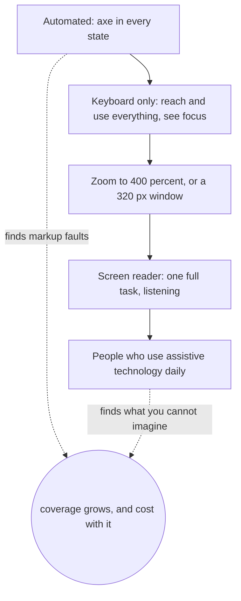

# 3 — Accessibility

> Automated checkers are the part of accessibility engineers reach for first, and whole categories of fault are invisible to them. In this track's lab, axe looks at a deliberately bad chat and reports four rules, none about its click-only Send control, its word-by-word live region or the answer text it blanks on failure. This chapter gives you the requirements that catch those faults, the few minutes of manual checking that finds them, and an honest account of what any tool can claim.

---

## What the standard asks

[WCAG 2.2](https://www.w3.org/TR/WCAG22/) is the W3C's testable standard, with criteria at [levels A, AA and AAA](https://www.w3.org/WAI/WCAG22/Understanding/conformance.html). The W3C calls the choice of level a policy decision, and AA is the usual default in our judgement. The W3C itself advises against adopting AAA as a blanket policy, because some content can't meet all of it. You don't need to read the document cover to cover. These criteria account for most of what goes wrong in an application interface.

| Criterion | Level | In one line |
|-----------|-------|-------------|
| [2.1.1 Keyboard](https://www.w3.org/WAI/WCAG22/Understanding/keyboard.html) | A | Everything works from a keyboard |
| [4.1.2 Name, Role, Value](https://www.w3.org/WAI/WCAG22/Understanding/name-role-value.html) | A | Assistive technology can tell what a control is, what it's called and what state it's in |
| [3.3.1 Error Identification](https://www.w3.org/WAI/WCAG22/Understanding/error-identification.html) | A | An error is identified and described in text |
| [1.4.1 Use of Color](https://www.w3.org/WAI/WCAG22/Understanding/use-of-color.html) | A | Colour isn't the only signal |
| [2.2.2 Pause, Stop, Hide](https://www.w3.org/WAI/WCAG22/Understanding/pause-stop-hide.html) | A | Moving or auto-updating content can be paused, stopped or hidden |
| [1.4.3 Contrast (Minimum)](https://www.w3.org/WAI/WCAG22/Understanding/contrast-minimum.html) | AA | 4.5:1 for text, 3:1 for large text |
| [1.4.10 Reflow](https://www.w3.org/WAI/WCAG22/Understanding/reflow.html) | AA | Usable at 320 CSS px wide with no two-dimensional scrolling, which is 1280 px at 400% zoom |
| [2.4.7 Focus Visible](https://www.w3.org/WAI/WCAG22/Understanding/focus-visible.html) | AA | You can see where the keyboard is |
| [2.4.11 Focus Not Obscured](https://www.w3.org/WAI/WCAG22/Understanding/focus-not-obscured-minimum.html) | AA | A sticky header or footer doesn't cover the focused element completely |
| [2.5.8 Target Size (Minimum)](https://www.w3.org/WAI/WCAG22/Understanding/target-size-minimum.html) | AA | Pointer targets of at least 24 by 24 CSS px, with exceptions |
| [4.1.3 Status Messages](https://www.w3.org/WAI/WCAG22/Understanding/status-messages.html) | AA | A change like "18 results" reaches assistive technology without moving focus |

## Keyboard and focus

Unplug the mouse. A surprising amount of the standard is tested by that. Tab moves forward, Shift+Tab moves back, Enter and Space activate, and Escape conventionally dismisses. The [APG keyboard guide](https://www.w3.org/WAI/ARIA/apg/practices/keyboard-interface/) has the conventions for richer widgets. Real `<button>` and `<a>` elements give you all of this from the [first chapter](01-html-css-and-the-dom.md#semantic-html-is-free-behaviour).

The problems left over come from dynamic interfaces. When a React update removes the element holding focus, [the browser moves focus to `<body>`](https://www.w3.org/WAI/ARIA/apg/practices/keyboard-interface/), and a keyboard user starts over from the top of the page. So the rule has a code consequence: when an action removes the control that has focus, move focus somewhere sensible first. The lab's Stop button disappears when you press it, and the code handles that explicitly.

Focus should also be visible, so don't write `outline: none` without replacing it. `:focus-visible` lets you style keyboard focus without showing a ring on every mouse click:

```css
:focus-visible {
  outline: 3px solid #1a56b0;
  outline-offset: 2px;
}
```

## Names, roles and the first rule of ARIA

The accessibility tree holds a role, a name and a state for each control, and that is all a screen reader has to work with. [4.1.2](https://www.w3.org/WAI/WCAG22/Understanding/name-role-value.html) is the requirement, and [the APG's naming guide](https://www.w3.org/WAI/ARIA/apg/practices/names-and-descriptions/) gives the order browsers compute names in. The practical summary: visible text is the best name, a `<label>` names a field, `aria-label` is for when no visible text exists, and `placeholder` is only a last-resort fallback the guide tells you to avoid. It also vanishes when someone starts typing.

ARIA lets you set a role and state on any element. The APG's [Read Me First](https://www.w3.org/WAI/ARIA/apg/practices/read-me-first/) opens with the warning you should remember: no ARIA is better than bad ARIA. It describes a role as a promise. `<div role="button">` promises Tab, Enter and Space behaviour, and ARIA delivers none of it. ARIA changes what assistive technology is told, and it does not change what the element does.

Reach for ARIA when HTML has no element for what you need. Even then, stay with the documented pattern. Here's the [disclosure pattern](https://www.w3.org/WAI/ARIA/apg/patterns/disclosure/), a real button plus a state attribute, which is the sort of thing you'd use for "Show sources":

```html
<!doctype html>
<button id="toggle" aria-expanded="false" aria-controls="panel">Show sources</button>
<div id="panel" hidden>Refund policy, section 2</div>
<script>
  const toggle = document.getElementById("toggle");
  const panel = document.getElementById("panel");
  toggle.addEventListener("click", () => {
    const open = toggle.getAttribute("aria-expanded") === "true";
    toggle.setAttribute("aria-expanded", String(!open));
    panel.hidden = open;
  });
  console.log("expanded:", toggle.getAttribute("aria-expanded"), "| panel hidden:", panel.hidden);
  toggle.click();
  console.log("expanded:", toggle.getAttribute("aria-expanded"), "| panel hidden:", panel.hidden);
</script>
```

```text
expanded: false | panel hidden: true
expanded: true | panel hidden: false
```

## Colour and contrast

Contrast is one of the few things you can compute. WCAG defines [relative luminance and the ratio](https://www.w3.org/TR/WCAG22/#dfn-contrast-ratio) exactly, so here it is in code.

```ts
function luminance(hex: string): number {
  const [r, g, b] = [1, 3, 5]
    .map((i) => parseInt(hex.slice(i, i + 2), 16) / 255)
    .map((c) => (c <= 0.04045 ? c / 12.92 : ((c + 0.055) / 1.055) ** 2.4));
  return 0.2126 * r! + 0.7152 * g! + 0.0722 * b!;
}

function contrast(a: string, b: string): number {
  const [hi, lo] = [luminance(a), luminance(b)].sort((x, y) => y - x);
  return (hi! + 0.05) / (lo! + 0.05);
}

for (const [fg, bg] of [["#999999", "#ffffff"], ["#767676", "#ffffff"], ["#595959", "#ffffff"], ["#000000", "#ffffff"]]) {
  const ratio = contrast(fg!, bg!);
  console.log(`${fg} on ${bg}: ${ratio.toFixed(2)}:1, ${ratio >= 4.5 ? "passes" : "fails"} AA for body text`);
}
```

```text
#999999 on #ffffff: 2.85:1, fails AA for body text
#767676 on #ffffff: 4.54:1, passes AA for body text
#595959 on #ffffff: 7.00:1, passes AA for body text
#000000 on #ffffff: 21.00:1, passes AA for body text
```

The light grey that looks refined in a mock-up is the one that fails. Separately, [colour must not be the only signal](https://www.w3.org/WAI/WCAG22/Understanding/use-of-color.html). A red border on a bad field needs words as well, which is a direct requirement on how an uncertain answer is shown in [chapter 5](05-ai-interfaces.md#uncertainty).

## Telling people what changed

A sighted user sees a spinner stop. Someone using a screen reader hears nothing, unless the page says so. That's what [4.1.3](https://www.w3.org/WAI/WCAG22/Understanding/status-messages.html) covers: status messages should be programmatically determinable, so they can be announced without moving focus.

The mechanism is a [live region](https://developer.mozilla.org/en-US/docs/Web/Accessibility/ARIA/Guides/Live_regions), an element whose changes assistive technology may announce. From MDN, the parts that matter in code:

- `role="status"` is polite: announced when the user is idle.
- `role="alert"` is assertive: it can interrupt, so save it for what needs that.
- The region must already exist before its content changes. Adding the element along with its message is unreliable, with `role="alert"` the usual exception.
- Support varies by browser and screen reader, so a correct attribute is no guarantee of a good announcement.

Note how little this tells you about streaming text, where each token is a change. The [AI interfaces chapter](05-ai-interfaces.md#streaming-and-assistive-technology) picks that up.

## What automated tools see

Axe's own README says it finds ["on average 57% of WCAG issues"](https://github.com/dequelabs/axe-core) and flags others as incomplete for human review. That's the vendor's own figure, and the README gives no method for it. The W3C's [guidance on evaluation tools](https://www.w3.org/WAI/test-evaluate/tools/selecting/) is blunter: tools can't check every aspect, human judgement is required, results can be false or misleading, and a tool can only assist in determining accessibility.

The automatic checks are still worth running, because the faults they find are common. WebAIM's [2026 scan of a million home pages](https://webaim.org/projects/million/), itself automatic, found detectable WCAG failures on 95.9% of them. The leading kinds were low contrast (83.9% of pages), missing alt text (53.1%) and missing form labels (51%). WebAIM's point is that fixing these few types would improve the web significantly.

The lab measures the gap directly. [`tests/axe-limits.test.ts`](../practice/tests/axe-limits.test.ts) runs axe 4.14 on [a naive chat](../practice/tests/fixtures/naive-chat.tsx) with these faults planted in it.

| Planted fault | Axe reported it? |
|---------------|------------------|
| Grey text at 2.85:1 | Yes, `color-contrast` |
| No `<main>`, no `<h1>` | Yes, `landmark-one-main`, `page-has-heading-one`, `region` |
| `<textarea>` with only a placeholder | No: the fallback gives it a name, so the rule passes |
| Send is a `<div>` with `onClick` | No: nothing marks it as a control, so no rule applies |
| Answer in a live region, changing 25 times in one answer | No |
| Answer blanked when the stream fails | No |
| Clean end of stream treated as success | No |
| Model output rendered as HTML | No |

And [a second page](../practice/tests/fixtures/axe-blind-spots.html) gets zero violations while having a `role="button"` that ignores the keyboard, a link reading "Delete my account" that opens a help page, and `alt="image"`. It passes for a good reason. Axe checks what's mechanically decidable. Whether a name is true or a button works needs someone to try it.

So treat a clean axe run as the floor. It's a real result: the lab keeps it as a test and the markup stays clean as states change. It tells you nothing about whether the page is usable, and you should not write "accessible" in a release note on the strength of it.

## A manual pass that fits in ten minutes



1. Keyboard: do the main task with no mouse. Was focus always visible? Did it ever jump to the top?
2. Zoom to 400%: is anything cut off or scrolling two ways? Does a sticky bar cover what has focus?
3. Screen reader: VoiceOver is on every Mac, and NVDA is free on Windows. Do one task with the screen off or your eyes shut.

That last step has a limit. A sighted developer running a screen reader for ten minutes is a rough approximation of a daily user, who knows shortcuts and strategies you don't. The WebAIM [survey](https://webaim.org/projects/screenreadersurvey10/) shows why one tool isn't enough: among its 1,539 respondents, a self-selected sample, primary desktop or laptop use was 40.5% JAWS, 37.7% NVDA and 9.7% VoiceOver, with large regional differences. So testing only with VoiceOver on a Mac, an easy default for a developer, misses the two desktop tools most of those respondents named. On mobile the picture differs, with VoiceOver the most common reader at 70.6%. The W3C's advice is to [involve real users](https://www.w3.org/WAI/test-evaluate/involving-users/) as well as checking conformance, because a design can conform and still be hard to use.

**What this track did and did not do:** the lab runs a real keyboard, axe, reflow and the [accessibility tree](https://playwright.dev/docs/aria-snapshots) in headless Chromium. Playwright reads the tree, which is not what a screen reader speaks. No screen reader was run, and no person who uses one tried it. Any claim here about what someone would hear comes from the specs and MDN.

## Pitfalls

**"Axe passes, so it's accessible."** *Symptom:* a clean dashboard and a complaint from a real user. Add a keyboard pass, and tests that press the keys.

**`role="button"` on a `div`.** *Symptom:* it reads as a button and ignores Enter. Use `<button>`. If you really can't, then you owe `tabindex`, keydown for Enter and Space, and a disabled state.

**Placeholder as the only label.** *Symptom:* the hint vanishes once you type, and low-contrast placeholder text fails the eye test. Axe won't flag it. Use `<label>`.

**Removing focus outlines.** *Symptom:* Tab appears to do nothing. Style `:focus-visible` rather than removing it.

**Focus lost on update.** *Symptom:* after an action, Tab restarts at the top. Move focus before the focused element is removed.

**Creating the live region with its message.** *Symptom:* it works in one screen reader and not in another. Render the region empty from the start.

**Over-announcing.** *Symptom:* `role="alert"` on routine messages interrupts someone constantly. Use it for what needs interrupting.

**Colour as the only signal.** *Symptom:* a "low confidence" tint means nothing in greyscale, or to someone with a colour vision deficiency. Say it in words.

## Try it

1. Run `bash check.sh` in [`practice/`](../practice/README.md), then read [`tests/axe-limits.test.ts`](../practice/tests/axe-limits.test.ts). Before running it, predict which planted faults axe will find.
2. In the lab, do Exercise 3: fix [`exercises/Chat.tsx`](../practice/exercises/Chat.tsx) until `bash check.sh exercises` passes. Note which fixes axe would never have asked for.
3. Turn on VoiceOver (Cmd+F5) or NVDA and try `npm start` in the lab. Write down what you hear while a long answer streams. The authors of this track haven't done this test, so your result is new evidence.

<details>
<summary>Answers</summary>

1. The test records what axe 4.14 reports: `color-contrast`, `landmark-one-main`, `page-has-heading-one` and `region`, and nothing about the click-only `div` or the live region.
2. The worked answer is [`solutions/Chat.tsx`](../practice/solutions/Chat.tsx). Moving the answer out of the live region, turning the `div` into a `button` and adding focus management are all invisible to axe.
3. No answer to check against. If the status line isn't announced, or the answer can't be read back easily, that's a real finding about this design.

</details>

## Interview checklist

| Question | Answer |
|----------|--------|
| Which WCAG level should you aim for? | AA is the usual default, in our judgement, and the W3C calls the choice a policy decision. It advises against blanket AAA. |
| What's the first rule of ARIA? | Prefer native HTML. No ARIA is better than bad ARIA, because a role promises behaviour it doesn't supply. |
| What contrast does body text need? | 4.5:1, and 3:1 for large text. |
| What share of problems does axe find? | Its README says 57% of issues on average, which is the vendor's own figure. Whether a control works or a name is true is outside what it can check. |
| How do you announce a status change? | A `role="status"` element, present from page load, updated with text. |
| What should happen to focus when a button disappears? | Move it somewhere sensible first, or it falls to `<body>`. |
| What can't you learn from a screen reader test by a sighted developer? | How someone who uses one daily would experience it. Involve those users. |
| How do you test keyboard use automatically? | Drive real key events in a browser and assert on `document.activeElement` and the result, as the lab's tests do. |

## Next

- [Chapter 4, UX principles](04-ux-principles.md): a page can be accessible and still confusing.
- [Chapter 5, AI interfaces](05-ai-interfaces.md#streaming-and-assistive-technology): applying live regions to a stream of tokens.
- [Testing strategy](../../software-design/notes/05-testing-strategy.md), for where these browser tests sit among the others.
