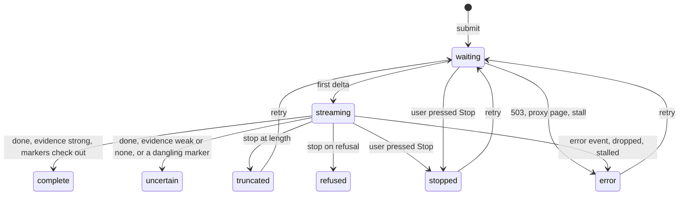

# 5 — AI interfaces

> A conventional interface shows what the system did. An AI interface shows what a system that can be fluently wrong said, while it is still saying it. So the usual engineering problems change shape: an HTTP 200 no longer means success, a citation may not support the sentence beside it, and in one 2023 audit the engines rated most useful had the least precise citations. This chapter builds the interface that takes those seriously, with a working lab behind it.

---

## What's different, and what isn't

Everything from chapters [1](01-html-css-and-the-dom.md) to [4](04-ux-principles.md) still applies. Three things are new.

- **Output is untrusted and unpredictable.** The same question gets different text, and the text can be shaped by [a prompt injection](../../../ai-engineering/09-safety-and-security/notes/02-prompt-injection-and-jailbreaks.md).
- **Wrong looks exactly like right.** A failed API call produces an error. A wrong answer produces a fluent paragraph.
- **Results arrive over time, and can fail partway.** Half an answer is a state you must design.

The material elsewhere in this course covers the layers around this one. [Application patterns](../../../generative-ai/07-agentic-applications/notes/06-application-patterns.md#interactive-chatbot) covers which kind of interface to choose, from chatbot to ambient agent. The [autonomy ladder](../../../ai-engineering/04-loop-engineering/notes/07-autonomy-ladder.md#the-human-side-of-the-ladder) covers how much to let an agent do, and [TypeScript for AI apps](../../typescript/notes/09-typescript-for-ai-apps.md#streaming) covers the API call. This chapter is the screen, using the [lab](../practice/README.md): a chat for a made-up product, Harbour, against a local mock server that can misbehave on demand. Harbour, its documents and its numbers are all invented.

## Streaming: what the wire looks like

Most model APIs stream with [server-sent events](https://html.spec.whatwg.org/multipage/server-sent-events.html), and vendors [build on it](https://platform.openai.com/docs/guides/streaming-responses) with [their own event types](https://platform.claude.com/docs/en/build-with-claude/streaming). The format is plain text: `field: value` lines, with a blank line ending each event. A line that starts with a colon is a comment, which is how servers send keep-alives.

```text
: keep-alive

event: delta
data: {"text":"Annual plans "}

event: citation
data: {"id":1,"title":"Refund policy","url":"/docs/refunds#window","quote":"..."}

event: done
data: {"stop":"end","evidence":"strong"}
```

The browser's built-in `EventSource` takes [only a URL and a credentials option](https://html.spec.whatwg.org/multipage/server-sent-events.html), so it can't POST a question. Chat clients use `fetch` with a [readable stream](https://developer.mozilla.org/en-US/docs/Web/API/Streams_API/Using_readable_streams) and parse the events themselves. That parser has the same trap as any [TCP reader](../../computer-science/notes/06-networks.md): chunks don't respect message boundaries. An event can straddle two reads, and so can one UTF-8 character, so decode with `TextDecoder` in stream mode (`decoder.decode(chunk, { stream: true })`), which holds a split character until the rest arrives.

```ts
function naive(chunks: string[]): string[] {
  return chunks.flatMap((c) => c.split("\n\n").filter(Boolean));
}

function buffered(chunks: string[]): string[] {
  const out: string[] = [];
  let buffer = "";
  for (const c of chunks) {
    buffer += c;
    const parts = buffer.split("\n\n");
    buffer = parts.pop()!; // the last piece may be incomplete: keep it
    out.push(...parts);
  }
  return out;
}

// One event, cut in the middle by the network.
const chunks = ['data: {"text":"Annual ', 'plans"}\n\ndata: {"text":" can"}\n\n'];
console.log("naive:   ", naive(chunks));
console.log("buffered:", buffered(chunks));
```

```text
naive:    [ 'data: {"text":"Annual ', 'plans"}', 'data: {"text":" can"}' ]
buffered: [ 'data: {"text":"Annual plans"}', 'data: {"text":" can"}' ]
```

The lab's [`solutions/sse.ts`](../practice/solutions/sse.ts) does this properly, following the spec's rules: all three line endings, comments, multi-line data, and discarding an unfinished event at end of stream.

### A 200 no longer means it worked

This is the mental shift. By the time the model fails, the status line has long gone out, so a stream can fail in ways HTTP can't report. Anthropic documents [error events inside a stream](https://platform.claude.com/docs/en/build-with-claude/streaming), such as `overloaded_error`, which would otherwise have been an HTTP 529. A complete client has to judge each response on what arrived. The lab's mock server has a scenario for each row below.

```ts
type Seen = { status: number; contentType: string; events: string[]; closed: boolean; msSinceByte?: number };

function outcome(r: Seen): string {
  if (r.status === 429 || r.status === 503 || r.status === 529) return "busy: say so, offer retry";
  if (r.status >= 400) return "failed before starting";
  if (!r.contentType.startsWith("text/event-stream")) return "not an answer: a proxy page, perhaps";
  if (r.events.includes("error")) return "failed partway: keep and label the text";
  if (r.events.includes("done")) return "finished";
  if (r.closed) return "dropped: no terminal event, so this is NOT success";
  if ((r.msSinceByte ?? 0) > 45000) return "stalled: give up";
  return "still streaming";
}

const sse = "text/event-stream";
const cases: [string, Seen][] = [
  ["normal", { status: 200, contentType: sse, events: ["delta", "done"], closed: true }],
  ["overloaded", { status: 503, contentType: "application/json", events: [], closed: true }],
  ["login page", { status: 200, contentType: "text/html", events: [], closed: true }],
  ["error mid-way", { status: 200, contentType: sse, events: ["delta", "error"], closed: true }],
  ["clean close, no done", { status: 200, contentType: sse, events: ["delta"], closed: true }],
  ["silent", { status: 200, contentType: sse, events: ["delta"], closed: false, msSinceByte: 50000 }],
];
for (const [name, seen] of cases) console.log(name.padEnd(21), outcome(seen));
```

```text
normal                finished
overloaded            busy: say so, offer retry
login page            not an answer: a proxy page, perhaps
error mid-way         failed partway: keep and label the text
clean close, no done  dropped: no terminal event, so this is NOT success
silent                stalled: give up
```

The dangerous row is the clean close. A proxy restart, or a server that crashes tidily, ends the body with no error at all, so a client that treats "stream ended" as "answer finished" presents half an answer as complete. Tell a slow stream from a dead one with a watchdog, reset by any byte, including [the comments the spec suggests sending every 15 seconds or so](https://html.spec.whatwg.org/multipage/server-sent-events.html) to keep intermediaries from timing out. Set the limit well above your server's keep-alive interval, or a healthy stream looks dead. The lab uses 45 seconds, three keep-alives at that suggested 15 seconds, which is a choice and not a sourced figure. (Its mock server sends them every 200 ms, so the tests stay quick.) Two more operational details: without HTTP/2, [browsers limit each domain to about six connections](https://developer.mozilla.org/en-US/docs/Web/API/Server-sent_events/Using_server-sent_events), and a buffering proxy may hold a stream back. MDN's example sets `X-Accel-Buffering: no` without saying why, and [nginx documents that header](https://nginx.org/en/docs/http/ngx_http_proxy_module.html#proxy_buffering) as a way to turn buffering off for one response.

### What streaming buys, and what it doesn't

A first token at 2 s against a full answer at 18 s moves you across the [10-second limit](https://www.nngroup.com/articles/response-times-3-important-limits/) from chapter 4, and that's the case for it. (Those durations are illustrative.) But there's a cost that gets less attention:

- **People read it before you know whether it's any good.** Any check that runs once the answer is complete, such as whether its citations hold up, can't have run when the first words appear. The warning arrives after the reading, and an answer that was shown can't be unshown. OpenAI's docs [flag a related risk](https://platform.openai.com/docs/guides/streaming-responses): partial completions are harder to moderate.
- **Long answers keep moving.** That's a pointer target that moves, and for some people a distraction. So treat Stop as a requirement of the design. [WCAG 2.2.2](https://www.w3.org/WAI/WCAG22/Understanding/pause-stop-hide.html), which asks for a way to pause, stop or hide moving content, is the closest analogy, but on its wording it doesn't strictly cover a stream the person started themselves.
- **The page shouldn't fight the reader.** Follow the stream only while they're at the bottom. If they scroll up to read, leave them there. The lab's first version had a real bug here, which a test caught: a scroll event fires up to a frame late, so text arriving in that gap dragged the reader back down.

If an answer is high stakes and checks are slow, the right call may be not to stream at all. Show a good progress message, then the verified answer.

### Streaming and assistive technology

None of the sources read for this track settles this one. MDN says [the `log` role suits chat](https://developer.mozilla.org/en-US/docs/Web/Accessibility/ARIA/Guides/Live_regions), and the obvious move is to put the answer in such a region. But a live region announces changes, and a stream changes constantly. In the lab, one 25-word answer changes the naive chat's live region 25 times.

The lab takes a different approach: keep the answer out of any live region, and announce transitions through a [status message](https://www.w3.org/WAI/WCAG22/Understanding/status-messages.html). The status region changes 3 times for that same answer: "Searching the help centre", "Writing an answer", "Answer complete, 2 sources". The answer is an ordinary `<article>` with [`aria-busy`](https://developer.mozilla.org/en-US/docs/Web/Accessibility/ARIA/Reference/Attributes/aria-busy) while it's incomplete. When it finishes, someone can read it at their own pace.

**That design is reasoning from the specs and has not been validated.** The lab proves the 25-versus-3 count and nothing about the experience, because no screen reader has been run against it and no screen reader user has tried it. They might prefer hearing text as it arrives, since a long wait with one status line has its own cost. Exercise 3 below is your chance to find out.

## Citations

A citation is a claim that a passage supports a sentence. Most of the work is making that claim true, and the interface comes second.

One audit, [Liu, Zhang and Liang](https://arxiv.org/abs/2304.09848), had paid annotators judge the answers of four generative search engines from early 2023 (Bing Chat, NeevaAI, perplexity.ai and YouChat) on 1,450 queries each. Averaged across the engines, 51.5% of generated sentences were fully supported by their citations (recall), and 74.5% of citations supported their sentence (precision). The averages hide a wide spread: recall ran from 11.1 for YouChat to 68.7 for perplexity.ai, and precision from 63.6 for YouChat to 89.5 for Bing Chat.

The paper also reports that citation precision and perceived utility were inversely correlated, at r = −0.96. Read that figure with care. The paper doesn't say what it's computed over, but correlating its four per-engine averages gives −0.955 (our calculation), so it appears to be four points, spanning 4.34 to 4.62 on a five-point scale. It says the engines rated most helpful had the least precise citations, and it doesn't say this holds answer by answer. Annotators also rated utility on responses shown without their citations, so it can't be measuring citations making an answer look good. The authors' hypothesis is that engines which copy or closely paraphrase a page get accurate citations, but copied sentences can be irrelevant to the question, which lowers perceived utility. They're also clear that verifiability isn't factuality: a sentence can be fully supported by a source and still be false. All of this describes systems from 2023, so don't quote any of it as today's. What carries over is the question to ask: does the thing people like about an answer have anything to do with whether it's supported?

Now add what people do with citations. NN/g's [research on AI information-seeking](https://www.nngroup.com/articles/explainable-ai/) reports that people rarely click citation links, and that appearing well cited itself builds trust. One participant said they trusted the chatbot partly because they could click through, then never clicked one in the session. So a citation can raise trust without being checked at all. Treat that as a risk you're adding by showing them, and note it's a different mechanism from Liu's correlation, where annotators never saw the citations.

Three design conclusions follow, in order of importance.

**Check them in code before showing them.** The [RAG generation chapter](../../../generative-ai/02-rag-retrieval/notes/06-generation-for-rag.md) covers the plumbing, including the point that an appended list of retrieved documents records what the model saw and not what it used. So never show the retrieval list as "sources". Show only what the answer refers to, and verify those references. Some checks cost nothing:

```ts
type Citation = { id: number; title: string; quote: string };
const markers = (text: string) => [...text.matchAll(/\[(\d+)\]/g)].map((m) => Number(m[1]));

function audit(answer: string, retrieved: Citation[]) {
  const used = new Set(markers(answer));
  const known = new Set(retrieved.map((c) => c.id));
  const cited = retrieved.filter((c) => used.has(c.id));
  const numbers = answer.replace(/\[\d+\]/g, "").match(/\d+/g) ?? [];
  return {
    shown: cited.map((c) => c.id),
    dangling: [...used].filter((n) => !known.has(n)),
    noMarkers: used.size === 0,
    numbersNotInAQuote: numbers.filter((n) => !cited.some((c) => new RegExp(`\\b${n}\\b`).test(c.quote))),
  };
}

const retrieved: Citation[] = [
  { id: 1, title: "Refund policy", quote: "Annual plans can be refunded in full within 30 days of purchase." },
  { id: 2, title: "Plans", quote: "Monthly plans can be cancelled at any time." },
  { id: 3, title: "Security", quote: "Exports are encrypted at rest." },
];
for (const answer of [
  "Annual plans are refundable within 30 days [1]. Monthly plans can be cancelled [2].",
  "Annual plans are refundable within 60 days [1].",
  "Annual plans are refundable within 3 days [1].", // a plain substring check would find "3" in "30"
  "Refunds are handled under section 9 [4].",
  "Yes, you can get a refund.",
]) console.log(JSON.stringify(audit(answer, retrieved)));
```

```text
{"shown":[1,2],"dangling":[],"noMarkers":false,"numbersNotInAQuote":[]}
{"shown":[1],"dangling":[],"noMarkers":false,"numbersNotInAQuote":["60"]}
{"shown":[1],"dangling":[],"noMarkers":false,"numbersNotInAQuote":["3"]}
{"shown":[],"dangling":[4],"noMarkers":false,"numbersNotInAQuote":["9"]}
{"shown":[],"dangling":[],"noMarkers":true,"numbersNotInAQuote":[]}
```

Look at the second row: the 60-day claim cites a real source that says 30, and the marker check alone would pass it. These checks catch mechanical failures and that's all. They can't tell you whether a passage actually supports a paraphrase. That needs an entailment model or a [grader](../../../generative-ai/08-eval/notes/04-graders.md), and it can't run on every token.

**Use structured citations when you can.** Prefer having the API return the passage to parsing markers from prose. [Anthropic's citations](https://platform.claude.com/docs/en/build-with-claude/citations) return the exact `cited_text`, with page or character ranges, which arrive in a stream as `citations_delta` events. That gives you a passage to display and a location to link to, with no marker parsing. Whether it supports the sentence is still a separate question, and the docs say the API doesn't guarantee that every field you extract has a citation. They also note that a JSON-only prompt can yield few or no citations, so test that your format doesn't quietly turn them off.

**Make checking easy.** From [NN/g's recommendations](https://www.nngroup.com/articles/explainable-ai/): put the source next to the specific claim, link to the relevant part of the source, avoid vague labels like "Source", and style citations differently from the main response text. The lab shows the quoted passage under each answer, so the check takes seconds and needs no click. That's an inference from "people rarely click", and it hasn't been tested on people here. It does put more text on screen, which has a cost too.

## Uncertainty

The honest state of the evidence: showing uncertainty can help, how you word it matters, and you need to test it.

[Kim et al.](https://arxiv.org/abs/2405.00623) ran a pre-registered study with 404 people answering yes/no medical questions with a fictional LLM search tool, deliberately right half the time. Hedges were placed on half the answers regardless of whether they were right. Estimated accuracy was 74.2% for people with no AI, who could still search the web and nearly all did, and 63.9% for people with the plain AI. The authors caution that the tool's 50% accuracy may be behind that drop. It helped when it was right and hurt badly when it was wrong (88.5% against 77.9%, and 33.0% against 64.7%, in an exploratory split). With first-person hedges ("I'm not sure, but...") accuracy was 72.8%, significantly above the plain AI. General hedges ("It's not clear, but...") reached 67.9%, which wasn't significantly above it.

Don't over-read that gap. The two wordings weren't significantly different from each other on accuracy, and the one significant difference between them was trust intention, which first-person wording lowered (2.91 against 3.36 on a five-point scale). Hedging reduced overreliance, meaning accepting the AI's answer when it's wrong, without removing it, and the authors say teams shouldn't assume hedging has addressed overreliance. They also caution against overgeneralising from one study of simple questions, and call for testing the specific language with end users before release.

This creates a tension you should know about. NN/g [advises against anthropomorphic language](https://www.nngroup.com/articles/explainable-ai/) in favour of neutral, factual wording, and Kim's significant accuracy result came from first-person wording. Kim's participants didn't rate first-person wording as significantly more human-like, though the authors still warn of effects people may not consciously report and advise caution. Neither source settles your product, and neither tested wording that states a reason, which is what the lab uses. Its hedges also differ in a bigger way: they come from a retrieval signal, while Kim's were uncorrelated with correctness. So this is a choice, and an untested one.

### Where the signal comes from

Don't ask the model how sure it is and print the answer. Self-reported confidence needs [calibrating against human labels](../../../generative-ai/08-eval/notes/15-calibration-against-human-labels.md) before it means anything. Look for evidence that your system can measure from outside the model.

| Signal | Example | State shown in the lab |
|--------|---------|------------------------|
| Nothing retrieved | No passage above threshold | No answer found |
| Weak retrieval | Best passage only loosely related | Weak evidence |
| Citation check failed | A marker with no source | Parts marked unverified |
| No markers at all | Fluent answer, no references | Warning, as unsupported |
| Hit the length limit | `stop_reason` of `max_tokens` | Cut off, incomplete |
| Declined | [`stop_reason` of `refusal`](../../typescript/notes/09-typescript-for-ai-apps.md#stop_reason-tells-you-what-to-do-next) | Declined, no retry |

The lab's mock server just sends an `evidence` field. In a real system that is where your retrieval scores and evaluations plug in, and a threshold that hasn't been evaluated on your own data is a guess.

### How to show it

The Explainability + Trust chapter of [Google PAIR's People + AI Guidebook](https://pair.withgoogle.com/chapter/explainability-trust/) warns about numeric confidence. People find statistical scores hard to interpret, a distinction such as 85.8% against 87% doesn't help anyone decide, and showing misleadingly high confidence can cause blind acceptance. So test whether a display changes decisions before you ship one. For a text answer, prefer a reason plus an action, as the lab does: "Weak evidence. The search found only loosely related passages. Check the source below, or ask a person."

Also use words, as [chapter 3](03-accessibility.md#colour-and-contrast) requires, since a tint alone is unavailable to many people. Announce it too. The lab's status says "Answer finished, with a warning" so a screen reader user isn't left with the same "complete" as everyone else.

The lab keeps these outcomes as separate states. `uncertain` here includes an answer with no citation markers at all:



### Trust is a design target, and more isn't better

The goal is [calibrated trust](https://pair.withgoogle.com/chapter/explainability-trust/): people relying on the system when it's right and catching it when it's wrong. Explanations don't reliably deliver that. [Bansal et al.](https://arxiv.org/abs/2006.14779) gave crowd workers (1,626 across the studies) sentiment and LSAT tasks, with the AI's recommendation and confidence shown up front. Adding explanations gave no significant net gain in accuracy, and the authors report that they raised accuracy when the AI was right and lowered it when the AI was wrong, though not uniformly: on one dataset they helped even then. That study used 2020-era classifiers and highlighted or expert-written text, and it didn't test chat. Separately, NN/g [warns](https://www.nngroup.com/articles/explainable-ai/) that step-by-step "reasoning" in a chat interface is often after-the-fact rationalisation, which shouldn't be presented as how the answer was reached.

[Buçinca, Malaya and Gajos](https://arxiv.org/abs/2102.09692) tested cognitive forcing (N = 199): making people work before they get the AI's answer. They added three designs on top of the same explanation: click to reveal it, decide first and then see it, or wait 30 seconds. Compared with the simple conditions (the explanation, with or without a confidence prompt), forcing raised correct decisions when the AI was wrong, but brought no gain across all questions, and people working with the AI still scored below the AI on its own. Overreliance, agreeing with the AI when it's wrong, fell significantly only on the sub-task of spotting the high-carb ingredient (0.64 to 0.48), and not when scored on the whole replacement (0.30 against 0.26). The cost shows up in the ratings. Comparing forcing with the simple conditions as groups, only perceived complexity differed significantly, but on wrong-AI items people who did better tended to trust and prefer the design less (weak correlations, |r| about 0.2 to 0.3). Participants high in need for cognition, a trait measuring how much someone enjoys effortful thinking, gained most, and also marked the designs down. The task was a low-stakes meal choice with a simulated AI, so extending it to medicine or support is an inference. Still, it's reason to measure more than satisfaction, and to weigh friction by stakes: a refund FAQ probably doesn't need it, and a tool suggesting a diagnosis might. That judgment is ours and untested. The [application patterns chapter](../../../generative-ai/07-agentic-applications/notes/06-application-patterns.md#what-the-interface-does-to-judgment) goes further into how an interface affects judgment.

## Setting expectations

[PAIR on mental models](https://pair.withgoogle.com/chapter/mental-models/) says mismatches lead to unmet expectations, misuse and abandonment, and recommends onboarding in stages: what the product can do, what it can't, how it may change and how to improve it. The first two of [Amershi et al.'s guidelines for human-AI interaction](https://www.microsoft.com/en-us/research/uploads/prod/2019/01/Guidelines-for-Human-AI-Interaction-camera-ready.pdf), [reviewed below](#the-guidelines-as-a-review), cover the first part: make clear what the system can do, and how well it can do it.

A disclaimer only helps if it's read. [NN/g's advice](https://www.nngroup.com/articles/explainable-ai/): plain language, placed near the input box, paired with an action. Compare "AI may produce inaccurate information" with the lab's "Answers come from an automated search of the help centre and can be wrong. Open the source before acting on one." The second says where answers come from and what to do about it.

## Handing off to a person

A handoff is an error path that has to work when the assistant has already failed. [PAIR's chapter on graceful failure](https://pair.withgoogle.com/chapter/errors-failing/) calls this returning control: people need awareness of the situation, plus what to do next and how.

Four requirements come out of that, and the lab tests each:

1. **Reachable from every finished state.** The lab shows "Ask a person" after a complete answer as well as a failed one, because a confident, wrong answer is the case that most needs it, and it's the one your system can't detect.
2. **Carries the context.** Nobody should repeat themselves.
3. **Says what happened.** A reference number, and what was shared.
4. **Can fail too.** The handoff endpoint is just another service. If it's down, say so and leave another route.

```ts
type Handoff = {
  question: string;
  answer: string;
  citations: { id: number; title: string; url: string }[];
  status: "complete" | "uncertain" | "truncated" | "refused" | "stopped" | "error";
  earlier: { question: string; answer: string }[];
};

function summary(h: Handoff): string {
  const flagged = h.status === "complete" ? "" : ` [assistant state: ${h.status}]`;
  return `${h.question}${flagged}\nAI answered: ${h.answer}\nSources: ${h.citations.map((c) => c.title).join(", ") || "none"}\nEarlier turns: ${h.earlier.length}`;
}

console.log(summary({
  question: "Do export links work for shared workspaces?",
  answer: "An export link appears to stay valid for 7 days [1], but the passage found does not mention shared workspaces.",
  citations: [{ id: 1, title: "Exports", url: "/docs/exports#limit" }],
  status: "uncertain",
  earlier: [{ question: "How do refunds work?", answer: "..." }],
}));
```

```text
Do export links work for shared workspaces? [assistant state: uncertain]
AI answered: An export link appears to stay valid for 7 days [1], but the passage found does not mention shared workspaces.
Sources: Exports
Earlier turns: 1
```

Flagging the AI's words as such matters, because the support person reading this should know they're looking at unverified text. Two backend connections: the [autonomy ladder](../../../ai-engineering/04-loop-engineering/notes/07-autonomy-ladder.md#the-human-side-of-the-ladder) makes the same point about sending context with each escalation, and [support agent observability](../../../generative-ai/06-observability/notes/05-support-agent-observability.md) tracks `escalated` as an outcome, so log handoffs and find out whether your handoff rate means what you think it does. For an agent pausing mid-task for approval, not a user asking for help, see [human-in-the-loop interrupts](../../../ai-engineering/05-graph-engineering/notes/04-durable-execution-and-interrupts.md#human-in-the-loop-with-interrupt).

Don't over-apply "return control" either. [PAIR warns](https://pair.withgoogle.com/chapter/errors-failing/) that reverting to manual can itself be risky, with the example of a navigation system that stops giving directions in unfamiliar streets at rush hour. The support version is milder: a handoff can drop someone into a queue that's closed at night, so state what actually happens next.

## An error taxonomy

Each failure gets different words and a different action. The lab implements every row, and the wording follows [chapter 4](04-ux-principles.md#writing-an-error).

| Failure | Keep partial text? | Retry? | What the person is told |
|---------|-------------------|--------|-------------------------|
| Busy, 429, 503 or 529 before streaming | Nothing yet | Yes, with the server's delay | The service is busy right now. Try again in about 2 seconds. |
| Rejected, 4xx | Nothing yet | No: the same request fails again | This question could not be sent. Edit it and try again. |
| Other 5xx before streaming | Nothing yet | Yes | The service hit an error while answering. |
| Network failure, no response at all | Nothing yet | Yes | The connection failed. |
| Error event mid-stream | Yes, labelled incomplete | Yes | The answer failed partway through. |
| Dropped or clean close with no end | Yes, labelled incomplete | Yes | The connection was lost before the answer finished. |
| Stalled | Yes, labelled | Yes | No response for a while, so this request was stopped. |
| 200 with the wrong content type | No: it isn't an answer | Yes | The service sent something other than an answer. |
| Length limit | Yes, labelled | Yes | Cut off at the length limit. This answer is incomplete. |
| Refusal | Yes | No: the answer won't change | This is outside what the assistant can help with. A person may be able to. |
| User pressed Stop | Yes, labelled | Yes | Stopped by you. This answer is incomplete. |

Partial text should stay on screen and be clearly marked. Blanking it destroys what someone was reading, and leaving it unmarked lets it pass for complete. Retrying a long failed request also pays for the model's work a second time. Stop should actually stop the work: the lab's test confirms the server sees the client leave and stops producing, which matters when each token costs money.

## Rendering is a security boundary

A model's output is attacker-influenceable input to your page. OWASP's [LLM05: Improper Output Handling](https://genai.owasp.org/llmrisk/llm052025-improper-output-handling/) frames it as giving users indirect access to whatever consumes the output, and names XSS from JavaScript or Markdown interpreted by the browser. It's concrete: a document containing an injection tells the model to write a Markdown image whose URL contains the conversation. If the page renders that Markdown, the browser fetches the image with no click at all, and the data has left. The [sandboxing chapter](../../../ai-engineering/09-safety-and-security/notes/04-tool-and-execution-sandboxing.md) treats the renderer as an egress point, for this reason.

Defence works in layers, and the lab tests them all using an `untrusted` scenario that returns an ``, a Markdown image and link to an outside host, and a `javascript:` citation URL.

1. **Render as text.** React [escapes by default](02-react-and-state.md#rendering-untrusted-strings). If you do need Markdown, use a library with raw HTML off, and allow-list image and link hosts.
2. **Validate URLs yourself.** Escaping doesn't help an `href`. [MDN lists](https://developer.mozilla.org/en-US/docs/Web/HTML/Reference/Elements/a) `javascript:` among the URL schemes an anchor can use, as executable code. React 19 blocks that one: rendering such a link with the lab's react-dom 19.3.1 output a URL that only throws an error. `data:` came through unchanged, though, and a framework or a Markdown renderer may do less. Only allow known schemes:

```ts
function safeHref(url: string, base: string): string | null {
  try {
    const u = new URL(url, base);
    return u.protocol === "http:" || u.protocol === "https:" ? u.href : null;
  } catch {
    return null;
  }
}

const base = "https://harbour.example/chat";
for (const url of ["/docs/refunds#window", "https://harbour.example/a", "javascript:alert(1)", "JaVaScRiPt:alert(1)", "data:text/html,hi", "http://[bad"]) {
  console.log(url.padEnd(28), safeHref(url, base));
}
```

```text
/docs/refunds#window         https://harbour.example/docs/refunds#window
https://harbour.example/a    https://harbour.example/a
javascript:alert(1)          null
JaVaScRiPt:alert(1)          null
data:text/html,hi            null
http://[bad                  null
```

3. **Set a [Content Security Policy](https://developer.mozilla.org/en-US/docs/Web/HTTP/Guides/CSP)**, a response header telling the browser which origins the page may load from or connect to (`'self'` means the page's own origin). It's the backstop when something else slips. The lab's `img-src 'self'` means an injected outbound image is blocked by the browser even if it reaches the DOM, and a test confirms it.

```text
default-src 'self'; script-src 'self'; style-src 'self'; img-src 'self';
connect-src 'self'; base-uri 'none'; form-action 'self'; frame-ancestors 'none'
```

The lab's own limit: its chat doesn't parse Markdown, so people see literal asterisks, which is safe but isn't what a product would ship. Adding Markdown means adding an allow-list and tests. Its URL check permits any `https:` link, so a real deployment should restrict to known source hosts, as the [sandboxing chapter](../../../ai-engineering/09-safety-and-security/notes/04-tool-and-execution-sandboxing.md) sets out.

## Feedback and control

[PAIR on feedback](https://pair.withgoogle.com/chapter/feedback-controls/) separates implicit signals from explicit ones, and says to tell people what their feedback is for. A thumbs-down with no visible effect teaches people that it's decoration. An abandoned answer, a retry, a handoff and a copy are also signals, available without asking anyone for anything. Connect them to your [evaluation](../../../generative-ai/08-eval/notes/06-evaluating-agents.md) and [observability](../../../generative-ai/06-observability/notes/05-support-agent-observability.md). The lab has no feedback control, which is a gap you could fill.

## The guidelines as a review

[Amershi et al.](https://www.microsoft.com/en-us/research/uploads/prod/2019/01/Guidelines-for-Human-AI-Interaction-camera-ready.pdf) consolidated more than 150 design recommendations into 18 guidelines, then had 49 design practitioners look for applications and violations in 20 AI products. They make a useful prompt for reviewing an AI feature. These seven are the closest to this chapter, some by extension, because the paper predates chat assistants and says nothing about streaming or citations.

| Guideline | In this chapter | In the lab |
|-----------|----------------|------------|
| G1 Make clear what the system can do | [Setting expectations](#setting-expectations) | Partly: a line says where answers come from |
| G2 Make clear how well the system can do what it can do | [Setting expectations](#setting-expectations) | Partly: says answers can be wrong, gives no frequency |
| G8 Support efficient dismissal | [Streaming](#what-streaming-buys-and-what-it-doesnt) | Stop, and Escape |
| G9 Support efficient correction | [Error taxonomy](#an-error-taxonomy) | Edit question. Most other rows are transport failures, which G9 doesn't address |
| G10 Scope services when in doubt | [Handing off](#handing-off-to-a-person) | Handoff, and a no-evidence state that doesn't guess. Its wording is about doubt over the user's goal, so evidence is an extension |
| G11 Make clear why the system did what it did | [Citations](#citations), [overreliance](#trust-is-a-design-target-and-more-isnt-better) | Citations partly: they show evidence for a sentence, not why the system behaved as it did |
| G15 Encourage granular feedback | [Feedback and control](#feedback-and-control) | Not built |

Know what the evidence is. The study shows practitioners could find examples of the guidelines in 2018 products such as recommenders, autocomplete and voice assistants. It didn't measure whether following them improves outcomes for users, and the authors only "anticipate" that they'll be useful. Several final wordings, including G1, G2, G11 and G15, were reworded after that study and then reviewed by 11 experts for clarity. So they're a review tool, and a product following them hasn't thereby been shown to work.

## Pitfalls

**Treating end of stream as success.** *Symptom:* a truncated answer looks finished, and no error appears in any log. Require a terminal event. Anything else is a failure.

**Showing retrieved documents as sources.** *Symptom:* a source list with documents the answer never used. List only what the answer refers to.

**Trusting the marker.** *Symptom:* "[1]" exists and says something else. Check that the source exists, and that numbers appear in it. For more, evaluate.

**Rendering Markdown from the model unfiltered.** *Symptom:* a request to an unknown host when an answer displays, with no click. Render as text or allow-list, and set `img-src`.

**A live region around streaming text.** *Symptom:* possibly a screen reader reading fragments constantly, though the tests here can only count changes. Announce state changes.

**A spinner with no watchdog.** *Symptom:* a hung stream spins forever. Reset a timer on every byte, and give up with a message.

**Blanking partial text on failure.** *Symptom:* someone is reading paragraph 3 and it vanishes. Keep it, and label it.

**A Stop button that only hides.** *Symptom:* the UI stops and the bill keeps climbing. [Abort the fetch](https://developer.mozilla.org/en-US/docs/Web/API/AbortController) ([how, in TypeScript](../../typescript/notes/06-async.md#cancellation-abortcontroller)), and have the server notice the client left and cancel upstream.

**Confidence percentages with no evaluation behind them.** *Symptom:* "92% confident" on a wrong answer. Show reasons from evidence you can measure. Test any number before shipping it.

**Handoff with no context, or hidden.** *Symptom:* people type the question again, or can't find a human. Send the transcript and offer it from every state.

**Measuring satisfaction alone.** *Symptom:* a design rates well while people accept wrong answers. Measure outcomes on cases where the AI is wrong, because in Buçinca's study ratings and performance on those items tended to move in opposite directions.

## Try it

The [lab](../practice/README.md) has a chat that does most of this wrong and a mock server that misbehaves on demand.

1. **The parser and state machine.** Write `exercises/sse.ts` and `exercises/state.ts` until `TARGET=exercises node --test tests/sse.test.ts tests/state.test.ts` passes. No browser is needed.
2. **The interface.** Fix [`exercises/Chat.tsx`](../practice/exercises/Chat.tsx) until `bash check.sh exercises` passes. Then try `npm start` and walk through each scenario in the dropdown.
3. **Listen to it.** With VoiceOver or NVDA, ask a question in the `long` scenario. Compare the lab's status-only design with a version where `.answer` has `aria-live="polite"`. Which would you want for a three-paragraph answer? Write down what you heard, and treat it as one person's first impression.
4. **Add Markdown safely.** Render `**bold**` and links in answers, allowing links only to the mock server's host. Keep the `untrusted` tests passing. What does your allow-list do with `http://localhost.outside.example/`?

<details>
<summary>Answers</summary>

1. The tests in `practice/tests/` are the specification, and [`solutions/`](../practice/solutions/state.ts) has one way to do it.
2. [`solutions/Chat.tsx`](../practice/solutions/Chat.tsx) has one answer. The lab's [planted-fault check](../practice/tests/mutants.ts) lists 15 mistakes the tests must catch, which is a good list of what to look for.
3. There's no key. This hasn't been tested by the track's authors, so your notes are real evidence, if only from one person.
4. Parse with `new URL()` and compare `hostname` exactly against the allow-list. A substring or `startsWith` check accepts that hostile address, because it starts with your host. The [sandboxing chapter](../../../ai-engineering/09-safety-and-security/notes/04-tool-and-execution-sandboxing.md) makes the same point about exact parsed hosts.

</details>

## Interview checklist

| Question | Answer |
|----------|--------|
| How do you know a stream succeeded? | A terminal event. A 200 and a clean close prove nothing. |
| Why `fetch` and not `EventSource` for chat? | `EventSource` takes a URL and a credentials option, so no POST body or custom headers. |
| What's the framing bug in a stream parser? | Chunks don't align with events, so buffer until a boundary, and decode UTF-8 across chunks. |
| How do you tell slow from dead? | A watchdog reset by any byte, including keep-alive comments. |
| Should streaming text go in a live region? | There's no settled answer. It announces every change. Announcing state changes instead is reasonable, but test with real screen reader users. |
| What does citation precision mean here? | The share of citations that support their sentence. Liu et al. averaged 74.5% across four 2023 engines, ranging from 63.6 to 89.5, with recall at 51.5%. |
| Do users check citations? | NN/g's research says rarely, and their presence itself builds trust. So verify in code. |
| Should an interface show confidence? | Only if it helps decisions. Prefer a reason and an action, using a signal from outside the model, evaluated on your own data. |
| Do explanations reduce overreliance? | Not reliably. Bansal found no significant net accuracy gain over confidence alone. Buçinca found forcing helped when the AI was wrong, with no overall gain, on a low-stakes task. |
| Name a Markdown attack on a chat UI. | An injected image URL holding conversation data. It's fetched on display, with no click. |
| What must a handoff do? | Be reachable from any finished state, carry context, confirm what happened and survive its own failure. |
| Why keep partial text? | The person may be mid-sentence and it can still be useful, so keep it and label it incomplete. |

## Next

- [Application patterns](../../../generative-ai/07-agentic-applications/notes/06-application-patterns.md#choosing-a-pattern): choosing what kind of interface to build at all.
- [Real-time and multimodal agents](../../../generative-ai/07-agentic-applications/notes/03-real-time-multimodal-agents.md), where much of this changes.
- [Threat model](../../../ai-engineering/09-safety-and-security/notes/01-threat-model.md), for the rest of what output handling sits inside.
- [The lab](../practice/README.md), then this track's [references](../references.md).
