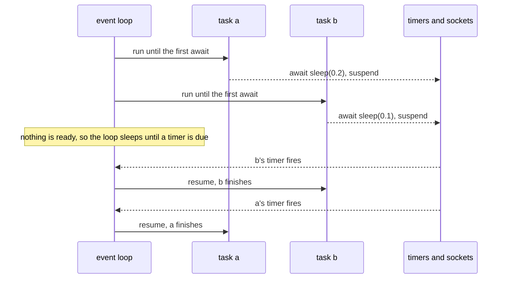

# 7 — Concurrency

> Waiting on the network or disk is **I/O-bound**: use threads or `asyncio`. Crunching numbers in pure Python is **CPU-bound**: use processes (or NumPy, which releases the GIL). Pick by what you're waiting on.

---

## Which tool

| Work | Tool | Why |
|---|---|---|
| A few dozen blocking HTTP calls, existing sync code | `ThreadPoolExecutor` | Threads release the GIL while waiting on I/O |
| Hundreds+ concurrent requests, an async SDK, a web server | `asyncio` | One thread, cheap tasks, explicit `await` points |
| CPU-heavy pure Python | `ProcessPoolExecutor` | Separate interpreters, so no GIL contention |

The **GIL** lets only one thread run Python bytecode at a time. Free-threaded builds (3.13t+) remove it, but most code and libraries still assume it.

## Threads with concurrent.futures

```python
from concurrent.futures import ThreadPoolExecutor, as_completed

with ThreadPoolExecutor(max_workers=8) as pool:
    futures = {pool.submit(fetch, url): url for url in urls}
    for fut in as_completed(futures):
        url = futures[fut]
        try:
            results[url] = fut.result()
        except Exception as err:
            errors[url] = err
```

`pool.map(fn, items)` is simpler when you want results in input order and any exception should stop you. Shared mutable state between threads needs a `threading.Lock`. Better: have each task return its result and combine them in the main thread.

## asyncio

One thread runs an **event loop**. It keeps a queue of tasks that are ready, and a list of what the others are waiting for. A task runs until it reaches an `await` on something not yet finished, then hands control back. Nothing preempts it, which is why switching can only happen at an `await`:

```python
import asyncio

async def worker(name: str, delay: float) -> None:
    print(f"{name} start")
    await asyncio.sleep(delay)   # hands control back to the loop
    print(f"{name} done")

async def main() -> None:
    async with asyncio.TaskGroup() as tg:
        tg.create_task(worker("a", 0.2))
        tg.create_task(worker("b", 0.1))

asyncio.run(main())
# a start
# b start
# b done
# a done
```



The total is about 0.2 s, not 0.3 s, because neither task holds the thread while it waits. A real fetcher has the same shape, with a concurrency limit added:

```python
import asyncio

async def fetch(client, url: str) -> str:
    resp = await client.get(url, timeout=10)
    return resp.text

async def main(urls: list[str]) -> list[str]:
    sem = asyncio.Semaphore(10)                        # at most 10 in flight
    async with httpx.AsyncClient() as client:
        async def limited(url):
            async with sem:
                return await fetch(client, url)
        async with asyncio.TaskGroup() as tg:          # 3.11+: cancels the rest if one fails
            tasks = [tg.create_task(limited(u)) for u in urls]
    return [t.result() for t in tasks]

asyncio.run(main(urls))
```

- `async def` makes a coroutine function. Calling it does nothing until it is awaited or scheduled as a task.
- `asyncio.gather(*coros, return_exceptions=True)` collects results and errors without cancelling.
- `asyncio.timeout(5)` (3.11+) or `asyncio.wait_for(coro, 5)` adds a deadline.
- **Never block the event loop**: `time.sleep`, `requests.get` or heavy CPU work inside `async def` freezes every task. Use `await asyncio.sleep`, an async client, or `await asyncio.to_thread(blocking_fn, ...)`.

This is the same model as JavaScript promises ([TypeScript 06](../../../typescript/notes/06-async.md)). `Promise.all` corresponds to `gather` and `TaskGroup`.

## Retries with backoff

```python
async def with_retry(make_call, attempts=4, base=0.5):
    for i in range(attempts):
        try:
            return await make_call()
        except (TimeoutError, ConnectionError):
            if i == attempts - 1:
                raise
            await asyncio.sleep(base * 2**i + random.random() * base)   # exponential + jitter
```

Retry only errors that can succeed next time (timeouts, 429, 5xx), never 4xx validation errors. LLM SDKs already retry for you, so check before you wrap them.

---

## Exercises

[`practice/exercises/07_concurrency.py`](../practice/exercises/07_concurrency.py)
