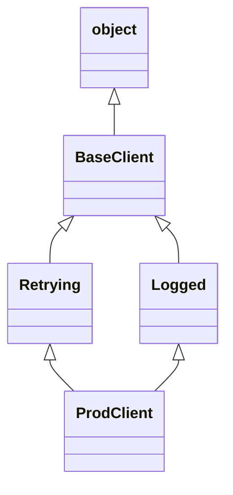

# 8 — Objects, inheritance and MRO

> Sooner or later a `super()` call runs a method in a class you never named, an instance attribute silently replaces a method, or two libraries refuse to combine with `TypeError: metaclass conflict`. All of these come from one small set of rules: how Python looks up an attribute, how it orders a class's ancestors, and how it builds a class in the first place. This chapter teaches those rules, so class behaviour becomes something you can work out instead of something you try until it passes. It also teaches what each tool costs, because most code needs less of this machinery than people expect. Code here ran on CPython 3.14.7.

---

## Classes are objects with a lookup chain

A `class` statement runs its body as ordinary code, collects the names it defines into a namespace, and builds an object from them. An instance is another object, with its own namespace and a pointer to its class. Reading `obj.x` searches those namespaces in a fixed order.

```python
class ChatModel:
    provider = "anthropic"            # on the class: one value, shared

    def __init__(self, name: str) -> None:
        self.name = name              # on the instance: one per object

    def describe(self) -> str:
        return f"{self.provider}/{self.name}"

fast = ChatModel("small")
print(vars(fast))
print([k for k in vars(ChatModel) if not k.startswith("__")])
print(fast.describe())

fast.provider = "local"               # creates an instance attribute; shadows the class one
print(fast.describe(), "|", ChatModel("big").describe())
print(type(fast.describe), type(ChatModel.describe))
```

```text
{'name': 'small'}
['provider', 'describe']
anthropic/small
local/small | anthropic/big
<class 'method'> <class 'function'>
```

Two consequences are worth holding on to. Assignment through an instance always writes to the instance, unless a descriptor intercepts it (see below). And `fast.describe` is not the function stored on the class: it is a *bound method*, a small object that remembers `fast` and passes it as `self`. The same machinery explains `@property`, `@classmethod` and `@staticmethod`, so we'll come back to it.

The shared namespace is also the source of a classic bug, the class-level cousin of the [mutable default trap](01-data-model-and-idioms.md):

```python
class Conversation:
    messages = []                     # one list, shared by every Conversation

    def add(self, text: str) -> None:
        self.messages.append(text)    # reads the class attribute, then mutates it

a, b = Conversation(), Conversation()
a.add("hello from tenant A")
print(b.messages)
```

```text
['hello from tenant A']
```

Tenant B can now read tenant A's message. In an LLM service, that is a data leak rather than a style problem. Set per-instance state in `__init__`, or use a [dataclass](05-types-and-dataclasses.md) with `field(default_factory=list)`.

## `classmethod` and `staticmethod`

The three kinds of method differ only in what arrives as the first argument.

| Kind | First argument | Use it for |
|---|---|---|
| plain `def f(self)` | the instance | Anything that uses instance state |
| `@classmethod def f(cls)` | the class it was called on | Alternative constructors, and anything subclasses should inherit polymorphically |
| `@staticmethod def f()` | nothing | A helper that you want namespaced on the class |

The classmethod's real value is that `cls` is the class you called it on, not the class that defined it. A constructor written once therefore builds the right subclass:

```python
import json
from dataclasses import dataclass

@dataclass
class Document:
    doc_id: str
    text: str

    @classmethod
    def from_jsonl_line(cls, line: str) -> "Document":
        record = json.loads(line)
        return cls(doc_id=record["id"], text=record["text"])

    @staticmethod
    def normalise(text: str) -> str:
        return " ".join(text.split())

class PdfDocument(Document):
    page_count = 0

line = '{"id": "d-17", "text": "Refund  policy\\n v2"}'
print(type(Document.from_jsonl_line(line)).__name__)
print(type(PdfDocument.from_jsonl_line(line)).__name__)
print(Document.normalise("Refund  policy\n v2"))
```

```text
Document
PdfDocument
Refund policy v2
```

**What `staticmethod` costs.** Very little at runtime, but it adds a small question for every reader: why is this on the class? If the helper needs no class state and subclasses won't override it, a module-level function is simpler, and you can test and import it on its own. Keep `@staticmethod` for when overriding it in a subclass is the point, or when the helper is meaningless outside the class.

## Inheritance couples you to the parent's internals

Inheritance gives you two things at once: an interface (a subclass can stand in for its parent) and an implementation (a subclass reuses its parent's code). The second is where the cost is, because the subclass now depends on which of its parent's methods call which others. The parent never promised that, and it can change.

```python
class ResponseCache:
    def __init__(self) -> None:
        self._data: dict[str, str] = {}

    def put(self, prompt: str, reply: str) -> None:
        self._data[prompt] = reply

    def put_many(self, items: dict[str, str]) -> None:
        for prompt, reply in items.items():
            self.put(prompt, reply)          # an implementation detail

class CountingCache(ResponseCache):
    def __init__(self) -> None:
        super().__init__()
        self.writes = 0

    def put(self, prompt: str, reply: str) -> None:
        self.writes += 1
        super().put(prompt, reply)

    def put_many(self, items: dict[str, str]) -> None:
        self.writes += len(items)
        super().put_many(items)

cache = CountingCache()
cache.put_many({"a": "1", "b": "2"})
print("writes:", cache.writes, "stored:", len(cache._data))
```

```text
writes: 4 stored: 2
```

Two items written, four counted: `put_many` counted them, then the parent's `put_many` called the overridden `put`. If a later version of `ResponseCache` writes straight to `_data` for speed, the count would be correct and a subclass that only overrides `put` would silently break. Nothing in either class's signature tells you this.

Composition removes that dependency. The wrapper sees only the public interface:

```python
class ResponseCache:
    def __init__(self) -> None:
        self._data: dict[str, str] = {}

    def put(self, prompt: str, reply: str) -> None:
        self._data[prompt] = reply

    def put_many(self, items: dict[str, str]) -> None:
        for prompt, reply in items.items():
            self.put(prompt, reply)

class CountingCache:
    def __init__(self, inner: ResponseCache) -> None:
        self._inner = inner
        self.writes = 0

    def put(self, prompt: str, reply: str) -> None:
        self.writes += 1
        self._inner.put(prompt, reply)

    def put_many(self, items: dict[str, str]) -> None:
        self.writes += len(items)
        self._inner.put_many(items)

cache = CountingCache(ResponseCache())
cache.put_many({"a": "1", "b": "2"})
print("writes:", cache.writes)
```

```text
writes: 2
```

Composition has its own cost: you forward every method you want to expose, and `isinstance(cache, ResponseCache)` is now false. Use a [`Protocol`](05-types-and-dataclasses.md) if you need the type relationship without the implementation. Inheritance is still the right tool when a framework asks for it, for exception hierarchies, and when the "is a" relationship is true and the parent was designed to be extended. [Design principles](../../../software-design/notes/03-design-principles.md) takes up the wider argument.

## The method resolution order

Every class has a `__mro__`: the flat list of ancestors that attribute lookup walks, front to back. With single inheritance it is just the chain of parents. With multiple inheritance, Python has to turn a graph into a list, and it does so with an algorithm called C3, adopted in Python 2.3 after Samuele Pedroni showed the Python 2.2 order was not monotonic. Simionato's [MRO paper](https://docs.python.org/3.14/howto/mro.html) in the Python docs is the standard account. C3 guarantees three things:

1. **A class comes before its parents.**
2. **Local precedence order:** parents keep the order you wrote them in `class C(A, B)`.
3. **Monotonicity:** if `A` comes before `B` in the MRO of `C`, it does so in the MRO of every subclass of `C`. Adding a subclass can't reshuffle the order that its parents already agreed on.

The rule itself is short. The linearisation of `C` is `C` followed by a merge of its parents' linearisations and the list of its parents:

```text
L[C(B1 ... BN)] = C + merge(L[B1], ..., L[BN], [B1, ..., BN])

merge: take the head of the first list. If it appears in the tail of no other list,
       it is a good head: emit it and remove it everywhere. Otherwise try the head
       of the next list. If no list has a good head, the class cannot be created.
```

Here is a diamond from an LLM client library, worked by hand:



```text
L[BaseClient] = BaseClient, object
L[Retrying]   = Retrying, BaseClient, object
L[Logged]     = Logged, BaseClient, object

L[ProdClient] = ProdClient + merge([Retrying, BaseClient, object],
                                   [Logged, BaseClient, object],
                                   [Retrying, Logged])
  Retrying     head of list 1, in no tail: emit
  BaseClient   head of list 1, but in the tail of list 2: skip
  Logged       head of list 2, in no tail: emit
  BaseClient   now clean: emit
  object       emit
```

`BaseClient` comes after *both* of its children, which a depth-first search would not give you. C3 is short enough to write out and check against the interpreter:

```python
def c3(cls: type) -> list[type]:
    def merge(lists: list[list[type]]) -> list[type]:
        out: list[type] = []
        lists = [xs for xs in lists if xs]
        while lists:
            for xs in lists:
                head = xs[0]
                if not any(head in other[1:] for other in lists):
                    break
            else:
                raise TypeError("no consistent order")
            out.append(head)
            lists = [[c for c in xs if c is not head] for xs in lists]
            lists = [xs for xs in lists if xs]
        return out
    bases = list(cls.__bases__)
    return [cls] + merge([c3(b) for b in bases] + [bases])

class BaseClient: ...
class Retrying(BaseClient): ...
class Logged(BaseClient): ...
class ProdClient(Retrying, Logged): ...

print(" > ".join(c.__name__ for c in c3(ProdClient)))
print(" > ".join(c.__name__ for c in ProdClient.__mro__))
print(c3(ProdClient) == list(ProdClient.__mro__))
```

```text
ProdClient > Retrying > Logged > BaseClient > object
ProdClient > Retrying > Logged > BaseClient > object
True
```

You won't run C3 by hand at work. What you need from it is the guarantee, and the fact that it can refuse. When two parents disagree about the order of their shared ancestors, no list satisfies everyone, and class creation fails when the module is imported rather than at some later call:

```python
class Retrying: ...
class Logged: ...
class A(Retrying, Logged): ...
class B(Logged, Retrying): ...

try:
    class C(A, B): ...
except TypeError as err:
    print(err)
```

```text
Cannot create a consistent method resolution order (MRO) for bases Retrying, Logged
```

## `super()` follows the MRO, not the parent

`super()` looks up the MRO of the *instance's* class, finds the class where the call was written, and continues the search from the entry after it. The [docs](https://docs.python.org/3.14/library/functions.html#super) give the exact rule: if `__mro__` is `D -> B -> C -> A -> object` and the type is `B`, then `super()` searches `C -> A -> object`. So `super()` in `B` can reach `C`, which is not `B`'s parent, and `B`'s author may never have heard of it.

That makes mixins possible. Each one wraps "whatever comes next", and whoever assembles the class picks the order:

```python
class BaseClient:
    def complete(self, prompt: str) -> str:
        print("  BaseClient: calling the API")
        return f"reply to {prompt!r}"

class RetryMixin:
    def complete(self, prompt: str) -> str:
        print("  RetryMixin: attempt 1")
        return super().complete(prompt)

class LogMixin:
    def complete(self, prompt: str) -> str:
        print("  LogMixin: request logged")
        return super().complete(prompt)

class RetryThenLog(RetryMixin, LogMixin, BaseClient): ...
class LogThenRetry(LogMixin, RetryMixin, BaseClient): ...

print("RetryThenLog"); RetryThenLog().complete("hi")
print("LogThenRetry"); LogThenRetry().complete("hi")
print([c.__name__ for c in RetryThenLog.__mro__])
```

```text
RetryThenLog
  RetryMixin: attempt 1
  LogMixin: request logged
  BaseClient: calling the API
LogThenRetry
  LogMixin: request logged
  RetryMixin: attempt 1
  BaseClient: calling the API
['RetryThenLog', 'RetryMixin', 'LogMixin', 'BaseClient', 'object']
```

The order is a real decision. With `RetryThenLog`, the log line sits inside the retry loop, so a retried call logs once per attempt. With `LogThenRetry`, it logs once per request. Neither mixin's source says which you get, and that is the cost: to understand `RetryMixin.complete`, you have to know what class it was mixed into. `RetryMixin` also can't work alone, because `super().complete` fails unless a later class provides it.

Hettinger's [*Python's super() considered super!*](https://rhettinger.wordpress.com/2011/05/26/super-considered-super/) names what cooperative classes need: the method `super()` calls must exist, the caller and callee must have matching signatures, and every occurrence of the method must call `super()`. His approach to differing `__init__` signatures is to have each class take the keyword arguments it uses and forward the rest:

```python
class Client:
    def __init__(self, *, model: str, **kwargs) -> None:
        self.model = model
        super().__init__(**kwargs)         # ends at object.__init__, which takes nothing

class RetryMixin:
    def __init__(self, *, max_attempts: int = 3, **kwargs) -> None:
        self.max_attempts = max_attempts
        super().__init__(**kwargs)

class ProdClient(RetryMixin, Client): ...

client = ProdClient(model="small", max_attempts=5)
print(client.model, client.max_attempts)

try:
    ProdClient(model="small", max_attempt=5)   # a typo
except TypeError as err:
    print(err)
```

```text
small 5
object.__init__() takes exactly one argument (the instance to initialize)
```

The forwarded `**kwargs` hides the constructor's real signature from your editor, from `help()` and, unless you do extra work, from the type checker. A typo reaches `object.__init__`, whose message doesn't name your class's parameters. For a small stack of wrappers, composition is often clearer:

```python
from typing import Protocol

class Completer(Protocol):
    def complete(self, prompt: str) -> str: ...

class ApiClient:
    def complete(self, prompt: str) -> str:
        return f"reply to {prompt!r}"

class Logged:
    def __init__(self, inner: Completer) -> None:
        self.inner = inner
        self.calls = 0

    def complete(self, prompt: str) -> str:
        self.calls += 1
        return self.inner.complete(prompt)

class Retrying:
    def __init__(self, inner: Completer, max_attempts: int = 3) -> None:
        self.inner, self.max_attempts = inner, max_attempts

    def complete(self, prompt: str) -> str:
        for attempt in range(1, self.max_attempts + 1):
            try:
                return self.inner.complete(prompt)
            except TimeoutError:
                if attempt == self.max_attempts:
                    raise
        raise AssertionError("unreachable")

client = Retrying(Logged(ApiClient()), max_attempts=5)   # the order is visible at the call site
print(client.complete("hi"))
```

```text
reply to 'hi'
```

The nesting shows the order at the point of assembly. [Patterns worth knowing](../../../software-design/notes/04-patterns-worth-knowing.md) calls this the decorator pattern. Mixins earn their place when a class really needs several independent capabilities and its base class is designed for them, as in [Hettinger's `LoggingDict`](https://rhettinger.wordpress.com/2011/05/26/super-considered-super/), which extends a built-in. Hettinger also shows the way to bring a non-cooperative class into such a hierarchy: an adapter that holds an instance and makes the `super()` calls for it.

## Descriptors: how attribute access really works

A **descriptor** is any object with `__get__`, `__set__` or `__delete__`, stored as a *class* attribute. When attribute lookup finds one, it calls the method instead of returning the object. If the object defines `__set__` or `__delete__` it is a **data descriptor**; with only `__get__` it is a **non-data descriptor**. The [Descriptor Guide](https://docs.python.org/3.14/howto/descriptor.html) gives a pure-Python equivalent of `object.__getattribute__`, which comes down to this order:

```text
obj.x
 │
 ├─ 1. search type(obj).__mro__ for "x"  ──► found a data descriptor?  call its __get__
 ├─ 2. "x" in obj.__dict__?                                            return it
 ├─ 3. found a non-data descriptor in step 1?                          call its __get__
 ├─ 4. found a plain class attribute in step 1?                        return it
 └─ 5. raise AttributeError  ──► the dot operator then tries type(obj).__getattr__, if defined
```

Functions are non-data descriptors, and that is the whole of method binding. `property` is a data descriptor, which is why you can't shadow it with an instance attribute, while a method can be shadowed. Here is the mechanism with nothing hidden:

```python
class Doc:
    def __init__(self, text: str) -> None:
        self.text = text

    def word_count(self) -> int:
        return len(self.text.split())

    @property
    def is_empty(self) -> bool:
        return not self.text

doc = Doc("a short passage")

raw = vars(Doc)["word_count"]                 # the plain function, no binding
print(type(raw).__name__, "has __get__:", hasattr(raw, "__get__"), "has __set__:", hasattr(raw, "__set__"))
print(raw.__get__(doc, Doc)())                # exactly what doc.word_count() does

doc.word_count = lambda: -1                   # non-data: the instance __dict__ wins
print(doc.word_count())
del doc.word_count

try:
    doc.is_empty = True                       # data descriptor: __set__ refuses
except AttributeError as err:
    print(err)

for name in ("word_count", "is_empty"):
    print(name, type(vars(Doc)[name]).__name__)
```

```text
function has __get__: True has __set__: False
3
-1
property 'is_empty' of 'Doc' object has no setter
word_count function
is_empty property
```

`@classmethod` and `@staticmethod` are descriptors too: their `__get__` binds the class, or returns the function untouched. So are `__slots__` entries, as [the next chapter](09-memory-and-the-runtime.md#__slots__-trading-flexibility-for-size) shows.

### Writing one: a validated field

The practical reason to write a descriptor is to reuse attribute logic across several fields, where repeating a `property` per field would be tedious. `__set_name__` lets it learn its own name when the class is created:

```python
class Bounded:
    """A float attribute that rejects values outside [low, high]."""

    def __init__(self, low: float, high: float) -> None:
        self.low, self.high = low, high

    def __set_name__(self, owner: type, name: str) -> None:
        self.public, self.private = name, f"_{name}"

    def __get__(self, obj, objtype=None):
        if obj is None:
            return self                       # accessed on the class
        return getattr(obj, self.private)

    def __set__(self, obj, value: float) -> None:
        if not self.low <= value <= self.high:
            raise ValueError(f"{self.public}={value} outside [{self.low}, {self.high}]")
        setattr(obj, self.private, value)

class SamplingConfig:
    temperature = Bounded(0.0, 2.0)
    top_p = Bounded(0.0, 1.0)

    def __init__(self, temperature: float, top_p: float) -> None:
        self.temperature = temperature        # goes through Bounded.__set__
        self.top_p = top_p

cfg = SamplingConfig(temperature=0.7, top_p=0.9)
print(cfg.temperature, vars(cfg))

try:
    cfg.top_p = 1.5
except ValueError as err:
    print(err)
```

```text
0.7 {'_temperature': 0.7, '_top_p': 0.9}
top_p=1.5 outside [0.0, 1.0]
```

The descriptor object lives on the class, so one `Bounded` instance serves every `SamplingConfig`. That's why the value must be stored on `obj`. Storing it on `self` is the top descriptor bug: every instance would share one value.

### What a descriptor costs

Every attribute read through a descriptor is a Python function call. This run reads an attribute two million times:

```python
import timeit

class Validated:
    def __set_name__(self, owner, name):
        self.private = "_" + name
    def __get__(self, obj, objtype=None):
        return getattr(obj, self.private)
    def __set__(self, obj, value):
        setattr(obj, self.private, value)

class Plain:
    def __init__(self):
        self.score = 1.0

class WithProperty:
    def __init__(self):
        self._score = 1.0
    @property
    def score(self):
        return self._score

class WithDescriptor:
    score = Validated()
    def __init__(self):
        self.score = 1.0

for cls in (Plain, WithProperty, WithDescriptor):
    obj = cls()
    per_read = min(timeit.repeat(lambda: obj.score, number=2_000_000, repeat=3)) / 2_000_000
    print(f"{cls.__name__:15} {per_read * 1e9:6.1f} ns per read")
```

```text
Plain             12.1 ns per read
WithProperty      21.4 ns per read
WithDescriptor    59.9 ns per read
```

All three numbers include the `lambda` call that `timeit` makes. On this machine a property read costs about 9 ns more than a plain attribute, and a hand-written descriptor that calls `getattr` about 48 ns more, around five times the plain read. That matters in a loop over millions of records and not at all next to an LLM call that takes seconds. The numbers will differ on your machine, so measure before you optimise.

A larger cost is that behaviour moves away from the code a reader is looking at: `cfg.top_p = 1.5` looks like a store and can raise. Before writing a descriptor, check whether [Pydantic or a dataclass](05-types-and-dataclasses.md) validates at the boundary well enough. Often you only need to check values once, on the way in.

## How a class gets built

A class is an instance of its **metaclass**, and the default metaclass is `type`. So calling `type(name, bases, namespace)` does what a `class` statement does:

```python
def describe(self):
    return f"retriever k={self.k}"

Retriever = type("Retriever", (object,), {"k": 5, "describe": describe})
print(Retriever().describe(), type(Retriever).__name__, type(type).__name__)
```

```text
retriever k=5 type type
```

The [data model](https://docs.python.org/3.14/reference/datamodel.html#customizing-class-creation) lists the steps of a `class` statement: resolve the bases, determine the metaclass, prepare the namespace, run the body, then create the class object. The last step calls `__set_name__` on the attributes, then `__init_subclass__` on the parent.

Before 3.6, running code automatically for every new subclass took a metaclass. [PEP 487](https://peps.python.org/pep-0487/) observed that most metaclass uses fell into a few categories and added two simple hooks, explicitly because metaclasses combine badly. Three tools now cover almost every case, in increasing order of power. Pick the first that works.

| Tool | Runs | Affects | Good for |
|---|---|---|---|
| Class decorator | After the class is built | That one class; you must apply it | `@dataclass`, adding generated methods |
| `__init_subclass__` | When a subclass is created | All future subclasses, not the class itself | Plugin registries, enforcing a rule on subclasses |
| Metaclass | Throughout class creation, and it stays | The class and all its subclasses | Changing the namespace before the body runs, customising the class's own attribute access, operators on classes |

A provider registry, the most common real request, needs only the middle one:

```python
class Provider:
    registry: dict[str, type["Provider"]] = {}

    def __init_subclass__(cls, /, name: str, **kwargs) -> None:
        super().__init_subclass__(**kwargs)
        if name in Provider.registry:
            raise ValueError(f"duplicate provider {name!r}")
        Provider.registry[name] = cls

class AnthropicProvider(Provider, name="anthropic"): ...
class LocalProvider(Provider, name="local"): ...

print(Provider.registry)
print(type(AnthropicProvider).__name__)     # still plain type
```

```text
{'anthropic': <class '__main__.AnthropicProvider'>, 'local': <class '__main__.LocalProvider'>}
type
```

Here is the same registry with a metaclass, so you can compare what it adds:

```python
class ProviderMeta(type):
    registry: dict[str, type] = {}

    def __new__(mcs, clsname, bases, namespace, name=None):
        cls = super().__new__(mcs, clsname, bases, namespace)
        if name is not None:
            mcs.registry[name] = cls
        return cls

    def __init__(cls, clsname, bases, namespace, name=None):
        super().__init__(clsname, bases, namespace)

class Provider(metaclass=ProviderMeta): ...
class AnthropicProvider(Provider, name="anthropic"): ...

print(ProviderMeta.registry)
print(type(AnthropicProvider).__name__)     # every subclass now carries this metaclass
```

```text
{'anthropic': <class '__main__.AnthropicProvider'>}
ProviderMeta
```

It takes more code and adds no capability here. It also carries the cost PEP 487 was written to reduce: a class's metaclass must be a subclass of all its bases' metaclasses, and Python won't merge two unrelated ones for you. Inherit from two libraries that each chose one, and class creation fails even though neither library did anything wrong:

```python
from abc import ABCMeta

class ProviderMeta(type): ...
class Provider(metaclass=ProviderMeta): ...
class Plugin(metaclass=ABCMeta): ...

try:
    class Both(Provider, Plugin): ...
except TypeError as err:
    print(err)

class BothMeta(ProviderMeta, ABCMeta): ...        # the manual fix: a combined metaclass
class Both(Provider, Plugin, metaclass=BothMeta): ...
print(type(Both).__name__)
```

```text
metaclass conflict: the metaclass of a derived class must be a (non-strict) subclass of the metaclasses of all its bases
BothMeta
```

**When a metaclass is the right call.** Libraries that need to change what *a class itself* can do use them. `Enum` needs iteration and lookup on the class (`Color["RED"]`, `for c in Color`), which only a metaclass can provide, and its metaclass in 3.14 is `enum.EnumType`. `abc.ABCMeta` tracks abstract methods and virtual subclasses. Pydantic 2.14's `BaseModel` uses a `ModelMetaclass` that extends `ABCMeta`, which I checked with `type(BaseModel).__mro__`. These are published frameworks whose users get a lot of value from a small declaration. If you are writing application code, you will rarely be in their position.

```python
import abc, enum

class Tier(enum.Enum):
    FAST = "small"
    SLOW = "large"

class Store(abc.ABC):
    @abc.abstractmethod
    def search(self, query: str) -> list[str]: ...

print(Tier["FAST"], [t.name for t in Tier], type(Tier).__name__)
print(type(Store).__name__)
try:
    Store()
except TypeError as err:
    print(err)
```

```text
Tier.FAST ['FAST', 'SLOW'] EnumType
ABCMeta
Can't instantiate abstract class Store without an implementation for abstract method 'search'
```

## Choosing, in one table

| You want | Reach for | Not |
|---|---|---|
| Data with a few methods | `@dataclass`, see [note 05](05-types-and-dataclasses.md) | A hand-written class |
| A second way to construct | `@classmethod` | `__init__` with a mode flag |
| Add behaviour around an object | Composition | A subclass that overrides half the parent |
| A structural type | `typing.Protocol` | An ABC, unless you need the runtime check or shared code |
| The same attribute rule on many fields | A descriptor, or a validation library | A pile of copy-pasted properties |
| Register or check subclasses | `__init_subclass__` | A metaclass |
| Change how a class itself behaves | A metaclass, in a library | Almost anything else first |

## Pitfalls

- **Treating `super()` as "the parent".** Symptom: a mixin works in one class and calls the wrong method, or fails with `AttributeError: 'super' object has no attribute`, in another. Print `type(self).__mro__` and read the order.
- **One class in the chain doesn't call `super()`.** Symptom: a mixin's `__init__` or `complete` is silently skipped. The chain stops at the first class that doesn't forward, with no error.
- **Calling a parent by name in a cooperative hierarchy.** `Base.__init__(self)` mixed with `super().__init__()` runs a shared ancestor twice or not at all. Symptom: double connections, or counters reset mid-construction.
- **Storing a descriptor's value on the descriptor.** Symptom: setting a field on one object changes it on all of them.
- **Expecting an instance attribute to beat a `property`.** Data descriptors win. Symptom: `AttributeError: property ... has no setter`, or an assignment that goes through a setter you forgot about. Non-data descriptors such as `functools.cached_property` are the opposite: the instance `__dict__` wins, which is how that caching works.
- **Mutable class attributes.** Symptom: state appears on objects that never touched it, the leak shown at the top of this chapter.
- **Subclassing `dict` or `list` and overriding one method.** Hettinger's [post](https://rhettinger.wordpress.com/2011/05/26/super-considered-super/) notes that `dict.update` doesn't use an overridden `__setitem__`. Symptom: validation that fires on `d[k] = v` and not on `d.update(...)`. It is the double-counting problem above with the opposite sign.
- **`__getattr__` confused with `__getattribute__`.** `__getattr__` runs only after normal lookup fails. `__getattribute__` runs on every access, and it recurses forever if it reads `self.x` directly. Symptom: `RecursionError`, or a global slowdown.
- **A metaclass where `__init_subclass__` would do.** Symptom: `TypeError: metaclass conflict` as soon as someone combines your class with another library's.
- **Zero-argument `super()` in a nested function.** The [docs](https://docs.python.org/3.14/library/functions.html#super) warn it won't work as expected inside nested functions, including generator expressions. Symptom: `TypeError` from a comprehension-style helper inside a method.

## Try it

1. Without running it, write the MRO of `class D(B, C)` where `class B(A)`, `class C(A)`. Then add `class E(C, B)` and `class F(D, E)`. What happens?
2. `Bounded` from this chapter stores its value at `_temperature`. Change it to use `obj.__dict__[self.public]` as the storage key, keeping it as a data descriptor. Why doesn't that cause infinite recursion, and why would the same trick break a non-data descriptor's validation?
3. Use `__init_subclass__` to refuse any `Provider` subclass that doesn't define a `complete` method, at class-definition time.
4. Explain why `functools.cached_property` can replace itself with a plain value after the first read, while `property` can't.

<details>
<summary>Answers</summary>

1. `D > B > C > A > object`. `E` gives `E > C > B > A > object`. `F(D, E)` fails with `TypeError` at definition: `D` needs `B` before `C` and `E` needs `C` before `B`, so no monotonic order exists.
2. Reading `obj.__dict__[name]` doesn't go through attribute lookup, so `__get__` isn't re-entered. The data descriptor still runs first on each read and write, even though the instance dict holds the same key. A non-data descriptor loses to the instance dict, so writes would never reach any `__set__`. In fact it couldn't have one, by definition.
3. ```python
   class Provider:
       def __init_subclass__(cls, /, **kwargs) -> None:
           super().__init_subclass__(**kwargs)
           if not callable(getattr(cls, "complete", None)):
               raise TypeError(f"{cls.__name__} must define complete()")

   class Good(Provider):
       def complete(self, prompt: str) -> str:
           return prompt

   try:
       class Bad(Provider): ...
   except TypeError as err:
       print(err)
   ```
4. `cached_property` defines no `__set__`, so it is a non-data descriptor. After computing, it writes the value to the instance `__dict__`, and step 2 of the lookup then finds it before step 3 is reached. `property` is a data descriptor, so step 1 always wins.

</details>

## Interview checklist

| Question | Answer |
|---|---|
| Difference between `classmethod` and `staticmethod`? | A classmethod receives the class it was called on, so it suits alternative constructors that work for subclasses. A staticmethod receives nothing; it is a namespaced function. |
| What is the MRO and how is it computed? | The ordered list of ancestors that attribute lookup walks, in `__mro__`. C3 linearisation: children before parents, parents in declared order, and monotonic across subclasses. |
| What does `super()` actually do? | Starts searching from the entry after the current class in the MRO of the instance's type. It can reach a sibling, not only a parent. |
| How does the diamond problem get resolved? | C3 puts the shared ancestor after all its children, once. With every class calling `super()`, each `__init__` runs exactly once. |
| Why might a class definition raise `TypeError`? | Inconsistent MRO among bases, or a metaclass conflict: no metaclass is a subclass of all the bases' metaclasses. |
| What is a descriptor? Give examples. | An object with `__get__`, `__set__` or `__delete__`, stored on a class. Functions, `property`, `classmethod`, `staticmethod`, `cached_property` and slots. |
| Data vs non-data descriptor? | A data descriptor defines `__set__` or `__delete__` and beats the instance `__dict__`. A non-data descriptor defines only `__get__` and loses to it. |
| `__getattr__` vs `__getattribute__`? | `__getattribute__` runs for every access. `__getattr__` runs only as a fallback when normal lookup raises `AttributeError`. |
| What is a metaclass? When would you write one? | The class of a class, `type` by default. Rarely: when you need to change how the class itself behaves or to prepare its namespace, usually in a library. Try a class decorator, then `__init_subclass__`, first. |
| Inheritance or composition? | Composition by default for reusing behaviour, since it depends only on a public interface. Inheritance when the "is a" relationship holds and the parent is designed for it, or a framework requires it. |

## Next

[9 — Memory and the runtime](09-memory-and-the-runtime.md): what these objects cost in bytes, how they get freed, and what the interpreter runs when it runs them.
