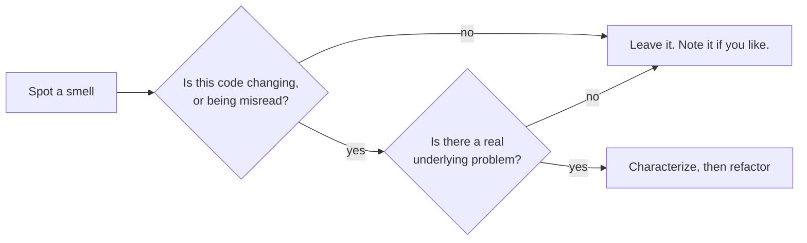

# 1 — Readable code and smells

> Most of what you do with code is read it, and most of what makes it expensive is what the reader has to keep in their head. This chapter is about reducing that load: names, function shape, comments, and the "smells" that suggest a closer look is due. Two warnings come with it. The best-known authorities disagree in public about function size and comments, and you should know the argument, not just one side. And the best controlled study of smells I could find says they matter less than file size does. Code here ran on CPython 3.14.7.

---

## What you are optimising for

[PEP 8](https://peps.python.org/pep-0008/) opens from Guido van Rossum's point that code is read much more often than it is written. Ousterhout and Martin, who disagree about nearly everything else below, [agree on the goal](https://github.com/johnousterhout/aposd-vs-clean-code): Ousterhout defines complexity as whatever makes a system hard to understand and modify, chiefly how much information a developer must hold in their head and how obvious that information is. Martin says the programmer to help most is the one reading someone else's code.

Use that as the test for every rule in this chapter. A rule is good when, in this place, it reduces what the next reader must know. The worst case Ousterhout names is a crucial fact hidden in far-away code that the reader has never heard of. So when you're unsure, ask: what would a new teammate need to know to change this safely, and where would they find it?

## Names carry most of the meaning

A name is the cheapest documentation you have, and the only kind certain to be seen at every use. The [Google Python Style Guide](https://google.github.io/styleguide/pyguide.html#316-naming) asks for descriptive names and warns against abbreviations that are ambiguous to readers outside your project. Here's the same function twice:

```python
def f(ms, n):
    o, t = [], 0
    for m in reversed(ms):
        c = len(m["content"]) // 4
        if t + c > n:
            break
        o.append(m)
        t += c
    return o[::-1]

CHARS_PER_TOKEN_ESTIMATE = 4

def keep_recent_messages(messages: list[dict], token_budget: int) -> list[dict]:
    """Return the newest messages that fit, oldest first."""
    kept, used = [], 0
    for message in reversed(messages):
        cost = len(message["content"]) // CHARS_PER_TOKEN_ESTIMATE
        if used + cost > token_budget:
            break
        kept.append(message)
        used += cost
    return kept[::-1]

history = [{"role": "user", "content": "x" * 400}, {"role": "assistant", "content": "y" * 200}, {"role": "user", "content": "z" * 80}]
print([m["role"] for m in keep_recent_messages(history, token_budget=80)])
assert f(history, 80) == keep_recent_messages(history, 80)
```

```text
['assistant', 'user']
```

The logic is identical, but the second version says what the 4 is and which end of the list survives. A few habits account for most of the gain:

- **Name the role, not the type.** `token_budget`, not `limit_int`. Say the unit if it's ambiguous: `timeout_s`, `latency_ms`, `cost_usd`.
- **Scale length with scope.** `i` is fine in a three-line loop. A module-level `n` is not.
- **Use the domain's words,** and one word per concept. If `chunk`, `passage` and `segment` mean the same thing in your RAG code, every reader has to work out that they do.
- **Name booleans as claims** (`is_cached`, `has_tool_calls`) so `if` reads as a sentence.

**The cost.** Long names make lines wrap. In the debate, [Ousterhout objects](https://github.com/johnousterhout/aposd-vs-clean-code) to Martin's very long method names: they waste horizontal space, trigger line wraps and still don't say as much as a shorter name with a comment. A name that needs seven words is usually a sign that the function does too many things.

## How long should a function be?

There's no agreed number, and the disagreement is instructive.

| | Position | Source |
|---|---|---|
| Martin | Very short functions that do "One Thing"; if you must err, err towards decomposition, since it can be inlined later | [Debate](https://github.com/johnousterhout/aposd-vs-clean-code) |
| Ousterhout | Decompose when the interface is much simpler than the implementation ("deep"); stop when pieces become "shallow" or "entangled" | Same |
| Google | No hard limit; past about 40 lines, think about whether it can be broken up without harming the structure | [Style guide §3.18](https://google.github.io/styleguide/pyguide.html#318-function-length) |

Both authors agree that over-decomposition exists and that the first edition of *Clean Code* says little about how to recognise it, as Martin concedes. Where they part is on weighting. Martin values decomposition more; Ousterhout counts entanglement as the worse failure: if understanding one method requires reading another, flipping between them is a red flag, and they may be better combined. Here is what that looks like:

```python
# Over-decomposed: each piece is short, and none can be understood alone.
def build_prompt(question, chunks):
    return _join(_header(), _body(chunks), _footer(question))

def _header():
    return "Answer using only the context below."

def _body(chunks):
    return "\n".join(_line(i, c) for i, c in enumerate(chunks, 1))

def _line(i, c):
    return f"[{i}] {c}"

def _footer(question):
    return f"Question: {question}"

def _join(*parts):
    return "\n\n".join(parts)

# One function: the whole shape of the prompt is visible at once.
def build_prompt_flat(question: str, chunks: list[str]) -> str:
    context = "\n".join(f"[{i}] {chunk}" for i, chunk in enumerate(chunks, 1))
    return f"Answer using only the context below.\n\n{context}\n\nQuestion: {question}"

chunks = ["Refunds take 5 days.", "Exchanges are free."]
assert build_prompt("How long?", chunks) == build_prompt_flat("How long?", chunks)
print(build_prompt_flat("How long?", chunks))
```

```text
Answer using only the context below.

[1] Refunds take 5 days.
[2] Exchanges are free.

Question: How long?
```

The prompt's layout is what a reader wants to see, and the split version scatters it over six functions with no reusable part. Contrast `keep_recent_messages` above: a caller needs only one sentence to use it and never reads the loop. That's a deep function, in Ousterhout's sense, and worth extracting even if it's called once.

My working test, which is judgement and not data: extract when the new name lets a reader skip the body. If they'd always need to read the body anyway, the extraction added a hop and removed nothing.

## Comments: what the code can't say

Here the two authors [ended up further apart](https://github.com/johnousterhout/aposd-vs-clean-code). *Clean Code* calls comments a necessary evil and, in a line Ousterhout quotes from page 54, "always failures"; Martin replies that he's hostile to gratuitous comments and that bad comments cost more than good ones save. Ousterhout says some information can't be expressed in code at all, and puts the cost of missing comments at 10 to 100 times the cost of incorrect ones, by his own experience. He estimates he'd write 5 to 10 times as many comment lines as Martin. Neither moved. They do agree that implementation code needs comments only where it's non-obvious.

Their shared ground gives you a usable rule: **comment what the code can't say, not what it already says.** PEP 8 adds the failure mode: [comments that contradict the code are worse than no comments](https://peps.python.org/pep-0008/#comments).

```python
import random

# Restates the code: delete it.
# multiply delay by 2
delay = 1.0
delay = delay * 2

# Says why, which no name could. The next reader would otherwise "fix" this.
# Full jitter: without it, every client that failed together retries together,
# and the provider's rate limiter sees the same spike again.
def backoff_seconds(attempt: int, rng: random.Random, cap_s: float = 30.0) -> float:
    return rng.uniform(0, min(cap_s, 2.0 ** attempt))

print(round(backoff_seconds(3, random.Random(7)), 2))
```

```text
2.59
```

Comments earn their place for these: why this and not the obvious alternative, units and invariants, what the caller must guarantee, links to the incident or paper behind a strange constant, and what a public function promises without its reader having to read the body. The lab's module opens with `# prices per 1k tokens (updated last week)`, a good example of a comment that went stale the week after someone wrote it.

## Measuring complexity

McCabe complexity counts decision points plus one. [Ruff's C901](https://docs.astral.sh/ruff/rules/complex-structure/) computes it, and it's a quick way to find where to look. This is the lab's module before and after refactoring, from `ruff check --select C901` on ruff 0.16.5:

```text
                                  lines   worst function (McCabe)
step0_original.py                    95   report = 23
step1_split_phases.py                94   read_rows = 6
step2_types_and_table.py            120   read_calls = 6
step4_add_feature.py                132   read_calls = 6
```

Notice that lines went up by 39% while the worst function fell by about 74%. That's a normal trade: more names and more declarations, each with less to hold in your head. Line count alone would say the refactor made it worse.

Treat the number as a pointer, not a target. Ruff's own example of a high-complexity function is a chain of simple `if`s mapping one status to another, which is perfectly readable, if better as a dict. Forcing a threshold on code like that produces helpers that exist to satisfy a linter.

## Smells

Fowler's [definition](https://martinfowler.com/bliki/CodeSmell.html) has two parts that often get lost: a smell is a surface indication that *usually* corresponds to a deeper problem, and it's quick to spot. And, he says, smells don't always indicate a problem: "some long methods are just fine." The term, he notes, was coined by Kent Beck. A smell is a reason to look, never a verdict.



The table uses names in common use, with examples from [the lab's module](../practice/exercises/usage_report_lab/usage_report.py).

| Smell | In the lab | The question to ask |
|---|---|---|
| Long function | `report` is 80-odd lines | How many things must I understand to change one? |
| Flag arguments | `report(path, mode, show_cost, write, dedupe)` | Are these really several functions? |
| Duplicated code | The print and file-write branches are copies | When one changes, will the other? |
| Global mutable state | `seen` and `TOTAL` persist between calls | What does the second call see? |
| Mixed levels of abstraction | JSON parsing and report formatting in one body | Can I test the arithmetic without a file? |
| Magic numbers | `0.015`, `0.075`, `0.95` | What do they mean, and where else do they appear? |
| Primitive obsession | `d[m][3]` is cost | Should this be a named thing? |
| Swallowed errors | Bare `except: continue` | What happens to the row we skipped, and who finds out? |
| Stale comment | "updated last week" | When was that? |

The flag argument is the easiest of these to see from the outside, because the damage is at the call site. [Fowler](https://martinfowler.com/bliki/FlagArgument.html) prefers separate methods, so that the call states the intent, and keeps a hidden flagged implementation behind them when the logic is too tangled to split:

```python
def report(path, mode="full", show_cost=True, write=False, dedupe=True):
    return f"{path} mode={mode} cost={show_cost} write={write} dedupe={dedupe}"

print(report("calls.jsonl", "summary", False, True, False))    # what does this do?

def summary_report(path: str, *, show_cost: bool = True, dedupe: bool = True) -> str:
    return f"{path} summary cost={show_cost} dedupe={dedupe}"

print(summary_report("calls.jsonl", show_cost=False, dedupe=False))
```

```text
calls.jsonl mode=summary cost=False write=True dedupe=False
calls.jsonl summary cost=False dedupe=False
```

And global state hides from every reader of a single call. These are two real, consecutive calls to the lab's original `report` on one file:

```text
>>> usage_report.report("calls.jsonl", mode="summary")
calls: 58 total: 0.7201
0.7201
>>> usage_report.report("calls.jsonl", mode="summary")
calls: 0 total: 0.7201
0.7201
```

The second call found nothing, yet still reported the same total. No line in `report`'s body looks wrong on its own.

### Smells that show up in ML code

Wilson's list of "nontoxic" smells in ML code bases (*Machine Learning Engineering in Action*, ch. 10, Table 10.1) mostly repeats the table above under ML names: too many parameters (a function taking `df, name, source, fitting, metric, score, value, rename, outliers, train, valid`), literals such as `profit = 0.72 * revenue`, comments that explain tangled code, and variable reuse (`pred` rebound from one model's predictions to another's, with a parquet write in between). The ones worth adding are specific to data work.

| Smell | Why it bites in ML code |
|---|---|
| Copied boilerplate: feature-engineering code defined separately for training, test and inference | Wilson calls it shotgun surgery. A change made in two of the three places gives a model features at serving time that differ from the ones it trained on, with no error |
| Default hyperparameters (`km = KMeans(); km.fit(train)`) | Defaults are rarely tuned, and an untuned model outside rapid prototyping is a sign nobody chose the setting |
| Wildcard imports (`from scipy import *`) and mixed styles (`import numpy as np` beside `from numpy import add`) | Names collide across libraries, and a reader cannot tell where `add` came from |
| SQL as one chain of joins with no CTEs, or with no indentation or capitalisation | One dependency chain means adding or dropping a column can take hours to trace |
| Constant recasting (`age = int(age)` repeated) | Types do not change between lines; cast once, where the data enters |

Swallowed exceptions are on his list of the five "deadly" problems and have an example in [errors and context managers](../../python/03-language-for-engineers/notes/04-errors-and-context-managers.md#blind-catches-hide-wrong-input). One more of his heuristics is a smell by his own account: "for the vast majority of ML solutions, the ratio of feature engineering code to model code should always be > 4x" (ch. 4). It is an experienced author's rule of thumb. The book gives no data or setup behind the 4, so use it as a prompt to look at where the code's effort went, not as a threshold. All of this is practitioner judgement, so the caution in the next section applies to every row.

## What the evidence says

Treat smell-hunting with some scepticism, because the evidence is thinner than the confidence of the advice. [Sjøberg et al. (2013)](https://doi.org/10.1109/TSE.2012.89) ran a controlled study: six professional developers each did three maintenance tasks on four functionally equivalent Java systems, over three to four weeks each, modifying 298 files, with an IDE plug-in timing the work per file. None of the 12 smells studied was significantly associated with more effort after adjusting for file size and number of changes, and one, Refused Bequest, was associated with *less*. File size and number of changes explained almost all of the modelled variation. Their conclusion: focusing on reducing code size and the practices that cause many changes may be more beneficial than refactoring smells.

That's one study, with a small number of developers, in Java, measuring effort and not defects or comprehension. It doesn't show that smells never matter. The authors point out that most smells are defined in ways that make larger files more likely to contain them: files with at least one smell were on average twice as long as files with none, and the average Spearman correlation between size and the 12 smells was 0.53. So adjusting for size may absorb part of what a smell would otherwise signal. What it does justify is priority. Don't refactor a file because it smells. Refactor it because you keep having to change it. The [refactoring chapter](02-refactoring.md) looks at when that pays.

## Style: automate the argument away

Argue about style once, then let the tool decide. [Ruff](https://docs.astral.sh/ruff/) with a formatter settles layout and many lint questions for a Python repo, and [tooling](../../python/03-language-for-engineers/notes/06-modules-packaging-tooling.md) shows the setup. PEP 8's own section on consistency allows you to break a rule when following it would make the code less readable, or when it clashes with the surrounding code. Consistency within a project matters more than any one choice, and review time is better spent on the things this chapter says machines can't check: what a name means, and whether a comment is true.

## Pitfalls

- **Treating a smell as a defect.** Symptom: review comments that say "too long" without saying what's hard to change. Ask what the reader has to know.
- **Decomposing until nothing can be read alone.** Symptom: you jump between five helpers to follow one behaviour. Inline them; Martin himself notes that decompositions can be inlined when they've gone too far.
- **Chasing a metric.** Symptom: helpers named `_part2` that exist because the linter fails at complexity 10. A dict or an early return usually answers the real problem.
- **Comments that restate code,** which go stale and teach readers to skip comments. Symptom: `# increment i`, or a comment that contradicts the next line.
- **No comments on an interface, because "the code should be self-documenting".** Symptom: every caller reads the body to find out the unit, the failure mode or who owns the returned list.
- **Cleanup mixed into a behaviour change.** Symptom: a 40-file diff nobody can review. See [small changes](07-git-code-review-and-design-docs.md#small-changes-and-reviewing-them).
- **Refactoring code that isn't changing.** Symptom: weeks spent on a stable module, while the one everyone edits stays bad.

## Try it

1. Rename every variable in the lab's `report` function, on a copy of [`usage_report.py`](../practice/exercises/usage_report_lab/usage_report.py), without changing its structure, and run the tests. How much clearer is it, and what is still hard?
2. Run `ruff check --select C901 --config 'lint.mccabe.max-complexity=1'` over a module you work on. Pick the function with the highest number. Is it actually hard to read? Pick one with a middling number that is. What does the metric miss?
3. Write the comment for this function, covering only what the code can't say: `def embed(texts, batch_size=64): ...`. Assume it's a public function in a shared library calling a remote API.
4. In a sentence each, give Ousterhout's and Martin's best argument about a two-line helper called once. Then say which applies to `build_prompt` above.

<details>
<summary>Answers</summary>

1. Names help a lot in a short pass: `d[m][3]` becomes obvious. But the flags, the duplicated rendering and the globals are all still there. Names can't fix structure, which is why [the next chapter](02-refactoring.md) exists. Reruns of the characterization tests should all pass, since renaming local variables changes nothing observable.
2. Answers vary. Typical misses: McCabe counts branches, so a straight 100-line function with hidden coupling scores 1, and a flat lookup chain scores high.
3. Something like: "Embed `texts` in order; the result is aligned with the input. Empty strings raise `ValueError`. Raises `RateLimitError` after retries are exhausted. `batch_size` trades latency for memory and must stay under the provider's limit. Safe to call from several threads." Each of these is something a caller needs and can't get from the signature.
4. Ousterhout: a shallow helper replaces no cognitive load, so it adds an interface without hiding anything. Martin: extracting gives a name, and it can always be inlined. For `build_prompt`, the helpers are entangled, since you'd read all of them to see the prompt, so Ousterhout's point applies.

</details>

## Interview checklist

| Question | Answer |
|---|---|
| What is a code smell? | Fowler: a surface indication that usually corresponds to a deeper problem. Quick to spot, and not always a problem. |
| Does refactoring smells reduce maintenance effort? | Sjøberg et al. found no significant effect for 12 smells after adjusting for file size and changes, in a controlled study of six developers and four Java systems. One study, but it argues for prioritising by change frequency. |
| How long should a function be? | There's no consensus. Google: think hard past about 40 lines. Martin: very short. Ousterhout: as long as the interface stays much simpler than the implementation. What matters is whether a reader can skip the body. |
| What is a deep module? | Ousterhout's term: lots of functionality behind a simple interface. A shallow one exposes nearly as much as it hides. |
| When should you write a comment? | For what the code can't say: why, units, invariants, what callers must guarantee. Not to restate the code. |
| What is cyclomatic complexity good for? | Finding places to look. It counts branches, so it misses coupling and overrates flat dispatch. Don't make it a target. |
| What's wrong with flag arguments? | The call site is unreadable, and they usually mean one function doing several jobs. Use keyword-only arguments or separate functions. |
| Why is global mutable state so costly? | No single function's text tells you its behaviour. A second call can behave differently, as the lab shows. |

## Next

[2 — Refactoring](02-refactoring.md): changing the structure without changing the behaviour, and how to know you haven't.
