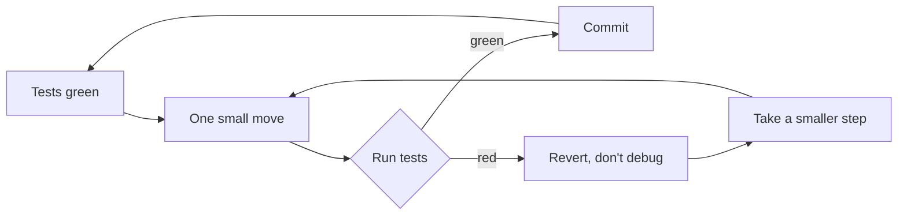
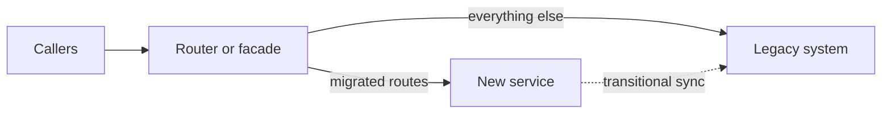

# 2 — Refactoring

> Refactoring means changing a program's structure without changing what it does, in steps small enough that it keeps working. The hard part isn't the moves, it's knowing that behaviour held, and knowing when the work is worth doing. This chapter goes through the moves using [the lab](../practice/README.md), which takes a real smelly module through refactoring under tests, and reports what that paid and what it didn't. One result surprised me: the refactor did not make the next feature's diff smaller. Code ran on CPython 3.14.7.

---

## What refactoring is, and what it isn't

[Fowler's definition](https://martinfowler.com/bliki/DefinitionOfRefactoring.html) has a noun and a verb: a change to the internal structure that makes software easier to understand and cheaper to modify without changing its observable behaviour, and the act of applying a series of them. [refactoring.com](https://refactoring.com/) adds the practical half: each transformation is small, a sequence of them can be large, and the system keeps working after each one. It's also firm that refactoring "isn't another word for cleaning up code." So a three-week rewrite on a branch that doesn't compile until the end isn't refactoring, whatever its ticket says.

Most people use the word more loosely. In [Kim et al.'s survey](https://doi.org/10.1145/2393596.2393655) of 328 Microsoft engineers, 78% defined it as a transformation that improves things like readability, maintainability or performance, and 46% did not mention preserving behaviour at all. When a colleague says "I'll refactor this", ask which they mean: is behaviour supposed to stay the same?

Kent Beck's two-hats metaphor, [as Fowler passes it on](https://martinfowler.com/articles/preparatory-refactoring-example.html), gives you a working rule. When you wear the refactoring hat, every change preserves observable behaviour and keeps the tests green. When you wear the feature hat, you add tests and may break existing ones, which is riskier. You can swap hats many times an hour, but wear only one at a time. If you find a bug while refactoring, write it down and finish the step.



Reverting instead of debugging feels wasteful, and it's the habit that makes the rest safe. A step that only took two minutes loses two minutes. Debugging one that went wrong can easily take much longer.

## When it pays: the change you're about to make

Fowler describes two everyday modes. [Opportunistic refactoring](https://martinfowler.com/bliki/OpportunisticRefactoring.html) is tidying what you pass through, the camp-site rule: leave it better than you found it. He notes that it needs judgement about how far to chase a rabbit hole, and that you should do it only when the tests are green. [Preparatory refactoring](https://martinfowler.com/articles/preparatory-refactoring-example.html) is what you do when the code isn't shaped for the feature in front of you. You reshape it first; in Kent Beck's words, "make the change easy, then make the easy change."

Both are tied to change you're making anyway, which lines up with the evidence in [the previous chapter](01-readable-code-and-smells.md#what-the-evidence-says): the smell isn't what costs you, the changes are. Fowler argues against treating refactoring as something to plan separately. Yet larger efforts are real: in Kim et al., 71% of respondents said that basic refactorings happen as part of larger efforts, and engineers perceived substantial cost and risk. On Windows 7, the top 25% most refactored binaries had post-release defects reduced 12.2% more than other modified binaries. That's observational data, and the authors are measuring correlation in one product, so it isn't proof that refactoring caused it.

A simple decision test before starting:

| Question | If no |
|---|---|
| Will this code change soon, or do people keep misreading it? | Leave it |
| Can I tell if I broke it? | Write characterization tests first, or leave it |
| Can I do it in steps that each leave the system working? | Find smaller steps, or call it a rewrite and plan it as one |
| Can I stop halfway and still be better off? | It's probably too big for now |

A related rule comes from machine-learning practice. Wilson tells teams that experimental code should be "a little janky": scripted, commented out and "nigh-untestable", and that "under no circumstances should experimental code be expanded upon for the final solution" (*Machine Learning Engineering in Action*, ch. 4). It is a rewrite, not a refactor, and the decision test above gives the same answer: you cannot tell whether you broke an experiment that never had tests, and no sequence of safe steps leads from a notebook script to a tested module. Keep the experiment as the reference for behaviour, and write the production version beside it. The advice is the author's experience on project timelines, not a measured result.

## Characterization tests: pin what it does, not what it should do

The lab's module has no tests and its header says `Don't touch unless you have to.` Before you can move anything you need to detect a change. [Michael Feathers](https://michaelfeathers.silvrback.com/characterization-testing) draws the distinction: most testing is about correctness and assumes you know what the code should do, but with legacy code you often don't. So you run the code, find out what it does, and write that down.

His method fits in one line: "Start with a test named 'x'", with a dummy expected value, then copy in the actual result from the failure message and give the test a name that records what you learned.

```python
def cost(model: str, prompt_tokens: int) -> float:
    if model == "atlas-large":
        return prompt_tokens / 1000 * 0.015
    return prompt_tokens / 1000 * 0.001

# Step 1: a test named x, expecting nothing in particular.
def test_x():
    assert cost("mystery-model", 1000) is None

try:
    test_x()
except AssertionError as failure:
    print("failed, and the failure tells us:", cost("mystery-model", 1000))

# Step 2: paste the real value, and name what you have learned.
def test_unknown_model_is_charged_a_default_price():
    assert cost("mystery-model", 1000) == 0.001

test_unknown_model_is_charged_a_default_price()
print("pinned")
```

```text
failed, and the failure tells us: 0.001
pinned
```

Is a default price for unknown models a bug? Feathers's example of a test that exposes questionable behaviour makes this exact point: the context decides, and if you don't yet know that something's a bug, leave the test in place. A production system, he writes, in a way becomes its own specification, because users come to rely on what it does. So characterization tests make questions visible without having to answer them right away. The lab marks suspected bugs with a `test_PINNED_` prefix, and refactoring leaves them all passing, bugs included, until a separate behaviour change.

A golden master is the bulk version: record the output for a grid of inputs and compare. The lab's [`make_golden.py`](../practice/exercises/usage_report_lab/make_golden.py) records printed output, return value and written file across 16 flag combinations, using a fresh module each time so the globals don't leak between cases.

The hardest part, says Feathers, is breaking dependencies enough to run the code in a harness at all. In the lab, that's the module-level `seen` and `TOTAL`, which is why the harness reloads the module. With that, 22 tests reach 100% statement and branch coverage of the original (80 statements, 42 branches). Coverage only tells you the lines ran, a point [the testing chapter](05-testing-strategy.md#coverage-versus-mutation) takes further.

Check the net before you trust it. [Fowler](https://martinfowler.com/bliki/OpportunisticRefactoring.html) suggests putting in a deliberate error to see whether the tests notice. I changed one price by a factor of ten in step 2 of the lab (`atlas-medium` completion, 0.015 to 0.0015), and 16 tests failed. Restored, 94 passed. If that error had produced no failures, the tests wouldn't have been protecting that line.

## The moves, on real code

A small vocabulary covers most of the lab: extract function, split phase, replace a conditional with a table, and name the data. The [catalogue](https://refactoring.com/catalog/) lists many more, with its examples in JavaScript.

**Split phase** is the most useful of these for data code. When one body of code does several things in sequence, make them separate stages that pass data along. The original mixes parsing, deduplication, pricing, aggregation and two copies of formatting. Here's the same shape in miniature, a log summariser:

```python
import json

LOG = """\
{"model": "atlas-small", "tokens": 120, "status": "ok"}
{"model": "atlas-small", "tokens": 80, "status": "error"}
not json
{"model": "atlas-large", "tokens": 300, "status": "ok"}
"""

# Before: read, filter, count and format, all in one loop.
def summary_tangled(text: str, write_to: list[str]) -> None:
    totals = {}
    for line in text.splitlines():
        try:
            row = json.loads(line)
        except json.JSONDecodeError:
            continue
        if row["status"] != "ok":
            continue
        totals[row["model"]] = totals.get(row["model"], 0) + row["tokens"]
    for model in sorted(totals):
        write_to.append(f"{model}: {totals[model]}")

# After: three phases, each testable without the others.
def parse_ok_rows(text: str) -> list[dict]:
    rows = []
    for line in text.splitlines():
        try:
            row = json.loads(line)
        except json.JSONDecodeError:
            continue
        if row["status"] == "ok":
            rows.append(row)
    return rows

def tokens_by_model(rows: list[dict]) -> dict[str, int]:
    totals: dict[str, int] = {}
    for row in rows:
        totals[row["model"]] = totals.get(row["model"], 0) + row["tokens"]
    return totals

def render(totals: dict[str, int]) -> list[str]:
    return [f"{model}: {totals[model]}" for model in sorted(totals)]

tangled: list[str] = []
summary_tangled(LOG, tangled)
assert tangled == render(tokens_by_model(parse_ok_rows(LOG)))
print(tangled)
print(tokens_by_model([{"model": "m", "tokens": 5}]))   # no file, no JSON, no formatting
```

```text
['atlas-large: 300', 'atlas-small: 120']
{'m': 5}
```

The last line is the point. You can now test the arithmetic with a literal, which you couldn't before. It's also longer, and that's the cost: 11 lines of body became 14, plus two more signatures. In the lab, splitting also let the two duplicated rendering branches collapse into one string sent to two places, so step 1 finished at 94 lines against the original 95, even with more functions.

**Replace a conditional.** The lab's pricing `if/elif` chain becomes a table in step 2, not a class per model, since the models only differ in data. This is where it's easy to overshoot. Fowler's catalogue entry is called *Replace Conditional with Polymorphism*, and it's the right move when branches differ in *behaviour* and the same switch shows up in several places. Here, three levels of the same decision:

```python
from dataclasses import dataclass
from typing import Protocol

def cost_if(model: str, tokens: int) -> float:
    if model == "atlas-large":
        return tokens / 1000 * 0.015
    if model == "atlas-small":
        return tokens / 1000 * 0.0008
    return tokens / 1000 * 0.001

# Data differs: a table. One new model is one new row.
PER_1K = {"atlas-large": 0.015, "atlas-small": 0.0008}
def cost_table(model: str, tokens: int) -> float:
    return tokens / 1000 * PER_1K.get(model, 0.001)

# Behaviour differs: polymorphism starts to earn its keep.
class Pricing(Protocol):
    def cost(self, tokens: int) -> float: ...

@dataclass
class PerToken:
    per_1k: float
    def cost(self, tokens: int) -> float:
        return tokens / 1000 * self.per_1k

@dataclass
class Tiered:
    free_tokens: int
    per_1k: float
    def cost(self, tokens: int) -> float:
        return max(0, tokens - self.free_tokens) / 1000 * self.per_1k

plans: dict[str, Pricing] = {"atlas-large": PerToken(0.015), "team-plan": Tiered(1000, 0.002)}
print(cost_if("atlas-large", 2000), cost_table("atlas-large", 2000), plans["atlas-large"].cost(2000))
print(plans["team-plan"].cost(2000))
```

```text
0.03 0.03 0.03
0.002
```

The class version costs a protocol, two classes and an indirection the reader has to follow, and buys nothing until a second behaviour exists. Reach for the table first. [Design principles](03-design-principles.md#solid-and-its-critics) returns to that trade, including a measured look at what polymorphism costs.

## What the lab measured

The lab goes in four steps. Steps 1 and 2 preserve behaviour, and the same golden file passes for both. Step 3 changes behaviour on its own, fixing the three pinned bugs. Step 4 adds a feature: cached tokens at a discount and a per-tenant breakdown. To see what the refactoring bought, I also hacked the same feature directly onto the original.

```text
                       lines  worst McCabe  what changed
step0_original            95            23  (start)
step1_split_phases        94             6  extract, split phase, render to one string
step2_types_and_table    120             6  dataclasses, price table
step3_fix_pinned_bugs    120             6  three bug fixes, tests re-recorded
step4_add_feature        132             6  cached tokens, by_tenant
feature_on_original      106            26  same feature, no refactor
```

Fixing the bugs took a small diff in step 3, once there was one place that read the file and no more globals. It changed real output: calls went from 58 to 60 and the total from 0.7201 to 0.7483, because retried calls now count. That's a billing report changing by 3.9%, which is why it belongs in its own reviewed step and not inside a tidy-up.

Here's the part I didn't expect, and I'd rather report it than hide it: **the feature's diff was not smaller after refactoring.**

```text
                               added   removed   hunks
on the original                  +24       -13       8
on the refactored step 3         +26       -14      11
```

The refactored diff is slightly larger, in part because of a docstring update and a reformat. The refactored end state is also 26 lines longer than the hack (132 against 106). So "refactor and your next feature is a smaller diff" isn't what this run shows. What it does show:

- The hacked function's McCabe score went from 23 to 26. The refactored module's worst stays at 6. The next feature lands on 26.
- A price is one row, not a branch and a formula, and the cached-token formula appears once rather than four times.
- `call_cost` can be tested alone with a literal. In the hacked version, only a file on disk reaches the pricing.
- The bug fixes in step 3 were each a small edit. On the original, the globals still sit under the new feature.

Caveats: this is one small module, I wrote both versions and I knew the feature in advance, which flatters neither side reliably. It's an n of 1, a worked example and not evidence. Whether it pays depends on how many more changes are coming, the same point as the previous chapter.

## Changing an interface other people use

Everything so far could change all callers in one commit. Once other teams or a released package call your code, you can't. [Parallel Change](https://martinfowler.com/bliki/ParallelChange.html) (Danilo Sato's write-up, also called expand and contract) splits it into three phases: expand, adding the new alongside the old; migrate, moving callers over; contract, removing the old. Here's the shape, for a function moving from a positional dict to a typed request:

```python
import warnings
from dataclasses import dataclass

@dataclass(frozen=True)
class CompletionRequest:
    prompt: str
    model: str = "atlas-small"
    max_tokens: int = 256

def complete(request: CompletionRequest) -> str:          # expand: the new interface
    return f"[{request.model}, up to {request.max_tokens}] {request.prompt[:20]}"

def complete_legacy(prompt: str, opts: dict) -> str:      # the old one, now forwarding
    warnings.warn("use complete(CompletionRequest(...))", DeprecationWarning, stacklevel=2)
    return complete(CompletionRequest(prompt, opts.get("model", "atlas-small"), opts.get("max_tokens", 256)))

with warnings.catch_warnings(record=True) as caught:
    warnings.simplefilter("always")
    old = complete_legacy("Summarise this ticket", {"max_tokens": 64})   # migrate callers one at a time
new = complete(CompletionRequest("Summarise this ticket", max_tokens=64))
assert old == new
print(new)
print(caught[0].category.__name__, "at line", caught[0].lineno)
# contract: when the warning stops firing in production logs, delete complete_legacy.
```

```text
[atlas-small, up to 64] Summarise this ticke
DeprecationWarning at line 19
```

The same three phases apply to a database column, a JSON field or an event schema. The cost is that for a while you're running two paths, and a contract step that never happens leaves you with both forever. Set a date, and make the old path's usage measurable so you know when it's safe.

[Branch by Abstraction](https://martinfowler.com/bliki/BranchByAbstraction.html) applies when the thing you're replacing is a large component and you want to work on mainline, not a long-lived branch. Introduce an abstraction over the part of the old component a client uses, move clients to it gradually, build the replacement behind it, then remove the old one. Fowler credits the term to Paul Hammant. In an LLM stack, that's how you move retrieval from one vector store to another:

```python
from typing import Protocol

class Retriever(Protocol):
    def search(self, query: str, k: int) -> list[str]: ...

class OldStore:
    def search(self, query: str, k: int) -> list[str]:
        return ["refund-policy", "shipping", "returns"][:k]

class NewStore:
    def search(self, query: str, k: int) -> list[str]:
        return ["refund-policy", "returns", "shipping"][:k]

class ShadowRetriever:
    """Serve from old, also query new, and record disagreement. Delete me afterwards."""
    def __init__(self, serving: Retriever, shadow: Retriever):
        self.serving, self.shadow, self.compared, self.disagreed = serving, shadow, 0, 0
    def search(self, query: str, k: int) -> list[str]:
        served = self.serving.search(query, k)
        self.compared += 1
        self.disagreed += served != self.shadow.search(query, k)
        return served

retriever = ShadowRetriever(OldStore(), NewStore())
print(retriever.search("how do refunds work", 1), retriever.search("how do refunds work", 3))
print(f"disagreed on {retriever.disagreed} of {retriever.compared}")
```

```text
['refund-policy'] ['refund-policy', 'shipping', 'returns']
disagreed on 1 of 2
```

The serving path is unchanged while you collect evidence on the new one. A disagreement here isn't necessarily a defect, since a different ranking might be better, which is why a real comparison needs [retrieval evaluation](../../../generative-ai/02-rag-retrieval/README.md). The shadow class also costs an extra call per query, so sample it in production.

[Strangler Fig](https://martinfowler.com/bliki/StranglerFigApplication.html) is the same thought at the scale of a whole system. Rather than a big-bang replacement, build the new around the old, using seams to divert one flow at a time, and accept transitional architecture that you'll later throw away. Fowler's reason is that gradual modernisation delivers value earlier and limits risk.



## Pitfalls

- **Refactoring without tests.** Symptom: "it looks right" and a defect two weeks later. If you can't test, make the smallest possible change, or write the characterization tests first.
- **Fixing bugs mid-refactor.** Symptom: a golden test fails and you can't say whether that's the fix or a slip. Pin it, finish, then change behaviour in its own step, as in step 3.
- **Big steps.** Symptom: you've spent an hour in a red state. Revert and take a smaller one.
- **Overshooting the pattern.** Symptom: a class hierarchy to replace three constants. Start with a table. See [patterns](04-patterns-worth-knowing.md).
- **Refactoring in a long-lived branch.** Symptom: painful merges. Fowler lists feature branches and strong code ownership as friction for opportunistic refactoring. Merge small and often.
- **Mechanical refactors that leave the concept wrong.** Symptom: same bad model in smaller pieces. Names and data types are usually what to fix.
- **Starting expand-and-contract and never contracting.** Symptom: three generations of the same function in the code base.
- **Assuming the payoff.** Symptom: the promise is "the next feature will be quicker", and no one checks. Say what you expect to get, and look afterwards.

## Try it

Work these in [the lab](../practice/README.md), not here.

1. Do steps 1 to 3 of the lab on your own copy of the module, running the tests after every move. When did you have to revert?
2. Put a deliberate error into your step 2, changing one price. How many tests fail? Then change the `0.95` in `p95` to `0.90`. Do the tests catch it? Why or why not?
3. Add the cached-token feature on your refactored code, then on a fresh copy of the original. Compare with `diff -u | grep -c '^[-+]'`, and say honestly which you'd rather review.
4. Sketch expand, migrate and contract for renaming the JSON field `prompt_tokens` to `input_tokens` when the logs are written by one service and read by two others. What has to be true before each step?

<details>
<summary>Answers</summary>

1. Personal. A red state that takes more than a few minutes to fix means the step was too big.
2. The price: 16 failures in the solution harness. The p95: I ran it on the lab's characterization tests and got 8 failed, 14 passed, because the golden output prints the p95 and the two quantiles land on different values in that data. On a file with few latencies they could coincide, and the tests would pass. That's what [mutation testing](05-testing-strategy.md#coverage-versus-mutation) checks systematically.
3. My numbers: +24/-13 on the original and +26/-14 on the refactored code. Yours may differ. Size isn't the only measure: look at how many places each diff touches and how you'd test it.
4. Expand: writers emit both fields, readers prefer `input_tokens` and fall back to `prompt_tokens`; needs a deployed reader before writers stop. Migrate: each reader moves, and you confirm no reader takes the fallback (log it). Contract: writers stop emitting the old field, then remove the fallback; old logs may need a backfill or a permanent reader for historic data.

</details>

## Interview checklist

| Question | Answer |
|---|---|
| What is refactoring? | A behaviour-preserving change to internal structure, in small steps that leave the system working. It's not a synonym for rewriting or cleaning up. |
| What's a characterization test? | A test that records what code does now, without claiming it's right. Feathers: start with a test named `x` and copy in the actual value. |
| How do you check your tests protect a refactor? | Introduce a deliberate error and confirm that something fails. Coverage alone doesn't tell you. |
| What's preparatory refactoring? | Reshaping code first so the feature becomes easy: "make the change easy, then make the easy change". |
| When isn't refactoring worthwhile? | Code that isn't changing, or when no tests are possible at a reasonable cost, or when a rewrite is the honest description. |
| Does refactoring always make the next change smaller? | No. In this course's lab the feature diff came out about the same. The gains were complexity, testability and later fixes. |
| Replace conditional with polymorphism: always? | Only when branches differ in behaviour and recur. If only data differs, a table is simpler. |
| How do you change an interface with callers you don't control? | Parallel change: expand, migrate, contract, with usage measured so you know when to delete. |
| Branch by Abstraction versus feature branch? | Work on mainline behind an abstraction, moving clients gradually, so nothing waits on a long merge. It costs a temporary layer. |
| What's a strangler fig? | Replacing a system gradually by diverting flows through a seam to new code, accepting transitional architecture. |
| What did Kim et al. find? | Engineers define refactoring loosely, 46% not mentioning behaviour; they see real cost and risk; refactored Windows 7 binaries showed more defect reduction. Correlational, one product. |

## Next

[3 — Design principles](03-design-principles.md): coupling, cohesion and information hiding, and SOLID with its critics.
