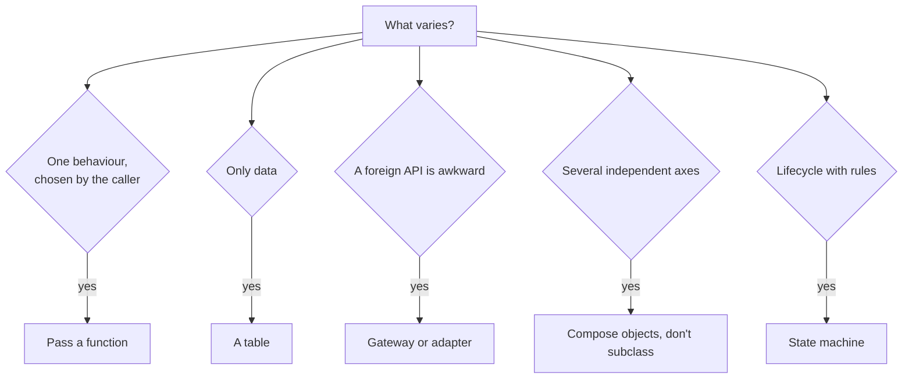

# 4 — Patterns worth knowing

> A pattern is a named solution to a recurring design problem, and it's useful mainly because the name saves a paragraph in a design review. Python removes the need for many classic ones: first-class functions, callable classes and modules do the work. This chapter covers the ten or so you'll actually meet in data and LLM systems, shows the smallest Python that does the job, and says what each one costs, including a measurement of the call overhead. I haven't read the Gang of Four book itself, and what I say about it comes through Rhodes and Norvig. Code ran on CPython 3.14.7.

---

## Why so few

[Peter Norvig's 1996 slides](https://norvig.com/design-patterns/design-patterns.pdf) studied the Gang of Four's 23 patterns and found that 16 of them have qualitatively simpler implementations in Lisp or Dylan than in C++, for at least some uses: strategy and command become plain functions, factories become first-class types, and so on. His claim is about those languages, and Python shares most of the features he lists. [Brandon Rhodes's guide](https://python-patterns.guide/) goes through the patterns in Python itself and comes to pattern-by-pattern verdicts rather than a blanket one: some are unneeded, a few are still valuable, and a number of Python-specific ones aren't in the book at all.

Start from the problem, not the pattern's name:



| You'd reach for | In Python, first try | When the full form earns its keep |
|---|---|---|
| Strategy class | A function argument | Strategy holds configuration and several related methods |
| Abstract factory | Pass a callable or the class | Many related objects must vary together |
| Singleton | A module-level object | Rarely; see below |
| Template method | A function with hooks as arguments | A framework you ship for subclassing |
| Iterator | A generator | An iterator with extra methods |
| Decorator class | `@wraps` function, if wrapping a call | You must wrap an object you didn't create |

## Strategy: pass a function

The behaviour varies and the caller picks. In this retriever, the reranking choice is an argument:

```python
from typing import Callable

Scored = tuple[str, float]
Reranker = Callable[[str, list[Scored]], list[Scored]]

def by_score(query: str, hits: list[Scored]) -> list[Scored]:
    return sorted(hits, key=lambda hit: -hit[1])

def prefer_query_terms(query: str, hits: list[Scored]) -> list[Scored]:
    terms = set(query.lower().split())
    return sorted(hits, key=lambda hit: (-len(terms & set(hit[0].lower().split())), -hit[1]))

def retrieve(query: str, hits: list[Scored], rerank: Reranker = by_score, k: int = 2) -> list[str]:
    return [text for text, _ in rerank(query, hits)[:k]]

hits = [("shipping times by region", 0.91), ("refund policy for orders", 0.82), ("how refunds work", 0.75)]
print(retrieve("refund policy", hits))
print(retrieve("refund policy", hits, rerank=prefer_query_terms))
```

```text
['shipping times by region', 'refund policy for orders']
['refund policy for orders', 'shipping times by region']
```

When the strategy needs configuration, `functools.partial` or a closure usually covers it. Move to a class (with `__call__`, or a method) when it has state you want to inspect, or when several functions always travel together.

## Adapter and gateway: confine a foreign API

An adapter makes one interface look like another. Fowler's [gateway](https://martinfowler.com/articles/gateway-pattern.html) is close kin, and he says what separates them: an adapter assumes both interfaces already exist, whereas you design a gateway's interface as you wrap the external system. It's a single place to confront the foreign code, working in your system's terms, and containing only the translation. Logic built on top belongs in its clients. Two provider SDKs returning different shapes are a typical case. These dicts are made up for the example; they imitate no real vendor:

```python
from dataclasses import dataclass
from typing import Protocol

@dataclass(frozen=True)
class Reply:
    text: str
    prompt_tokens: int
    completion_tokens: int

class Provider(Protocol):
    def complete(self, prompt: str) -> Reply: ...

def alpha_sdk_call(messages):
    return {"choices": [{"message": {"content": "ok-alpha"}}], "usage": {"in": 12, "out": 3}}

def beta_sdk_call(input_text):
    return {"output": [{"text": "ok-"}, {"text": "beta"}], "tokens": {"input": 9, "output": 2}}

class AlphaGateway:
    def __init__(self, call=alpha_sdk_call):
        self._call = call    # Fowler's "connection": the seam a test stubs
    def complete(self, prompt: str) -> Reply:
        raw = self._call([{"role": "user", "content": prompt}])
        return Reply(raw["choices"][0]["message"]["content"], raw["usage"]["in"], raw["usage"]["out"])

class BetaGateway:
    def complete(self, prompt: str) -> Reply:
        raw = beta_sdk_call(prompt)
        return Reply("".join(part["text"] for part in raw["output"]), raw["tokens"]["input"], raw["tokens"]["output"])

for gateway in (AlphaGateway(), BetaGateway()):
    print(gateway.complete("hello"))
print(AlphaGateway(call=lambda m: {"choices": [{"message": {"content": "canned"}}], "usage": {"in": 0, "out": 0}}).complete("x").text)
```

```text
Reply(text='ok-alpha', prompt_tokens=12, completion_tokens=3)
Reply(text='ok-beta', prompt_tokens=9, completion_tokens=2)
canned
```

Fowler's priorities are worth noting: swapping vendors is a handy benefit but "hardly ever a reason" on its own. Containing awkwardness and easier testing are what justify it.

**The cost.** Any translation layer loses something: streaming, tool-call deltas, a vendor-specific parameter. A lowest-common-denominator `Reply` means new features wait for your wrapper, and a framework does the same to you at a larger scale. Fowler also warns about translating a widely-understood vocabulary just because a team doesn't like the names. If you only have one vendor and its types are fine, using them directly may be the better choice.

## Decorator: two things with one name

[Rhodes](https://python-patterns.guide/gang-of-four/decorator-pattern/) separates what Python's `@` syntax does from the Decorator Pattern. He notes the term was reused for an unrelated language feature in Python 2.4, and he says "decorator class" for the pattern. The two look alike from a distance: a function decorator wraps one call when the function is defined, while a decorator class wraps an object at runtime. Here are both, with a retry:

```python
import functools
import time

class RateLimited(Exception):
    pass

def retry(attempts: int = 3, delay_s: float = 0.0, sleep=time.sleep):
    def wrap(fn):
        @functools.wraps(fn)
        def inner(*args, **kwargs):
            for attempt in range(1, attempts + 1):
                try:
                    return fn(*args, **kwargs)
                except RateLimited:
                    if attempt == attempts:
                        raise
                    sleep(delay_s * 2 ** (attempt - 1))
        return inner
    return wrap

failures = iter([True, True, False])

@retry(attempts=3)
def complete(prompt: str) -> str:
    """Call the model."""
    if next(failures):
        raise RateLimited
    return f"answer to {prompt!r}"

print(complete("hi"), "|", complete.__name__, "|", complete.__doc__)

class LoggingClient:
    """Decorator class: wrap an object someone else built. Delegates everything else."""
    def __init__(self, client, log):
        self._client, self._log = client, log
    def complete(self, prompt: str) -> str:
        self._log.append(len(prompt))
        return self._client.complete(prompt)
    def __getattr__(self, name):
        return getattr(self._client, name)

class ThirdPartyClient:
    model = "atlas-small"
    def complete(self, prompt: str) -> str:
        return prompt.upper()

calls: list[int] = []
client = LoggingClient(ThirdPartyClient(), calls)
print(client.complete("hello"), client.model, calls)
```

```text
answer to 'hi' | complete | Call the model.
HELLO atlas-small [5]
```

Rhodes's reason for a decorator class is specific: it helps when you need to adjust an object you can't subclass, since a subclass only works if your code creates the object. Otherwise, he says to reach for it rarely. `__getattr__` saves writing out the whole surface, as he shows, but special methods aren't looked up through it, so `len(wrapped)` or `with wrapped:` won't delegate; [the objects chapter](../../python/03-language-for-engineers/notes/08-objects-inheritance-and-mro.md) explains why.

**The cost.** Each wrapper adds a stack frame and a level to read through, and stacked decorators apply in an order that matters: retries inside a timeout mean something different from a timeout inside retries.

## Factory: a callable and a mapping

Rhodes's [example](https://python-patterns.guide/gang-of-four/abstract-factory/) is the standard library's `json.loads(text, parse_float=Decimal)`: the caller supplies what to build, and the type itself is a perfectly good factory. In config-driven systems, the usual form is a registry that maps a name to a constructor:

```python
import json
from decimal import Decimal
from functools import partial

print(json.loads('{"cost_usd": 0.0071}', parse_float=Decimal))

class BM25Retriever:
    def __init__(self, k1: float = 1.5): self.k1 = k1
    def __repr__(self): return f"BM25Retriever(k1={self.k1})"

class DenseRetriever:
    def __init__(self, model: str, top_k: int = 5): self.model, self.top_k = model, top_k
    def __repr__(self): return f"DenseRetriever(model={self.model!r}, top_k={self.top_k})"

RETRIEVERS = {"bm25": BM25Retriever, "dense": partial(DenseRetriever, model="atlas-embed")}

def build_retriever(config: dict):
    options = {key: value for key, value in config.items() if key != "kind"}
    try:
        factory = RETRIEVERS[config["kind"]]
    except KeyError:
        raise ValueError(f"unknown retriever {config['kind']!r}; known: {sorted(RETRIEVERS)}") from None
    return factory(**options)

print(build_retriever({"kind": "dense", "top_k": 8}))
print(build_retriever({"kind": "bm25"}))
```

```text
{'cost_usd': Decimal('0.0071')}
DenseRetriever(model='atlas-embed', top_k=8)
BM25Retriever(k1=1.5)
```

The mapping is greppable and a typo in config gets a real message. A self-registering plugin system using decorators and import side effects looks neat, but you lose grep, and whether a name is registered depends on what was imported.

## Repository: a collection-shaped front for storage

[Hieatt and Mee's definition](https://martinfowler.com/eaaCatalog/repository.html) has it mediating between domain and data mapping layers, "acting like an in-memory domain object collection", and they say it becomes more important with many domain classes or heavy querying.

```python
import sqlite3
from dataclasses import dataclass
from typing import Protocol

@dataclass(frozen=True)
class Trace:
    run_id: str
    model: str
    cost: float

class TraceRepository(Protocol):
    def add(self, trace: Trace) -> None: ...
    def costliest(self, limit: int) -> list[Trace]: ...

class SqliteTraces:
    def __init__(self, path: str = ":memory:"):
        self._db = sqlite3.connect(path)
        self._db.execute("CREATE TABLE traces (run_id TEXT PRIMARY KEY, model TEXT, cost REAL)")
    def add(self, trace: Trace) -> None:
        self._db.execute("INSERT INTO traces VALUES (?, ?, ?)", (trace.run_id, trace.model, trace.cost))
    def costliest(self, limit: int) -> list[Trace]:
        rows = self._db.execute("SELECT run_id, model, cost FROM traces ORDER BY cost DESC LIMIT ?", (limit,))
        return [Trace(*row) for row in rows]

class InMemoryTraces:
    def __init__(self): self._items: list[Trace] = []
    def add(self, trace: Trace) -> None: self._items.append(trace)
    def costliest(self, limit: int) -> list[Trace]:
        return sorted(self._items, key=lambda t: -t.cost)[:limit]

def spend_alert(traces: TraceRepository, threshold: float) -> list[str]:
    return [t.run_id for t in traces.costliest(10) if t.cost > threshold]

for repository in (SqliteTraces(), InMemoryTraces()):
    for trace in (Trace("r1", "atlas-small", 0.01), Trace("r2", "atlas-large", 0.40)):
        repository.add(trace)
    print(type(repository).__name__, spend_alert(repository, 0.1))
```

```text
SqliteTraces ['r2']
InMemoryTraces ['r2']
```

**The cost.** It can hide the query plan. A `costliest` method looks free, and N of them in a loop is a performance bug you can't see from the caller. Transactions and joins across repositories don't map onto a collection. And analytical work usually wants SQL, not a set of method names that end up reinventing it, as [the SQL track](../../sql/README.md) makes plain. Reach for it around a real domain, with a small and stable set of queries. For a script or a notebook, keep the SQL.

## Observer: hooks for events

Observers let one event notify many listeners that the emitter doesn't know about. This is how [LLM tracing](../../../generative-ai/06-observability/notes/01-tracing-with-langfuse.md) and most framework callbacks work:

```python
from collections import defaultdict
from typing import Callable

class Events:
    def __init__(self):
        self._listeners: dict[str, list[Callable]] = defaultdict(list)
    def on(self, name: str, listener: Callable) -> None:
        self._listeners[name].append(listener)
    def emit(self, name: str, **payload) -> None:
        for listener in self._listeners[name]:
            try:
                listener(**payload)
            except Exception as error:      # a broken metric must not break the request
                print(f"listener {listener.__name__} failed: {error}")

events = Events()
spend = {"total": 0.0}

def add_cost(model, cost):
    spend["total"] += cost

def broken_metric(model, cost):
    raise ValueError("metrics backend down")

def log_call(model, cost):
    print(f"{model} cost {cost}")

events.on("llm_call", add_cost)
events.on("llm_call", broken_metric)
events.on("llm_call", log_call)
events.emit("llm_call", model="atlas-small", cost=0.002)
print(spend)
```

```text
listener broken_metric failed: metrics backend down
atlas-small cost 0.002
{'total': 0.002}
```

**The cost.** Control flow disappears: nothing in the emitter tells you what runs. Listener order becomes an accidental contract, and a slow listener slows the emitter unless you add a queue, at which point you've got delivery semantics to think about. Whether to swallow listener errors, as here, is a decision worth making explicitly. It's right for metrics and wrong for a listener that's supposed to enforce a budget.

## Pipeline: generators in sequence

Unix pipes, in [North's words](https://dannorth.net/blog/cupid-for-joyful-coding/), let you compose a handful of commands that each do one thing. In Python, [generators](../../python/03-language-for-engineers/notes/02-generators-and-iteration.md) give you the same thing lazily:

```python
import json
from typing import Iterable, Iterator

RAW = ['{"text": "  Refund policy  ", "lang": "en"}', 'bad json', '{"text": "Politique", "lang": "fr"}',
       '{"text": "Shipping times are listed by region and carrier.", "lang": "en"}']

pulled = []

def parse(lines: Iterable[str]) -> Iterator[dict]:
    for line in lines:
        pulled.append(line[:12])
        try:
            yield json.loads(line)
        except json.JSONDecodeError:
            continue

def only_lang(rows: Iterable[dict], lang: str) -> Iterator[dict]:
    return (row for row in rows if row["lang"] == lang)

def clean(rows: Iterable[dict]) -> Iterator[str]:
    return (row["text"].strip() for row in rows)

def chunks(texts: Iterable[str], size: int) -> Iterator[str]:
    for text in texts:
        yield from (text[i:i + size] for i in range(0, len(text), size))

pipeline = chunks(clean(only_lang(parse(RAW), "en")), size=20)
print(next(pipeline))
print("lines read so far:", len(pulled))
print(list(pipeline))
print("lines read in the end:", len(pulled))
```

```text
Refund policy
lines read so far: 1
['Shipping times are l', 'isted by region and ', 'carrier.']
lines read in the end: 4
```

Each stage is testable with a list literal, and laziness means a big file isn't loaded whole. **The cost.** An exception surfaces at the far end, inside whichever `next()` pulled it, and a generator is exhausted once consumed. Stack traces get longer. If you need retries, checkpoints or parallelism per stage, you've outgrown this: see the [data engineering orchestration pillar](../../../data-engineering/03-transform-and-orchestrate/README.md).

## State machine: make illegal transitions impossible

An agent run or an ingestion job has a lifecycle. Booleans like `is_running`, `is_done` and `has_failed` allow combinations that mean nothing. An enum and a transition table don't:

```python
from enum import Enum, auto

class Run(Enum):
    QUEUED = auto()
    CALLING_MODEL = auto()
    RUNNING_TOOL = auto()
    DONE = auto()
    FAILED = auto()

ALLOWED = {
    Run.QUEUED: {Run.CALLING_MODEL, Run.FAILED},
    Run.CALLING_MODEL: {Run.RUNNING_TOOL, Run.DONE, Run.FAILED},
    Run.RUNNING_TOOL: {Run.CALLING_MODEL, Run.FAILED},
    Run.DONE: set(),
    Run.FAILED: set(),
}

class AgentRun:
    def __init__(self):
        self.state, self.history = Run.QUEUED, [Run.QUEUED]
    def to(self, new: Run) -> None:
        if new not in ALLOWED[self.state]:
            raise ValueError(f"{self.state.name} -> {new.name} is not allowed")
        self.state = new
        self.history.append(new)

run = AgentRun()
for step in (Run.CALLING_MODEL, Run.RUNNING_TOOL, Run.CALLING_MODEL, Run.DONE):
    run.to(step)
print(" -> ".join(state.name for state in run.history))
try:
    run.to(Run.RUNNING_TOOL)
except ValueError as error:
    print("rejected:", error)
```

```text
QUEUED -> CALLING_MODEL -> RUNNING_TOOL -> CALLING_MODEL -> DONE
rejected: DONE -> RUNNING_TOOL is not allowed
```

The table is the design: you can read it, draw it, and test it exhaustively. The full State pattern puts each state in a class, and is worthwhile only if behaviour differs a lot between states. Durable agents need more, namely persisted state and resumption, covered in [durable execution](../../../ai-engineering/05-graph-engineering/notes/04-durable-execution-and-interrupts.md).

**The cost.** It's rigid by design: a new state means touching the table. For two states and one transition, a boolean is fine.

## Template method versus strategy

Template method: a base class fixes the skeleton, and subclasses fill in steps. Rhodes's [composition chapter](https://python-patterns.guide/gang-of-four/composition-over-inheritance/) has the classic problem with it: when you specialise along two axes at once (filter *and* destination, in his logging example), subclasses multiply, whereas composed objects don't.

```python
from abc import ABC, abstractmethod

class Evaluator(ABC):                                 # template method
    def run(self, cases: list[tuple[str, str]]) -> float:
        hits = sum(self.grade(self.predict(q), want) for q, want in cases)
        return hits / len(cases)
    @abstractmethod
    def predict(self, question: str) -> str: ...
    @abstractmethod
    def grade(self, got: str, want: str) -> bool: ...

class EchoExact(Evaluator):
    def predict(self, question): return question.upper()
    def grade(self, got, want): return got == want

class EchoLoose(Evaluator):
    def predict(self, question): return question.upper()     # had to repeat this
    def grade(self, got, want): return want.lower() in got.lower()

def evaluate(cases, predict, grade) -> float:         # composition
    return sum(grade(predict(q), want) for q, want in cases) / len(cases)

echo = str.upper
exact = lambda got, want: got == want
loose = lambda got, want: want.lower() in got.lower()

cases = [("refund", "REFUND"), ("ship", "shi")]
print(EchoExact().run(cases), EchoLoose().run(cases))
print(evaluate(cases, echo, exact), evaluate(cases, echo, loose))
```

```text
0.5 1.0
0.5 1.0
```

Two predictors and two graders need four subclasses, or two functions of each and any pairing. Inheritance has a real use when a framework needs to enforce a skeleton or subclasses share substantial state; [Python's MRO chapter](../../python/03-language-for-engineers/notes/08-objects-inheritance-and-mro.md) covers how to do it well.

Rhodes also takes on the objection that a single class with `if` statements is simpler. He argues that this simplicity is largely an illusion: a forest of `if`s makes features hard to delete, is hard for dead-code analysis to see through, runs irrelevant code in every test, and pays for each feature on every call. That is about behavioural features. It doesn't conflict with a table for data; see [replace a conditional](02-refactoring.md#the-moves-on-real-code).

## Singleton: use a module

Rhodes's [verdict](https://python-patterns.guide/gang-of-four/singleton/): the Gang of Four's form is a poor fit for Python, and a `__new__`-based version has three problems. It's hard to read, `Logger()` misleadingly looks as though it makes a new object, and it forces a commitment that a [global object](https://python-patterns.guide/python/module-globals/) doesn't, since a global still lets a test create its own separate instance.

```python
import functools

class ModelClient:
    def __new__(cls):                               # Singleton Pattern: looks like a new object
        if not hasattr(cls, "_instance"):
            cls._instance = super().__new__(cls)
            cls._instance.calls = 0
        return cls._instance

first, second = ModelClient(), ModelClient()
first.calls += 1
print(first is second, second.calls)

class Settings:                                     # the plain alternative
    def __init__(self, model: str = "atlas-small"):
        self.model = model

SETTINGS = Settings()                               # a global object: one line, easy to read

@functools.cache                                    # or lazy, when construction is expensive
def get_settings() -> Settings:
    print("loading settings once")
    return Settings()

print(get_settings() is get_settings())
print(Settings(model="test-model").model)            # a test can still make its own
```

```text
True 1
loading settings once
True
test-model
```

**The cost**, for either form: [Rhodes's points on mutable globals](https://python-patterns.guide/python/module-globals/) apply to `@cache` too. Tests that were independent become coupled through the object and can't safely run in parallel. He finds mutable globals easiest to justify for resources that are process-wide anyway, such as `os.environ`. Otherwise pass the thing as a parameter, and construct it once at the program's edge. The lab's `seen` list is a mutable global, and you [saw what it does](01-readable-code-and-smells.md#smells).

## What the indirection costs per call

Here's every level of wrapping in this chapter, timed:

```python
import functools
import timeit

def direct(x): return x + 1

def passthrough_decorator(fn):
    @functools.wraps(fn)
    def inner(*args, **kwargs):
        return fn(*args, **kwargs)
    return inner

decorated = passthrough_decorator(direct)
twice_decorated = passthrough_decorator(decorated)

class Method:
    def call(self, x): return x + 1

class Delegates:
    def __init__(self, inner): self._inner = inner
    def call(self, x): return self._inner.call(x)

class ViaGetattr:
    def __init__(self, inner): self._inner = inner
    def __getattr__(self, name): return getattr(self._inner, name)

method, delegates, via_getattr = Method(), Delegates(Method()), ViaGetattr(Method())
table = {"direct": direct}

cases = {
    "plain function": lambda: direct(1),
    "dict lookup then call": lambda: table["direct"](1),
    "method": lambda: method.call(1),
    "explicit delegate": lambda: delegates.call(1),
    "__getattr__ delegate": lambda: via_getattr.call(1),
    "1 @wraps decorator": lambda: decorated(1),
    "2 @wraps decorators": lambda: twice_decorated(1),
}
empty = min(timeit.repeat(lambda: None, repeat=7, number=200_000)) / 200_000 * 1e9
for name, fn in cases.items():
    ns = min(timeit.repeat(fn, repeat=7, number=200_000)) / 200_000 * 1e9 - empty
    print(f"{name:<24}{ns:7.1f} ns")
```

```text
plain function             15.4 ns
dict lookup then call      19.4 ns
method                     17.8 ns
explicit delegate          39.1 ns
__getattr__ delegate       72.8 ns
1 @wraps decorator         52.8 ns
2 @wraps decorators        86.8 ns
```

The absolute numbers are small, tens of nanoseconds on this machine. A remote model call takes many orders of magnitude longer, so on a request path none of this will appear on [a profile](06-debugging-and-profiling.md). In a loop over millions of rows it might. The bigger cost of indirection is what it asks of the reader: one more place to look to find out what actually runs.

## Pitfalls

- **Pattern first, problem second.** Symptom: `AbstractRetrieverFactoryProvider`. Ask what varies, and start with a function.
- **An interface with one implementation.** Symptom: a `Protocol` and a class with the same methods and no second user. Delete the protocol until there's a test double or a second backend.
- **Stacking wrappers without knowing the order.** Symptom: retries that each get a full timeout, or a cache that stores errors. Test the order you want.
- **Assuming `__getattr__` delegates everything.** Symptom: `len(wrapper)` raises `TypeError`, because Python looks up special methods on the type.
- **Global clients.** Symptom: a test passes alone and fails in the full suite. Pass them in, or provide a reset.
- **Hiding queries behind methods.** Symptom: N+1 queries that no reader can see.
- **Translating everything in a gateway.** Symptom: a new vendor feature needs a change in five layers. Offer an escape hatch to the raw response.
- **Generator pipelines that swallow errors.** Symptom: `parse` skips bad rows and no count of them exists anywhere. Count what you drop.

## Try it

1. Add a `TimeoutError` retry to `retry`, then change the wrapper so that attempts share one overall deadline rather than a delay per attempt. Pass `sleep` and a clock in so the test takes no real time.
2. Extend `ALLOWED` with a `WAITING_FOR_HUMAN` state, entered from `RUNNING_TOOL`. Write a test that walks every pair of states, and compares the outcome with the table.
3. In the observer example, make a budget listener that must be able to stop a call. What has to change in `emit`, and what have you lost?
4. Pick a class in your code that has one implementation of an abstract base. What would break if you deleted the base class?

<details>
<summary>Answers</summary>

1. Catch a tuple, `except (RateLimited, TimeoutError)`. For a deadline, take `clock=time.monotonic` and compute `deadline = clock() + budget_s`; before sleeping, check that `clock() + delay < deadline`, and otherwise re-raise. Test it with a fake clock whose `sleep` advances the time.
2. For `a` and `b` in `Run`: build a run in state `a`, call `to(b)`, and assert that it raises exactly when `b not in ALLOWED[a]`. Remember that `run.state` can be set directly to reach `a` in a test, which also shows that nothing enforces the table against direct assignment.
3. A listener must be able to raise through `emit`, so only some errors can be swallowed: define a `BudgetExceeded` that `emit` re-raises, or use a separate ordered list of guards. You've lost the emitter's ignorance of its listeners, and order now matters.
4. Personal. If only tests would change, you've found a test double, which a `Protocol` or a plain fake handles without a base class.

</details>

## Interview checklist

| Question | Answer |
|---|---|
| Why are many Gang of Four patterns less common in Python? | First-class functions and types make them small or invisible. Norvig counted 16 of 23 as simpler in Lisp or Dylan, for at least some uses. |
| Strategy in Python? | Pass a function. Use a class only for inspectable state or several related methods. |
| Adapter vs gateway? | An adapter fits one existing interface to another existing one. Fowler's gateway wraps an external system behind an interface you design as you wrap it, with only translation logic inside. |
| Decorator pattern vs `@decorator`? | The pattern wraps an object at runtime behind the same interface. `@` is syntax for rebinding a name to a function's result. Rhodes treats them as unrelated. |
| How do you write a singleton in Python? | Usually don't: use a module-level object, or `functools.cache` for laziness. It lets tests make separate instances. |
| What's wrong with mutable globals? | Distant code becomes coupled, and tests can't run independently or in parallel. Easiest to justify for process-wide resources like `os.environ`. |
| When is a repository worth it? | Around a real domain with a stable, small query surface. It costs you visibility of queries and doesn't map to transactions or analytics well. |
| What's the risk with observers? | Hidden control flow, order dependence, slow or failing listeners. Decide whether listener errors propagate. |
| Why use a transition table? | Illegal states become unrepresentable, and you can test the whole table. |
| Inheritance or composition for two axes of variation? | Composition. Inheritance gives you one subclass per combination. |
| What does indirection cost? | Tens of nanoseconds per layer in CPython on my machine, which rarely matters on a request path. The reader's cost is usually larger. |

## Next

[5 — Testing strategy](05-testing-strategy.md): what to test at which level, what tests can't tell you, and how to test code that calls a model.
