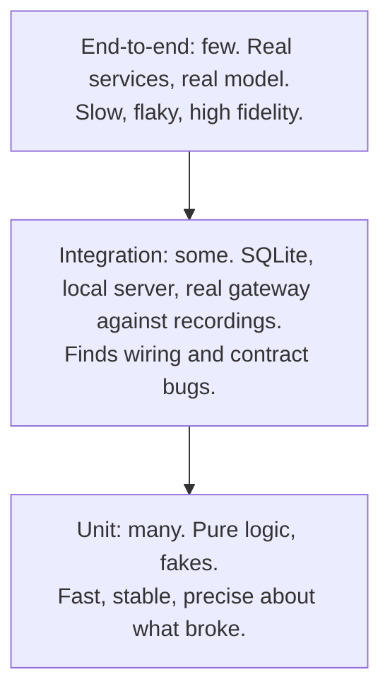

# 5 — Testing strategy

> A test suite is an investment with running costs. Its value is that you can change code without fear; its price is time to write, time to run, and time to fix when a harmless change breaks it. This chapter is about where to spend: what size of test to write, when a test double lies to you, why 100% coverage can prove almost nothing, what a mutation tester tells you, and how to test code around a model whose answers vary. Code ran on CPython 3.14.7, with Hypothesis 6.170.14 and coverage 7.17.0.

---

## What a test suite is for

Fowler gives a good [test of sufficiency](https://martinfowler.com/bliki/TestCoverage.html): you have enough tests if bugs rarely escape to production and you're rarely hesitant to change code for fear of causing them. You have too many if you could remove some and still meet that bar, and one sign is a simple code change that demands long changes to the tests.

Two properties make a test worth keeping, and they pull against what looks like diligence. It should fail when behaviour breaks, and it should stay quiet when behaviour doesn't. [Software Engineering at Google](https://abseil.io/resources/swe-book/html/ch12.html) (SWE from here) calls a test that fails on an unrelated change *brittle*, and its advice follows from that: call the code through its public API, as a user would, and test behaviours rather than methods.

## Size, scope and the pyramid

SWE [separates two things](https://abseil.io/resources/swe-book/html/ch11.html) that the words "unit" and "integration" blur together. **Size** is the resources a test may use: small tests stay in one process and can't sleep or do I/O, medium tests stay on one machine and may use localhost, and large tests can span machines. **Scope** is how much code the test is validating. A small test can have broad scope, if it runs a whole request handler against in-memory fakes, and that's a very good test to have. Size is what predicts speed and determinism, so it's the one to push down.



The pyramid is due to [Mike Cohn, according to Fowler](https://martinfowler.com/bliki/TestPyramid.html). SWE gives "a very rough guideline" of 80% narrow, 15% medium and 5% end-to-end by test count, and names two antipatterns: the ice cream cone, mostly end-to-end tests, and the hourglass, with many unit and end-to-end tests but little between, typically because tight coupling makes it hard to instantiate pieces alone.

It's not a law, and Fowler says so. The shape assumes broad tests are expensive, slow and brittle, and if yours are fast, reliable and cheap to change, lower-level ones aren't needed. He also suspects that the arguments for more integration tests and fewer unit tests are largely about differing definitions of "unit test". His rule for when a high-level test does fail is the part to keep: you've found a bug and a missing unit test, so reproduce it with a unit test before you fix it.

Larger tests still exist for a reason. [SWE chapter 14](https://abseil.io/resources/swe-book/html/ch14.html) calls that reason *fidelity*: they resemble production. They catch what mocks can't, such as an owner's real behaviour differing from the mock its caller wrote, which can go stale without any signal.

## Test doubles, and how they lie

SWE [uses precise words](https://abseil.io/resources/swe-book/html/ch13.html), which I'll use here. A **fake** is a working lightweight implementation, such as an in-memory database. A **stub** returns values you specify. **Interaction testing** checks how a function was called, without calling it. "Mock" is overloaded, so [Fowler](https://martinfowler.com/articles/mocksArentStubs.html) reserves it for doubles that insist on behaviour verification, and SWE uses it for what a mocking framework creates.

SWE's order of preference, learned "the hard way" after years of mocking-framework tests that were easy to write, costly to maintain, and rarely found bugs: real implementation if it's fast, deterministic and has simple dependencies; then a fake; then stubbing; and interaction testing only when necessary. Fowler describes the same split as *classical* against *mockist* TDD. He's a classicist, concerned about coupling tests to implementation, but admits he hasn't tried the mockist style on more than toys and knows good developers who are convinced by it. So treat this as a judgement with a track record, not a settled result.

The failure to watch for is a mock that accepts anything. Here the application calls `embed` with the wrong arguments:

```python
from unittest.mock import MagicMock, create_autospec

class Embedder:
    def embed(self, texts: list[str], model: str) -> list[list[float]]:
        return [[float(len(text)), 1.0] for text in texts]

def index_documents(embedder, documents: list[str]) -> int:
    vectors = embedder.embed(documents)         # bug: model is required
    return len(vectors)

loose = MagicMock()
loose.embed.return_value = [[0.0, 1.0], [0.0, 1.0]]
print("MagicMock:", index_documents(loose, ["a", "b"]))

strict = create_autospec(Embedder, instance=True)
strict.embed.return_value = [[0.0, 1.0], [0.0, 1.0]]
try:
    index_documents(strict, ["a", "b"])
except TypeError as error:
    print("autospec:", error)

try:
    index_documents(Embedder(), ["a", "b"])
except TypeError as error:
    print("real:", error)
```

```text
MagicMock: 2
autospec: missing a required argument: 'model'
real: Embedder.embed() missing 1 required positional argument: 'model'
```

`MagicMock` passes a broken call. [`create_autospec`](https://docs.python.org/3.14/library/unittest.mock.html) at least copies the signature, so it catches this mistake. It can't catch a change in what `embed` *does*, which is where fakes and real objects win.

Then there's brittleness. These two versions of `answer` behave the same for every caller, and only one test survives the switch:

```python
from unittest.mock import MagicMock

class DictCache:
    def __init__(self): self.data = {}
    def get(self, key): return self.data.get(key)
    def set(self, key, value): self.data[key] = value
    def get_many(self, keys): return {key: self.data.get(key) for key in keys}

def answer_v1(cache, model, question):
    cached = cache.get(question)
    if cached is not None:
        return cached
    reply = model(question)
    cache.set(question, reply)
    return reply

def answer_v2(cache, model, question):           # same behaviour, batched read
    cached = cache.get_many([question])[question]
    if cached is not None:
        return cached
    reply = model(question)
    cache.set(question, reply)
    return reply

def interaction_test(answer):
    cache = MagicMock()
    cache.get.return_value = None
    answer(cache, lambda q: "reply", "q1")
    cache.get.assert_called_once_with("q1")
    cache.set.assert_called_once_with("q1", "reply")

def state_test(answer):
    calls = []
    def model(question):
        calls.append(question)
        return "reply"
    cache = DictCache()
    assert answer(cache, model, "q1") == "reply"
    assert answer(cache, model, "q1") == "reply"
    assert calls == ["q1"]                       # the second call came from the cache

for test in (interaction_test, state_test):
    for answer in (answer_v1, answer_v2):
        try:
            test(answer)
            outcome = "pass"
        except AssertionError:
            outcome = "FAIL"
        print(f"{test.__name__:<18}{answer.__name__:<11}{outcome}")
```

```text
interaction_test  answer_v1  pass
interaction_test  answer_v2  FAIL
state_test        answer_v1  pass
state_test        answer_v2  pass
```

The interaction test fails on a correct refactor, and since it never runs a real cache, it would keep passing if `DictCache.set` were broken. The state test says what users care about: the model's only called once. Interaction testing still has a place, SWE says, when you can't use a real implementation or a fake, or when the number or order of calls is itself the behaviour. A metered model call could qualify.

Keep the fake honest as well. SWE's position is that fakes need tests of their own, and it names one way: run the same tests against the real implementation and the fake, which it calls contract tests.

## Contract tests: one test, many implementations

[Chapter 3](03-design-principles.md#l-liskov-substitution) showed an embedder that type-checks while dropping rows. A type checker can't catch that, and a contract test can. Write the behaviour you rely on once, and run it against every implementation, including the fake:

```python
class FakeEmbedder:
    dimension = 3
    def embed(self, texts):
        return [[float(len(text)), 0.0, 1.0] for text in texts]

class BatchingEmbedder:
    dimension = 3
    def embed(self, texts):
        vectors = []
        for start in range(0, len(texts), 2):
            vectors += [[1.0, 0.0, float(len(t))] for t in texts[start:start + 2]]
        return vectors

class DropsEmptyEmbedder:
    dimension = 3
    def embed(self, texts):
        return [[1.0, 2.0, 3.0] for text in texts if text]

def contract_failures(embedder) -> list[str]:
    failures = []
    texts = ["refund policy", "", "shipping", "x" * 500, "café"]
    vectors = embedder.embed(texts)
    if len(vectors) != len(texts):
        failures.append(f"returned {len(vectors)} vectors for {len(texts)} texts")
    if any(len(vector) != embedder.dimension for vector in vectors):
        failures.append("wrong dimension")
    if embedder.embed([]) != []:
        failures.append("empty input should give an empty list")
    if embedder.embed(texts) != vectors:
        failures.append("not deterministic for the same input")
    return failures

for embedder in (FakeEmbedder(), BatchingEmbedder(), DropsEmptyEmbedder()):
    print(type(embedder).__name__, contract_failures(embedder) or "ok")
```

```text
FakeEmbedder ok
BatchingEmbedder ok
DropsEmptyEmbedder ['returned 4 vectors for 5 texts']
```

In a real suite, this is a `pytest.mark.parametrize` over implementations, with the implementation backed by a real vendor marked as slow. Between services, [Vocke describes](https://martinfowler.com/articles/practical-test-pyramid.html#ContractTests) the same idea as consumer-driven contracts: the consumer writes what it needs from a provider's interface, and the provider runs those tests. He says the provider should run them continuously, so that a breaking change is caught before it goes live.

## Property tests: say what's always true

An example test checks the cases you thought of. [Hypothesis](https://hypothesis.readthedocs.io/en/latest/) generates inputs from a description (a *strategy*) and tests a claim that should hold for all of them, 100 inputs by default. It reports a simplified failing case rather than whichever random one it hit first. Here's a chunker with a bug I wrote on purpose, of a kind that's easy to write by accident:

```python
import re

from hypothesis import given, settings, strategies as st

def chunk(text: str, size: int, overlap: int) -> list[str]:
    step = size - overlap
    return [text[i:i + size] for i in range(0, len(text) - size + 1, step)]

def rebuild(pieces: list[str], overlap: int) -> str:
    if not pieces:
        return ""
    return pieces[0] + "".join(piece[overlap:] for piece in pieces[1:])

def first_fix(text: str, size: int, overlap: int) -> list[str]:
    step = size - overlap
    return [text[i:i + size] for i in range(0, len(text) - overlap, step)]

def fixed_chunk(text: str, size: int, overlap: int) -> list[str]:
    if not text:
        return []
    step = size - overlap
    return [text[i:i + size] for i in range(0, max(len(text) - overlap, 1), step)]

inputs = st.tuples(st.text("ab ", max_size=30), st.integers(1, 8), st.integers(0, 7)).filter(lambda t: t[2] < t[1])

def no_text_lost(chunker):
    @settings(derandomize=True, database=None, max_examples=300)
    @given(inputs)
    def test(case):
        text, size, overlap = case
        assert rebuild(chunker(text, size, overlap), overlap) == text
    return test

for chunker in (chunk, first_fix, fixed_chunk):
    try:
        no_text_lost(chunker)()
        print(chunker.__name__, "held for 300 generated cases")
    except AssertionError as error:
        print(chunker.__name__, "falsified:", re.sub(r"\s+|#.*?\n", "", error.__notes__[0]).replace(",)", ")").removeprefix("Failingtestcase:"))
```

```text
chunk falsified: test(case=('a',2,0))
first_fix falsified: test(case=('a',2,1))
fixed_chunk held for 300 generated cases
```

The first failure is what you'd write by hand if you'd thought of it: text shorter than the chunk size disappears. An example test like `chunk("hello worl", 4, 1)` passes, because that length happens to line up. The second line is a surprise I didn't plan. `first_fix` was my first attempt at a repair, it looked right to me, and the same property found that it loses a one-character text when the overlap equals the text's length.

Good properties to look for in data code: round trips (`parse(render(x)) == x`), invariants (no row lost, totals preserved), and agreement with a slow but obvious version. **The cost.** Generated tests run many cases, need thought about what's true, and a property that restates the implementation proves nothing. The strategy also decides what you've really tested: `st.text("ab ")` above will never try a multi-byte character.

## Coverage versus mutation

Coverage tells you what ran, not what was checked. [SWE puts it](https://abseil.io/resources/swe-book/html/ch11.html) in terms of the metric becoming a goal: an 80% bar soon acts as a ceiling rather than a floor. [Fowler](https://martinfowler.com/bliki/TestCoverage.html) expects a thoughtful team to land in the upper 80s or 90s, and finds 100% suspicious as a sign of writing tests for the number. Its best use, he says, is finding code you forgot.

Mutation testing asks the question coverage can't: if this line were wrong, would any test notice? Here are three suites over the same function, all at 100% branch coverage, and each put through a tiny mutator that swaps one operator at a time:

```python
import ast
import copy
import io
import pathlib
import coverage

SOURCE = """\
def budget_status(spent, budget, warn_ratio=0.8):
    if spent >= budget:
        return "stop"
    if spent >= budget * warn_ratio:
        return "warn"
    return "ok"
"""
pathlib.Path("budget.py").write_text(SOURCE)

SWAPS = {ast.GtE: ast.Gt, ast.Mult: ast.Div}

def mutants(source):
    tree = ast.parse(source)
    for index, node in enumerate(ast.walk(tree)):
        if isinstance(node, ast.Compare) and type(node.ops[0]) in SWAPS or isinstance(node, ast.BinOp) and type(node.op) in SWAPS:
            clone = copy.deepcopy(tree)
            target = list(ast.walk(clone))[index]
            if isinstance(target, ast.Compare):
                target.ops[0] = SWAPS[type(target.ops[0])]()
            else:
                target.op = SWAPS[type(target.op)]()
            yield ast.unparse(clone), target.lineno

def load(source):
    namespace = {}
    exec(compile(source, "budget.py", "exec"), namespace)
    return namespace["budget_status"]

def no_asserts(fn):
    for spent in (2.0, 0.9, 0.1):
        fn(spent, 1.0)

def typical(fn):
    assert fn(2.0, 1.0) == "stop"
    assert fn(0.9, 1.0) == "warn"
    assert fn(0.1, 1.0) == "ok"

def boundaries(fn):
    typical(fn)
    assert fn(1.0, 1.0) == "stop"
    assert fn(0.5, 1.0, warn_ratio=0.5) == "warn"

def branch_coverage(suite):
    cov = coverage.Coverage(branch=True, data_file=None, include=["budget.py"])
    cov.start()
    suite(load(SOURCE))
    cov.stop()
    return cov.report(file=io.StringIO())

def survivors(suite):
    alive = []
    for source, line in mutants(SOURCE):
        try:
            suite(load(source))
            alive.append(line)
        except AssertionError:
            pass
    return alive

total = len(list(mutants(SOURCE)))
for suite in (no_asserts, typical, boundaries):
    alive = survivors(suite)
    print(f"{suite.__name__:<12} coverage {branch_coverage(suite):5.1f}%   killed {total - len(alive)}/{total}   survivors on lines {alive}")
```

```text
no_asserts   coverage 100.0%   killed 0/3   survivors on lines [2, 4, 4]
typical      coverage 100.0%   killed 1/3   survivors on lines [2, 4]
boundaries   coverage 100.0%   killed 3/3   survivors on lines []
```

The first suite has perfect coverage and checks nothing. The second looks responsible, and lets boundary bugs through. This small tool is a toy, but it's the same idea real ones scale up.

On the lab's module, [`practice/mutate.py`](../practice/mutate.py) makes 37 operator swaps across `usage_report.py`, and the [22 characterization tests](../practice/README.md) kill all 37. Remove the 16 golden-master cases, leaving 6 targeted tests, and it falls to 13 killed and 24 survivors. A golden master compares whole reports, so a wrong operator nearly always changes some number. That's an argument for golden masters, within the limits of the swaps this tool tries: it doesn't touch constants, and a wrong price would need the golden file to be right about it.

Practice at scale is more cautious than the idea. [Petrović et al.](https://arxiv.org/abs/2102.11378) describe Google's system: running over the whole codebase is infeasible, and a mutation *score* wasn't actionable. So it mutates only changed, covered lines, reports at most one mutant per line, and shows survivors to authors in code review. The main finding for you is about usefulness: developers initially classified 85% of reported mutants as unproductive, meaning equivalent to the original or not worth a test, and suppression rules built on developer feedback raised the productive share from 15% to 89%. They also warn that a test written to kill an unproductive mutant can be a change-detector that makes the suite worse.

So treat a survivor as a question: is there a behaviour here that nobody specified? Run it on the code you're changing, rather than chasing a score.

## Flaky tests

A flaky test passes and fails with no change in the code. SWE's arithmetic: at a 0.1% false-failure rate per test and 10,000 test runs a day, you investigate 10 flakes a day. As the rate approaches 1%, SWE says, tests start to lose value, and Google's own rate hovers around 0.15%. Past that point the real loss is trust, because people stop reacting to failures at all.

How a per-test rate looks from the level of a whole CI run:

```python
for tests in (100, 1_000, 10_000):
    cells = [f"{1 - (1 - rate) ** tests:6.1%}" for rate in (0.0001, 0.001, 0.01)]
    print(f"{tests:>6} tests  " + "  ".join(cells))
```

```text
   100 tests    1.0%    9.5%   63.4%
  1000 tests    9.5%   63.2%  100.0%
 10000 tests   63.2%  100.0%  100.0%
```

Those columns are per-test flake rates of 0.01%, 0.1% and 1%, and each cell is the chance a run contains at least one false failure, assuming independence. At 1,000 tests and 0.1%, about two runs in three go red for nothing. Automatic reruns trade CPU for engineer time, and SWE accepts that at low levels while warning that it only postpones the root cause.

Nearly all causes come down to something the test doesn't control: clocks, thread timing, network latency, random seeds, and shared state between tests. Inject the source of nondeterminism:

```python
from datetime import datetime, timedelta, timezone

def is_stale(fetched_at: datetime, max_age: timedelta, now=lambda: datetime.now(timezone.utc)) -> bool:
    return now() - fetched_at > max_age

fixed = datetime(2026, 11, 2, 12, 0, tzinfo=timezone.utc)
print(is_stale(fixed - timedelta(minutes=5), timedelta(minutes=5), now=lambda: fixed))
print(is_stale(fixed - timedelta(minutes=5, seconds=1), timedelta(minutes=5), now=lambda: fixed))
```

```text
False
True
```

Exact boundaries are now testable, with no `sleep`. The test needs no tolerance and can't fail because CI was busy.

## Testing around a model

An LLM call is a slow, costly, nondeterministic dependency, so separate what's deterministic from what isn't. Most code around a model is ordinary logic: prompt assembly, parsing, retries, tool dispatch, budgets. That logic takes small tests with a scripted stand-in, and the scripted stand-in can produce the failures a real model only gives you occasionally:

```python
import json
from collections.abc import Callable, Iterable

class ScriptedModel:
    """A fake model: replays replies in order, and fails loudly when it runs out."""
    def __init__(self, replies: Iterable[str]):
        self._replies, self.prompts = iter(replies), []
    def __call__(self, prompt: str) -> str:
        self.prompts.append(prompt)
        try:
            return next(self._replies)
        except StopIteration:
            raise AssertionError(f"unexpected model call #{len(self.prompts)}") from None

def extract_invoice(model: Callable[[str], str], text: str, attempts: int = 2) -> dict:
    prompt = f"Return JSON with keys total and currency.\n\n{text}"
    for _ in range(attempts):
        reply = model(prompt)
        try:
            data = json.loads(reply)
            return {"total": float(data["total"]), "currency": data["currency"].upper()}
        except (ValueError, KeyError) as error:
            prompt = f"Your last reply was invalid ({type(error).__name__}). Return only JSON.\n\n{text}"
    raise ValueError(f"no valid JSON after {attempts} attempts")

model = ScriptedModel(['{"total": "12.50", "currency": "eur"}'])
print(extract_invoice(model, "Invoice: 12.50 EUR"))

model = ScriptedModel(['Sure! Here is the JSON:', '{"total": 3, "currency": "usd"}'])
print(extract_invoice(model, "Invoice: 3 USD"), "| second prompt:", model.prompts[1][:38])

try:
    extract_invoice(ScriptedModel(["no", "still no"]), "Invoice")
except ValueError as error:
    print("gave up:", error)
```

```text
{'total': 12.5, 'currency': 'EUR'}
{'total': 3.0, 'currency': 'USD'} | second prompt: Your last reply was invalid (JSONDecod
gave up: no valid JSON after 2 attempts
```

What this can't tell you is whether the model answers well, and more stubs won't change that. The layers are different questions, and they run at different times:

| Question | Test | Runs |
|---|---|---|
| Does our logic handle each reply shape, including garbage? | Small tests with a scripted model | Every commit |
| Do we parse what the vendor really sends? | Gateway tests against recorded responses, refreshed sometimes | Every commit |
| Is the credential, model name and wiring right? | A few real calls with weak assertions | Before deploy, or nightly |
| Is the output good enough? | [Evals](../../../generative-ai/08-eval/notes/01-what-an-eval-is.md) with graders, on a dataset, as a [CI gate](../../../generative-ai/08-eval/notes/10-evals-in-ci.md) when affordable | On prompt or model change |

Don't assert exact strings from a live model: that test either flakes or pins the wording you don't care about. Don't treat an eval's pass rate as a unit test either. A score of 0.91 against 0.92 can be noise, which is why [the regression gate](../../../generative-ai/08-eval/notes/10-evals-in-ci.md) compares against a baseline rather than one number.

## Pitfalls

- **Mocking what you own, by default.** Symptom: tests rewrite themselves on every refactor and rarely catch bugs. Use the real object or a fake when you can.
- **`MagicMock` without a spec.** Symptom: a typo in a method name passes. Use `create_autospec`, or a small hand-written fake.
- **Coverage as a target.** Symptom: assertion-free tests, and a bar that behaves like a ceiling. Read uncovered lines rather than the percentage.
- **Chasing every surviving mutant.** Symptom: tests that assert on internal details. Ask whether a behaviour is unspecified; many survivors aren't worth a test.
- **Trusting a score you've seen once.** My first `mutate.py` reported 10, 11, 24 and 30 killed on the same six tests. Python reuses a `.pyc` when the source's mtime, in whole seconds, and size both match, and swapping `+` for `-` keeps the size, so a test run could import the previous mutant. With bytecode writing off, it gives 13 every time. Run a new measuring tool twice before believing it.
- **Sleep in a test.** Symptom: slow suite, sporadic failures. Inject a clock or wait on a condition.
- **Shared state across tests.** Symptom: passes alone, fails together, or depends on order. Tests should be hermetic: each sets up what it needs.
- **Logic in tests.** Symptom: a loop or computed expectation that repeats the implementation's bug. SWE's advice is to prefer obvious, even repetitive, tests ("DAMP, not DRY").
- **Property tests that restate the code.** Symptom: the assertion computes the same formula as the function. Use invariants, round trips, or a slow reference.
- **Live model calls in unit tests.** Symptom: a slow, costly, flaky suite. Script the model and keep live calls in a small separate job.

## Try it

1. Add a mutation operator to the toy mutator that swaps the `return` strings or changes the constant `0.8`. Which suite catches it?
2. Add a property for `fixed_chunk`: every chunk has at most `size` characters. Then widen the strategy to include `size=overlap`. What happens, and what should the function do?
3. In a scratch copy of the lab, delete the golden-master test from `test_usage_report.py` and run `uv run python <path>/mutate.py`. What survives, and which of those matter?
4. Write `FakeEmbedder`'s contract as `pytest.mark.parametrize`, and add a slow-marked real implementation. How would CI skip the slow one on each commit?

<details>
<summary>Answers</summary>

1. `no_asserts` catches nothing, and `typical` catches any changed return string. The constant mutant, for example `0.8` to `0.9`, survives `typical` (0.9 is still "warn"), and survives `boundaries` too, because that suite's `warn_ratio=0.5` call doesn't touch the default. A test like `fn(0.8, 1.0) == "warn"` is what's missing, which shows that a toy operator set can give false comfort.
2. The size property holds. With `size == overlap`, the step is 0 and `range` raises `ValueError: range() arg 3 must not be zero`. That's a reasonable outcome if you say so: validate `0 <= overlap < size` at the top, with a clear message.
3. When I ran it: 37 mutants, 13 killed, 24 survived, the same on five runs. Survivors include the arithmetic in the pricing lines, the per-model counters, the `or` that gives `atlas-small-2` its price, and the `mode == "full"` check before the file write. All of those change what a reader sees, so a suite like that is thin despite passing, which is what the golden master was covering.
4. `@pytest.mark.slow` on the real implementation's parameter (via `pytest.param(..., marks=pytest.mark.slow)`), registered in `pyproject.toml`, with `pytest -m "not slow"` on each commit and the full set nightly.

</details>

## Interview checklist

| Question | Answer |
|---|---|
| What makes a good test? | It fails when behaviour breaks, stays quiet otherwise, runs fast and deterministically, and tests through the public API. |
| Size vs scope? | Size is resources (process, machine, network). Scope is how much code is validated. Size predicts speed and flakiness. |
| What's the pyramid's rationale? | Broad tests are slow, flaky and hard to diagnose, so most tests should be narrow. It's a rule of thumb that depends on that assumption being true for you. |
| Fake vs stub vs mock? | A fake is a working lightweight implementation. A stub returns set values. A mock, in Fowler's sense, verifies calls. |
| Which do you prefer? | Real if fast and deterministic, then fake, then stub, and interaction checks only when the call is the behaviour. |
| Classical vs mockist? | Classical uses real objects where practical and verifies state. Mockist mocks collaborators and verifies calls. The risk with mockist style is tests coupled to implementation. |
| Is 100% coverage good? | It says everything ran, not that anything was checked. An assertion-free suite can hit it. Use coverage to find forgotten code. |
| What's mutation testing? | Inject small faults and see if tests fail. It finds weak assertions but is expensive and noisy: Google restricts it to changed lines and suppresses unproductive mutants. |
| What's a contract test for? | Running the same behavioural checks against each implementation of an interface, including fakes, or between consumer and provider. |
| What's a property test? | It asserts an invariant over generated inputs and shrinks failures. Look for round trips and conservation laws. |
| How do you handle flakes? | Quarantine, find the nondeterminism, and inject it. Rerunning only postpones the fix, and past about 1% a suite loses trust. |
| How do you test LLM code? | Script the model for logic tests, record vendor responses for parsing, keep a few live smoke tests, and use evals for quality. |

## Next

[6 — Debugging and profiling](06-debugging-and-profiling.md): what to do once a test or a user tells you something's wrong.
