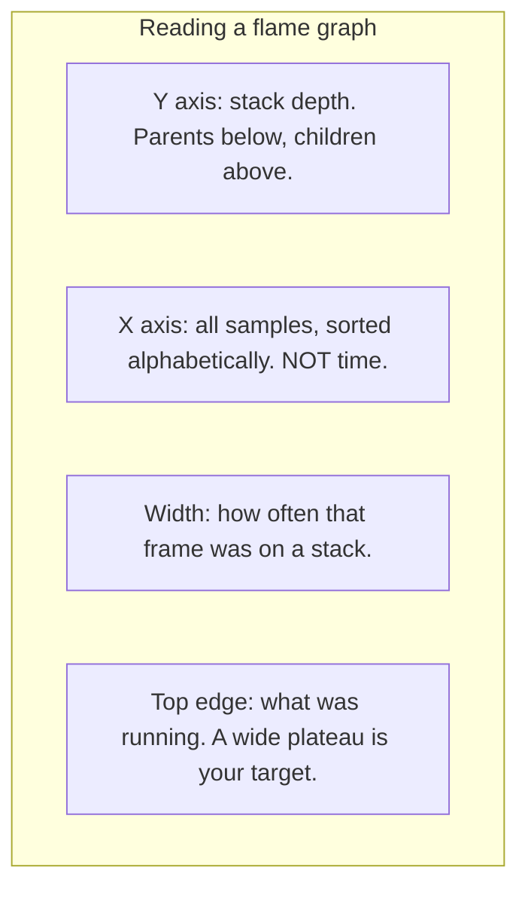

# 6 — Debugging and profiling

> Most time lost to bugs goes on the wrong hypothesis, and most time lost to slowness goes on optimising the wrong function. Both have the same cure: measure before you change anything. This chapter gives you the troubleshooting loop, `pdb` on real transcripts, `cProfile` and where it misleads, a sampling profiler you can write yourself, how to read a flame graph, and what to do when the failing process is in production and you can't stop it. Everything ran on CPython 3.14.7 on macOS. Two tools, py-spy and `pdb -p`, need root on this OS and I didn't run them with it; I show what they said.

---

## The troubleshooting loop

Google's [SRE book](https://sre.google/sre-book/effective-troubleshooting/) frames troubleshooting as the hypothetico-deductive method: from observations and an understanding of the system, propose causes, then test them, either by comparing state against the theory or by changing the system in a controlled way and observing.


Some of its advice applies well beyond large systems:

- **Stabilise first.** In a serious outage, the first job is making the system work as well as it can under the circumstances. Finding the root cause can wait.
- **Ask what changed.** Systems tend to stay as they are until something acts on them, so a recent deploy or config change is a productive first question.
- **Divide and conquer.** Inject known data and check each component's output, and with a pipeline, bisect rather than walking every stage.
- **Beware of the traps it lists:** chasing symptoms that aren't relevant, assuming the cause of the last incident is back, and trusting correlations. Correlation isn't causation, and it's often two effects of one cause.

What this means in practice is a habit: **write the prediction down before running anything**. "If the cache is stale, this key's timestamp will be older than the deploy." A failed prediction has then told you something. Changing two things at once tells you nothing, and `print` debugging without a hypothesis is just reading at random.

Reproduce it next. If a failure can be turned into a failing test, you've got a fast loop and a [regression test](05-testing-strategy.md) in one step. If you know of a commit range where it started, [`git bisect`](07-git-code-review-and-design-docs.md#finding-a-bug-with-bisect) can find the commit for you.

## pdb: stopping at the moment it goes wrong

A reranker crashes on some requests. `python -m pdb` runs the script under the debugger, and when an uncaught exception escapes, it drops into post-mortem mode at the point of failure, with every frame still alive. This session is real, driven by piped commands so it could be captured, with pdb's own stack frames filtered out:

```python
import pathlib
import re
import subprocess
import sys

pathlib.Path("rerank.py").write_text('''\
def normalise(scores):
    low, high = min(scores), max(scores)
    return [(score - low) / (high - low) for score in scores]

def rerank(query, hits):
    scaled = normalise([hit["score"] for hit in hits])
    return sorted(zip(scaled, hits), key=lambda pair: -pair[0])

hits = [{"id": "d1", "score": 0.5}, {"id": "d2", "score": 0.5}]
print(rerank("refund policy", hits))
''')

commands = """\
continue
where
p scores
p low, high
up
p query
p hits
quit
"""
run = subprocess.run([sys.executable, "-m", "pdb", "rerank.py"], input=commands, capture_output=True, text=True, env={"PYTHON_COLORS": "0"})
output = re.sub(r"/\S*/rerank\.py", "rerank.py", run.stdout)
output = re.sub(r"  /\S*/[pb]db\.py.*\n-> .*\n|  <string>.*\n", "", output)     # drop pdb's own frames
pieces = output.split("(Pdb) ")                                                # stdin isn't echoed, so restore it
print(pieces[0] + "".join(f"(Pdb) {cmd}\n{piece}" for cmd, piece in zip(commands.splitlines(), pieces[1:])))
```

```text
> rerank.py(1)<module>()
-> def normalise(scores):
(Pdb) continue
Uncaught exception. Entering post mortem debugging
Running 'cont' or 'step' will restart the program
> rerank.py(3)normalise()
-> return [(score - low) / (high - low) for score in scores]
(Pdb) where
  rerank.py(10)<module>()
-> print(rerank("refund policy", hits))
  rerank.py(6)rerank()
-> scaled = normalise([hit["score"] for hit in hits])
> rerank.py(3)normalise()
-> return [(score - low) / (high - low) for score in scores]
(Pdb) p scores
[0.5, 0.5]
(Pdb) p low, high
(0.5, 0.5)
(Pdb) up
> rerank.py(6)rerank()
-> scaled = normalise([hit["score"] for hit in hits])
(Pdb) p query
'refund policy'
(Pdb) p hits
[{'id': 'd1', 'score': 0.5}, {'id': 'd2', 'score': 0.5}]
(Pdb) quit
```

The arithmetic bug is obvious once you can look: every score is equal, so `high - low` is 0. The useful habit here is `up`: the fix belongs in `normalise`, but you need the caller's frame to see which requests can produce this.

Commands worth having in your fingers:

| Command | Does |
|---|---|
| `w` / `u` / `d` | Where am I; move up or down the stack |
| `n` / `s` / `r` / `c` | Next line; step in; run until return; continue |
| `b 12, doc_id == "d3"` | Break at line 12 only when the condition holds |
| `p expr` / `pp expr` | Print; pretty-print |
| `display expr` | Show an expression whenever it changes while stepping |
| `interact` | Full Python REPL in the current frame |

A conditional breakpoint beats stepping through a loop. Here, one document among many gets a bad chunk count:

```python
import pathlib
import re
import subprocess
import sys

pathlib.Path("ingest.py").write_text('''\
documents = {"d1": "short text", "d2": "", "d3": "a longer piece of text here"}

def chunk_count(text, size=8):
    return (len(text) + size - 1) // size

totals = {}
for doc_id, text in documents.items():
    count = chunk_count(text)
    totals[doc_id] = count
print(totals)
''')

commands = """\
break 9, count == 0
continue
p doc_id, text
continue
"""
run = subprocess.run([sys.executable, "-m", "pdb", "ingest.py"], input=commands, capture_output=True, text=True, env={"PYTHON_COLORS": "0"})
output = re.sub(r"/\S*/ingest\.py", "ingest.py", run.stdout)
pieces = output.split("(Pdb) ")
print(pieces[0] + "".join(f"(Pdb) {cmd}\n{piece}" for cmd, piece in zip(commands.splitlines(), pieces[1:])))
```

```text
> ingest.py(1)<module>()
-> documents = {"d1": "short text", "d2": "", "d3": "a longer piece of text here"}
(Pdb) break 9, count == 0
Breakpoint 1 at ingest.py:9
(Pdb) continue
> ingest.py(9)<module>()
-> totals[doc_id] = count
(Pdb) p doc_id, text
('d2', '')
(Pdb) continue
{'d1': 2, 'd2': 0, 'd3': 4}
The program finished and will be restarted
> ingest.py(1)<module>()
-> documents = {"d1": "short text", "d2": "", "d3": "a longer piece of text here"}
```

In your own code, use the built-in `breakpoint()`, which [replaced `import pdb; pdb.set_trace()`](https://docs.python.org/3.14/library/pdb.html). It's a hook: setting `PYTHONBREAKPOINT=0` turns all of them into no-ops, and you can point it at another debugger. Don't leave one in a committed path, since a service with no terminal will hang or fail on it. `pdb.pm()` gives you post-mortem from a REPL after a crash, and `pdb.set_trace_async()` is the 3.14 form for use inside `async` functions.

**The cost.** A debugger shows one execution, stops time, and so hides timing bugs. It can't be used on a service under load. That's when logs, traces and the tools below take over.

## cProfile: what's slow, by the function

The first rule of performance work is to profile first, since intuition about what's slow is poor. [`cProfile`](https://docs.python.org/3.14/library/profile.html) records every function call and return. Here's a preprocessing step that feels too slow:

```python
import cProfile
import pstats
import re

TOKEN = r"[a-z0-9]+"

def tokens(text: str) -> list[str]:
    return re.findall(TOKEN, text.lower())

def dedupe(rows: list[str]) -> list[str]:
    seen, unique = [], []
    for row in rows:
        if row not in seen:
            seen.append(row)
            unique.append(row)
    return unique

def preprocess(rows: list[str]) -> int:
    unique = dedupe(rows)
    return sum(len(tokens(row)) for row in unique)

rows = [f"Refund policy for order number {i % 4000} placed online" for i in range(20_000)]

profiler = cProfile.Profile()
profiler.enable()
preprocess(rows)
profiler.disable()
stats = pstats.Stats(profiler)
stats.strip_dirs().sort_stats("tottime").print_stats(5)
```

```text
         40166 function calls (40162 primitive calls) in 0.362 seconds

   Ordered by: internal time
   List reduced from 53 to 5 due to restriction <5>

   ncalls  tottime  percall  cumtime  percall filename:lineno(function)
        1    0.354    0.354    0.355    0.355 block.py:10(dedupe)
     4000    0.003    0.000    0.003    0.000 {method 'findall' of 're.Pattern' objects}
     4001    0.001    0.000    0.007    0.000 block.py:20(<genexpr>)
     4000    0.001    0.000    0.006    0.000 block.py:7(tokens)
     4000    0.001    0.000    0.005    0.000 __init__.py:270(findall)
```

Read two columns. `tottime` is time in the function itself, excluding what it calls. `cumtime` includes callees. A high `cumtime` with a low `tottime` is a coordinator, so keep looking inside it. High `tottime` is where the work is. Here it's `dedupe`, with its list scan, rather than the regex that I'd have guessed. A set lookup is the fix. You could've spotted this by reading it, but in a real pipeline with 40 functions you won't.

The docs are explicit that the profilers [aren't for benchmarking](https://docs.python.org/3.14/library/profile.html), because they add overhead to Python code more than to C. That can change which function looks expensive. These two functions do comparable work:

```python
import cProfile
import pstats
import time

def small_step(x):
    return x + 1

def many_calls(n=3_600_000):
    total = 0
    for _ in range(n):
        total = small_step(total)
    return total

def tight_loop(n=7_000_000):
    total = 0
    for _ in range(n):
        total = total + 1
    return total

def workload():
    many_calls()
    tight_loop()

for fn in (many_calls, tight_loop):
    start = time.perf_counter()
    fn()
    print(f"{fn.__name__:<12} real {time.perf_counter() - start:6.3f} s")

start = time.perf_counter()
workload()
plain = time.perf_counter() - start

profiler = cProfile.Profile()
start = time.perf_counter()
profiler.runcall(workload)
profiled = time.perf_counter() - start
print(f"whole workload {plain:.3f} s, under cProfile {profiled:.3f} s ({profiled / plain:.1f}x)")

stats = pstats.Stats(profiler)
for (_, _, name), (_, _, _, cumtime, _) in stats.stats.items():
    if name in ("many_calls", "tight_loop"):
        print(f"{name:<12} cProfile says {cumtime:6.3f} s")
```

```text
many_calls   real  0.087 s
tight_loop   real  0.082 s
whole workload 0.230 s, under cProfile 0.476 s (2.1x)
tight_loop   cProfile says  0.093 s
many_calls   cProfile says  0.382 s
```

Without the profiler, the two take about the same time. With it, the call-heavy one looks several times worse, because the cost is per call. Bear that in mind when you see a profile dominated by small helpers.

## Sampling: what the program is doing, most of the time

A sampling profiler doesn't hook every call. It looks at the stack at intervals and counts what it sees, so the overhead doesn't depend on the call count and a function's share of samples estimates its share of time. Python's [`sys._current_frames()`](https://docs.python.org/3.14/library/sys.html#sys._current_frames) is enough to build one. The workload is shaped like a real LLM request, in which most of the time goes on waiting:

```python
import collections
import sys
import threading
import time

def sampler(thread_id, stop, counts, interval=0.002):
    previous = time.perf_counter()
    while not stop.is_set():
        frame = sys._current_frames().get(thread_id)
        stack = []
        while frame is not None:
            stack.append(frame.f_code.co_name)
            frame = frame.f_back
        now = time.perf_counter()
        counts[";".join(reversed(stack))] += now - previous      # weight by the gap: see below
        previous = now
        time.sleep(interval)

def cosine_search(n=1_500_000):
    return sum(i * i % 7 for i in range(n))

def retrieve():
    return cosine_search()

def build_prompt():
    return "".join(str(i) for i in range(800_000))

def call_model():
    time.sleep(0.25)            # the network, as far as a stack can tell

def parse_reply():
    return [str(i).strip() for i in range(400_000)]

def handle_request():
    real = {}
    for step in (retrieve, build_prompt, call_model, parse_reply):
        start = time.perf_counter()
        step()
        real[step.__name__] = real.get(step.__name__, 0) + time.perf_counter() - start
    return real

counts, stop = collections.Counter(), threading.Event()
thread = threading.Thread(target=sampler, args=(threading.get_ident(), stop, counts))
thread.start()
real = collections.Counter()
for _ in range(4):
    real.update(handle_request())
stop.set()
thread.join()

folded = {stack.removeprefix("<module>;"): ms * 1000 for stack, ms in counts.items()}
print("Folded stacks (top 4, milliseconds):")
for stack, ms in sorted(folded.items(), key=lambda item: -item[1])[:4]:
    print(f"{stack} {ms:.0f}")

inclusive = collections.Counter()
for stack, ms in folded.items():
    frames = stack.split(";")
    for depth in range(len(frames)):
        inclusive[tuple(frames[:depth + 1])] += ms

total = inclusive["handle_request",]
print("\nA flame graph, turned on its side. Length is share of the request:")
for frames, ms in sorted(inclusive.items()):
    if frames[0] == "handle_request" and ms / total >= 0.01:
        indent = "  " * (len(frames) - 1)
        print(f"{indent + frames[-1]:<26}{'#' * round(ms / total * 40):<41}{ms / total:6.1%}")

print("\nSampler against a stopwatch:")
for step, seconds in real.items():
    sampled = sum(ms for stack, ms in folded.items() if step in stack.split(";"))
    print(f"{step:<14} real {seconds * 1000:6.0f} ms   sampled {sampled:6.0f} ms")
```

```text
Folded stacks (top 4, milliseconds):
handle_request;call_model 1011
handle_request;retrieve;cosine_search;<genexpr> 321
handle_request;build_prompt;<genexpr> 176
handle_request;parse_reply 71

A flame graph, turned on its side. Length is share of the request:
handle_request            ######################################## 100.0%
  build_prompt            ######                                    14.4%
    <genexpr>             ####                                      10.6%
  call_model              ########################                  60.7%
  parse_reply             ##                                         4.3%
  retrieve                ########                                  19.3%
    cosine_search         ########                                  19.3%
      <genexpr>           ########                                  19.3%

Sampler against a stopwatch:
retrieve       real    326 ms   sampled    321 ms
build_prompt   real    225 ms   sampled    240 ms
call_model     real   1014 ms   sampled   1011 ms
parse_reply    real    100 ms   sampled     71 ms
```

The sampler weights each sample by the gap since the last one. Without that, a separate run on this same workload that counted one per sample gave `call_model` 88% of the samples against 68% by the stopwatch, because a Python thread can't sample while another thread holds the GIL, so CPU-heavy sections are undersampled. The stopwatch comparison at the end is how to catch a profiler lying.

The `name;name;name count` lines are the "folded" format that Gregg's `flamegraph.pl` consumes. [Brendan Gregg, who invented flame graphs](https://www.brendangregg.com/flamegraphs.html), defines the picture precisely, and each detail is commonly misread:



Because the x axis is alphabetical, left and right mean nothing, and neighbouring frames don't run one after another. Gregg notes that a *flame chart*, as in Chrome's tools, does put time on the x axis, so check which you're looking at.

Pay attention to `call_model`. My sampler reads wall-clock stacks, so waiting shows up. A profiler that only counts on-CPU stacks wouldn't show it at all, and you'd spend a week speeding up `retrieve` in a request that mostly waits on the network. Gregg treats blocked time as a separate analysis (off-CPU). Decide which question you're asking.

This toy has known limits. It only looks when it gets the interpreter, so a C call holding the GIL delays it, and native frames are invisible. Under real load, use a tool built for it.

## py-spy and other real tools

[py-spy](https://github.com/benfred/py-spy) is a sampling profiler written in Rust that reads the process's memory from outside. It runs in a separate process, doesn't need code changes or a restart, and its README presents it as safe for production. Its commands:

```text
py-spy record -o profile.svg --pid 12345     # a flame graph SVG
py-spy top --pid 12345                       # live, like top
py-spy dump --pid 12345                      # every thread's stack, once
py-spy record -o profile.svg -- python job.py  # start it under the profiler
```

`--gil` limits samples to threads holding the GIL, `--idle` includes idle threads, and `--native` includes C extension frames. See the README for your version's options.

I couldn't run this one here. On this Mac, py-spy 0.4.3 printed `This program requires root on OSX`, and I didn't escalate. The README says macOS always requires root, while on Linux it depends on system settings: launching the target under py-spy works without root, but attaching to an existing PID usually needs it. In a container, you'll typically need the `SYS_PTRACE` capability. Check this before an incident rather than during one. On Linux, CPython can also [appear by name in `perf`](https://docs.python.org/3.14/howto/perf_profiling.html), which helps when a native library is the hot spot.

| Tool | Overhead | Good for | Bad for |
|---|---|---|---|
| `cProfile` | Per call, can be heavy | Call counts; a local, repeatable run | Production; call-heavy code |
| Sampling (py-spy) | Fixed per sample, outside the process | Live services; flame graphs | Exact counts; very short runs |
| [`tracemalloc`](../../python/03-language-for-engineers/notes/09-memory-and-the-runtime.md#finding-it-with-tracemalloc) | Heavy on allocation | Who allocated this memory | CPU time; C allocations |
| Traces ([Langfuse](../../../generative-ai/06-observability/notes/01-tracing-with-langfuse.md)) | Per span | Where a request's time goes across services | Inside a function |
| `timeit` | Only what you run | Comparing two small snippets | Whole programs |

## When the process is stuck in production

A job has stopped making progress, or a worker segfaulted, and no one attached anything. Prepare ahead of time. [`faulthandler`](https://docs.python.org/3.14/library/faulthandler.html) is in the standard library and dumps Python tracebacks on a fatal signal, after a timeout, or on a signal you choose. Here it catches a deadlock. Two locks are taken in opposite orders, the kind of hang that gives no error and no log line:

```python
import pathlib
import re
import subprocess
import sys

pathlib.Path("worker.py").write_text('''\
import faulthandler
import threading
import time

faulthandler.dump_traceback_later(1.0, exit=True)   # the watchdog

index_lock, cache_lock = threading.Lock(), threading.Lock()

def update_index():
    with index_lock:
        time.sleep(0.1)
        with cache_lock:
            pass

def refresh_cache():
    with cache_lock:
        time.sleep(0.1)
        with index_lock:
            pass

threads = [threading.Thread(target=update_index), threading.Thread(target=refresh_cache)]
for thread in threads:
    thread.start()
for thread in threads:
    thread.join()
''')

run = subprocess.run([sys.executable, "worker.py"], capture_output=True, text=True)
report = re.sub(r"/\S*/(threading|worker)\.py", r"\1.py", run.stderr)
report = re.sub(r"0x[0-9a-f]+", "0x...", report)
print(report.strip())
print("exit code:", run.returncode)
```

```text
Timeout (0:00:01)!
Thread 0x... [Thread-2 (refresh_cache)] (most recent call first):
  File "worker.py", line 18 in refresh_cache
  File "threading.py", line 1024 in run
  File "threading.py", line 1082 in _bootstrap_inner
  File "threading.py", line 1044 in _bootstrap

Thread 0x... [Thread-1 (update_index)] (most recent call first):
  File "worker.py", line 12 in update_index
  File "threading.py", line 1024 in run
  File "threading.py", line 1082 in _bootstrap_inner
  File "threading.py", line 1044 in _bootstrap

Thread 0x... (most recent call first):
  File "threading.py", line 1133 in join
  File "worker.py", line 25 in <module>
exit code: 1
```

Both threads are shown stopped on the inner `with`, at the lines that take the second lock, and the opposite ordering is plain to see. `faulthandler` works when the interpreter is badly broken, since [its handler only uses signal-safe functions](https://docs.python.org/3.14/library/faulthandler.html) and can't allocate on the heap, so it's also what you want for a segfault in a C extension: `faulthandler.enable()` at startup, `-X faulthandler`, or `PYTHONFAULTHANDLER=1`. `faulthandler.register(signal.SIGUSR1)` makes `kill -USR1 <pid>` print the stacks of a live process without stopping it, on Unix.

Python 3.14 also adds a proper way in from outside. [PEP 768](https://peps.python.org/pep-0768/) gives the interpreter safe points at which a debugger can ask it to run code, replacing the unsafe practice of injecting code through GDB. Two features use it: `python -m pdb -p <pid>` attaches a debugger to a running process, and `sys.remote_exec(pid, script)` runs a script in it. Here's what I got when trying it on a process I owned:

```python
import pathlib
import subprocess
import sys
import time

pathlib.Path("probe.py").write_text("print('hello from inside')\n")
target = subprocess.Popen([sys.executable, "-c", "import time; time.sleep(5)"])
time.sleep(0.3)
try:
    sys.remote_exec(target.pid, "probe.py")
    print("sent")
except PermissionError as error:
    print("PermissionError:", str(error).split("(")[0].strip())
finally:
    target.kill()
    target.wait()
```

```text
PermissionError: Cannot get task port for PID 85547
```

So on this OS it needs elevated rights, and the feature itself is untested here beyond this refusal. On Linux the PEP says access follows the same `ptrace` checks as any debugger. The [docs note](https://docs.python.org/3.14/library/pdb.html) that a process blocked in a system call attaches only once it next executes bytecode or receives a signal. Administrators can turn it off with `PYTHON_DISABLE_REMOTE_DEBUG` or `-X disable-remote-debug`, which is worth knowing both ways: as a hardening control, and as a reason your attach might fail. Running arbitrary code in a production process is a serious step, so decide who can do it before you need it.

Order of operations for a service that's misbehaving now:

1. **Stabilise.** Roll back or shed load. Keep one bad instance out of rotation if you can, rather than restarting everything and destroying the evidence.
2. **Read what already exists.** Metrics, logs, [traces](../../../generative-ai/08-eval/notes/08-tracing-and-observability.md), recent deploys.
3. **Look at stacks.** `py-spy dump` or a `SIGUSR1` handler. It's cheap, and it answers "what's it doing right now?"
4. **Profile if it's slow.** A `py-spy record` for 30 seconds, in the slow state.
5. **Track memory if it grows.** See [the memory chapter](../../python/03-language-for-engineers/notes/09-memory-and-the-runtime.md).
6. **Attach a debugger last.** It's the most invasive step, and it pauses the process.

## Pitfalls

- **Changing code before forming a hypothesis.** Symptom: the bug "went away" and nobody knows why. Predict first, and change one thing at a time.
- **Optimising without a profile.** Symptom: a rewrite that makes no measurable difference. Measure first, and measure again after.
- **Trusting `cProfile` on call-heavy code.** Symptom: small helpers dominate the report, and inlining them doesn't help as much as predicted. Cross-check with a sampler or `timeit`.
- **Reading a flame graph as a timeline.** The x axis is sorted alphabetically. Look at width only.
- **An on-CPU profile of a waiting program.** Symptom: the profile looks fine while requests are slow. Include idle or blocked time, or read traces.
- **Profiling a different workload.** Symptom: the fix works locally and nothing changes in production. Use realistic data sizes, and profile the slow state.
- **`breakpoint()` left in a service.** Symptom: a request hangs in CI or production. Lint for it, and set `PYTHONBREAKPOINT=0` where it can't be useful.
- **Restarting first.** Symptom: the hang is gone and so is the only evidence. Capture stacks before you restart.
- **Finding out during an incident that you can't attach.** Check permissions and tools in your container ahead of time.

## Try it

1. Fix `normalise` so that equal scores don't crash, and decide what it should return. Write the test first.
2. Run the `cProfile` example again after replacing `seen` with a set. What's the top `tottime` function now, and by how much did total time fall?
3. Extend the sampler to write a folded file, and render it with [Gregg's `flamegraph.pl`](https://github.com/brendangregg/FlameGraph).
4. Reproduce the deadlock with a consistent lock order so that it finishes. Then add `faulthandler.register(signal.SIGUSR1)` to a sleeping script and send it the signal from another terminal.

<details>
<summary>Answers</summary>

1. If `high == low`, there's no ordering information, so return an equal value for every score, usually `[0.0] * len(scores)` or `1.0`, and test with equal, single and empty inputs. `min([])` will still raise on empty input, so decide on that as well.
2. Replace `seen = []` with `set()` and `append` with `add`. On my run, `dedupe` drops out of the top entries, and the regex work in `re.findall` plus `tokens` takes first place. Total time falls by more than an order of magnitude, since the scan was most of it. Your numbers will differ, but the shape shouldn't.
3. Write `f"{stack} {count}\n"` for each entry. `flamegraph.pl folded.txt > out.svg` then produces a chart with the `call_model` width you saw in the text version.
4. Take `index_lock` first in both functions. With a consistent order there's no cycle, so no deadlock. The signal prints all thread stacks to stderr and the script carries on.

</details>

## Interview checklist

| Question | Answer |
|---|---|
| How do you approach a bug you don't understand? | Reproduce it, form a hypothesis with a prediction, test one thing at a time, ask what changed, and keep a test afterwards. |
| First step in an outage? | Stabilise: roll back or shed load. Diagnosis comes after. |
| What's post-mortem debugging? | Inspecting frames after an uncaught exception, via `python -m pdb` or `pdb.pm()`, with state intact. |
| `tottime` vs `cumtime`? | Time in the function alone vs including callees. |
| Deterministic vs sampling profiler? | Deterministic hooks every call, and so gives exact counts with per-call overhead. Sampling looks at stacks periodically, with lower, fixed overhead and statistical results. |
| How do you read a flame graph? | Width is share of samples, y is stack depth, the x order is alphabetical and isn't time. Look for wide plateaus on top. |
| Why might a profile look fine while requests are slow? | It may count on-CPU time only, and the request is waiting on a network or lock. |
| How do you profile a production Python process? | A sampling profiler such as py-spy attaching from outside, with suitable permissions. |
| What's `faulthandler` for? | Python tracebacks on segfaults, after a timeout, or on a signal, even when the interpreter is badly broken. |
| What's new for debugging in 3.14? | PEP 768: `python -m pdb -p <pid>` and `sys.remote_exec`, using safe points in the interpreter. |
| How would you diagnose a hang? | Dump every thread's stack: `py-spy dump` or `faulthandler`. Look for threads waiting on each other's locks. |

## Next

[7 — Git, code review and design docs](07-git-code-review-and-design-docs.md): the team practices that keep all this reviewable.
