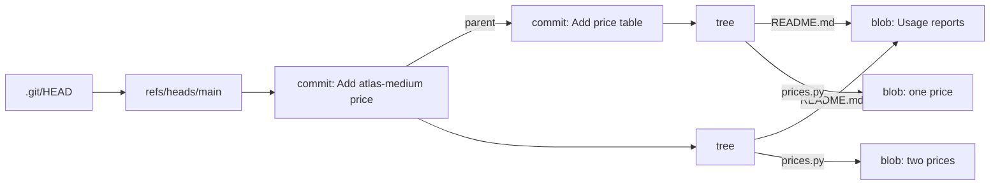
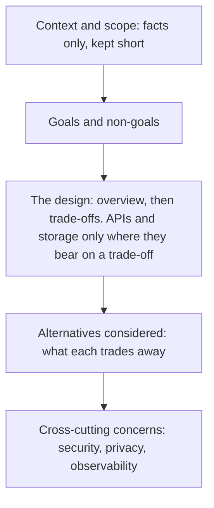

# 7 — Git, code review and design docs

> Code gets read, changed and argued about for longer than it takes to write, and most of that happens through three records: the history, the review and the design document. Each one costs time and buys something you can name. This chapter starts with what Git actually stores, because that makes rebase, reflog and bisect obvious rather than frightening, and then covers the human side: small changes, what a reviewer is for, and when a design doc is worth its overhead.

Every Git transcript here came from running the block on Git 2.55.0 and Python 3.14.7, in a throwaway repository made under a temporary directory with a clean environment. The blocks build history with plumbing commands (`git commit-tree`, `git update-ref`), so you can see each step. [Pro Git](https://git-scm.com/book/en/v2/Git-Internals-Git-Objects) describes those steps as essentially what `git add` and `git commit` do. Run them as they are, and don't point them at a repository you care about.

---

## What Git stores

[Pro Git](https://git-scm.com/book/en/v2/Git-Internals-Git-Objects) calls Git a content-addressable filesystem: a key-value store whose key is a hash of the content plus a header. There are three object types that matter day to day. A *blob* holds a file's bytes and no name. A *tree* lists names, modes and the hashes of blobs and subtrees. A *commit* holds one tree, its parents, the author and committer, and a message.

```python
import hashlib, os, pathlib, subprocess, tempfile

REPO = pathlib.Path(tempfile.mkdtemp()) / "repo"
REPO.mkdir()
ENV = {"PATH": os.environ["PATH"], "HOME": str(REPO.parent), "GIT_CONFIG_NOSYSTEM": "1"}
ENV |= {f"GIT_{who}_{field}": value for who in ("AUTHOR", "COMMITTER")
        for field, value in (("NAME", "Asha"), ("EMAIL", "asha@example.com"), ("DATE", "1767225600 +0000"))}

def git(*args):
    return subprocess.run(["git", *args], cwd=REPO, env=ENV, capture_output=True, text=True, check=True).stdout.strip()

def save(files, message):
    """Write the files, then do by hand what `git add` and `git commit` do."""
    for name, text in files.items():
        (REPO / name).write_text(text)
    git("add", "-A")
    parents = ["-p", git("rev-parse", "HEAD")] if git("rev-list", "--all", "--count") != "0" else []
    new = git("commit-tree", git("write-tree"), *parents, "-m", message)
    git("update-ref", "-m", f"commit: {message}", "HEAD", new)

git("init", "-q", "-b", "main", "--object-format=sha1")
readme, prices_v1 = "Usage reports.\n", 'PRICE = {"atlas-small": 0.0005}\n'
save({"README.md": readme, "prices.py": prices_v1}, "Add price table")
save({"prices.py": 'PRICE = {"atlas-small": 0.0005, "atlas-medium": 0.003}\n'}, "Add atlas-medium price")

data = prices_v1.encode()
print("sha1 by hand :", hashlib.sha1(b"blob %d\0" % len(data) + data).hexdigest())
print("git's answer :", git("rev-parse", "HEAD~1:prices.py"))
print("\n--- the latest commit\n" + git("cat-file", "-p", "HEAD"))
print("\n--- its tree\n" + git("cat-file", "-p", "HEAD^{tree}"))
print("\n--- the previous tree\n" + git("cat-file", "-p", "HEAD~1^{tree}"))
print("\n--- what a branch is")
print(".git/HEAD            :", (REPO / ".git/HEAD").read_text().strip())
print(".git/refs/heads/main :", (REPO / ".git/refs/heads/main").read_text().strip())
print("objects on disk      :", sum(p.is_file() for p in (REPO / ".git/objects").rglob("*")))
```

```text
sha1 by hand : 7205bc546c3380b22caee0d800a7775191696343
git's answer : 7205bc546c3380b22caee0d800a7775191696343

--- the latest commit
tree c8c9890095c29a934fadbff32c659dc845c7e420
parent 0e200df1e38cd8b2b002eb17a8ad84cd721d6969
author Asha <asha@example.com> 1767225600 +0000
committer Asha <asha@example.com> 1767225600 +0000

Add atlas-medium price

--- its tree
100644 blob 472818ad2bd0809516acd1aa47fc960cd73b6394	README.md
100644 blob 7be6c77a309ab07220f5cff660d296df789342bf	prices.py

--- the previous tree
100644 blob 472818ad2bd0809516acd1aa47fc960cd73b6394	README.md
100644 blob 7205bc546c3380b22caee0d800a7775191696343	prices.py

--- what a branch is
.git/HEAD            : ref: refs/heads/main
.git/refs/heads/main : 4d5f40eadb7efa5b439c419010bc53a4334fd8da
objects on disk      : 7
```

Notice four things in that output.

- `README.md` has the same blob hash in both trees. A commit is a snapshot, but an unchanged file costs nothing new. The second commit added three objects to the first four: one blob, one tree, one commit.
- The commit names its parent by hash, and its own hash covers that parent line. Change anything in history and every descendant gets a new hash.
- A branch is a small file holding a hash. `HEAD` is a file naming a branch. Creating a branch writes a few bytes, which is why it's cheap.
- History is immutable, and what moves is pointers. Almost everything alarming in Git is a pointer moving while the old objects stay on disk.



## The reflog: getting back what you lost

If a mistake only moved a pointer, the old commit is still there and you need its hash. The [reflog](https://git-scm.com/docs/git-reflog) records when the tips of branches and other references changed in your local repository. Here's a `git reset --hard` that throws away two commits, and the way back:

```python
import os, pathlib, subprocess, tempfile

REPO = pathlib.Path(tempfile.mkdtemp()) / "repo"
REPO.mkdir()
ENV = {"PATH": os.environ["PATH"], "HOME": str(REPO.parent), "GIT_CONFIG_NOSYSTEM": "1"}
ENV |= {f"GIT_{who}_{field}": value for who in ("AUTHOR", "COMMITTER")
        for field, value in (("NAME", "Asha"), ("EMAIL", "asha@example.com"), ("DATE", "1767225600 +0000"))}

def git(*args):
    return subprocess.run(["git", *args], cwd=REPO, env=ENV, capture_output=True, text=True, check=True).stdout.strip()

def save(files, message):
    for name, text in files.items():
        (REPO / name).write_text(text)
    git("add", "-A")
    parents = ["-p", git("rev-parse", "HEAD")] if git("rev-list", "--all", "--count") != "0" else []
    new = git("commit-tree", git("write-tree"), *parents, "-m", message)
    git("update-ref", "-m", f"commit: {message}", "HEAD", new)

git("init", "-q", "-b", "main", "--object-format=sha1")
save({"chunker.py": "SIZE = 512\n"}, "Add chunker")
save({"chunker.py": "SIZE = 512\nOVERLAP = 64\n"}, "Add chunk overlap")
save({"chunker.py": "SIZE = 512\nOVERLAP = 64\nMIN = 20\n"}, "Drop chunks under 20 tokens")

git("reset", "--hard", "HEAD~2")
print("after the reset:\n" + git("log", "--format=%h %s"))
print("\nthe reflog remembers:\n" + git("reflog", "-4", "--format=%h %gd %gs"))
git("reset", "--hard", "HEAD@{1}")
print("\nafter resetting to HEAD@{1}:\n" + git("log", "--format=%h %s"))
```

```text
after the reset:
b9d7f21 Add chunker

the reflog remembers:
b9d7f21 HEAD@{0} reset: moving to HEAD~2
7121ccb HEAD@{1} commit: Drop chunks under 20 tokens
4cb1b0e HEAD@{2} commit: Add chunk overlap
b9d7f21 HEAD@{3} commit: Add chunker

after resetting to HEAD@{1}:
7121ccb Drop chunks under 20 tokens
4cb1b0e Add chunk overlap
b9d7f21 Add chunker
```

Three limits are worth knowing. The reflog is local, so it isn't on your colleague's machine or the server. [By default](https://git-scm.com/docs/git-reflog) entries expire after 90 days, and entries no longer reachable from the current tip after 30. And it only knows about things that were committed: `git reset --hard` over uncommitted edits destroys them, and there's no pointer to follow. Commit often, even as `wip`, because a commit is what makes work recoverable.

## Rewriting local history: rebase, fixup and range-diff

Rebase replays commits on a new base. A commit's hash covers its parent, so a replayed commit is a *new* commit even if its patch is identical. That one fact explains the rule from [Pro Git](https://git-scm.com/book/en/v2/Git-Branching-Rebasing): don't rebase commits that exist outside your repository and that people may have based work on. It's fine to tidy your own unpublished work, and also a pushed branch nobody has built on. On a shared branch, you'd leave colleagues holding the old commits while you hold copies of them.

The tidy-up habit worth having is `fixup`. You notice a mistake in an earlier commit on your branch, record the correction as a commit named `fixup! <subject>`, and let [`--autosquash`](https://git-scm.com/docs/git-rebase) move it next to its target and fold it in. Normally you'd use `git commit --fixup=<rev>` to write that name. Reviewers get a clean series, and you never had to stop and reorder anything by hand.

[`git range-diff`](https://git-scm.com/docs/git-range-diff) then compares the two versions of the series, so it answers what a plain diff can't: what changed between this round of review and the last, once the base has moved?

```python
import os, pathlib, subprocess, tempfile

REPO = pathlib.Path(tempfile.mkdtemp()) / "repo"
REPO.mkdir()
ENV = {"PATH": os.environ["PATH"], "HOME": str(REPO.parent), "GIT_CONFIG_NOSYSTEM": "1"}
ENV |= {f"GIT_{who}_{field}": value for who in ("AUTHOR", "COMMITTER")
        for field, value in (("NAME", "Asha"), ("EMAIL", "asha@example.com"), ("DATE", "1767225600 +0000"))}

def git(*args):
    return subprocess.run(["git", *args], cwd=REPO, env=ENV, capture_output=True, text=True, check=True).stdout.strip()

def save(files, message):
    for name, text in files.items():
        (REPO / name).write_text(text)
    git("add", "-A")
    parents = ["-p", git("rev-parse", "HEAD")] if git("rev-list", "--all", "--count") != "0" else []
    new = git("commit-tree", git("write-tree"), *parents, "-m", message)
    git("update-ref", "-m", f"commit: {message}", "HEAD", new)

git("init", "-q", "-b", "main", "--object-format=sha1")
save({"README.md": "Retrieval service.\n"}, "Start the service")
git("switch", "-q", "-c", "rerank")
RERANK = """def rerank(hits, top_k=5):
    \"\"\"Order hits by score and keep the best top_k.\"\"\"
    kept = [hit for hit in hits if hit["score"] is not None]
    ranked = sorted(kept, key=lambda hit: hit["score"]%s)
    return ranked[:top_k]
"""
save({"rerank.py": RERANK % ""}, "Add reranker")
save({"cache.py": "TTL_SECONDS = 300\n"}, "Add result cache settings")
save({"rerank.py": RERANK % ", reverse=True"}, "fixup! Add reranker")
first_round = git("rev-parse", "HEAD")
old_base = git("rev-parse", "main")

git("switch", "-q", "main")
save({"README.md": "Retrieval service. See docs/ for setup.\n"}, "Point the README at the docs")
git("switch", "-q", "rerank")

print("before:\n" + git("log", "--format=%h %s", "main..HEAD"))
git("-c", "sequence.editor=true", "rebase", "-q", "-i", "--autosquash", "main")
print("\nafter:\n" + git("log", "--format=%h %s", "main..HEAD"))
print("\nrange-diff, first round against second:")
print(git("range-diff", "--no-color", f"{old_base}..{first_round}", "main..HEAD"))
```

```text
before:
0e27df1 fixup! Add reranker
fc8593d Add result cache settings
39cbdcb Add reranker

after:
11e820f Add result cache settings
5de6888 Add reranker

range-diff, first round against second:
1:  39cbdcb ! 1:  5de6888 Add reranker
    @@ rerank.py (new)
     +def rerank(hits, top_k=5):
     +    """Order hits by score and keep the best top_k."""
     +    kept = [hit for hit in hits if hit["score"] is not None]
    -+    ranked = sorted(kept, key=lambda hit: hit["score"])
    ++    ranked = sorted(kept, key=lambda hit: hit["score"], reverse=True)
     +    return ranked[:top_k]
2:  fc8593d = 2:  11e820f Add result cache settings
3:  0e27df1 < -:  ------- fixup! Add reranker
```

The lines read: `=` means the patch is unchanged despite a new hash, `!` means it changed, with the difference shown below, and `<` means the commit is only in the first range. So a reviewer can see in seconds that the only real change is `reverse=True`, and that the cache commit needs no second look. Pairing is a heuristic, too: my first version of this demo had a two-line `rerank.py`, the fixup changed half of it, and `range-diff` reported the old and new commits as unrelated. `--creation-factor` tunes that.

Rebase versus merge is a real trade-off, not a matter of taste. Rebasing gives a straight, bisectable history, but replays each commit onto a base it was never tested on, and merges conflicts one commit at a time. Merging keeps what really happened and only resolves conflicts once, but it leaves a history that's harder to read. A common team rule is rebase your own branch before review and don't rewrite after others depend on it. Whichever you choose, write it down so that nobody has to reargue it on every pull request.

## Finding a bug with bisect

[`git bisect`](https://git-scm.com/docs/git-bisect) does a binary search over history for the commit that introduced a change in behaviour. You give it one bad and one good commit, and `git bisect run <cmd>` then treats exit code 0 as good and 1 to 127 as bad, except for 125, which means "can't test this one, skip it". Any other code aborts the search.

Here token estimates went wrong somewhere in 64 commits, and one commit in the middle doesn't even import:

```python
import os, pathlib, subprocess, sys, tempfile

ROOT = pathlib.Path(tempfile.mkdtemp())
REPO = ROOT / "repo"
REPO.mkdir()
ENV = {"PATH": os.environ["PATH"], "HOME": str(ROOT), "GIT_CONFIG_NOSYSTEM": "1", "PYTHONDONTWRITEBYTECODE": "1"}
ENV |= {f"GIT_{who}_{field}": value for who in ("AUTHOR", "COMMITTER")
        for field, value in (("NAME", "Asha"), ("EMAIL", "asha@example.com"), ("DATE", "1767225600 +0000"))}

def git(*args, check=True):
    return subprocess.run(["git", *args], cwd=REPO, env=ENV, capture_output=True, text=True, check=check).stdout.strip()

def save(files, message):
    for name, text in files.items():
        (REPO / name).write_text(text)
    git("add", "-A")
    parents = ["-p", git("rev-parse", "HEAD")] if git("rev-list", "--all", "--count") != "0" else []
    new = git("commit-tree", git("write-tree"), *parents, "-m", message)
    git("update-ref", "-m", f"commit: {message}", "HEAD", new)

GOOD = "def estimate_tokens(text):\n    return len(text) // 4\n"
BAD = "def estimate_tokens(text):\n    return len(text) // 3\n"
BROKEN = "def estimate_tokens(text)\n    return len(text) // 4\n"

git("init", "-q", "-b", "main", "--object-format=sha1")
for n in range(64):
    tokens = BAD if n >= 41 else GOOD
    if n == 31:
        tokens = BROKEN
    subject = {41: "Tidy the token estimate", 31: "Rework the estimator (does not parse)"}.get(n, f"Update notes, round {n}")
    save({"tokens.py": tokens, "notes.txt": f"round {n}\n"}, subject)

# The check lives outside the repository, so that bisect's checkouts can't change it.
check = ROOT / "check.py"
check.write_text(f"""
import pathlib, sys
log = open({str(ROOT / 'runs.log')!r}, "a")
sys.path.insert(0, ".")
try:
    from tokens import estimate_tokens
except SyntaxError:
    log.write("skip\\n")
    sys.exit(125)                  # can't test this commit: skip it
log.write("run\\n")
sys.exit(0 if estimate_tokens("x" * 400) == 100 else 1)
""")

first = git("rev-list", "--max-parents=0", "HEAD")
git("bisect", "start", "HEAD", first)
output = git("bisect", "run", sys.executable, str(check))
culprit = git("rev-parse", "refs/bisect/bad")
git("bisect", "reset")

runs = (ROOT / "runs.log").read_text().split()
print(f"commits in history: {git('rev-list', '--count', 'HEAD')}, tested: {runs.count('run')}, skipped: {runs.count('skip')}")
print("first bad commit  :", git("log", "-1", "--format=%s", culprit))
print("found by bisect   :", culprit == git("log", "--format=%H", "--grep=Tidy the token"))
print("\nSame answer from a text search, without running anything:")
print(git("log", "--format=%s", "-S", "// 3", "--", "tokens.py"))
```

```text
commits in history: 64, tested: 6, skipped: 1
first bad commit  : Tidy the token estimate
found by bisect   : True

Same answer from a text search, without running anything:
Tidy the token estimate
```

A linear walk could take up to 63 checks. Bisect stepped over the broken commit and still landed on the culprit. Its cost grows with the logarithm of the history, so the work stays small even with a slow test. That's only true if commits can be tested: a history full of broken intermediates turns the search into a run of skips, and giant commits leave you knowing only that the bug is somewhere in 2,000 lines. This is a concrete reason for small commits that each pass the tests.

`git log -S` found it too, and it's cheaper when you know what string to look for. Use it when you can name the suspect text and bisect when you can only name the symptom. [`git blame -L`](https://git-scm.com/book/en/v2/Git-Tools-Debugging-with-Git) answers a narrower question, who last touched these lines, and that person often only reformatted them. All of these serve the "what changed?" question from [chapter 6](06-debugging-and-profiling.md).

## Worktrees: two checkouts, one repository

[`git worktree`](https://git-scm.com/docs/git-worktree) gives you another working directory attached to the same repository. A production bug arrives in the middle of a refactor, and you don't need to stash or commit half-done work:

```python
import os, pathlib, subprocess, tempfile

ROOT = pathlib.Path(tempfile.mkdtemp())
REPO = ROOT / "repo"
REPO.mkdir()
ENV = {"PATH": os.environ["PATH"], "HOME": str(ROOT), "GIT_CONFIG_NOSYSTEM": "1"}
ENV |= {f"GIT_{who}_{field}": value for who in ("AUTHOR", "COMMITTER")
        for field, value in (("NAME", "Asha"), ("EMAIL", "asha@example.com"), ("DATE", "1767225600 +0000"))}

def git(*args, cwd=REPO):
    return subprocess.run(["git", *args], cwd=cwd, env=ENV, capture_output=True, text=True)

git("init", "-q", "-b", "main", "--object-format=sha1")
(REPO / "app.py").write_text("VERSION = 1\n")
git("add", "-A")
tree = git("write-tree").stdout.strip()
git("update-ref", "HEAD", git("commit-tree", tree, "-m", "First version").stdout.strip())

(REPO / "app.py").write_text("VERSION = 1\n# half-done refactor\n")
git("worktree", "add", "-q", "-b", "hotfix", "../hotfix", "main")

print("main checkout :", repr((REPO / "app.py").read_text()))
print("hotfix checkout:", repr((ROOT / "hotfix" / "app.py").read_text()))
print("\nworktrees:")
print(git("worktree", "list", "--porcelain").stdout.replace(str(ROOT.resolve()), "...").replace(str(ROOT), "..."))
second = git("worktree", "add", "../again", "hotfix")
print("a second checkout of the same branch:")
print(second.stderr.strip().replace(str(ROOT.resolve()), "...").replace(str(ROOT), "..."))
```

```text
main checkout : 'VERSION = 1\n# half-done refactor\n'
hotfix checkout: 'VERSION = 1\n'

worktrees:
worktree .../repo
HEAD 28c7ea4705c44a1a7431d45cf34a062c580e1f2c
branch refs/heads/main

worktree .../hotfix
HEAD 28c7ea4705c44a1a7431d45cf34a062c580e1f2c
branch refs/heads/hotfix


a second checkout of the same branch:
Preparing worktree (checking out 'hotfix')
fatal: 'hotfix' is already used by worktree at '.../hotfix'
```

The refusal is deliberate: [by default](https://git-scm.com/docs/git-worktree), `add` won't check out a branch that another worktree already has. The objects are shared, so a worktree is much cheaper than a second clone, and a commit made in one is visible from the other.

This is also the right shape for running several coding agents at once. Agents sharing a single working tree pick up each other's half-done edits, and a broad `git add` can sweep those edits into the wrong commit. A worktree per agent, or per task, keeps them apart.

## Commit messages that answer why

The diff shows what changed. A commit message has to say what the diff can't: the reason, and what you decided against. [Chris Beams's seven rules](https://cbea.ms/git-commit/) are the common convention: separate subject from body with a blank line, limit the subject to 50 characters, capitalise it, no full stop, imperative mood, wrap the body at 72 characters, and use the body to explain what and why rather than how.

The mechanical rules can be checked by machine, and the checker doubles as a `commit-msg` hook:

```python
import re

def lint(message):
    subject, *rest = message.split("\n")
    problems = []
    if len(subject) > 50:
        problems.append(f"subject is {len(subject)} characters")
    if subject[:1].islower():
        problems.append("subject isn't capitalised")
    if subject.endswith("."):
        problems.append("subject ends in a full stop")
    if rest and rest[0]:
        problems.append("no blank line after the subject")
    if any(len(line) > 72 for line in rest):
        problems.append("a body line is over 72 characters")
    if re.match(r"\w+(ed|ing)\b", subject):
        problems.append("subject may not be imperative")
    return problems

messages = {
    "vague": "fixed stuff.",
    "long": "Updated the retrieval service so that the reranker sorts results in the right order",
    "clean but useless": "Change sort order in rerank",
    "useful": """Sort reranked hits best first

rerank() sorted ascending, so the prompt builder's top_k kept the worst
hits. Eval recall@5 dropped from 0.81 to 0.34 after the reranker landed.

Not fixed in the prompt builder, because two other callers already
expect best-first order.""",
}
for name, message in messages.items():
    print(f"{name:18} {lint(message) or 'passes'}")
```

```text
vague              ["subject isn't capitalised", 'subject ends in a full stop', 'subject may not be imperative']
long               ['subject is 83 characters', 'subject may not be imperative']
clean but useless  passes
useful             passes
```

The third and fourth messages both pass, and only one is any use. That's the limit of the tool: a linter can police the format, but it can't tell whether the *why* is there. The recall numbers in that example are invented to show the shape of a good body. [Google's guidance on change descriptions](https://google.github.io/eng-practices/review/developer/cl-descriptions.html) makes the same case from the reader's side: the description is a permanent public record, and reading the source may tell a future developer what the code does but not why it exists.

## Small changes and reviewing them

[Google's guidance on small changes](https://google.github.io/eng-practices/review/developer/small-cls.html) gives the benefits: reviewed faster and more thoroughly, less likely to hide a bug, less wasted work if the direction is wrong, simpler to merge and to roll back. "Small" there means one self-contained change. It offers rough sizes rather than a limit: 100 lines is usually reasonable and 1000 usually too large, up to the reviewer's judgement. [*Software Engineering at Google*](https://abseil.io/resources/swe-book/html/ch09.html) says about 200 lines, so don't treat any of these as a measured threshold.

It also recommends keeping refactoring separate from features and bug fixes, for the reason [chapter 2](02-refactoring.md) gives: a reviewer can verify "no behaviour changed" or "this behaviour changed", and struggles when both come at once. And it allows larger changes when they come from a refactoring tool you trust, and small cleanups inside a fix.

Size is easy to measure, provided you leave out what nobody reads:

```python
import os, pathlib, subprocess, tempfile

REPO = pathlib.Path(tempfile.mkdtemp()) / "repo"
REPO.mkdir()
ENV = {"PATH": os.environ["PATH"], "HOME": str(REPO.parent), "GIT_CONFIG_NOSYSTEM": "1"}
ENV |= {f"GIT_{who}_{field}": value for who in ("AUTHOR", "COMMITTER")
        for field, value in (("NAME", "Asha"), ("EMAIL", "asha@example.com"), ("DATE", "1767225600 +0000"))}

def git(*args):
    return subprocess.run(["git", *args], cwd=REPO, env=ENV, capture_output=True, text=True, check=True).stdout.strip()

GENERATED = ("uv.lock", ".json")

def reviewable_lines(base, head):
    read, skipped = 0, 0
    for line in git("diff", "--numstat", base, head).splitlines():
        added, deleted, path = line.split("\t")
        if path.endswith(GENERATED):
            skipped += int(added) + int(deleted)
        else:
            read += int(added) + int(deleted)
    return read, skipped

git("init", "-q", "-b", "main", "--object-format=sha1")
(REPO / "rerank.py").write_text("def rerank(hits):\n    return hits\n")
git("add", "-A")
base = git("commit-tree", git("write-tree"), "-m", "Start")
git("update-ref", "HEAD", base)

(REPO / "rerank.py").write_text("def rerank(hits):\n    return sorted(hits, key=lambda h: -h['score'])\n")
(REPO / "test_rerank.py").write_text("".join(f"def test_case_{n}():\n    assert rerank([]) == []\n\n" for n in range(18)))
(REPO / "uv.lock").write_text("".join(f"package-{n}\n" for n in range(1400)))
git("add", "-A")
head = git("commit-tree", git("write-tree"), "-p", base, "-m", "Sort hits")

read, skipped = reviewable_lines(base, head)
print(f"a reviewer reads {read} lines, the diff shows {read + skipped}")
```

```text
a reviewer reads 56 lines, the diff shows 1456
```

Put a number like this in CI and it flags oversized changes without a lockfile update setting it off. Treat it as a prompt to split, not a gate, given how loosely those thresholds are stated.

The cost, as *SWE at Google* admits and many engineers will tell you, is that small changes are easy to read individually and harder to understand as a whole, and some engineers there don't like the preference. A stack of 12 small changes has no obvious place to explain itself. Link them to a design doc or a tracking issue, and say early in the series where it's going.

### What a reviewer is for

[Google's standard](https://google.github.io/eng-practices/review/reviewer/standard.html) is the most useful single sentence on this: favour approving a change once it definitely improves the overall health of the code, even if it isn't perfect. There's no perfect code, only better code, and comments that aren't important can be marked `Nit:` so the author may ignore them. Facts and data beat opinions, the style guide settles style, and design questions get weighed on principles rather than preference.

Spend your attention in the [order they give it](https://google.github.io/eng-practices/review/reviewer/looking-for.html): design first, then functionality, complexity, tests, naming, comments, style, consistency and documentation. They single out over-engineering: encourage people to solve the problem they know about now. Leave as much as you can of the end of that list to formatters and linters.

*SWE at Google* makes a claim that surprises people: checking correctness isn't the main benefit they get from review. More weight goes on whether the code is understandable and still makes sense as the codebase grows, and on knowledge moving between engineers. Automated tools have reduced how much rests on human correctness checks, though the book is clear that they don't remove it and that review is one layer of defence among others. So if a reviewer can't follow the code, that's a finding in itself, even if the code works.

Two practices stop review becoming a bottleneck.

- **Be quick.** [One business day](https://google.github.io/eng-practices/review/reviewer/speed.html) is their maximum for a first response, and it's the team's speed they're protecting, not the reviewer's. They also say not to interrupt focused work to do a review, so check between tasks.
- **Comment on the code, not the person,** and [give the reason](https://google.github.io/eng-practices/review/reviewer/comments.html). "This concurrency adds complexity with no performance benefit I can see, so let's keep it single-threaded" gives the author something to answer. "Why did you use threads here?" mostly gives them something to feel.

Authors have their half. Read your own diff first, run the tests, and in the description say what you want checked. Treat each comment as something to address, which isn't the same as something to accept: [SWE](https://abseil.io/resources/swe-book/html/ch09.html) says to explain your disagreement and not to resolve a comment until both sides have had their say.

LLM-written code makes all this more important. It lowers the cost of producing a diff and doesn't change the cost of understanding one, so the size limit and the "can the reviewer follow it?" test now do more work. That's my reasoning and not a finding from these sources.

## Short-lived branches and trunk-based development

The size of a change and the age of a branch are the same problem. [DORA's page on trunk-based development](https://dora.dev/capabilities/trunk-based-development/) contrasts feature branches that take days or weeks with small batches merged to trunk at least daily. Its analysis of its 2016 and 2017 data associates higher delivery speed, stability and availability with three or fewer active branches, merging to trunk at least once a day, and no code freezes or integration phases. Treat that as association across teams and not proof that the branching alone caused it. It's a fair bet, though, that teams able to work this way already have good tests.

It has prerequisites, and the page names them: fast automated tests that run on every commit, a habit of breaking work into small batches, and a review process that doesn't take days. A heavy review process pushes people to batch up changes, and larger batches make review slower. Longer branches can be right if you can't meet those conditions. An open source project taking patches from strangers is the obvious case, in my view, because review has to come before the merge.

Unfinished work on trunk needs a way to stay switched off. The techniques from [chapter 2](02-refactoring.md), parallel change and branch by abstraction, are how a big migration lands as many small safe commits.

## Design docs: think before the expensive part

Code is a poor medium for choosing between designs: by the time you can read one, you've paid for it. [Malte Ubl's account of design docs at Google](https://www.industrialempathy.com/posts/design-docs-at-google/) says what they're for: finding design issues while changes are still cheap, getting consensus, making sure cross-cutting concerns are considered, spreading senior engineers' knowledge, and leaving a record of why. Its rule one is to write them in whatever form suits the project, and then it gives the structure that has tended to work:



The two sections people skip are the ones that earn the doc. *Non-goals* aren't negated goals like "shouldn't crash". They're things that could reasonably be goals and which you're choosing not to pursue: "this cache doesn't need to survive a restart" removes a whole class of design. *Alternatives considered* shows why the choice beats the options a reader is already wondering about.

Here's the core of a short one, for a system this course cares about:

```text
Title: Caching embeddings for the ingestion pipeline

Context: Re-ingesting a corpus re-embeds every chunk, including those that
haven't changed. Re-ingests are the largest item in the embedding bill.

Goals: don't embed the same text with the same model twice. Keep ingestion
working if the cache is unavailable.
Non-goals: sharing the cache across regions. Caching query embeddings.

Design: key on sha256(model_id + chunk_text), store vectors in a table beside
the chunks. A model change misses every key, so it invalidates by itself.

Alternatives:
- Key on chunk ID. Simpler, but an edited chunk would keep its stale vector.
- A separate Redis cluster. Faster, but another system to run for a batch job
  that calls a far slower API anyway.

Cross-cutting: vectors can leak source text, so the table takes the access
rules of the chunks table.
```

That's a mini doc, and Ubl says a 1 to 3 page version is fine for an incremental change or a sub-task, with roughly 10 to 20 pages being the sweet spot for a larger project.

They aren't free. [Ubl says plainly](https://www.industrialempathy.com/posts/design-docs-at-google/) that design docs are overhead, and that reviews can be a dangerous trap of it. The test for whether to write one is whether the solution is ambiguous. If your doc only says how you're going to build it, with no trade-offs or alternatives, it's an implementation manual, and you should have just written the program. Prototyping can be part of the doc, too: "I tried it and it worked" is a legitimate thing to put in it. Docs drift out of date like all documentation, so update the doc when reality forces a design change. Ubl's suggestion to reread your own a year or two later is good practice in judging your past decisions.

## Decision records: the smallest useful design doc

A design doc is often too big to keep current, and the question you have six months later is usually narrow: why is it like this, and can I change it? [Michael Nygard's 2011 post](https://www.cognitect.com/blog/2011/11/15/documenting-architecture-decisions) names the failure this addresses. A newcomer without the reasoning can either accept a past decision blindly or reverse it blindly, and both can be wrong.

His architecture decision record is a short numbered text file in the repository: a title, the context and forces at play, the decision in full sentences ("We will…"), a status, and all the consequences, including the bad ones. Records aren't deleted. A reversed decision stays, marked superseded with a link to its replacement, because it's still useful to know what used to be true.

```text
# ADR 7: Keep embeddings in Postgres with pgvector

Status: Accepted. Supersedes ADR 3.

Context: We run one Postgres already and have about two million vectors.
Our retrieval p95 budget is 150 ms. A dedicated vector database would add
an on-call system to a team of four.

Decision: We will store embeddings in Postgres with pgvector.

Consequences: One system to back up, and joins with metadata are simple.
Index builds now compete with production traffic, so we run them off-peak.
Revisit this if we pass about 50 million vectors or need filtered search
that the planner handles badly.
```

The figures in that record are illustrative. The last line is the one to copy: writing down what would change your mind tells your successor when the decision has expired. The consequences of one record often become the context of the next.

| Record | Answers | Size | Written |
|---|---|---|---|
| Commit message | Why this change? | A paragraph | With every commit |
| Change description | What should a reviewer know? | A few paragraphs | With every review |
| ADR | Why is the system like this? | 1 to 2 pages | At a significant decision |
| Design doc | Which way should we build this? | 1 to 20 pages | Before an ambiguous project |

## Pitfalls

- **`git add -A` when you meant three files.** Symptom: a commit containing someone else's work or a stray secret. Stage explicit paths, and read `git diff --staged` before you commit.
- **Force-pushing over a shared branch.** Symptom: a colleague's history no longer matches and their work seems to vanish. Rebase only what nobody has built on, and prefer `--force-with-lease` when you do push.
- **Bisecting a flaky test.** Symptom: bisect names a commit that has nothing to do with the bug. A wrong good or bad answer sends the search down the wrong half. Make the check reliable first, or repeat it inside the script.
- **Keeping the bisect check inside the repository.** Symptom: results change as bisect checks out old commits. Keep it outside, as above.
- **Reviewing style and missing design.** Symptom: 30 comments on naming on a change that shouldn't exist. Automate style, and read for design first.
- **Holding a change for perfection.** Symptom: review takes a week, and authors start batching changes up. Approve when it improves things, and mark the rest `Nit:`.
- **A design doc that's really an implementation manual.** Symptom: no alternatives and no trade-offs. Skip the doc or do the thinking.
- **A decision record with only good consequences.** Symptom: the record reads like a sales pitch and no one trusts it. List what you gave up.

## Try it

1. Add one more commit to the bisect block that breaks a *different* behaviour on top of the regression. What does bisect report if your check tests both things with one exit code, and how would you find each?
2. Run the reflog block, but add `git gc --prune=now` before the recovery. Does the recovery still work? Then add `git reflog expire --expire=now --all` before the `gc`, and try again. Explain both results.
3. Pick a decision in a project of yours that nobody can now explain. Write its ADR, including at least one bad consequence and what would make you revisit it.
4. Take a pull request you merged recently. What would you split out, using [Google's splitting advice](https://google.github.io/eng-practices/review/developer/small-cls.html)? Would each part still pass the tests alone?

<details><summary>Answers</summary>

1. Bisect assumes one transition from good to bad. With one exit code covering both behaviours, it reports the earlier regression and says nothing about the later one. Write one check per behaviour and bisect each on its own.
2. With only `gc --prune=now`, recovery works: the reflog entries still make those commits reachable, so `gc` keeps them. After expiring the reflog, `gc` deletes the unreachable commits, and `reset --hard HEAD@{1}` fails because there's no such entry. That's why the expiry windows matter, and why you shouldn't run these on a real repository.
3. Yours to judge. Would a newcomer now be able to decide whether to keep it or reverse it?
4. A common split: a refactor with no behaviour change, then the tests, then the small behaviour change. Each part has to pass by itself, because otherwise you've lost bisect.

</details>

## Interview checklist

| Question | Answer |
|---|---|
| What are Git's main object types? | Blob (file bytes), tree (names to blobs and trees), commit (a tree, parents, author and message). All addressed by content hash. |
| What's a branch? | A movable reference: a small file holding a commit hash. `HEAD` points to the current branch. |
| Why does rebase change hashes? | The hash covers the parent, so a replayed commit is a new commit even with an identical patch. |
| When shouldn't you rebase? | When commits exist outside your repository and others may have based work on them. |
| How do you recover from a bad `reset --hard`? | Find the old tip in `git reflog` and reset to it. Commits survive, uncommitted edits don't. It's local, and entries expire. |
| What does `git bisect` need to work well? | A reliable automated check, one good and one bad commit, and history whose commits can each be tested. |
| What do the exit codes in `bisect run` mean? | 0 is good, 1 to 127 is bad except 125, which skips. Anything else aborts. |
| What's `range-diff` for? | Comparing two versions of a commit series, for example between review rounds after a rebase. |
| What does a good commit message contain? | A short imperative subject, then the reason, and what you considered and rejected. |
| Why keep changes small, and what does it cost? | Faster and better review, easier rollback and bisect. The cost is that the overall direction is harder to see, so link a design doc. |
| What's Google's standard for approving a change? | It definitely improves overall code health, even if it isn't perfect. |
| What should a reviewer look at first? | Design, before functionality, complexity and tests. Automate style. |
| What's trunk-based development, and what does it need? | Small batches merged to trunk at least daily. It needs fast tests, the habit of small changes, and quick review. |
| When is a design doc worth it? | When the solution is ambiguous. If it has no trade-offs, it's an implementation manual and you should write the code. |
| What's an ADR? | A short numbered record of one decision: context, decision, status, and all consequences. Superseded rather than deleted. |

## Next

This is the end of the track's chapters. Go and do the [lab](../practice/README.md), which takes a real smelly module through refactoring under tests. It's the place to practise small commits too: make every step one commit that passes.
