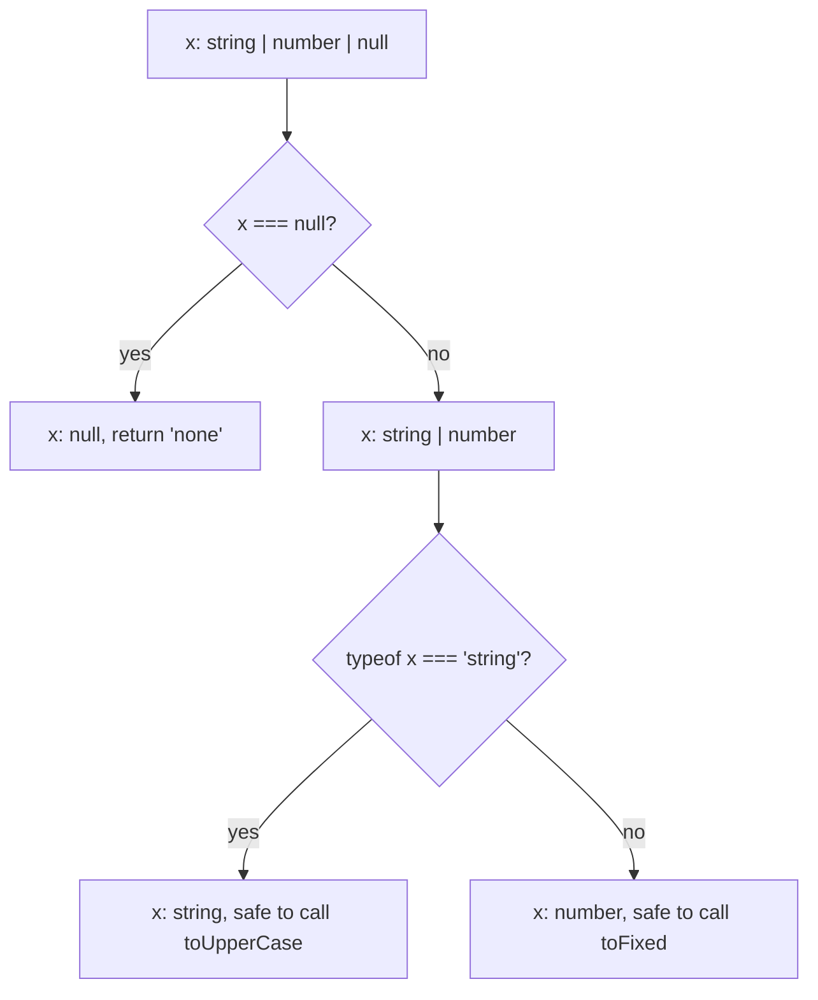

# 3 — Unions and Narrowing

> A union says "one of these". Narrowing is how you find out which one. Discriminated unions with an exhaustive `switch` are TypeScript's most useful pattern.

---

## Unions

```ts
type ID = number | string;

function show(id: ID): string {
  return id.toUpperCase();   // error: toUpperCase doesn't exist on number
}
```

On a union you can use only what **every** member has. To use more, narrow it first.

## Narrowing

The checker follows your control flow and narrows the type inside each branch:

| Check | Narrows | Example |
|---|---|---|
| `typeof x === 'string'` | Primitives | `if (typeof id === 'string') id.toUpperCase()` |
| `x instanceof Date` | Class instances | `catch (e) { if (e instanceof Error) e.message }` |
| `'role' in x` | Object shapes, by property | `if ('role' in person) person.role` |
| `x === null`, `x == null`, `if (x)` | Nullability | `if (!user) return;` then `user` is non-null |
| `x.kind === 'circle'` | Discriminated unions | see below |
| `Array.isArray(x)` | Arrays | |

Follow one value through a function. Each branch removes members of the union, so what is left at the bottom is the only type it can be:

```ts
function label(x: string | number | null): string {
  if (x === null) return 'none';                     // x: null
  if (typeof x === 'string') return x.toUpperCase(); // x: string
  return x.toFixed(2);                               // x: number
}

console.log(label(null), label('ada'), label(3));    // none ADA 3.00
```



Narrowing also happens after an early `return` or `throw`. Guard clauses at the top of a function are the idiomatic way to do it.

## Discriminated unions

Give each member a literal `type` (or `kind`) field. Checking that field narrows to the matching member:

```ts
type Shape =
  | { kind: 'circle'; radius: number }
  | { kind: 'rect'; width: number; height: number };

function area(s: Shape): number {
  switch (s.kind) {
    case 'circle':
      return Math.PI * s.radius ** 2;       // s is the circle member here
    case 'rect':
      return s.width * s.height;
    default: {
      const unreachable: never = s;          // compile error if you add a member and forget a case
      throw new Error(`unhandled: ${JSON.stringify(unreachable)}`);
    }
  }
}
```

This is how you model API responses (`{ ok: true; data } | { ok: false; error }`), Redux-style actions and LLM content blocks (`block.type === 'text'`, [note 09](09-typescript-for-ai-apps.md)). It plays the role of Python's tagged unions with `match`.

## Type predicates

Write a function that returns `x is T` to package a check so you can reuse it:

```ts
function isAdmin(p: Person): p is Admin {
  return p.type === 'admin';
}
const admins = people.filter(isAdmin);    // Admin[], not Person[]
```

The predicate is a promise *you* make, and the checker trusts it without verifying. Since TS 5.5, simple arrow functions like `(p) => p.type === 'admin'` are inferred as predicates automatically. That is why vendored exercise 04 already passes on TS 7 (see `practice/typescript-exercises/NOTICE.md`).

## `unknown` at the boundaries

```ts
function parse(json: string): unknown {
  return JSON.parse(json);
}
const v = parse(input);
if (typeof v === 'object' && v !== null && 'name' in v && typeof v.name === 'string') {
  v.name;   // string
}
```

Narrowing `unknown` by hand gets painful quickly. That is the job of a schema library ([note 08](08-runtime-validation-zod.md)).

---

## Exercises

[`practice/typescript-exercises/02`](../practice/typescript-exercises/02/index.ts), [`03`](../practice/typescript-exercises/03/index.ts) and [`04`](../practice/typescript-exercises/04/index.ts): unions of `User | Admin`, narrowing with `in`, and type predicates. From `practice/`, check each with `node check.ts exercises/02/` (and so on).
